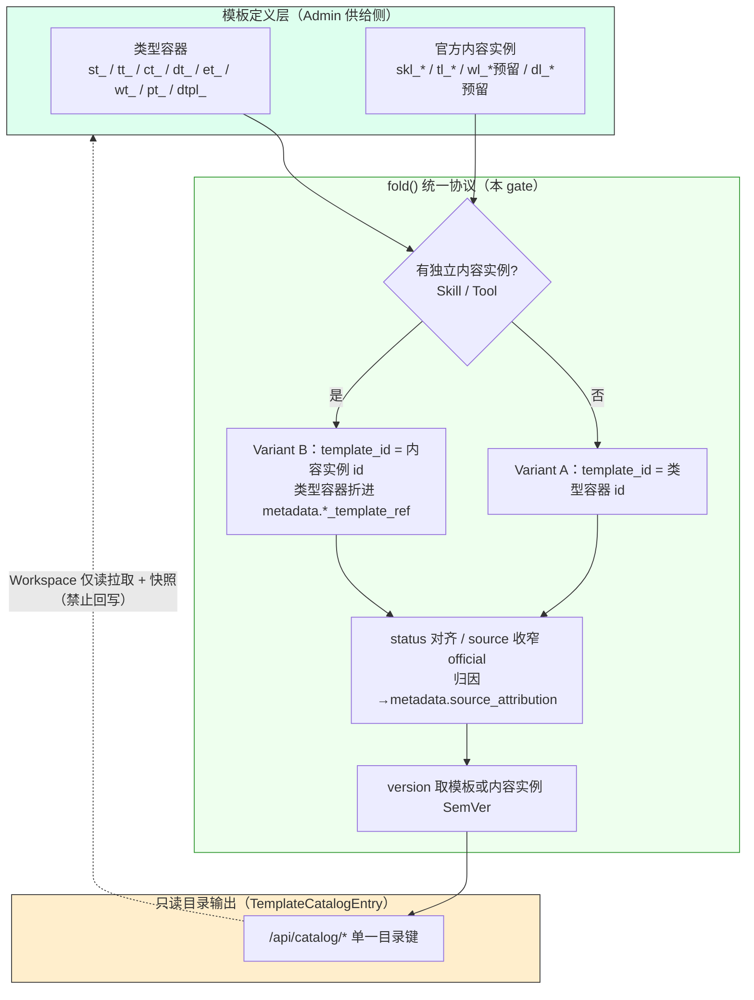

# Gate B 目录折叠统一设计（Directory Folding Unification · design-only）

> **作者**：高见远（架构师，software-architect）
> **主理人**：齐活林（交付总监）
> **阶段**：Phase-1B 模板目录折叠统一协议（Gate B · 纯文档 design-only reservation），零代码、零后端改动、零实例化、零 UI
> **定位**：本设计为横切协议层，把 Task 1（Persona System）、Task 2（Tool Catalog 官方内容库）、既有 Skill 官方库、Dashboard 契约、Company Package 契约中分散的"目录折叠"需求统一成一份协议。它**不 patch 任何既有契约**，仅给出建议变更清单供主理人裁定。
> **硬律**：① design-only 禁止 patch 既有契约；② 不引入新资产类型（故不触 L2 #7）；③ Admin/Workspace 边界不变（故不触 L2 #6）；④ 与 `Curis Workspace` 严格隔离；⑤ 不自行 git commit。

---

## 0. 文档定位与引用

- 本设计是 **Gate B（目录折叠）统一协议**：定义在 Admin 对外只读目录中，如何把"模板类型容器 + 官方内容实例"折叠成单一 `TemplateCatalogEntry` 行。
- 它吸收并统一了以下既有/规划中的契约的折叠语义：
  - `template-catalog-runtime-contract.md`（6 类 `TemplateCatalogEntry` 输出协议）
  - `official-skill-catalog-contract.md`（§4.2：`skl_*` 折叠进 `SkillTemplateEntry`，`template_id = skl_*`）
  - `tool-catalog-official-plan.md`（Task 2：`tl_*` 折叠进 `ToolTemplateEntry`，`template_id = tl_*`）
  - `employee-persona-system-plan.md`（Task 1：`pt_` PersonaTemplate 类型）
  - `dashboard-template-admin-contract.md`（`dtpl_` 第 7 类模板，`DashboardTemplateEntry`）
  - `company-package-contract.md`（`ccp_` 公司包，非 TemplateBase 子类，走商业目录）
- **两条铁律与数据流单向性**沿用 `admin-workspace-template-boundary.md`：Admin→Workspace 只读输出；Workspace 实例自管；禁止反向写官方目录。

---

## 1. 问题陈述（Problem Statement）

Phase-1 多份设计文档各自定义了"目录折叠"，但规则不一致、命名空间未对齐，存在三类问题：

1. **fold 语义分裂**：Skill 用 `template_id = skl_*`（内容实例 id 作为目录主键，类型容器 `st_*` 折进 `metadata.skill_template_ref`）；而 Company/Department/Employee/Workflow/Dashboard 用 `template_id = 类型容器 id`（`ct_*`/`dt_*`/`et_*`/`wt_*`/`dtpl_*`）。Tool（Task 2）沿用 Skill 模式用 `tl_*`。
2. **前缀命名空间冲突/歧义**：任务派发中"预留 `wt_/wl_*`、`dt_/dl_*`、`cpt_/cpl_*`、`cmcf_*`、`et_*`、`pt_*`"与既有契约实际分配存在偏差（详见 §3.4 核对），易在后续 gate 造成 ID 碰撞。
3. **受控分类法未对齐**：Tool 的 15 个域（Task 2）与 Skill 的 35 个类目（`official-skill-catalog-contract.md` §2）彼此独立，缺少映射与缺口标注，导致"技能→工具"组合无法在目录层校验。

**目标**：把上述折叠统一成"单一 `TemplateCatalogEntry` + `fold()` 规则集 + 类型覆盖矩阵 + 受控分类法对齐"的横切协议，使后续 Gate B 登记、Gate D 作者端点、Gate E/F 实例化都能复用同一套规则。

---

## 2. 统一折叠模型（Unified Folding Model）

### 2.1 三种 ID 角色区分

| 角色 | 含义 | 命名空间示例 | 在 fold 中的位置 |
|------|------|--------------|------------------|
| **类型容器前缀（Type-Container）** | 模板*类型定义*（TemplateBase 子类），回答"这是什么种类" | `st_`(SkillTemplate) / `tt_`(ToolTemplate) / `ct_` / `dt_` / `et_` / `wt_` / `pt_` / `dtpl_` | 类型仅容器型：直接作为 `template_id`；类型+内容型：折进 `metadata.*_template_ref` |
| **内容实例前缀（Content-Instance）** | 某类型下的*一个官方具体内容*（Admin 资产库稳定键） | `skl_*`(Skill 内容) / `tl_*`(Tool 内容) / `wl_*`(Workflow 内容, 预留) / `dl_*`(Dashboard 内容, 预留) | 类型+内容型：作为 `template_id`（目录主键）；类型仅容器型：无独立前缀 |
| **目录折叠单行（Catalog Entry）** | 对外只读输出的 `TemplateCatalogEntry`（fold 结果） | 统一 7 字段，单主键 | fold() 的输出产物 |

> 关键不变量：**一个 `TemplateCatalogEntry` 行 = 一个可被 Workspace 引用的稳定目录键**。`template_id` 要么是类型容器 id（Variant A），要么是内容实例 id（Variant B），二者互斥，由"该类型是否有独立内容实例"决定。

### 2.2 `TemplateCatalogEntry` 统一形状（7 字段，沿用既有）

```json
{
  "template_id": "string  // 见 2.1：Variant A=类型容器id; Variant B=内容实例id",
  "version":     "string  // SemVer; Variant A=模板TemplateBase.version; Variant B=内容实例version",
  "name":        "string  // 展示名",
  "description": "string  // 默认空串",
  "source":      "enum    // 收窄为 official | marketplace（不出现 tenant_private）",
  "status":      "enum    // draft | active | disabled | archived",
  "metadata":    "object  // 类型专属摘要 + 归因 + 折叠回指"
}
```

### 2.3 `fold()` 规则集（伪代码 + 变体）

```
fold(template_def, official_contents?) -> TemplateCatalogEntry:

  # —— 版本折叠 ——
  if official_contents is present (Variant B: Skill/Tool):
      # 每个内容实例各自独立 SemVer；目录逐条展开
      for c in official_contents:
          entry.template_id = c.content_instance_id        # skl_* / tl_*
          entry.version     = c.version                    # 内容实例自身 SemVer
          entry.metadata.<type>_template_ref = template_def.type_container_id  # st_* / tt_*
  else (Variant A: 类型仅容器):
      entry.template_id = template_def.type_container_id   # ct_* / dt_* / et_* / wt_* / pt_* / dtpl_*
      entry.version     = template_def.version             # TemplateBase.version

  # —— status 折叠 ——
  entry.status = template_def.status                       # 直接对齐 draft/active/disabled/archived
  # deprecated 折叠：status in {disabled, archived} 视为"不活跃"；
  # 目录默认隐藏 archived，除非调用方显式 ?include=archived

  # —— source 折叠（两层 source 必须区分！）——
  entry.source = "official"                                # 目录输出层收窄枚举（official/marketplace）
  # 内容归因（6 值生态枚举 MetaGPT/ChatDev/CrewAI/AutoGen/industry SOP/Curis internal）
  #   仅 Skill/Tool 内容有，存入 metadata.source_attribution（绝不写入 entry.source）
  entry.metadata.source_attribution = template_def.content_attribution  # 可选，仅 Variant B

  # —— 类型专属 metadata 摘要 ——
  entry.metadata.<type_specific_summary> = template_def.summary_projection()
  return entry
```

**两个 `source` 概念的硬性区分**（防坑）：
- `TemplateCatalogEntry.source` ∈ {official, marketplace}：**目录输出层**枚举（谁拥有写权）。
- `metadata.source_attribution` ∈ {6 值生态}：**内容来源归因**（MetaGPT SOP 等），仅 Skill/Tool 内容存在。
- 二者不得混用：`skl_*` 的 `entry.source` 恒为 `official`，其真实生态来源读 `metadata.source_attribution`。

### 2.4 折叠变体总览

| 变体 | 适用类型 | `template_id` 来源 | 类型容器去向 | 典型例子 |
|------|----------|--------------------|--------------|----------|
| **A（类型仅容器）** | Company/Department/Employee/Workflow/Persona/Dashboard | 类型容器 id | 即为主键 | `ct_*`、`dt_*`、`et_*`、`wt_*`、`pt_*`、`dtpl_*` |
| **B（类型+内容）** | Skill/Tool | 内容实例 id | 折进 `metadata.skill_template_ref` / `metadata.tool_template_ref` | `skl_*`、`tl_*` |
| **C（聚合包，出目录）** | Company Package | 非 TemplateCatalogEntry（走商业目录） | — | `ccp_*` |
| **D（商业配置，出目录）** | Commercial Config | 非 TemplateCatalogEntry（商业域对象） | — | `cmcf_*` 家族 |

---

## 3. 类型覆盖矩阵（10 类资产映射）

> 10 类资产 = Company / Department / Employee / Persona / Skill / Tool / Workflow / Company Package / Dashboard / Commercial Config。
> "现状"列用 **已分配**（契约已用）/ **已规划**（设计文档已定义）/ **预留**（本 gate 建议预留命名空间）。

| # | 资产类型 | 类型容器前缀 | 内容实例前缀 | Catalog Entry 形状 | 折叠变体 | 现状 | 归属 Gate |
|---|----------|--------------|--------------|--------------------|----------|------|-----------|
| 1 | Company | `ct_` | （无；CompanyInstance 无独立前缀） | CompanyTemplateEntry `ct_` | A | 已分配（company-template-contract，Phase-4 reserved） | A/B |
| 2 | Department | `dt_` | （无；DepartmentInstance 无独立前缀） | DepartmentTemplateEntry `dt_` | A | 已分配 | A/B |
| 3 | Employee | `et_` | （无；EmployeeInstance 无独立前缀） | EmployeeTemplateEntry `et_` | A | 已分配 | A/B |
| 4 | Persona | `pt_` | （无；经 EmployeeTemplate.persona_ref 引用） | PersonaTemplateEntry `pt_` | A | 已规划（Task 1，新资产类型） | A/B（L2 #7 前置授权） |
| 5 | Skill | `st_` | `skl_*` | SkillTemplateEntry；`template_id = skl_*` | B | 已吸收（official-skill-catalog-contract） | B（本 gate） |
| 6 | Tool | `tt_` | `tl_*` | ToolTemplateEntry；`template_id = tl_*` | B | 已吸收（Task 2） | B（本 gate） |
| 7 | Workflow | `wt_` | `wl_*`(预留) / 步骤 `ws_` | WorkflowTemplateEntry `wt_` | A + step 变体 | 已分配 `wt_`；`wl_*` 预留 | B |
| 8 | Company Package | `ccp_`(主) / `cp_`(CapabilityPackage) / `sp_` / `tp_` | （包实例，走商业目录） | 非 TemplateCatalogEntry（独立商业目录） | C | 已规划（company-package-contract `ccp_`） | C |
| 9 | Dashboard | `dtpl_` | `dl_*`(预留，DashboardInstance) | DashboardTemplateEntry `dtpl_` | A | 已规划（dashboard-template-admin-contract `dtpl_`，第 7 类） | B 登记 → C/D/E/F |
| 10 | Commercial Config | `cmcf_*`(家族预留) | — | 非 TemplateCatalogEntry（商业域对象） | D | 预留（`cmcf_*`） | 商业域 gate |

### 3.1 兼容吸收 `st_/skl_*` 与 `tt_/tl_*`

- **Skill**：`st_*`(SkillTemplate 类型容器) 1:N 关联 `skl_*`(官方内容实例)。fold → 每条 `skl_*` 产出一个 `TemplateCatalogEntry`，`template_id = skl_*`，`metadata.skill_template_ref = st_{skill_name}`，`entry.source = official`，`metadata.source_attribution = 6 值之一`。✅ 与 `official-skill-catalog-contract.md` §4.2 一致。
- **Tool**：`tt_*`(ToolTemplate 类型容器) 1:N 关联 `tl_*`(官方内容实例，Task 2 共 46 条)。fold 规则同 Skill：`template_id = tl_*`，`metadata.tool_template_ref = tt_{tool_name}`。✅ 与 `tool-catalog-official-plan.md` 一致。
- 吸收后，`template-catalog-runtime-contract.md` 的 `template_id` 正则必须扩展（见 §3.5 建议变更）。

### 3.2 Variant A 类型的 `metadata` 摘要形态（统一约定）

| 类型 | `metadata` 关键字段 |
|------|----------------------|
| Company | `slug`, `departments[](dt_*)`, `employees[](et_*)`, `workflows[](wt_*)`, `capability_packages[](cp_*)`, `default_goals[]` |
| Department | `slug`, `department_type`, `employee_template_refs[](et_*)`, `workflow_template_refs[](wt_*)` |
| Employee | `slug`, `role`, `persona`(文本或 `pt_*`), `default_skill(st_*)`, `default_tool(tt_*)`, `default_capability_types[]` |
| Persona | `slug`, `archetype`, `communication_style`, `reporting_style`, `decision_style` |
| Workflow | `slug`, `department_type`, `process_type`, `step_templates[](ws_*)` |
| Dashboard | `company_type`, `role_type`, `widget_ids[]`, `layout_summary`, `commercial_slot_ref` |

### 3.3 Workflow 步骤前缀说明

`workflow-template-contract.md` 定义步骤为 `ws_*`（`WorkflowStepTemplate`）。步骤不单独进目录，仅在 Workflow 的 `metadata.step_templates` 中以 `ws_*` 数组引用。Workflow 的内容实例（若未来需要逐公司 SOP 变体）用预留 `wl_*`，本 gate 仅登记命名空间，不强制实例化。

### 3.4 命名核对与修订（与任务派发"预留"清单比对）

任务派发要求"预留 `wt_/wl_*`、`dt_/dl_*`、`cpt_/cpl_*`、`cmcf_*`、`et_*`、`pt_*`"。经核对既有契约，**需修订如下**：

| 派发预留项 | 实际契约现状 | 修订结论 |
|------------|--------------|----------|
| `wt_/wl_*` | `wt_` **已分配**（WorkflowTemplate，template-catalog-runtime-contract）；`wl_*` 确为内容实例预留 | `wt_` 改为"已分配"；`wl_*` 保留预留 ✅ |
| `dt_/dl_*` | `dt_` **已分配**（DepartmentTemplate）；Dashboard 类型实为 `dtpl_`，非 `dt_`。`dl_*` 应预留给 **DashboardInstance** | `dt_` 改为"已分配"；`dl_*` 重新指派给 Dashboard 内容实例（Department 无内容前缀） |
| `cpt_/cpl_*` | Company Package 契约实际用 **`ccp_`**（company-package-contract R6），CapabilityPackage 用 `cp_`，子包 `sp_`/`tp_` | 弃用 `cpt_/cpl_*`，统一为 `ccp_`/`cp_`/`sp_`/`tp_` |
| `cmcf_*` | 商业配置域无强制前缀；`cmcf_*` 作为家族预留合理，但其对象**不进 TemplateCatalogEntry** | 保留 `cmcf_*` 命名空间预留，标注"出目录（变体 D）" |
| `et_*` | `et_` **已分配**（EmployeeTemplate） | 改为"已分配"；Employee 内容实例 = EmployeeInstance（无独立前缀） |
| `pt_*` | `pt_` 为 Task 1 新资产类型前缀 | 保留预留/已规划 ✅ |

> **结论**：命名空间真正"待预留"的仅有 `wl_*`(Workflow 内容)、`dl_*`(Dashboard 内容)、`cmcf_*`(商业家族)；`ccp_` 由 Company Package 契约已规划；其余 `wt_/dt_/et_` 均已在用。本 gate 不再新占前缀，避免碰撞。

### 3.5 建议变更清单（design-only，不执行 patch）

下列为本 gate 落地时应由主理人裁定并 patch 的建议，**本设计不修改任何文件**：

1. **`template-catalog-runtime-contract.md` §1**：
   - `template_id` 正则由 `^ct_|dt_|et_|wt_|st_|tt_[a-z0-9_-]+$` 扩展为 `^ct_|dt_|et_|wt_|st_|tt_|pt_|dtpl_[a-z0-9_-]+$`（登记 `pt_` 与 `dtpl_`）。
   - 新增 §3.7 `PersonaTemplateEntry`（`pt_*`）与 §3.8 明确 `skl_*`/`tl_*` 作为 `template_id` 的目录形态（当前 §3.5/§3.6 仅以 `st_*`/`tt_*` 为 pattern，需补充内容实例 id 说明）。
   - "6 类"改为"8 类"（增补 Persona + Dashboard）。
2. **`ai-company-template-system.md` §2**：
   - 增补 PersonaTemplate（`pt_`，第 8 个 TemplateBase 子类）与 DashboardTemplate（`dtpl_`，已在 dashboard 契约定义）的目录登记。
3. **`template-versioning-policy.md` §5**：
   - 快照枚举 `company/department/employee/workflow/skill/tool` 增补 `persona`/`dashboard`（与 Task 1 / Dashboard 契约对齐）。
4. **Company Package**：将 `company-package-contract.md` R6 的 `ccp_` 决议固化（弃用 `cpt_/cpl_*` 命名）。

---

## 4. 受控分类法对齐（Controlled Taxonomy Alignment）

### 4.1 Skill 35 类目（来自 `official-skill-catalog-contract.md` §2）

- **Pack A · ai_rd（7 类）**：`product`, `architecture`, `development`, `testing`, `devops`, `data`, `security`
- **Pack B · ai_content（15 类）**：`content_analysis`, `topic`, `content_planning`, `script`, `video`, `design`, `distribution`, `data_analysis`, `operations`, `copywriting`, `brand`, `seo`, `livestream`, `audit`, `promotion`
- **Pack C · ai_commercial（13 类）**：`market`, `user_research`, `sales`, `business_plan`, `finance`, `pricing`, `channel`, `customer_success`, `growth`, `fundraising`, `competition`, `commercial_ops`, `commercial_brand`
- **合计 = 7 + 15 + 13 = 35 类** ✅

### 4.2 Tool 15 域（来自 Task 2 `tool-catalog-official-plan.md`）

`code_execution`, `file_io`, `api_integration`, `database`, `vector_search`, `data_processing`, `document`, `web_search`, `web_browser`, `media_generation`, `deployment`, `observability`, `communication`, `scheduler`, `secret`

### 4.3 Skill 类目 → Tool 域 映射（目录层可校验组合）

| Skill 类目（示例） | 关联 Tool 域 | 说明 |
|---------------------|--------------|------|
| `development` / `testing` / `data` | `code_execution`, `file_io`, `database`, `vector_search` | 研发执行核心 |
| `architecture` / `devops` | `deployment`, `observability`, `api_integration` | 部署与可观测 |
| `security` | `secret`, `api_integration` | 凭据与鉴权 |
| `data_analysis` / `data`(rd) | `database`, `vector_search`, `data_processing` | 数据分析 |
| `content_analysis` / `topic` / `research` | `web_search`, `web_browser` | 研究与检索 |
| `script` / `copywriting` / `content_planning` | `document`, `file_io` | 文档生成 |
| `video` / `design` / `thumbnail` | `media_generation` | 多媒体生成 |
| `distribution` / `multi_platform` / `email` | `api_integration`, `communication` | 分发与触达 |
| `operations` / `content_calendar` | `scheduler`, `communication` | 运营调度 |
| `customer_success` / `community` | `communication` | 客户互动 |
| `market` / `competition` / `channel` | `web_search`, `api_integration` | 商业情报 |
| `finance` / `pricing` / `business_plan` | `data_processing`, `file_io` | 商业分析 |

### 4.4 缺口标注（Gaps）

| 缺口 | 说明 | 处置 |
|------|------|------|
| `secret` 域无专属 Skill 类目 | `secret` 为跨领域凭据能力，被 `security` 间接引用 | 不新增类目；`security` 类目 `recommended_tools` 可含 `secret` 域工具 |
| `scheduler` 域仅 `operations`/`content_calendar` 弱关联 | 调度为运营支撑，无独立职能域 | 保留为 Tool 域，Skill 侧不强制映射 |
| `observability` 域缺 Skill 对应 | 监控归 `devops`，但 observability 更细 | 在 `devops` 类目下补充 observability 工具推荐 |
| 内容类目缺少 `media_generation` 强映射外的视频后处理 | `video` 已映射，但 `editing_guidance` 偏流程 | 维持 `media_generation` 单一映射 |

> 分类法对齐为**单向引用**（Skill 类目 → Tool 域），不双向强制；组合校验在 Gate D 作者端点落地时执行（本 gate 仅定义映射）。

---

## 5. Out-of-Scope / 后续 Gate（Out-of-Scope & Downstream Gates）

**本 Gate B 范围（做）**：
- 定义统一 `fold()` 协议与类型覆盖矩阵（§2/§3）。
- 登记命名空间（`pt_`, `dtpl_`, `wl_`, `dl_`, `ccp_`, `cmcf_*`）并修订冲突（§3.4/§3.5）。
- 受控分类法映射（§4）。

**Out-of-Scope（不做）**：
- ❌ 不实例化任何 EmployeeInstance / DepartmentInstance / Company / DashboardInstance。
- ❌ 不开发作者端点（Gate D）、不写后端、不建表、不加路由。
- ❌ 不修改 Workspace 执行链 / Credential Vault / Employee Runtime / Usage Event。
- ❌ 不开发 Billing / Marketplace / UI。
- ❌ Company Package 与 Commercial Config 的目录折叠（变体 C/D）仅登记命名空间，真实聚合归 Gate C 与商业域 gate。
- ❌ Widget Catalog 去重（Dashboard `token_cost`/`tech_risk` 等与 `ceo-dashboard-contract.md` 统一）归 Gate C。

**后续 Gate 路径（沿用 A→F）**：

```
A(目录总契约) → B(本 gate：折叠统一协议) → C(Company Package 聚合 + Widget Catalog 去重)
             → D(Skill/Tool/Dashboard/Persona 作者端点) → E(Employee Template 默认注入)
             → F(Workspace 实例绑定 + 快照隔离)
```

- **Gate C**：Company Package（`ccp_*`）聚合打包；Dashboard Widget Catalog 单一真相源去重。
- **Gate D**：Admin 写端点（`/api/platform/*`）+ 只读 `/api/catalog/*`；将 design-only 契约转可落地端点。
- **Gate E**：`default_skills` / `persona_ref` / `default_tool` 注入 EmployeeTemplate。
- **Gate F**：Workspace 实例化 + `template_version_snapshot`（follow_latest 默认 false）。

---

## 6. L2 Gate 评估 NOTE

| L2 Gate | 是否触发 | 判定 |
|---------|----------|------|
| **#7 新核心资产类型需升级** | **否** | 本 gate 是"目录折叠统一协议"，**不引入任何新资产类型**。它仅统一既有/已规划类型的 fold 规则（`st_/skl_*`、`tt_/tl_*`、`pt_`（Task 1 已授权）、`dtpl_`（Dashboard 契约已定义）、`ccp_`（Company Package 契约已定义））。Persona（`pt_`）与 Dashboard（`dtpl_`）虽为新资产类型，但其新增已在各自前置 gate（Task 1 / Dashboard 契约）单独评审，本 gate 仅折叠登记，不扩资产类型集合。 |
| **#6 Admin/Workspace 边界变更需评审** | **否** | 本 gate 严格沿用 `admin-workspace-template-boundary.md` 两条铁律与数据流单向性：目录输出仍 `source` 收窄为 official/marketplace，仅读、不实例化、不回写；未新增任何 Admin→Workspace 或 Workspace→Admin 的写路径。 |

> **NOTE 结论**：#7 = 否，#6 = 否。本 gate 不改变资产类型集合与边界，仅做横切折叠统一，故不入 L2 升级评审流程。

---

## 7. Gate 结论（Gate Verdict）

> **Gate B 结论：✅ PASS-WITH-NOTES**

**理由**：
- 统一折叠模型（`fold()` + 3 种 ID 角色 + 4 变体）完整闭合，兼容吸收 `st_/skl_*` 与 `tt_/tl_*`，覆盖 10 类资产，命名冲突已核对修订（§3.4）。
- 受控分类法对齐 35 Skill 类目 ↔ 15 Tool 域，标注缺口（§4）。
- 严守 design-only：零代码、零实例化、零 UI、零 Billing，Admin/Workspace 边界不变，不触 L2 #7/#6。
- 所有契约变更以"建议清单"形式给出（§3.5），本设计未 patch 任何文件。

**Notes（须在后续 gate 处理）**：
1. `template-catalog-runtime-contract.md` 正则扩展与"6→8 类"增补（建议变更 1）。
2. `ai-company-template-system.md` 登记 `pt_`/`dtpl_`（建议变更 2）。
3. `template-versioning-policy.md` 快照枚举增补 `persona`/`dashboard`（建议变更 3）。
4. Company Package 命名固化 `ccp_`（建议变更 4）。
5. Widget Catalog 去重、Company Package 聚合归 Gate C。

---

## 8. Mermaid 图

### 8.1 统一折叠模型类图（含类型容器 vs 内容实例 vs 目录单行）

```mermaid
classDiagram
    class TemplateBase {
        +string version
        +enum status
        +enum source
        +string description
    }
    class TemplateCatalogEntry {
        +string template_id
        +string version
        +string name
        +string description
        +enum source
        +enum status
        +object metadata
    }
    class TypeContainer {
        <<角色：模板类型定义>>
        +string type_container_id
    }
    class ContentInstance {
        <<角色：官方内容实例>>
        +string content_instance_id
    }
    class SkillTemplate {
        +string skill_template_id  %% st_*
    }
    class OfficialSkillContent {
        +string skill_id  %% skl_*
        +enum source_attribution
    }
    class ToolTemplate {
        +string tool_template_id  %% tt_*
    }
    class OfficialToolContent {
        +string tool_id  %% tl_*
        +enum source_attribution
    }
    class CompanyTemplate { +string id %% ct_* }
    class DepartmentTemplate { +string id %% dt_* }
    class EmployeeTemplate { +string id %% et_* }
    class PersonaTemplate { +string persona_id %% pt_* }
    class WorkflowTemplate { +string id %% wt_* }
    class DashboardTemplate { +string dashboard_template_id %% dtpl_* }

    TemplateBase <|-- TypeContainer
    TemplateBase <|-- ContentInstance
    TemplateBase <|-- TemplateCatalogEntry

    TypeContainer <|-- SkillTemplate
    TypeContainer <|-- ToolTemplate
    TypeContainer <|-- CompanyTemplate
    TypeContainer <|-- DepartmentTemplate
    TypeContainer <|-- EmployeeTemplate
    TypeContainer <|-- PersonaTemplate
    TypeContainer <|-- WorkflowTemplate
    TypeContainer <|-- DashboardTemplate

    ContentInstance <|-- OfficialSkillContent
    ContentInstance <|-- OfficialToolContent

    SkillTemplate "1" o-- "1..*" OfficialSkillContent : Variant B 折叠
    ToolTemplate "1" o-- "1..*" OfficialToolContent : Variant B 折叠

    OfficialSkillContent ..> TemplateCatalogEntry : fold()  template_id=skl_*
    OfficialToolContent ..> TemplateCatalogEntry : fold()  template_id=tl_*
    CompanyTemplate ..> TemplateCatalogEntry : fold()  template_id=ct_*
    DepartmentTemplate ..> TemplateCatalogEntry : fold()  template_id=dt_*
    EmployeeTemplate ..> TemplateCatalogEntry : fold()  template_id=et_*
    PersonaTemplate ..> TemplateCatalogEntry : fold()  template_id=pt_*
    WorkflowTemplate ..> TemplateCatalogEntry : fold()  template_id=wt_*
    DashboardTemplate ..> TemplateCatalogEntry : fold()  template_id=dtpl_*

    note for TemplateCatalogEntry "7 字段统一形状；source 收窄 official/marketplace；归因存 metadata.source_attribution"
    note for OfficialSkillContent "template_id = skl_*；metadata.skill_template_ref 回指 st_*"
    note for OfficialToolContent "template_id = tl_*；metadata.tool_template_ref 回指 tt_*"
```



### 8.2 折叠流程（fold 过程）



---

## 9. 验收映射

| # | 验收项 | 落点 |
|---|--------|------|
| 1 | 问题陈述 | §1 |
| 2 | 统一折叠模型（3 种 ID 角色 + TemplateCatalogEntry + fold() + 变体） | §2 |
| 3 | 类型覆盖矩阵（10 类资产映射） | §3.1 |
| 4 | 兼容吸收 `st_/skl_*` 与 `tt_/tl_*` | §3.1 |
| 5 | 命名核对与修订（派发预留 vs 契约现状） | §3.4 |
| 6 | 建议变更清单（不 patch） | §3.5 |
| 7 | 受控分类法对齐（35 类 ↔ 15 域 + 缺口） | §4 |
| 8 | Out-of-scope / 后续 Gate | §5 |
| 9 | L2 NOTE（#7 否 / #6 否） | §6 |
| 10 | Gate 结论（PASS-WITH-NOTES） | §7 |
| 11 | Mermaid（类图 + 折叠流程） | §8 |

---

## 10. 自主建议：下一步缺口排序

基于本 gate 暴露的三处"仅登记命名空间、未填充内容"的缺口，建议主理人按以下优先级排期：

1. **P0 — Workflow 官方内容库（补全 `wl_*` 内容）**：Workflow 仅有 `wt_*` 类型容器与 `ws_*` 步骤，缺官方 SOP 内容实例（类比 Skill 的 `skl_*`）。当前 6 类模板中 Workflow 目录最空，建议仿 Task 2 建官方 Workflow 内容库（MetaGPT SOP / 行业 SOP 来源）。
2. **P1 — Company Package 内容填充（固化 `ccp_*`）**：`company-package-contract.md` 已定义结构但 `ccp_*` 实例为 design-only（R8 无实例化）。建议补首批官方公司包（如 `ccp_ai_software_company`）并落 `company_packages` 表 + 作者端点（Gate C/D）。
3. **P2 — Dashboard 独立规划收口（Widget Catalog 去重）**：Dashboard 契约已完整，但 `token_cost`/`tech_risk`/`content_output` 等与 `ceo-dashboard-contract.md` 运行时目录同域重复，需在 Gate C 确立 `DashboardWidgetCatalog` 单一真相源后再行实例化。

> 推荐顺序：P0（Workflow 内容）→ P1（Company Package 内容）→ P2（Dashboard 去重），与本 gate 的"先填内容、后聚合/实例化"原则一致。

*—— Gate B 目录折叠统一设计（纯设计/协议，零代码）。统一 fold() 协议 + 10 类资产覆盖矩阵 + 受控分类法对齐；design-only，不 patch 既有契约，不触 L2 #7/#6。*
