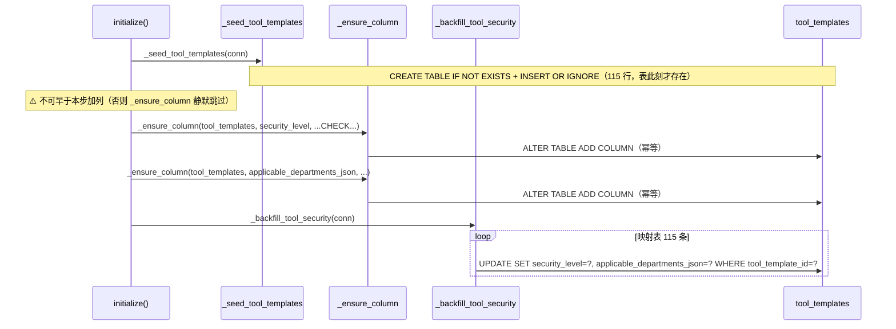

# P1-1 实现设计 · `tool_templates` 安全等级 / 适用部门入表

> 设计：高见远（软件架构师） ｜ 关联评审：`docs/plan/v2-p0p1-architect-review.md` §四/§六 P1-1
> 落点：`backend/app/database.py`（`initialize()` 挂载，纯 additive 扩展，向后兼容）
> 状态：设计文档（**不改代码**，工程师据此实现）

---

## 0. 目标与边界（一句话）

把 catalog 文档 `docs/research/domain/official-tool-catalog-v1.md` 中的「安全等级」「适用部门」两项治理字段，**从 markdown 落到 `tool_templates` 表**（`security_level` + `applicable_departments_json`），使 21 条高危工具（及全部 115 条）能在 DB 层被过滤、校验、驱动最小权限。

**不接真实凭证、不新建资产类、不碰 L2 暂停四项、零 UI 变更。**

---

## 1. Schema 扩展方案

### 1.1 两列定义

| 列 | 类型 / 约束 | 默认值 | 说明 |
|---|---|---|---|
| `security_level` | `TEXT NOT NULL CHECK(security_level IN ('high','medium','low'))` | `'low'` | 三级安全分级，错值写入直接被 SQLite 拒绝。 |
| `applicable_departments_json` | `TEXT NOT NULL` | `'[]'` | JSON 数组，元素为「规范部门中文名」字符串，如 `["研发部","运营部"]`。 |

> 校验过运行环境：**SQLite 3.53.1 ≥ 3.35**，`ALTER TABLE ADD COLUMN ... CHECK(...)` 受支持，可安全加约束列。

### 1.2 加列调用（复用现有 `_ensure_column`）

`_ensure_column(connection, table, column, definition)`（L1371）本身已幂等：先查 `sqlite_master` 确认表存在，再 `pragma table_info` 确认列不存在，才执行 `ALTER TABLE ADD COLUMN`。直接复用即可，**无需改动 `_ensure_column` 本身**。

调用语句（定义贴在本文 §4 的回填函数同文件）：

```python
# P1-1：tool_templates 安全治理字段（additive + 幂等）
self._ensure_column(
    connection, "tool_templates", "security_level",
    "text not null default 'low' check (security_level in ('high','medium','low'))",
)
self._ensure_column(
    connection, "tool_templates", "applicable_departments_json",
    "text not null default '[]'",
)
```

### 1.3 ⚠️ 插入点修正（关键）

> **brief 建议「在 L952 附近（skill_templates version/category 的 `_ensure_column` 调用区）增加调用」——此建议在全新 DB 上是失效的，必须纠正。**

原因（`database.py` 实测）：

- `_ensure_column` 第一行：`if row is None: return`（表不存在则直接跳过，不加列）。
- `tool_templates` 表是在 `self._seed_tool_templates(connection)`（**L1042**）内部用 `create table if not exists` 创建的。
- L952 区位于 L1042 **之前**；此时 `tool_templates` 表尚不存在 → `_ensure_column` 静默 return → **两列永远不会被加上**。

**正确插入点：紧接 L1042 `self._seed_tool_templates(connection)` 之后**（同属 V2 P0/P1 块），再调用回填函数：

```python
# V2 P0/P1（降级执行）：补齐 ai_rd 线 Skill/Tool/Workflow 真实内容 + Persona 形象。
self._seed_tool_templates(connection)          # L1042：此刻 tool_templates 表才存在
# ── P1-1 起点（必须在 _seed 之后）──
self._ensure_column(connection, "tool_templates", "security_level",
                    "text not null default 'low' check (security_level in ('high','medium','low'))")
self._ensure_column(connection, "tool_templates", "applicable_departments_json",
                    "text not null default '[]'")
self._backfill_tool_security(connection)        # 见 §4
# ── P1-1 结束 ──
self._seed_skill_templates_airnd(connection)
self._seed_workflow_template_containers(connection)
self._seed_persona_image_refs(connection)
```

> 注：brief 中函数名写作 `_seed_tool_templates_airnd`，**实际函数名为 `_seed_tool_templates`（L1725）**，工程师以实际名为准。

---

## 2. 值域与字典

### 2.1 `security_level` 三级定义

| 值 | 含义 | 运行时治理要求 |
|---|---|---|
| `high` | 高危：可写外部系统 / 持凭证 / 执行任意代码 / 容器或云基础设施控制 / 安全类工具 | 最小权限 + **凭证保管** + **沙箱**；建议审批流 |
| `medium` | 中危：需认证、网络出站或数据库读写，但非任意执行/非资金 | 需认证；限制作用域 |
| `low` | 低危：公开 / 只读 / 本地文档或分析 | 默认可用 |

> 21 条 catalog 标注高危工具（§七）全部对应 `high`，且 catalog 明示「均附最小权限 + 凭证保管 + 沙箱建议」。

### 2.2 部门字典（规范中文名）

从 catalog 实际出现的部门名归一得到**受控词表**。回填统一使用下列规范名；`applicable_departments_json` 不做外键约束，仅作治理过滤维度。

| 规范名 | 说明 / 来源 |
|---|---|
| 研发部 | catalog 高频（git/postgres/code 等） |
| 运维部 | docker / sentry / cubesandbox 等 |
| 测试部 | playwright |
| 数据部 | postgres / supabase / pandas / vector 等 |
| 产品部 | notion / officecli / pptx 等 |
| 设计部 | figma / canva / ideogram 等 |
| 市场部 | hubspot / midjourney / post_to_x 等 |
| 销售部 | hubspot |
| 客服部 | Pack B candidate（尚未入表） |
| 运营部 | slack / zapier / n8n 等 |
| 内容部 | Pack D / F-J 内容线 |
| 电商部 | Pack E |
| 财务部 | stripe / alipay / xlsx 等 |
| 法务部 | pdf / contract_review |
| 安全部 | strix |
| 管理层 | powerbi / tableau（Pack B candidate） |
| 会议 | qwen_asr |
| 全员 | **由「全员（通用）」归一**（唯一归一规则） |

**归一规则（回填前必做）**：catalog 中的 `全员（通用）` → `全员`；其余名称**原样保留**（保持与 catalog 真相源逐字可追溯）。

**保留未用（brief 建议词表，catalog 暂未出现，留作前向兼容）**：`技术部`、`商业部`、`HR部`。

---

## 3. 回填数据映射（`tool_template_id → security_level / departments`）

### 3.1 高危 21 条（catalog §七 标注，逐字来自 catalog 文档）

| # | tool_template_id | 来源包 | security_level | applicable_departments（归一后） |
|---|---|---|---|---|
| 1 | `tl_github` | A | high | 研发部 |
| 2 | `tl_gitlab` | A | high | 研发部 |
| 3 | `tl_postgres` | A | high | 研发部、数据部 |
| 4 | `tl_supabase` | A | high | 研发部、数据部 |
| 5 | `tl_slack` | A | high | 全员、运营部 |
| 6 | `tl_zapier` | A | high | 运营部、全员 |
| 7 | `tl_n8n` | A | high | 运营部、研发部 |
| 8 | `tl_pipedream` | A | high | 运营部、研发部 |
| 9 | `tl_strix` | C | high | 安全部、研发部 |
| 10 | `tl_activepieces` | C | high | 运营部、研发部 |
| 11 | `tl_make` | C | high | 运营部 |
| 12 | `tl_shopify` | E | high | 电商部、运营部 |
| 13 | `tl_stripe` | E | high | 财务部、电商部 |
| 14 | `tl_paypal` | E | high | 财务部、电商部 |
| 15 | `tl_alipay` | E | high | 财务部、电商部 |
| 16 | `tl_taobao_open` | E | high | 电商部、运营部 |
| 17 | `tl_jd_jos` | E | high | 电商部、运营部 |
| 18 | `tl_pinduoduo` | E | high | 电商部、运营部 |
| 19 | `tl_douyin_ecom` | E | high | 电商部、内容部 |
| 20 | `tl_woocommerce` | E | high | 电商部、运营部 |
| 21 | `tl_youzan` | E | high | 电商部、运营部 |

### 3.2 ai_rd 内部 30 条（catalog 未收录，架构师按 `tool_type` / 能力推断，建议值）

> 评审报告 §2.3(a) 指明：30 条 `tl_ai_rd_*` 在 DB 但不在 catalog。其安全等级无 markdown 真相源，下表为**架构师建议值**，供工程师回填；若后续 catalog 补录内部执行器，以 catalog 为准覆盖。

| tool_template_id | security_level | applicable_departments | 推断依据 |
|---|---|---|---|
| `tl_ai_rd_code_executor` | high | 研发部 | 任意代码执行（沙箱） |
| `tl_ai_rd_python_repl` | high | 研发部 | 任意代码执行 |
| `tl_ai_rd_shell_terminal` | high | 研发部、运维部 | shell 命令执行 |
| `tl_ai_rd_docker_run` | high | 研发部、运维部 | 容器生命周期 |
| `tl_ai_rd_kubernetes_ctl` | high | 研发部、运维部 | K8s 资源控制 |
| `tl_ai_rd_ci_runner` | high | 研发部、运维部 | CI 流水线触发 |
| `tl_ai_rd_cloud_deploy` | high | 研发部、运维部 | 云部署 |
| `tl_ai_rd_secret_resolver` | high | 安全部、研发部 | 密钥解析/注入 |
| `tl_ai_rd_git_client` | medium | 研发部 | 版本操作（出站） |
| `tl_ai_rd_github_api` | medium | 研发部 | API 出站 |
| `tl_ai_rd_http_client` | medium | 研发部、全员 | 通用 HTTP 出站 |
| `tl_ai_rd_graphql_client` | medium | 研发部 | API 出站 |
| `tl_ai_rd_postgres_connector` | medium | 研发部、数据部 | 数据库读 |
| `tl_ai_rd_sql_query_executor` | medium | 研发部、数据部 | SQL 执行 |
| `tl_ai_rd_vector_db_query` | medium | 研发部、数据部 | 向量检索 |
| `tl_ai_rd_vector_db_upsert` | medium | 研发部、数据部 | 向量写入 |
| `tl_ai_rd_log_aggregator` | medium | 研发部、运维部 | 日志采集 |
| `tl_ai_rd_metric_monitor` | medium | 研发部、运维部 | 指标采集 |
| `tl_ai_rd_alert_sender` | medium | 研发部、运维部 | 告警发送 |
| `tl_ai_rd_file_reader` | low | 研发部 | 本地只读 |
| `tl_ai_rd_file_writer` | low | 研发部 | 本地写 |
| `tl_ai_rd_directory_search` | low | 研发部 | 本地检索 |
| `tl_ai_rd_code_linter` | low | 研发部 | 静态检查 |
| `tl_ai_rd_test_runner` | low | 研发部 | 测试运行 |
| `tl_ai_rd_code_docs_search` | low | 研发部 | 本地检索 |
| `tl_ai_rd_csv_parser` | low | 研发部、数据部 | 本地解析 |
| `tl_ai_rd_pandas_analyzer` | low | 研发部、数据部 | 本地分析 |
| `tl_ai_rd_chart_plotter` | low | 研发部、数据部 | 本地绘图 |
| `tl_ai_rd_pdf_parser` | low | 研发部、全员 | 本地解析 |
| `tl_ai_rd_docx_generator` | low | 研发部、全员 | 本地生成 |

### 3.3 其余 64 条外部非高危（来自 catalog，按包归类）

**Pack A 非高危（8）**：`tl_docker`(中,研发部、运维部) · `tl_playwright`(中,测试部、研发部) · `tl_sentry`(中,研发部、运维部) · `tl_brave_search`(低,全员) · `tl_notion`(中,产品部、全员) · `tl_linear`(中,研发部) · `tl_figma`(低,设计部) · `tl_hubspot`(中,市场部、销售部)

**Pack C 非高危（12）**：`tl_google_drive`(中,全员、产品部) · `tl_google_maps`(低,全员) · `tl_tavily`(低,全员) · `tl_exa`(低,全员) · `tl_desktopcommander`(中,研发部) · `tl_cubesandbox`(中,研发部、运维部) · `tl_agent_memory`(低,研发部) · `tl_agency_agents`(低,全员) · `tl_superpowers`(低,研发部) · `tl_agent_skills`(低,研发部) · `tl_officecli`(低,全员、产品部) · `tl_meetily`(低,全员)

**Pack D（14，0 高危；仅 3 中）**：`tl_midjourney`(低,内容部、设计部、市场部) · `tl_kling`(低,内容部) · `tl_runway`(低,内容部、设计部) · `tl_suno`(低,内容部) · `tl_elevenlabs`(低,内容部) · `tl_capcut`(低,内容部) · `tl_descript`(低,内容部) · `tl_heygen`(低,内容部、市场部) · `tl_canva`(低,内容部、市场部、设计部) · `tl_adobe_firefly`(低,设计部、内容部) · `tl_ideogram`(低,内容部、设计部) · `tl_wordpress`(中,内容部、市场部) · `tl_wechat_official`(中,内容部、市场部) · `tl_douyin_content`(中,内容部、市场部)

**Pack E 非高危（2）**：`tl_sf_express`(中,电商部、运营部) · `tl_aftership`(中,电商部、运营部)

**Pack F–J（28，0 高危；3 中）**：`tl_pptx`(低,全员、市场部、产品部) · `tl_xlsx`(低,全员、财务部、运营部) · `tl_pdf`(低,全员、法务部) · `tl_docx`(低,全员、产品部) · `tl_product_manager_toolkit`(低,产品部) · `tl_ai_drawio`(低,研发部、产品部) · `tl_frontend_design`(低,研发部) · `tl_nanobanana_ppt`(低,市场部、产品部) · `tl_content_publisher`(中,内容部、市场部) · `tl_article_illustrator`(低,内容部) · `tl_url_to_markdown`(低,内容部、研发部) · `tl_format_markdown`(低,全员) · `tl_post_to_x`(中,市场部) · `tl_xhs_images`(低,内容部、市场部) · `tl_video_suite`(低,内容部) · `tl_video_collaborator`(低,内容部) · `tl_video_recreation`(低,内容部) · `tl_video_frame_extractor`(低,内容部、研发部) · `tl_viral_video_copy`(低,内容部、市场部) · `tl_tts_voice`(低,内容部) · `tl_qwen_asr`(低,内容部、会议) · `tl_infinitetalk`(低,内容部) · `tl_ecom_copywriter`(低,电商部、市场部) · `tl_ecom_video_marketing`(低,电商部、内容部) · `tl_product_copywriter`(低,市场部) · `tl_product_video`(低,市场部、电商部) · `tl_paper_analysis`(低,研发部、研究部) · `tl_contract_review`(中,法务部)

> **统计**：high 29（catalog 21 + ai_rd 内部 8）｜ medium 28 ｜ low 58 ｜ 合计 115。与 seed 行数一致。（注：medium/low 拆分以 §3.4 字典为权威，原 prose 误写 40/46，已修正）

### 3.4 完整映射（工程师可直接粘贴的 Python 字典）

为减少搬运错误，回填函数直接内联如下 `mapping`（已含全部 115 条，部门名已归一）。键为 `tool_template_id`，值为 `(security_level, [部门...])`：

```python
_SECURITY_BACKFILL: dict[str, tuple[str, list[str]]] = {
    # ── 高危 21（catalog §七）──
    "tl_github": ("high", ["研发部"]),
    "tl_gitlab": ("high", ["研发部"]),
    "tl_postgres": ("high", ["研发部", "数据部"]),
    "tl_supabase": ("high", ["研发部", "数据部"]),
    "tl_slack": ("high", ["全员", "运营部"]),
    "tl_zapier": ("high", ["运营部", "全员"]),
    "tl_n8n": ("high", ["运营部", "研发部"]),
    "tl_pipedream": ("high", ["运营部", "研发部"]),
    "tl_strix": ("high", ["安全部", "研发部"]),
    "tl_activepieces": ("high", ["运营部", "研发部"]),
    "tl_make": ("high", ["运营部"]),
    "tl_shopify": ("high", ["电商部", "运营部"]),
    "tl_stripe": ("high", ["财务部", "电商部"]),
    "tl_paypal": ("high", ["财务部", "电商部"]),
    "tl_alipay": ("high", ["财务部", "电商部"]),
    "tl_taobao_open": ("high", ["电商部", "运营部"]),
    "tl_jd_jos": ("high", ["电商部", "运营部"]),
    "tl_pinduoduo": ("high", ["电商部", "运营部"]),
    "tl_douyin_ecom": ("high", ["电商部", "内容部"]),
    "tl_woocommerce": ("high", ["电商部", "运营部"]),
    "tl_youzan": ("high", ["电商部", "运营部"]),
    # ── ai_rd 内部 30（架构师建议值）──
    "tl_ai_rd_code_executor": ("high", ["研发部"]),
    "tl_ai_rd_python_repl": ("high", ["研发部"]),
    "tl_ai_rd_shell_terminal": ("high", ["研发部", "运维部"]),
    "tl_ai_rd_docker_run": ("high", ["研发部", "运维部"]),
    "tl_ai_rd_kubernetes_ctl": ("high", ["研发部", "运维部"]),
    "tl_ai_rd_ci_runner": ("high", ["研发部", "运维部"]),
    "tl_ai_rd_cloud_deploy": ("high", ["研发部", "运维部"]),
    "tl_ai_rd_secret_resolver": ("high", ["安全部", "研发部"]),
    "tl_ai_rd_git_client": ("medium", ["研发部"]),
    "tl_ai_rd_github_api": ("medium", ["研发部"]),
    "tl_ai_rd_http_client": ("medium", ["研发部", "全员"]),
    "tl_ai_rd_graphql_client": ("medium", ["研发部"]),
    "tl_ai_rd_postgres_connector": ("medium", ["研发部", "数据部"]),
    "tl_ai_rd_sql_query_executor": ("medium", ["研发部", "数据部"]),
    "tl_ai_rd_vector_db_query": ("medium", ["研发部", "数据部"]),
    "tl_ai_rd_vector_db_upsert": ("medium", ["研发部", "数据部"]),
    "tl_ai_rd_log_aggregator": ("medium", ["研发部", "运维部"]),
    "tl_ai_rd_metric_monitor": ("medium", ["研发部", "运维部"]),
    "tl_ai_rd_alert_sender": ("medium", ["研发部", "运维部"]),
    "tl_ai_rd_file_reader": ("low", ["研发部"]),
    "tl_ai_rd_file_writer": ("low", ["研发部"]),
    "tl_ai_rd_directory_search": ("low", ["研发部"]),
    "tl_ai_rd_code_linter": ("low", ["研发部"]),
    "tl_ai_rd_test_runner": ("low", ["研发部"]),
    "tl_ai_rd_code_docs_search": ("low", ["研发部"]),
    "tl_ai_rd_csv_parser": ("low", ["研发部", "数据部"]),
    "tl_ai_rd_pandas_analyzer": ("low", ["研发部", "数据部"]),
    "tl_ai_rd_chart_plotter": ("low", ["研发部", "数据部"]),
    "tl_ai_rd_pdf_parser": ("low", ["研发部", "全员"]),
    "tl_ai_rd_docx_generator": ("low", ["研发部", "全员"]),
    # ── Pack A 非高危 8 ──
    "tl_docker": ("medium", ["研发部", "运维部"]),
    "tl_playwright": ("medium", ["测试部", "研发部"]),
    "tl_sentry": ("medium", ["研发部", "运维部"]),
    "tl_brave_search": ("low", ["全员"]),
    "tl_notion": ("medium", ["产品部", "全员"]),
    "tl_linear": ("medium", ["研发部"]),
    "tl_figma": ("low", ["设计部"]),
    "tl_hubspot": ("medium", ["市场部", "销售部"]),
    # ── Pack C 非高危 12 ──
    "tl_google_drive": ("medium", ["全员", "产品部"]),
    "tl_google_maps": ("low", ["全员"]),
    "tl_tavily": ("low", ["全员"]),
    "tl_exa": ("low", ["全员"]),
    "tl_desktopcommander": ("medium", ["研发部"]),
    "tl_cubesandbox": ("medium", ["研发部", "运维部"]),
    "tl_agent_memory": ("low", ["研发部"]),
    "tl_agency_agents": ("low", ["全员"]),
    "tl_superpowers": ("low", ["研发部"]),
    "tl_agent_skills": ("low", ["研发部"]),
    "tl_officecli": ("low", ["全员", "产品部"]),
    "tl_meetily": ("low", ["全员"]),
    # ── Pack D 14 ──
    "tl_midjourney": ("low", ["内容部", "设计部", "市场部"]),
    "tl_kling": ("low", ["内容部"]),
    "tl_runway": ("low", ["内容部", "设计部"]),
    "tl_suno": ("low", ["内容部"]),
    "tl_elevenlabs": ("low", ["内容部"]),
    "tl_capcut": ("low", ["内容部"]),
    "tl_descript": ("low", ["内容部"]),
    "tl_heygen": ("low", ["内容部", "市场部"]),
    "tl_canva": ("low", ["内容部", "市场部", "设计部"]),
    "tl_adobe_firefly": ("low", ["设计部", "内容部"]),
    "tl_ideogram": ("low", ["内容部", "设计部"]),
    "tl_wordpress": ("medium", ["内容部", "市场部"]),
    "tl_wechat_official": ("medium", ["内容部", "市场部"]),
    "tl_douyin_content": ("medium", ["内容部", "市场部"]),
    # ── Pack E 非高危 2 ──
    "tl_sf_express": ("medium", ["电商部", "运营部"]),
    "tl_aftership": ("medium", ["电商部", "运营部"]),
    # ── Pack F–J 28 ──
    "tl_pptx": ("low", ["全员", "市场部", "产品部"]),
    "tl_xlsx": ("low", ["全员", "财务部", "运营部"]),
    "tl_pdf": ("low", ["全员", "法务部"]),
    "tl_docx": ("low", ["全员", "产品部"]),
    "tl_product_manager_toolkit": ("low", ["产品部"]),
    "tl_ai_drawio": ("low", ["研发部", "产品部"]),
    "tl_frontend_design": ("low", ["研发部"]),
    "tl_nanobanana_ppt": ("low", ["市场部", "产品部"]),
    "tl_content_publisher": ("medium", ["内容部", "市场部"]),
    "tl_article_illustrator": ("low", ["内容部"]),
    "tl_url_to_markdown": ("low", ["内容部", "研发部"]),
    "tl_format_markdown": ("low", ["全员"]),
    "tl_post_to_x": ("medium", ["市场部"]),
    "tl_xhs_images": ("low", ["内容部", "市场部"]),
    "tl_video_suite": ("low", ["内容部"]),
    "tl_video_collaborator": ("low", ["内容部"]),
    "tl_video_recreation": ("low", ["内容部"]),
    "tl_video_frame_extractor": ("low", ["内容部", "研发部"]),
    "tl_viral_video_copy": ("low", ["内容部", "市场部"]),
    "tl_tts_voice": ("low", ["内容部"]),
    "tl_qwen_asr": ("low", ["内容部", "会议"]),
    "tl_infinitetalk": ("low", ["内容部"]),
    "tl_ecom_copywriter": ("low", ["电商部", "市场部"]),
    "tl_ecom_video_marketing": ("low", ["电商部", "内容部"]),
    "tl_product_copywriter": ("low", ["市场部"]),
    "tl_product_video": ("low", ["市场部", "电商部"]),
    "tl_paper_analysis": ("low", ["研发部", "研究部"]),
    "tl_contract_review": ("medium", ["法务部"]),
}
```

---

## 4. Seed 回填实现（`_backfill_tool_security`）

新增为 `_seed_tool_templates` 之后的同级实例方法（约 L1885 之后），由 `initialize()` 在 `_ensure_column` 之后调用。

```python
def _backfill_tool_security(self, connection: sqlite3.Connection) -> None:
    """P1-1：将 catalog 文档的安全等级/适用部门回填到 tool_templates。

    - additive + 幂等：重跑 initialize() 安全（同值覆盖）。
    - 仅对映射表内的官方 seed 行生效（by tool_template_id）；
      不在映射内的行（tenant_private / 未来扩展 / Pack B candidate）保持默认 'low'/'[]'。
    - applicable_departments_json 以 JSON 字符串落库（ensure_ascii=False 保留中文）。
    """
    import json

    mapping = _SECURITY_BACKFILL  # 见 §3.4 完整字典
    for tid, (level, depts) in mapping.items():
        connection.execute(
            "update tool_templates "
            "set security_level = ?, applicable_departments_json = ? "
            "where tool_template_id = ?",
            (level, json.dumps(depts, ensure_ascii=False), tid),
        )
```

**幂等性说明**：`UPDATE ... WHERE tool_template_id = ?` 每次写入相同值；映射覆盖全部 115 条官方 seed，故重跑 `initialize()` 结果稳定。若团队希望「保留人工覆盖」，可将 UPDATE 改为 `where tool_template_id = ? and security_level = 'low' and applicable_departments_json = '[]'`（仅回填尚未写入的行）——本设计默认采用「catalog 对官方行权威、无条件回填」语义，二者均可，二选一即可。

---

## 5. 调用时序（Mermaid）



---

## 6. 任务列表（有序，给工程师）

| 任务 | 名称 | 源文件 | 依赖 | 优先级 |
|---|---|---|---|---|
| **T1** | 加列：在 `initialize()` 的 `_seed_tool_templates(connection)` 之后插入两处 `_ensure_column` 调用 | `backend/app/database.py`（L1042 后） | — | P0 |
| **T2** | 回填函数：新增 `_SECURITY_BACKFILL` 字典 + `_backfill_tool_security(connection)` 方法，并在 T1 之后调用 | `backend/app/database.py`（L1885 后新增方法；L1042 后调用） | T1 | P0 |
| **T3** | QA 测试：新增/扩展回归用例，校验列存在、115 行回填、21 高危值、CHECK 约束拒绝非法值、重跑幂等 | `tests/`（现有 DB 测试套件，如 `tests/test_database.py` 或 Phase-1 QA 套件） | T1, T2 | P1 |
| **T4** | 验证：重新 `initialize()` 后抽查 live DB（含当前 61→115 行补齐）并过 QA | `curis.sqlite`（运行 `initialize()`） | T3 | P1 |

> 依赖链：T1 → T2 → T3 → T4，线性、无环。T1/T2 仅改 `database.py`；T3/T4 不改业务代码，仅测试与验证。
> 注：brief 中函数名 `_seed_tool_templates_airnd` 为笔误，实际为 `_seed_tool_templates`（L1725）。

---

## 7. 边界确认（红线，全部守住）

| 红线 | 本设计处置 |
|---|---|
| 真实凭证 | ✅ 仅加 `security_level` / `applicable_departments_json` 两文本列；零凭证列；catalog 明确「只编目元数据，不接入真实凭证」。 |
| 新建资产类 | ✅ 不新增任何表/资产类；仅扩展既有 `tool_templates`。 |
| L2 暂停四项（新商业包 / Marketplace / 收费 / 外部 Agent） | ✅ 仅回填**已 seed** 的 115 条元数据；Pack B 12 条 candidate 未入表，不在映射内，不受影响。 |
| UI 变更 | ✅ 零前端改动；纯 DB schema + seed 回填。 |

---

## 8. 风险与待办

| # | 风险 | 缓解 |
|---|---|---|
| R1 | **插入点错误**（在 L952 加列 → 表不存在 → 静默失效） | 严格置于 `_seed_tool_templates(connection)`（L1042）之后；本设计 §1.3 已标注。 |
| R2 | **幂等**：回填覆盖人工改值 | 官方 seed 行以 catalog 为权威（默认无条件回填）；如需保留人工覆盖改用「仅回填默认行」变体（§4）。 |
| R3 | **catalog 与 DB id 对应**：ai_rd 30 条不在 catalog，需靠命名对齐 | 已逐条核对：`tool_template_id` = `tl_<slug>`（外部）/ `tl_ai_rd_<name>`（内部），与 `_seed_tool_templates` 完全一致；回填按 id 精确匹配，无歧义。 |
| R4 | **live DB 当前仅 61 行**（非 115） | 已确认 61 行是 115 的干净子集、无孤儿、命名正确；重跑 `initialize()` 经 `INSERT OR IGNORE` 补齐至 115，再回填。回填必须在 `_seed` 之后（R1）。 |
| R5 | **部门名漂移**（catalog 用「全员（通用）」等） | 唯一归一规则：`全员（通用）`→`全员`；其余原样，保证与 catalog 逐字可追溯（§2.2）。 |
| R6 | **CHECK 约束兼容性** | 已验证运行环境 SQLite 3.53.1 ≥ 3.35，支持 `ADD COLUMN ... CHECK`；若降级到更旧 SQLite 需去掉 CHECK、改应用层校验。 |

### 改进项（非缺陷，建议同期或后续）
- 评审 P1-6：`tool_templates` / `skill_templates` 的 seed 由 `INSERT OR IGNORE` 升级为 `ON CONFLICT ... DO UPDATE`，便于纠错（本回填已用 UPDATE 部分覆盖该能力）。
- 评审 P1-4：`tl_desktopcommander` slug 拼写（缺 k）与真实项目名不符，建议后续修正（本设计按现状映射，不改 slug）。
- 建议 QA 在 Phase-1 套件增加断言：115 行全部 `security_level ∈ {high,medium,low}` 且非空、`applicable_departments_json` 为合法 JSON 数组。

---

## 9. 验收标准（Done 定义）

1. `initialize()` 重跑后 `tool_templates` 含 `security_level`、`applicable_departments_json` 两列；
2. 行数 = 115（含从 61 补齐）；
3. 21 条 catalog 高危工具 `security_level='high'` 且部门与 §3.1 一致；
4. 非法 `security_level` 写入被 CHECK 拒绝；
5. 重复 `initialize()` 结果幂等一致；
6. QA 回归用例 0 失败。
