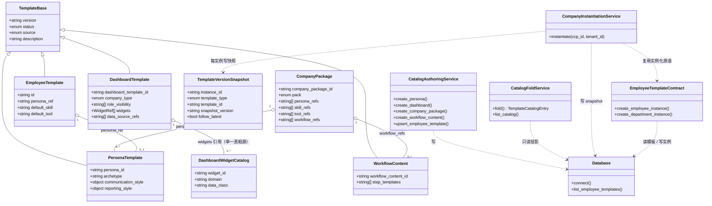
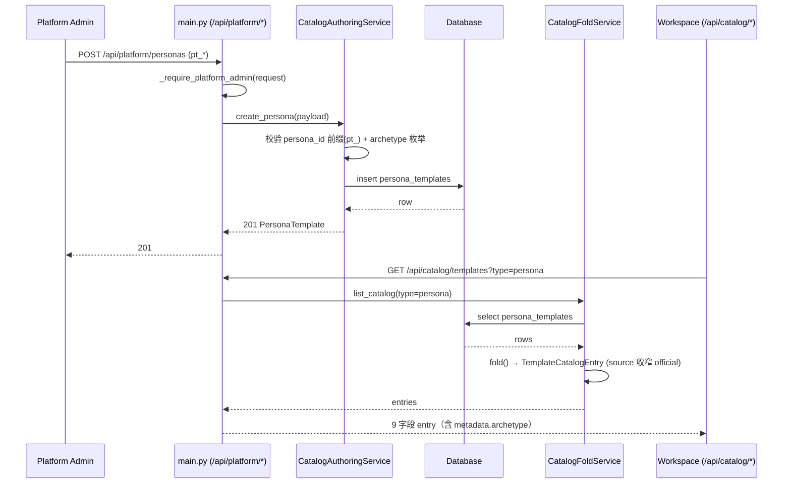
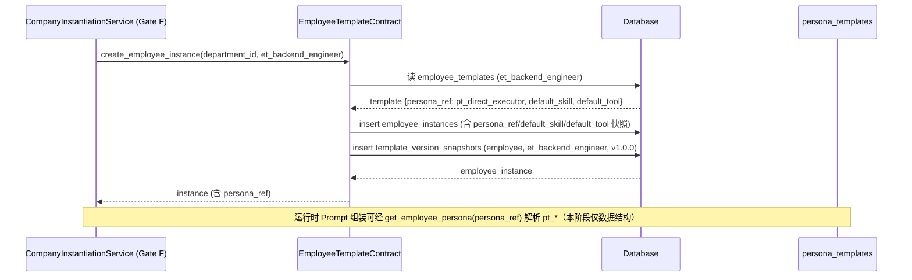
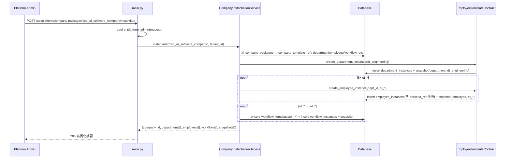

# Phase-1 Asset Factory Consolidation — Gate C/D/E/F 实现设计（design-for-implementation）

> **作者**：高见远（架构师，software-architect）
> **主理人**：齐活林（交付总监）
> **阶段**：Phase-1 Consolidation 真实实现执行（runtime code APPROVED to proceed，2026-07-11 总控 "可以进行"）
> **Basis**：6 份 design-only plan（`c2f30217`→`be284181`）+ 实现层 gate `issues/phase1_asset_factory_consolidation_gate.md`（Status: CLEARED，APPROVED to proceed）
> **性质**：本文件是**实现蓝图**，工程师（寇豆码）据此写代码、QA（Yan）据此测。**本文件不含实现代码**，仅给出契约 patch、数据结构、调用流程、API 形状、DB 变更与有序任务分解。
> **红线（全程遵守）**：
> - 禁止触碰 payment / invoice / 真实计费 / 收费路径（`cmcf_*` 已冻结，不在本任务）。
> - 禁止 Employee CRUD 端点 / 多 Agent / 外部服务凭证 / L5L6 经济 / 自动改码 / 真实隔离 / 复杂 UI / 向量库。
> - Curis Workspace 预删除严格隔离，不混入本提交。
> - 不自行 git commit（主理人统一入仓）。

---

## 0. 总览与关键约束落点

本设计把 `issues/phase1_asset_factory_consolidation_gate.md` 的 Scope §1–§5 转为可落地的实现方案，分四块：

| 块 | 内容 | 落点章节 |
|----|------|---------|
| A | §延后 backlog 7 处契约 patch（design-layer 登记，低危、无运行时） | §1 |
| B | Gate C Widget Catalog 去重（单一真相源） | §2 |
| C | Gate D 作者端点（`POST /api/platform/*` 写官方内容） | §3 |
| D | Gate E Employee 注入（`persona_ref`/`default_skills` 数据流） | §4 |
| E | Gate F Workspace 实例化（从 `ccp_ai_software_company` 实例化 + 快照） | §5 |

**框架选型**：**完全复用既有栈，零新框架**。
- 后端：`FastAPI`（`backend/app/main.py` 已有 `@app.get/post` + `_require_platform_admin` 守卫 + Pydantic `*-In` 模型）+ `SQLite`（`backend/app/database.py` 单例 DB 层）。
- 目录输出协议：`/api/catalog/*`（Workspace 只读，已存在 `list_catalog_gateways` 风格）。
- 不引入 React / ORM / 新依赖；不开发 UI（红线禁止复杂 UI）。
- 新增代码均为**纯 Python 模块 + SQLite DDL/DML**，与现有 `employee_templates.py` / `capability_catalog.py` 同构。

**代码落盘红线（Git 基线纪律 `83f017bf` checkpoint）**：
- `admin-platform/` 当前仅为 docs 壳（仅 `README.md` + 空 `docs/`）；运行时 Admin/Platform 后端即 `backend/app/`（承载全部 `/api/platform/*`）。故**所有 Admin 供给侧运行时代码落 `backend/app/`**。
- `workspace/` 当前仅为壳（仅 `README.md`）。本阶段实例化服务复用同一进程内的 `backend/app/` + 共享 `database.py`（单 SQLite），不跨进程。
- **Shared 文件**（两队/多模块共用）明确标注共用原因（见 §6 文件列表与 §8 共享知识）。
- 不混入任何 `Curis Workspace/...` 预删除文件。

---

## 1. §延后 backlog 契约 patch（7 处确切修改方案）

> 以下 patch 为 **design-layer 登记**，无运行时行为变化、无后端改动；在内容实例化（Gate D/F）之前 apply。每条给出**文件 + 段落 + 目标文本/diff 草案**。工程师 apply 时仅需文本编辑，不改代码。

### 1.1 `docs/contracts/template-catalog-runtime-contract.md` §1 — 正则 6→9 类 + 显式注明 `ccp_*` 出目录

**位置**：§1 统一运行时对象字段表 `template_id` 行（约 L26），及其上方说明段落（约 L22 "所有 6 类模板…"）。

**Target 文本（替换 L26 正则）**：
```diff
- | `template_id` | string | 是 | 沿用既有前缀 `^ct_｜dt_｜et_｜wt_｜st_｜tt_[a-z0-9_-]+$` | **统一 ID**… |
+ | `template_id` | string | 是 | 沿用既有前缀 `^ct_|dt_|et_|wt_|st_|tt_|pt_|wl_|dtpl_[a-z0-9_-]+$` | **统一 ID**… |

  > **前缀扩展说明（2026-07-11 Gate C/D/E/F 登记）**：
  > 原 6 类（`ct_/dt_/et_/wt_/st_/tt_`）扩展为 9 类，新增 `pt_`（PersonaTemplate，Variant A）、
  > `wl_`（Workflow 内容实例，Variant B，折叠进 `metadata.workflow_template_ref`）、
  > `dtpl_`（DashboardTemplate，Variant A，第 7+ 类目录项）。
  > **`ccp_*` 不在此正则内**：Company Package 是聚合包（Gate B §2.4 变体 C），走独立商业目录，
  > **不进** `TemplateCatalogEntry` 只读目录（单一目录主键语义不适用多资产聚合）。本输出协议 §3 仍为 9 类 entry。
```

**同时**：§1 首段 "所有 6 类模板运行时输出对象" → "所有 9 类模板运行时输出对象（含 `pt_`/`wl_`/`dtpl_`）"。

### 1.2 `docs/contracts/template-catalog-runtime-contract.md` §3.9 — 增 `DashboardTemplateEntry`（8→9 类目）

**位置**：§3 现有 §3.1–§3.6（6 类 entry）。在 §3.6 之后插入 §3.7 `PersonaTemplateEntry`、§3.8（Workflow 内容 `wl_*` 折叠说明）、§3.9 `DashboardTemplateEntry`。

**Target 文本（§3.7 PersonaTemplateEntry，新增）**：
```json
{
  "$schema": "http://json-schema.org/draft-07/schema#",
  "title": "PersonaTemplateEntry",
  "type": "object",
  "additionalProperties": false,
  "required": ["template_id","version","name","source","status","metadata"],
  "properties": {
    "template_id": { "type": "string", "pattern": "^pt_[a-z0-9_-]+$" },
    "version":     { "type": "string", "pattern": "^\\d+\\.\\d+\\.\\d+$" },
    "name":        { "type": "string" },
    "description": { "type": "string", "default": "" },
    "source":      { "type": "string", "enum": ["official","marketplace"] },
    "status":      { "type": "string", "enum": ["draft","active","disabled","archived"] },
    "metadata": {
      "type": "object", "additionalProperties": false,
      "properties": {
        "slug":                  { "type": "string" },
        "archetype":             { "type": "string" },
        "traits":                { "type": "array", "items": { "type": "string" }, "default": [] },
        "applicable_roles":      { "type": "array", "items": { "type": "string" }, "default": [] },
        "tenant_id":             { "type": ["string","null"], "default": "platform" }
      }
    }
  },
  "examples": [{ "template_id": "pt_supportive_coach", "version": "1.0.0", "name": "Supportive Coach",
    "source": "official", "status": "active",
    "metadata": { "archetype": "supportive_coach", "applicable_roles": ["product_manager","qa_engineer"] } }]
}
```

**Target 文本（§3.8 Workflow 内容 `wl_*` 折叠说明，新增）**：
```text
### 3.8 Workflow 内容实例折叠（Variant B，对齐 Skill/Tool）
- `wt_*` 为 WorkflowTemplate 类型容器（Variant A，entry.template_id = wt_*）。
- `wl_*` 为官方 Workflow **内容实例**（预留，Task 4 共 36 条真实 id），折叠为
  `template_id = wl_*` 的独立 entry，`metadata.workflow_template_ref = wt_{对应类型容器}`，
  `metadata.step_templates` 仍为 `ws_*` 数组引用。
- 即 Workflow 同时有 Variant A（wt_* 容器）与 Variant B（wl_* 内容）两种 entry 形态。
```

**Target 文本（§3.9 DashboardTemplateEntry，新增）**：
```json
{
  "$schema": "http://json-schema.org/draft-07/schema#",
  "title": "DashboardTemplateEntry",
  "type": "object",
  "additionalProperties": false,
  "required": ["template_id","version","name","source","status","metadata"],
  "properties": {
    "template_id": { "type": "string", "pattern": "^dtpl_[a-z0-9_-]+$" },
    "version":     { "type": "string", "pattern": "^\\d+\\.\\d+\\.\\d+$" },
    "name":        { "type": "string" },
    "description": { "type": "string", "default": "" },
    "source":      { "type": "string", "enum": ["official","marketplace"] },
    "status":      { "type": "string", "enum": ["draft","active","disabled","archived"] },
    "metadata": {
      "type": "object", "additionalProperties": false,
      "properties": {
        "company_type":     { "type": "string", "enum": ["ai_rd","ai_content","ai_content_ops","generic","ai_commercial"] },
        "role_visibility":  { "type": "array", "items": { "type": "string" }, "default": ["ceo"] },
        "widget_ids":       { "type": "array", "items": { "type": "string", "pattern": "^[a-z0-9_]+$" }, "default": [] },
        "layout_summary":   { "type": "string", "default": "" },
        "data_source_refs": { "type": "array", "items": { "type": "string" }, "default": [] },
        "commercial_slot_ref": { "type": ["string","null"], "default": null },
        "tenant_id":        { "type": ["string","null"], "default": "platform" }
      }
    }
  },
  "examples": [{ "template_id": "dtpl_ai_rd_ceo_cockpit", "version": "1.0.0",
    "name": "AI 研发公司 CEO 驾驶舱", "source": "official", "status": "active",
    "metadata": { "company_type": "ai_rd", "role_visibility": ["ceo"],
      "widget_ids": ["company_health","project_progress","ai_cost","employee_status"] } }]
}
```
> 同步更新 §3 开头 "六类模板运行时对象" → "九类模板运行时对象（Company/Department/Employee/Workflow/Skill/Tool/Persona/WorkflowContent/Dashboard）"。

### 1.3 `docs/contracts/ai-company-template-system.md` — 登记 `pt_*`(PersonaTemplate) 与 `dtpl_*`(DashboardTemplate) 为 TemplateBase 子类

**位置**：§0（"本契约是 … 权威总览。它统一定义 6 类官方模板…" → 改为"8 类"，并补 `pt_`/`dtpl_`）；§2 在 §2.6 之后新增 §2.7 `PersonaTemplate`、§2.8 `DashboardTemplate`；§3 类图增补两个子类。

**Target（§2.7 PersonaTemplate 摘要，新增）**：
```json
{ "title": "PersonaTemplate", "type": "object", "additionalProperties": false,
  "required": ["persona_id","slug","name","archetype","version","status","source"],
  "properties": {
    "persona_id": { "type": "string", "pattern": "^pt_[a-z0-9_-]+$" },
    "slug": { "type": "string" }, "name": { "type": "string" },
    "archetype": { "type": "string", "enum": ["supportive_coach","direct_executor","analytical_advisor","creative_explorer","balanced_facilitator","risk_aware_guardian"] },
    "traits": { "type": "array", "items": { "type": "string" }, "default": [] },
    "communication_style": { "type": "object", "default": {} },
    "reporting_style": { "type": "object", "default": {} },
    "decision_style": { "type": "string", "default": "consultative" },
    "collaboration_style": { "type": "object", "default": {} },
    "version": { "type": "string", "pattern": "^\\d+\\.\\d+\\.\\d+$", "default": "1.0.0" },
    "status": { "type": "string", "enum": ["draft","active","disabled","archived"], "default": "draft" },
    "source": { "type": "string", "enum": ["official","tenant_private","marketplace"], "default": "official" },
    "tenant_id": { "type": ["string","null"], "default": "platform" }
  } }
```

**Target（§2.8 DashboardTemplate 摘要，新增，引用 dashboard-template-admin-contract §1.2）**：
```json
{ "title": "DashboardTemplate", "type": "object", "additionalProperties": false,
  "required": ["dashboard_template_id","name","company_type","role_visibility","widgets","layout","version","status"],
  "properties": {
    "dashboard_template_id": { "type": "string", "pattern": "^dtpl_[a-z0-9_-]+$" },
    "name": { "type": "string" },
    "company_type": { "type": "string", "enum": ["ai_rd","ai_content","ai_content_ops","generic","ai_commercial"] },
    "role_visibility": { "type": "array", "items": { "type": "string" }, "default": ["ceo"] },
    "widgets": { "type": "array", "items": { "type": "object" }, "default": [] },
    "layout": { "type": "object" },
    "data_source_refs": { "type": "array", "items": { "type": "string" }, "default": [] },
    "commercial_display_slot": { "type": ["object","null"], "default": null },
    "version": { "type": "string", "pattern": "^\\d+\\.\\d+\\.\\d+$", "default": "1.0.0" },
    "status": { "type": "string", "enum": ["draft","active","disabled","archived"], "default": "draft" },
    "source": { "type": "string", "enum": ["official","tenant_private","marketplace"], "default": "official" }
  } }
```

**Target（§3 类图追加）**：
```text
    class PersonaTemplate { +string persona_id +string archetype +object communication_style +object reporting_style }
    class DashboardTemplate { +string dashboard_template_id +enum company_type +string[] role_visibility +WidgetRef[] widgets }
    TemplateBase <|-- PersonaTemplate
    TemplateBase <|-- DashboardTemplate
```

### 1.4 `docs/contracts/template-versioning-policy.md` §5 — 确认 snapshot 桶覆盖 `wl_*`/`pt_*`/`dtpl_*` 内容实例

**位置**：§5 快照数据结构 `template_type` 枚举（L88）与 `template_id` pattern（L89）。

**Target 文本（替换 L88–L89）**：
```diff
-    "template_type":       { "type": "string", "enum": ["company","department","employee","workflow","skill","tool"] },
-    "template_id":         { "type": "string", "pattern": "^ct_|dt_|et_|wt_|st_|tt_[a-z0-9_-]+$", "description": "快照来源模板的 template_id" },
+    "template_type":       { "type": "string", "enum": ["company","department","employee","workflow","workflow_content","skill","tool","persona","dashboard"] },
+    "template_id":         { "type": "string", "pattern": "^ct_|dt_|et_|wt_|wl_|st_|tt_|skl_|tl_|pt_|dtpl_[a-z0-9_-]+$", "description": "快照来源模板/内容实例的 template_id" },
```
**补充示例桶**（在 §5 examples 后追加）：
```json
{ "instance_id":"ei_pm_001","template_type":"persona","template_id":"pt_supportive_coach","snapshot_version":"1.0.0",
  "snapshot_metadata":{"archetype":"supportive_coach","communication_style":{"tone":"encouraging"}},"snapshot_at":"2026-07-15T09:00:00Z","follow_latest":false }
{ "instance_id":"di_rnd_001","template_type":"dashboard","template_id":"dtpl_ai_rd_ceo_cockpit","snapshot_version":"1.0.0",
  "snapshot_metadata":{"company_type":"ai_rd","widget_ids":["company_health","project_progress","ai_cost"]},"snapshot_at":"2026-07-15T09:00:00Z","follow_latest":false }
```
> 同步更新 §1 首句 "所有 6 类模板" → "所有 9 类模板（含 `wl_*`/`pt_*`/`dtpl_*` 内容实例）"。

### 1.5 `docs/contracts/company-package-contract.md` §2 R6 — 固化 `ccp_` 命名 + 增补 4 个 refs 字段

**位置**：§2 JSON Schema `properties`（在 `employee_template_refs` 后增补）；§5 R6 文本（从"design-only, 不决议"改为固化）。

**Target（§2 增补 4 字段，插入 `employee_template_refs` 之后）**：
```json
    "persona_refs":  { "type": "array", "items": { "type": "string", "pattern": "^pt_[a-z0-9_-]+$" }, "default": [], "description": "引用 Persona 内容实例（Task 1 pt_*）" },
    "skill_refs":    { "type": "array", "items": { "type": "string", "pattern": "^skl_[a-z0-9_]+$" }, "default": [], "description": "引用 Skill 内容实例（Task 2 skl_*）" },
    "tool_refs":     { "type": "array", "items": { "type": "string", "pattern": "^tl_[a-z0-9_]+$" }, "default": [], "description": "引用 Tool 内容实例（Task 2 tl_*）" },
    "workflow_refs": { "type": "array", "items": { "type": "string", "pattern": "^wl_[a-z0-9_]+$" }, "default": [], "description": "引用 Workflow 内容实例（Task 4 wl_*）" },
```
**Target（§5 R6 文本替换）**：
```diff
- | **R6** | **主键命名** | 建议 `company_package_id` 采用 `ccp_` 前缀以区别于 CapabilityPackage 的 `cp_`；若复用 `cp_` 命名空间，须在落表时与 `capability_packages` 区分（独立表或 `package_kind` 列）。**本契约 design-only，不决议**。 |
+ | **R6** | **主键命名（已固化）** | `company_package_id` **采用 `ccp_` 前缀**（如 `ccp_ai_software_company`）；**正式弃用 `cpt_/cpl_*` 命名空间**（Gate B §3.4 已核对：`cp_`=CapabilityPackage，`ccp_`=Company Package，命名空间独立）。落表用独立 `company_packages` 表，不并入 `capability_packages`。本契约 design-only，命名已决议。 |
```

### 1.6 `docs/contracts/dashboard-template-admin-contract.md` §1.2 — `company_type` enum 扩 +`ai_content`/`+ai_commercial` + 补 `role_visibility`/`data_source_refs`

**位置**：§1.2 JSON Schema `company_type` enum（L65）、`role_type` 后补 `role_visibility`；`widgets` 后补 `data_source_refs`。

**Target（L65 enum 替换）**：
```diff
-    "company_type": { "type": "string", "enum": ["ai_rd", "ai_content_ops", "generic"], "description": "公司类型分类（可扩展枚举）" },
+    "company_type": { "type": "string", "enum": ["ai_rd", "ai_content", "ai_content_ops", "ai_commercial", "generic"], "description": "公司类型分类；对齐 skl_/tl_/wl_ 包命名（ai_rd/ai_content/ai_commercial）" },
```
**Target（在 `role_type` 字段后新增 `role_visibility`，在 `widgets` 后新增 `data_source_refs`）**：
```json
    "role_visibility": {
      "type": "array", "items": { "type": "string" }, "default": ["ceo"],
      "description": "可见角色集合（升级自单值 role_type；支持多角色可见，如 ceo/cto/ops）"
    },
    "data_source_refs": {
      "type": "array", "items": { "type": "string" }, "default": [],
      "description": "Dashboard 数据来源引用（指向 Workspace 运行时事实域，如 project/usage_event/value_event）；Admin 仅声明引用，不读取源"
    },
```
> 同步更新 §1.1 字段表：将 `role_type` 标注为"历史单值，升级为 `role_visibility` 数组"；新增 `data_source_refs` 行。

### 1.7 `docs/contracts/workflow-template-contract.md` — 加"官方 `wl_*` 引用 `ws_*` + 角色/Skill/Tool 绑定"说明（不改字段）

**位置**：`## Invariants` 段之前（或 `## First R&D SOP Contract` 之后）新增说明段。

**Target（新增段落）**：
```text
## Official Workflow Content Binding（Gate C/D/E/F 登记，无字段变更）

官方 `wl_*` 内容实例（Task 4 `workflow-official-content-plan.md`，36 条真实 id）是 `wt_*` 类型容器下的**具体内容实例**：
- 每个 `wl_*` 通过其 `step_templates`（`ws_*` 数组）引用 `WorkflowStepTemplate` 步骤；
- 每个 `ws_*` 步骤含 `owner_employee_template_id`（角色绑定，如 `et_backend_engineer`）、
  `required_capability_types`（model/tool/connector），并可在官方内容层关联 `default_skill`（`st_/skl_*`）与 `default_tool`（`tt_/tl_*`）绑定；
- `workflow-template-contract.md` 现有字段**不变**；上述绑定通过 `wt_*`/`wl_*` 的 `step_templates` + `WorkflowStepTemplate` 既有字段承载，属内容填充而非契约扩展。
```

---

## 2. Gate C — Widget Catalog 去重（单一真相源方案）

### 2.1 问题描述

两套并行 Widget 分类共存，同域冲突：
- **Admin 供给侧**（`docs/plan/dashboard-official-content-plan.md`）：`project_progress`、`token_cost`、`tech_risk` 等。
- **Workspace 运行时**（`docs/contracts/ceo-dashboard-contract.md` Widget Catalog）：`project_progress`、`project_risk`、`token_usage`、`model_usage`、`ai_cost`、`value_event` 等 16 类。
- 冲突域：`cost` 域（Admin `token_cost` vs 运行时 `ai_cost`/`token_usage`）、`risk` 域（Admin `tech_risk` vs 运行时 `project_risk`）、`progress` 域（`project_progress` 两侧同名但须同源）。

### 2.2 单一真相源方案

**权威 Widget 目录 = `dashboard_widget_catalog` 表（Admin 拥有、写入）**。规则：

1. **以运行时 `ceo-dashboard-contract.md` 的 16 类 Widget 为权威域集合**，按 `domain` 分桶：`company` / `department` / `project` / `employee` / `cost` / `value` / `capability` / `knowledge`。
2. **Admin `DashboardTemplate.widgets[].widget_id` 与 Workspace 运行时 Widget Catalog 必须引用同一张 `dashboard_widget_catalog` 表**（单一真相源，禁止两处各定义）。
3. **去重映射**（Admin 旧名 → 规范 `widget_id`）：
   | Admin 旧 widget_id | 规范 widget_id | domain | 处置 |
   |---|---|---|---|
   | `token_cost` | `ai_cost` | cost | 弃用别名，模板改用 `ai_cost`（与运行时一致；非账单，estimated_cost 聚合） |
   | `tech_risk` | `project_risk` | risk | 弃用别名（同域）；如需"技术风险"细分，作为 `project_risk` 的 `data_class='tech'` 子类，仍同一 widget_id |
   | `project_progress` | `project_progress` | project | 保留，正式登记进 catalog |
   | `token_usage` / `model_usage` | 保留 | cost | 保留，登记进 catalog |
4. **`dashboard_widget_catalog` 每行**含：`widget_id`（PK，稳定 snake_case）、`domain`、`data_class`（可选细分，如 `tech`）、`title`、`description`、`source`（恒 `official`）、`tenant_id`（默认 `platform`）、`enabled`。
5. **fold 输出**（`template-catalog-runtime-contract.md` §3.9 `DashboardTemplateEntry.metadata.widget_ids`）只存 `widget_id` 引用，不内嵌 widget 定义；Workspace 渲染时按 `widget_id` 回查 `dashboard_widget_catalog` 取 `domain`/`title`。
6. **校验**：Gate D 写 `DashboardTemplate` 时，校验 `widgets[].widget_id` 必须存在于 `dashboard_widget_catalog`（引用完整性，R3 同构）。

> 红线遵守：本去重**不开发 UI**、不碰 billing；`ai_cost` 明确为 `estimated_cost` 聚合（非账单），与 `cmcf_*` 收费路径严格隔离。

---

## 3. Gate D — 作者端点 API 设计

### 3.1 路由总览（全部 `_require_platform_admin` 守卫；对齐现有 `/api/platform/capabilities` 风格）

| 方法 | 路由 | 写对象 | 落表 |
|------|------|--------|------|
| POST | `/api/platform/personas` | `pt_*` PersonaTemplate | `persona_templates` |
| POST | `/api/platform/dashboards` | `dtpl_*` DashboardTemplate | `dashboard_templates` |
| POST | `/api/platform/company-packages` | `ccp_*` CompanyPackage | `company_packages` |
| POST | `/api/platform/workflow-contents` | `wl_*` WorkflowContent | `workflow_contents` |
| POST | `/api/platform/employee-templates` | `et_*` 增补（含 `persona_ref`/`default_skill`/`default_tool`） | `employee_templates`（加列） |
| POST | `/api/platform/department-templates` | `dt_*` 增补 | `department_templates`（加列） |
| POST | `/api/platform/company-templates` | `ct_*` 增补 | `company_templates`（新建） |
| GET | `/api/catalog/templates` | 只读目录（fold 输出 9 类 entry） | 多表投影 |
| GET | `/api/catalog/widgets` | 只读 Widget 目录 | `dashboard_widget_catalog` |
| POST | `/api/platform/company-packages/{id}/instantiate` | 触发 Gate F 实例化 | 见 §5 |

> **鉴权**：复用 `main.py` 现有 `_require_platform_admin(request)`。所有写路由返回 201；422 on 校验失败（对齐 `create_platform_capability`）。
> **不新增** Employee 运行时 CRUD 端点（红线）；`employee-templates` 写仅限**官方 catalog 内容补全**（Admin 供给侧），不触碰 `employee_instances` 运行时。

### 3.2 请求/响应形状（示例：`POST /api/platform/personas`）

**入参 Pydantic `PersonaCreateIn`**：
```python
class PersonaCreateIn(BaseModel):
    persona_id: str                      # ^pt_[a-z0-9_-]+$
    slug: str
    name: str
    archetype: str                      # 受控枚举
    traits: list[str] = []
    communication_style: dict = {}
    reporting_style: dict = {}
    decision_style: str = "consultative"
    collaboration_style: dict = {}
    description: str = ""
    version: str = "1.0.0"              # SemVer
    status: str = "draft"               # draft|active|disabled|archived
```
**出参**（201）：`PersonaTemplate` 行（同 §1.3 §2.7 字段）。

**示例：`POST /api/platform/company-packages`** 入参对齐 `company-package-official-content-plan.md` §3.3（含 `persona_refs`/`skill_refs`/`tool_refs`/`workflow_refs`）；出参为 `company_packages` 行。

**示例：`GET /api/catalog/templates?type=dashboard`** 出参：
```json
{ "templates": [ { "template_id":"dtpl_ai_rd_ceo_cockpit", "version":"1.0.0", "name":"AI 研发公司 CEO 驾驶舱",
  "source":"official", "status":"active",
  "metadata": { "company_type":"ai_rd", "role_visibility":["ceo"], "widget_ids":["company_health","project_progress","ai_cost"] } } ] }
```

### 3.3 服务端落点

- `CatalogAuthoringService`（新模块 `backend/app/catalog_authoring.py`）：`create_persona` / `create_dashboard` / `create_company_package` / `create_workflow_content` / `upsert_employee_template` / `create_company_template` 等方法，统一校验 `template_id` 前缀（调 `catalog_constants.py`）、校验引用存在性（R3）、写 `database.py`。
- `CatalogFoldService`（`backend/app/catalog_fold.py`）：`fold()` 实现 Gate B §2.3 协议，把各表行投影为 `TemplateCatalogEntry`；`source` 收窄 `official`/`marketplace`；归因存 `metadata.source_attribution`。
- `main.py`：新增上述路由，注入 `CatalogAuthoringService` / `CatalogFoldService`。

---

## 4. Gate E — Employee 注入（`persona_ref` / `default_skills` 数据流）

### 4.1 数据流（design-only 登记 → 内容实例化）

```
et_* 模板 (employee_templates)
   ├── persona_ref : pt_supportive_coach        ─┐
   ├── default_skill : st_backend_coding / skl_* ─┤ 模板层引用（Gate D 写 / seed 补全）
   └── default_tool  : tt_code_executor / tl_*   ─┘
                                                     │  create_employee_instance 时读取
                                                     ▼
employee_instances (运行时快照)
   ├── persona_ref        (来自 et_*.persona_ref)
   ├── default_skill      (来自 et_*.default_skill)
   ├── default_tool       (来自 et_*.default_tool)
   └── persona_overrides_json (Employee 层局部覆盖，可选)
```

### 4.2 代码落点（不新增运行时 CRUD；复用现有 `employee_templates.py`）

1. **`database.py` 加列**：
   - `employee_templates` 加：`persona_ref text default ''`、`default_skill text default ''`（`st_/skl_*`）、`default_tool text default ''`（`tt_/tl_*`）、`persona_overrides_json text default '{}'`、`version text default '1.0.0'`、`status text default 'draft'`、`updated_at text default current_timestamp`。
   - `employee_instances` 加：`persona_ref text default ''`、`default_skill text default ''`、`default_tool text default ''`（快照冻结值）。
2. **`employee_templates.py`**：`create_employee_instance` 读取 `template["persona_ref"]`/`template["default_skill"]`/`template["default_tool"]`，写入 `employee_instances` 快照列；`_employee_instance_from_row` 暴露这三个字段；新增 `get_employee_persona(employee_id)` 解析 `persona_ref` → `persona_templates` 行（供运行时 Prompt 组装，不在此阶段实现调用）。
3. **Seed**：官方 `et_*` 内容补全 `persona_ref`（如 `et_backend_engineer → pt_direct_executor`、`et_product_manager → pt_supportive_coach`、`et_architect → pt_analytical_advisor`、`et_tech_lead → pt_balanced_facilitator`、`et_qa_engineer → pt_supportive_coach`、`et_frontend_engineer → pt_direct_executor`），并填 `default_skill`/`default_tool`（对齐 `employee-default-skill-mapping.md`）。现有 `official.*` 种子行保留兼容，新 `et_*` 行叠加写入（不删旧）。

> 红线遵守：**不新增 Employee CRUD 端点**；仅扩展模板字段 + 实例快照列 + 复用既有 `create_employee_instance`。`persona_overrides` 仅数据结构预留，本阶段不实现覆盖 UI。

---

## 5. Gate F — Workspace 实例化（从 `ccp_ai_software_company`）

### 5.1 流程（编排现有实例化原语，非新 CRUD）

```
POST /api/platform/company-packages/{id}/instantiate   (_require_platform_admin)
   │
   ▼  CompanyInstantiationService.instantiate(ccp_id, tenant_id)
   1. 读 ccp_* → company_template_ref (ct_ai_software_company)
   2. 确保 companies 行（若 tenant 无默认公司，复用 CompanyProjectRuntime；不新建公司激活逻辑）
   3. 对每个 department_template_refs (dt_engineering):
        调用 employee_templates.create_department_instance(template_id=dt_engineering)
        → 写 department_instances + 写 template_version_snapshot(department, dt_engineering)
   4. 对每个 employee_template_refs (6× et_*):
        调用 employee_templates.create_employee_instance(department_id, template_id=et_*)
        → 写 employee_instances(含 persona_ref/default_skill/default_tool 快照)
        + 写 template_version_snapshot(employee, et_*)
   5. 对每个 workflow_refs (wl_* → wt_*):
        确保 workflow_templates 含对应 wt_*（已 seed）；写 workflow_instances + snapshot
   6. 对每个 persona_refs / skill_refs / tool_refs:
        仅校验存在性（引用完整性），不实例化（Persona/Skill/Tool 非实例资产）
   7. 返回实例化摘要 {company_id, departments[], employees[], workflows[], snapshots[]}
```

### 5.2 DB schema 变更

**新增 `company_packages` 表**（对齐 §1.3 §2 + company-package-contract §2，含 R6 固化的 `ccp_` + 4 refs）：
```sql
create table if not exists company_packages (
  company_package_id text primary key,
  name text not null, description text not null default '',
  version text not null default '1.0.0',
  status text not null default 'draft' check (status in ('draft','active','disabled')),
  source text not null default 'Curis internal',
  pack text not null check (pack in ('ai_rd','ai_content','ai_commercial')),
  company_template_ref text,
  department_template_refs_json text not null default '[]',
  employee_template_refs_json text not null default '[]',
  persona_refs_json text not null default '[]',
  skill_refs_json text not null default '[]',
  tool_refs_json text not null default '[]',
  workflow_refs_json text not null default '[]',
  sub_package_refs_json text not null default '[]',
  pricing_reference text, quota_reference text,
  availability text default 'public',
  tenant_id text not null default 'platform',
  enabled integer not null default 1,
  created_at text not null default current_timestamp,
  updated_at text not null default current_timestamp
);
```
**新增 `persona_templates` / `dashboard_templates` / `workflow_contents` 表**（对齐 §1.3 各 schema，`template_id`/`persona_id`/`dashboard_template_id` 为主键，`status`/`version`/`source` 同 TemplateBase）。
**新增 `dashboard_widget_catalog` 表**（Gate C §2.2）。
**新增 `template_version_snapshots` 表**（快照隔离，对齐 template-versioning-policy §5）：
```sql
create table if not exists template_version_snapshots (
  id text primary key,
  instance_id text not null,
  template_type text not null,   -- company|department|employee|workflow|workflow_content|skill|tool|persona|dashboard
  template_id text not null,
  snapshot_version text not null,
  snapshot_metadata_json text not null default '{}',
  snapshot_at text not null default current_timestamp,
  follow_latest integer not null default 0
);
```

### 5.3 快照机制

- 每次实例化写一条 `template_version_snapshots`（`follow_latest=0` 默认，快照隔离）。
- 升级传播矩阵（template-versioning-policy §4）单向向前：已存在实例不变，新实例用 `status=active` 中最大 version。
- `ccp_*` 自身不实例化（变体 C）；仅其引用的 `ct_/dt_/et_/wt_*` 被实例化并各自快照。

> 红线遵守：实例化复用既有 `create_department_instance` / `create_employee_instance` 原语（不新建 Employee CRUD）；不触碰 payment/billing；`pricing_reference`/`quota_reference` 仅引用 `plan_id`，不持数值。

---

## 6. 文件列表（相对路径 + 红线分类）

> 红线：`admin-platform/` 与 `workspace/` 当前均为壳；运行时 Admin/Platform 后端即 `backend/app/`，故 Admin 代码落 `backend/app/`，实例化服务复用同进程共享 `database.py`。

### A. 契约 patch（docs/，design-layer，无代码）
- `docs/contracts/template-catalog-runtime-contract.md`（§1 正则 + §3.7/§3.8/§3.9）
- `docs/contracts/ai-company-template-system.md`（§0/§2.7/§2.8/§3 类图）
- `docs/contracts/template-versioning-policy.md`（§1/§5 枚举 + 示例桶）
- `docs/contracts/company-package-contract.md`（§2 4 refs + §5 R6 固化）
- `docs/contracts/dashboard-template-admin-contract.md`（§1.1/§1.2 enum + 字段）
- `docs/contracts/workflow-template-contract.md`（官方 wl_* 绑定说明段）

### B. Admin 供给侧运行时（backend/app/，Admin 范围）
- `backend/app/catalog_authoring.py`（**新**）— Gate D 写服务（create_persona/dashboard/company_package/workflow_content/employee_template/company_template）
- `backend/app/catalog_fold.py`（**新**）— Gate D 只读 fold 输出（/api/catalog/*）
- `backend/app/company_instantiation.py`（**新**）— Gate F 编排服务
- `backend/app/main.py`（**改**）— 注册 Gate D 路由 + Gate F instantiate 路由（复用 `_require_platform_admin`）

### C. 数据层（backend/app/，SHARED 两队共用）
- `backend/app/database.py`（**改**）— 建 `company_packages`/`persona_templates`/`dashboard_templates`/`workflow_contents`/`dashboard_widget_catalog`/`template_version_snapshots`；`employee_templates`/`employee_instances` 加列；seed 官方 `et_*/pt_*/wl_*/dtpl_*/ccp_*` 内容
  - **共用原因**：单 SQLite 实例，Admin 写（authoring/instantiation）与 Workspace 读（catalog 输出 / 运行时实例化消费）共用同一 `Database` 连接与 schema；是 Admin↔Workspace 边界的唯一数据交换面（admin-workspace-template-boundary 两条铁律的物理落点）。
- `backend/app/catalog_constants.py`（**改**）— 扩展 `TEMPLATE_ID_PREFIXES`、`TEMPLATE_STATUS`、`SOURCE_ATTRIBUTION`、Widget domain 枚举
  - **共用原因**：前缀/枚举/正则的单一真相源，被 Admin authoring（Gate D 校验）、catalog fold（Gate D 输出）、Workspace 消费（Gate E/F 解析）三方引用，避免前缀漂移。

### D. 现有模块扩展（backend/app/，SHARED）
- `backend/app/employee_templates.py`（**改**）— Gate E 注入逻辑（`create_employee_instance` 读取 `persona_ref`/`default_skill`/`default_tool` 写快照；`_employee_instance_from_row` 暴露）
  - **共用原因**：同一模块既被 Admin seed（官方 `et_*` 内容）又被 Workspace 运行时 `create_employee_instance` 调用，是 Employee 模板→实例注入的唯一落点。

---

## 7. 数据结构 / 接口（类图 + JSON Schema 摘要）

### 7.1 类图（Mermaid）



### 7.2 关键 JSON Schema 摘要（见各 §）

- PersonaTemplate：`docs/contracts/ai-company-template-system.md` §2.7（§1.3 本文件已给）。
- DashboardTemplate：`docs/contracts/ai-company-template-system.md` §2.8（§1.3 本文件已给）。
- CompanyPackage：`company-package-official-content-plan.md` §3.3（含 persona_refs/skill_refs/tool_refs/workflow_refs）。
- TemplateVersionSnapshot：`template-versioning-policy.md` §5（§1.4 本文件已扩枚举）。
- DashboardWidgetCatalog：Gate C §2.2（§2 本文件已定义）。

---

## 8. 调用流程（Mermaid 时序图）

### 8.1 Gate D — 写官方 Persona + 只读目录输出



### 8.2 Gate E — Employee 注入（创建实例时携带 persona_ref 快照）



### 8.3 Gate F — 从 ccp_ai_software_company 实例化



---

## 9. 有序任务列表（工程师据此批量写码，≤5 任务）

> 依赖：T01 为基础设施（契约 patch + DB schema + 常量）；T02/T03/T04 依赖 T01；T05 依赖 T02/T03/T04。

### T01 — 契约登记 + 数据层基础设施 【P0】
- **Source Files**：`docs/contracts/template-catalog-runtime-contract.md`、`docs/contracts/ai-company-template-system.md`、`docs/contracts/template-versioning-policy.md`、`docs/contracts/company-package-contract.md`、`docs/contracts/dashboard-template-admin-contract.md`、`docs/contracts/workflow-template-contract.md`、`backend/app/catalog_constants.py`、`backend/app/database.py`
- **Dependencies**：无
- **内容**：
  1. Apply §1 七处契约 patch（design-layer 登记）。
  2. `catalog_constants.py`：扩展 `TEMPLATE_ID_PREFIXES`（含 `pt_/wl_/dtpl_/ccp_`）、`TEMPLATE_STATUS`、`PACK_ENUM`、`WIDGET_DOMAINS`、`SOURCE_ATTRIBUTION`。
  3. `database.py`：新建 `company_packages`/`persona_templates`/`dashboard_templates`/`workflow_contents`/`dashboard_widget_catalog`/`template_version_snapshots`；`employee_templates` + `employee_instances` 加列（`persona_ref`/`default_skill`/`default_tool`/`version`/`status`/`persona_overrides_json`/`updated_at`）；seed 官方 `et_*/pt_*/wl_*/dtpl_*/ccp_*` 内容（含 `et_*` 的 `persona_ref` 绑定）。

### T02 — Gate C Widget Catalog 去重单一真相源 【P1】
- **Source Files**：`backend/app/database.py`（dashboard_widget_catalog 表 + 去重映射数据）、`backend/app/catalog_authoring.py`（widget catalog 读写 + 引用校验）、`backend/app/catalog_fold.py`（fold 输出引用 widget catalog）
- **Dependencies**：T01
- **内容**：建 `dashboard_widget_catalog`；写入 16 类规范 widget（含 `token_cost→ai_cost`、`tech_risk→project_risk` 去重映射）；`CatalogAuthoringService` 提供 widget 读写；`CatalogFoldService` 输出 `DashboardTemplateEntry.metadata.widget_ids` 仅引用 catalog；DashboardTemplate 写时校验 widget_id 存在性。

### T03 — Gate D 作者端点 【P0】
- **Source Files**：`backend/app/main.py`（路由）、`backend/app/catalog_authoring.py`（create_* 方法）、`backend/app/catalog_fold.py`（/api/catalog 只读输出）
- **Dependencies**：T01, T02
- **内容**：注册 `POST /api/platform/personas|dashboards|company-packages|workflow-contents|employee-templates|department-templates|company-templates`（全部 `_require_platform_admin`）；`GET /api/catalog/templates`、`GET /api/catalog/widgets`；实现 `CatalogAuthoringService` 各 create 方法与前缀/引用校验；实现 `CatalogFoldService.fold()`（Gate B §2.3）。

### T04 — Gate E Employee 注入 【P1】
- **Source Files**：`backend/app/employee_templates.py`、`backend/app/database.py`（加列已在 T01；本任务补注入逻辑与 seed 关联）、`backend/app/catalog_constants.py`（前缀校验复用）
- **Dependencies**：T01, T03
- **内容**：`employee_templates.py` 的 `create_employee_instance` 读取 `template.persona_ref/default_skill/default_tool` 写入 `employee_instances` 快照列；`_employee_instance_from_row` 暴露；新增 `get_employee_persona(employee_id)` 解析 `persona_ref→persona_templates`（供运行时，不实现调用）；确认官方 `et_*` seed 带 `persona_ref`（T01 已 seed）。

### T05 — Gate F 公司实例化 【P0】
- **Source Files**：`backend/app/company_instantiation.py`（新编排服务）、`backend/app/database.py`（snapshot 表已在 T01）、`backend/app/main.py`（instantiate 路由）
- **Dependencies**：T02, T03, T04
- **内容**：`CompanyInstantiationService.instantiate(ccp_id, tenant_id)` 编排（§5.1）；复用 `employee_templates.create_department_instance`/`create_employee_instance` 原语；每实例写 `template_version_snapshots`（`follow_latest=0`）；注册 `POST /api/platform/company-packages/{id}/instantiate`（_require_platform_admin）；返回实例化摘要。

---

## 10. 依赖包列表

```
# 复用既有栈，无新增第三方依赖（FastAPI / SQLite / Pydantic 已在 backend/ 环境）
- fastapi          # 现有 API 框架（main.py）
- pydantic         # 现有请求体校验（*-In 模型）
- sqlite3          # Python 标准库（database.py，单文件 SQLite）
# 新增模块均为纯 Python（catalog_authoring.py / catalog_fold.py / company_instantiation.py）
# 不引入 ORM / React / 向量库 / 任何 UI 框架（红线禁止复杂 UI）
```

---

## 11. 共享知识（跨文件约定）

1. **`template_id` 前缀与正则单一真相源** = `catalog_constants.py`（`TEMPLATE_ID_PREFIXES`）。任何校验/输出必须从该常量取，禁止散落正则。9 类：`ct_/dt_/et_/wt_/st_/tt_/pt_/wl_/dtpl_`；`ccp_*` 出目录（变体 C）。
2. **两层 source 概念**：`TemplateCatalogEntry.source` ∈ {official, marketplace}（目录输出层，谁拥有写权）；`metadata.source_attribution` ∈ 6 值生态（MetaGPT SOP/ChatDev workflow/CrewAI example/AutoGen pattern/industry SOP/Curis internal），仅 Skill/Tool 内容有。二者不得混用。
3. **status 枚举**：模板类 `draft|active|disabled|archived`；Company Package `draft|active|disabled`；实例独立状态不受模板影响。
4. **SemVer**：统一 `^\d+\.\d+\.\d+$`，由 Admin 控制演进。
5. **Admin 写 / Workspace 读边界**：所有写经 `_require_platform_admin`；Workspace 仅 `GET /api/catalog/*` 只读，禁止回写官方目录（admin-workspace-template-boundary 两条铁律）。
6. **快照隔离**：`follow_latest` 默认 `0`（false）；升级单向向前（只影响新实例）。
7. **日期**：ISO 8601 UTC（`current_timestamp` SQLite 默认）。
8. **商业信封**：`ccp_*` 的 `pricing_reference`/`quota_reference` 仅引用 `plan_id`，不持数值；**严禁**触碰 `cmcf_*` 收费路径与任何 billing/invoice 代码。
9. **DB 单一 SQLite**：Admin 与 Workspace 共用 `backend/app/database.py`；是两队唯一数据交换面。
10. **红线禁区**：无 Employee CRUD 端点、无多 Agent、无外部凭证、无 L5L6 经济、无自动改码、无真实隔离、无复杂 UI、无向量库；不混入 `Curis Workspace/...` 预删除。

---

## 12. 待明确事项（Assumptions & Open Questions）

1. **`admin-platform/` vs `backend/app/` 物理落点**：当前 `admin-platform/` 仅为 docs 壳，运行时 Admin 后端即 `backend/app/`。本设计据此将 Admin 代码落 `backend/app/`。若主理人要求未来把 Admin 拆到独立 `admin-platform/` 服务，需补服务边界与跨服务鉴权设计（本阶段未做）。
2. **现有 `official.*` 种子 ID 与 Phase-1 `et_*/dt_*/ct_*` ID 并存**：本设计选择"叠加写入新官方 `et_*` 行"而非重命名旧 `official.*` 行（避免破坏既有运行时引用）。是否需别名映射（`official.department.software_rnd ↔ dt_engineering`）待主理人裁定。
3. **`company_templates` 表新建 vs 复用**：`ai-company-template-system.md` 标注"无 `company_templates` 表（Phase-5+）"。本设计为 Gate D `POST /api/platform/company-templates` 新建该表（最小 schema），若与主理人后续表设计冲突以主理人裁定为准。
4. **`employee_instances` 公司已存在判断**：Gate F 实例化假设 tenant 已有默认 `companies` 行（复用 `CompanyProjectRuntime.list_companies` 默认公司），不新建公司激活逻辑。若需"从 ccp 全新建公司"则需扩展 `companies` 写（本阶段未含，红线禁真实隔离）。
5. **`persona_overrides` 实现时机**：本阶段仅预留 `persona_overrides_json` 列与数据结构，覆盖解析逻辑（运行时 Prompt 组装）留待后续 gate，不在本实现范围。
6. **安全边界席 clearance 已就位**（2026-07-11 总控 waiver），运行时/instantiation 代码 APPROVED to proceed；本设计为设计交付，代码由工程师寇豆码实现、QA Yan 验证。

---

*—— Phase-1 Asset Factory Consolidation Gate C/D/E/F 实现设计（design-for-implementation）。架构师：高见远；主理人：齐活林。2026-07-11。*
