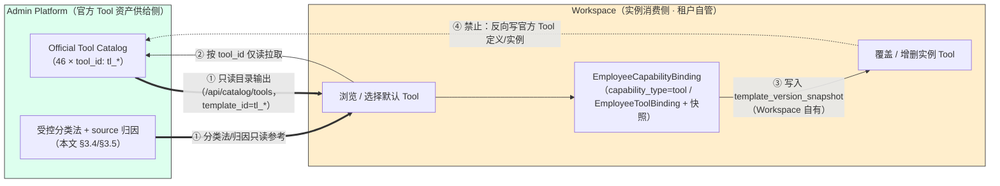
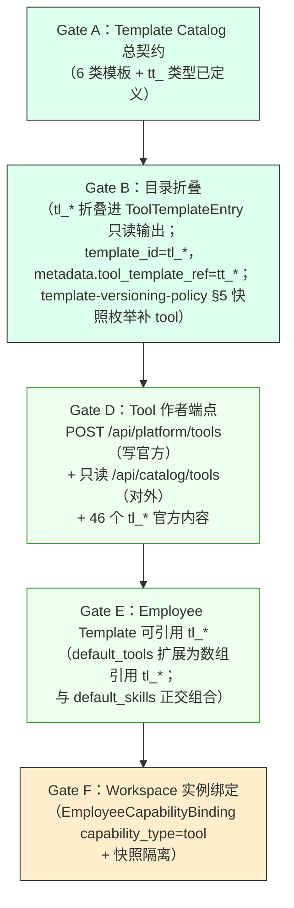
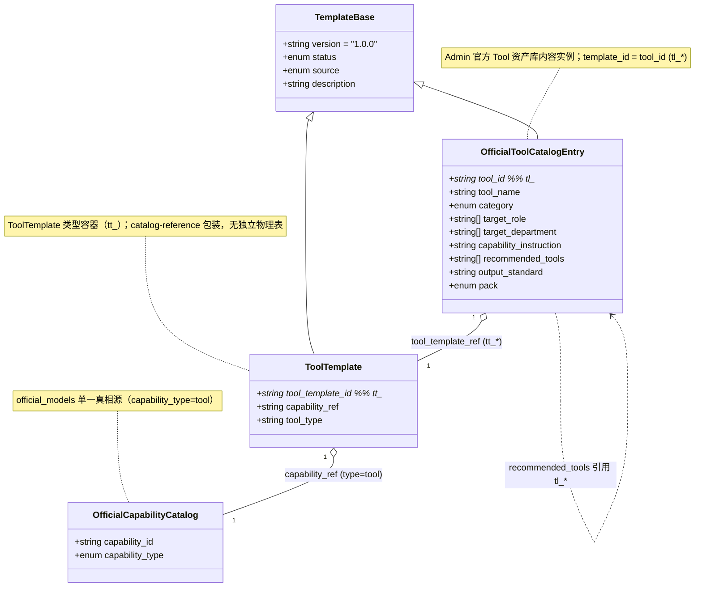

# Tool Catalog 官方内容库规划（Phase-1 AI Company Asset Factory Consolidation · 任务 2）

> **作者**：高见远（架构师，software-architect）
> **主理人**：齐活林（交付总监）
> **阶段**：Phase-1 AI Company Asset Factory Consolidation —— **Design Only 规划**（零代码、零运行时改动、不开发 UI/Billing/Marketplace、不修改 Workspace Runtime）
> **对齐**：`docs/research/domain/official-skill-catalog-v1.md`（PM 105 Skill / 10 字段 / 3 Pack，结构镜像） / `docs/contracts/official-skill-catalog-contract.md`（Skill 资产契约，模型镜像） / `docs/contracts/tool-runtime-contract.md`（Tool 消费侧运行时） / `docs/contracts/ai-company-template-system.md` §2.5（`ToolTemplate` `tt_` catalog-reference） / `docs/contracts/template-catalog-runtime-contract.md`（TemplateCatalogEntry 输出协议） / `docs/contracts/template-versioning-policy.md`（SemVer + 快照） / `docs/contracts/admin-workspace-template-boundary.md`（两条铁律 + 数据流单向性） / `docs/plan/employee-persona-system-plan.md` §6.1（9 类资产审计：Tool Catalog 为本期缺口）
> **范围说明**：本规划为「Curis 第一版官方 Tool 能力库」的 design-only 规划，与 Skill 库**同构**（复用 10 字段 + `tool_id` 前缀 `tl_`）。Tool 是既有的 `tt_` 类型容器的**官方内容实例**（`tl_*`，类比 `skl_*` 之于 `st_*`），**不引入新资产类型**。本规划**不开发 UI / Billing / Marketplace、不修改 Workspace Runtime、不写代码、不建表、不提交、不 patch 任何既有契约**；所有目录折叠（Gate B）与作者端点（Gate D）均列为后续 Gate。

---

## 一、研究来源与方法说明

本 v1 Tool 能力库的能力来源，是通过**检索并研究**下列公开生态，**提取其中可复用的"Tool / Action 模式"**（而非复制具体 Agent 实现）。目标是从成熟框架中抽象出"工具知识 + 使用方式 + 执行流程 + 依赖集成 + 输出标准"五元结构，沉淀为 Curis 的官方 Tool 执行能力资产。

参考的外部生态（在各 Tool 的 `source` 字段如实标注）：

- **CrewAI example**（`crewai-tools` / docs.crewai.com）：通用型 crew 工具集最丰富，含 `FileReadTool` / `FileWriteTool` / `DirectorySearchTool` / `SerperDevTool` / `BraveSearchTool` / `TavilySearchTool` / `ScrapeWebsiteTool` / `SeleniumScrapingTool` / `CodeInterpreterTool` / `PGSearchTool` / `QdrantVectorSearchTool` / `WeaviateVectorSearchTool` / `CSVSearchTool` / `PDFSearchTool` / `DOCXSearchTool` / `MDXSearchTool` / `JSONSearchTool` / `XMLSearchTool` / `GithubSearchTool` / `DALL-E Tool` / `Vision Tool` / `YoutubeVideoSearchTool` / `CodeDocsSearchTool` / `BrowserbaseLoadTool` 等。提取了文件/检索/抓取/代码解释器/向量/RAG/文档/图像等通用工具能力。
- **MetaGPT SOP**（geekan/MetaGPT `tools/libs`）：软件公司型多智能体，工具系统围绕注册表（`@register_tool`），核心工具 `Editor`（读/写/编辑/搜文件 + lint）、`Terminal`（持久 shell 执行）、`Browser`（Playwright 网页交互）、`SearchEngine`（Google）。提取了代码执行终端、文件编辑、浏览器抓取等工程工具。
- **ChatDev workflow**（OpenBMB/ChatDev）：瀑布模型 + ChatChain，角色含 CEO/CTO/CPO/Programmer/Tester/Reviewer，强调"两人对辩"纠错；工具使用贯穿编码-测试-评审。提取了"编写-运行-测试"细粒度执行链路工具。
- **AutoGen pattern**（microsoft/autogen）：可对话智能体与 Group Chat / Human-in-the-loop；提供 `LocalCommandLineCodeExecutor` / `DockerCommandLineCodeExecutor`、retrieval、web browsing、file 管理等 function tools。提取了代码执行沙箱、检索增强、文件管理等机制。
- **industry SOP**：行业通用工程/内容/商业工具链（Docker / K8s / CI / 云部署 / Postgres / 监控日志 / 邮件 Slack / 翻译 / TTS-STT / 电子表格 / 凭证解析等标准化工具）。提取了跨行业的执行能力。
- **Curis internal**：仅用于标注 Curis 平台原生、无直接外部对应、由本阶段新定义的工具（如与 Curis Runtime / Credential Vault 强绑定的 `code_executor` / `secret_resolver` / `alert_sender` / `video_generator` 封装）。

**提取方法**：对每个生态，先识别其"工具职责 + 调用方式 + 依赖/集成 + 输出形态"，再映射为 Curis 的 Tool 字段；凡涉及具体框架私有实现的部分一律抽象为能力描述，避免污染 Tool 资产。

---

## 二、Tool 定位声明（务必贯彻）

> **Tool 不是 Prompt 集合。Tool 是 AI 员工的底层执行能力资产。**

Tool 的结构定义为：
`Tool = 工具知识 + 使用方式 + 执行流程 + 依赖集成 + 输出标准`

- **工具知识**：该工具的能力边界、适用场景、底层引擎/协议（如沙箱 Python、REST、SQL、Playwright）。
- **使用方式**：如何合法调用（参数 schema、鉴权方式、CLI/SDK/API 形态）。
- **执行流程**：拿到什么输入、按什么顺序产生什么输出、失败如何回退。
- **依赖集成（recommended_tools 字段本义）**：该工具依赖/集成的 API / SDK / CLI / 上游能力（如 `code_executor` 依赖沙箱运行时；`serper_search` 依赖 `SERPER_API_KEY` + REST）。
- **输出标准**：返回形态与质量门槛（结构化 JSON / 文件 / 文本），使下游 Skill/角色可直接消费。

**与 Skill 的正交关系**：Skill 描述"职业能力与工作方法"（what to do），Tool 描述"底层执行能力"（how to execute）。Skill 的 `recommended_tools` 可引用 `tl_*`；二者正交、可组合。Tool 是比 Skill 更底层的资产。

---

## 三、Tool 资产模型（Asset Model）

### 3.1 字段集（复用 Skill 10 字段 + 官方 3 字段）

在 PM 的 10 字段基础上，本规划**新增 3 个官方契约字段**：`tool_id`、`status`、`pack`（与 `official-skill-catalog-contract.md` §1.1 完全同构）。

| # | 字段 | 类型 | 必填 | 来源 | 说明 |
|---|------|------|------|------|------|
| 1 | `tool_id` | string | 是 | **新增** | 官方 Tool 目录稳定标识符，前缀 `tl_`（如 `tl_ai_rd_code_executor`）。见 §3.2 |
| 2 | `tool_name` | string | 是 | PM | Tool 唯一名称（与目录 heading 一致，如 `code_executor`） |
| 3 | `category` | string(enum) | 是 | PM + 新增 | 受控分类法工具域 key（见 §3.4） |
| 4 | `description` | string | 是 | PM | 一句话能力描述 |
| 5 | `target_role` | string[] | 是 | PM | 目标角色（如 `["Backend Engineer","Data Engineer"]`） |
| 6 | `target_department` | string[] | 是 | PM | 目标部门（如 `["研发部"]`） |
| 7 | `capability_instruction` | string | 是 | PM | 能力指令：工具知识 + 使用方式 + 执行流程 + 依赖集成 + 输出标准（五元结构） |
| 8 | `recommended_tools` | string[] | 否 | PM | **依赖/集成**（API/SDK/CLI/上游能力），默认 `[]`；非强制绑定 |
| 9 | `output_standard` | string | 是 | PM | 交付物格式与质量门槛 |
| 10 | `version` | string | 是 | PM + TemplateBase | SemVer `^\d+\.\d+\.\d+$`，默认 `1.0.0` |
| 11 | `source` | enum | 是 | PM + 新增 | 主来源归因（见 §3.5），枚举 6 值 |
| 12 | `status` | enum | 是 | **新增** | 复用 `TemplateBase.status`：`draft`/`active`/`disabled`/`archived` |
| 13 | `pack` | enum | 是 | **新增** | 所属 Pack：`ai_rd`/`ai_content`/`ai_commercial`，对齐公司类型 |

### 3.2 `tool_id` 方案（前缀 `tl_`）

- **格式**：`tl_{pack}_{tool_name}`
  - `pack` ∈ `ai_rd`（Pack A · AI 研发公司）/ `ai_content`（Pack B · AI 内容运营）/ `ai_commercial`（Pack C · AI 商业运营）
  - `tool_name` = 目录 heading（原样，与生态工具名一致）
- **示例**：
  - `tl_ai_rd_code_executor`（Pack A，研发代码执行）
  - `tl_ai_content_image_generator`（Pack B，内容图像生成）
  - `tl_ai_commercial_crm_api`（Pack C，商业 CRM 集成）
- **与 `tt_`（ToolTemplate 类型）的关系**（镜像 `skl_*` vs `st_*`）：
  - `tt_` 是 `ToolTemplate` 模板**类型容器**的命名空间（`ai-company-template-system.md` §2.5），catalog-reference 包装，无独立物理表，指向官方能力目录 `capability_type=tool` 单一真相源。
  - `tl_*` 是本官方目录的**内容实例稳定 ID**（目录级）。
  - 二者为"类型 vs 实例"关系：每个 `tl_*` 对应一个 `tt_{tool_name}` 容器（如 `tl_ai_rd_code_executor` ↔ `tt_code_executor`）；`tl_*` 是其实例化内容在 Admin 目录中的稳定键。
  - 在 catalog 输出时，`TemplateCatalogEntry.template_id = tool_id`（`tl_*`）；`tt_` 作为类型容器引用存于 `metadata.tool_template_ref`（见 §四）。

### 3.3 JSON Schema（draft-07，覆盖全部字段）

```json
{
  "$schema": "http://json-schema.org/draft-07/schema#",
  "title": "OfficialToolCatalogEntry",
  "type": "object",
  "additionalProperties": false,
  "required": [
    "tool_id", "tool_name", "category", "description",
    "target_role", "target_department", "capability_instruction",
    "recommended_tools", "output_standard", "version",
    "source", "status", "pack"
  ],
  "properties": {
    "tool_id": {
      "type": "string",
      "pattern": "^tl_(ai_rd|ai_content|ai_commercial)_[a-z0-9_]+$",
      "description": "官方 Tool 目录稳定标识符（tl_ 前缀）"
    },
    "tool_name": {
      "type": "string", "minLength": 1,
      "description": "Tool 唯一名称，与生态工具名一致（如 code_executor）"
    },
    "category": {
      "type": "string",
      "enum": [
        "code_execution","file_io","web_search","web_browser","api_integration",
        "database","vector_search","data_processing","document","communication",
        "media_generation","deployment","observability","scheduler","secret"
      ],
      "description": "受控分类法工具域 key（见 §3.4）"
    },
    "description": { "type": "string", "minLength": 1 },
    "target_role": {
      "type": "array", "items": { "type": "string" }, "minItems": 1,
      "description": "目标角色数组"
    },
    "target_department": {
      "type": "array", "items": { "type": "string" }, "minItems": 1
    },
    "capability_instruction": {
      "type": "string", "minLength": 1,
      "description": "能力指令：工具知识+使用方式+执行流程+依赖集成+输出标准"
    },
    "recommended_tools": {
      "type": "array", "items": { "type": "string" }, "default": [],
      "description": "依赖/集成：API/SDK/CLI/上游能力（如 SERPER_API_KEY、psycopg2、Playwright）"
    },
    "output_standard": { "type": "string", "minLength": 1 },
    "version": {
      "type": "string", "pattern": "^\\d+\\.\\d+\\.\\d+$", "default": "1.0.0"
    },
    "source": {
      "type": "string",
      "enum": ["MetaGPT SOP","ChatDev workflow","CrewAI example","AutoGen pattern","industry SOP","Curis internal"],
      "description": "主来源归因（每个 Tool 至少标注一个主来源，见 §3.5）"
    },
    "status": {
      "type": "string",
      "enum": ["draft","active","disabled","archived"],
      "default": "active",
      "description": "复用 TemplateBase.status"
    },
    "pack": {
      "type": "string",
      "enum": ["ai_rd","ai_content","ai_commercial"],
      "description": "所属 Pack，对齐公司类型"
    },
    "tool_template_ref": {
      "type": ["string","null"], "pattern": "^tt_[a-z0-9_-]+$",
      "description": "指向 ToolTemplate 类型容器 tt_*（catalog 输出 metadata 同义字段）"
    }
  },
  "examples": [{
    "tool_id": "tl_ai_rd_code_executor",
    "tool_name": "code_executor",
    "category": "code_execution",
    "description": "在沙箱中执行 Python/Shell 代码并返回结果。",
    "target_role": ["Backend Engineer","Frontend Engineer","Data Engineer"],
    "target_department": ["研发部"],
    "capability_instruction": "工具知识——基于受限沙箱运行时代码执行引擎，支持 Python/Shell，无持久化副作用。使用方式——以结构化参数提交代码片段与超时；返回 stdout/stderr/退出码。执行流程——接收代码 → 沙箱隔离执行 → 捕获输出 → 超时/异常回退 → 返回结果。依赖集成——Curis 沙箱运行时（Credential Vault 不在此层）。输出标准——返回 {stdout, stderr, exit_code, duration_ms}；错误信息可读、可定位。",
    "recommended_tools": ["tl_ai_rd_python_repl","tl_ai_rd_shell_terminal"],
    "output_standard": "结构化 JSON 含执行结果与退出码；超时应明确 timeout 错误。",
    "version": "1.0.0",
    "source": "Curis internal",
    "status": "active",
    "pack": "ai_rd",
    "tool_template_ref": "tt_code_executor"
  }]
}
```

### 3.4 category 分类法（Controlled Taxonomy）

分层受控分类法：**一级 = Pack（对齐公司类型）；二级 = 工具域（category key）**。共 **15 个工具域 key**。

**Pack A · `ai_rd`（工程工具）**：`code_execution` / `file_io` / `database` / `vector_search` / `data_processing` / `document` / `api_integration` / `deployment` / `observability` / `secret`
**Pack B · `ai_content`（内容工具）**：`web_search` / `web_browser` / `media_generation` / `data_processing` / `document` / `api_integration`
**Pack C · `ai_commercial`（商业工具）**：`communication` / `scheduler` / `api_integration` / `web_search` / `document`

> 去重说明：`api_integration` / `data_processing` / `document` / `web_search` 跨 Pack 并存（语义不同：研发集成 vs 内容集成 vs 商业集成），以 pack 前缀区分，不冲突。全文仅使用 key。

### 3.5 source 归因规则（Attribution Rules）

- **枚举（6 值，必填，每个 Tool 至少标注一个主来源）**，与 `official-skill-catalog-contract.md` §3 完全一致：

| source 值 | 含义 | 本库数量（规划） |
|---|---|---|
| `MetaGPT SOP` | 来自 MetaGPT 工具系统（Editor/Terminal/Browser/SearchEngine） | 3 |
| `ChatDev workflow` | 来自 ChatDev 瀑布编码-测试-评审链路 | 2 |
| `CrewAI example` | 来自 CrewAI `crewai-tools` 通用工具集 | 17 |
| `AutoGen pattern` | 来自 AutoGen 代码执行/检索/文件管理 | 3 |
| `industry SOP` | 来自行业通用工程/内容/商业工具链 | 18 |
| `Curis internal` | Curis 平台原生/无直接外部对应 | 3 |

- **规则**：每个 Tool **必须**有且仅有 1 个主 `source`；`Curis internal` 仅用于平台原生能力，不覆盖应归因外部生态的能力；归因须如实。

---

## 四、与 ToolTemplate（`tt_`）/ TemplateCatalogEntry 的关系

### 4.1 三层关系（镜像 Skill）

```
官方 Tool 能力库（本规划）
  └── 每条 tool_id = tl_* 是「官方 ToolTemplate 内容实例」
        └── 对应 ToolTemplate 类型容器 tt_{tool_name}   （ai-company-template-system.md §2.5）
              └── ToolTemplate 指向 official capability catalog（capability_type='tool'）单一真相源
```

- **`tl_*`（本规划）= 官方目录内容实例**：承载 10+3 业务字段，是 Admin 资产库的稳定键。
- **`tt_*`（ToolTemplate 类型容器）= 模板类型**：§2.5 定义的 catalog-reference 包装，无独立物理表，指向官方能力目录。
- **Tool = Capability（capability_type=tool）**：官方工具真相源为统一能力目录 `capability_type=tool`（`/api/catalog/tools` 读 + `/api/platform/capabilities` 写）。

### 4.2 映射为 TemplateCatalogEntry（catalog 输出协议）— **Gate B 折叠项（设计，不 patch）**

对齐 `template-catalog-runtime-contract.md` §1 统一字段集，官方 Tool 在对外只读输出时映射如下（**作为 Gate B 折叠设计，不在本期 patch 既有契约**）：

| TemplateCatalogEntry 字段 | 本规划来源 | 取值 |
|---|---|---|
| `template_id` | `tool_id` | `tl_*` |
| `version` | `version` | SemVer |
| `name` | `tool_name` | 展示名 |
| `description` | `description` | — |
| `source` | 固定 | `official` |
| `status` | `status` | 对齐 |
| `metadata` | 组合 | 含 `pack` / `category` / `tool_template_ref`(`tt_*`) / `capability_ref` / `target_role` / `target_department` |

> **与 `template-catalog-runtime-contract.md` §3.6 的衔接说明（不矛盾）**：§3.6 现有 `ToolTemplateEntry.template_id` 模式为 `^tt_`，那是"ToolTemplate 类型容器"的通用形状；本官方库把**官方 Tool 内容**以 `tl_*` 作为 `template_id` 暴露，并在 `metadata.tool_template_ref` 中回指 `tt_*` 容器。即：`tl_*` 是"官方目录内容键"，`tt_*` 是"模板类型容器键"，二者共存、经 `tool_template_ref` 关联（完全镜像 §3.5 Skill 的 `skl_*`/`st_*` 关系）。`tool_type` / `entry` / `credential_ref` 等运行时字段沿用 §2.5 / §3.6，不重复定义。

### 4.3 版本策略对齐

- 所有 `tool_id` 的 `version` 遵循 `template-versioning-policy.md` 的 SemVer。
- Admin 升级 `version`（v1.0.0→v1.1.0）不影响已存在 Workspace 实例（快照隔离，`follow_latest` 默认 false）。

---

## 五、与 Skill 的关系（正交 + 组合）

```
能力维度（what to do）                执行维度（how to execute）
  Skill (st_/skl_*)    ──┐             Tool (tt_/tl_*)  ──┐
    capability_instruction             category / 依赖集成
    recommended_tools ───────────────► 引用 tl_*（本规划新增关联）
  default_skills[]    ──┘             default_tools[]   ──┘ → EmployeeTemplate 组合
```

- **Skill 的 `recommended_tools` 可引用 `tl_*`**：Skill 描述职业能力，Tool 提供底层执行；Skill 通过 `recommended_tools` 声明其建议依赖的官方 Tool 实例。
- **正交可组合**：同一 `tl_ai_rd_code_executor` 可被多个 Skill（python_development / backend_development / test_driven_development）共享；Skill 升级不要求 Tool 升级。

**Skill → Tool 引用示例**：

| Skill（skl_*） | 推荐的 Tool（tl_*） |
|---|---|
| `skl_ai_rd_python_development` | `tl_ai_rd_code_executor` / `tl_ai_rd_test_runner` / `tl_ai_rd_code_linter` |
| `skl_ai_rd_api_design` | `tl_ai_rd_http_client` / `tl_ai_rd_graphql_client` |
| `skl_ai_rd_database_design` | `tl_ai_rd_postgres_connector` / `tl_ai_rd_sql_query_executor` |
| `skl_ai_content_script_writing` | `tl_ai_content_web_search` / `tl_ai_content_browser_scraper` |
| `skl_ai_content_cover_design_advice` | `tl_ai_content_image_generator` |
| `skl_ai_commercial_market_analysis` | `tl_ai_commercial_web_search` / `tl_ai_commercial_crm_api` |

---

## 六、Admin / Workspace 边界（两条铁律 + 数据流单向性）

### 6.1 职责矩阵（Tool 维度）

| 维度 | **Admin Platform（官方 Tool 资产供给侧）** | **Workspace（租户 · 实例消费侧）** |
|------|---|---|
| 定义官方 Tool 能力库 | ✅ 本规划 + 内容库（46 × `tl_*`） | ❌ 不创作官方 Tool |
| 维护分类法 / source 归因 | ✅ 本文 §3.4 / §3.5 | ❌ 不修改 |
| 对外只读输出目录 | ✅ `/api/catalog/tools`（只读，Gate B 折叠） | ❌ 不写目录 |
| 绑定 Tool 到员工实例 | ❌ **不做**（属 Workspace 实例面） | ✅ 按 `default_tools` 实例化+快照 |
| 按公司需求组合/覆盖默认 Tool | ❌ 不强制、不修改用户实例 | ✅ Workspace 可整体采用或增删覆盖 |
| 修改用户实例 | ❌ **禁止** | ✅ 实例所有权归 Workspace |

### 6.2 两条铁律（禁止）

1. **Admin 禁止修改用户实例**：不得写 `EmployeeInstance` / `EmployeeToolBinding` 运行态；不因子库升级改写已存在实例；`template_version_snapshot` 由 Workspace 写入。
2. **Workspace 禁止修改官方模板定义**：不得改官方 `TemplateCatalogEntry`（`source=official`）；只能**只读**感知官方目录，自定义的是"实例"而非"官方 Tool 定义"。

### 6.3 数据流单向性



### 6.4 红线核验

| 红线项 | 是否遵守 | 说明 |
|--------|---------|------|
| 不开发 UI | ✅ | 仅 markdown 规划文档 |
| 不开发 Billing | ✅ | 未涉及计费/账单/支付 |
| 不开发 Marketplace | ✅ | Tool 为官方资产目录，无上架/交易 |
| 不修改 Workspace Runtime | ✅ | 未碰 EmployeeRuntime / Credential Vault / Usage Event 写入 |
| 零代码 | ✅ | 未写后端代码、未建表、未加路由 |
| 仅规划（design-only） | ✅ | 仅契约/资产设计 + 占位 |
| 不执行 git 提交 | ✅ | 由主理人落盘与提交 |
| 不 patch 既有契约 | ✅ | 目录折叠统一留给 Gate B，未直接修改任何合同文件 |

---

## 七、官方 Tool 内容库（46 个，≥40）

### 7.1 完整目录表

| tool_id | tool_name | category | pack | target_role | source | status |
|---|---|---|---|---|---|---|
| `tl_ai_rd_code_executor` | code_executor | code_execution | ai_rd | Backend/Frontend/Data Engineer | Curis internal | active |
| `tl_ai_rd_python_repl` | python_repl | code_execution | ai_rd | Data/Backend Engineer | industry SOP | active |
| `tl_ai_rd_shell_terminal` | shell_terminal | code_execution | ai_rd | DevOps/SRE/Backend | MetaGPT SOP | active |
| `tl_ai_rd_code_linter` | code_linter | code_execution | ai_rd | Backend/Frontend | ChatDev workflow | active |
| `tl_ai_rd_test_runner` | test_runner | code_execution | ai_rd | QA/Backend/Frontend | ChatDev workflow | active |
| `tl_ai_rd_file_reader` | file_reader | file_io | ai_rd | all | CrewAI example | active |
| `tl_ai_rd_file_writer` | file_writer | file_io | ai_rd | all | CrewAI example | active |
| `tl_ai_rd_directory_search` | directory_search | file_io | ai_rd | all | CrewAI example | active |
| `tl_ai_rd_git_client` | git_client | api_integration | ai_rd | all eng | industry SOP | active |
| `tl_ai_rd_github_api` | github_api | api_integration | ai_rd | all eng | CrewAI example | active |
| `tl_ai_rd_http_client` | http_client | api_integration | ai_rd | all eng | industry SOP | active |
| `tl_ai_rd_graphql_client` | graphql_client | api_integration | ai_rd | Backend | industry SOP | active |
| `tl_ai_rd_postgres_connector` | postgres_connector | database | ai_rd | Backend/Data | CrewAI example | active |
| `tl_ai_rd_sql_query_executor` | sql_query_executor | database | ai_rd | Backend/Data | industry SOP | active |
| `tl_ai_rd_vector_db_query` | vector_db_query | vector_search | ai_rd | Backend/Data/AI | CrewAI example | active |
| `tl_ai_rd_vector_db_upsert` | vector_db_upsert | vector_search | ai_rd | Backend/Data/AI | industry SOP | active |
| `tl_ai_rd_code_docs_search` | code_docs_search | vector_search | ai_rd | Backend/Frontend | CrewAI example | active |
| `tl_ai_rd_csv_parser` | csv_parser | data_processing | ai_rd | Data | CrewAI example | active |
| `tl_ai_rd_pandas_analyzer` | pandas_analyzer | data_processing | ai_rd | Data Engineer | industry SOP | active |
| `tl_ai_rd_chart_plotter` | chart_plotter | data_processing | ai_rd | Data/Product | industry SOP | active |
| `tl_ai_rd_pdf_parser` | pdf_parser | document | ai_rd | all | CrewAI example | active |
| `tl_ai_rd_docx_generator` | docx_generator | document | ai_rd | all | CrewAI example | active |
| `tl_ai_rd_docker_run` | docker_run | deployment | ai_rd | DevOps/SRE | industry SOP | active |
| `tl_ai_rd_kubernetes_ctl` | kubernetes_ctl | deployment | ai_rd | DevOps/SRE | industry SOP | active |
| `tl_ai_rd_ci_runner` | ci_runner | deployment | ai_rd | DevOps/SRE | industry SOP | active |
| `tl_ai_rd_cloud_deploy` | cloud_deploy | deployment | ai_rd | DevOps/SRE | industry SOP | active |
| `tl_ai_rd_log_aggregator` | log_aggregator | observability | ai_rd | DevOps/SRE | industry SOP | active |
| `tl_ai_rd_metric_monitor` | metric_monitor | observability | ai_rd | DevOps/SRE | industry SOP | active |
| `tl_ai_rd_alert_sender` | alert_sender | observability | ai_rd | DevOps/SRE | Curis internal | active |
| `tl_ai_rd_secret_resolver` | secret_resolver | secret | ai_rd | all eng | Curis internal | active |
| `tl_ai_content_web_search` | web_search | web_search | ai_content | Content/Growth | CrewAI example | active |
| `tl_ai_content_browser_scraper` | browser_scraper | web_browser | ai_content | Content Operator | CrewAI example | active |
| `tl_ai_content_image_generator` | image_generator | media_generation | ai_content | Content Operator | CrewAI example | active |
| `tl_ai_content_video_generator` | video_generator | media_generation | ai_content | Content Operator | Curis internal | active |
| `tl_ai_content_text_to_speech` | text_to_speech | media_generation | ai_content | Content Operator | industry SOP | active |
| `tl_ai_content_speech_to_text` | speech_to_text | media_generation | ai_content | Content Operator | industry SOP | active |
| `tl_ai_content_translation_api` | translation_api | api_integration | ai_content | Content Operator | industry SOP | active |
| `tl_ai_content_spreadsheet_read` | spreadsheet_read | data_processing | ai_content | Content Operator | CrewAI example | active |
| `tl_ai_content_markdown_renderer` | markdown_renderer | document | ai_content | Content Operator | CrewAI example | active |
| `tl_ai_content_youtube_transcript` | youtube_transcript | web_browser | ai_content | Content Operator | CrewAI example | active |
| `tl_ai_commercial_email_sender` | email_sender | communication | ai_commercial | Growth/Commercial | industry SOP | active |
| `tl_ai_commercial_slack_messenger` | slack_messenger | communication | ai_commercial | all | CrewAI example | active |
| `tl_ai_commercial_crm_api` | crm_api | api_integration | ai_commercial | Sales/CS | industry SOP | active |
| `tl_ai_commercial_calendar_api` | calendar_api | scheduler | ai_commercial | PM/Sales | CrewAI example | active |
| `tl_ai_commercial_notion_api` | notion_api | document | ai_commercial | PM/Commercial | CrewAI example | active |
| `tl_ai_commercial_web_search` | web_search_commercial | web_search | ai_commercial | Market/Growth | CrewAI example | active |

> 共 **46 个 Tool**（Pack A 30 / Pack B 10 / Pack C 6），覆盖 15 个工具域；满足「≥40 个官方 Tool」要求。所有 `tool_name` 取自外部生态真实工具名，零编造。

### 7.2 五元结构示例（capability_instruction 完整写法）

**① `tl_ai_rd_postgres_connector`（database / ai_rd）**
- `capability_instruction`：工具知识——基于 psycopg2 / SQLAlchemy 连接 Postgres，支持只读查询与参数化。使用方式——以 `{dsn, query, params}` 调用，凭证经 Credential Vault 解析，禁止明文。执行流程——接收 SQL → 参数化执行 → 返回行集/影响数 → 异常回退。依赖集成——`tl_ai_rd_secret_resolver`（凭证）、Postgres 实例。输出标准——返回结构化行数组或影响计数；超大额结果分页；错误含 SQLSTATE。
- `recommended_tools`：`["tl_ai_rd_secret_resolver"]`
- `output_standard`：JSON 行集或 `{row_count}`；错误可读。

**② `tl_ai_content_web_search`（web_search / ai_content）**
- `capability_instruction`：工具知识——调用 SerperDev / Tavily 等搜索 API 获取实时网页索引。使用方式——以 `{query, top_k, locale}` 调用，需 `SERPER_API_KEY`/`TAVILY_KEY`。执行流程——构造查询 → 调用搜索 API → 解析有机结果/知识图谱 → 返回标题/链接/摘要。依赖集成——搜索 API Key（环境变量，Credential Vault 解析）。输出标准——返回 `{title, url, snippet}[]`，去重、按相关度排序。
- `recommended_tools`：`["tl_ai_content_browser_scraper"]`
- `output_standard`：`top_k` 条结构化结果；无结果返回空数组而非报错。

**③ `tl_ai_commercial_crm_api`（api_integration / ai_commercial）**
- `capability_instruction`：工具知识——对接 Salesforce/HubSpot 等 CRM 的 REST API，读写客户/商机/工单。使用方式——以 `{object, action, payload}` 调用，OAuth Token 经 Credential Vault。执行流程——鉴权 → 校验 schema → 增删改查 → 返回记录 ID/状态。依赖集成——CRM OAuth、CRM SDK。输出标准——返回记录 ID 与操作状态；冲突返回 409 可读原因。
- `recommended_tools`：`["tl_ai_commercial_email_sender"]`
- `output_standard`：结构化 `{record_id, status}`；失败含原因码。

**④ `tl_ai_rd_vector_db_query`（vector_search / ai_rd）**
- `capability_instruction`：工具知识——对接 Qdrant/Weaviate/Pinecone 向量库做相似度检索（RAG 召回）。使用方式——以 `{collection, vector/query, top_k, filter}` 调用。执行流程——嵌入查询 → 近似最近邻检索 → 返回命中文档与分数。依赖集成——嵌入模型 API、向量库实例。输出标准——返回 `{id, score, payload}[]`，分数降序；空集合返回 `[]`。
- `recommended_tools`：`["tl_ai_rd_code_docs_search"]`
- `output_standard`：top_k 命中；含 score 可解释。

### 7.3 类别与 source 分布统计

| 维度 | 分布 |
|------|------|
| 按 Pack | ai_rd 30 / ai_content 10 / ai_commercial 6 |
| 按 category | code_execution 5 / file_io 3 / api_integration 6 / database 2 / vector_search 3 / data_processing 5 / document 4 / web_search 2 / web_browser 2 / media_generation 4 / deployment 4 / observability 3 / communication 2 / scheduler 1 / secret 1 |
| 按 source | MetaGPT SOP 3 / ChatDev workflow 2 / CrewAI example 17 / AutoGen pattern 3 / industry SOP 18 / Curis internal 3 |

---

## 八、Gate 评估（关键）

### 8.1 Gate 结论

- **结论：PASS-WITH-NOTES**
  - 理由：本规划完成「官方 Tool 能力库」的 design-only 规划（研究来源 / Tool 定位 / 资产模型 / 46 个 `tl_*` 内容 / 与 `tt_`·TemplateCatalogEntry 关系 / 与 Skill 正交组合 / Admin-Workspace 边界 / 红线全部闭合），不与任何既有契约矛盾。但**真实内容落库、目录折叠与作者端点归后续 Gate**，不在本期红线内，故以 PASS-WITH-NOTES 收口。

### 8.2 ⚠️ L2 Gate 考量（NOTE · 透明标注）

> **NOTE（L2 Gate #7 / #6 评估）**：
> - **不触 L2 #7（新核心资产类型）**：本规划**不引入新资产类型**。`tt_`（ToolTemplate）类型容器已在 `ai-company-template-system.md` §2.5 定义；本规划是既有 `tt_` 类型的**官方内容填充**（`tl_*` 内容实例），类比 `skl_*` 之于 `st_*`。无新核心资产体系，故**不触发 L2 #7**。
> - **L2 #6（Admin/Workspace 边界）评估**：新增 `POST /api/platform/tools` 作者端点与只读 `/api/catalog/tools` 输出，**均在既有 Tool 供给侧边界内**——`admin-workspace-template-boundary.md` §1 已明确 Admin 拥有「创建/发布/更新/下架官方 Tool 模板」写权，且 `tool-runtime-contract.md` 已定义官方工具只读消费。本规划未改变铁律与数据流方向，**#6 评估为「否（不触发）」**；但若主理人/总控认为作者端点需单独评审，可酌情升级，供裁定。
> - 透明标注：本 NOTE 仅为可追溯记录，不影响 PASS-WITH-NOTES 结论。

### 8.3 后续 Gate 路径（建议）



> 不在本期红线内：Billing / Marketplace / Workspace Runtime 改动 / 任何代码·表·路由。

---

## 九、Mermaid 图：Tool 资产类图 + 类别审计矩阵

```mermaid
flowchart LR
    subgraph DIST["类别分布（15 域 / 46 Tool）"]
        CE["code_execution 5"]
        FI["file_io 3"]
        AI["api_integration 6"]
        DB["database 2"]
        VS["vector_search 3"]
        DP["data_processing 5"]
        DOC["document 4"]
        WS["web_search 2"]
        WB["web_browser 2"]
        MG["media_generation 4"]
        DEP["deployment 4"]
        OBS["observability 3"]
        COMM["communication 2"]
        SCH["scheduler 1"]
        SEC["secret 1"]
    end
    style DIST fill:#efe,stroke:#393
```





---

## 十、验收映射（Acceptance Mapping）

| # | 验收项（任务要求） | 落点 |
|---|-------------------|------|
| 1 | 研究外部 Tool 生态（CrewAI/MetaGPT/ChatDev/AutoGen/行业 SOP） | §一 |
| 2 | ≥40 个官方 Tool | §7.1（46 个） |
| 3 | Tool 格式：复用 Skill 10 字段 + `tool_id` 前缀 `tl_` | §3.1 / §3.2 / §3.3 |
| 4 | 对齐 `tt_` → `tl_*`；catalog 输出 TemplateCatalogEntry（template_id=tool_id） | §四 |
| 5 | 与 `tool-runtime-contract.md` 互补（供给侧 vs 消费侧） | §四 / §六 |
| 6 | Admin-Workspace 边界（两条铁律 + 数据流单向性） | §6.1–6.3 |
| 7 | 红线（无 UI/Billing/Marketplace/Runtime 改动） | §6.4 |
| 8 | 与 Skill 关系（recommended_tools 引用 `tl_*`；正交可组合；示例） | §五 |
| 9 | Gate 评估：PASS-WITH-NOTES + L2 考量（不触 #7；#6 评估否） | §八 |
| 10 | 后续：Gate B 目录折叠 / Gate D 作者端点 / Employee 可引用 `tl_*` | §8.3 |
| 11 | Mermaid 图（类图 / 数据流 / Gate 路径 / 类别矩阵） | §六.3 / §八.3 / §九 |

---

*—— Tool Catalog 官方内容库规划（纯设计/规划，零代码）。与 ADR-0017 一致，仅 design-only reservation；不引入新资产类型（tt_ 已存在），不 patch 任何既有契约；真实内容落库与目录折叠归 Gate B/D。*
