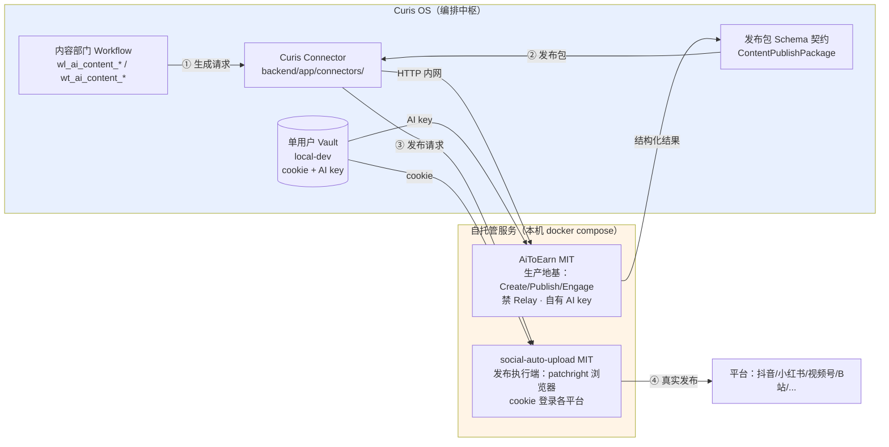
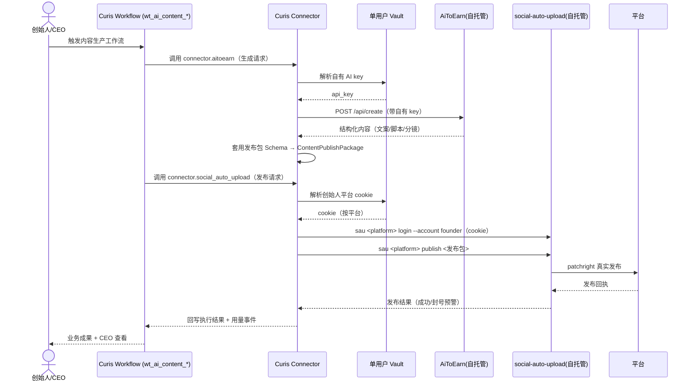
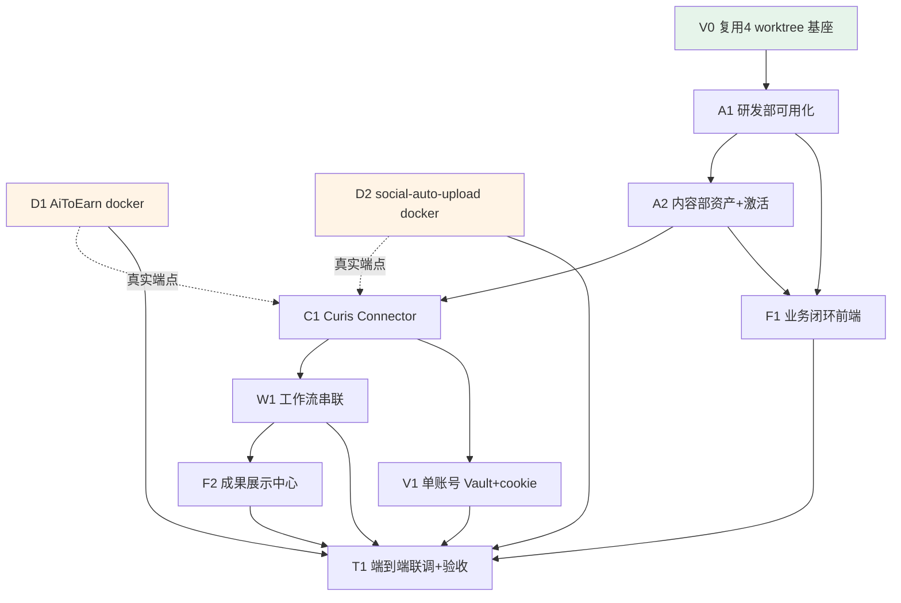

# Curis v1 自用版本 · 系统架构设计 + 任务分解

> 产出人：软件架构师 高见远（Gao）
> 日期：2026-07-13
> 输入（已读）：`content-department-phase1-dev-spec.md`、`v2-p0p1-architect-brief/review/impl-design.md`、`2026-07-12_Curis_自用版本开发冲刺决议.md`、根目录 `PROJECT_STATUS.md` / `knowledge/NOW.md` / `TASKS.md`、`docs/product/ai-content-publish-package.md`，并实地核查了 `curis.sqlite` 与 `backend/app/*`、`frontend/app/*`、4 个可复用 worktree。
> 用户裁定（verbatim 拆解）：Admin 按终局设计；v1 仅落「研发部 + 内容增长部」两个真实部门；本地自运行、账号只开创始人一人；内容增长部严格按 spec 实现；多租户→单账号适配；研发部复用既有 `skl_ai_rd_*`/`tl_ai_rd_*` seed 做「运行时可用化」。

---

## 0. 现役资产核查（实测，非凭空）

| 维度 | 实测（curis.sqlite / 代码） | 含义 |
|---|---|---|
| `skill_templates` | 55 行（**52 个 `skl_ai_rd_*`** + 3 official） | 研发部技能已 seed ✅ |
| `tool_templates` | 61 行（**30 个 `tl_ai_rd_*`** + 31 其他；注：非 impl-design 声称的 115） | 研发部工具已 seed ✅ |
| `workflow_templates` | 17 行，全部 `department_type='software_rnd'`（1 official + **16 `wt_*` 容器**） | `wl_ai_rd_*` 是逻辑名，`wt_*` 是库内容器，1:1 映射 ✅ |
| `department_templates` | 2 行：`official.department.software_rnd`、`dt_engineering`（均指向 `software_rnd`） | 研发部模板存在 ✅ |
| `company_packages` | 1 行：`ccp_ai_software_company`（pack=`ai_rd`，聚合 6 et_*/4 pt_*/6 skl_ai_rd_*/6 tl_ai_rd_*/6 wl_ai_rd_*） | 研发部出厂包存在 ✅ |
| `department_types` | 4 行（business.general / function.admin / function.bi / function.hr） | **无 `ai_rd` / `ai_content`** —— 两部门尚未登记到系统级目录 ⚠️ |
| `departments`（实例） | **0 行** | 两部门均**未实例化** ⚠️ |
| `tenant_department_activations` | 0 行 | 两部门均**未激活** ⚠️ |
| `credential_metadata` | 0 行 | Vault 单用户尚未写入 ⚠️ |
| 内容增长部资产 | `skl_ai_content_*`=0、`tl_ai_content_*`=0、`wl_ai_content_*`=12（设计态，在 `workflow-official-content-plan.md`，库内 0 行） | 内容部**纯设计态，运行态空** ⚠️ |
| `backend/app/connectors/` | **不存在** | Curis→自托管服务的连接器模块需新建 ⚠️ |
| `CredentialVaultService` | 存在，含 `LocalDevCredentialBackend`（进程内 + `credential_metadata` 仅存摘要/不存明文）+ `vault://`/`kms://` 预留 scheme | 单账号 Vault 可直接复用 ✅ |
| `usage_meter.py` / `model_gateway.py` | 存在；model_gateway 用 `CURIS_MODEL_GATEWAY_API_KEY` | P0.6 成本统计 / 自有 AI key 注入有基座 ✅ |

**结论性事实**：研发部资产「已 seed 但**未实例化、未激活、工具未真正跑通**」；内容增长部资产「**设计态、库内 0 行**」。v1 的两件事 = ① 把研发部做成"运行时可用"的真实部门；② 把内容增长部从设计态填充为运行态真实部门，并接上自托管执行端。

---

## 1. Admin 终局架构（v1 仅落两部门，向前兼容）

### 1.1 设计原则

- **部门 = 系统级目录条目（`department_types`）+ 部门模板（`department_templates`）+ 资产集合（`skl_*`/`tl_*`/`wt_*`）+ 可选出厂包（`company_packages`）**。这是现役 `ai_rd` 已验证的模式，v1 原样复用并补两部门。
- **终局扩展点 = 往 `department_types` 加条目**（如未来加「设计部」「运营部」），**不依赖多租户**、不锁死未来商业化。单租户（`tenant_id='default'`）贯穿始终（见 `department_catalog.py`：`create_department` 强制 `tenant_id==DEFAULT_TENANT`，系统级共享目录）。
- **冻结项直接不建**：新商业包前缀 `ccp_/ct_/dt_/et_/skl_ai_commercial_*`、Marketplace、收费 `cmcf_*`、外部 Agent 生态、多租户商业化 —— 一律零触碰（见 §7）。

### 1.2 部门资产装配契约（两部门共用同一套接缝）

| 层 | 研发部（复用） | 内容增长部（v1 新建） | 说明 |
|---|---|---|---|
| `department_types` 目录键 | `ai.rd`（新增登记，映射 `software_rnd`） | `ai.content`（新增登记） | 系统级目录，激活用 |
| `department_templates` | `dt_engineering`（已存在） | `dt_ai_content`（新建） | `default_capability_types_json` 含 `"connector"` |
| 技能 `skl_*` | `skl_ai_rd_*`（52，已 seed） | `skl_ai_content_*`（≤33，需 seed） | 内容部前缀**不在冻结列表** |
| 工具 `tl_*` | `tl_ai_rd_*`（30，已 seed） | `tl_ai_content_*`（≤10+，需 seed） | 同上 |
| 工作流容器 `wt_*` | `wt_*`（16，已 seed，`department_type='software_rnd'`） | `wt_ai_content_*`（12，需 seed） | 对齐 12 个 `wl_ai_content_*` |
| 逻辑工作流 `wl_*` | `wl_ai_rd_*`（6，在 `company_packages.work_flow_refs_json`） | `wl_ai_content_*`（12，在 `workflow-official-content-plan.md`） | 库内存 `wt_*`，逻辑名 `wl_*` |
| 出厂包 `company_packages` | `ccp_ai_software_company`（已存在，复用） | **不新建 ccp_/ct_ 行**（规避冻结前缀） | 内容部靠 `dt_ai_content`+激活+资产 seed 即可"真实可用" |
| 员工 `et_*` | 6 个 `et_*`（已 seed） | 内容部员工（v1.1 补，或复用通用 `official.employee.*`） | 不在 v1 硬阻断 |

### 1.3 终局架构图（Mermaid）

```mermaid
graph LR
    subgraph CAT["系统级目录（终局扩展点）"]
        DT[department_types<br/>ai.rd / ai.content / ...future]
        DTMPL[department_templates<br/>dt_engineering / dt_ai_content]
    end
    subgraph ASSET["资产集合（Admin 提供）"]
        SKL[skill_templates<br/>skl_ai_rd_* / skl_ai_content_*]
        TL[tool_templates<br/>tl_ai_rd_* / tl_ai_content_*]
        WT[workflow_templates<br/>wt_* 容器]
        PKG[(company_packages<br/>可选聚合, 非必需)]
    end
    subgraph RUNTIME["Workspace 运行时（单租户 default）"]
        ACT[TenantDepartmentActivation<br/>.set_current([...])]
        DEP[departments 实例<br/>create_department()]
        EMP[employee_instances<br/>绑定 et_*/official.employee.*]
    end
    DT --> DTMPL
    DTMPL --> SKL & TL & WT
    DTMPL -.聚合.-> PKG
    DT --> ACT
    ACT --> DEP
    DEP --> EMP
    SKL & TL & WT --> EMP
    style CAT fill:#e8f0fe
    style RUNTIME fill:#e6f4ea
```

> **向前兼容说明**：未来加部门 = 往 `department_types`/`department_templates` 加条目 + seed 对应 `skl_/tl_/wt_`；当前 v1 只点亮 `ai.rd` + `ai.content` 两个键，其余目录条目（business.general / function.*）保持休眠，不实例化。

---

## 2. 内容执行层架构（单账号适配后）

### 2.1 口径适配（用户拍板）

| spec 原文（多租户） | v1 单账号适配 | 落点 |
|---|---|---|
| T7 多租户 cookie + Vault 隔离 | **仅创始人 1 个账号**；cookie 存 `credential_metadata`（provider=`social_platform`，ref=`local-dev://tenant/default/credential/<id>`），**不建跨租户隔离机械** | `CredentialVaultService`（LocalDev 后端，已是单租户语义） |
| Vault 多租户加密隔离 | **单用户简化版**：复用现有 `LocalDevCredentialBackend`（进程内 + 摘要入库，明文不落库） | 零新依赖 |
| 租户平台账号绑定 UI | **创始人"我的凭证"单页**：粘贴自有平台 cookie + 自有 AI key | `frontend/app/control/` 新增 |

### 2.2 数据流图（Mermaid）



### 2.3 时序图（Mermaid）



> **关键约束**：两段自托管服务均经**内网 API** 调用，绝不依赖任何第三方 SaaS；AiToEarn **禁用 Relay**，零 aitoearn 在线服务费、零 ToS 违约（spec §1.2）。

---

## 3. 两部门落地为 Workspace 真实部门

### 3.1 研发部（复用 `ai_rd` seed，做「运行时可用化」）

**不重建、不另起炉灶**。现役已 seed 52 技能 / 30 工具 / 16 工作流容器 / 6 员工 / 1 出厂包。v1 只需把它"点亮并跑通"：

1. `department_types` 登记 `ai.rd`（映射 `software_rnd`，`is_system=1`）。
2. `TenantDepartmentActivation.set_current(["ai.rd", "ai.content"])` 激活。
3. `DepartmentCatalog.create_department("ai.rd", "研发部")` 落真实实例（`departments` 当前 0 → 变 1）。
4. 6 个 `et_*` 员工绑定到该部门实例（`employee_instances` 当前 0）。
5. 确认 `department_templates.default_capability_types_json` 含 `"connector"`，使 Curis Connector 可作为能力被工作流路由（现役 `dt_engineering` 已含 `["model","tool","connector"]` ✅）。
6. 跑一次 `wl_ai_rd_software_dev_sop` 端到端，验证 30 个 `tl_ai_rd_*` 真能执行（而非仅名字）。

### 3.2 内容增长部（按 spec 填充运行态）

1. `department_types` 登记 `ai.content`（`is_system=1`）。
2. 新建 `department_templates`：`dt_ai_content`（`name='内容增长部'`，`default_capability_types_json='["model","tool","connector"]'`，`default_workflow_template_id` 指向主流程 `wt_ai_content_content_production_sop`）。
3. **Admin 资产 seed**（spec T0）：
   - `skl_ai_content_*` ≤33 个（来源 `docs/research/domain/official-skill-catalog-v1.md` + `docs/plan/tool-catalog-official-plan.md` 的 content 段）；
   - `tl_ai_content_*` ≤10+ 个（来源 `docs/research/domain/official-tool-catalog-v1.md` + `docs/plan/tool-catalog-official-plan.md`）；
   - `wt_ai_content_*` 12 个容器（对齐 `workflow-official-content-plan.md` 的 12 个 `wl_ai_content_*`），`department_type='ai.content'`，使 `wl_→wt_*` 0 悬空。
4. **发布包 Schema 契约落库**（spec T4）：把 `docs/product/ai-content-publish-package.md` 的 `ContentPublishPackage` 实现为 Pydantic 模型 + 校验器（见 §5 共享约定）。
5. 激活 `ai.content` + `create_department("ai.content", "内容增长部")`。
6. 内容部员工（v1 可先复用 `official.employee.*` 通用员工，v1.1 再补专属 `et_content_*`）。

> **治理红线校验**：内容部新建资产前缀为 `skl_ai_content_*` / `tl_ai_content_*` / `wt_ai_content_*` / `dt_ai_content` —— **均不在冻结列表**（`ccp_/ct_/dt_/et_/skl_ai_commercial_*`）。用户 2026-07-12 裁定已明确授权内容增长部真实可用，故属 in-scope。为绝对规避冻结前缀，**不新建任何 `ccp_/ct_/et_` 行**（出厂包聚合留待 v1.1）。

---

## 4. 任务列表（核心 · 有序 · 含依赖 · 按类型分组）

> 分组类型：DevOps（docker 自托管）/ Admin资产 / 运行时可用化 / Connector / 工作流串联 / 单账号 Vault+cookie / 前端 / 测试 / 复用基座。
> 「复用」列标注是否复用既有 worktree；「新建/修改」列标注文件；「依赖」列标注前序任务。
> **编排要点**：DevOps 重活（D1/D2）与纯 Curis 代码（A1/A2/C1/W1/V1/F1/F2）分两条轨并行；docker 未起时 Connector 走 mock/local 模式先出活。

| ID | 类型 | 任务 | 复用 / 新建·修改文件 | 依赖 | 优先级 |
|---|---|---|---|---|---|
| **V0** | 复用基座 | 合入 4 个可复用 worktree 到主分支，提供 P0.1/0.4/0.5/0.6 基线 | **复用**：`phase1c-company-project-bootstrap-ui`(P0.1)、`low-token-workflow-v2`(P0.4)、`ai-secretary-planning`(P0.5)、`phase9a-workspace-metering`(P0.6)，各自独立 commit + QA | 无 | P0 |
| **D1** | DevOps | (spec T1) 自托管 AiToEarn MIT：`deploy/aitoearn/docker-compose.yml` + 去品牌 + 配自有 AI key（Vault 解析注入）+ 禁 Relay | **新建**：`deploy/aitoearn/*`、`.env`（AI key 占位）；外部仓库 `github.com/yikart/AiToEarn` | 无（独立后台跑） | P0 |
| **D2** | DevOps | (spec T3) 自托管 social-auto-upload：headless + `deploy/social-auto-upload/docker-compose.yml` + cookie 接入点预留 | **新建**：`deploy/social-auto-upload/*`、`.env`；外部仓库 `github.com/dreammis/social-auto-upload` | 无（独立后台跑） | P0 |
| **A1** | 运行时可用化 | 研发部"运行时可用化"：登记 `ai.rd` 目录 + 激活 + 实例化 + 绑定 6 `et_*` + 跑通 `wl_ai_rd_*` 验证 30 `tl_ai_rd_*` 真执行 | **修改**：`backend/app/database.py`（`_seed_department_types` 加 `ai.rd`）、`backend/app/department_catalog.py`（激活/实例化调用）；**复用**：现有 `skl_ai_rd_*`/`tl_ai_rd_*`/`wt_*` seed（不重建） | V0 | P0 |
| **A2** | Admin资产 | (spec T0) 内容增长部资产落地：`skl_ai_content_*`(≤33)/`tl_ai_content_*`(≤10+)/`wt_ai_content_*`(12) seed + 发布包 Schema 契约落库 + 登记 `ai.content` + 新建 `dt_ai_content` + 激活 + 实例化 | **修改**：`backend/app/database.py`（新增 `_seed_ai_content_assets` 与 `_seed_department_types` 加 `ai.content`）、`backend/app/content_publish_package.py`(新建 Pydantic 模型+校验)、`backend/app/department_catalog.py`；**来源文档**：`workflow-official-content-plan.md`/`official-skill-catalog-v1.md`/`official-tool-catalog-v1.md`/`tool-catalog-official-plan.md` | A1 | P0 |
| **C1** | Connector | (spec T2/T5 适配器) 新建 `backend/app/connectors/`：`base.py`(ServiceConnector) + `aitoearn_client.py` + `social_auto_upload.py` + `registry.py`；接入 `workflow_runtime` 的 connector 路由（mock/local 模式可先跑） | **新建**：`backend/app/connectors/*`；**修改**：`backend/app/workflow_runtime.py`（connector step 路由）、`backend/app/main.py`（挂载 connector router，可选） | A2 | P0 |
| **W1** | 工作流串联 | (spec T4+T6) 发布包 Schema 校验+序列化（Pydantic）串联：生成(AiToEarn)→发布包→发布(social-auto-upload)；端到端跑通（mock 模式先通） | **修改**：`backend/app/content_publish_package.py`、`backend/app/connectors/*`、`backend/app/workflow_runtime.py`；复用 `low-token-workflow-v2`(P0.4 自动执行) | C1, A2 | P0 |
| **V1** | 单账号 Vault+cookie | (spec T7 单账号适配) 创始人"我的凭证"单页：粘贴平台 cookie + 自有 AI key → `CredentialVaultService.create`（local-dev 单用户）；consumers 从 Vault 解析 | **复用**：`backend/app/credential_vault.py`（`LocalDevCredentialBackend`）；**新建**：`frontend/app/control/secret-vault.js`；**修改**：`backend/app/main.py`（credential router，若未挂） | C1 | P0 |
| **F1** | 前端 | (P0.1) 业务闭环前端：CEO Office / company-project bootstrap，两部门状态可见 | **复用**：`phase1c-company-project-bootstrap-ui`（`frontend/app/platform/*`、`frontend/app/page.js`）；**修改**：接入两部门实例数据 | A1, A2 | P1 |
| **F2** | 前端 | (P0.2) 成果展示中心：内容发布包 / 代码 / 视频 / 数据报告统一查看 | **复用**：`frontend/app/tasks/*` + `ai-secretary-planning`(P0.5 汇总)；**新建**：`frontend/app/platform/results.js` | W1 | P1 |
| **T1** | 测试 | (spec T8) 端到端联调 + 验收：资产 0 悬空（`wl_→wt_*`/`skl→tl`）、Connector 真实调用（D1/D2 起后）、发布成功率、封号预警、单用户 Vault 读写 | **新建/修改**：`backend/tests/test_v1_selfuse_*.py`；复用 `phase9a`(P0.6 成本统计)、`low-token-workflow-v2`(P0.4) 的回归套件 | D1, D2, W1, V1, F1, F2 | P0 |

### 4.1 任务依赖图（Mermaid）



---

## 5. 依赖清单

### 5.1 外部服务（MIT 自托管，零 Relay / 零第三方 SaaS）

| 服务 | 仓库（MIT） | 自托管方式 | 配置要点 | 触发 L2? |
|---|---|---|---|---|
| **AiToEarn**（生产地基） | `https://github.com/yikart/AiToEarn`（v2.4, ~18.8k★） | `docker compose up -d`（Nginx+Web+Server+AI+Mongo+Redis+RustFS） | 去 aitoearn 品牌；AI key=我们自有（Vault 注入）；**禁用 Relay** | 否（仅内部服务，禁 Relay） |
| **social-auto-upload**（发布执行端） | `https://github.com/dreammis/social-auto-upload`（Python+patchright） | headless 服务模式 + Docker | 创始人 cookie 来自 Vault；覆盖抖音/小红书/视频号/B站/快手/百家号/TikTok/YouTube | 否（创始人自有账号，local-dev Vault） |

### 5.2 内部依赖包（现役，零新框架）

- `backend/app/database.py`：seed 机制（`insert or ignore` / `on conflict do update` / `_ensure_column`）。
- `backend/app/credential_vault.py`：`CredentialVaultService` + `LocalDevCredentialBackend`（单用户 Vault 基座）。
- `backend/app/department_catalog.py` / `department_activation.py`：`create_department` / `set_current` 实例化与激活。
- `backend/app/workflow_runtime.py`：工作流编排（接入 connector 路由）。
- `backend/app/model_gateway.py`：自有 AI key 注入（`CURIS_MODEL_GATEWAY_API_KEY` 模式可借鉴）。
- `backend/app/usage_meter.py`：P0.6 AI 成本统计（复用 `phase9a` worktree 增强）。
- HTTP 客户端：复用 `model_gateway.py` 既有的 `requests` 调用模式（Connector 不发新依赖）；如需异步可引入 `httpx`（待定，默认复用 `requests`）。

---

## 6. 共享约定（跨文件）

1. **发布包 Schema 契约（唯一对接面）**：
   - 单一真相源 = `docs/product/ai-content-publish-package.md` 的 `ContentPublishPackage`。
   - Curis 侧实现为 `backend/app/content_publish_package.py` 的 Pydantic 模型，字段严格对齐：`package_id`(`pkg_*`)、`version`(SemVer)、`source_workflow`(`wl_ai_content_*`)、`artifacts[]`（`type` ∈ `copywriting|script|storyboard|editorial_calendar|multichannel_draft|media_asset`）。
   - **契约不变式**：切换执行端（如未来原生 API 分支）**只改 Connector，不动工作流**（spec §5）。
2. **Vault 单用户 Schema**：
   - `credential_metadata` 仅存摘要：`provider`(`social_platform`|`model_gateway`)、`credential_type`(`cookie`|`api_key`)、`credential_ref`(`local-dev://tenant/default/credential/<id>`)、`secret_digest`(sha256)。
   - 明文永不落库（LocalDev 后端进程内）；跨进程重启需重新写入（v1 本地自运行可接受，v1.1 再考虑持久化后端）。
3. **部门目录命名**：
   - `department_types` 键：`ai.rd` / `ai.content`（小写点分，与 `business.general` 同构）。
   - 资产前缀：研发部 `skl_ai_rd_*`/`tl_ai_rd_*`/`wt_*`；内容部 `skl_ai_content_*`/`tl_ai_content_*`/`wt_ai_content_*`。
   - 工作流逻辑名 `wl_*` ↔ 库内容器 `wt_*`（1:1）。
4. **Seed 幂等策略**（沿用 v2-p0p1）：`insert or ignore` 用于纯新增；`on conflict(id) do update` 用于可纠错容器（如 `wt_*`）；新增列走 `_ensure_column`。重跑 `initialize()` 安全。
5. **AI 员工运行基础（P0.3）**：独立 Session / 项目隔离 / 基础记忆 —— 由现役 `employee.py`/`skill_runtime.py` 基座承载，v1 两部门直接复用，不另建。

---

## 7. Out-of-Scope（v1 明确不做）

**L2 冻结项（直接不建，非"不开放"）：**
- 新商业包：`ccp_/ct_/dt_/et_/skl_ai_commercial_*`（含任何新商业公司/行业出厂包）。
- Marketplace、收费体系 `cmcf_*`、外部 Agent 生态导入、多租户商业化。

**内容/执行层边界（spec §1.2）：**
- AiToEarn **Relay** / 任何 aitoearn 在线服务（ToS 禁转授权，白标违法）。
- Monetize 变现/结算（触 L2 ①②④，另行 gate）。
- 各平台原生 OAuth App 注册（v1 走 social-auto-upload cookie；原生 API 替换归后续阶段）。
- 大规模行业包扩展、复杂组织扩展、大量 UI 丰富化。

**v1.1 才做（后置）：**
- 内容部专属 `et_content_*` 员工、剩余 21 个 `skl_ai_content_*` 补量、内容部 `company_package` 聚合。
- Vault 持久化后端（替代进程内 LocalDev，跨重启不丢）。
- 监控/告警（spec T8 的封号预警可视化，v1 先埋点不建大盘）。

---

## 8. 待明确项（≤5，附建议默认答案）

1. **内容部 `skl_ai_content_*` 全量 vs 最小可用**：设计态 33 个 vs 运行态 0。建议默认 **seed 全部 ≤33 个**（满足 P0-4 资产完成度"有真实内容行"标准），最小可用阈值对齐 12 个 `wl_ai_content_*`。
2. **`tool_templates` 数量口径**：现役 `curis.sqlite` 实测 **61**（30 ai_rd + 31 其他），与 `v2-p0p1-impl-design.md §7` 声称的 115 不一致。建议默认 **以现役 DB（61）为准**，并修订 impl-design §7/§8.2（review P0-1 已要求）。
3. **内容部是否建 `company_package`**：冻结前缀含 `ccp_/ct_/dt_/et_`。建议默认 **不建 ccp_/ct_/et_ 新行**，仅靠 `dt_ai_content` + 激活 + 资产 seed 实现"真实可用"；聚合出厂包留 v1.1。
4. **单账号 cookie 存储是否需先过 安全边界席 L2 #5**：spec §6 原称多租户 Vault 触发 L2 #5。建议默认 **不需**（仅创始人自有账号 + 本地自运行 + local-dev Vault，无跨租户隔离需求；L2 #5 预留给未来多租户/自有 OAuth App）。
5. **自托管运行位置**：AiToEarn / social-auto-upload 跑在创始人本机还是独立 docker host？建议默认 **同一台本地机器 docker compose**（契合"本地自运行"裁定），后续可拆独立 host。

---

## 9. 最快上线顺序（轻量先出活 · DevOps 重活并行）

**双轨并行**：

- **轨 A — 纯 Curis 代码（可立即出活，主理人/工程师马上能看到）**：
  - V0（合入 4 worktree）→ A1（研发部点亮）→ A2（内容部资产 seed + 激活）→ C1（Connector，mock 模式）→ W1（工作流串联，mock 通）→ V1（单账号 Vault UI）→ F1/F2（前端闭环）。
  - 这条轨**不依赖 docker 起来**，Connector 先用 mock/local 模式跑通，前端即可展示两部门状态与成果。
- **轨 B — DevOps 重活（后台并行，不阻塞轨 A）**：D1（AiToEarn docker）、D2（social-auto-upload docker）。拉镜像/起服务期间，轨 A 已产出可见代码与 UI。
- **切换点**：D1/D2 就绪后，Connector 从 mock 切真实内网端点（改 env 即可，不改代码）；最后 T1 端到端联调 + 验收。

**用户体感**：等 docker 自托管的同时，已能看到 Curis 侧——两部门资产 seed 完成、业务闭环前端、工作流串联（mock 模式出活）、单账号凭证页。docker 一好即真发布。

---

## 10. 一句话结论（给主理人）

**当前设计可进入工程师实现阶段，无硬性阻断项需先升级 L2 Gate / 安全边界席。**
理由：① 两部门资产均落在**已授权范围**（研发部复用既有 seed、内容部前缀 `skl_ai_content_*/tl_ai_content_*/wt_ai_content_*` 不在冻结列表，且用户 2026-07-12 裁定明确授权）；② 单账号 Vault/cookie（local-dev、创始人自有账号）**不触发 L2 #5**（该 gate 预留给未来多租户/自有 OAuth App）；③ DevOps 重活与 Curis 代码已分轨，无相互阻塞。
**唯一建议（非阻断，可在实现中顺带处置）**：修订 `v2-p0p1-impl-design.md §7`（115→61 口径）以满足可追溯性闸门（review P0-1），以及按 §8 待明确项 1–3 在 seed 前由主理人确认默认答案即可开工。

---

*—— Curis v1 自用版本架构设计 + 任务分解（软件架构师 高见远 · 2026-07-13）。*
