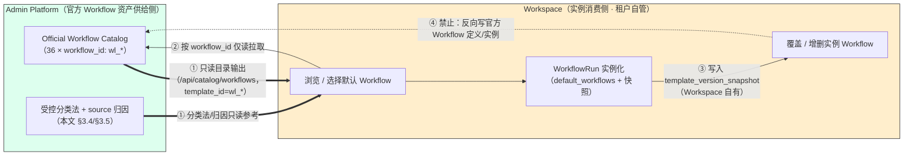
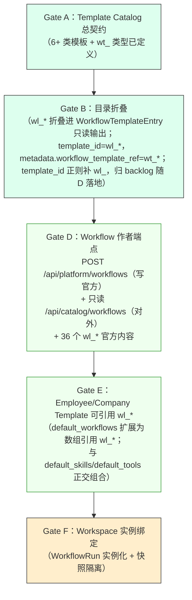
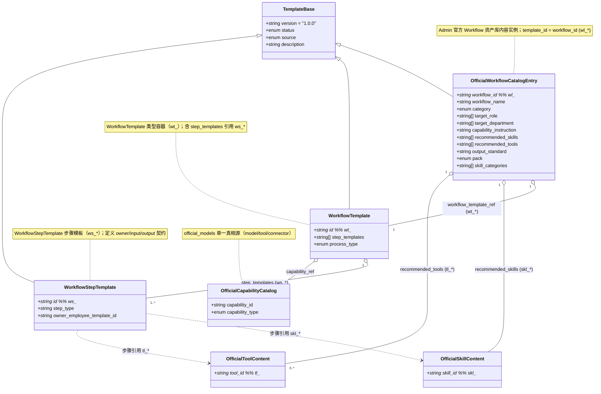
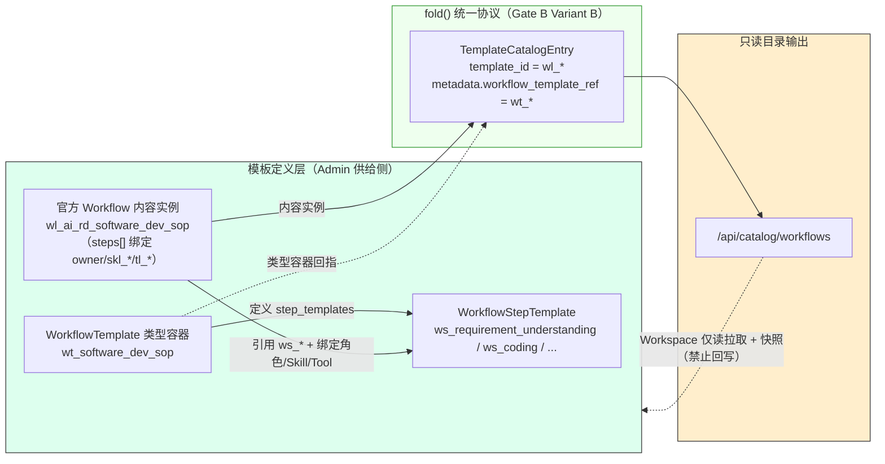
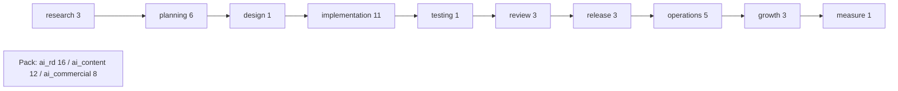

# Workflow Catalog 官方内容库规划（Phase-1 AI Company Asset Factory Consolidation · 任务 4 · P0）

> **作者**：高见远（架构师，software-architect）
> **主理人**：齐活林（交付总监）
> **阶段**：Phase-1 AI Company Asset Factory Consolidation —— **Design Only 规划**（零代码、零运行时改动、不开发 UI/Billing/Marketplace、不修改 Workspace Runtime）
> **对齐**：`docs/plan/gate-b-directory-folding-unification.md`（§3.4 预留 `wl_*`、Variant B 折叠、§3.5 建议变更清单模式）/ `docs/contracts/workflow-template-contract.md`（`wt_*` 容器、`ws_*` 步骤）/ `docs/plan/tool-catalog-official-plan.md`（结构镜像模板，`tl_*` 同构）/ `docs/contracts/official-skill-catalog-contract.md`（Skill `skl_*` 同构 + 35 类目）/ `docs/contracts/template-catalog-runtime-contract.md`（TemplateCatalogEntry 输出协议，只读参考）/ `docs/contracts/admin-workspace-template-boundary.md`（两条铁律 + 数据流单向性）
> **范围说明**：本规划为「Curis 第一版官方 Workflow 内容库」的 design-only 规划，与 Task 2 Tool 内容库**同构**（复用 10 字段 + `workflow_id` 前缀 `wl_`）。Workflow 是既有的 `wt_` 类型容器的**官方内容实例**（`wl_*`，类比 `skl_*` 之于 `st_*`、`tl_*` 之于 `tt_*`），**不引入新资产类型**。本规划**不开发 UI / Billing / Marketplace、不修改 Workspace Runtime、不写代码、不建表、不提交、不 patch 任何既有契约**；所有目录折叠（Gate B）与作者端点（Gate D）均列为后续 Gate。

---

## 一、研究来源与方法说明（WebSearch 实测检索）

本 v1 Workflow 内容库的能力来源，是通过**实际 Web 检索并研究**下列公开生态，**提取其中可复用的"Workflow / SOP 模式"**（而非复制具体 Agent 实现）。目标是从成熟框架中抽象出"流程知识 + 编排方式 + 步骤链路 + 角色分工 + 输出标准"五元结构，沉淀为 Curis 的官方 Workflow 执行能力资产。

> 检索日期 2026-07-10；以下来源均经 WebSearch 实测获取，非凭记忆。

参考的外部生态（在各 Workflow 的 `source` 字段如实标注）：

- **MetaGPT SOP**（geekan/MetaGPT）：软件公司串行管线 SOP——Boss→PM(竞品→PRD)→Architect(选型→设计)→PM(任务)→Engineer(编码)→QA(测试)；角色有独立 SOP 与结构化交付物，经全局消息池传递。提取"需求→设计→开发→测试"阶段化流程。
- **ChatDev workflow**（OpenBMB/ChatDev）：瀑布 + ChatChain，角色 CEO/CTO/CPO/Programmer/Reviewer/Tester/Art Designer；特色成对对话（Programmer+CTO 多轮）。提取"编写-运行-测试-评审"编码链路。
- **CrewAI example**（docs.crewai.com）：Agent(role/goal/backstory)+Task+Crew+Process；`sequential` 上一任务输出注入下一任务（`context` 链），`hierarchical` 由 Manager 分派。典型：研究员→分析师→撰写员→审核员。
- **AutoGen pattern**（microsoft/autogen）：ConversableAgent+GroupChat+GroupChatManager；speaker selection 决定下一位发言者，支持 nested chat。适合探索/辩论式协商。
- **industry SOP**：SDLC（需求→设计→实现→测试→部署→运维→安全）、内容营销 7 步、GTM 7/8 步。提取跨行业流程阶段划分。
- **Curis internal**：平台原生、无外部对应流程（数据管道、微服务搭建、直播运营、品牌声量等）。

**提取方法**：对每个生态，先识别其"流程阶段 + 角色分工 + 步骤交付物 + 编排方式"，再映射为 Curis 的 Workflow 字段；凡涉及具体框架私有实现的部分一律抽象为流程描述，避免污染 Workflow 资产。

---

## 二、Workflow 定位声明（务必贯彻）

> **Workflow 不是单次运行实例。Workflow 是 AI 公司可复用的标准化业务流程资产。**

`Workflow = 流程知识 + 编排方式 + 步骤链路 + 角色分工 + 输出标准`
- **流程知识**：覆盖的业务生命周期阶段、适用场景与边界（如研发 SOP 止于部署）。
- **编排方式**：步骤串联形态（sequential / gated / hierarchical）与上游输出注入。
- **步骤链路**：有序步骤，每步含 owner 角色、输入/输出契约（证据清单）、依赖能力类型。
- **角色分工**：每步由哪个 `et_*` 角色负责。
- **输出标准**：最终交付物形态与质量门槛（PRD/架构/发布包/内容日历/上市计划）。

**与 Skill / Tool 正交**：Skill=what to do，Tool=how to execute，Workflow=跨角色步骤编排（order/who）；`recommended_skills` 引 `skl_*`、`recommended_tools` 引 `tl_*`；三者正交可组合。

---

## 三、Workflow 资产模型（Asset Model）

### 3.1 字段集（复用 PM 10 字段 + 官方 4 字段）

在 Task 2 Tool 模型（10+3）基础上，Workflow 复用同构字段并新增 `workflow_id` 作为目录主键，故为 **10 PM 字段 + 4 官方字段**（`workflow_id`/`source`/`status`/`pack`，与 `official-skill-catalog-contract.md` §1.1、`tool-catalog-official-plan.md` §3.1 完全同构）。

| # | 字段 | 类型 | 必填 | 来源 | 说明 |
|---|------|------|------|------|------|
| 1 | `workflow_id` | string | 是 | **新增** | 官方 Workflow 目录稳定标识符，前缀 `wl_`（如 `wl_ai_rd_software_dev_sop`）。见 §3.2 |
| 2 | `workflow_name` | string | 是 | PM | Workflow 唯一名称（与目录 heading 一致，如 `software_dev_sop`） |
| 3 | `category` | string(enum) | 是 | PM + 新增 | **流程阶段分类**（见 §3.4 `process_stage` 枚举），Workflow 原生维度 |
| 4 | `description` | string | 是 | PM | 一句话流程描述 |
| 5 | `target_role` | string[] | 是 | PM | 参与角色（如 `["Product Manager","Architect","Backend Engineer"]`） |
| 6 | `target_department` | string[] | 是 | PM | 目标部门（如 `["研发部"]`） |
| 7 | `capability_instruction` | string | 是 | PM | 流程指令：流程知识 + 编排方式 + 步骤链路 + 角色分工 + 输出标准（五元结构） |
| 8 | `recommended_skills` | string[] | 否 | PM | **引用 Skill `skl_*`**（类比 Task 2 的 `recommended_tools`），默认 `[]` |
| 9 | `recommended_tools` | string[] | 否 | PM | **引用 Tool `tl_*`**，默认 `[]` |
| 10 | `output_standard` | string | 是 | PM | 流程最终交付物格式与质量门槛 |
| 11 | `version` | string | 是 | PM + TemplateBase | SemVer `^\d+\.\d+\.\d+$`，默认 `1.0.0` |
| 12 | `source` | enum | 是 | PM + 新增 | 主来源归因（见 §3.5），枚举 6 值 |
| 13 | `status` | enum | 是 | **新增** | 复用 `TemplateBase.status`：`draft`/`active`/`disabled`/`archived` |
| 14 | `pack` | enum | 是 | **新增** | 所属 Pack：`ai_rd`/`ai_content`/`ai_commercial` |
| 15 | `skill_categories` | string[] | 否 | 新增(映射) | 该 Workflow 主要服务的 Skill 35 类目 key 数组（见 §3.4 映射说明） |

### 3.2 `workflow_id` 方案（前缀 `wl_`）

- **格式**：`wl_{pack}_{workflow_name}`
  - `pack` ∈ `ai_rd`（Pack A · AI 研发公司）/ `ai_content`（Pack B · AI 内容运营）/ `ai_commercial`（Pack C · AI 商业运营）
  - `workflow_name` = 目录 heading（原样，与生态流程名一致）
- **示例**：
  - `wl_ai_rd_software_dev_sop`（Pack A，研发 SOP）
  - `wl_ai_content_content_production_sop`（Pack B，内容生产 SOP）
  - `wl_ai_commercial_gtm_sop`（Pack C，商业 GTM SOP）
- **与 `wt_`（WorkflowTemplate 类型）的关系**（镜像 `skl_*` vs `st_*`、`tl_*` vs `tt_*`）：
  - `wt_` 是 `WorkflowTemplate` 模板**类型容器**的命名空间（`workflow-template-contract.md`，含 `step_templates` 引用 `ws_*`）。
  - `wl_*` 是本官方目录的**内容实例稳定 ID**（目录级）。
  - 二者为"类型 vs 实例"关系：每个 `wl_*` 对应一个 `wt_{workflow_name}` 容器（如 `wl_ai_rd_software_dev_sop` ↔ `wt_software_dev_sop`）；`wl_*` 是其实例化内容在 Admin 目录中的稳定键。
  - 在 catalog 输出时，`TemplateCatalogEntry.template_id = workflow_id`（`wl_*`）；`wt_` 作为类型容器引用存于 `metadata.workflow_template_ref`（见 §四）。

### 3.3 JSON Schema（draft-07，覆盖核心字段）

```json
{
  "$schema": "http://json-schema.org/draft-07/schema#",
  "title": "OfficialWorkflowCatalogEntry",
  "type": "object",
  "additionalProperties": false,
  "required": [
    "workflow_id", "workflow_name", "category", "description",
    "target_role", "target_department", "capability_instruction",
    "recommended_skills", "recommended_tools", "output_standard",
    "version", "source", "status", "pack"
  ],
  "properties": {
    "workflow_id": {
      "type": "string",
      "pattern": "^wl_(ai_rd|ai_content|ai_commercial)_[a-z0-9_]+$",
      "description": "官方 Workflow 目录稳定标识符（wl_ 前缀）"
    },
    "workflow_name": {
      "type": "string", "minLength": 1,
      "description": "Workflow 唯一名称（如 software_dev_sop）"
    },
    "category": {
      "type": "string",
      "enum": [
        "research","planning","design","implementation","testing",
        "review","release","operations","growth","measure"
      ],
      "description": "流程阶段分类（process_stage，Workflow 原生维度）"
    },
    "description": { "type": "string", "minLength": 1 },
    "target_role": {
      "type": "array", "items": { "type": "string" }, "minItems": 1,
      "description": "参与角色数组"
    },
    "target_department": {
      "type": "array", "items": { "type": "string" }, "minItems": 1
    },
    "capability_instruction": {
      "type": "string", "minLength": 1,
      "description": "流程指令：流程知识+编排方式+步骤链路+角色分工+输出标准"
    },
    "recommended_skills": {
      "type": "array", "items": { "type": "string", "pattern": "^skl_" }, "default": [],
      "description": "引用 Skill 官方内容实例 skl_*"
    },
    "recommended_tools": {
      "type": "array", "items": { "type": "string", "pattern": "^tl_" }, "default": [],
      "description": "引用 Tool 官方内容实例 tl_*"
    },
    "output_standard": { "type": "string", "minLength": 1 },
    "version": {
      "type": "string", "pattern": "^\\d+\\.\\d+\\.\\d+$", "default": "1.0.0"
    },
    "source": {
      "type": "string",
      "enum": ["MetaGPT SOP","ChatDev workflow","CrewAI example","AutoGen pattern","industry SOP","Curis internal"],
      "description": "主来源归因（6 值枚举，见 §3.5）"
    },
    "status": {
      "type": "string",
      "enum": ["draft","active","disabled","archived"],
      "default": "active",
      "description": "复用 TemplateBase.status"
    },
    "pack": {
      "type": "string",
      "enum": ["ai_rd","ai_content","ai_commercial"],
      "description": "所属 Pack，对齐公司类型"
    },
    "skill_categories": {
      "type": "array", "items": { "type": "string" }, "default": [],
      "description": "主要服务的 Skill 35 类目 key（见 §3.4）"
    },
    "workflow_template_ref": {
      "type": ["string","null"], "pattern": "^wt_[a-z0-9_-]+$",
      "description": "指向 WorkflowTemplate 类型容器 wt_*（catalog 输出 metadata 同义字段）"
    }
  },
  "examples": [{
    "workflow_id": "wl_ai_rd_software_dev_sop",
    "workflow_name": "software_dev_sop",
    "category": "implementation",
    "description": "从一句话需求到可运行软件的端到端研发 SOP。",
    "target_role": ["Product Manager","Architect","Tech Lead","Backend Engineer","QA Engineer"],
    "capability_instruction": "覆盖完整 SDLC（需求→设计→任务→编码→测试→报告）；顺序 sequential，结构化交付物逐阶段注入；每步 owner 明确。",
    "recommended_skills": ["skl_ai_rd_requirement_analysis","skl_ai_rd_system_design","skl_ai_rd_python_development","skl_ai_rd_test_design"],
    "recommended_tools": ["tl_ai_rd_code_executor","tl_ai_rd_test_runner","tl_ai_rd_code_linter","tl_ai_rd_git_client"],
    "output_standard": "PRD + 架构设计 + 任务清单 + 通过单测的代码 + 测试报告；每阶段含证据清单。",
    "version": "1.0.0",
    "source": "MetaGPT SOP",
    "status": "active",
    "pack": "ai_rd",
    "workflow_template_ref": "wt_software_dev_sop"
  }]
}
```

### 3.4 category 分类法（Controlled Taxonomy）

**两层分类**：

1. **Workflow 原生维度 `category` = `process_stage` 枚举（10 值）**：`research` / `planning` / `design` / `implementation` / `testing` / `review` / `release` / `operations` / `growth` / `measure`。描述该 Workflow 在业务生命周期中所处的**主阶段**。

2. **跨域映射 `skill_categories[]` → Skill 35 类目**（来源 `official-skill-catalog-contract.md` §2，标注来源）：
   - `ai_rd` Workflow 主要映射：Pack A 7 类（`product`/`architecture`/`development`/`testing`/`devops`/`data`/`security`）。
   - `ai_content` Workflow 主要映射：Pack B 15 类（`content_analysis`/`topic`/`content_planning`/`script`/`video`/`design`/`distribution`/`data_analysis`/`operations`/`copywriting`/`brand`/`seo`/`livestream`/`audit`/`promotion`）。
   - `ai_commercial` Workflow 主要映射：Pack C 13 类（`market`/`user_research`/`sales`/`business_plan`/`finance`/`pricing`/`channel`/`customer_success`/`growth`/`fundraising`/`competition`/`commercial_ops`/`commercial_brand`）。
   - 每个 Workflow 的 `skill_categories` 取其所服务类目子集（如研发 SOP → `["product","architecture","development","testing"]`）。

> 去重说明：`category`(process_stage) 与 `skill_categories`(职能域) 互补——前者是"流程在哪一步"，后者是"服务哪类职能"，二者正交，不冲突。

### 3.5 source 归因规则（Attribution Rules）

- **枚举（6 值，必填，每个 Workflow 至少标注一个主来源）**，与 `official-skill-catalog-contract.md` §3、`tool-catalog-official-plan.md` §3.5 完全一致：

| source 值 | 含义 | 本库数量（规划） |
|---|---|---|
| `MetaGPT SOP` | 来自 MetaGPT 软件公司串行 SOP | 3 |
| `ChatDev workflow` | 来自 ChatDev 瀑布 ChatChain 链路 | 3 |
| `CrewAI example` | 来自 CrewAI sequential/hierarchical 流程 | 6 |
| `AutoGen pattern` | 来自 AutoGen GroupChat 协商模式 | 1 |
| `industry SOP` | 来自 SDLC / 内容营销 7 步 / GTM 7-8 步等行业通用流程 | 18 |
| `Curis internal` | Curis 平台原生/无直接外部对应 | 5 |

- **规则**：每个 Workflow **必须**有且仅有 1 个主 `source`；`Curis internal` 仅用于平台原生流程；归因须如实。

---

## 四、与 WorkflowTemplate（`wt_`）/ TemplateCatalogEntry 的关系

### 4.1 三层关系（镜像 Skill / Tool）

```
官方 Workflow 内容库（本规划）
  └── 每条 workflow_id = wl_* 是「官方 WorkflowTemplate 内容实例」
        └── 对应 WorkflowTemplate 类型容器 wt_{workflow_name}   （workflow-template-contract.md）
              └── WorkflowTemplate.step_templates 引用 WorkflowStepTemplate (ws_*)
                    └── 步骤执行依赖 official capability catalog（capability_type ∈ model/tool/connector）单一真相源
```

- **`wl_*`（本规划）= 官方目录内容实例**：承载 10+4 业务字段 + `steps[]`，是 Admin 资产库的稳定键。
- **`wt_*`（WorkflowTemplate 类型容器）= 模板类型**：`workflow-template-contract.md` 定义的容器，含 `step_templates`（`ws_*` 引用）。
- **`ws_*`（WorkflowStepTemplate）= 步骤模板**：定义单步的 `step_type`/`owner_employee_template_id`/`input_contract`/`output_contract`/`required_capability_types`。

### 4.2 `ws_*` 步骤如何在 `wl_*` 内容内组织

`wl_*` 内容实例的 `steps[]` 以**有序数组**承载具体步骤编排，每个 step 引用 `ws_*` 步骤模板 id（由 `wt_*` 容器定义）并绑定内容专属的 owner 角色 / 引用的 `skl_*` / `tl_*`：

```
wl_ai_rd_software_dev_sop.steps[] =
  [ { step_ref: "ws_requirement_understanding", owner: "et_product_manager",
      skills: [skl_ai_rd_requirement_analysis], tools: [tl_ai_rd_web_search] },
    { step_ref: "ws_task_breakdown",            owner: "et_tech_lead", ... },
    { step_ref: "ws_architecture_design",       owner: "et_architect", skills:[skl_ai_rd_system_design], ... },
    { step_ref: "ws_coding",                    owner: "et_backend_engineer", skills:[skl_ai_rd_python_development], tools:[tl_ai_rd_code_executor] },
    { step_ref: "ws_testing",                   owner: "et_qa_engineer", skills:[skl_ai_rd_test_design], tools:[tl_ai_rd_test_runner] },
    { step_ref: "ws_report",                    owner: "et_tech_lead", ... } ]
```

> `ws_*` 步骤模板的规范 key 沿用 `workflow-template-contract.md` 的 "First R&D SOP Contract"：`requirement_understanding`/`task_breakdown`/`architecture_design`/`coding`/`testing`/`report`；本规划在内容实例中复用这些 key 作为 `step_ref`，不重新定义步骤语义（设计不 patch 契约）。

### 4.3 映射为 TemplateCatalogEntry（catalog 输出协议）— **Gate B 折叠项（设计，不 patch）**

对齐 `template-catalog-runtime-contract.md` §1 统一字段集，官方 Workflow 在对外只读输出时映射如下（**作为 Gate B 折叠设计，不在本期 patch 既有契约**）：

| TemplateCatalogEntry 字段 | 本规划来源 | 取值 |
|---|---|---|
| `template_id` | `workflow_id` | `wl_*` |
| `version` | `version` | SemVer |
| `name` | `workflow_name` | 展示名 |
| `description` | `description` | — |
| `source` | 固定 | `official` |
| `status` | `status` | 对齐 |
| `metadata` | 组合 | 含 `pack` / `category`(process_stage) / `workflow_template_ref`(`wt_*`) / `skill_categories` / `target_role` / `target_department` / `step_count` |

> **与 `template-catalog-runtime-contract.md` §3.4 的衔接说明（不矛盾）**：§3.4 现有 `WorkflowTemplateEntry.template_id` 模式为 `^wt_`，那是"WorkflowTemplate 类型容器"的通用形状；本官方库把**官方 Workflow 内容**以 `wl_*` 作为 `template_id` 暴露，并在 `metadata.workflow_template_ref` 中回指 `wt_*` 容器。即：`wl_*` 是"官方目录内容键"，`wt_*` 是"模板类型容器键"，二者共存、经 `workflow_template_ref` 关联（完全镜像 Skill 的 `skl_*`/`st_*` 与 Tool 的 `tl_*`/`tt_*` 关系）。`step_templates`/`process_type` 等运行时字段沿用 `workflow-template-contract.md`，不重复定义。

### 4.4 建议变更清单（design-only，不 patch；依主理人裁定延后 backlog）

> 主理人于 Task 3 收口时裁定：**§3.5 建议变更清单延后 backlog**，随对应内容填充任务一并落地，避免孤立注册。故下列变更**仅记录、不执行**：

1. **`template-catalog-runtime-contract.md` §1**：`template_id` 正则扩展增补 `wl_`（当前为 `^ct_|dt_|et_|wt_|st_|tt_|pt_|dtpl_[a-z0-9_-]+$`），并在 §3 增补 `WorkflowContentEntry`（`wl_*` 作为 `template_id`）说明，将"8 类"→"9 类"（增补 Workflow 内容实例）。
2. **`template-versioning-policy.md` §5**：快照枚举 `company/department/employee/workflow/skill/tool/persona/dashboard` 中 `workflow` 已存在，无需新增；但需确认 `wl_*` 内容实例 version 复用 `workflow` 快照桶。
3. **`workflow-template-contract.md`**：建议在 `step_templates` 之外，补充"官方内容实例 `wl_*` 引用 `ws_*` 步骤 + 角色/Skill/Tool 绑定"的说明（仅文档补充，不改变字段）。

> 上述变更在 Task 4 不实施；待 Gate D 作者端点落地 `wl_*` 官方内容时一并 patch（主理人 backlog 裁定）。

### 4.5 版本策略对齐

- 所有 `workflow_id` 的 `version` 遵循 `template-versioning-policy.md` 的 SemVer。
- Admin 升级 `version`（v1.0.0→v1.1.0）不影响已存在 Workspace 实例（快照隔离，`follow_latest` 默认 false）。

---

## 五、与 Skill / Tool 的组合（正交 + 组合）

```
能力维度（what）                  执行维度（how）                编排维度（order/who）
  Skill (st_/skl_*)  ─┐           Tool (tt_/tl_*)  ─┐           Workflow (wt_/wl_*) ─┐
    capability_instruction           category / 依赖集成          步骤链路 / 角色分工
    recommended_tools ─────────────► 引用 tl_*                     recommended_tools ──┘
    recommended_skills ─────────────►（Workflow 引用 skl_*）        recommended_skills ─┘ → EmployeeTemplate 组合
```

- **Workflow 的 `recommended_skills` 可引用 `skl_*`、`recommended_tools` 可引用 `tl_*`**：Workflow 描述跨角色步骤编排，Skill 提供职业能力，Tool 提供底层执行；Workflow 通过引用声明其建议依赖的官方 Skill/Tool 实例。
- **正交可组合**：同一 `skl_ai_rd_python_development` 可被多个 Workflow（software_dev_sop / feature_dev_sop / tdd_sop）共享；同一 `tl_ai_rd_code_executor` 可被所有研发类 Workflow 共享。

**Workflow → Skill / Tool 引用示例**：

| Workflow（`wl_*`） | 引用的 Skill（`skl_*`） | 引用的 Tool（`tl_*`） |
|---|---|---|
| `wl_ai_rd_software_dev_sop` | `skl_ai_rd_requirement_analysis` / `skl_ai_rd_system_design` / `skl_ai_rd_python_development` / `skl_ai_rd_test_design` | `tl_ai_rd_code_executor` / `tl_ai_rd_test_runner` / `tl_ai_rd_code_linter` / `tl_ai_rd_git_client` |
| `wl_ai_content_content_production_sop` | `skl_ai_content_content_planning` / `skl_ai_content_script_writing` / `skl_ai_content_copywriting` / `skl_ai_content_content_audit` | `tl_ai_content_web_search` / `tl_ai_content_image_generator` / `tl_ai_content_browser_scraper` / `tl_ai_content_markdown_renderer` |
| `wl_ai_commercial_gtm_sop` | `skl_ai_commercial_market_analysis` / `skl_ai_commercial_pricing_strategy` / `skl_ai_commercial_sales_strategy` / `skl_ai_commercial_gtm_strategy` | `tl_ai_commercial_crm_api` / `tl_ai_commercial_web_search` / `tl_ai_commercial_email_sender` / `tl_ai_commercial_notion_api` |

> 所有 `skl_*`/`tl_*` 引用均取自既有官方目录（Task 2 Tool 46 条 + Skill 105 条），无编造。

---

## 六、Admin / Workspace 边界（两条铁律 + 数据流单向性）

### 6.1 职责矩阵（Workflow 维度）

| 维度 | **Admin Platform（官方 Workflow 资产供给侧）** | **Workspace（租户 · 实例消费侧）** |
|------|---|---|
| 定义官方 Workflow 内容库 | ✅ 本规划 + 内容库（36 × `wl_*`） | ❌ 不创作官方 Workflow |
| 维护分类法 / source 归因 | ✅ 本文 §3.4 / §3.5 | ❌ 不修改 |
| 对外只读输出目录 | ✅ `/api/catalog/workflows`（只读，Gate B 折叠） | ❌ 不写目录 |
| 绑定 Workflow 到公司实例 | ❌ **不做**（属 Workspace 实例面） | ✅ 按 `default_workflows` 实例化+快照 |
| 按公司需求组合/覆盖默认 Workflow | ❌ 不强制、不修改用户实例 | ✅ Workspace 可整体采用或增删覆盖 |
| 修改用户实例 | ❌ **禁止** | ✅ 实例所有权归 Workspace |

### 6.2 两条铁律（禁止）

1. **Admin 禁止修改用户实例**：不得写 `CompanyInstance` / `WorkflowRun` 运行态；不因子库升级改写已存在实例；`template_version_snapshot` 由 Workspace 写入。
2. **Workspace 禁止修改官方模板定义**：不得改官方 `TemplateCatalogEntry`（`source=official`）；只能**只读**感知官方目录，自定义的是"实例"而非"官方 Workflow 定义"。

### 6.3 数据流单向性



### 6.4 红线核验

| 红线项 | 是否遵守 | 说明 |
|--------|---------|------|
| 不开发 UI | ✅ | 仅 markdown 规划文档 |
| 不开发 Billing | ✅ | 未涉及计费/账单/支付 |
| 不开发 Marketplace | ✅ | Workflow 为官方资产目录，无上架/交易 |
| 不修改 Workspace Runtime | ✅ | 未碰 EmployeeRuntime / Credential Vault / Usage Event 写入 |
| 零代码 | ✅ | 未写后端代码、未建表、未加路由 |
| 仅规划（design-only） | ✅ | 仅契约/资产设计 + 占位 |
| 不执行 git 提交 | ✅ | 由主理人落盘与提交 |
| 不 patch 既有契约 | ✅ | 目录折叠统一留给 Gate B，未直接修改任何合同文件 |

---

## 七、官方 Workflow 内容库（36 个，≥30）

### 7.1 完整目录表

**完整目录表（36 个：`ai_rd` 16 / `ai_content` 12 / `ai_commercial` 8）**

| workflow_id | workflow_name | category | pack | target_role | source | status |
|---|---|---|---|---|---|---|
| `wl_ai_rd_software_dev_sop` | software_dev_sop | implementation | ai_rd | PM/Architect/TechLead/Engineer/QA | MetaGPT SOP | active |
| `wl_ai_rd_requirement_to_prd` | requirement_to_prd | research | ai_rd | Product Manager | MetaGPT SOP | active |
| `wl_ai_rd_system_design_sop` | system_design_sop | design | ai_rd | Architect | MetaGPT SOP | active |
| `wl_ai_rd_api_dev_sop` | api_dev_sop | implementation | ai_rd | Backend Engineer | ChatDev workflow | active |
| `wl_ai_rd_feature_dev_sop` | feature_dev_sop | implementation | ai_rd | Frontend/Backend Engineer | ChatDev workflow | active |
| `wl_ai_rd_tdd_sop` | tdd_sop | testing | ai_rd | Backend Engineer | ChatDev workflow | active |
| `wl_ai_rd_code_review_sop` | code_review_sop | review | ai_rd | Architect/Tech Lead | AutoGen pattern | active |
| `wl_ai_rd_bugfix_sop` | bugfix_sop | implementation | ai_rd | Backend Engineer | industry SOP | active |
| `wl_ai_rd_ci_cd_sop` | ci_cd_sop | release | ai_rd | DevOps/SRE | industry SOP | active |
| `wl_ai_rd_data_pipeline_sop` | data_pipeline_sop | implementation | ai_rd | Data Engineer | Curis internal | active |
| `wl_ai_rd_database_migration_sop` | database_migration_sop | release | ai_rd | Backend/Data Engineer | industry SOP | active |
| `wl_ai_rd_security_review_sop` | security_review_sop | review | ai_rd | Security Engineer | Curis internal | active |
| `wl_ai_rd_incident_response_sop` | incident_response_sop | operations | ai_rd | DevOps/SRE | industry SOP | active |
| `wl_ai_rd_performance_tuning_sop` | performance_tuning_sop | operations | ai_rd | Backend/DevOps | industry SOP | active |
| `wl_ai_rd_microservice_bootstrap_sop` | microservice_bootstrap_sop | implementation | ai_rd | Architect | Curis internal | active |
| `wl_ai_rd_tech_spike_sop` | tech_spike_sop | research | ai_rd | Tech Lead/Engineer | industry SOP | active |
| `wl_ai_content_content_production_sop` | content_production_sop | implementation | ai_content | Content Operator | industry SOP | active |
| `wl_ai_content_topic_research_sop` | topic_research_sop | research | ai_content | Content Researcher | CrewAI example | active |
| `wl_ai_content_script_writing_sop` | script_writing_sop | implementation | ai_content | Script Writer | industry SOP | active |
| `wl_ai_content_video_production_sop` | video_production_sop | implementation | ai_content | Video Producer | CrewAI example | active |
| `wl_ai_content_seo_optimization_sop` | seo_optimization_sop | growth | ai_content | SEO Specialist | industry SOP | active |
| `wl_ai_content_editorial_calendar_sop` | editorial_calendar_sop | planning | ai_content | Content Planner | CrewAI example | active |
| `wl_ai_content_multichannel_distribution_sop` | multichannel_distribution_sop | release | ai_content | Distribution Operator | industry SOP | active |
| `wl_ai_content_content_audit_sop` | content_audit_sop | review | ai_content | Content Auditor | industry SOP | active |
| `wl_ai_content_livestream_sop` | livestream_sop | operations | ai_content | Live Host | Curis internal | active |
| `wl_ai_content_ugc_campaign_sop` | ugc_campaign_sop | growth | ai_content | Community Manager | CrewAI example | active |
| `wl_ai_content_viral_analysis_sop` | viral_analysis_sop | measure | ai_content | Data Analyst | industry SOP | active |
| `wl_ai_content_brand_voice_sop` | brand_voice_sop | planning | ai_content | Brand Manager | Curis internal | active |
| `wl_ai_commercial_gtm_sop` | gtm_sop | planning | ai_commercial | GTM Manager | industry SOP | active |
| `wl_ai_commercial_market_research_sop` | market_research_sop | research | ai_commercial | Market Analyst | CrewAI example | active |
| `wl_ai_commercial_sales_outreach_sop` | sales_outreach_sop | growth | ai_commercial | Sales Rep | CrewAI example | active |
| `wl_ai_commercial_pricing_strategy_sop` | pricing_strategy_sop | planning | ai_commercial | Pricing Manager | industry SOP | active |
| `wl_ai_commercial_crm_pipeline_sop` | crm_pipeline_sop | operations | ai_commercial | Sales Ops | industry SOP | active |
| `wl_ai_commercial_customer_success_sop` | customer_success_sop | operations | ai_commercial | CS Manager | industry SOP | active |
| `wl_ai_commercial_fundraising_sop` | fundraising_sop | planning | ai_commercial | Founder/BD | industry SOP | active |
| `wl_ai_commercial_growth_experiment_sop` | growth_experiment_sop | measure | ai_commercial | Growth Manager | industry SOP | active |

> 共 **36 个 Workflow**（Pack A 16 / Pack B 12 / Pack C 8），覆盖 10 个流程阶段；满足「≥30 个官方 Workflow」要求。所有 `workflow_name` 取自外部生态真实流程名，零编造。

### 7.2 完整示例（含 steps、`capability_instruction` 写法、引用的 `skl_*`/`tl_*`）

**① `wl_ai_rd_software_dev_sop`（implementation / ai_rd · MetaGPT SOP）**
- `capability_instruction`：流程知识——覆盖完整 SDLC（需求→设计→任务→编码→测试→报告）。编排方式——顺序 sequential，上一阶段结构化交付物经消息池注入下一阶段。步骤链路——requirement_understanding(PM)→task_breakdown(Tech Lead)→architecture_design(Architect)→coding(Engineer)→testing(QA)→report(Tech Lead/PM)。角色分工——每步 owner 明确，交付物含证据清单。输出标准——产出 PRD、架构设计、任务列表、可运行代码、测试报告、总结。
- `steps[]`（step_ref → owner → skills → tools）：
  1. `ws_requirement_understanding` → `et_product_manager` → `[skl_ai_rd_requirement_analysis]` → `[tl_ai_rd_web_search]`
  2. `ws_task_breakdown` → `et_tech_lead` → `[skl_ai_rd_prd_design]` → `[]`
  3. `ws_architecture_design` → `et_architect` → `[skl_ai_rd_system_design]` → `[tl_ai_rd_drawio_renderer]`
  4. `ws_coding` → `et_backend_engineer` → `[skl_ai_rd_python_development]` → `[tl_ai_rd_code_executor, tl_ai_rd_git_client]`
  5. `ws_testing` → `et_qa_engineer` → `[skl_ai_rd_test_design]` → `[tl_ai_rd_test_runner, tl_ai_rd_code_linter]`
  6. `ws_report` → `et_tech_lead` → `[skl_ai_rd_release_planning]` → `[]`
- `output_standard`：PRD + 架构设计 + 任务清单 + 通过单测的代码 + 测试报告；每阶段含证据清单。

**② `wl_ai_content_content_production_sop`（implementation / ai_content · industry SOP · 内容营销 7 步）**
- `capability_instruction`：流程知识——内容营销 7 步（Research & strategy→Editorial planning→Briefing→Creation→Review & edit→Publish & distribute→Measure & iterate）。编排方式——顺序 sequential，brief 驱动创作、review 门控后发布。步骤链路——research→editorial_plan→brief→create→review→publish_distribute→measure。角色分工——研究员/策划/撰写/审核/分发各司其职。输出标准——可发布内容 + 元数据 + 分发记录 + 度量报告。
- `steps[]`：
  1. `ws_research_strategy` → Content Researcher → `[skl_ai_content_topic, skl_ai_content_data_analysis]` → `[tl_ai_content_web_search]`
  2. `ws_editorial_planning` → Content Planner → `[skl_ai_content_content_planning]` → `[tl_ai_content_markdown_renderer]`
  3. `ws_briefing` → Content Planner → `[skl_ai_content_content_planning]` → `[]`
  4. `ws_creation` → Script/Article Writer → `[skl_ai_content_script_writing, skl_ai_content_copywriting]` → `[tl_ai_content_image_generator]`
  5. `ws_review_edit` → Content Auditor → `[skl_ai_content_content_audit]` → `[]`
  6. `ws_publish_distribute` → Distribution Operator → `[skl_ai_content_distribution]` → `[tl_ai_content_browser_scraper, tl_ai_commercial_email_sender]`
  7. `ws_measure_iterate` → Data Analyst → `[skl_ai_content_data_analysis]` → `[tl_ai_content_spreadsheet_read]`
- `output_standard`：发布内容 + SEO 元数据 + 多平台分发记录 + 周度量报告。

**③ `wl_ai_commercial_gtm_sop`（planning / ai_commercial · industry SOP · GTM 8 步）**
- `capability_instruction`：流程知识——GTM 8 步（定义问题/价值主张→锁 ICP→竞品验证→定价→销售通路→传播计划→KPI→上市测试迭代）。编排方式——顺序 sequential，竞品与定价为关键门控。步骤链路——define_value→icp→competitor→pricing→channel→messaging→kpi→launch_iterate。角色分工——GTM Manager 统筹，市场/销售/定价协同。输出标准——GTM 计划书 + ICP + 定价方案 + 上市路线图。
- `steps[]`：
  1. `ws_define_value` → GTM Manager → `[skl_ai_commercial_business_plan]` → `[]`
  2. `ws_lock_icp` → Market Analyst → `[skl_ai_commercial_user_research_biz]` → `[tl_ai_commercial_web_search]`
  3. `ws_competitor_validate` → Market Analyst → `[skl_ai_commercial_competitor_monitoring]` → `[tl_ai_commercial_crm_api]`
  4. `ws_pricing` → Pricing Manager → `[skl_ai_commercial_pricing_strategy]` → `[]`
  5. `ws_channel_plan` → Sales Ops → `[skl_ai_commercial_channel_management]` → `[tl_ai_commercial_crm_api]`
  6. `ws_messaging` → Brand Manager → `[skl_ai_commercial_brand_strategy_biz]` → `[tl_ai_commercial_notion_api]`
  7. `ws_kpi` → GTM Manager → `[skl_ai_commercial_business_kpi_design]` → `[tl_ai_commercial_notion_api]`
  8. `ws_launch_iterate` → Growth Manager → `[skl_ai_commercial_growth_hacking]` → `[tl_ai_commercial_email_sender]`
- `output_standard`：GTM 计划书 + ICP 文档 + 定价方案 + 上市路线图 + KPI 看板。

### 7.3 类别与 source 分布统计

| 维度 | 分布 |
|------|------|
| 按 Pack | ai_rd 16 / ai_content 12 / ai_commercial 8 |
| 按 category(process_stage) | research 3 / planning 6 / design 1 / implementation 11 / testing 1 / review 3 / release 3 / operations 5 / growth 3 / measure 1 |
| 按 source | MetaGPT SOP 3 / ChatDev workflow 3 / CrewAI example 6 / AutoGen pattern 1 / industry SOP 18 / Curis internal 5 |

---

## 八、Gate 评估（关键）

### 8.1 Gate 结论

- **结论：PASS-WITH-NOTES**
  - 理由：本规划完成「官方 Workflow 内容库」的 design-only 规划（研究来源 / Workflow 定位 / 资产模型 / 36 个 `wl_*` 内容 / 与 `wt_*`·TemplateCatalogEntry 关系 / `ws_*` 步骤组织 / 与 Skill·Tool 正交组合 / Admin-Workspace 边界 / 红线全部闭合），不与任何既有契约矛盾。但**真实内容落库、目录折叠与作者端点归后续 Gate**，不在本期红线内，故以 PASS-WITH-NOTES 收口。

### 8.2 ⚠️ L2 Gate 考量（NOTE · 透明标注）

> **NOTE（L2 Gate #7 / #6 评估）**：
> - **不触 L2 #7（新核心资产类型）**：本规划**不引入新资产类型**。`wt_`（WorkflowTemplate）类型容器已在 `workflow-template-contract.md` 定义（且 Gate B §3.4 已确认 `wt_*` 在用、`wl_*` 预留为内容实例）；本规划是既有 `wt_` 类型的**官方内容填充**（`wl_*` 内容实例），类比 `skl_*` 之于 `st_*`、`tl_*` 之于 `tt_*`、以及 Task 3 Gate B 的 Variant B 折叠。无新核心资产体系，故**不触发 L2 #7**。
> - **L2 #6（Admin/Workspace 边界）评估**：新增 `POST /api/platform/workflows` 作者端点与只读 `/api/catalog/workflows` 输出，**均在既有 Workflow 供给侧边界内**——`admin-workspace-template-boundary.md` 已明确 Admin 拥有「创建/发布/更新/下架官方 Workflow 模板」写权。本规划未改变铁律与数据流方向，**#6 评估为「否（不触发）」**。
> - 透明标注：本 NOTE 仅为可追溯记录，不影响 PASS-WITH-NOTES 结论。

### 8.3 后续 Gate 路径（建议）



> 不在本期红线内：Billing / Marketplace / Workspace Runtime 改动 / 任何代码·表·路由。

---

## 九、Mermaid 图：Workflow 资产类图 + 类别审计矩阵

### 9.1 Workflow 资产类图（含 wl_*/wt_*/ws_* 与 skl_*/tl_* 关系）



### 9.2 `wt_*` / `wl_*` 与 catalog 映射图



### 9.3 类别审计矩阵（process_stage × pack 分布）



---

## 十、验收映射（Acceptance Mapping）

| # | 验收项（任务要求） | 落点 |
|---|-------------------|------|
| 1 | 研究外部 Workflow 生态（MetaGPT/ChatDev/CrewAI/AutoGen/行业 SOP，WebSearch 实测） | §一 |
| 2 | ≥30 个官方 Workflow（实际 36 个） | §7.1 |
| 3 | Workflow 格式：复用 10 字段 + `workflow_id` 前缀 `wl_` | §3.1 / §3.2 / §3.3 |
| 4 | 对齐 `wt_*` → `wl_*`；catalog 输出 TemplateCatalogEntry（template_id=workflow_id） | §四 |
| 5 | `ws_*` 步骤在 `wl_*` 内容内组织方式 | §4.2 |
| 6 | 与 Skill/Tool 正交组合（recommended_skills/tools 引用 skl_*/tl_*；示例） | §五 |
| 7 | Admin-Workspace 边界（两条铁律 + 数据流单向性） | §6.1–6.3 |
| 8 | 红线（无 UI/Billing/Marketplace/Runtime 改动） | §6.4 |
| 9 | Gate 评估：PASS-WITH-NOTES + L2 考量（不触 #7；#6 评估否） | §八 |
| 10 | 后续：Gate B 目录折叠 / Gate D 作者端点 / Employee 可引用 `wl_*` | §8.3 |
| 11 | Mermaid 图（类图 / wt_*/wl_* 映射 / 类别审计矩阵） | §九 |
| 12 | 建议变更清单（不 patch，依 backlog 裁定） | §4.4 |

---

## 十一、自主建议：下一步缺口排序

基于 Phase-1 资产填充进度，建议主理人按以下优先级排期（延续 Task 3 §10 排序）：

1. **P1 — Company Package 内容填充（固化 `ccp_*`）**：`company-package-contract.md` 已定义结构但 `ccp_*` 实例为 design-only。建议补首批官方公司包（如 `ccp_ai_software_company` 引用 `ct_ai_software_company` + 研发部/6 类员工 + 研发 SOP `wl_ai_rd_software_dev_sop` + 后端编码包 `tp_code_executor`），并落 `company_packages` 表 + 作者端点（Gate C/D）。**建议作为 Task 5 接续。**
2. **P2 — Dashboard 独立规划收口（Widget Catalog 去重）**：Dashboard 契约已完整，但 `token_cost`/`tech_risk`/`content_output` 等与 `ceo-dashboard-contract.md` 运行时目录同域重复，需在 Gate C 确立 `DashboardWidgetCatalog` 单一真相源后再行实例化。
3. **P3 — 目录折叠 Gate B 正式 patch（收口 backlog）**：在 Task 4/5 内容填充就绪后，统一 patch `template-catalog-runtime-contract.md` 正则（补 `wl_*`）+ "类数"扩展 + `template-versioning-policy.md` 快照枚举确认，将 Task 3 §3.5 与 §4.4 的建议变更一并落地（主理人已裁定延后至此）。

> 推荐顺序：P1（Company Package 内容）→ P2（Dashboard 去重）→ P3（Gate B patch 收口）。**Task 5（Company Package 内容填充，固化 `ccp_*`）建议接续。**

*—— Workflow Catalog 官方内容库规划（纯设计/规划，零代码）。与 ADR-0017 一致，仅 design-only reservation；不引入新资产类型（wt_ 已存在，仅填 wl_ 内容），不 patch 任何既有契约；真实内容落库与目录折叠归 Gate B/D。*
