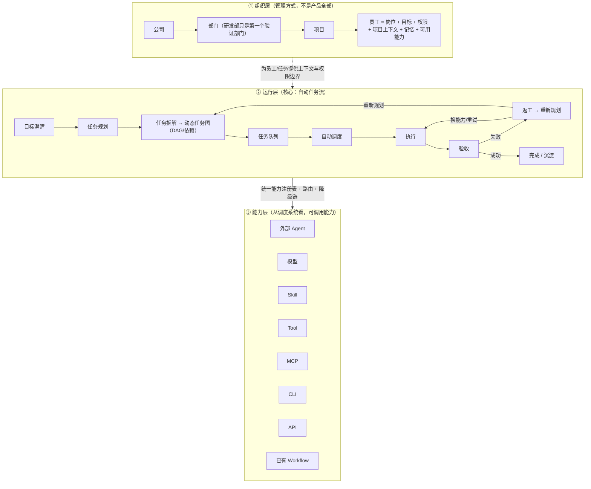

# Curis 产品愿景 + 当前阶段 PRD（团队对齐基准）

Status: Deprecated

> **文档性质**：产品愿景校准 + 当前阶段需求定义。本文档是软件开发团队不可动摇的对齐基准，任何开发优先级判定以此为准。
> **版本**：v1.0 ｜ **Owner**：产品（许清楚）｜ **默认模式**：简单 PRD（无竞品分析）
> **一句话定位**：公司、部门、员工是**组织层**；自动任务流是**运行层**；Agent、模型、Skill、Tool 是**能力层**。Curis 的核心是让这三层组合起来，在无人盯守的情况下持续把目标变成结果。

---

## 1. Product Vision（产品愿景）

### 1.1 产品定位

Curis 是**一人公司的自动任务与工作流系统**。用户只需说清目标，AI 负责引导、规划、拆解、调度、执行、验收和返工，**只在关键决策时找 CEO**。

### 1.2 正确整体流程

```
CEO 提出目标
  → AI 引导澄清需求
  → 生成执行计划
  → 拆成动态任务图
  → 自动选择执行能力（员工/外部 Agent/模型/Skill/Tool）
  → 执行与结果验证
  → 失败：重试 / 换能力 / 重新规划
  → 成功：沉淀成果和经验
  → 仅关键事项交给 CEO 决策
```

### 1.3 三层架构（必须彻底分开）



**Workflow 不应只理解成固定步骤**，运行层须支持：固定工作流 / Agent 自主规划 / 两者混合 / 执行中重新规划 / 定时·事件·条件触发。

### 1.4 四条不可动摇的原则

1. **全自动任务流是核心**，公司组织只是管理方式。
2. **Agent、模型、Skill、Tool 都是可替换能力，不写死具体产品**（如 Codex / WorkBuddy 不得硬编码进业务逻辑）。
3. **员工不是固定 Agent**，而是能够动态调用能力的岗位。
4. **任何开发如果没有让「目标 → 执行 → 验收 → 返工 → 完成」更自动，就不是当前优先级。**

---

## 2. 当前阶段定义（当前优先级）

### 2.1 本阶段 ONLY 做

> **后端自动任务流核心 + 能力路由降级**；前端仅保留**极简入口**。

- **后端**：动态任务图、自动调度、统一能力注册与路由降级、验收/返工闭环增强、项目状态与经验沉淀。
- **前端极简入口（6 步）**：输入目标 → 查看 AI 生成的计划 → 启动执行 → 查看实时进度 → 处理关键决策 → 查看成果。

### 2.2 后置 / 不做清单（明确划界，防止再次跑偏）

| 类别 | 项目 | 状态 |
|---|---|---|
| 组织层展示 | CEO Office 复杂管理台 | ❌ 后置 |
| 形象层 | 员工虚拟形象 / Avatar | ❌ 不做 |
| 前端 | 组织树美化、炫酷 UI | ❌ 不做 |
| 前端 | 复杂看板 / 甘特图 / 多维图表 | ❌ 后置 |
| 运行层 | 完整混合编排引擎（固定+自主+事件触发全量） | 🟡 本阶段先做最小可用，全量后置 |
| 能力层 | 所有 Skill/Tool/MCP 的预登记 | 🟡 本阶段先打通路由机制，按需登记 |

---

## 3. 能力差距评估（后端 7 项 × 工程现状）

> 工程现状经代码核查（2026-07-21）：`backend/app/issue_pipeline.py`、`issue_pipeline_api.py`、`dev_agent.py` 已存在。
> **重要修正**：`dev_agent.py` 并非"零抽象"——已落地 `DevAgent` Protocol + 5 个适配器（Claude / OpenAI-Codex / WorkBuddy-API / Codex-CLI / WorkBuddy-CLI），且部分适配器内置 `no_api_key` 优雅降级。**真正的缺口是"统一注册表 + 自动路由/降级链 + 把能力扩展到非模型类型（Skill/Tool/MCP/Webhook）"，而非从头造适配器。**

| # | 后端能力 | 状态 | 现状与缺口 |
|---|---|---|---|
| 1 | 目标澄清与任务规划 | 🟡 部分 | `NLParser` 已实现 NL→Issue Spec 基础解析；但**迭代式澄清对话、生成结构化执行计划**缺失，规划能力弱。 |
| 2 | 动态任务图（DAG） | ❌ 缺失 | `IssueQueue` 是**扁平队列**（enqueue/dequeue），无依赖关系、无 DAG、无就绪判定。 |
| 3 | 任务队列和自动调度 | 🟡 部分 | 队列（`IssueQueue`）+ 派发（`PipelineDispatcher.dispatch_one`，支持后台 `_run`）已具备；但**持续调度器**（按依赖/就绪态自动拉取、触发条件）缺失。 |
| 4 | 统一能力注册与路由 | ❌ 缺失 | **无注册表、无路由**。适配器存在但由执行器手动实例化；缺"能做什么/可用性/凭证/成本/权限/IO/备用"元数据与自动选路。 |
| 5 | Agent/模型/Skill/Tool 替换与降级 | 🟡 部分 | 单个适配器内部有降级（如 `WorkBuddyAdapter` 先 SDK 后 CLI）；但**跨能力的系统级降级链**缺失，且无 Skill/Tool 类型。 |
| 6 | 结果验收、重试和自动返工 | 🟡 部分 | `ResultReviewer` + `pipeline_rework` 端点已具备；但返工/重试**依赖人工 approve/reject**，未形成自动闭环（自动重试/自动换能力）。 |
| 7 | 项目状态、成果和经验沉淀 | ❌ 缺失/很弱 | 任务级状态在队列中存在；但**项目级状态聚合、成果归档、lessons-learned 记忆**基本无。 |

**结论**：7 项中——✅ 0 项完整 / 🟡 5 项部分 / ❌ 2 项缺失。本阶段 P0 聚焦把"部分"补成"完整闭环"，并补齐 2 项缺失中的核心（动态任务图、注册路由）。

---

## 4. 需求池（P0 / P1 / P2）

### P0（本阶段必须 — 后端自动任务流核心 + 能力路由降级）

| ID | 需求 | 说明 | 验收标准 |
|---|---|---|---|
| P0-1 | 动态任务图（DAG） | 任务可声明依赖、输入输出、触发条件；支持就绪态判定 | 能表达 A→B→C 依赖并据此决定可执行顺序 |
| P0-2 | 自动调度器 | 基于任务图就绪态持续拉取待执行任务，支持定时/事件/条件触发最小集 | 无需人工 dispatch，就绪任务自动进入执行 |
| P0-3 | 统一能力注册表 | 每种能力登记：能力描述/当前可用性/所需凭证/成本/权限范围/支持 IO/备用能力 | 路由前可查询任意能力状态 |
| P0-4 | 能力路由 + 降级链 | 调度时按可用性自动选首选→逐级降级到备用；不写死具体产品 | 首选不可用时自动切备用且不中断流程 |
| P0-5 | 验收/返工闭环增强 | 失败时自动重试、自动换能力、必要时自动重新规划 | 形成"验收→返工→再验收"自动闭环，仅卡点上报 CEO |
| P0-6 | 项目状态与经验沉淀 | 项目级状态聚合 + 成果归档 + lessons-learned 记忆 | 可查看项目整体进度与历史经验复用 |

### P1（能力适配器抽象 + 员工=能力组合模型）

| ID | 需求 | 说明 |
|---|---|---|
| P1-1 | 5 类适配器抽象 | CLI / HTTP API / MCP / Webhook / Local Process Adapter；在现有 model 适配器基础上统一为 `Capability` 接口 |
| P1-2 | 员工 = 能力组合模型 | 员工 = 岗位 + 业务目标 + 权限边界 + 项目上下文 + 记忆 + 可用能力列表；不绑定固定 Agent |
| P1-3 | 外部 Agent 统一适配器接入 | 复用 `dev_agent.py` 已有雏形，泛化为标准 Capability |

### P2（极简前端入口 + 后置复杂 UI）

| ID | 需求 | 说明 |
|---|---|---|
| P2-1 | 极简前端入口 | 输入目标 → 查看计划 → 启动执行 → 实时进度 → 处理关键决策 → 查看成果 |
| P2-2 | 后置：CEO Office / 员工形象 / 组织树美化 / 复杂看板 | 本阶段明确不做 |

---

## 5. 待确认问题（需 CEO 拍板）

1. **能力注册表持久化策略**：先落库（DB/文件，支持多进程调度一致性）还是先内存（开发更快、单进程）？——影响 P0-3/P0-2 的并发安全设计。
2. **降级链自动化边界**：首选能力不可用时，是否允许**静默自动降级**到备用（实现"无人盯守"），还是必须**上报 CEO** 待确认？——关系到原则 4 的"自动"程度。
3. **动态任务图触发模式默认项**：本阶段默认先支持「固定工作流 + 简单依赖」还是「Agent 自主规划」？「执行中重新规划」的触发时机（验收失败 N 次 / 超时 / 外部事件）如何定？

---

## 6. 附录：本阶段"不要做"红线

- ❌ 不为每个员工开发独立 Agent。
- ❌ 不把 Codex / WorkBuddy 等具体产品写死在业务逻辑里。
- ❌ 不投入组织树美化、员工形象、CEO Office 复杂看板。
- ❌ 不追求"全量混合编排引擎"一步到位。
- ✅ 一切以"目标 → 执行 → 验收 → 返工 → 完成 更自动"为唯一优先级判据。
