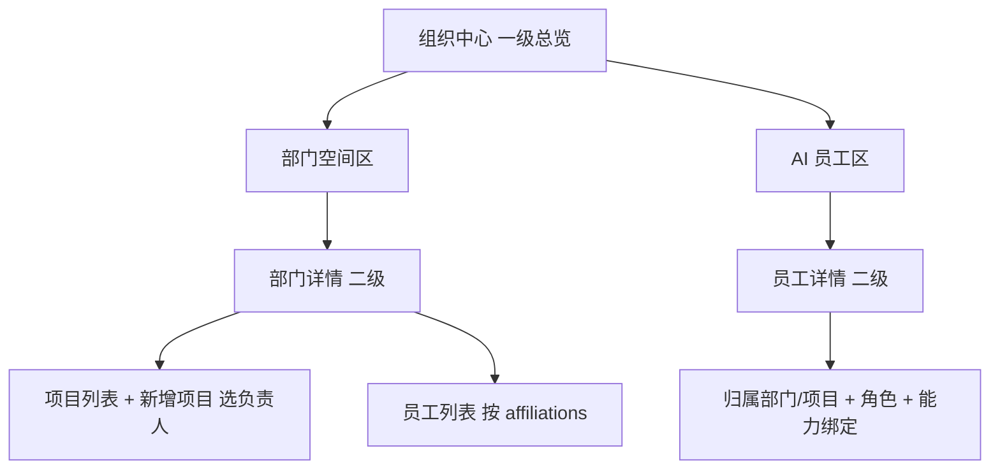

# 简单 PRD：Curis Workspace 组织中心真实前端接入

> 版本：2026-07（初稿） · 作者：产品经理 许清楚（Alice）
> 配套依据：`prototypes/curis-workspace-prototype.html` + `prototypes/curis-prototype-spec.md`（§3 状态规范）、`docs/design/phase1c-ceo-office-ui-design.md`（暗色主题）、后端 `backend/app/`（调研只读结论）。
> 文档性质：简单 PRD（无竞品分析），供架构师 / 工程师 / QA 后续工作。

---

## 0. 项目信息

| 项 | 内容 |
|---|---|
| Language | 中文（与用户需求一致） |
| 前端技术栈（铁律） | Next.js 16 App Router + **纯 JavaScript（非 TS）** + Tailwind CSS 3.4 + **手写 ceo-office 暗色主题（非 MUI）**。**禁用 Vite / MUI / TypeScript。** |
| 后端技术栈 | FastAPI + SQLite（`backend/app/`，已有 departments / employees / projects CRUD + 能力路由） |
| Project Name | `org_center_real_frontend` |
| 涉及目录 | 前端 `frontend/app/`（Workspace 区：ceo-office / employees / **新建 org-center** / control）；后端 `backend/app/` |

**原始需求复述**：用户已确认原型定型（mock 交互 OK，后续再美化），现需将「组织中心」从 mock 接入**真实前端**，形成可操作的部门 / 项目 / 员工组织管理闭环。

### 0.1 已确认决策（用户拍板）
- **决策 1（归属模型）**：扩展后端支持**员工多归属**（员工可归属多个部门 / 项目，`affiliations` 多值）。后端新建「员工 - 部门 / 项目」关联表，使后端支持原型里的 affiliations 模型。
- **决策 2（中心形态）**：真实前端**新建聚合页 `frontend/app/org-center/page.js`**，对齐原型：一级组织总览（部门空间 + AI 员工两区）、二级部门详情 / 员工详情、项目在部门详情里。现有 `frontend/app/employees/page.js` 保留或并入。

### 0.2 红线与铁律（PRD 必须标注，工程师不可越界）
- **后端扩展 = 红线真实实现项**（ADR-0017 禁止区：Employee 真实实现须独立 future gate + 总控 + 安全边界席）。用户（总控）已当面授权决策 1，落地须走：**Issue 立项 + 双 lead 会签 + API 版本化（如 `/api/workspace/v2/...` 或新增 `/api/workspace/employee-affiliations`）+ future gate 登记**。
- **绝不触碰**：payment / invoice / 真实计费、外部凭证接入、自动改码、真实隔离、复杂 UI、向量库、Marketplace、多租户商业化。
- `backend/` 任何改动须建 Issue + 双 lead 会签 + API 版本化（Git 基线纪律）。
- 前端**不碰 `frontend/app/platform/**`（Admin 区）**，只改 Workspace 区（ceo-office / employees / 新建 org-center / control 等）。
- 技术栈铁律：Next.js 16 App Router + 纯 JS（非 TS）+ Tailwind 3.4 + 手写 ceo-office 暗色主题（非 MUI）；禁用 Vite / MUI / TypeScript。

### 0.3 调研关键事实（只读结论）
- 后端部门 CRUD 真实端点已存在：`/api/workspace/departments`（POST/GET/PATCH/DELETE，`main.py:2169-2207`）。
- 员工 CRUD 真实端点已存在：`/api/workspace/employees`（POST `main.py:2220` / GET `2216` / PATCH `2235` / DELETE `2246` + 能力绑定 PUT）；`employee_instances` 表当前为**单 `department_id`**（`database.py:646`），**不支持多归属**。
- 项目 CRUD 真实端点已存在：`/api/workspace/projects`（POST `2029` / GET `2022` / PATCH `2045` + POST tasks `2054`），`projects` 表有 `owner_id` 引用员工。
- 能力路由已存在：`ToolRouter` + `CapabilityResolver` + `CapabilityAdapterFactory`，真实可运行；选择器 `/api/workspace/capabilities/selector` 可用。
- **后端缺口**：无「员工 - 部门 / 项目多归属」关联表；无「员工归属多个部门」的读写端点 → 需新建（决策 1）。
- 前端缺口：① 无共享 API 层（每页重复 `API_BASE`+`X-Tenant-Id` 头）② 部门缺编辑 / 删除 / 独立页 ③ 项目 CRUD 完全空白 ④ 无组织中心聚合页 ⑤ 两套设计语言并存需统一为 ceo-office 主题。

---

## 1. 产品目标

**一句话**：把「组织中心」从原型 mock 接入真实后端，形成可操作的部门 / 项目 / 员工组织管理闭环，并复用后端已有 CRUD 与能力路由。

- **G1 接入真实后端**：组织中心全部读写操作对接 FastAPI 真实端点（departments / employees / projects），移除 mock 数据。
- **G2 组织中心可操作**：新建 `org-center` 聚合页，支持部门 / 员工 / 项目的查看、新增、编辑、删除完整动线。
- **G3 员工多归属复用**：基于决策 1 新建后端关联表与版本化 API，使员工可归属多个部门 / 项目，前端表单支持多行选择。
- **G4 统一技术栈与体验**：前端统一为 ceo-office 暗色主题，新增共享 API 层 `lib/api.js`，消除各页重复头注入。
- **G5 执行者取自归属**：项目运行工作台的执行者 / 能力下拉来源与员工归属保持一致（复用 `/api/workspace/capabilities/selector`）。

---

## 2. 用户故事（按角色）

> 覆盖主线：进组织中心 → 看部门空间 + AI 员工 → 新增部门 → 进部门详情 → 新增项目（选归属员工为负责人）→ 新增员工（选归属部门 + 项目，可多行）→ 编辑员工（改归属 / 角色 / 能力）→ 部门编辑 / 删除 → 项目编辑 / 删除 → 工作台执行者取自归属。

- **US1（CEO）**：作为 CEO，我希望打开「组织中心」就能在一页看到所有**部门空间**与 **AI 员工**总览，以便获得实时的组织快照（替代原型的 mock 数据）。
- **US2（CEO / 部门负责人）**：作为管理者，我希望在组织中心**新增部门**并落库后端，以便该部门立即出现在总览与组织树中。
- **US3（部门负责人）**：作为部门负责人，我希望打开**部门详情**看到本部门的项目列表与员工列表（按 affiliations 过滤），以便集中管理本部门资源。
- **US4（部门负责人）**：作为部门负责人，我希望在部门详情内**新增项目**并选择一名员工为项目负责人（`owner_id`），以便项目与负责人正确关联。
- **US5（HR / 部门负责人）**：作为录入者，我希望**新增员工**时可勾选多个归属部门与项目（多行选择），以便员工的 affiliations 以多值持久化。
- **US6（部门负责人）**：作为部门负责人，我希望**编辑员工**以修改其归属 / 角色 / 能力绑定，以便组织变更实时回写后端。
- **US7（CEO / 部门负责人）**：作为管理者，我希望对部门执行**编辑 / 删除**（含清晰的级联策略提示），以便清理废弃部门。
- **US8（项目 owner）**：作为项目 owner，我希望对部门内的项目执行**编辑 / 删除**，以便管理项目生命周期。

（G5「工作台执行者取自归属」作为跨页一致性约束，由 P2-3 落地。）

---

## 3. 需求池

优先级：P0 = 必须（阻断闭环）/ P1 = 重要 / P2 = 锦上添花。每条含【编号 / 描述 / 验收标准 / 前后端归属】。

### P0（必须）

| 编号 | 描述 | 验收标准 | 归属 |
|---|---|---|---|
| P0-1 | **org-center 聚合页骨架**：新建 `frontend/app/org-center/page.js`，一级总览含「部门空间」「AI 员工」两区，顶栏导航 + ceo-office 暗色主题。 | 页面可路由访问；两区以卡片列表渲染（先读真实 API，无数据显空状态）；视觉与 ceo-office 主题一致。 | 前端 |
| P0-2 | **共享 API client**：新增 `frontend/lib/api.js`，导出 `workspaceFetch`，自动注入 `API_BASE` + `X-Tenant-Id` 头，替代各页重复头。 | org-center 及后续页面统一经 `lib/api.js` 调用；`X-Tenant-Id` 从统一来源读取；无重复头拼接代码。 | 前端 |
| P0-3 | **部门 CRUD 接真实 API**：部门空间区对接 `/api/workspace/departments`（GET 列表 / POST 新增 / PATCH 编辑 / DELETE 删除）。 | 新增部门后列表实时刷新且后端落库；编辑 / 删除可用；错误态有提示。 | 前端（端点已存在） |
| P0-4 | **员工 CRUD 接真实 API**：复用 / 并入 `frontend/app/employees/page.js`，对接 `/api/workspace/employees`（GET/POST/PATCH/DELETE + 能力绑定 PUT）。 | 员工增删改查与能力绑定真实生效；与 org-center 员工区数据一致。 | 前端（端点已存在） |
| P0-5 | **项目 CRUD 接真实 API**：在部门详情内对接 `/api/workspace/projects`（POST 新增并设 `owner_id` / GET 列表 / PATCH 编辑 / DELETE 删除 / POST tasks）。 | 部门详情可新增项目并选员工为负责人；项目编辑 / 删除可用。 | 前端（端点已存在） |
| P0-6 | **员工多归属后端关联表 + API（决策 1，红线项）**：`backend` 新建「员工 - 部门 / 项目」关联表（`affiliations` 多值）+ 版本化读写端点（建议 `/api/workspace/v2/employees/.../affiliations` 或独立 `/api/workspace/employee-affiliations`）。 | 员工可写多部门 / 多项目；读取返回 `affiliations` 数组；**受 future gate + 双 lead 会签管控**，并先建 Issue + API 版本化。 | 后端（红线） |

### P1（重要）

| 编号 | 描述 | 验收标准 | 归属 |
|---|---|---|---|
| P1-1 | **二级部门详情页**：`frontend/app/org-center/[deptId]/page.js`（或 state 路由），展示部门信息 + 项目列表 + 员工列表（按 affiliations 过滤）。 | 点击部门卡进入详情；数据来自真实 API；可返回总览。 | 前端 |
| P1-2 | **二级员工详情页**：`frontend/app/org-center/[empId]/page.js`，展示员工信息 + 归属部门 / 项目 + 角色 + 能力绑定。 | 点击员工卡进入详情；展示 affiliations 与能力 chip。 | 前端 |
| P1-3 | **员工表单多归属选择器**：新增 / 编辑员工表单支持多行勾选归属部门与项目（multi-select），提交写 affiliations。 | 可勾选多个部门 / 项目；保存到后端关联表（P0-6）。 | 前端 + 后端 |
| P1-4 | **部门编辑 / 删除交互**：部门详情或总览提供编辑 / 删除入口，明确级联策略（见待确认 Q3）。 | 删除有二次确认；编辑回写后端；级联行为符合约定。 | 前端 |
| P1-5 | **项目编辑 / 删除交互**：部门详情内提供项目编辑 / 删除。 | 编辑回写 owner / 字段；删除有确认。 | 前端 |
| P1-6 | **能力绑定复用**：员工详情 / 编辑复用已有能力绑定 PUT 端点与 `/api/workspace/capabilities/selector` 选择器。 | 能力可绑定 / 解绑并持久化；选择器数据来源一致。 | 前端（端点已存在） |

### P2（锦上添花）

| 编号 | 描述 | 验收标准 | 归属 |
|---|---|---|---|
| P2-1 | **组织中心搜索 / 筛选**：部门空间与 AI 员工区支持按名称 / 角色筛选。 | 输入关键字可过滤两区列表。 | 前端 |
| P2-2 | **空状态与加载态统一**：沿用原型 §3 状态规范（空 / 加载 / 运行中 / 失败 / 完成）到真实接入页。 | 各页具备一致的状态视觉与文案。 | 前端 |
| P2-3 | **工作台执行者下拉与归属联动**：项目运行工作台执行者来源对齐员工 affiliations（依赖现有工作台页，可后置）。 | 执行者列表与员工归属一致。 | 前端 |
| P2-4 | **统一设计语言清理**：移除 / 替换非 ceo-office 主题样式，确保全 Workspace 区视觉一致。 | 仅存 ceo-office 暗色主题一套设计语言。 | 前端 |
| P2-5 | **批量操作**：部门 / 员工批量编辑或移动（后续迭代）。 | 支持多选批量动作。 | 前端 |

---

## 4. UI 设计稿（org-center 三级结构）

> 设计规范对齐：`prototypes/curis-prototype-spec.md` §3（状态与按钮行为）、`docs/design/phase1c-ceo-office-ui-design.md`（暗色主题）。**全部沿用 ceo-office 暗色主题**（深底 + 青 / 琥珀强调色），卡片 / 抽屉 / 表单复用现有 `EmployeeFormDrawer` 风格。

### 4.1 一级 · 组织中心总览（`/org-center`）

```
┌──────────────────────────────────────────────────────────────────┐
│ 顶栏: 🏢CEO办公室 | 🏛️组织中心(当前) | ⚙️工作台 | 🔌能力 | 📦成果 | 🧰设置 │
├──────────────────────────────────────────────────────────────────┤
│  组织中心 · 一级总览                                             │
│  ┌────────────────────────────┐  ┌────────────────────────────┐ │
│  │  部门空间 Department Space  │  │  AI 员工 AI Employees        │ │
│  │  [部门卡] [部门卡] [+新增]  │  │  [员工卡] [员工卡] [+新增]  │ │
│  │  点击 → 部门详情            │  │  点击 → 员工详情            │ │
│  └────────────────────────────┘  └────────────────────────────┘ │
└──────────────────────────────────────────────────────────────────┘
```

### 4.2 二级 · 部门详情（`/org-center/[deptId]`）

```
┌──────────────────────────────────────────────────────────────────┐
│ ← 返回总览 | 部门名 | [编辑] [删除]                              │
│ 部门信息: 名称 / 描述 / 创建时间                                  │
│ ┌────────────────────────────┐  ┌────────────────────────────┐ │
│ │  项目列表 Projects          │  │  员工列表 (by affiliations)  │ │
│ │ [项目卡 owner=员工] [+新增] │  │  [员工卡] ...               │ │
│ └────────────────────────────┘  └────────────────────────────┘ │
└──────────────────────────────────────────────────────────────────┘
```

### 4.3 二级 · 员工详情（`/org-center/[empId]`）

```
┌──────────────────────────────────────────────────────────────────┐
│ ← 返回总览 | 员工名 | [编辑] [删除]                              │
│ 基本信息: 角色 / 状态                                            │
│ 归属: 部门A, 部门B | 项目X (multi affiliations)                  │
│ 能力绑定: [能力chip] [+绑定]                                     │
└──────────────────────────────────────────────────────────────────┘
```

### 4.4 结构关系（Mermaid）



---

## 5. 待确认问题（需用户 / 架构师后续拍板）

- **Q1 多归属 API 路径**：用 `/api/workspace/v2/employees/.../affiliations` 还是独立 `/api/workspace/employee-affiliations`？需架构师与双 lead 会签定。
- **Q2 员工详情归属**：员工详情并入 org-center 二级页，还是保留现有 `/employees` 页？决策 2 说「保留或并入」，需定。
- **Q3 部门删除级联策略**：删除部门时其下项目 / 员工如何处理（级联删除 / 置空 owner / 禁止删除需先清空）？
- **Q4 关联表范围**：员工多归属关联表是否同时记录「项目归属」，还是仅部门；项目 `owner_id` 与 `affiliations` 是否双写。
- **Q5 `X-Tenant-Id` 统一来源**：从何处读取（session / localStorage / 路由参数），`lib/api.js` 如何获取并注入。
- **Q6 职责划分**：现有 `/employees` 页与 org-center 员工区的职责边界，避免功能重复。
- **Q7 红线落地顺序**：先 Issue + 双 lead 会签，再开发；future gate 登记字段与位置（P0-6 前置条件）。
- **Q8 路由形态**：部门详情 / 员工详情用独立路由页还是 SPA state 路由（影响刷新 / 可分享性，原型为 state 路由）。
- **Q9 负责人下拉范围**：部门详情内新增项目时，负责人下拉范围（仅本部门员工 or 全公司员工）。

---

> 备注：本 PRD 为简单 PRD，不含竞品分析。后续架构师据此产出技术方案（含 P0-6 红线落地路径），工程师按 P0→P1→P2 实现，QA 依验收标准测试。
