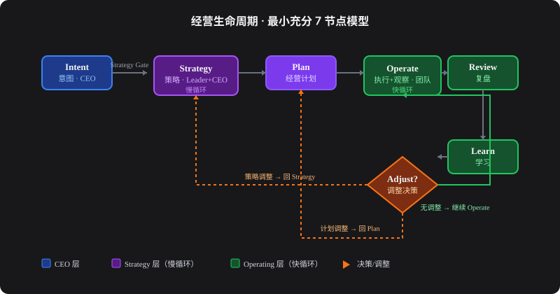
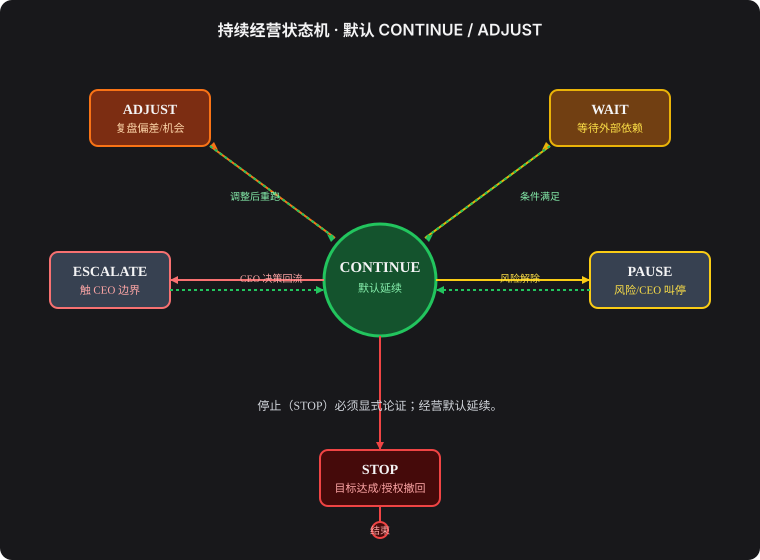

# CURIS 自主经营业务模型研究
### WORKBUDDY 独立研究轨道 · 经营操作系统（Operating OS）设计

**日期**：2026-08-20
**报告类型**：战略研究 / 经营操作系统定义（Research Specification）
**分析主题**：Curis 如何从「AI 员工自动完成任务」升级为「AI 员工自主经营业务」
**研究轨道**：WorkBuddy 独立轨道（未读取 Codex 同题研究，未与 Codex 预对齐）
**署名**：丁笃行（Ding）· 战略咨询合伙人
**纪律声明**：外部事实标 [F]（已检索来源），本模型的设计性主张标 [A]（假设/设计）或 [I]（推断）。小红书案例中的具体市场数字为 [A] 示意，结构性结论锚定外部 agent / 经营方法论研究 [F]。

---

## 📌 核心结论（Bottom Line）

- **结论**：Curis 要做到「AI 员工自主经营业务」，必须把工作的基本单元从 **Task（任务）** 提升为 **Operating Responsibility（经营责任）**——由一个 **Leader（经营负责人）** 长期持有，并以「情境理解 → 研究 → 诊断 → 策略 → 计划 → 执行督导 → 结果复盘 → 学习 → 调整 → 下一轮」的连续循环运转；其中 **Strategy（为何赢/现在怎么赢/本轮验证什么）与 Team Operating（团队如何把活做出来）必须严格分层**，且业务的持续增长只能来自 Leader 的「假设驱动实验循环」，而非执行量的堆叠。
- **支撑论据**（3 条）：
  1. [F] 2025–2026 年 agentic AI 研究一致结论：从「问 AI」到「委托 AI」的跃迁，本质是管理从「直接执行」转向「督导与编排 agent 团队」；价值来自 *continuous optimization：agents track outcomes, detect deviations, refine strategies over time*——但策略修正需要**显式的 Strategy 循环**，执行自动化本身不提供方向（Noventiq 2026；Datasumi 2026；AetherLink 2026）。
  2. [F] 自主Agent治理研究（TrackMind REACT 框架、Mindra 四档自治、PlayerZero 可调自治）证明：真正的自主不是「全授权」，而是 **按风险/可逆性/置信度分档授权 + 信任梯度赚取更高自治**；这正好对应本研究「CEO 边界 + Leader 自治」的切分（TrackMind 2026；Mindra 2026；PlayerZero 2026）。
  3. [I] 若 Team Operating 100% 自动但无 Strategy/Review，业务不会增长：自动化只提升「被生产之物」的吞吐；若策略错误（定位/受众/角度错），更多执行 = 更多浪费。增长需要**方向校正**，而方向校正只能由 Strategy+Review 提供。
- **反转条件（Kill Conditions）**：
  1. 若实测显示 Leader 的「策略循环」在 V1 单域内带来的指标改善 ≤ 纯执行自动化的改善（即策略层无边际贡献），则说明本模型的「Strategy/Operating 分层」过度设计，应回退到「任务自动化 + 规则化复盘」。
  2. 若用户（CEO）在 V1 真实使用中仍被迫每日介入运营细节（而非仅在高杠杆 Gate 出现），则说明自治档位/触发机制设计失败，模型需重做「持续经营」与「CEO 边界」两章。
- **研究范围边界**：本报告**只定义经营操作系统模型**，不修改 Product Authority / Runtime / Schema / DB / Prototype；所有结论为「产品可采纳的研究提案」，非对现有蓝图的改写。

---

## 0. 研究边界、框架与文献基础

**问题域判定**：这是「经营模型/组织怎么改」类咨询问题，走**咨询模式**（非行研）。不套个股模板、不输出评级/目标价。

**框架选型（问题决定框架，非框架决定问题）**：

| 分析维度 | 选定框架 | 验证什么 |
|---|---|---|
| 经营循环结构 | **OODA（Observe-Orient-Decide-Act）** + **PDCA** | 快循环（战术响应）与稳循环（持续改进）的双层节奏 |
| 增长机制 | **Build-Measure-Learn（精益创业）** | 假设驱动实验、已验证学习、避免「多做≠增长」 |
| 方向与节奏 | **OKR / Operating Cadence** | Goal 级联、周期复盘、持续而非偶发 |
| 自治与边界 | **可调自治（Tunable Autonomy / REACT）** + **Human-in-the-Loop** | CEO 边界、自治档位、信任梯度 |
| 多智能体编排 | **Control Plane / Orchestration**（2025–2026 实证） | Leader 作为编排层，非执行者、非路由器的角色定位 |

**外部研究基础（已实际检索，非凭记忆）**：
- [F] Noventiq《The Era of Multi-Agent Systems》(2026-05)：Agentic AI 五大特征——主动性、多步执行、协作、自治、集成；价值四点含 *continuous optimization*。
- [F] Datasumi《The Agentic AI Wave》(2026)：2026=试点与标准化、2027=规模化与治理、2028=协同自主生态；*Human-plus-agent collaboration becomes the default operating model*。
- [F] AetherLink《AI Agents & Multi-Agent Systems》(2026)：Control Plane 管理任务路由/冲突解决/资源优化/审计/学习适配；提出 *specialized agents outperform general-purpose*。
- [F] TrackMind《Agent Handoff Protocols》(2026)：四档自治（Fully Supervised / Conditional / Monitored / Full）+ REACT 矩阵（Risk/Explainability/Accuracy/Consequence/Time）。
- [F] Mindra《HITL Orchestration》(2026)：四档自治梯（Draft-only / Act on low-risk / Ask before sensitive / Act within policy），强调 *autonomy is earned workflow by workflow*。
- [F] PlayerZero《Tunable Autonomy》(2026)：自治是按工作流阶段可调的；跨团队边界需 *autonomy gate*；以审批率/MTTR/缺陷逃逸率衡量是否「赚到」更高自治。
- [F] Umbrex / YourMarketingPeople《OODA vs PDCA》(2026)：OODA 强调 *tempo + orientation*，PDCA 强于稳态过程控制，二者可叠加；增长/UX 演化用 OODA，治理用 PDCA。

---

## 0.5 证据与结论自检（审阅响应）

本次自检针对「结论是否站得住、证据是否充分」两项进行。

### 核心结论的证据等级

| 核心结论 | 证据等级 | 支撑 |
|---|---|---|
| 工作单元应从 Task 提升为 Operating Responsibility | [A] 设计主张 | 来自 OODA/PDCA/BML/agentic 共同机制的操作化，非可直接观测事实 |
| Strategy 层与 Operating 层必须分离 | [I] 强推断 | [F] 2025–2026 agentic 研究一致指出 control plane / continuous optimization / accountability 是价值倍增点；[I] 执行自动化只能规模化错误方向 |
| 增长来自假设驱动实验循环，非执行量 | [I] 推断 | [F] BML/精益创业方法论；[I] 内容域「多发≠增长」为结构性判断 |
| CEO 边界应通过可调自治/信任梯度实现 | [A] 设计主张 | [F] TrackMind/Mindra/PlayerZero 的 HITL/REACT 研究支持分档自治机制 |
| 小红书案例具体市场数据 | [A] 示意 | 未做真实赛道检索；已在未决问题列明 |
| 客服反例修正 | [I] 推断 | 基于客服域与内容/研发域的结构差异推导 |

### 证据充分性判断

- **充分**：外部 agentic AI / 经营方法论研究已实际检索并引用 [F]，覆盖 multi-agent orchestration、continuous optimization、可调自治、OODA/PDCA/BML 等关键机制。
- **不充分（已标注并待补）**：
  1. 小红书 AI 科技内容赛道的真实市场规模/头部/形态/变现数据——当前为 [A] 示意。
  2. 「信任梯度」晋升阈值——需 V1 实测标定，当前无 [F]。
  3. 多业务并发时 Leader 间协调机制——V1 范围外，未展开。
- **自检结论**：模型框架性结论有 [F] 方法论研究支撑，足以进入产品/架构评审；V1 落地前必须补全真实赛道数据并在单域内实测策略循环的边际贡献。

---

## 1. 从 CEO 真实意图开始

**案例**：「这个 AI 科技小红书账号交给你，帮我做起来。」

这句意图的本质不是「派一个任务」，而是一次**责任转移（responsibility handoff）**。「做起来」是**结果承诺**，不是交付物。小白用户不会、也不应提前知道：定位、增长策略、内容策略、变现方式、KPI、团队结构、Workflow。

### Curis 应该自己理解什么
- **意图是结果导向的**：「做起来」= 让账号进入增长/有价值状态，而非「发 N 篇笔记」。
- **渠道与领域只是提示，不是策略**：「AI 科技」是领域线索，「小红书」是渠道线索——都不是定位、受众、 monetization 的完整定义。
- **CEO 提供的是「委托 + 约束」，系统提供「委托之下的全部」**。

### Curis 应该自己研究什么（在问 CEO 之前先做功课）
- **赛道/市场**：小红书 AI 科技内容的格局——头部账号、有效内容形态、平台算法近期趋势、空白定位 [A，案例示意，需真实检索补全]。
- **变现路径谱系**：该类账号常见变现（品牌商单、知识产品、社群、引流到服务/产品）——各自的前提条件与时机。
- **能力需求**：需要哪些能力（选题研究、内容创作、视觉设计、发布、数据分析、互动维护），以及当前可用能力是否齐备。
- **竞争白空间**：现有打法里哪类受众/角度尚未被强占。

### 必须问 CEO 什么（最少、最高杠杆）
- **结果的私人定义**：「做起来」对**你**意味着什么？粉丝量 / 影响力 / 收入 / 还是某更大目标的跳板？（这是 Goal——CEO 的本职。）
- **风险与禁区**：有什么绝对不能做的（品牌安全、合规、预算上限、时间/精力预算）？（这是 Risk 边界。）
- **方向偏好（可选）**：你是否已有某个假设（如「我觉得短视频讲解最靠谱」），还是全权交给我定？（决定首轮 Strategy Gate 是「选 A/B/C」还是「我定你批」。）

### 什么不应该问（以保全自主经营）
- **不要问**内容日历、发布频率、具体选题、团队组成、工具选型——这些是 Operating 责任，Leader 应自己拥有。
- **不要以开放题把策略甩回给 CEO**（如「你的定位是什么？」）。正确做法：Curis 研究后**提出 2–3 个定位选项**供 CEO 在 Strategy Gate 里选，而非要求 CEO 替系统做策略。
- **不对称性总结**：CEO 给 *意图 + 约束*；系统给 *约束之下的全部*。交接物是一份**责任契约**，不是一份规格书。

---

## 2. Operating Responsibility（经营责任）

**定义**：Leader 接到的不是 Task，而是**长期经营责任**。

### Leader 必须持续承担的 10 项职责
1. **Situation Understanding**（情境理解）——持续感知业务内外部状态。
2. **Research**（研究）——主动补信息，而非等指令。
3. **Diagnosis**（诊断）——判断「现在到底怎么了 / 机会在哪」。
4. **Strategy**（策略）——回答「为何做、现在怎么赢、本轮验证什么」。
5. **Operating Plan**（经营计划）——把策略落成本轮可执行的计划。
6. **Execution supervision**（执行督导）——不是自己干，而是确保团队把活做出来、达标。
7. **Result Review**（结果复盘）——对照目标与假设评判。
8. **Learning**（学习）——把复盘沉淀为可复用/可证伪的模式。
9. **Adjustment**（调整）——基于学习修正计划/策略。
10. **Next Cycle**（下一轮）——主动发起下一轮（见第 5 章）。
11. **Escalation**（升级）——触到 CEO 边界时主动上抛（见第 7 章）。

### Leader 明确不是什么
- **不是 Router（路由器）**：仅把任务分发给执行者即结束。Leader 对结果负责，不只对分发负责。
- **不是 Workflow 节点**：不是流水线里的一步。它横跨整条生命周期。
- **不是所有工作的 Executor**：它**编排**能力，不亲自写每一篇稿、画每一张图（契合 Curis「员工=动态调用能力的岗位」模型）。
- **不是 CEO 替代品**：它不设定公司终极 Goal / Direction，只在 CEO 授权范围内经营。

**一句话区分 Task vs Operating**：Task 执行者「做完即停」；Operating Leader「做完一轮即开始下一轮」——因为责任是连续的。「任务完成」对 Operating Leader 无意义，只有「业务结果是否在朝 Goal 推进」有意义。

---

## 3. Strategy 与 Team Operating 严格分离

**Strategy 回答**：
- 为什么做（Why now）？
- 现在准备怎么赢（Where to play / How to win）？
- 当前在验证什么（What are we validating this cycle）？

**Team Operating 回答**：
- 团队怎么把 Work 做出来（Who does what, with what capability, in what cadence）？

### 必须证明：即便 Team Operating 完全自动，没有 Strategy / Review，业务仍不会自动增长
- **逻辑**：Team Operating 自动化只提升「被生产之物」的吞吐量与稳定性。它回答「做得更快更稳」，不回答「做对了吗」。
- **反证**：若策略错（定位错、受众错、角度错），执行自动化只会**规模化错误**——更多笔记、更快触达错误人群、更高效地烧预算。这是「多做」陷阱的结构性来源（见第 6 章）。
- **结论**：增长只能源于**方向校正**，而方向校正只能由 Strategy + Review 提供。执行自动化是**必要非充分**条件。
- **外部佐证 [F]**：AetherLink 2026 指出 *specialized agents outperform general-purpose*，但「编排层（Control Plane）做路由/冲突/学习适配」才是价值倍增点——即 Strategy/Review 所在的层。Datasumi 2026 亦强调 *agent accountability becomes as important as raw capability*—— accountability 正落在 Leader 的 Strategy/Review 职责上。

**设计含义**：Curis 的产品里，Strategy 层与 Operating 层必须是**两个独立循环、独立节奏、独立可信度**：
- Strategy 层：慢循环，CEO 可触达（Gate）。
- Operating 层：快循环，高度自治。
- 两层通过「本轮验证假设」这一契约连接，而非混为一谈。

---

## 4. 经营生命周期（最小充分模型）

用户给出的长链：Intent → Situation → Research → Strategy → Plan → Cycle → Execution → Result → Review → Learning → Adjustment → Next Cycle。

**删减原则**：不为完整而保留概念。合并后可得到**最小充分 7 节点模型**：

**被合并/删除的概念及理由**：
- **Situation + Research + Diagnosis** → 并入 Strategy 前的「Sense（感知）」阶段与一个诊断子步骤。三者本质都是「策略前的认知」，不必作为独立生命周期节点常驻；它们以**子动作**存在于每轮 Strategy 构建中。
- **Cycle / Execution / Result** → 统一为 **Operate（执行+观察）**，因为对外部观察者，这三者在一次经营动作里不可分。
- **Next Cycle** → 不是节点，而是状态机（见第 5 章）；它决定流向，不占生命周期位置。

**保留的双层节奏**（呼应第 3 章）：
- **Strategy 层（慢）**：Intent → Strategy(Gate) → Plan →（偶尔回到 Strategy）。
- **Operating 层（快）**：Operate → Review → Learn → Adjust → Operate。

---

## 5. 持续经营（为什么一轮结束后团队不会停）

**核心问题**：一轮工作结束后，为什么团队不会停？

### 五类触发源（决定「为什么要继续」）
1. **经营节奏（Operating Cadence）**——结构性原因。业务按既定节奏（如每周增长循环）自动开启下一轮。这是「不停」的**默认机制**。
2. **Result 触发**——结果回来了 → 必须复盘 → 复盘产出下一步动作 → 自然进入下一轮。
3. **外部 Signal**——市场变化、平台算法迁移、竞品动作、突发热点。
4. **Leader 主动发起**——Leader 识别到机会，开启新实验轮。
5. **CEO 新目标**——CEO 追加意图或改变方向。

### 状态机（CONTINUE / ADJUST / WAIT / ESCALATE / PAUSE / STOP）

**关键设计点**：**默认状态是 CONTINUE 或 ADJUST，不是 STOP**。停止是必须被显式论证的例外。这正是「经营」与「任务」的分水岭——任务默认终止，经营默认延续。

---

## 6. Growth 不是「多做」——以小红书压力测试

**命题**：发布更多内容 ≠ 增长。

### 团队如何真正增长（假设驱动实验循环 = Build-Measure-Learn + OODA 战术 tempo）
1. **找机会**：扫数据（哪种形态/角度/话题在涨）、外部趋势、竞争定位空白。
2. **建假设**：「若我们把重心切到 60 秒 AI 工具实测，因为 [受众信号]，预期 [指标] 提升。」
3. **做实验**：受控测试（如 2 周、A/B 内容类型），**事前注册成功指标**。
4. **衡量**：对照基线 + 对照组。
5. **识别有效模式**：把胜出模式提升为「标准打法（Playbook）」。
6. **放大有效策略**：把更多周期/能力分配给胜出模式。
7. **停止无效策略**：用「kill rule」切掉败因（不是单周差就杀）。
8. **发现商业化机会**：受众/信任到位后，测试收入路径（商单/产品/服务）。

### 防 AI 因短期数据频繁改方向的护栏
- **事前注册假设与成功指标**：禁止事后改目标（goal-moving）。
- **最小样本/时间阈值**：未达 N 篇或 2 周前不判死刑（防噪声）。
- **策略稳定地平线**：策略变更在**更慢节奏**上评审（如月度），战术执行可在稳定策略内波动。
- **噪声 vs 信号区分**：单周波动 = 噪声；跨多轮持续趋势 = 信号。
- **每次调整写入 Learning 账本**：系统累积而非震荡（避免「上周说 A 这周说 B」）。

**本质**：增长 = *已验证学习的复利*，不是执行量的堆积。这与第 3 章「Strategy/Operating 分离」互为表里——放大的必须是**经 Review 验证的模式**，而非更多随机输出。

---

## 7. CEO 边界

**CEO 默认只负责**：
- **Goal**（目标）
- **Direction**（方向）
- **Strategy-level Decision Gate**（策略级决策门）
- **Risk**（风险）
- **不可逆 / 高影响决策**

### Leader 自主决定的（无需问 CEO）
- 经营战术：已批准定位内的选题、发布节奏、形态实验、工具/执行者指派、周度资源分配、品牌指南内的常规互动。
- 当前策略内的小幅计划调整。
- 本轮跑哪些实验。

### 必须找 CEO 的（升级触发）
- **策略变更**：转型定位、进入新变现模型、改变目标受众。
- **不可逆 / 高影响**：花钱（超阈值广告预算）、签合同/约、有法律/品牌风险的对外声明、删/合并账号、任何触钱/客/法/公且超自治档的动作。
- **风险事件**：品牌安全事件、平台处罚、负面发酵、数据/安全问题。
- **歧义**：Leader 在授权内无法解决、或置信度 < 阈值。
- **改变成功定义**：任何动摇 Goal 的事。

### 避免两个极端
- **A. 什么都问 CEO** → 失去自主经营，CEO 成瓶颈，「团队」只是 CEO 干活的 UI。
- **B. 什么都自己决定** → 失控，自主动作触钱/法/牌风险，使命漂移。

### 平衡机制（锚定外部研究 [F]）
采用 **可调自治（Tunable Autonomy）**：每类动作按 **REACT**（Risk / Explainability / Accuracy-Confidence / Consequence / Time-sensitivity）定档；档位**按审批历史「赚取」**（信任梯度）——审批率近 100% 的工作流可毕业到更高自治（TrackMind 2026；Mindra 2026；PlayerZero 2026）。Curis 的 CEO 边界 = 「哪些动作永远在 Gate 之后 / 哪些可随信任梯度下放」的配置。

---

## 8. 新业务完整案例（小红书，从一句话跑到商业化决策）

**CEO**：「我要做一个 AI 科技小红书账号。」

| 阶段 | 发生什么 | 用户是否在场 |
|---|---|---|
| 1. Intent 理解 | Curis 解析「做」= 建设+增长；「AI 科技」= 领域线索（非完整定位）；「小红书」= 渠道。不要求 CEO 补定义。 | 说一句话 |
| 2. 市场/赛道研究 | Curis 自主研究小红书 AI 内容格局、头部、形态、变现、算法趋势 [A 示意]。产出情境简报。 | 否 |
| 3. 首轮策略 | Curis 提出 2–3 个定位论点（如 A 工具实测 / B 科普干货 / C AI 副业搞钱），各附受众、内容支柱、为何现在、变现路径、推荐默认项。 | 否（生成中） |
| 4. CEO 确认 | CEO 在 **Strategy Gate** 里选/改。这是**启动期唯一强制 CEO 触点**；Curis 也可提议 Goal 默认（如「3 个月 1 万粉 + 探索变现」）供确认。 | **是（Gate）** |
| 5. Business/Workspace 建立 | Curis 建业务实体、Workspace、KPI 基线、经营节奏。 | 否 |
| 6. 团队建立 | Curis 组建：1 个 Leader（经营负责人）+ 执行者（研究员/创作者/设计师/发布员/分析师）；角色绑定能力（契合 Curis 员工=动态调用能力岗位）。 | 否 |
| 7. 首轮执行 | Plan → Cycle：选题研究 → 创作 3–5 篇 → 设计 → 发布 → 监测。 | 否 |
| 8. 数据回来 | 2 周后指标（阅读/涨粉/收藏/评论/爆款归因）。 | 否 |
| 9. Review | Leader 对照基线与假设复盘。 | 否 |
| 10. Strategy 调整 | 学习显示讲解类胜出 → 调整计划加权讲解；若需收窄定位（如聚焦「AI 工具实测」）且超当前授权 → 提 **Strategy Gate** 给 CEO；若在授权内 → 自主调整。 | 视授权 |
| 11. 第二轮 | 执行调整计划。 | 否 |
| 12. 稳定增长 | 节奏持续，胜出模式被放大，粉丝复利。 | 否 |
| 13. 商业化 Decision | 达阈值（如 1 万粉+互动）后，Leader 向 CEO 抛 **变现 Strategy Gate**：「可启动品牌商单/付费社群，建议 X，是否批准？」 | **是（Gate）** |

**用户在哪些地方需要出现（尽量少）**：
- Intent（一句话）。
- 首轮 Strategy Gate（选定位 + 确认 Goal）。
- 偶发 Strategy Gate（变现、转型）——**低频、高杠杆**。
- 风险/升级事件。
- 其余全部对用户不可见。

---

## 9. 研发 Domain 压力测试（同一模型，不套内容逻辑）

**CEO**：「继续把 Curis 做成真正可用的产品。」

| 经营环节 | 研发域的具体内容（非内容逻辑） |
|---|---|
| 产品现状判断 | Leader 评估当前产品就绪度（什么能用/什么坏/用户反馈/技术债）——是**内部状态评估**，非市场研究。 |
| 优先级 | Leader 提议下一步构建什么，依据用户痛点、杠杆、可行性——**不是「发更多内容」类比**，而是「哪个能力解锁最多价值」。 |
| 研究 | 技术/可行性 spike、竞品产品拆解、用户研究。 |
| Strategy | 产品策略——本季产品应成为什么、在验证什么（如「本地优先上手能否留存」）。 |
| 开发计划 | 路线图、里程碑、完成定义（DoD）。 |
| 执行 | 构建（人/AI 开发执行者）。 |
| Build/Test/Review | 每特性 → 测试 → 对照**真实能力证据**复盘（非「200 OK」，而是「用户真能用」）。 |
| Product Learning | 该特性是否让产品更「真能用」？用户行为/留存/已解决投诉。 |
| 下一轮 Priority | 基于学习重排 backlog。 |

**与内容域的关键差异（证明模型域无关、内容域相关）**：
- 「增长」指标是**产品价值/可用性**，不是受众规模。
- 实验是**特性/能力交付**，不是内容发布。
- 「市场」是**用户自身的使用与痛点**，不是外部平台算法。
- Strategy 内容是**建什么**，不是**说什么**。
- 变现类比 = 「产品是否值得付费/能否留存」；对自用产品，「业务结果」是**能力成熟度**，非收入。
**结论**：经营循环结构可跨域迁移；Strategy/Research/Metrics 的**实质内容**完全按域定制。模型在「操作层」域无关，在「策略层」域相关。

---

## 10. 第三个反例（客服经营——故意寻找模型失效点）

选 **客服经营** 作为反例，因为它与「增长型/构建型」的内容、研发都不同，是**事件驱动（event-driven）**的稳态运营。

### 模型在客服域如何套用
- Goal：Resolution quality / Response time / CSAT / Cost-per-resolution（**不是增长**）。
- Strategy 内容：SLA、升级规则、知识库策略、渠道策略。
- 循环：工单到达 → 研究/诊断 → 处理 → 复盘 → 学习 → 调整。

### 模型失效 / 需修正的点（真实反例，非只验证）
1. **「Leader 主动发起增长循环」假设失效**：纯响应式运营里没有「可发起的增长」——循环由**入站需求**触发，非 Leader 主动。
   → **修正**：模型必须支持两种循环触发——**推（主动实验）** 与 **拉（事件触发）**。第 5 章触发源需补「事件触发」为一级。
2. **自治档位冲突尖锐化**：客户面对的回复是**公开+影响品牌** → 高自治档（草稿/审批）；但高量级使全审批不可能 → 必须靠信任梯度毕业到「政策内自治」，否则瓶颈。
   → **印证**：自治分档不是可选项，是必需；且客服域比内容域更早需要「赚取自治」。
3. **「变现」类比不存在**：业务结果是**成本/质量**，非收入。
   → **修正**：模型的「growth」动词是域特定的；不变式是「朝 Goal 的持续改进」，不是字面「增长」。
4. **ESCALATE 是稳态而非例外**：部分工单**必须**到人（共情、责任）。Leader 的「路由给人」是**一等经营动作**，非仅失败兜底。
   → **修正**：ESCALATE 在客服域是 steady-state；Leader 设计必须内建「路由到人」为常规能力。

**结论**：反例没有推翻模型，但**修正了三处**：循环触发需含事件驱动、growth 动词需域化、ESCALATE 在某些域是稳态。这正是压力测试的价值——暴露并修正，而非自证。

---

## 11. 经营 Truth（长期该保存什么）

**区分三类**，且**不设计数据库**，只定义「真相类别」与其生命周期：

### Canonical Truth（必须长期保存 · 业务的记忆）
- **Goal**（CEO 设定，锚点，不可被推理覆盖）。
- **当前 Strategy**（已选定的赌注）。
- **Operating Plan / Playbook**（什么有效、怎么打）。
- **Learning Ledger**（已验证模式 + 已 kill 模式 + 原因 + 证据引用）。
- **Business Baseline & Trajectory**（规范指标的时间序列）。
- **CEO Boundary Config**（自治档位、升级规则）。
- **Key Decisions & Rationale**（Strategy Gate 记录 + CEO 选择 + 理由）。

### Temporary AI Reasoning（临时推理 · 不进 Canonical）
- 本轮原始观察、待测假设草稿、在途执行日志、中间分析。
- 生命周期：本轮 + 复盘期内保留；复盘后**要么晋升为 Learning（验证通过），要么丢弃**。
- **纪律**：不把整条推理轨迹当真相存（会膨胀且混淆）。存「决策 + 已验证学习 + 轨迹」，不存自由文本推断流。

### UI Projection（派生展示 · 非真相源）
- CEO Desk、Dashboard、图表——由 Canonical Truth + 当前状态**渲染**而来，自身永不作为权威。

**生命周期**：born（临时）→ validated（晋升 Canonical）→ canonical（长期）→ deprecated（失效归档，如旧策略被新策略取代）。

---

## 12. 产品体验（用户最后才该看见的）

**原则**：用户不应理解内部 Operating Lifecycle。目标体感是——「这个团队自己在经营，有重要事情才来找我。」而非「我每天来操作 AI 经营系统。」

### 五个 surfaces（渐进披露，默认为零）
1. **CEO Desk**（唯一「家」）：只显示你托付的业务 + 一句话状态（「稳定增长中 / 等你拍板：变现模式 / 风险：平台限流预警」）+ 一个「有重要事才找你」的收件箱。**不暴露生命周期**。
2. **Department**（可选深入）：组织视图——团队及其授权，非日常循环。
3. **Business**：业务健康速览——Goal、当前 Strategy（大白话）、轨迹、下一个需 CEO 决策。**非执行细节**。
4. **Workspace**：团队工作的地方——对多数用户**只读可见**，以叙事呈现（「本周发 5 篇，2 篇爆款，已据此调整策略」），**非任务列表**。
5. **Leader Conversation**：与经营 Leader 的自然语言通道——问「怎么样了」、给新方向、批 Gate。Leader 用大白话说话、抛决策、报结果。

### 信息拉取规则（progressive disclosure）
系统**只在**以下情况把信息拉给用户：(a) 需 CEO 边界决策；(b) 风险/升级；(c) 用户自选的周期性摘要。其余全部沉在表面之下。

---

## 13. 外部研究提炼（共同机制，非机械套框架）

从 OODA / PDCA / Build-Measure-Learn / OKR-cadence / autonomous agents / HITL 中提炼出的**共同机制**：

1. **Tempo 胜完美**（OODA、BML）：更快的「已验证循环」获胜；好决定今天做 > 完美决定下季度做。
2. **Orientation / 心智模型质量**是「反应」与「经营」的分水岭（OODA Orient、Strategy 层）：感知之后先「理解含义」再决策，跳过即瞎猜。
3. **方向循环与执行循环必须分离**（PDCA vs 执行；Control Plane 编排研究）：这正是第 3 章 Strategy≠Team Operating 原则的外部佐证。
4. **自治是赚来的，不是给的**（Tunable Autonomy / 信任梯度）：HITL 是控制层而非瓶颈；按档位+审批历史下放。
5. **连续而非偶发**（Operating Cadence、agentic continuous optimization）：循环默认不停（第 5 章 CONTINUE/ADJUST 默认态）。

**应用方式**：Curis 不机械套用任一框架，而是把上述 5 条机制**操作化**为——双速循环（Strategy 慢 / Operating 快）、Leader 持 Orient 质量、CEO 边界=自治档位配置、默认延续的状态机。框架是「为什么这样设计」的依据，不是「直接照搬的模板」。

---

## 14. V1 提案（最小可诚实宣称「AI 团队会自主经营业务」的程度）

### 必须 V1 做（MUST）
- Intent 接收 + Goal 捕获（CEO 一句话）。
- Leader **自主**情境/市场研究。
- 首轮 Strategy 提案（2–3 选项）→ CEO **Strategy Gate**（最小强制触点）。
- Business / Workspace / Team **自动**建立。
- 经营节奏 + 至少一轮**自治循环**（研究→创作→发布/执行→衡量）。
- Leader **结果复盘** + Learning Ledger。
- 自动进入下一轮（CONTINUE / ADJUST）。
- CEO 边界：自治档位 + 触策略/风险/不可逆时 **ESCALATE**。
- **CEO Desk + Leader Conversation 为唯一用户面**，隐藏生命周期。
- **一个域端到端跑通**：内容/小红书为天然 V1（可观测、可衡量、低风险、能演示增长）。

### 绝对不要首版做（MUST NOT）
- 多业务协同 / 跨业务策略。
- 复杂多 agent 协商或 agent 间契约。
- **完整自主变现执行**（花钱动作 V1 仍 CEO 门的）。
- 复杂组织层级 / 部门模板市场。
- 超出简单信任规则的「自修改自治档位」。
- 多源实时外部信号 ingestion（V1 先用「定时 + 结果触发」）。
- 每个动作都 HITL（会杀死自治）——仅 CEO 边界动作门控。
- 预测/ML 策略引擎——V1 用**启发式假设循环**，非模型。

### V1 宣称校准
Curis 只能在**受限范围内**诚实说「AI 团队会自主经营业务」：该域需 (a) 循环可观测/可衡量、(b) 自治档位控住风险、(c) 存在 CEO Gate 覆盖策略/风险。V1 锁定**单域（内容）+ 单业务并发**。在该 bounded scope 内宣称为真，不可泛化为「任何业务全自动」。

---

## ✅ 下一步行动

| # | 行动 | 负责人 | 截止时间 | 验证指标 |
|---|------|--------|---------|---------|
| 1 | 将本模型提交产品/架构评审，确认与 Curis「员工=动态调用能力岗位」「目标→执行→验收→返工→完成」底座的一致性 | 产品规划席（齐活林） | 2026-08-27 | 评审结论 + 与现有任务流的关系图（Operating 层 vs Task 层） |
| 2 | 在内容域做 V1 原型：Leader 角色 + Strategy Gate + 自治循环 + CEO Desk | 系统交付席（高见远/寇豆码） | 2026-09-10 | 单业务端到端跑通 ≥ 2 轮循环，CEO 仅在 Gate/风险出现 |
| 3 | 真实检索补全小红书 AI 内容赛道数据（替换本报告 [A] 示意） | 研究/内容团队 | 2026-09-03 | 赛道规模/头部/形态/变现的 [F] 来源清单 |
| 4 | 定义 Canonical Truth 的 7 类字段与生命周期（不落地 DB，先定契约） | 架构师 | 2026-09-05 | Truth 契约文档 v0.1 |

---

## ⚠️ 风险与未决问题

- **风险 1（策略层无边际贡献）**：若 V1 实测 Strategy 循环未带来 > 纯执行自动化的改善，模型可能过度设计。应对：第 1 条 Kill Condition 已设反向验证。
- **风险 2（CEO 仍被日常卷入）**：自治档位/触发设计失败 → 用户被迫每日操作。应对：V1 实测「CEO 触点频率」，超标即回炉第 5/7 章。
- **风险 3（AI 短期数据 whipsaw）**：频繁改方向伤业务。应对：第 6 章护栏（事前注册/最小样本/策略稳定地平线）。
- **未决问题**：
  - 多业务并发时，Leader 之间如何不互相踩踏（跨业务策略协调）——V1 范围外。
  - 真实小红书赛道数据未检索（本报告 [A] 为示意）。
  - 「信任梯度」的具体晋升阈值（审批率/MTTR/缺陷逃逸率权重）需 V1 实测标定。

---

## 📚 证据与数据来源

- 外部检索（实际发起，非凭记忆）：
  - [F] Noventiq, *The Era of Multi-Agent Systems* (2026-05-26)
  - [F] Datasumi, *The Agentic AI Wave* (2026)
  - [F] AetherLink, *AI Agents & Multi-Agent Systems: Enterprise Orchestration 2026* (2026)
  - [F] TrackMind, *Agent Handoff Protocols / REACT Framework* (2026)
  - [F] Mindra, *Human-in-the-Loop AI Orchestration* (2026)
  - [F] PlayerZero, *Human in the Loop AI: Tunable Autonomy* (2026)
  - [F] Umbrex, *OODA Loop Applied to Optimization* (2026)
  - [F] YourMarketingPeople, *What Is the OODA Loop in Business and Marketing* (2026)
  - [F] Charles Burnette, *The Executive's Toolkit* (OODA/PDCA/Cynefin) (2026)
  - [F] CHML Tech Consulting, *OODA Loop vs PDCA Cycle* (2026)
- 内部依据：Curis 产品四原则（全自动任务流是核心 / 能力可替换 / 员工=动态调用能力岗位 / 任何开发须让「目标→执行→验收→返工→完成」更自动）——作为 Operating 层的**已有底座**，本报告在其之上提出 Operating Responsibility 层，**未修改**任何 Product Authority / Runtime / Schema / DB / Prototype。
- 标注说明：小红书案例中的具体市场数字为 [A] 示意（需真实检索补全，见未决问题）；结构性结论锚定上述 [F] 外部研究。

---

> ⚠️ 以上内容由 AI 基于可获得信息整理生成，仅供决策参考，不构成正式投资或法律建议。重大决策请结合专业顾问意见。

---

# WORKBUDDY AUTONOMOUS OPERATION RESEARCH
— INDEPENDENT TRACK COMPLETE
— BUSINESS OPERATING MODEL DEFINED
— LEADER AUTONOMY DEFINED
— CONTINUOUS GROWTH LOOP DEFINED
— CEO BOUNDARY DEFINED
— CROSS-DOMAIN PRESSURE TEST COMPLETE
— V1 PROPOSED
— STOP
