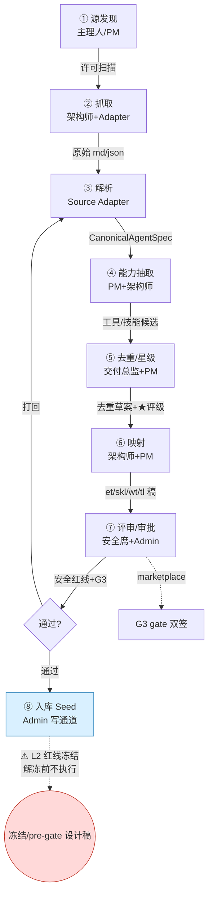

# Agent 拆解转换引擎 V1 规划报告（前半部分草稿）

> 版本：V1 规划草稿（前半，对应章节 1/2/3/5 + 候选 harvest 清单）
> 作者：产品经理 许清楚（software-product-manager）
> 阶段性质：**纯规划 / 资产设计**，不写代码、不落地真实资产
> 关键红线：⚠️ **把外部 agent 真实转换为 Employee / Skill / Department / Workflow 属 L2 暂停四项 #4 红线冻结**——本报告所有映射、清单均为 pre-gate 设计稿，不实际 seed。
> 目标读者：主理人 → 转交架构师（高见远）做资产格式设计

---

## 0. 背景与范围

Curis 未来要建设 AI 员工库（Employee Template 体系）。外部已有大量优秀 Agent / Role 项目（如 `agency-agents`，MIT 许可，230+ agents）。本引擎的目标是**不重复开发**，而是把这些外部 Agent 角色体系**转换**为 Curis 官方员工资产（Employee Template + Skill + Workflow + Tool Mapping）。

本草稿完成 4 项子任务（对应最终报告章节 1/2/3/5）+ 一份候选 harvest 清单设计稿。参考项目以 `msitarzewski/agency-agents` 为范式 1，已实地拉取其 `divisions.json`、`tools.json`、`strategy/runbooks.json` 及多个真实 agent `.md` 文件作为分析依据。

**Curis 现有资产体系对齐要点（已读取 5 份研究文档确认）：**
- Employee Template：`et_*`，字段含 `name/role/default_instructions/persona_overrides/image_ref_json 形象字段/applicable_departments`（注：现有研究表为 12 字段，主理人补充的 `persona_overrides/image_ref_json/applicable_departments` 为扩展字段，需架构师确认 schema）
- Department Template：`dt_*`，`department_templates` 表 + `department_types` 类型注册表（manifest_json 7 键契约）
- Skill：`skl_*`（含 version/category）；Tool：`tl_*` / `tool_templates`（富字段：名称/能力/类型/来源/适用部门/适用员工/需要权限/认证方式/安全等级/版本）
- Workflow：`wt_*`（对齐 `wl_*` 工作流，Phase-5+ 预留）
- Persona Template：`pt_*`（形象/风格/沟通，独立于员工角色）
- 三态治理一致：official / tenant_private / marketplace；ADR-0017 禁止区——Template 元数据可解禁，Instance / Runtime 仍锁定

---

## 章节 1：参考项目角色体系与能力结构分析

### 1.1 项目规模与组成（实地核实）

| 维度 | 事实（来自仓库与 divisions.json / runbooks.json） |
|------|------|
| 许可 | MIT（可商用、可改造、可再分发，无 copyleft 传染） |
| Agent 总数 | 230+，按 division 目录组织 |
| 真实 division 数 | **17 个**（见 1.2 表），由 `divisions.json` 权威定义 |
| 非 division 目录 | `integrations/`（convert.sh 的分发**输出**，非源 agent）、`strategy/`（playbook 与 runbooks，非 division）、`examples/`、`scripts/` |
| 单 agent 形态 | 一个 `.md` 文件：YAML frontmatter + 多段 `##` 章节 |
| 运行引擎 | **无**。靠 `convert.sh`/`install.sh` 把 Markdown 分发到外部宿主（Claude Code / Cursor / Codex / Gemini CLI / OpenClaw / Mistral Vibe），靠宿主会话 activate |
| 辅助元数据 | `divisions.json`（分区定义）、`tools.json`（外部工具集成格式）、`strategy/runbooks.json`（NEXUS 场景组队名册） |
| 贡献门槛 | 原创性检查、lint 校验（`lint-agents.sh`）、模板一致性、章节完整性 |

### 1.2 Division → Curis Department 映射表

`divisions.json` 给出 17 个 division，每个含 `label / icon / color`。下方映射到 Curis 的部门类型（`department_types` 的 `type_key`）或目标 `dt_*` / 业务职能，并标注与 Curis 现有资产的重叠/互补关系。

| # | agency division | Curis 目标部门类型 / 业务职能 | 对应资产层级 | 与 Curis 现状关系 |
|---|------|------|------|------|
| 1 | engineering | 研发部（`business.general` 子类） | `dt_*` 研发 + `et_*` FE/BE/DevOps | **已覆盖**：Curis 已有 6 个 official 员工（tech_lead/pm/architect/fe/be/qa）+ 30 条研发工具；agency 40+ 工程 agent 可作细分补充（如 devops-automator、ai-engineer、search-relevance） |
| 2 | design | 设计部 | `dt_*` design + `et_design_*` | 互补：Curis 有 `tl_figma/canva`，无设计员工模板；agency 有 ux-architect/ui-designer/brand-guardian 等 |
| 3 | product | 产品部 | `dt_*` product + `et_product_*` | 部分覆盖：Curis 有 official `product_manager`；agency 另有 feedback-synthesizer / trend-researcher / sprint-prioritizer / behavioral-nudge-engine（**净新增**） |
| 4 | marketing | 市场部 | `dt_*` marketing + `et_marketing_*` | **净新增**：Curis 无市场员工模板（仅 Pack B candidate 工具 tl_hubspot/jasper/semrush/buffer）；agency 有 36 个营销 agent |
| 5 | sales | 销售部 | `dt_*` sales + `et_sales_*` | **净新增**：Curis 无销售员工（仅 candidate 工具 tl_salesforce/apollo/gong/clay）；agency 有 9 个 |
| 6 | support | 客服部 / 支持部 | `dt_*` support + `et_support_*` | **净新增**：Curis 无支持员工（仅 candidate 工具 tl_intercom/zendesk）；agency 有 6 个 |
| 7 | finance | 财务部 | `dt_*` finance + `et_finance_*` | **净新增**：Curis 无财务员工（tl_stripe/alipay 仅支付侧）；agency 有 5 个（analyst/fpa/bookkeeper/tax/investment） |
| 8 | project-management | 项目管理（研发部子类或独立） | `dt_*` pm + `et_project_*` | 部分重叠：Curis 用 tech_lead 承担拆解协调；agency 有 senior-pm / project-shepherd / meeting-notes（可作补充或并入 tech_lead） |
| 9 | paid-media | 市场部 / 媒介投流（子类） | `dt_*` marketing + `et_paid_media_*` | **净新增**：投流职能 Curis 空白 |
| 10 | strategy | **非 division**（playbook 目录） | → `wt_*` 工作流教义 / NEXUS 组队 | 不直接转员工；其 `runbooks.json` 组队名册 → Workflow 团队组合（见 1.5） |
| 11 | security | 安全部 | `dt_*` security + `et_security_*` | 互补：Curis 有 `tl_strix`；无安全员工；agency 有 10 个 |
| 12 | testing | 测试部 | `dt_*` testing + `et_qa_*` | 部分覆盖：Curis 有 official `qa_engineer`；agency 有 evidence-collector/api-tester/reality-checker/performance-benchmarker（细分补充） |
| 13 | academic | 研究部 / 学术 | `dt_*` research + `et_research_*` | 净新增（研究职能）；可对齐 Pack C `tl_paper_analysis` |
| 14 | healthcare | 医疗（垂直行业） | 垂直 `dt_*` / `et_healthcare_*` | 可选：行业垂直，非 Curis 核心；建议 Phase-6+ 评估 |
| 15 | game-development | 游戏研发（垂直） | 垂直 `dt_*` / `et_game_*` | 可选：垂直行业 |
| 16 | gis | 地理信息（垂直） | 垂直 `dt_*` / `et_gis_*` | 可选：垂直行业，4 个层级 13 agent |
| 17 | spatial-computing | 空间计算（垂直） | 垂直 `dt_*` / `et_spatial_*` | 可选：垂直行业 |
| — | specialized | 跨职能 / 特殊（如 agents-orchestrator、sales-outreach） | `et_specialized_*` 或并入协调岗 | 部分：agents-orchestrator → 协调/tech_lead 语义；其余按职能并入对应部门 |
| — | integrations | **非源**（分发输出） | → `tl_*` 宿主集成元数据 | 不可转为员工；其「宿主工具格式」思路可借鉴到 tool_templates 集成字段 |

**映射结论**：17 个 division 中，核心商业职能（engineering/design/product/marketing/sales/support/finance/pm/paid-media/security/testing）直接映射到 Curis 部门体系；垂直行业（healthcare/game/gis/spatial）与 `specialized` 建议后置或并入；`strategy`/`integrations` 不转员工，分别转为 Workflow 教义与 Tool 集成元数据。

### 1.3 Agent 定义字段 → Curis 字段映射表

以实地读取的 `engineering-frontend-developer.md` 为样本，agency agent 由 **frontmatter + 9~11 个 `##` 章节**组成。下方逐字段映射：

| agency 字段 / 章节 | 内容性质 | 目标 Curis 资产 / 字段 | 转换方式 | 保真度 |
|------|------|------|------|------|
| frontmatter.`name` | 角色展示名 | `et_*.name` | 直接复制 | 高 |
| frontmatter.`description` | 一句话能力描述 | `et_*.description` | 直接复制 | 高 |
| frontmatter.`emoji` | 头像 emoji | `et_*.image_ref_json.avatar_emoji` 或 `pt_*.avatar` | 直接复制 | 高 |
| frontmatter.`color` | 主题色 | `pt_*.theme_color` / `image_ref_json.theme` | 直接复制 | 高 |
| frontmatter.`vibe` | 风格一句话 | `et_*.persona_overrides.style` 或 `pt_*.persona_summary` | 直接复制 | 高 |
| frontmatter.`services`（部分 agent 有） | 绑定服务提示 | `et_*.applicable_departments` / 工具 hint | 提取为工具候选 | 中 |
| `#` 标题 + 导语 | 角色自我介绍 | `et_*.role` + `default_instructions` 前言 | 抽取 | 高 |
| `## Identity & Memory`（Role/Personality/Memory/Experience） | 人格画像 | `et_*.persona_overrides` + `pt_*`（Persona Template） | 抽取为 persona 层 | 高 |
| `## Core Mission` | 目标与职责 | `et_*.responsibility`（公开）+ `default_instructions`（隐藏） | 拆为责任描述 + 详细指令 | 高 |
| `## Critical Rules` | 硬性约束 | `default_instructions`（约束段）+ `governance_rules_json`（部分） | 抽取为约束 | 高 |
| `## Technical Deliverables`（含代码示例） | 交付物 + 隐含工具 | `tl_*` 工具候选 + `skl_*` 技能候选 + `default_capability_types_json` | **NLP 抽取**隐含工具/技能 | 中（需映射） |
| `## Workflow Process`（Step 1..N） | 顺序步骤 | `wt_*` 工作流（对齐 `wl_*`） | 结构化归一为带 owner/expected_output 的步骤 | 中（单 agent 无 owner） |
| `## Deliverable Template` | 输出模板 | （无直接字段）→ 可作 `wt_*` 步骤 `expected_output` 或 SOP 样例 | 抽取 | 中 |
| `## Communication Style` | 沟通风格 | `persona_overrides.communication` / `pt_*.communication_style` | 抽取 | 高 |
| `## Learning & Memory` | 学习记忆偏好 | ⚠️ Curis Phase-4 **不支持员工记忆**（研究 Q5：Phase-6+） | **暂丢弃/后置** | 不可直接转 |
| `## Success Metrics` | 成功指标 | `wt_*` 验收标准 / 质量关卡（无独立 et 字段） | 抽取为验收条件 | 中 |
| `## Advanced Capabilities` | 进阶能力 | `skl_*` / `tl_*` 扩展候选 | 抽取 | 中 |

**关键发现**：agency 的「能力」**不**以结构化列表存在，而是**融于 Mission / Rules / Deliverables / Workflow 的自然语言**中。这意味着转换的核心难点是 **非结构化 persona → 结构化 Curis 资产**（尤其是 Tool/Skill 抽取），而非简单字段搬运。

### 1.4 能力构成方式总结

- **无独立 capabilities 列表**：不像 CrewAI 有显式 `tools: [...]`、AutoGPT 有 tool schema。agency 的能力完全靠自然语言描述（"Build with React/Vue/Angular"、"Integrate with GitHub API"）。
- **隐含工具须抽取**：Technical Deliverables 中的技术栈/平台名（React、GitHub、WCAG、Lighthouse）需经 NLP + 映射表落到 Curis 115 工具库（`tl_*`）或新增 candidate。
- **工作流为单 agent 视角**：Workflow Process 是「该 agent 自己怎么做」，不含多 agent 协作；多 agent 协作仅在 `runbooks.json` 中以 roster 形式存在。

### 1.5 与「部门 / 岗位 / 技能 / 工具」的对应关系

| agency 概念 | Curis 对应资产 | 说明 |
|------|------|------|
| division 目录（`divisions.json`） | `department_types` 类型注册表 / `dt_*` 部门模板 | 分类维度 |
| 单个 agent `.md` | `et_*`（Employee Template）+ `pt_*`（Persona Template） | 岗位角色 + 人格 |
| `## Workflow Process` 步骤 | `wt_*`（Workflow，对齐 `wl_*`） | 单 agent 流程 |
| `## Technical Deliverables / Advanced Capabilities` | `skl_*`（Skill）+ `tl_*`（Tool） | 技能与工具 |
| `strategy/runbooks.json` roster | `wt_*` 团队组合 / `dt_*.default_employee_templates_json` / 未来 `CompanyTemplate` | 多 agent 组队（phased roster） |
| `tools.json`（宿主格式） | `tl_*` 集成元数据（借鉴思路） | 非 Curis 工具，仅启发集成字段设计 |
| `convert.sh/install.sh` | ❌ 不转换 | Curis 自有 Admin/Workspace catalog + capability binding，外部宿主分发超出范围 |

---

## 章节 2：可转换性评估矩阵

### 2.1 逐层评估

判断三档：**可转**（直接映射，保真度高）/ **部分可转**（需抽取、归一或受 Phase 限制）/ **不可转**（与 Curis 模型冲突或超出范围）。

| # | 评估层级 | 判断 | 理由 | 对应 Curis 资产 | 前置条件 |
|---|------|------|------|------|------|
| 1 | Persona 内容（Identity/Mission/Style/Rules） | **可转** | 自然语言直接落入 `default_instructions` / `persona_overrides`；无需结构化改造 | `et_*` + `pt_*` | 须过安全红线（无 prompt 注入、无凭证） |
| 2 | 角色定义（name/role/description） | **可转** | 与 `et_*.name/role/description` 1:1 | `et_*` | — |
| 3 | Frontmatter 元数据（emoji/color/vibe） | **可转** | → `image_ref_json` / `pt_*` | `et_*` + `pt_*` | 需 `image_ref_json` 字段已落地 |
| 4 | Division 结构（divisions.json） | **可转** | 17 个 division → 部门类型/部门模板；Curis 按业务价值筛选（核心职能优先，垂直后置） | `dt_*` + `department_types` | Admin 审核纳入哪些为 official 部门 |
| 5 | Workflow（Workflow Process 步骤） | **部分可转** | 顺序步骤可归一为 `wt_*`；但单 agent 文件无 `owner_role`、无 `expected_output` 显式字段，需补全；且 `wt_*` 属 Phase-5+ 预留 | `wt_*` | Workflow 资产体系就绪（Phase-5+） |
| 6 | 工具绑定（Technical Deliverables / services） | **部分可转** | 隐含工具须 NLP 抽取并映射 Curis 115 工具库；未命中者生成 `tl_*` candidate（**不真实 seed**）；外部宿主工具（Claude Code 等）非 Curis 工具 | `tl_*` + `skl_*` | 工具映射表 + 去重；新工具走 candidate 待架构师确认 |
| 7 | 组队名册（runbooks.json roster） | **部分可转** | roster（分组 + activation 阶段）→ `wt_*` 团队组合 / `dt_*.default_employee_templates_json`；但 Curis 暂无多 agent 运行时（Instance 锁定），仅能定义为模板元数据 | `wt_*` / `dt_*` / 未来 `CompanyTemplate` | 多 agent 编排能力（Phase-5+）；当前仅沉淀为设计稿 |
| 8 | Learning & Memory 章节 | **不可直接转** | Curis Phase-4 不做员工记忆（研究 Q5：Phase-6+ 评估）；该章节仅描述学习偏好，无运行时意义 | （暂丢弃/后置） | 员工记忆能力解锁后重评估 |
| 9 | 分发脚本（convert.sh/install.sh/tools.json） | **不可转** | 外部宿主分发逻辑与 Curis 自有 catalog + capability binding 模型冲突；Curis 不依赖外部宿主 activate | —（仅借鉴集成字段思路） | — |
| 10 | 许可与原创性 | **可转（条件）** | MIT 允许改造再分发；但须保留署名、过原创性/lint 校验、过安全审查 | 治理层 | 许可合规检查 |

### 2.2 ⚠️ L2 红线标注（必须明确）

> **把外部 agent 真实转换为 Employee / Skill / Department / Workflow 属 L2 暂停四项 #4 红线冻结。**
>
> 本报告（章节 1 映射、章节 3 流程、章节 5 适配器、候选 harvest 清单）**全部为规划/设计稿**，用于：
> - 打磨转换方法论与资产格式提案（交架构师）；
> - 沉淀「源发现 → 解析 → 映射 → 评审」流水线设计；
> - 在 L2 红线解冻前，冻结任何对 `employee_templates` / `tool_templates` / `department_templates` / `workflow_templates` 的真实写操作（seed）。
>
> 当前可执行的边界（对齐 official-tool-catalog-v1 红线）：**仅编目元数据、做映射设计、产出 candidate 草案**；不接入凭证、不建立 marketplace、不 instantiation。

---

## 章节 3：Agent → Curis Employee 端到端转换流程设计

### 3.1 流程概览（负责角色 / 输入输出 / 质量关卡）

| 阶段 | 负责角色 | 输入 | 输出 | 质量关卡（Gate） |
|------|------|------|------|------|
| ① 源发现 Source Discovery | 主理人 + 产品经理 | 源清单（GitHub repo / skill 仓库 / 平台导出） | 候选源登记（含许可扫描） | 许可合规（MIT/可商用）；非 copyleft 传染 |
| ② 抓取 Fetch | 架构师（脚本/采集器） | 源 URL + adapter 选择 | 原始 agent 文件集合（md/json） | 完整性校验；source integrity；去噪（排除 integrations/strategy 非源目录） |
| ③ 解析 Parse | 架构师（Source Adapter） | 原始文件 | 结构化中间体 `CanonicalAgentSpec`（见章节 5） | frontmatter schema 合法；必需章节齐全（类 `lint-agents.sh`）；解析失败告警 |
| ④ 能力抽取 Capability Extraction | 产品经理 + 架构师 | `CanonicalAgentSpec` | 隐含工具/技能清单（候选 `tl_*`/`skl_*`） | 抽取保真度；**禁止幻觉工具**；命中 Curis 115 工具库优先复用 |
| ⑤ 去重 / 星级分级 Dedup & Rating | 交付总监（齐活林）+ 产品经理 | 抽取结果 + Curis 现有 115 工具/52 技能/6 官方员工 | 去重后的资产草案 + ★1~5 评级 | 与现有资产重叠度检查；评级标准（覆盖缺口、质量、互补性）；重叠项标记「增强而非新建」 |
| ⑥ 映射 Mapping | 架构师 + 产品经理 | 去重草案 | `et_*`/`skl_*`/`wt_*`/`tl_*` 字段填充稿 | 字段映射完整度；persona→et、deliverables→tl/skl、workflow→wt 三向对齐 |
| ⑦ 评审 / 审批 Review & Approve | 安全边界席 + Admin | 映射稿 | 审批意见（通过/打回/转 marketplace） | **安全红线**：无凭证持久化、无 prompt 注入、无越权；marketplace 触发 G3 gate |
| ⑧ 入库 Seed（冻结） | Admin（catalog 写通道） | 审批通过稿 | official 资产（source='official'） | ⚠️ **L2 红线解冻前此步不执行**；解冻后经 `/api/platform/*` 写通道 seed |

### 3.2 Mermaid 流程图

### 3.3 关键质量关卡说明

- **关卡③ Parse**：复用 agency 自带的 `lint-agents.sh` 思路——校验必需章节（Identity/Mission/Rules/Deliverables/Workflow/Success Metrics）存在、frontmatter 字段完整，否则解析告警。
- **关卡④ Extraction**：抽取出的工具必须能在 Curis 115 工具库或已知生态中找到依据，**禁止凭空生成工具 id**；无法命中者标 `candidate` 而非 `active`。
- **关卡⑤ Dedup**：与 Curis 现有 6 官方员工比——如 agency `product-manager` 与 `official.employee.product_manager` 重合，判定为「增强而非新建」；星级反映净新增价值。
- **关卡⑦ Review**：安全边界席重点查三类风险——(a) 凭证持久化（agent 文本若含 api_key/secret 模式须剥离）；(b) prompt 注入（恶意指令）；(c) 越权表述（如「直接执行任意代码」须降级为受控技能）。

---

## 章节 5：多源扩展方案（Source Adapter 范式）

### 5.1 设计思想：Source Adapter 模式 + CanonicalAgentSpec 中间 schema

以 `agency-agents` 为**范式 1**（Markdown persona + shell 分发），抽象出统一接口 `SourceAdapter`，每个外部来源实现一套适配器。所有适配器把异构源**归一化为同一个中间表示 `CanonicalAgentSpec`**，再喂入章节 3 的同一转换流水线。这样「源解析」与「Curis 映射」彻底解耦——新增来源只需新增一个 Adapter，不改映射逻辑。

**`CanonicalAgentSpec`（中间 schema，非代码，字段清单）：**
`id` / `division` / `name` / `role` / `description` / `vibe_style` / `avatar_emoji` / `theme_color` / `mission[]` / `critical_rules[]` / `deliverables[]`（含隐含技术栈） / `workflow_steps[]`（step + 文本） / `implied_tools[]` / `implied_skills[]` / `memory_notes` / `success_metrics[]` / `source_license`。

### 5.2 候选来源与适配差异对比（≥4 种，含范式 1 共 6 种）

| 来源 | 形态 | 是否有结构化能力 | 映射保真度 | 适配差异（Adapter 重点） | 主要对应 Curis 资产 |
|------|------|------|------|------|------|
| **① agency-agents（范式 1）** | Markdown persona + shell | 否（自然语言） | 中 | `MarkdownFrontmatterAdapter`：解析 frontmatter + `##` 章节；能力须 NLP 抽取 | `et_*` + `pt_*` + `wt_*` + `tl_*` candidate |
| **② curispeng22-coder/skill** | 结构化 skill 仓库（系统内置） | 是（技能步骤清晰） | 高 | `SkillRepoAdapter`：skill 已近 `skl_*` 形态；直接落 `skl_*` + 部分 `tl_*`；Curis 现有 Pack F~J 多源于此 | `skl_*` + `tl_*`（高保真） |
| **③ CrewAI** | YAML（Agents/Crew，role/goal/backstory/tools） | 是（显式 tools 列表） | 高 | `CrewYAMLAdapter`：与 Curis EmployeeTemplate 字段**天然对齐**（role/goal→responsibility/backstory→default_instructions/tools→capability）；几乎 1:1 | `et_*` + `tl_*`（直接） |
| **④ AutoGPT / AgentKit** | JSON/YAML agent 定义 + tool schema | 是（tool schema 结构化） | 高 | `AgentConfigAdapter`：tool schema → `tl_*` 直接映射；注意沙箱/权限声明须转为 security_level | `et_*` + `tl_*` |
| **⑤ Coze / Dify** | 可视化 bot 导出 JSON（nodes/plugins） | 是（节点+插件） | 中高 | `PlatformExportAdapter`：nodes → `wt_*` 步骤；plugins → `tl_*`；需剥离平台私有字段 | `wt_*` + `tl_*` + `et_*` |
| **⑥ MCP Registry / awesome-mcp-servers** | MCP server manifest | 是（工具/资源清单） | 高（工具侧） | `MCPManifestAdapter`：以 `tl_*` 为主，少 persona；对齐 official-tool-catalog 扫描法 | `tl_*`（为主） |

**适配层接口（职责描述，非代码）：**
- `discover()`：枚举源内 agent / skill / tool 条目
- `fetch(entry)`：拉取原始内容
- `parse(raw)`：归一为 `CanonicalAgentSpec`
- `extractCapabilities(spec)`：抽取隐含工具/技能（对非结构化源）
- `getMetadata()`：返回许可、来源、版本等治理元数据

### 5.3 扩展原则

1. **保真度优先**：结构化源（CrewAI/AutoGPT/skill 仓库）优先于非结构化源（agency-agents）纳入，因其映射损耗低。
2. **一次归一、多次复用**：所有源先转 `CanonicalAgentSpec`，再共享章节 3 流水线，避免每源写一套映射。
3. **许可闸门前置**：① 阶段即过滤不可商用/强 copyleft 源，MIT/Apache-2.0/宽松许可优先。
4. **candidate 而非 active**：任何未在 Curis 工具/技能库命中的抽取结果，一律产出 `candidate` 草案，不自动 seed。

---

## 候选 harvest 清单（设计稿，非真实入库）

> **性质声明**：本清单为 **pre-gate 设计稿**，依据章节 3 流程的 ⑤⑥ 阶段产出形态。**不落真实库、不 seed**；真实 seed 须待 L2 红线解冻 + 架构师确认 `et_*` 扩展字段 schema + Admin 审批。
> 选取原则：与 Curis 现有 **6 个 official 研发员工 + 30 条研发工具 + 约 52 技能** **互补**的商业职能 persona（优先 marketing/sales/support/finance/product 等 Curis 尚缺员工模板的职能）。
> 星级（★1~5）含义：净新增价值 / 与现有资产互补度 / 内容质量。

| # | 源 slug（agency-agents） | division | 目标 et_* 草案 id | 互补性说明（vs Curis 现状） | 默认能力类型 | 关联 tl_*/skl_*/wt_* 草案 | ★ |
|---|------|------|------|------|------|------|------|
| 1 | product-feedback-synthesizer | product | `et_product_feedback_synth` | 净新增：Curis 仅有通用 PM，无「反馈综合」专项 | model | `wt_feedback_synth`（反馈归类流） | ★★★★ |
| 2 | product-trend-researcher | product | `et_product_trend_researcher` | 净新增：趋势/竞品研究岗；对齐 `tl_paper_analysis` 思路 | model+tool+connector | `skl_trend_scan` | ★★★ |
| 3 | product-sprint-prioritizer | product | `et_product_sprint_prioritizer` | 部分重叠：tech_lead 承担拆解；判定「增强 tech_lead」而非独立岗 | model | — | ★★★ |
| 4 | product-behavioral-nudge-engine | product | `et_product_nudge_engine` | 净新增：行为/增长心理学专项，Curis 空白 | model | `skl_nudge_design` | ★★★ |
| 5 | marketing-growth-hacker | marketing | `et_marketing_growth_hacker` | 净新增职能；互补 `tl_hubspot/jasper/buffer` | model+tool+connector | `wt_growth_loop` | ★★★★★ |
| 6 | marketing-content-creator | marketing | `et_marketing_content_creator` | 净新增；强互补 `tl_content_publisher`/`tl_article_illustrator` | model+tool | `skl_content_draft` | ★★★★★ |
| 7 | marketing-social-media-strategist | marketing | `et_marketing_social_strategist` | 净新增；互补 `tl_wechat_official`/`tl_post_to_x`/`tl_xhs_images` | model+tool | `wt_social_calendar` | ★★★★ |
| 8 | sales-pipeline-analyst | sales | `et_sales_pipeline_analyst` | 净新增；互补 `tl_salesforce`/`tl_apollo`/`tl_gong` | model+tool+connector | `skl_pipeline_forecast` | ★★★★ |
| 9 | sales-discovery-coach | sales | `et_sales_discovery_coach` | 净新增；发现/问诊话术专项 | model | `skl_discovery_call` | ★★★ |
| 10 | support-support-responder | support | `et_support_responder` | 净新增；互补 `tl_intercom`/`tl_zendesk` | model+connector | `wt_ticket_triage` | ★★★★★ |
| 11 | support-legal-compliance-checker | support | `et_support_legal_compliance` | 净新增；互补 `tl_contract_review` | model+tool | `skl_compliance_scan` | ★★★★ |
| 12 | finance-financial-analyst | finance | `et_finance_analyst` | 净新增职能（Curis 无财务员工）；`tl_stripe/alipay` 仅支付侧 | model+tool | `skl_fin_modeling` | ★★★★★ |
| 13 | finance-tax-strategist | finance | `et_finance_tax_strategist` | 净新增；税务策略岗 | model+tool | `skl_tax_plan` | ★★★ |
| 14 | project-management-senior-project-manager | project-management | `et_project_senior_pm` | 部分重叠 tech_lead；判定资深 PM 补充或并入 | model+tool | `wt_release_plan` | ★★★★ |
| 15 | security-compliance-strategist* | security | `et_security_compliance` | 净新增；互补 `tl_strix`（仅 1 个安全工具） | model+tool+connector | `skl_security_review` | ★★★★ |

> *注 15：security division 真实 slug 待抓取确认（仓库 security 共 10 agent，具体词干需 `scripts/check-divisions` 或目录核对）；此处用语义名占位，体现 harvest 设计方法。
> 注 5/7/10 等 market/support 职能在 Curis 现有 115 工具中仅有 **candidate** 级工具（Pack B），本清单与之形成「员工模板 + 工具」闭环，互补性强。
> 重叠处理：#3（sprint-prioritizer）、#14（senior-pm）与 Curis `tech_lead` 职责重叠，按关卡⑤判定为「增强而非新建」，建议作为 `et_*` 派生候选或并入，而非新增 official 员工。

**去重结论**：15 个候选中，约 11 个为 Curis **净新增商业职能员工模板**（营销/销售/支持/财务/产品细分），2~3 个为与现有 tech_lead 的重叠项（降级处理），1 个（security）待 slug 确认。均不触发与现有 6 官方研发员工的冲突。

---

## 给架构师的前置问题（资产格式设计输入）

1. **EmployeeTemplate 扩展字段**：主理人补充的 `persona_overrides` / `image_ref_json` / `applicable_departments` 是否为 Phase-4 S1 additive 字段？与现有 12 字段表如何合并？`persona_overrides` 是否独立于 `pt_*`（Persona Template）？
2. **Persona Template（`pt_*`）是否独立成表**？还是仅作为 `et_*` 内嵌 JSON？agency 的 Identity/Style/Communication 适合抽为可复用 persona。
3. **Workflow（`wt_*`）资产 schema 何时就绪**？当前 agency 的 Workflow Process 与 runbooks roster 只能先沉淀为设计稿（Phase-5+）。
4. **Skill（`skl_*`）catalog 现状**：任务提到 Curis 已有 ~52 技能，其字段（version/category）与 `tool_templates` 的关系需确认，以便 harvest 时正确区分 `skl_*` 与 `tl_*`。
5. **`image_ref_json` 安全**：emoji/color 来自外部，须做注入清洗（防 Unicode 滥用/隐藏字符）。

---
*（报告前半完。后续章节 4「转换引擎技术方案/MVP 切片」与章节 6「风险与治理」待补充。）*
