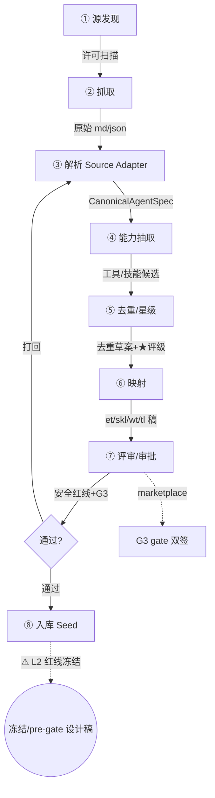

# Agent 拆解转换引擎 V1 规划报告

> **文档性质**：产品规划 + 资产设计（pre-gate 设计稿，**不实现、不 seed 真实资产**）
> **协作产出**：产品经理 许清楚（software-product-manager，章节 1/2/3/5 + 候选 harvest 清单）｜架构师 高见远（software-architect，章节 0 勘误 / 4 / 6 / MVP）｜主理人 齐活林（software-team-lead，汇编 + 章节 7 自判）
> **参考项目**：[msitarzewski/agency-agents](https://github.com/msitarzewski/agency-agents)（MIT，230+ agents）
> **红线声明**：⚠️ 把外部 agent 真实转换为 Employee / Skill / Department / Workflow 属 **L2 暂停四项 #4 红线冻结**。本报告全部为规划/设计稿，解冻前不执行任何真实写操作。
> **汇报规范**：结论 → 原因 → 建议（三段式）

---

## 章节 0：背景、范围与真实基线勘误

### 0.1 背景与目标
Curis 要建设 AI 员工库（Employee Template 体系）。外部已有大量优秀 Agent/Role 项目，我们**不重复开发**，而是把外部 Agent 角色体系**转换**为 Curis 官方员工资产（Employee Template + Skill + Workflow + Tool Mapping）。本引擎（V1）研究这一转换的方法论、资产格式与可扩展架构。

### 0.2 范围
- 本报告完成 5 项研究子任务：① 分析参考项目角色体系与能力结构；② 评估可转换性；③ 设计端到端转换流程；④ 定义转换后资产格式；⑤ 评估多源扩展性。
- **仅规划/设计，不写实现代码、不落地真实资产、不碰 L2 红线冻结项。**

### 0.3 ⚠️ 真实资产基线勘误（架构师读取 `backend/app/database.py` 后纠正 PM 草稿 3 处关键偏差）
| # | PM 草稿假设 | 真实 `database.py` 事实 | 对设计的影响 |
|---|------|------|------|
| ① | `et_*` 含 `image_ref_json`（头像/主题色） | `employee_templates` **无该列**；字段在 `persona_templates.image_ref_json`（additive） | 头像/主题色须经 `et_*.persona_ref → persona_templates.image_ref_json` 落地，**不能直接写 et_*** |
| ② | `et_*` 含 `applicable_departments`（多部门） | `employee_templates` **无此列**；仅单值 `department_type`；反向关系由 `department_templates.default_employee_templates_json` 承载 | agency 的 `services` 只能拆为「单 department 标签 + 候选工具」 |
| ③ | `wt_*` 属 Phase-5+ 预留 | `workflow_templates` + `workflow_contents` **已落地** | agency 的 Workflow/runbooks **现在即可映射真实表**，仅缺内容补全与评审 |

**真实落地表与关键列（已逐一核实，作为本报告映射基线）**：
- `employee_templates`：`id, slug, name, role, responsibility, description, department_type, default_instructions, default_capability_types_json, default_model_policy_json, default_workflow_step_types_json, guardrails_json, source, tenant_id, enabled, created_at` + additive：`persona_ref, default_skill, default_tool, persona_overrides_json, version, status, updated_at`
- `persona_templates`：`persona_id, slug, name, archetype(CHECK 6值), traits_json, communication_style_json, reporting_style_json, decision_style, collaboration_style_json, version, status, source, tenant_id, enabled, created_at, updated_at` + additive：`image_ref_json`
- `skill_templates` / `tool_templates`：共享形态 `{slug,name,description,default_capability_types_json,instruction_excerpt,source,tenant_id,status,version,...}`；`skill` 默认 `["model"]`+`skill_type`+`category`，`tool` 默认 `["tool"]`+`tool_type`
- `workflow_templates`：`id,name,description,source,tenant_id,department_type,process_type,steps_json,status,...`；`workflow_contents`（wl_* 折叠）：`workflow_content_id,name,workflow_template_ref,pack,owner_roles_json,step_templates_json,source_attribution,...`
- `department_templates` / `department_types`（类型注册表，7 列 DDL 锁定）
- 三态 `source` CHECK `('official','tenant_private','marketplace')`；命名空间 `official.*` / `tenant:<tid>:* ` / `marketplace:*`

---

## 章节 1：参考项目角色体系与能力结构分析

### 1.1 项目规模与组成（实地核实）
| 维度 | 事实 |
|------|------|
| 许可 | MIT（可商用、可改造、可再分发，无 copyleft 传染） |
| Agent 总数 | 230+，按 division 目录组织 |
| 真实 division 数 | **17 个**（由 `divisions.json` 权威定义） |
| 单 agent 形态 | 一个 `.md` 文件：YAML frontmatter + 多段 `##` 章节 |
| 运行引擎 | **无**。靠 `convert.sh`/`install.sh` 分发到外部宿主（Claude Code/Cursor/Codex/Gemini CLI/OpenClaw/Mistral Vibe），靠宿主会话 activate |
| 辅助元数据 | `divisions.json`（分区）、`tools.json`（外部工具集成）、`strategy/runbooks.json`（NEXUS 组队名册） |
| 贡献门槛 | 原创性检查、lint（`lint-agents.sh`）、模板一致性 |

### 1.2 Division → Curis Department 映射表
| # | agency division | Curis 目标部门/职能 | 与 Curis 现状关系 |
|---|------|------|------|
| 1 | engineering | 研发部 `dt_*` + `et_*` | 已覆盖：6 官方员工+30 研发工具；agency 40+ 工程 agent 作细分补充 |
| 2 | design | 设计部 | 互补：有 `tl_figma/canva`，无设计员工模板 |
| 3 | product | 产品部 | 部分覆盖：有 `product_manager`；agency 另有 feedback-synthesizer/trend-researcher/sprint-prioritizer/nudge-engine（净新增） |
| 4 | marketing | 市场部 | **净新增**：无市场员工（仅 Pack B candidate 工具）；agency 36 个 |
| 5 | sales | 销售部 | **净新增**：无销售员工；agency 9 个 |
| 6 | support | 支持部 | **净新增**：无支持员工；agency 6 个 |
| 7 | finance | 财务部 | **净新增**：无财务员工（tl_stripe/alipay 仅支付侧）；agency 5 个 |
| 8 | project-management | 项目管理 | 部分重叠：Curis 用 tech_lead 承担 |
| 9 | paid-media | 媒介投流 | **净新增**：投流职能空白 |
| 10 | strategy | 非 division（playbook） | 不转员工 → `wt_*` 组队 |
| 11 | security | 安全部 | 互补：有 `tl_strix`；无安全员工；agency 10 个 |
| 12 | testing | 测试部 | 部分覆盖：有 `qa_engineer`；agency 细分补充 |
| 13 | academic | 研究部 | 净新增；可对齐 `tl_paper_analysis` |
| 14–17 | healthcare / game-development / gis / spatial-computing | 垂直行业 | 可选：建议 Phase-6+ |
| — | specialized / integrations | 特殊/分发输出 | 部分并入；integrations 不转员工 |

**映射结论**：核心商业职能（engineering/design/product/marketing/sales/support/finance/pm/paid-media/security/testing）直接映射；垂直行业与 specialized 后置；strategy/integrations 不转员工（转 Workflow/Tool 元数据）。

### 1.3 Agent 定义字段 → Curis 字段映射表
| agency 字段/章节 | 目标 Curis 资产/字段 | 转换方式 | 保真度 |
|------|------|------|------|
| frontmatter.name/description | `et_*.name/description` | 直接复制 | 高 |
| frontmatter.emoji/color/vibe | `pt_*.image_ref_json` / `persona_overrides_json` | 经 persona 层落地（见 0.3①） | 高 |
| `#` 标题+导语 | `et_*.role` + `default_instructions` 前言 | 抽取 | 高 |
| `## Identity & Memory` | `et_*.persona_overrides_json` + `pt_*` | 抽取为 persona 层 | 高 |
| `## Core Mission` | `et_*.responsibility`（公开）+ `default_instructions`（隐藏） | 拆分 | 高 |
| `## Critical Rules` | `default_instructions` + `guardrails_json` | 抽取 | 高 |
| `## Technical Deliverables` | `tl_*`/`skl_*` candidate + `default_capability_types_json` | **NLP 抽取** | 中 |
| `## Workflow Process` | `wt_*`（`steps_json`） | 结构化归一 | 中（单 agent 无 owner） |
| `## Communication Style` | `persona_overrides_json.communication` / `pt_*.communication_style_json` | 抽取 | 高 |
| `## Learning & Memory` | ⚠️ Curis Phase-4 **不支持员工记忆** | 暂丢弃/后置 | 不可直接转 |
| `## Success Metrics` | `wt_*` 验收标准/质量关卡 | 抽取 | 中 |
| `## Advanced Capabilities` | `skl_*`/`tl_*` 候选 | 抽取 | 中 |

**关键发现**：agency 的「能力」**不以结构化列表存在**，而是融于 Mission/Rules/Deliverables/Workflow 的自然语言中。转换核心难点是 **非结构化 persona → 结构化 Curis 资产**（尤其 Tool/Skill 抽取），而非简单字段搬运。

### 1.4 能力构成方式总结
- 无独立 capabilities 列表（不像 CrewAI 显式 `tools`、AutoGPT tool schema）；能力靠自然语言描述。
- 隐含工具须抽取：Technical Deliverables 中的技术栈/平台名须经 NLP + 映射表落到 Curis 115 工具库（`tl_*`）或新增 candidate。
- 工作流为单 agent 视角；多 agent 协作仅在 `runbooks.json` 以 roster 形式存在。

### 1.5 与「部门/岗位/技能/工具」的对应关系
| agency 概念 | Curis 对应资产 |
|------|------|
| division 目录 | `department_types` / `dt_*` |
| 单个 agent `.md` | `et_*` + `pt_*` |
| `## Workflow Process` | `wt_*` |
| `## Technical Deliverables / Advanced Capabilities` | `skl_*` + `tl_*` |
| `strategy/runbooks.json` roster | `wt_*` 团队组合 / `dt_*.default_employee_templates_json` |
| `tools.json` | `tl_*` 集成元数据（借鉴思路） |
| `convert.sh/install.sh` | ❌ 不转换 |

---

## 章节 2：可转换性评估矩阵

### 2.1 逐层评估（可转 / 部分可转 / 不可转）
| # | 评估层级 | 判断 | 对应 Curis 资产 | 前置条件 |
|---|------|------|------|------|
| 1 | Persona 内容 | **可转** | `et_*` + `pt_*` | 过安全红线 |
| 2 | 角色定义 | **可转** | `et_*` | — |
| 3 | Frontmatter 元数据 | **可转** | `et_*` + `pt_*` | 经 persona 层（0.3①） |
| 4 | Division 结构 | **可转** | `dt_*` + `department_types` | Admin 审核纳入哪些 official |
| 5 | Workflow 步骤 | **部分可转** | `wt_*` | schema 已就绪（0.3③），仅缺内容补全+评审 |
| 6 | 工具绑定 | **部分可转** | `tl_*` + `skl_*` | 工具映射表+去重；未命中者 candidate |
| 7 | 组队名册（runbooks） | **部分可转** | `wt_*`/`dt_*` | 多 agent 运行时（Phase-5+）仅沉淀设计稿 |
| 8 | Learning & Memory 章节 | **不可直接转** | （后置） | 员工记忆能力解锁后重评估 |
| 9 | 分发脚本 | **不可转** | — | 仅借鉴集成字段思路 |
| 10 | 许可与原创性 | **可转（条件）** | 治理层 | MIT 保留署名；copyleft 过滤 |

### 2.2 ⚠️ L2 红线标注（必须明确）
**把外部 agent 真实转换为 Employee/Skill/Department/Workflow 属 L2 暂停四项 #4 红线冻结。** 本报告（全部映射、流程、适配器、候选清单）均为 pre-gate 设计稿，用于打磨方法论与资产格式、沉淀流水线设计；冻结前任何对 `employee_templates/tool_templates/department_templates/workflow_templates` 的真实写操作（seed）均不执行。当前可执行边界（对齐 official-tool-catalog-v1 红线）：**仅编目元数据、做映射设计、产出 candidate 草案**；不接入凭证、不建 marketplace、不 instantiation。

---

## 章节 3：Agent → Curis Employee 端到端转换流程设计

### 3.1 流程概览（负责角色 / 输入输出 / 质量关卡）
| 阶段 | 负责角色 | 输入 | 输出 | 质量关卡 |
|------|------|------|------|------|
| ① 源发现 | 主理人+PM | 源清单 | 候选源登记（含许可扫描） | 许可合规（MIT/可商用） |
| ② 抓取 | 架构师（Adapter） | 源 URL+adapter | 原始 agent 文件集合 | 完整性校验；排除 integrations/strategy 非源 |
| ③ 解析 | 架构师（SourceAdapter） | 原始文件 | `CanonicalAgentSpec` | frontmatter 合法；必需章节齐全（类 lint） |
| ④ 能力抽取 | PM+架构师 | `CanonicalAgentSpec` | 工具/技能候选 | 保真度；**禁止幻觉工具**；命中 115 库优先复用 |
| ⑤ 去重/星级 | 交付总监+PM | 抽取结果+现有资产 | 去重草案+★1~5 | 重叠度检查；重叠项标记「增强而非新建」 |
| ⑥ 映射 | 架构师+PM | 去重草案 | `et_*/skl_*/wt_*/tl_*` 稿 | 字段映射完整度；三向对齐 |
| ⑦ 评审/审批 | 安全边界席+Admin | 映射稿 | 审批意见 | 安全红线（无凭证/无注入/无越权）；marketplace 触发 G3 |
| ⑧ 入库 Seed（冻结） | Admin 写通道 | 审批通过稿 | official 资产 | ⚠️ L2 红线解冻前不执行 |

### 3.2 Mermaid 流程图


### 3.3 关键质量关卡
- **③ Parse**：复用 agency `lint-agents.sh` 思路——校验必需章节存在、frontmatter 完整。
- **④ Extraction**：抽取工具必须在 Curis 115 工具库或已知生态找到依据，**禁止凭空生成工具 id**；未命中者标 candidate。
- **⑤ Dedup**：如 agency `product-manager` 与 `official.employee.product_manager` 重合 → 判定「增强而非新建」；星级反映净新增价值。
- **⑦ Review**：安全边界席查三类风险——凭证持久化剥离 / prompt 注入 / 越权表述降级。

---

## 章节 4：Agent → Curis Employee 目标资产格式设计（架构师）

### 4.1 CanonicalAgentSpec 字段级中间 schema（统一归一契约）
所有 `SourceAdapter` 把异构源归一化为下述中间 schema，再共享章节 3 流水线。源解析与 Curis 映射彻底解耦。

```json
{
  "$schema": "https://json-schema.org/draft/2020-12/schema",
  "$id": "https://curis.ai/schemas/CanonicalAgentSpec/v1",
  "title": "CanonicalAgentSpec",
  "description": "外部 Agent 转 Curis 资产的统一中间表示。所有 SourceAdapter.parse() 的输出。设计稿，不实现。",
  "type": "object",
  "required": ["spec_version", "source", "license", "division", "identity", "security_scan"],
  "properties": {
    "spec_version": { "type": "string", "const": "1.0.0" },
    "source": {
      "type": "object",
      "required": ["adapter", "repo_url", "entry_path"],
      "properties": {
        "adapter": { "type": "string", "enum": ["MarkdownFrontmatterAdapter","SkillRepoAdapter","CrewYAMLAdapter","AgentConfigAdapter","PlatformExportAdapter","MCPManifestAdapter"] },
        "repo_url": { "type": "string", "format": "uri" },
        "entry_path": { "type": "string" },
        "fetched_at": { "type": "string", "format": "date-time" }
      }
    },
    "license": {
      "type": "object",
      "required": ["spdx", "commercial_use", "copyleft", "attribution_required"],
      "properties": {
        "spdx": { "type": "string", "examples": ["MIT","Apache-2.0","GPL-3.0","AGPL-3.0"] },
        "commercial_use": { "type": "boolean" },
        "copyleft": { "type": "boolean", "description": "强 copyleft（GPL/AGPL）须过滤拒绝" },
        "attribution_required": { "type": "boolean" },
        "raw_license_text": { "type": "string" }
      }
    },
    "division": {
      "type": "object",
      "required": ["source_key", "label"],
      "properties": {
        "source_key": { "type": "string" },
        "label": { "type": "string" },
        "target_dt_type": { "type": "string", "description": "→ department_types.type_key" },
        "target_dt_id": { "type": "string" }
      }
    },
    "identity": {
      "type": "object",
      "required": ["name", "role"],
      "properties": {
        "name": { "type": "string", "minLength": 1, "maxLength": 120 },
        "role": { "type": "string", "minLength": 1, "maxLength": 80 },
        "slug": { "type": "string", "pattern": "^[a-z0-9][a-z0-9_-]{1,78}$" },
        "description": { "type": "string", "maxLength": 500 },
        "emoji": { "type": "string", "maxLength": 4, "description": "清洗后单 grapheme emoji" },
        "color": { "type": "string", "pattern": "^#[0-9a-fA-F]{6}$" },
        "vibe": { "type": "string", "maxLength": 200 }
      }
    },
    "mission": {
      "type": "object",
      "properties": {
        "summary": { "type": "string", "maxLength": 1000 },
        "responsibilities": { "type": "array", "items": { "type": "string", "maxLength": 400 }, "maxItems": 30 },
        "critical_rules": { "type": "array", "items": { "type": "string", "maxLength": 400 }, "maxItems": 50 }
      }
    },
    "persona": {
      "type": "object",
      "properties": {
        "archetype": { "type": "string", "enum": ["supportive_coach","direct_executor","analytical_advisor","creative_explorer","balanced_facilitator","risk_aware_guardian"] },
        "traits": { "type": "array", "items": { "type": "string", "maxLength": 60 }, "maxItems": 20 },
        "communication_style": { "type": "object", "additionalProperties": { "type": "string" }, "maxProperties": 10 },
        "reporting_style": { "type": "object", "additionalProperties": { "type": "string" }, "maxProperties": 10 },
        "decision_style": { "type": "string", "enum": ["consultative","autonomous","delegative","data_driven"] },
        "collaboration_style": { "type": "object", "additionalProperties": { "type": "string" }, "maxProperties": 10 }
      }
    },
    "deliverables": {
      "type": "object",
      "properties": { "text_blocks": { "type": "array", "items": { "type": "string", "maxLength": 600 }, "maxItems": 30 } }
    },
    "workflow": {
      "type": "object",
      "properties": {
        "process_type": { "type": "string", "enum": ["sequential","parallel"], "default": "sequential" },
        "steps": {
          "type": "array",
          "items": {
            "type": "object",
            "required": ["step_order", "name"],
            "properties": {
              "step_order": { "type": "integer", "minimum": 1 },
              "name": { "type": "string", "maxLength": 120 },
              "instruction_excerpt": { "type": "string", "maxLength": 800 },
              "expected_output": { "type": "string", "maxLength": 400 },
              "owner_role": { "type": "string", "maxLength": 80 }
            }
          },
          "maxItems": 40
        }
      }
    },
    "capability_candidates": {
      "type": "object",
      "properties": {
        "tool_candidates": { "type": "array", "items": { "type": "object", "required": ["name_hint"], "properties": { "name_hint": { "type": "string", "maxLength": 80 }, "evidence": { "type": "string", "maxLength": 300 }, "matched_tool_id": { "type": "string" }, "suggested_tool_type": { "type": "string" } } } },
        "skill_candidates": { "type": "array", "items": { "type": "object", "required": ["name_hint"], "properties": { "name_hint": { "type": "string", "maxLength": 80 }, "evidence": { "type": "string", "maxLength": 300 }, "matched_skill_id": { "type": "string" }, "suggested_skill_type": { "type": "string" } } } }
      }
    },
    "memory_notes": { "type": "array", "items": { "type": "string", "maxLength": 400 }, "maxItems": 20, "description": "Learning & Memory；Phase-4 不支持，仅记录不映射" },
    "success_metrics": { "type": "array", "items": { "type": "string", "maxLength": 300 }, "maxItems": 20 },
    "security_scan": {
      "type": "object",
      "required": ["credential_patterns", "prompt_injection_flags", "overclaim_flags"],
      "properties": {
        "credential_patterns": { "type": "array", "items": { "type": "string" }, "maxItems": 20 },
        "prompt_injection_flags": { "type": "array", "items": { "type": "string" }, "maxItems": 20 },
        "overclaim_flags": { "type": "array", "items": { "type": "string" }, "maxItems": 20 }
      }
    },
    "conversion_disposition": {
      "type": "object",
      "properties": {
        "employee_action": { "type": "string", "enum": ["create","enhance_existing","skip"], "default": "create" },
        "existing_official_id": { "type": "string" },
        "star_rating": { "type": "integer", "minimum": 1, "maximum": 5 },
        "notes": { "type": "string", "maxLength": 500 }
      }
    }
  }
}
```
> **设计原则**：区分「内容字段」（identity/mission/persona/workflow/deliverables）与「治理字段」（source/license/security_scan/conversion_disposition）。后者在映射阶段被消费但不进入 Curis 业务表（除 `source` 三态与 `license`→`source_attribution` 文本）。

### 4.2 SourceAdapter 接口契约（抽象基类，仅签名 + docstring）
```python
from abc import ABC, abstractmethod
from dataclasses import dataclass
from typing import Any, Iterable
from .canonical import CanonicalAgentSpec

@dataclass
class SourceEntry:
    """源内一个可转换条目的轻量引用。"""
    entry_id: str
    entry_path: str
    title: str
    raw_ref: Any

@dataclass
class SourceMetadata:
    """治理元数据，供关卡①许可闸门与关卡⑦评审消费。"""
    adapter: str
    repo_url: str
    license_spdx: str
    commercial_use: bool
    copyleft: bool
    attribution_required: bool
    fetched_at: str

class SourceAdapter(ABC):
    """外部 Agent 来源的归一化适配器契约。所有异构来源实现本接口，输出 CanonicalAgentSpec。设计稿，不含实现逻辑，不读写数据库。"""

    @abstractmethod
    def discover(self, source_root: Any) -> Iterable[SourceEntry]:
        """枚举源内可转换条目（agent/skill/tool）。非源目录（integrations/strategy）须在此过滤。"""
        raise NotImplementedError

    @abstractmethod
    def fetch(self, entry: SourceEntry) -> Any:
        """拉取单个条目的原始内容（.md/.json/.yaml），不含归一化或安全清洗。"""
        raise NotImplementedError

    @abstractmethod
    def parse(self, raw: Any, entry: SourceEntry) -> CanonicalAgentSpec:
        """归一化为 CanonicalAgentSpec：frontmatter/字段抽取、章节切分、emoji/color 清洗、license 填充、security_scan 初扫。"""
        raise NotImplementedError

    @abstractmethod
    def extract_capabilities(self, spec: CanonicalAgentSpec) -> CanonicalAgentSpec:
        """抽取隐含工具/技能候选；按 Curis 115 工具库/52 技能库做命中匹配；严禁凭空生成工具 id，未命中一律标 candidate。"""
        raise NotImplementedError

    @abstractmethod
    def get_metadata(self) -> SourceMetadata:
        """返回治理元数据：适配器名、源 URL、许可（SPDX/商用/copyleft/署名）、抓取时间。关卡①据此过滤不可商用/copyleft 源。"""
        raise NotImplementedError
```

### 4.3 目标资产字段级映射 schema（CanonicalAgentSpec → Curis 真实表）
#### 4.3.1 → `employee_templates`（et_*）
| CanonicalAgentSpec 字段 | 目标列 | 转换说明 |
|---|------|------|
| `identity.slug`+`division.target_dt_type` | `id` | 命名空间 `official.employee.{slug}` |
| `identity.name` | `name` | 直接复制 |
| `identity.role` | `role` | 直接复制 |
| `identity.description` | `description` | 直接复制 |
| `mission.summary` | `responsibility` | CEO 面向公开 |
| `mission.*`+`deliverables.*`+`workflow.*` | `default_instructions` | 隐藏不暴露 CEO；完整 prompt 拼接 |
| `mission.critical_rules[]` | `guardrails_json` | 数组 |
| `division.target_dt_type` | `department_type` | 单值 forward（无 applicable_departments 列） |
| `capability_candidates` | `default_capability_types_json` | 如 `["model","tool"]` |
| `persona`（复用） | `persona_ref` | → `persona_templates.persona_id` |
| `persona`（专属微调） | `persona_overrides_json` | 仅 delta，与 persona_ref 深合并 |
| `identity.emoji`/`color` | —（经 persona_ref） | **不直接落 et_***；写入 `persona_templates.image_ref_json` |
| `capability_candidates` | `default_skill`/`default_tool` | → skill/tool 表 id（可选） |
| `workflow.process_type` | `default_workflow_step_types_json` | 步骤类型标签 |
| `conversion_disposition=enhance_existing` | （不新建） | 标记增强既有 official |
| — | `source`/`tenant_id` | `official`/`platform`（解冻前草案记 official） |

#### 4.3.2 → `persona_templates`（pt_*，独立可复用资产）
| CanonicalAgentSpec 字段 | 目标列 | 转换说明 |
|---|------|------|
| `identity.slug` | `persona_id`/`slug` | `pt_{slug}` |
| `identity.name`+`persona.archetype` | `name` | persona 展示名 |
| `persona.archetype` | `archetype` | CHECK 6 值之一 |
| `persona.traits[]` | `traits_json` | 数组 |
| `persona.communication_style` | `communication_style_json` | 对象 |
| `persona.reporting_style` | `reporting_style_json` | 对象 |
| `persona.decision_style` | `decision_style` | 4 枚举之一 |
| `persona.collaboration_style` | `collaboration_style_json` | 对象 |
| `identity.emoji`/`color` | `image_ref_json` | 清洗后：`{"avatar_emoji":"📊","theme_color":"#1E88E5"}` |

#### 4.3.3 → `skill_templates`（skl_*）与 `tool_templates`（tl_*）
**区分原则**：`tl_*` = 具名外部产品/API/技术栈的原子能力或集成；`skl_*` = 方法论/手艺/流程型 know-how（常 model-only，可再绑工具）。
| 来源 | 目标表 | 转换说明 |
|---|------|------|
| `skill_candidates[].name_hint` | `skill_templates` | `skl_{slug}`；`default_capability_types_json` 默认 `["model"]`；additive `category`=业务职能 |
| `tool_candidates[].matched_tool_id`（命中） | `tool_templates`（复用） | 直接复用既有 `tl_*`，不新建 |
| `tool_candidates[].name_hint`（未命中） | `tool_templates`（候选） | `tl_{slug}` candidate，`status=candidate` 不 seed active |
> 富字段（适用部门/员工/权限/认证/安全等级/版本/来源）以 `official-tool-catalog-v1.md` 为单一真相源，不写入 DB 核心列。

#### 4.3.4 → `workflow_templates`（wt_*，schema 已就绪）
| CanonicalAgentSpec 字段 | 目标列 | 转换说明 |
|---|------|------|
| `identity.name`+`workflow.process_type` | `name`/`description` | — |
| `workflow.process_type` | `process_type` | sequential/parallel |
| `division.target_dt_type` | `department_type` | 按 division 设 |
| `workflow.steps[]` | `steps_json` | 步骤形状 `{"step_order":1,"name":"...","owner_role":"<role>","instruction_excerpt":"...","expected_output":"..."}` |
| `success_metrics[]` | （步骤 expected_output/quality gate） | 并入 |
| `runbooks.json` roster | `workflow_contents.owner_roles_json`+`step_templates_json` | 组队名册 → 多 owner 工作流 |

#### 4.3.5 → `department_templates`（dt_*，division 级 harvest）
| CanonicalAgentSpec 字段 | 目标列 | 转换说明 |
|---|------|------|
| `division.label` | `name` | — |
| `division.target_dt_type` | `department_type` | → `department_types.type_key` |
| 已转换 `et_*.id` 列表 | `default_employee_templates_json` | 反向归集 |
| — | `default_workflow_template_id` | 可选关联 wt_* |

### 4.4 五个前置问题的架构答复（基于真实 DDL）
- **Q1**：`persona_overrides_json` 是 **additive 列已落地**，是与 `pt_*` 独立但可组合的「per-employee delta 层」（解析 = 深合并 `pt_*` + `persona_overrides_json`）。`image_ref_json` **不在 et_***（在 `pt_*`），头像须经 `persona_ref` 落地。`applicable_departments` **不存在**，仅单值 `department_type`，反向由 `dt_*.default_employee_templates_json` 承载。
- **Q2**：`pt_*` **独立成表**（一级可复用资产），被多 `et_*` 经 `persona_ref` 共享；`et_*.persona_overrides_json` 仅存 delta，完整 persona 永不在 et 内嵌。
- **Q3**：`wt_*` schema **已就绪**（非 Phase-5+ 预留），agency 的 Workflow/runbooks 现在即可映射真实表，仅缺内容补全+评审。
- **Q4**：`skl_*` 默认 `["model"]`+`skill_type`+`category`（方法论）；`tl_*` 默认 `["tool"]`+`tool_type`（原子能力/集成）。harvest 启发式：具名产品/API/技术栈→`tl_*`；方法/手艺/流程→`skl_*`；不确定先匹配 115 工具库。
- **Q5**：emoji 白名单 Unicode 区段（Emoticons/Misc/Dingbats/Arrows/Geometric），按 grapheme ≤1，剥离 VS16/ZWJ/RTL/控制字符；color 严格 `^#[0-9a-fA-F]{6}$`，拒绝具名色/CSS 表达式；通用防注入剥离零宽/BOM/RTL 覆盖符。

---

## 章节 5：多源扩展方案（Source Adapter 范式）

### 5.1 设计思想
以 `agency-agents` 为**范式 1**（Markdown persona + shell 分发），抽象统一接口 `SourceAdapter`，每个来源实现一套适配器，把异构源归一为 `CanonicalAgentSpec`，再喂入章节 3 同一流水线。「源解析」与「Curis 映射」解耦——新增来源只需新增 Adapter。

### 5.2 候选来源与适配差异（6 种）
| 来源 | 形态 | 结构化能力 | 保真度 | 适配器重点 | 主要资产 |
|------|------|------|------|------|------|
| ① agency-agents（范式1） | Markdown+shell | 否（自然语言） | 中 | `MarkdownFrontmatterAdapter`：解析 frontmatter+`##`；能力须 NLP 抽取 | `et_*`+`pt_*`+`wt_*`+`tl_*` candidate |
| ② curispeng22-coder/skill | 结构化 skill 仓库 | 是 | 高 | `SkillRepoAdapter`：近 `skl_*` 形态；Curis Pack F~J 多源于此 | `skl_*`+`tl_*` |
| ③ CrewAI | YAML（role/goal/backstory/tools） | 是 | 高 | `CrewYAMLAdapter`：字段天然对齐（role/goal→responsibility/backstory→instructions/tools→capability） | `et_*`+`tl_*` |
| ④ AutoGPT/AgentKit | JSON/YAML+tool schema | 是 | 高 | `AgentConfigAdapter`：tool schema→`tl_*`；沙箱/权限→security_level | `et_*`+`tl_*` |
| ⑤ Coze/Dify | 可视化 bot 导出 JSON | 是 | 中高 | `PlatformExportAdapter`：nodes→`wt_*`；plugins→`tl_*`；剥离平台私有字段 | `wt_*`+`tl_*`+`et_*` |
| ⑥ MCP Registry | MCP server manifest | 是 | 高（工具侧） | `MCPManifestAdapter`：以 `tl_*` 为主 | `tl_*` |

### 5.3 扩展原则
1. **保真度优先**：结构化源（CrewAI/AutoGPT/skill 仓库）优先纳入，映射损耗低。
2. **一次归一、多次复用**：所有源先转 `CanonicalAgentSpec`，共享章节 3 流水线。
3. **许可闸门前置**：① 阶段过滤不可商用/强 copyleft 源。
4. **candidate 而非 active**：未命中 Curis 库的抽取结果一律 candidate 草案，不自动 seed。

### 5.4 候选 harvest 清单（设计稿，非真实入库）
> 性质声明：pre-gate 设计稿，不落真实库、不 seed。选取与 Curis 现有 6 官方研发员工+30 研发工具+52 技能**互补**的商业职能 persona（优先 marketing/sales/support/finance/product）。★=净新增价值/互补度/质量。

| # | 源 slug | division | 目标 et_* 草案 | 互补性 | 关联草案 | ★ |
|---|------|------|------|------|------|------|
| 1 | product-feedback-synthesizer | product | `et_product_feedback_synth` | 净新增 | `wt_feedback_synth` | ★★★★ |
| 2 | product-trend-researcher | product | `et_product_trend_researcher` | 净新增 | `skl_trend_scan` | ★★★ |
| 3 | product-sprint-prioritizer | product | `et_product_sprint_prioritizer` | 重叠 tech_lead（增强） | — | ★★★ |
| 4 | product-behavioral-nudge-engine | product | `et_product_nudge_engine` | 净新增 | `skl_nudge_design` | ★★★ |
| 5 | marketing-growth-hacker | marketing | `et_marketing_growth_hacker` | 净新增 | `wt_growth_loop` | ★★★★★ |
| 6 | marketing-content-creator | marketing | `et_marketing_content_creator` | 净新增 | `skl_content_draft` | ★★★★★ |
| 7 | marketing-social-media-strategist | marketing | `et_marketing_social_strategist` | 净新增 | `wt_social_calendar` | ★★★★ |
| 8 | sales-pipeline-analyst | sales | `et_sales_pipeline_analyst` | 净新增 | `skl_pipeline_forecast` | ★★★★ |
| 9 | sales-discovery-coach | sales | `et_sales_discovery_coach` | 净新增 | `skl_discovery_call` | ★★★ |
| 10 | support-support-responder | support | `et_support_responder` | 净新增 | `wt_ticket_triage` | ★★★★★ |
| 11 | support-legal-compliance-checker | support | `et_support_legal_compliance` | 净新增 | `skl_compliance_scan` | ★★★★ |
| 12 | finance-financial-analyst | finance | `et_finance_analyst` | 净新增 | `skl_fin_modeling` | ★★★★★ |
| 13 | finance-tax-strategist | finance | `et_finance_tax_strategist` | 净新增 | `skl_tax_plan` | ★★★ |
| 14 | project-management-senior-project-manager | project-management | `et_project_senior_pm` | 重叠 tech_lead（增强） | `wt_release_plan` | ★★★★ |
| 15 | security-compliance-strategist* | security | `et_security_compliance` | 净新增 | `skl_security_review` | ★★★★ |

> *15：security 真实 slug 待抓取确认（仓库 security 共 10 agent），此处语义占位。#3/#14 与 tech_lead 重叠，按关卡⑤判为「增强而非新建」。去重结论：15 个候选中约 11 个为 Curis 净新增商业职能员工模板，2~3 个重叠项降级，1 个待 slug 确认；均不冲突现有 6 官方研发员工。

---

## 章节 6：风险与治理

### 6.1 L2 Gate #4 红线边界（冻结 vs 允许）
| 动作 | 是否冻结 |
|------|------|
| 真实 seed 六类资产表（外部 agent 来源） | ❌ 冻结 |
| 经 `/api/platform/*` 或 `/api/tenant/*` 写通道落外部资产 | ❌ 冻结 |
| 接入凭证/建 marketplace/instantiation | ❌ 冻结 |
| 模板触发任务路由/prompt 注入/员工记忆 | ❌ 冻结（ADR-0017 Instance/Runtime 锁定） |
| 编目元数据/映射设计/candidate 草案/schema 设计/安全审查设计 | ✅ 允许（本设计范畴） |
| 读取分析 `database.py` 对齐 schema | ✅ 允许（只读） |

### 6.2 candidate vs active 两态管理
所有未在 Curis 现有库（115 工具/52 技能/6 官方员工）**命中**的抽取结果，一律 `candidate` 草案（不 seed active）；命中既有资产的判定「复用/增强」而非新建。候选清单（章节 5.4 的 15 个）全部为 candidate，解冻后经 Admin 写通道+评审转 active。

### 6.3 安全审查三类风险（关卡⑦）
| 风险 | 识别 | 处置 |
|------|------|------|
| 凭证持久化 | `security_scan.credential_patterns` 命中 api_key/secret/token/password | 从字段剥离；模板永不持久化凭证 |
| prompt 注入 | `security_scan.prompt_injection_flags` | 评审打回/清洗 |
| 越权表述 | `security_scan.overclaim_flags`（如「执行任意代码」） | 降级为受控 `skl_*` 或剔除 |

### 6.4 外部 emoji/color Unicode 注入清洗（见 4.4 Q5）
清洗在 `SourceAdapter.parse()` 归一阶段强制实施；`image_ref_json` 仅存白名单内值。

### 6.5 许可合规
MIT（agency-agents）可商用但 `attribution_required=true`→保留署名；copyleft（GPL/AGPL）直接拒绝 harvest；Apache-2.0 须保留 NOTICE；未确认许可一律 candidate 不 seed。

### 6.6 三态治理 + ADR-0017 禁止区
三态 `official/tenant_private/marketplace` 与现有体系一致。ADR-0017 禁止区：Template 元数据属**可解禁层**；Employee Instance 创建/激活、AIEmployee 执行（Runtime）**仍锁定**。本设计仅触元数据层 schema 与映射，不碰 Instance/Runtime。

---

## 附：MVP 切片建议（假设 L2 红线未来解冻）

> 目标：V1 最小可落地范围。全部假设红线解冻、走 Admin 写通道。

**选型**：源=仅 ①agency-agents（MIT，互补性最强）；division=marketing/sales/support/finance/product（商业职能缺口）；资产类型=`et_*`+`pt_*`+`skl_*` candidate+`tl_*` candidate+`wt_*` 步骤草稿+`dt_*` 映射稿（人格与员工核心，skl/tl 先候选，wt 仅草稿，dt 仅映射）。

**依赖与顺序（6 步）**：
| 步骤 | 内容 | 依赖 |
|------|------|------|
| T1 | `SourceAdapter`+`CanonicalAgentSpec` schema+emoji/color 清洗器 | — |
| T2 | 候选 harvest 清单→`CanonicalAgentSpec` 生成（5 division） | T1 |
| T3 | `pt_*` persona 抽取+`et_*.persona_ref` 关联+`persona_overrides_json` | T2 |
| T4 | `et_*` 字段填充稿 | T2,T3 |
| T5 | `skl_*`/`tl_*` candidate 抽取+安全审查+许可合规 | T2 |
| T6 | `wt_*` 步骤草稿+`dt_*` division 映射+总评审稿 | T4,T5 |

> 全部 candidate/草稿；真实 seed 仅 L2 解冻后由 Admin 经 `/api/platform/*` 执行，过章节 3 关卡⑦。

---

## 章节 7：主理人自判（齐活林）

> 按任务要求，完成研究后自主判断三项。

### 7.1 是否形成 Employee Template Catalog
**结论：本阶段不形成真实 official Employee Template Catalog，仅产出「候选 Catalog 设计态（candidate）」。**
- **原因**：把外部 agent 真实转换为 Employee 属 L2 暂停四项 #4 红线冻结。本报告章节 5.4 的 15 个 harvest 清单与章节 4 的格式schema，均为 pre-gate 设计稿，未 seed 任何 `employee_templates` 记录。
- **建议**：把候选清单 + `CanonicalAgentSpec` + `SourceAdapter` 契约作为「设计态 Catalog 草案」沉淀于本报告与两份源文档；待 L2 #4 解冻后，经 Admin 写通道把 candidate 转 official（MVP 建议先落 marketing/sales/support/finance/product 5 division）。

### 7.2 是否需要进入后续实现 Gate
**结论：当前不进入实现 Gate；是否开 Gate 须由总控（用户）裁定。**
- **原因**：外部 Agent 生态转换是 L2 #3/#4/#5/#6 红线冻结项，主理人无权自主推进真实落地。本规划报告已是当前授权边界内的最大产出（方法论+格式+候选清单）。
- **建议**：将本报告作为「pre-gate 资产」提交总控裁定——是否开 L2 #4 Gate 做受控试点。若开，推荐此前 A/B/C 选项中的 **B（受控试点）**：选 5 商业 division + `et_*`+`pt_*` 先落，走标准 SOP（PM 增量 PRD → 架构师设计 → 工程师实现 → QA 测试）。

### 7.3 下一步建议（按优先级）
1. **总控裁定 L2 #4 是否解冻 / 开受控试点 B**：这是唯一阻塞项。若不解冻，本规划即终态；若解冻，进入标准 SOP 实现 V1（建议先 MVP T1–T6 切片，`et_*`+`pt_*` 先落）。
2. **当前授权内可继续（不越红线）**：① 把章节 5.4 候选清单的 agency 真实 slug 抓取补全（尤其 security 10 agent 的精确词干）；② 将架构师 0.3 的 3 处 DDL 勘误**回写更新** `docs/research/employee-template-research.md` 等既有研究文档，对齐真实 schema；③ 把 `CanonicalAgentSpec` + `SourceAdapter` 契约持续打磨为可复用规范。
3. **git 收尾**：本次三份规划文档（`agent-conversion-engine-v1-plan.md` / `-design.md` / `-report.md`）属研究文档，按 git 纪律各自单独提交（不碰代码、不碰真实资产）。
4. **安全边界席无需介入**：纯规划、无凭证接入、无外部服务、无隐私数据，不触发安全边界席审查。
5. **后续可扩展**：待首个源（agency-agents）闭环验证后，按章节 5.2 逐步接入 ②skill 仓库（高保真，Pack F~J 同源）、③CrewAI、④AutoGPT、⑤Coze/Dify、⑥MCP Registry。

---

*报告完。协作链：许清楚（研究/规划）→ 高见远（资产格式设计）→ 齐活林（汇编 + 自判）。全程守 L2 红线，零真实资产写操作。*
