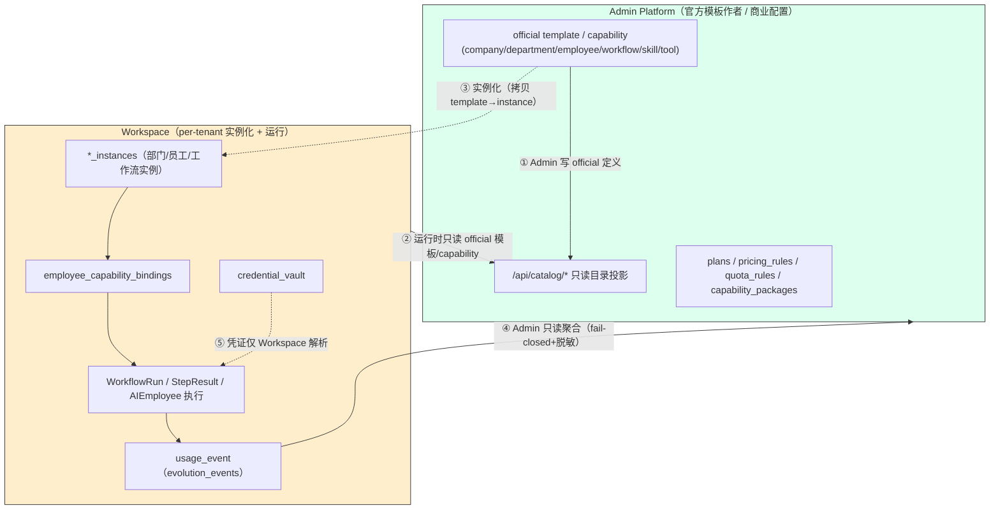

# Admin 支撑 AI Company OS 能力评估

> 评估人：高见远（架构师，software-architect）｜主理人：齐活林（交付总监）
> 任务：Admin Support for AI Company OS Roadmap 评估
> 日期：2026-07-10
> 性质：纯评估/分析，零代码、零后端改动
> 范围说明：**Payment / Invoice / Marketplace 深化已暂停**，不在缺口清单展开，仅在边界与范围节标注「已暂停」。
> 基线：`git status --short` 输出为空（工作区干净）。所有契约/研究/实现现状均经实地 `Read`/`Grep` 核验。

---

## A. Admin 支撑 AI Company OS 的能力清单

### A.0 总述

Admin Platform 当前已具备三类能力：**（1）官方能力目录供给**（model/tool/connector 统一能力包，已实现）、**（2）商业配置面**（Plan / PricingRule / QuotaRule / CapabilityPackage，已实现或 partial）、**（3）治理与只读聚合**（D 系列 reservation、usage/audit 只读投影）。

但「**官方业务模板（Company/Department/Employee/Workflow）的 Admin 作者能力**」基本缺失——仅以 `database.py` 内置**种子数据**形式存在（`employee_templates` / `department_templates` / `workflow_templates`），**无对应的 `/api/platform/*` 作者路由**，Admin 无法新增/编辑/上架官方模板。

> 关于「Skill / Tool」维度的澄清（依据 `capability-type-contract.md`）：本系统**不存在独立的 "Skill" 实体**。`capability_type ∈ {model, tool, connector}` 即「能力/技能」维度；"Tool" = `tool` 这一 capability_type。二者统一由 **official capability catalog**（`official_models` 表 + `/api/platform/capabilities`）供给，Admin **已可 CRUD**。故 6 类对象中 Skill、Tool 的官方供给已由 Admin 落地。

### A.1 六类对象逐类能力表

| 对象 | 官方模板契约（引用，不重写） | 契约状态 | Admin 可管理 official template？ | 实现状态（表 + API） | 数据供给能力 |
|---|---|---|---|---|---|
| **Company** | `company-template-contract.md` | 存在，Phase-3.5，全部字段 `Reserved Only` / `Phase-4: no` | **否** | 无 `company_templates` 表；无 `/api/platform/company-templates` | 无（设计预留，研究`ai-company-template-research.md` 指明 Phase-5+） |
| **Department** | `department-template-contract.md` | 存在，Phase-4 implement（`software_rnd`）+ `DepartmentInstance` 字段 | **部分** | `department_templates` 表已建+种子；**无** `/api/platform/department-templates`；但其下层「类型注册表」`department_types` 由 Admin 经 `manage_department_types` 管理 | 部分：类型可供给；模板蓝图 Admin 不可创作 |
| **Employee** | `employee-template-contract.md` | 存在，Phase-4 implement metadata + `EmployeeInstance` 字段 | **否**（仅种子） | `employee_templates` 表已建+种子；**无** `/api/platform/employee-templates` | 部分：种子可读；Admin 不可创作 |
| **Skill**（= capability） | `capability-type-contract.md` | 存在，Phase-3.5，`capability_type∈{model,tool,connector}` | **是** | `official_models` 统一能力目录 + `/api/platform/capabilities`（GET/POST/PUT）+ `/api/platform/models` | **是**：Admin 可 CRUD 官方能力 |
| **Tool**（= capability `tool`） | `tool-runtime-contract.md` + 统一能力目录 | 存在，Phase-1A；官方工具目录读已实现（issue 067） | **是**（经 `/api/platform/capabilities` `type=tool`） | `/api/catalog/tools` 读已实现；Admin 写经统一能力目录 | **是**：Admin 可供给官方 tool capability |
| **Workflow** | `workflow-template-contract.md` | 存在，Phase-3.5，全部字段 `Reserved Only` / `Phase-4: no` | **否**（仅种子） | `workflow_templates` 表已建+种子；**无** `/api/platform/workflow-templates` | 部分：种子可读；Admin 不可创作；Phase-4 不实现引擎 |

### A.2 跨切面已落地能力

| 切面 | 对象 | 状态 | 依据 |
|---|---|---|---|
| 商业配置 | **Plan** | `partial`（无 `price` 列，订阅价经 PricingRule 派生） | `commercial-configuration-v1.md §2` |
| 商业配置 | **PricingRule** | ✅ 已实现（`pricing_rules` 表 + `/api/platform/pricing-rules`） | `phase9a-commercial-configuration-status.md §1` |
| 商业配置 | **QuotaRule** | ✅ 已实现（`quota_rules` 表 + `/api/platform/quota-rules`） | 同上 |
| 商业配置 | **CapabilityPackage**（能力包） | ✅ 已实现（`capability_packages` 表 + `/api/platform/capability-packages`，14 例测试） | `capability-package-commercial-contract.md` §8 |
| 商业配置 | **EmployeeSeatPolicy** | design-only（未落表/API） | `commercial-configuration-v1.md §2` |
| 治理 | D 系列 reservation / boundary | ✅（Workspace 侧只读 facade：`department_catalog.py` / `department_activation.py` / `department_manifest.py`；声明-only 缝） | `issues/052`、`056`、`087` |
| Console | 只读聚合（usage / audit 投影） | ✅（`GET /api/platform/usage`、audit 命名空间只读） | `issues/062 §7`、`063 R-03/R-05` |
| 能力供给 | 官方 capability catalog（model/tool/connector） | ✅ 已实现 | `issues/071`、`067` |

---

## B. official template 缺口

> **范围边界声明**：Payment / Invoice / Marketplace 深化**已暂停**，不在本缺口清单展开；其相关对象（CapabilityPackage 的 marketplace 包、PromotionRule、TenantPricingPolicy、BillingEvent）均按 `admin-workspace-commercial-boundary.md` 与 `commercial-operation-roadmap.md` 列为独立 gate，本期不实现。

### B.1 逐类缺口

| 对象 | 契约状态 | 实现状态 | 具体缺口 | 缺口严重度 |
|---|---|---|---|---|
| **Company** | exists（Reserved Only） | 无表、无 API | 缺 `company_templates` 表与 `/api/platform/company-templates` 作者端；`company-template-contract.md` 明确 Phase-4 不实现公司包导入/激活 | **阻塞**（对完整 AI Company OS 蓝图供给）；但对 Phase-1 实例化**不需**（见 §D） |
| **Department** | exists（Phase-4） | 表+种子存在；Admin 写 API 缺失 | 缺 `EmployeeTemplateCatalog`/`DepartmentTemplateCatalog` 独立服务与 `/api/platform/department-templates` 端点（issue 087 §3.2 C3 条件） | **部分**（类型注册表 `department_types` 已由 Admin 供给；模板蓝图 Admin 不可创作） |
| **Employee** | exists（Phase-4） | 表+种子存在；Admin 写 API 缺失 | 同上，缺 `/api/platform/employee-templates` 作者路由；`employee_templates` 表缺 `updated_at`/`schema_version`（issue 087 §1.2/§10） | **部分**（种子可供给最小实例化；扩展 official 员工需 Admin API） |
| **Skill**（capability） | exists | ✅ 已实现 | 无（统一能力目录已落地；`CAPABILITY_TYPE` 保持 3 类型不扩展，issue 087 C5） | **轻微/无** |
| **Tool**（capability `tool`） | exists | ✅ 已实现（读：`/api/catalog/tools` issue 067；写：`/api/platform/capabilities`） | 轻微：官方工具**读目录**当前投影自静态 `registry`（非 `capability_catalog` 工具行），两路存在微弱分叉，需统一投影源 | **轻微/无** |
| **Workflow** | exists（Reserved Only） | 表+种子存在；Admin 写 API 缺失；无引擎 | 缺 `/api/platform/workflow-templates`；`workflow-template-contract.md` 明确 Phase-4 不实现自动 step 执行 | **部分**（对完整 OS 蓝图供给）；对 Phase-1 **不需**（无引擎） |

### B.2 特别指出：Skill 与 Tool 维度现状

- **Skill 维度 ≡ Capability**（`capability-type-contract.md`）：`capability_type ∈ {model, tool, connector}`，**无独立 "skill" 实体**；"Templates are separate catalogs, not capabilities"。官方能力供给由 Admin 经 `/api/platform/capabilities`（issue 071 已实现）与 `/api/platform/models` 管理，状态机 `active↔inactive`，零密钥列。
- **Tool 维度**（`tool-runtime-contract.md` + 官方工具目录）：Tool 是 `capability_type=tool`，Admin 写经统一能力目录；Workspace 运行时读 `/api/catalog/tools`（issue 067 `implemented-and-verified`）。`ToolRuntime` 仅封装既有 `tools` registry + Tool Router，不替代 Model Gateway / Credential Vault。

---

## C. Admin / Workspace 边界

### C.1 作者权 vs 实例化权

| 维度 | 官方模板作者权（Admin） | per-tenant 实例化 / 运行（Workspace） |
|---|---|---|
| Company/Department/Employee/Workflow 模板 | ✅ 理论上拥有（契约赋予），但**作者 API 未落地**（仅种子） | ✅ 从 official 模板实例化（`*_instances` 表） |
| Capability（Skill/Tool/Connector） | ✅ 拥有并**已实现**（`/api/platform/capabilities`） | ✅ 经 `employee_capability_bindings` 绑定运行 |
| EmployeeInstance / WorkflowRun / StepResult | ❌ 不管理运行实例 | ✅ 创建/运行/状态 |
| credential_vault | ❌ 不解析/不持久化/不暴露 | ✅ 管理与解析 |
| BillingEvent / Invoice | ❌ 本阶段不生成真实计费（**已暂停**） | ❌ 不生成；仅产生 `usage_event` |

### C.2 数据流（official template → 实例化 → 运行实例）

### C.3 红线清单（引用 `admin-workspace-commercial-boundary.md` §2 与 D 系列 ADR）

| # | 红线 | 来源 |
|---|---|---|
| 1 | Admin **不修改** Workspace 运行实例（`EmployeeInstance`/`WorkflowRun`/`StepResult`） | `admin-workspace-commercial-boundary.md` 铁律① |
| 2 | Admin **不解析 / 不持久化 / 不暴露** `credential_vault` / `credential_ref` | 同上；`usage-value-event-boundary.md` |
| 3 | Admin **不生成** BillingEvent / Invoice（**Payment/Invoice/Marketplace 已暂停**） | `phase9a-commercial-design-freeze.md` 六禁 |
| 4 | Workspace **不判断价格 / 不写官方模板 / 不改 `plans`/`pricing_rules`/`capability_catalog`** | `admin-workspace-commercial-boundary.md` 铁律② |
| 5 | Workspace **不调用** `/api/platform/*`、不修改 official 定义 | `capability-type-contract.md` Invariants |
| 6 | catalog 读 ≠ platform 写（非替代分工） | ADR-0028 §8.1 条件#3 / issue 062 |

---

## D. Phase 1 是否需要 Admin 配合

### D.1 概念界定

「Phase 1」= **ADR-0028 Phase-1 共享基础契约**（`issues/062_adr0028_phase1_shared_contract.md`，design-only，2026-07-08 附 5 条件签收）。它定义双团队并行开发共同遵守的**契约形状**（Tenant/CEO/Company、Capability Source、Model、Tool、Connector、Department、三类 Event），实现须经 G1–G4 gate 解锁。其 §1.3 明确 **Company 在 Phase-1 用 `tenants.company_name` + 派生 `company_id=tenant_id` 表达，不单独立表**；§6 明确 **Department Template = `department_types` 类型注册表 + `department_type_status` + `source` 列**。

### D.2 逐类判断：Phase 1 是否必须先由 Admin 交付 official template

| 对象 | 是否需 Admin 先交付 official template | 判定依据 |
|---|---|---|
| **Company** | **不需** | Phase-1 无独立 Company 模板，由 `tenants` 表属性表达（ADR-0028 §1.3）；`company_templates` 表设计 Phase-5+，与 Phase-1 无关 |
| **Department** | **部分需** | Phase-1 供给 = `department_types` 类型注册表（**Admin 已通过 `manage_department_types` 管理**，S4 既有）；更丰富的 `department_templates` 目录（含 `default_employee_templates`）的 Admin 作者 API 非 Phase-1 必需（issue 087 S1 切片即为「Workspace 只读 official 模板」） |
| **Employee** | **部分需** | Phase-1 最小实例化只需读取 official 员工模板**种子**（已落 `employee_templates` 表 + `/api/workspace/employee-templates`）；Admin 创作新模板的 API 非 Phase-1 必需，但扩展多角色需补 |
| **Skill**（capability） | **需（已具备）** | Workspace 经 `employee_capability_bindings` 引用 official capability key；Admin 必须供给官方 model/tool/connector 目录——**已由 `/api/platform/capabilities` 落地（issue 071）** |
| **Tool**（capability `tool`） | **需（已具备）** | 同上，tool 即 capability；官方 tool 读目录 `/api/catalog/tools` 已实现（issue 067），Admin 写已具备 |
| **Workflow** | **不需** | `workflow-template-contract.md` 明确 Phase-4 不实现引擎；Phase-1 无 workflow 执行，无需 Admin 供给 workflow 模板管理 |

### D.3 解锁 Phase 1 的最小 Admin 动作清单（按优先级）

| 优先级 | 动作 | 现状 | 阻塞 Phase-1？ |
|---|---|---|---|
| **P0** | 官方 capability catalog（model/tool/connector）填充并 Admin 可管 | ✅ 已实现（issue 071） | 已具备 |
| **P0** | 官方 department 类型注册表 `department_types` 由 Admin 管理并 seed | ✅ 既有（S4 `manage_department_types`） | 已具备 |
| **P0** | official employee/department 模板种子供 Workspace 只读 | ✅ 已落种子 + `/api/workspace/*-templates` | 已具备 |
| **P1** | 新增 `EmployeeTemplateCatalog` / `DepartmentTemplateCatalog` 服务 + `/api/platform/employee-templates`、`/api/platform/department-templates` 作者端点（issue 087 C3 / S3） | ❌ 未实现 | 非 Phase-1 阻塞；为丰富官方供给所必需 |
| **P2** | Company template catalog 设计（`company_templates` 表，Phase-5+） | ❌ 未设计 | 不在 Phase-1 范围 |
| **P2** | Workflow template Admin 作者 + 引擎（引擎 Phase-4 后） | ❌ 未实现 | 不在 Phase-1 范围 |

---

## E. 评估结论与建议

### E.1 一句话结论

**Admin 已具备「官方能力（Skill/Tool）目录 + 商业配置面 + 治理/只读聚合」的供给能力，但「官方业务模板（Company/Department/Employee/Workflow）的 Admin 作者能力」基本缺失——仅以种子数据存在、无可写 API；对 Phase-1 实例化而言，Skill/Tool 与 Department 类型注册表/Employee 种子已足够，Company/Workflow 本就不在 Phase-1 范围。**

### E.2 下一步建议（3–5 条）

1. **优先补官方业务模板作者端（P1）**：按 issue 087 C3 落地 `EmployeeTemplateCatalog` / `DepartmentTemplateCatalog` 独立服务与 `/api/platform/employee-templates`、`/api/platform/department-templates` 端点（沿用 `CapabilityCatalog` 范式：`create`/`set_status`/`template.*` 审计 / `_reject_secret_like_metadata`）。这是解锁「Admin 可运营官方业务模板」的最小动作，不触碰 Workspace 执行链。
2. **明确是否需新 gate 解禁模板写**：`employee_templates` 写涉及 ADR-0017「员工 CRUD」禁止区部分解禁（issue 087 C1），须提交独立 ADR 经总控决策席 + 安全边界席 gate 解锁；`department_templates` 写因偏离 ADR-0028 §6，须先文档化双层关系（C2）。
3. **统一官方工具目录投影源**：`/api/catalog/tools` 当前读静态 `registry`，与统一能力目录 `capability_catalog`（含 tool 行）存在分叉，建议 catalog 读统一指向 `capability_catalog` 工具行，避免两套官方 tool 真相。
4. **与 Phase-9b/9c 商业配置对齐**：`CapabilityPackage` 已实现且已引用 `workflow_template_ids` / `employee_template_ids`，但这两类模板 Admin 仍不可创作——Phase-9c（Marketplace 官方模板上架销售，G3 双签）前须先完成本条建议 #1 的模板作者端，否则能力包将引用尚不可管理的模板 id。
5. **Company / Workflow 模板按路线图留待后续 gate**：Company 模板设计 Phase-5+（研究 `ai-company-template-research.md`）；Workflow 引擎与官方 workflow 模板管理待 Phase-4 后——本期不投入，避免越界。

---

*—— 评估文档完。本产出为纯分析，未写文件、未提交 git（由主理人落盘）；所有契约/实现现状均经实地 `git`/`Grep`/`Read` 核验。缺失/空内容处已标注「未找到/设计预留」；Payment/Invoice/Marketplace 深化已按范围边界声明暂停。*
