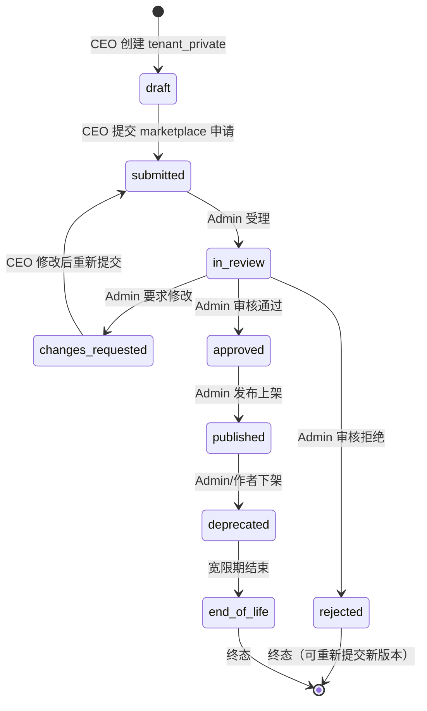

# 能力市场（Capability Marketplace）领域研究

> 研究范围：Curis Admin Platform 的能力市场（marketplace）上架流程、租户私有能力申请上架、审核状态模型、安装模型、版本管理、下架机制、收益分成预留、Pack 商品类型。
>
> 研究性质：纯研究文档，不含实现方案、不含代码改动。所有结论须与 ADR-0028 共享契约、issue 087 Phase-3.5 决策、G3 gate 边界对齐。
>
> Gate 状态：marketplace 跨租户共享/安装/收益分成均属 G3 禁止区，**须经总控决策席 + 安全边界席 gate 解锁后方可实现**。本研究仅定义数据形状与流程设计，不定义实现逻辑。

---

## 现状分析

### 1. Curis 当前 marketplace 架构现状

Curis Admin Platform 当前**未实现** marketplace 业务流程，仅在数据模型层预留了 `capability_source = 'marketplace'` 枚举值。

#### 1.1 `capability_source` 三态枚举已落地

issue 062 (ADR-0028 §2) 定义 `capability_source` 三态：

| source | 含义 | 管理方 | 可见性 | 计量归属 | 状态 |
| --- | --- | --- | --- | --- | --- |
| `official` | 平台官方标准能力 | Admin Platform | 全局（所有租户） | 平台目录（不计入租户私有配额） | ✅ 已落地 |
| `tenant_private` | CEO 自创，仅本租户 | Workspace | 仅本租户（X-Tenant-Id 隔离） | 归属该 tenant_id | ✅ 已落地 |
| `marketplace` | 租户提交审核后共享 | Admin 审核 / Workspace 用 | 订阅租户 | ⚠️ 待 gate（跨租户计量） | ⚠️ **枚举已预留，流程未实现** |

#### 1.2 已落地表中的 marketplace 预留

`backend/app/database.py` 中以下表已预留 `marketplace` 枚举值：

- `employee_templates.source` CHECK 含 `'marketplace'`（`database.py:451-452`）
- `department_templates.source` CHECK 含 `'marketplace'`（`database.py:478-479`）
- `employee_capability_bindings.capability_source` CHECK 含 `'marketplace'`（`database.py:489-490`）
- `tenant_private_capabilities.source` 默认 `'tenant_private'`（未显式 CHECK，但语义上不承载 marketplace）
- `official_models.source` 默认 `'official'`（marketplace 经提升后落库，待流程实现）

#### 1.3 `tenant_private` 隔离已正确实现

issue 087 §5.1 确认：
- `list_employee_templates` / `list_department_templates` 使用 `source = 'official' or (source = 'tenant_private' and tenant_id = ?)` 过滤
- `tenant_private` 不进入 `/api/catalog/*`（仅 official 全局可见）
- `tenant_private` 不进入 `list_catalog_capabilities()`（仅查 `official_models` 表 `source='official'`）

#### 1.4 marketplace 相关 Gate 状态

issue 062 §9 明确 G3 gate：

> **G3 跨租户 marketplace**：`capability_source=marketplace` 枚举值已定义形状；跨租户共享/安装/收益分成 ❌ 被锁定实现；解锁条件：总控决策席 + 安全边界席 gate。

issue 062 §10.5 明确 marketplace 与 tenant_private 的边界：
> tenant_private 在本租户内可见可用（不受 G3 限制），仅「跨租户共享/上架」触发 G3 gate。

### 2. Phase-3.5 契约评审对 marketplace 的预留

issue 087 §4 给出了 marketplace template 审核流程建议（仅设计，未实现）：

#### 2.1 审核流程建议（issue 087 §4.1）

```
CEO 提交 tenant_private template → marketplace 申请（status='pending_review'）
  → Admin 审核队列（/api/platform/marketplace-review）
  → Admin approve → 提升/复制为 source='marketplace', tenant_id='platform'
  → 全局可见，订阅租户可使用
```

#### 2.2 审核队列表建议（issue 087 §4.2）

| 字段 | 类型 | 说明 |
| --- | --- | --- |
| `review_id` | text PK | |
| `template_type` | enum | `employee_template` / `department_template` |
| `source_template_id` | text | → employee_templates / department_templates |
| `source_tenant_id` | text | 提交方租户 |
| `status` | enum | `pending_review` / `approved` / `rejected` / `published` |
| `reviewer_id` | text | Admin 审核人 |
| `reviewed_at` | datetime | |
| `review_notes` | text | |
| `published_template_id` | text | 批准后生成的 marketplace template ID |

#### 2.3 marketplace template usage_event 投影（issue 087 §4.3）

`employee_capability_bindings.capability_source` 已含 `'marketplace'`，UsageEvent 中 `capability_ref.source` 字段可标记 marketplace 来源，Admin 投影时按 `source='marketplace'` 过滤。

**注意**：marketplace 跨租户计量触发 G3 gate（ADR-0028 §9），跨租户 usage 归属和收益分成须待 gate 解锁。

### 3. 待研究问题

- 完整的 marketplace 上架流程（draft → submitted → review → approved/rejected → published → deprecated）
- 租户私有能力如何申请上架（提交入口、审核状态、提升机制）
- 安装模型（订阅机制、安装到租户、卸载）
- 版本管理（多版本并存、升级、回滚）
- 下架机制（deprecate 流程、存量用户影响）
- 收益分成是否需要预留（G1 gate 相关）
- Company Pack / Department Pack / Employee Pack 是否应成为 marketplace 商品类型

---

## 研究发现

### 1. 行业 marketplace 审核状态机

#### 1.1 AWS Marketplace 审核流程

AWS Marketplace 商品上架流程：
1. **Create**：卖家创建 listing（product config、pricing、metadata）
2. **Submit**：提交审核
3. **Review**：AWS 团队审核（含法务、技术、安全）
4. **Approved** → **Live**：审核通过后上架
5. **Changes Requested**：审核反馈，卖家修改后重新提交
6. **Rejected**：审核拒绝
7. **Deprecate**：下架（存量用户仍有 N 天宽限期）
8. **Removed**：完全移除

参考价值：AWS 的 `Changes Requested` 状态值得 Curis 引入（issue 087 §4.2 建议的 `rejected` 状态过于终态，应支持迭代修改）。

#### 1.2 OpenAI GPT Store 审核流程

OpenAI GPT Store 的 GPT 发布流程：
1. Builder 创建 GPT（private）
2. Builder 提交至 GPT Store（review queue）
3. OpenAI 审核（policy、safety、IP）
4. Approved → Published（公开可搜索）
5. Rejected → Builder 修改后重新提交
6. Deprecate：Builder 主动下架

参考价值：GPT Store 的 `private → public` 二档可见性比 Curis 简单，但 Curis 的三态（official/tenant_private/marketplace）已更细。GPT Store 的 Builder 主动下架机制值得参考。

#### 1.3 Hugging Face Hub 模型生命周期

Hugging Face Hub 的模型生命周期：
- `gated`：需申请访问
- `disabled`：被平台禁用（违规）
- `deprecated`：作者标记弃用（仍可见但建议迁移）
- `deleted`：完全删除（仅作者可操作）

参考价值：HF 的 `gated` 机制（需申请访问）对 Curis 未来 marketplace 高价值能力值得借鉴。`deprecated` 状态明确区分「下架但仍可用」（存量用户）与「完全删除」。

#### 1.4 cline/mcp-marketplace 审核状态机

cline/mcp-marketplace 采用三态终态：
- **Approved**：审核通过
- **Changes Requested**：需修改（iterative）
- **Rejected**：拒绝

参考价值：三态终态简洁，但 Curis 需要更细粒度（含 `published` 与 `deprecated`）以支持版本生命周期。

### 2. 行业安装与订阅模型

#### 2.1 SaaS 订阅模型

- **AWS Marketplace SaaS Subscriptions**：买家订阅后获得访问权，按月/年计费，卖家可定义多个 pricing tier
- **Microsoft Commercial Marketplace**：SaaS offers 支持 flat rate、per user、per seat 等多种定价模型
- **Hugging Face Hub**：模型/数据集下载即用，无显式订阅（但 `gated` 模型需申请）

#### 2.2 Curis 适用的安装模型

Curis 是 B2B 多租户平台，安装模型应：
- **订阅（subscribe）**：CEO 在 marketplace 选择能力 → 安装到本租户 → 产生 `tenant_private` 引用（或 `marketplace` 引用）
- **卸载（unsubscribe）**：CEO 卸载能力 → 保留历史 usage_event 但停止使用
- **版本绑定（version pinning）**：CEO 可选择固定版本或自动升级

### 3. 行业版本管理实践

#### 3.1 Semantic Versioning

行业普遍采用 semver：`MAJOR.MINOR.PATCH`：
- MAJOR：不兼容变更
- MINOR：向后兼容新增
- PATCH：bug 修复

#### 3.2 多版本并存模式

- **Hugging Face**：Git-based，每个 revision 是 commit hash，可同时存在多个 revision
- **PyPI / npm**：所有历史版本永久可访问
- **AWS Lambda Layers**：版本号递增，旧版本仍可引用

#### 3.3 版本生命周期

- **stable**：推荐使用
- **beta**：可试用，不稳定
- **deprecated**：建议迁移
- **sunset**：即将下架
- **end-of-life**：完全不可用

### 4. 行业收益分成模型

#### 4.1 App Store 模式（Apple / Google）

- Apple App Store：30% 抽成（小开发者 15%）
- Google Play：30% 抽成（订阅 1 年后降至 15%）

#### 4.2 SaaS Marketplace 模式

- AWS Marketplace：3% 抽成（SaaS products）
- Microsoft Commercial Marketplace：10%（CSP program）/ 0%（direct）
- Stripe App Marketplace：0% 抽成（仅支付费）

#### 4.3 Curis 适用模型

Curis marketplace 是能力市场（非完整 SaaS），收益分成模型需考虑：
- 能力提交方（CEO / 第三方开发者）的激励
- 平台运营成本（审核、计量、托管）
- 跨租户计量的合规性（G3 gate）

建议：**G1 gate 解锁前不实现收益分成**，仅预留数据形状。Phase-5+ 视商业化进展决定。

### 5. Pack 作为 marketplace 商品类型

#### 5.1 行业 Pack / Bundle 模式

- **Microsoft 365 Business Bundles**：多个 Office 应用打包销售
- **Adobe Creative Cloud Bundles**：多个 Adobe 应用打包
- **AWS Solutions**：CloudFormation 模板 + 多个 AWS 服务组合

#### 5.2 Curis Pack 类型

- **Company Pack**：完整公司蓝图（部门组合 + 员工配置 + 能力绑定）
- **Department Pack**：部门能力组合（多 capability + employee templates）
- **Employee Pack**：员工能力组合（角色 + 多 capability 绑定）

三者均可作为 marketplace 商品类型，但治理复杂度递减：
- Company Pack：跨多 template 引用，须严格审核
- Department Pack：中等复杂度
- Employee Pack：最简单

---

## 设计建议

### 1. Marketplace 上架流程

#### 1.1 完整流程状态机



#### 1.2 状态说明

| 状态 | 含义 | 触发方 | 可见性 | 可执行 |
| --- | --- | --- | --- | --- |
| `draft` | CEO 草稿，仅本租户可见 | CEO | tenant_private | ✅ 本租户内 |
| `submitted` | 已提交审核，等待 Admin 受理 | CEO | 提交方 + Admin | ❌ 冻结 |
| `in_review` | Admin 审核中 | Admin | 提交方 + Admin | ❌ 冻结 |
| `changes_requested` | Admin 要求修改 | Admin | 提交方 + Admin | ❌ 冻结 |
| `approved` | 审核通过，待发布 | Admin | 提交方 + Admin | ❌ 冻结 |
| `rejected` | 审核拒绝（终态） | Admin | 提交方 + Admin | ❌ 不可用 |
| `published` | 已上架，全局可见 | Admin | 所有租户 | ✅ 订阅后可用 |
| `deprecated` | 已下架，存量用户可用 | Admin/作者 | 订阅租户 + Admin | ⚠️ 存量可用，新订阅关闭 |
| `end_of_life` | 完全不可用（终态） | Admin | 仅 Admin 可见 | ❌ 不可用 |

#### 1.3 状态机规则

- `draft` → `submitted`：CEO 主动提交，须填写上架申请表（description、category、pricing_tier 占位）
- `submitted` → `in_review`：Admin 受理（自动或手动）
- `in_review` → `changes_requested`：Admin 反馈修改意见，CEO 可修改后重新提交
- `in_review` → `approved`：Admin 审核通过（含内容、安全、合规检查）
- `in_review` → `rejected`：Admin 审核拒绝（终态，CEO 可重新提交新版本）
- `approved` → `published`：Admin 发布上架（提升为 `source='marketplace'`, `tenant_id='platform'`）
- `published` → `deprecated`：Admin 或作者主动下架（须注明 deprecate 原因与迁移建议）
- `deprecated` → `end_of_life`：宽限期结束（建议 90 天），完全移除

### 2. 租户私有能力申请上架流程

#### 2.1 提交入口

CEO 在 Workspace 内对 `source='tenant_private'` 的能力/模板发起上架申请：

```
POST /api/tenant/marketplace-applications
{
  "capability_type": "employee_template",  // 或 department_template / capability / pack
  "source_id": "tenant:acme:analyst_v1",
  "display_name": "Acme 数据分析师模板",
  "description": "面向零售场景的数据分析师模板",
  "category": "analytics",
  "pricing_tier": "free",  // G1 gate 前，仅支持 free
  "version": "1.0.0"
}
```

#### 2.2 Workspace 侧动作

1. 校验 `source_id` 存在且属本租户 `tenant_private`
2. 创建审核记录（写入 `marketplace_reviews` 表，status=`submitted`）
3. 冻结源能力（设 `frozen=true`，禁止修改直至审核结束或撤回）
4. 发送 `marketplace.submitted` 审计事件
5. 通知 Admin（待 Admin 受理）

#### 2.3 Admin 侧审核

```
GET /api/platform/marketplace-reviews?status=submitted
POST /api/platform/marketplace-reviews/:review_id/approve
POST /api/platform/marketplace-reviews/:review_id/reject
POST /api/platform/marketplace-reviews/:review_id/request-changes
POST /api/platform/marketplace-reviews/:review_id/publish
```

#### 2.4 审核通过后的提升机制

Admin approve 后：
1. 复制源能力到 official/marketplace 表（`source='marketplace'`, `tenant_id='platform'`）
2. 生成新的 `marketplace_id`（如 `marketplace:employee_template:analyst_v1`）
3. 保留 `source_template_id` / `source_tenant_id` 记录原始提交方
4. 解冻源能力（CEO 可继续修改 tenant_private 版本，不影响已上架 marketplace 版本）
5. 发送 `marketplace.published` 审计事件

### 3. 审核状态模型

#### 3.1 审核队列表设计

```sql
create table if not exists marketplace_reviews (
  review_id              text primary key,
  capability_type        text not null
                         check (capability_type in
                           ('model', 'tool', 'connector',
            'employee_template', 'department_template',
            'workflow_template', 'company_template', 'capability_pack')),
  source_id              text not null,           -- → 源表 PK
  source_tenant_id       text not null,           -- 提交方租户
  source_version         text not null default '1.0.0',
  display_name           text not null,
  description            text not null default '',
  category               text not null default '',
  pricing_tier           text not null default 'free',
  status                 text not null default 'submitted'
                         check (status in
                           ('submitted', 'in_review', 'changes_requested',
            'approved', 'rejected', 'published', 'deprecated', 'end_of_life')),
  reviewer_id            text,
  reviewed_at            datetime,
  review_notes           text not null default '',
  published_id           text,                    -- 发布后生成的 marketplace ID
  published_at           datetime,
  deprecated_at          datetime,
  end_of_life_at         datetime,
  deprecate_reason       text not null default '',
  migration_guide        text not null default '',
  submitted_at           datetime not null default current_timestamp,
  updated_at             datetime not null default current_timestamp
);

create index if not exists idx_marketplace_reviews_status
  on marketplace_reviews(status, capability_type);
create index if not exists idx_marketplace_reviews_source
  on marketplace_reviews(source_tenant_id, capability_type, source_id);
```

#### 3.2 审核事件审计

所有审核状态变更写入 `evolution_events`：
- `marketplace.submitted`
- `marketplace.in_review`
- `marketplace.changes_requested`
- `marketplace.approved`
- `marketplace.rejected`
- `marketplace.published`
- `marketplace.deprecated`
- `marketplace.end_of_life`

事件 payload 须含 `review_id`、`capability_type`、`source_id`、`source_tenant_id`、`status`、`reviewer_id`。

### 4. 安装模型

#### 4.1 订阅关系表

```sql
create table if not exists marketplace_subscriptions (
  subscription_id        text primary key,
  tenant_id              text not null,           -- 订阅方租户
  ceo_id                 text not null,
  capability_type        text not null,
  marketplace_id         text not null,           -- → 已发布的 marketplace 能力
  marketplace_version    text not null,           -- 订阅时锁定的版本
  auto_upgrade           integer not null default 0,  -- 是否自动升级
  status                 text not null default 'active'
                         check (status in ('active', 'suspended', 'unsubscribed')),
  subscribed_at          datetime not null default current_timestamp,
  unsubscribed_at        datetime,
  updated_at             datetime not null default current_timestamp
);

create unique index if not exists idx_marketplace_subscriptions_unique
  on marketplace_subscriptions(tenant_id, marketplace_id);
```

#### 4.2 订阅流程

```
POST /api/tenant/marketplace-subscriptions
{
  "marketplace_id": "marketplace:employee_template:analyst_v1",
  "version": "1.0.0",
  "auto_upgrade": false
}
```

Workspace 侧动作：
1. 校验 `marketplace_id` 存在且 `status='published'`
2. 创建订阅记录（status=`active`）
3. 在本租户生成引用副本（写入 `tenant_private_capabilities` 或对应 template 表，`source='marketplace'`, `tenant_id=本租户`, `marketplace_ref=marketplace_id`）
4. 发送 `marketplace.subscribed` 审计事件

#### 4.3 卸载流程

```
POST /api/tenant/marketplace-subscriptions/:sub_id/unsubscribe
```

Workspace 侧动作：
1. 校验订阅属本租户
2. 标记订阅 `status='unsubscribed'`，记录 `unsubscribed_at`
3. 禁用本租户内的引用副本（`enabled=0`），**不**物理删除（保留历史 usage_event）
4. 发送 `marketplace.unsubscribed` 审计事件

### 5. 版本管理

#### 5.1 版本表设计

```sql
create table if not exists marketplace_versions (
  version_id             text primary key,
  marketplace_id         text not null,
  version                text not null,           -- semver: MAJOR.MINOR.PATCH
  changelog              text not null default '',
  status                 text not null default 'draft'
                         check (status in ('draft', 'beta', 'stable', 'deprecated', 'end_of_life')),
  created_at             datetime not null default current_timestamp,
  published_at           datetime,
  deprecated_at          datetime,
  end_of_life_at         datetime,
  unique (marketplace_id, version)
);

create index if not exists idx_marketplace_versions_marketplace
  on marketplace_versions(marketplace_id, status);
```

#### 5.2 版本生命周期

| 状态 | 含义 | 可订阅 | 可执行 |
| --- | --- | --- | --- |
| `draft` | 新版本草稿，作者编辑中 | ❌ | ❌ |
| `beta` | 公测版本，可试用 | ✅（显式 opt-in） | ✅ |
| `stable` | 稳定版本，推荐订阅 | ✅ | ✅ |
| `deprecated` | 已弃用，建议迁移 | ❌（新订阅关闭） | ✅（存量用户） |
| `end_of_life` | 完全下架 | ❌ | ❌ |

#### 5.3 版本升级与回滚

- **自动升级**：订阅时 `auto_upgrade=true`，新 stable 版本发布时自动迁移
- **手动升级**：订阅时 `auto_upgrade=false`，CEO 显式调用升级 API
- **回滚**：CEO 可回滚至任意历史 stable 版本（须仍处于 `stable` 或 `deprecated` 状态）

```
POST /api/tenant/marketplace-subscriptions/:sub_id/upgrade
{
  "target_version": "1.1.0"
}

POST /api/tenant/marketplace-subscriptions/:sub_id/rollback
{
  "target_version": "1.0.0"
}
```

### 6. 下架与版本管理

#### 6.1 下架流程

1. 作者或 Admin 发起 deprecate 请求
2. 填写 `deprecate_reason` 与 `migration_guide`（建议迁移至哪个替代能力）
3. 版本状态变更为 `deprecated`，新订阅关闭
4. 通知所有订阅租户（经 `marketplace.deprecated` 事件）
5. 宽限期（建议 90 天）后，版本状态变更为 `end_of_life`，完全不可用
6. 宽限期内订阅租户须迁移至替代能力或接受停用

#### 6.2 强制下架（违规处理）

Admin 可强制下架违规能力：
1. 直接将版本状态设为 `end_of_life`（跳过 `deprecated`）
2. 通知所有订阅租户立即停用
3. 记录违规原因至 `marketplace_reviews.review_notes`

### 7. 收益分成预留

#### 7.1 G1 gate 边界

issue 062 §9 G1 明确：L6 计费计算（成本/ROI/账单金额）被锁定，须经 gate 解锁。

marketplace 收益分成属于 L6 经济层，**G1 gate 解锁前不实现任何收益分成逻辑**。

#### 7.2 数据形状预留

仅预留数据形状，不计算金额：

```sql
create table if not exists marketplace_revenue_shares (
  share_id               text primary key,
  period                 text not null,           -- 如 "2026-07"
  marketplace_id         text not null,
  contributor_tenant_id  text not null,           -- 提交方租户
  platform_share_ratio   real not null default 0.0,  -- 平台分成比例（0-1）
  contributor_share_ratio real not null default 0.0, -- 提交方分成比例（0-1）
  usage_refs             text not null default '[]', -- 关联 UsageEvent 集合
  gross_amount           real,                    -- ⚠️ 待 G1 gate，形状占位
  platform_share_amount  real,                    -- ⚠️ 待 G1 gate
  contributor_share_amount real,                  -- ⚠️ 待 G1 gate
  currency               text,                    -- ⚠️ 待 G1 gate
  status                 text not null default 'draft'
                         check (status in ('draft', 'issued', 'settled')),
  created_at             datetime not null default current_timestamp,
  updated_at             datetime not null default current_timestamp
);
```

#### 7.3 预留规则

- **Phase-4 / Phase-5**：仅落表结构，不写入任何金额字段
- **G1 gate 解锁后**：根据商业化决策填充分成比例与金额计算逻辑
- **分成模型建议**（待 gate 后评审）：
  - Platform 30% / Contributor 70%（参照 Apple App Store 反向）
  - Platform 10% / Contributor 90%（参照 AWS Marketplace）
  - 具体比例须由产品规划席 + 总控决策席决定

#### 7.4 G1 gate 关联

收益分成与 G1 gate（L6 计费计算）强耦合：
- G1 解锁前：仅落形状，不计算 `gross_amount` / `platform_share_amount` / `contributor_share_amount`
- G1 解锁后：基于 UsageEvent 的 `raw_meter_value` + 计费规则计算金额
- 跨租户计量触发 G3 gate：marketplace 跨租户 usage 归属须 G1 + G3 双解锁

### 8. Company Pack / Department Pack / Employee Pack 作为 marketplace 商品

#### 8.1 商品类型建议

| Pack 类型 | 是否作为 marketplace 商品 | 理由 |
| --- | --- | --- |
| `company_pack` | ✅ 推荐 | 完整公司蓝图是高价值商品，但审核严格度高 |
| `department_pack` | ✅ 推荐 | 部门能力组合是中等粒度商品，审核复杂度适中 |
| `employee_pack` | ✅ 推荐 | 员工能力组合是最细粒度商品，审核简单 |

#### 8.2 Pack 上架特殊规则

- **引用完整性校验**：Pack 引用的所有 capability / template 必须已上架为 marketplace 商品（或为 official）
- **版本联动**：Pack 引用的 capability / template 版本升级时，Pack 须评估兼容性
- **跨租户引用**：Pack 引用的必须是 marketplace 或 official 能力，不可引用 `tenant_private`（提交 Pack 时须校验）

#### 8.3 Pack 审核流程

与单能力审核流程一致，但增加：
1. **引用完整性检查**：所有 `capability_refs_json` / `template_refs_json` 须解析成功
2. **依赖能力审核状态**：被引用能力须为 `published` 状态
3. **组合合规性检查**：Pack 组合不得违反平台策略（如禁止组合特定能力）

#### 8.4 Pack 订阅机制

订阅 Pack 等同于订阅 Pack 内所有引用能力：
1. 创建 Pack 订阅记录
2. 自动为 Pack 内每个 capability / template 创建单独订阅记录
3. Pack 内能力的版本升级须保持同步

### 9. 数据模型建议汇总

#### 9.1 新增表（Phase-5+，待 G3 gate）

- `marketplace_reviews`：审核队列
- `marketplace_subscriptions`：订阅关系
- `marketplace_versions`：版本管理
- `marketplace_revenue_shares`：收益分成（形状预留，G1 gate 解锁后填充）

#### 9.2 现有表扩展

- `official_models` / `employee_templates` / `department_templates`：保持 `source='marketplace'` 枚举值，无需扩展
- `tenant_private_capabilities`：建议 additive 加 `marketplace_ref` 列（记录订阅来源，便于 usage 归因）

### 10. API 设计建议

#### 10.1 Workspace 侧（CEO 操作）

```
# 上架申请
POST   /api/tenant/marketplace-applications
GET    /api/tenant/marketplace-applications              # 本租户的申请列表
DELETE /api/tenant/marketplace-applications/:review_id   # 撤回申请（仅 draft/submitted 状态）

# 订阅管理
POST   /api/tenant/marketplace-subscriptions
GET    /api/tenant/marketplace-subscriptions              # 本租户的订阅列表
POST   /api/tenant/marketplace-subscriptions/:sub_id/unsubscribe
POST   /api/tenant/marketplace-subscriptions/:sub_id/upgrade
POST   /api/tenant/marketplace-subscriptions/:sub_id/rollback

# 浏览市场
GET    /api/catalog/marketplace                           # 浏览已上架能力
GET    /api/catalog/marketplace/:marketplace_id           # 查看详情
GET    /api/catalog/marketplace/:marketplace_id/versions  # 查看版本
```

#### 10.2 Admin 侧（审核管理）

```
# 审核队列
GET    /api/platform/marketplace-reviews                  # 待审核列表
GET    /api/platform/marketplace-reviews/:review_id       # 审核详情
POST   /api/platform/marketplace-reviews/:review_id/start-review      # 受理
POST   /api/platform/marketplace-reviews/:review_id/request-changes   # 要求修改
POST   /api/platform/marketplace-reviews/:review_id/approve           # 审核通过
POST   /api/platform/marketplace-reviews/:review_id/reject            # 审核拒绝
POST   /api/platform/marketplace-reviews/:review_id/publish           # 发布上架

# 已发布能力管理
GET    /api/platform/marketplace-listings                 # 已上架能力列表
POST   /api/platform/marketplace-listings/:id/deprecate   # 下架（含宽限期）
POST   /api/platform/marketplace-listings/:id/force-remove  # 强制下架（违规）

# 收益分成（G1 gate 解锁后）
GET    /api/platform/marketplace-revenue?period=          # 收益报表
```

### 11. 边界规则

#### 11.1 Gate 边界

- **G3 gate（跨租户 marketplace）**：marketplace 上架/订阅/跨租户计量均须 G3 解锁
- **G1 gate（L6 计费计算）**：收益分成金额计算须 G1 解锁
- **G1 + G3 双解锁**：跨租户收益分成须双 gate 解锁

#### 11.2 数据隔离不变式

- 审核队列对提交方仅可见自身申请（`source_tenant_id = ?`）
- 订阅关系仅对本租户可见（`tenant_id = ?`）
- Admin 可见所有审核记录与订阅记录（admin token）
- Workspace 不可见其他租户的审核记录与订阅记录

#### 11.3 状态机不变式

- `published` 状态的能力方可被订阅
- `deprecated` 状态的能力不可被新订阅，存量订阅可用至 `end_of_life`
- `end_of_life` 状态的能力完全不可用
- 审核中的能力（`submitted` / `in_review` / `changes_requested`）源能力冻结，不可修改

#### 11.4 审计不变式

- 所有审核状态变更写入 `evolution_events`（append-only）
- 所有订阅/卸载/升级/回滚操作写入 `evolution_events`
- 收益分成计算（G1 gate 后）写入 `evolution_events`

#### 11.5 凭证不变式

- marketplace 能力不持久化任何凭证/密钥
- 私有模型/工具自带 key/endpoint 仍属 G4 禁止区
- 订阅 marketplace 能力不涉及凭证传递（仅引用元数据）

---

## 前置条件

### 1. G3 gate 解锁（marketplace 跨租户）

- 总控决策席 + 安全边界席双签 gate
- 独立 ADR（如 ADR-00xx Marketplace 审核流程）已落
- 跨租户 usage 归属机制已设计

### 2. G1 gate 解锁（L6 计费计算）

- 总控决策席 + 安全边界席双签 gate
- 独立 ADR（如 ADR-00xx 计费计算）已落
- BillingEvent 金额计算逻辑已设计

### 3. Phase-4 template catalog 落地

- `EmployeeTemplateCatalog` / `DepartmentTemplateCatalog` 服务已实现
- Phase-4 S1-S4 切片已完成（Workspace 只读 + tenant_private CRUD + Admin official CRUD + binding）

### 4. 审核队列表设计

- `marketplace_reviews` 表已设计（本研究提供字段建议）
- `marketplace_subscriptions` 表已设计
- `marketplace_versions` 表已设计

### 5. 跨租户计量机制

- UsageEvent 跨租户归属规则已定义（`capability_ref.source='marketplace'` 标记）
- `marketplace_ref` 列已 additive 加至 `tenant_private_capabilities` 表

### 6. Pack 体系前置（仅 Pack 商品类型）

- `capability_packs` 表已落地（见能力目录研究）
- `CapabilityPackCatalog` 服务已实现
- Pack 引用完整性校验逻辑已实现

---

## 结论

### 1. 核心结论

1. **marketplace 完整流程须待 G3 gate 解锁**：上架/订阅/跨租户计量均属 G3 禁止区，本研究仅定义数据形状与流程设计，不定义实现逻辑。

2. **审核状态机采用 9 态模型**：`draft` → `submitted` → `in_review` → `changes_requested` / `approved` / `rejected` → `published` → `deprecated` → `end_of_life`。相比 issue 087 §4.2 的 5 态模型，新增 `changes_requested`（支持迭代修改）、`deprecated`（存量用户可用）、`end_of_life`（完全下架）三态，更贴合行业最佳实践。

3. **安装模型采用订阅机制**：CEO 订阅 marketplace 能力 → 安装到本租户（生成 `source='marketplace'` 引用副本）→ 可卸载/升级/回滚。订阅关系记录于 `marketplace_subscriptions` 表。

4. **版本管理采用 semver + 5 态生命周期**：`draft` / `beta` / `stable` / `deprecated` / `end_of_life`。支持多版本并存、自动升级、手动回滚。

5. **下架机制采用宽限期模式**：`deprecated` 状态新订阅关闭，存量用户可用 90 天，期满后 `end_of_life` 完全不可用。Admin 可强制下架违规能力（跳过宽限期）。

6. **收益分成仅预留数据形状**：`marketplace_revenue_shares` 表字段已设计，但 `gross_amount` / `platform_share_amount` / `contributor_share_amount` 须待 G1 gate 解锁后填充。建议分成比例（30/70 或 10/90）由产品规划席 + 总控决策席 gate 后决定。

7. **Company Pack / Department Pack / Employee Pack 均应成为 marketplace 商品类型**：三者治理复杂度递减，均可作为商品。Pack 上架须校验引用完整性（被引用能力须为 `published` 状态），订阅 Pack 等同于订阅其所有引用能力。

### 2. 实施路径建议

| 阶段 | 内容 | 前置 gate |
| --- | --- | --- |
| Phase-4 S5 | 预留 `marketplace_reviews` 表结构（不实现审核流程） | G-C1 至 G-C5 |
| Phase-5 S1 | 实现 marketplace 审核流程（draft → published） | G3 gate 解锁 |
| Phase-5 S2 | 实现订阅与安装机制 | G3 gate 解锁 |
| Phase-5 S3 | 实现版本管理与升级/回滚 | G3 gate 解锁 |
| Phase-5 S4 | 实现下架与宽限期机制 | G3 gate 解锁 |
| Phase-6 S1 | 实现收益分成计算 | G1 + G3 双解锁 |
| Phase-6 S2 | 实现 Pack 商品上架与订阅 | G3 gate 解锁 + Pack 体系落地 |

### 3. 风险与缓解

| 风险 | 缓解措施 |
| --- | --- |
| 跨租户计量归属不清 | UsageEvent 强制打标 `tenant_id` + `capability_ref.source`，订阅关系记录 `marketplace_ref` |
| 审核流程过于复杂导致延迟 | 引入 SLA：`submitted` → `in_review` 须 1 工作日内；`in_review` → `approved/rejected` 须 5 工作日内 |
| 版本升级破坏存量用户 | 强制 `migration_guide` + 90 天宽限期 + 回滚机制 |
| 违规能力造成损失 | Admin 强制下架机制 + 违规原因记录 + 订阅租户立即通知 |
| 收益分成争议 | G1 gate 解锁后须明确分成比例 + 结算周期 + 争议处理流程 |

### 4. 一句话总结

**Curis marketplace 应采用「9 态审核状态机 + 订阅式安装 + semver 版本管理 + 90 天宽限期下架 + G1 gate 后收益分成」的完整流程**：审核流程支持 `changes_requested` 迭代修改与 `deprecated`/`end_of_life` 分阶段下架；订阅机制记录于 `marketplace_subscriptions` 表，支持卸载/升级/回滚；版本管理采用 semver + 5 态生命周期；收益分成仅预留数据形状，待 G1 + G3 双 gate 解锁后实现；Company Pack / Department Pack / Employee Pack 均应成为 marketplace 商品类型，须校验引用完整性后允许上架。
