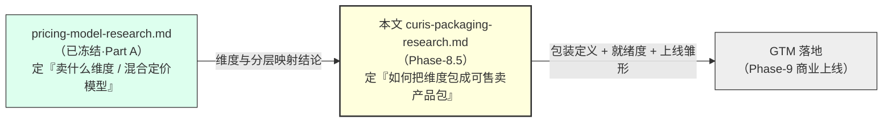
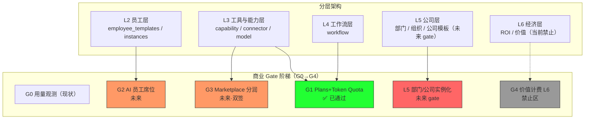
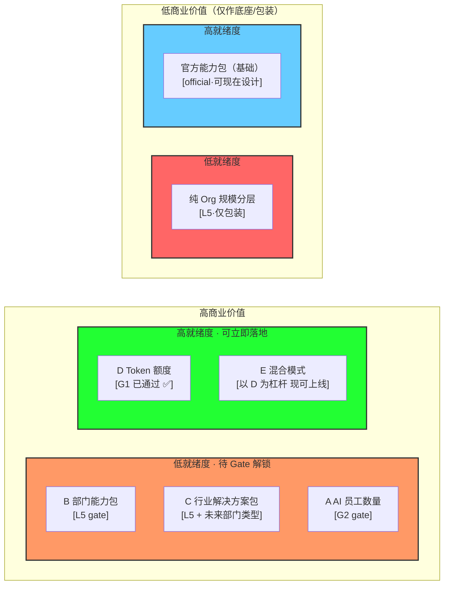
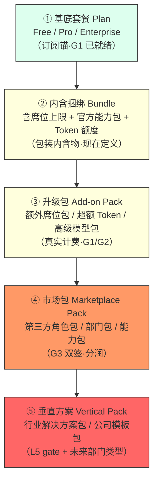
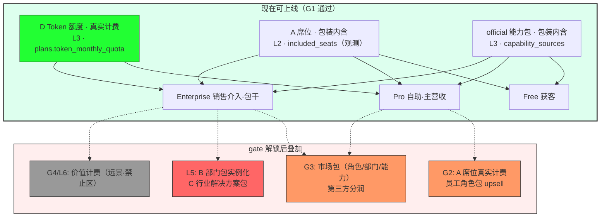
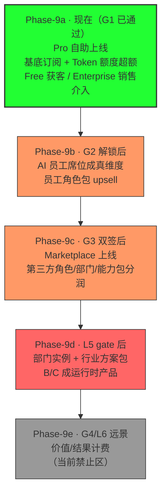

# Curis 商业产品包装研究（Phase-8.5 Commercial Readiness）

> **研究阶段**：Phase-8.5 Commercial Readiness —— 在 Phase-7.5/7.6 已冻结的 Hybrid 商业模式之上，进一步回答「Curis 应该**怎么把东西包成可售卖的产品包**（packaging / GTM）」。
> **协作团队**：`software-phase85-commercial-readiness`（主理人 / 产品经理许清楚 / 架构师高见远）。
> **文档性质**：**纯研究** —— 不写代码、不实现支付、不改动 Admin 治理、不实现 L5/L6 经济层。
> **与既有文档的边界**：`docs/research/domain/pricing-model-research.md`（Part A）已论证「卖什么维度 / 混合定价模型」；本文**不重复**其已论述内容，仅在其结论之上扩展「包装层级 / 捆绑策略 / 升级钩子 / 定价心理在包装上的应用 / 五个包装方向的商业逻辑与就绪度」。技术计费机制见 `usage-billing-research.md`、`phase8-billing-mvp-design.md`。
> **关键前置**（必须已读对齐）：`docs/contracts/pricing-contract.md`、`docs/contracts/admin-capability-package-contract.md`、`docs/contracts/employee-seat-contract.md`、`docs/decisions/commercial-roadmap.md`、`docs/research/domain/employee-template-research.md`、`docs/research/domain/department-template-research.md`、`docs/research/domain/capability-marketplace-research.md`。

---

## 0. 文档总览

**核心结论（一句话）**：Curis 应采用 **Hybrid 包装策略（方向 E）**——以 **Token 额度（方向 D）为当下唯一的真实收入杠杆**、以 **AI 员工席位（方向 A）与官方能力包为包装内含物**、以 **AI 部门能力包（方向 B）与行业解决方案包（方向 C）为 gate 解锁后的高价值升级层**；Free/Pro/Enterprise 三档现在就能以「Pro 自助 + Enterprise 销售介入」上线，部门包与行业包待 L5 gate、市场包待 G3、价值计费待 G4（L6 禁止区）。

**本文在「定价→包装」链条中的位置**

---

## 1. 研究背景与前置对齐

### 1.1 已冻结的商业模式（引用 `pricing-contract.md` / `commercial-roadmap.md`）

Phase-7.6 冻结的第一商业模型为 **Hybrid**，含五大构成：

1. **Tiered Subscription**（分层订阅基底）
2. **Token / Model Usage**（模型额度用量）
3. **Capability Packages**（能力包）
4. **AI Employee Seats**（AI 员工席位）
5. **Future Value-Based Pricing**（未来价值计费，远景）

本文在此冻结结论上工作，**不重新讨论是否 Hybrid**，只讨论「把这五类构成如何打包成客户一眼能懂、愿意买的产品包」。

### 1.2 既有定价研究结论（引用 `pricing-model-research.md`，仅摘要点，不展开）

| 来源章节 | 已被论证的结论（本文直接引用，不再重复论证） |
| --- | --- |
| A.4.1 维度×分层映射 | Token 🟢 高就绪、Capability 🟡 中、Seat 🔴 低、Org 🔴 低、Value ⛔ 禁止 |
| A.5.1 五维度点评 | 强烈推荐 Token 作第一浮动标的；推荐 Seat（Phase-4 后主推）、Capability（差异化内容）；Org 作包装维度、Value 仅作 L6 愿景 |
| A.6 套餐示例 | Free/Pro/Enterprise 三段式，含席位/能力/token/用量超额字段 |
| A.7 定价心理 | 锚定 Pro、低门槛获客、可测性优先、扩展钩子 |
| A.8 分阶段路线 | G1→Phase-4→G3→L5/L6 逐层解锁，套餐自然「加维度」 |

> **本文增量**：上述结论回答了「维度与权重」；本文回答「**同一维度如何在产品包里呈现、如何捆绑、如何制造升级、竞品怎么包、现在能卖哪一档**」。

### 1.3 当前状态（Phase-8 Billing MVP）

| 项 | 状态 |
| --- | --- |
| **G1（Plans + Model Quota Billing）** | ✅ **已通过**，进入 Phase-8 开发 |
| Plan / Quota / Usage / Billing Event | ✅ **已实现**（Plan/Quota/Usage 面板 + Billing Event 聚合） |
| 三档默认 Plan 已 seed | ✅ free / pro / enterprise（`plan_code` 1:1 对齐 `plan_tier`） |
| payment / 自动扣款 / invoice | ❌ 未实现（硬禁止） |
| Marketplace 治理 / 分润 | ❌ 未实现（G3 禁止区） |
| 价值 / ROI 计费 | ❌ 禁止（L6 禁止区，`billing_event` 不引用 `value_event`） |
| AI 员工实例（employee_instances）权威计量 | ⚠️ Admin 可**只读观测** seat 计数，但实例创建/激活仍受 ADR-0017 锁定，未成为真实计费维度 |

**Phase-8 三档 seed 快照（来自 `phase8-billing-mvp-design.md` §3.3）**

| plan_code | seat_limit | token_monthly_limit | capability_sources | workflow_monthly_limit | overage 单价（token/席/workflow） | billing_interval |
| --- | --- | --- | --- | --- | --- | --- |
| free | 3 | 1,000,000 | official | 0 | 全 0（达额阻断） | monthly |
| pro | 15 | 50,000,000 | official + tenant_private | 50,000 | $0.002/1k · $9/席 · $0.01/次 | monthly |
| enterprise | 0（不限） | 0（不限） | official + tenant_private + **marketplace(占位)** | 0（不限） | 全 0（包干） | annual |

> 关键洞察：**三档的「包装骨架」Phase-8 已落好**（席位上限、token 额度、能力源白名单、超额单价均已在 `plans.quota_rules_json` 中）。但「真实能收到钱」的只有 **Token 额度超额用量**（数据已有 + G1 通过）；**Seat 与 Capability 目前是「包进去但不单独计费」的包装内容**，须 gate 解锁后才成为独立计费维度。

### 1.4 分层架构与 Gate 阶梯（本文统一口径）

Curis 分层架构（L2–L6）与商业 Gate 阶梯（G0–G4）的对应关系，作为全文分析坐标：

> **本文 Gate 口径说明**：`pricing-model-research.md` 曾把「G1」泛指经济/ROI 禁止区；本文统一采用 `commercial-roadmap.md` 的 **G0–G4 阶梯**（G1=Plan+Token 计费，已通过），并把「部门/公司实例化」单独标注为 **L5 gate**，与 L6 价值禁止区区分，避免歧义。

---

## 2. 五个候选包装方向分析

每个方向按五要素展开：**商业逻辑 / 架构映射（L2–L6）/ 当前可实现度 vs Gate / 竞争差异化 / 风险与陷阱**。

### 2.1 A. AI 员工数量（按席位卖 AI 员工）

- **商业逻辑**：把 Curis 的「AI 公司」叙事落到最小单元——客户买的不是软件 license，而是「N 个数字员工（角色）」。契合创业者「招一支 AI 团队」的心智，且席位天然可数、可预测、易沟通。
- **架构映射**：落在 **L2 员工层**。`employee_templates`（角色定义，Phase-4 S1 已预置 6 个 official：tech_lead/PM/architect/FE/BE/QA）→ `employee_instances`（实例，ADR-0017 仍锁定）→ 计费侧 `plans.included_seats` + `quotas.quota_type='employee_seat'`（`current_usage` 来自 `employee_instances(enabled=1)` 计数）。
- **当前可实现度 vs Gate**：
  - 🟡 **包装骨架已就位**：Phase-8 seed 已含 `seat_limit`（free 3 / pro 15 / enterprise 不限），Admin 可**观测** seat 计数。
  - 🔴 **不能真实售卖**：① `employee_instances` 创建/激活仍受 ADR-0017 锁定（Phase-4 C1 仅解禁 Template 定义，未解禁 Instance）；② `employee-seat-contract.md` 明确「Phase-7.7 不强制 seat 限制、不 seat 计费」；③ 真实 seat 计费属 **G2 gate**（商业路线图 G2）。
  - **判定**：现在能「把席位写进套餐描述」，但**不能**作为独立计费维度收费。须 G2 解锁。
- **竞争差异化**：Devin 把 AI 席定义为「$40/全职 AI 席」并作为核心卖点；Curis 差异在于**角色化**（PM/TechLead/Architect/FE/BE/QA 一整套研发编制），而非单一 coding agent。叙事更完整。
- **风险与陷阱**：① **纯 per-seat 在 AI 场景失效**（`pricing-model-research.md` A.3.5 已论证：AI 会「吃掉」人类席位，按人头收费自相矛盾）；② 客户在价值未验证前**抗拒为 AI 员工付费**（`value-measurement-research.md` 指出 seat value alone 弱）；③ 若把 seat 当普通 SaaS 人类席位卖，会与「AI 替代人力」的定位冲突。

### 2.2 B. AI 部门能力包（按「部门级能力组合」打包卖）

- **商业逻辑**：不卖零散工具，而卖「一个能运转的部门」——如「销售部 AI 能力包」= 部门模板 + 预置员工角色组合 + 绑定能力 + SOP。客户买的是**职能（function）**，而非零件，感知价值显著高于单能力。
- **架构映射**：落在 **L5 公司层（部门）** 组合 **L2（员工）+ L3（能力）**。即 `department_templates`（Phase-3.5 已落地，含 1 个 official「通用研发部」）+ 其 `default_employee_templates_json` + `capability_packs`。对应 `capability-marketplace-research.md` 的 **Department Pack**。
- **当前可实现度 vs Gate**：
  - 🟡 **内容包可定义**：official 部门模板已存在，可立即作为「catalog 内容包 / 包装描述」出现在 Enterprise 档（如「含通用研发部能力包」）。
  - 🔴 **不能作为运行时产品售卖**：部门**实例**（`departments`）受 governance gate（L5）控制，Workspace 侧尚未解锁实例化；客户买了「包」却不能在自己的 AI 公司里真正拉起一个部门。
  - **判定**：现在可作 **Enterprise 的包装描述 / 内容捆绑**；作为**可实例化的部门产品**须待 **L5 gate**。
- **竞争差异化**：主流 AI Agent 平台（Dify/Coze/AutoGPT）卖的是「单个 agent / 工作流」；Curis 卖「整个部门」是稀缺定位，强契合「AI 公司系统」母题。
- **风险与陷阱**：① 若部门实例未解锁就对外承诺「买部门包即建部门」，会**过度承诺**；② 部门包治理复杂度高于单能力包（引用完整性、版本联动，`capability-marketplace-research.md` §8）；③ 当前仅有 1 个 official 部门模板，SKU 太薄，不足以支撑「部门包」作为独立产品线。

### 2.3 C. 行业解决方案包（按行业垂直打包卖）

- **商业逻辑**：卖「某行业的完整 AI 公司」——如「电商 AI 公司包」「律所 AI 公司包」= 公司模板 + 多个部门包 + 角色包 + 行业能力/连接器 + 行业 SOP。这是**金字塔顶端包装**，卖的是领域专业能力与 outcomes，单位 ARPU 最高。
- **架构映射**：落在 **L5 公司层（company_template，未来）** 跨 **L4（workflow）+ L5（departments）+ L2/L3**。即 `capability-marketplace-research.md` 的 **Company Pack / Industry Pack**。
- **当前可实现度 vs Gate**：
  - ⛔ **仅概念设计**：① Curis **尚无 `company_template`**（部门模板研究 Q4 标注 Phase-5+）；② 行业部门（content_ops / ecommerce / investment_research / bi_data）均为 **Phase-5+ 预留**，未实现；③ 行业所需连接器（电商/律所系统）Curis 当前能力目录尚未覆盖。
  - **判定**：当前**零数据、零模板、零能力**，只能设计框架与命名规范；作为产品须待 **L5 gate + 未来部门类型扩展**。
- **竞争差异化**：垂直 AI 公司包是强差异化（对标行业 SaaS + 垂类 Agent），但需深领域积累。
- **风险与陷阱**：① **过早垂直化会分散精力**，每个行业都要领域深度与连接器，TAM 反而变窄；② 行业包依赖 L5（公司/部门实例化）+ 未来部门类型 + 行业连接器，**gate 依赖最深、最远**；③ 若行业能力与官方能力目录差距大，会变成「为包装而包装」的空壳。

### 2.4 D. Token 额度（按用量卖模型额度）

- **商业逻辑**：卖「模型算力预算」——含 X token/月 + 超额按量计费。最低摩擦、最易计量、客户最易理解的标的，是 AI 产品的「水电费」。
- **架构映射**：落在 **L3 上游（模型网关用量）**。`usage_event.total_tokens` / `estimated_cost` → `plans.token_monthly_quota` → `quotas.quota_type='token'`（`current_usage` 读时聚合）→ `billing_events` 超额 token 行。
- **当前可实现度 vs Gate**：
  - 🟢 **唯一「现在就能真卖」的浮动标的**：① 数据已有（`usage_event` 全程记录 tokens/cost）；② **G1 已通过**，Phase-8 已落地 token quota + overage 计算（`billing_events` 可 `calculate` 出 token 超额金额，非权威估算但机制就绪）；③ Free/Pro/Enterprise 的 token 额度与超额单价已 seed。
  - **判定**：现在即可作为**真实收入杠杆**上线（Pro 自助超额计费）。
- **竞争差异化**：与所有人一样卖 token/credit（OpenAI、Devin、Dify 皆然）——**是商品化标品，不具差异化**，但它是稳健的底座。
- **风险与陷阱**：① **商品化 → 价格透明 → 易陷入底价竞争**；② 纯 token 卖法引发「用得越多越贵」的预算焦虑，须配基底费 + 封顶（`pricing-model-research.md` A.3.4）；③ 单独卖 token **无法体现 Curis 的「AI 公司」差异化**，只能当底层管道。

### 2.5 E. 混合模式（上述组合）

- **商业逻辑**：把 A/B/C/D 按分层订阅基底组合——基底费（可预测）+ Token 额度（主浮动）+ 能力包（差异化内容）+ AI 员工席位（特色维度）+（未来）部门包/行业包/价值计费。客户按档位获得「一整套 AI 公司能力」。
- **架构映射**：横跨 **L2–L6**，由 `plans` 实体统一承载（`included_seats` + `capability_sources_json` + `token_monthly_quota` + 未来 `department_pack_refs` / `industry_pack_refs` / value 行）。
- **当前可实现度 vs Gate**：
  - 🟢 **现在就能以「D 驱动 + A/B 作包装」上线**：基底订阅 + Token 额度超额（真实收入）+ 含席位/官方能力（包装内含）的 Hybrid 包，Phase-8 骨架已支持。
  - 后续随 gate 解锁逐层「加维度」：G2 加 seat 计费、G3 加市场包、L5 加部门/行业包、G4 加价值计费。
- **竞争差异化**：市场已收敛到 Hybrid（Devin/Intercom 均为混合标杆，`pricing-model-research.md` A.2.5）；Curis 的差异化不在「是否混合」，而在**混合里装的是「AI 员工 + 部门 + 行业」的层级化公司叙事**，而非单点工具。
- **风险与陷阱**：① 混合模型若维度过多会让客户**决策疲劳**（须靠清晰的三档收敛）；② 现在若把 seat/部门/行业也标成「已计费」，会**越 G2/L5 红线**——必须明确「现在仅 token 真实计费，其余为包装内含」。

---

## 3. 五方向对比与就绪度判定

### 3.1 对比矩阵

| 方向 | 一句话包装 | 架构落点 | 现在真实可售？ | 真实计费前置 Gate | 商业价值 | 差异化强度 |
| --- | --- | --- | --- | --- | --- | --- |
| **A. AI 员工数量** | 「N 个 AI 员工席位」 | L2 | ❌ 包装可，计费不可 | G2 | 高 | 强（角色化） |
| **B. AI 部门能力包** | 「一个能运转的部门」 | L5(部门)+L2+L3 | ⚠️ 描述可，实例化不可 | L5 gate | 高 | 强（稀缺） |
| **C. 行业解决方案包** | 「某行业的完整 AI 公司」 | L5(公司)+全层 | ❌ 仅概念 | L5 + 未来部门类型 | 极高 | 极强（但最远） |
| **D. Token 额度** | 「模型算力预算」 | L3 上游 | ✅ **可** | G1（已通过） | 中（商品化） | 弱（标品） |
| **E. 混合模式** | 「分层 AI 公司订阅」 | L2–L6 | ✅ **现在以 D 为杠杆可上线** | G1 现 / 其余随 gate | 高 | 强（层级化公司叙事） |

### 3.2 商业价值 × 实施就绪度（Mermaid flowchart，替代象限图）

> 按 `pricing-model-research.md` A.4.2 的坐标风格，用 flowchart 四宫格呈现（避免 quadrantChart 中文轴渲染失败）。

**读图结论**：
- 唯一「高价值且现在可落地」的是 **D（Token 额度，G1 通过）**，它是 Phase-9 上线的**第一把刀**。
- **E（混合）** 与 D 同处「可立即落地」区——因为 E 可以「以 D 为真实杠杆、A/B 作包装」先上线，无需等所有 gate。
- A/B/C 都在「高价值·待 Gate」区，是**清晰的升级路线图**，不是现在的收入来源。

### 3.3 五个方向各自就绪度判定（一句话）

- **A. AI 员工数量**：🔴 包装骨架已就绪（Phase-8 seed 含 seat_limit），但真实席位计费须待 **G2**，现在仅能作为套餐内含展示。
- **B. AI 部门能力包**：🟡 官方部门模板已存在可作 **Enterprise 包装描述**，但部门实例化为运行时产品须待 **L5 gate**，现在不可作为独立售卖 SKU。
- **C. 行业解决方案包**：⛔ 当前零模板零能力，**仅概念设计**，须待 **L5 gate + 未来行业部门类型**，最远。
- **D. Token 额度**：🟢 **现在即可真卖**（数据已有 + G1 通过 + Phase-8 超额机制就绪），是唯一当下真实收入杠杆。
- **E. 混合模式**：🟢 **推荐**。现在以 D 为真实杠杆、A/B 为包装内含、C 留作愿景即可上线；其余维度随 G2/G3/L5/G4 逐层叠加。

---

## 4. 包装策略深化（packaging 视角，补充定价研究）

本节在 `pricing-model-research.md` 的「维度与定价」之上，补充**产品包如何组织与呈现**的 GTM 视角。

### 4.1 包装层级模型（Packaging Hierarchy）

Curis 的产品包应按「从底到顶」五层组织，越往上 ARPU 越高、gate 依赖越深：

### 4.2 捆绑策略（Bundling）

| 层 | 捆什么 | 目的 | 现在能否捆 |
| --- | --- | --- | --- |
| Free | 1–3 席 + official 基础能力 + 低额 Token + 基础用量看板 | 低门槛获客、教育市场 | ✅ 现在 |
| Pro | 最多 15 席 + official+tenant_private 能力 + 50M Token + workflow + 用量看板 | 主营收锚、让客户「拥有团队」 | ✅ 现在（Token 真实计费） |
| Enterprise | 不限席 + 全能力源（含 marketplace 占位）+ 不限 Token + SSO/集中管控/优先支持 | 大客户包干、销售介入 | ✅ 现在（包干描述） |
| Add-on | 额外席位包 / 超额 Token 包 / 高级模型包 | 自然 upsell | 🟡 Token 现在；席位待 G2 |
| Marketplace | 第三方角色/部门/能力包 | 平台网络效应 | ❌ 待 G3 |
| Vertical | 行业公司包 | 顶端 ARPU | ❌ 待 L5 |

### 4.3 升级钩子设计（Upgrade Hooks）

| 从 → 到 | 触发升级的钩子 | 钩子现在是否可触发 |
| --- | --- | --- |
| Free → Pro | Token 额度耗尽、需要 tenant_private 私有能力、需要 workflow SOP、需要用量看板 | ✅ Token 耗尽可真实触发（G1） |
| Pro → Enterprise | 席位上限（15）触顶、需要 SSO/集中管控、组织扩张、需 marketplace 能力 | ⚠️ 席位触顶为观测值，真实阻断待 G2；其余描述可引导 |
| Pro → Add-on | 超额 Token 自动转 usage-based；额外席位包 | ✅ Token 超额真实；席位包待 G2 |
| Enterprise → Vertical | 需要行业化部门/公司模板 | ❌ 待 L5 |
| 任意 → Marketplace | 需要第三方专属角色/部门包 | ❌ 待 G3 |

### 4.4 定价心理在包装上的应用

| 心理机制 | 在 Curis 包装上的落地 | 引用/扩展 |
| --- | --- | --- |
| **锚定（Anchoring）** | Pro 设为「主力锚」（参考 Devin $20 / Notion $10 区间，定价待商业决策）；Free 显便宜、Enterprise 显「无上限」 | 扩展 `pricing-model-research.md` A.7.1 |
| **Good-Better-Best** | 三档严格收敛为「够用 / 主流 / 无限」，降低决策成本 | 沿用 A.3.2 |
| **捆绑价值感知** | 把「席位 + 能力 + Token」捆成一「AI 团队」而非拆项计价，提升感知价值、弱化 Token 商品化焦虑 | **本文新增**（packaging 视角） |
| **诱饵（Decoy）** | Enterprise 的「不限」作为诱饵，拉升 Pro 转化意愿 | **本文新增** |
| **可测性优先** | 每档显式标注「含 X Token / Y 员工 / Z 能力」，对抗纯 usage 的预算焦虑 | 沿用 A.7.1 |
| **免费即价值验证** | Free 让客户真实跑通一个 AI 员工，降低首次决策成本，为 Pro 转化蓄水池 | 沿用 A.7.2 |

---

## 5. 推荐包装策略与 Free/Pro/Enterprise 落地

### 5.1 推荐结论（明确）

> **推荐：采用方向 E（Hybrid 包装），并以「D 为真实收入杠杆、A/B 为包装内含、C 为 gate 解锁后的高价值升级层」组织产品。**
> 即——**现在上线「基底订阅 + Token 额度超额」的 Hybrid 包（Pro 自助、Enterprise 销售介入）；AI 员工席位与官方能力包作为各档「内含物」先行包装，待 G2 成为独立计费维度；AI 部门能力包作为 Enterprise 包装描述，待 L5 实例化为产品；行业解决方案包作为 L5 后的顶端垂直方案；价值计费作为 G4/L6 远景。**

### 5.2 Free / Pro / Enterprise 包装定义（现在能卖 vs gate 解锁后才能卖）

| 维度 | **Free**（获客） | **Pro**（主营收·自助） | **Enterprise**（大客户·销售介入） |
| --- | --- | --- | --- |
| **基底订阅** | $0 | 月费锚（定价待定，参考 $20–49） | 年付议价（包干） |
| **AI 员工席位（A）** | 1–3 席（**包装展示**） | 最多 15 席（**包装展示**） | 不限（**包装展示**） |
| **能力包（official/tenant_private）** | official 基础包 | official + tenant_private | 全源（含 marketplace 占位） |
| **Token 额度（D）** | 1M/月，**达额阻断** | 50M/月，**超额按量真实计费** ✅ | 不限/协商，**包干** |
| **工作流 SOP** | — | ✅ 含 | ✅ 含 |
| **用量看板** | — | ✅ | ✅ + 集中管控 |
| **治理/安全** | — | 基础 | SSO / 专属部署 / 优先支持 |
| **现在真实收入杠杆** | 无（获客） | **Token 超额用量** ✅ | 包干年费（Token 不计费） |
| ── gate 解锁后追加 ── | ── | ── | ── |
| **G2 后：席位计费** | 席超限阻断 | **额外席位包真实计费** | 不限（仍包干） |
| **G3 后：市场包** | — | 可订阅第三方角色/能力包 | 含 marketplace 部门包 |
| **L5 后：部门/行业包** | — | 可加购部门能力包 | **可实例化行业解决方案包** |
| **G4/L6 后：价值计费** | — | 可选 ROI 报表 | 可选价值/结果分成（远景） |

> **边界铁律**：上表中凡是标注「包装展示 / 描述」的维度，**现在不计费**——Phase-8 仅做观测与配置，不触发 seat/部门/行业的真实扣费，严守 G2/L5/G4 红线。

### 5.3 包装 → 架构 → Gate 映射（Mermaid flowchart）

---

## 6. 竞争差异化总览（包装维度 vs 竞品）

| 对比对象 | 它的包装方式 | Curis 包装差异化 |
| --- | --- | --- |
| **Devin（Cognition）** | 订阅 + 配额 + **按 AI 席（$40/全职席）** + 超额 token | Curis 不限于 coding，卖**角色化 AI 团队**（PM/TechLead/...），且现在以 Token 为真实杠杆而非强押席位 |
| **Intercom Fin** | 人类席 + **结果计费 $0.99/解决** | Curis 跨职能（不只客服），结果计费留作 G4/L6 远景，不现在押注 |
| **Salesforce Agentforce** | 按对话 $2 + AI Credits | Curis 多租户开箱即用，**无重平台绑定**，包装是「AI 公司」而非「平台上的 bot」 |
| **Dify / Coze** | 按调用/席位/资源包，单点工具/agent | Curis 包装上升一级：**部门包 / 行业包**，卖「公司」而非「agent」 |
| **Langbase / Wordware** | 纯用量（token/API） | Curis 用 Hybrid，给非技术买家**预算可测性** + 公司叙事 |
| **行业 SaaS（如电商/律所）** | 按席位/模块年费 | Curis 行业包（C）未来以「AI 公司」形态切入，而非传统模块收费 |

**一句话定位（包装版）**：*「Curis 把 AI 员工、能力包和模型额度打包成可随组织成长的 AI 公司订阅——现在以 Token 用量为真实计费杠杆，未来随 gate 解锁叠加席位、部门与行业方案。」*

---

## 7. Phase-9 商业上线建议雏形

> 以下为 **Phase-9 商业上线建议雏形**（非实施计划），与 `commercial-roadmap.md` 的 G0–G4 对齐。

### 7.1 分阶段上线路线（Mermaid flowchart）

### 7.2 各阶段 GTM 动作建议

| 阶段 | 上线包装 | GTM 动作 | 关键前置 |
| --- | --- | --- | --- |
| **Phase-9a（现在）** | Free + Pro（自助）+ Enterprise（销售） | 以「Token 额度 + 内含 AI 团队」为主卖点；Pro 自助注册+信用卡（payment 须 G1 后独立实现）；Enterprise 走销售漏斗 | G1 通过、Phase-8 计费机制、payment/invoice 实现（独立 gate 子项） |
| **Phase-9b（G2）** | + 员工角色包 | 推出「加购 AI 员工席位」upsell，强化 AI 公司叙事 | G2 解锁、employee_instances 权威计量 |
| **Phase-9c（G3）** | + Marketplace 包 | 开放第三方角色/部门/能力包上架与分润，建平台网络效应 | G3 双签、marketplace 审核队列与订阅机制 |
| **Phase-9d（L5）** | + 部门包 / 行业包 | Enterprise 客户可实例化部门、采购行业解决方案包，冲顶端 ARPU | L5 gate、departments 实例化、行业部门类型 |
| **Phase-9e（G4/L6）** | + 价值计费 | 可选 ROI/结果分成（须用户确认价值，AI 不自 declared 发票价值） | G4 解锁、Value Event 体系 |

---

## 8. 风险与禁忌总览

| 方向 | 主要风险 | 对应禁忌 / 边界 |
| --- | --- | --- |
| A 席位 | 纯 per-seat 在 AI 场景失效；客户抗拒为未验证价值的 AI 员工付费 | G2 前**不**对 seat 计费；ADR-0017 实例锁定不破 |
| B 部门包 | 过度承诺「买包即建部门」；SKU 过薄（仅 1 official 模板） | L5 前部门包仅作**描述/内容捆绑**，不实例化为产品 |
| C 行业包 | 过早垂直化分散精力；依赖最深 gate；能力缺口 | 当前**仅概念设计**，不对外承诺；待 L5 + 未来部门类型 |
| D Token | 商品化底价竞争；预算焦虑 | 须配基底费 + 封顶；不单独卖 token，须嵌 Hybrid |
| E 混合 | 维度过多决策疲劳；误把包装标成已计费 | 三档严格收敛；明确「现在仅 Token 真实计费」 |
| 全局 | 越 G1/L5/L6 红线 | 不实现 payment/invoice/自动扣款/marketplace/ROI 收费（见 `phase8-billing-mvp-design.md` §11 六项禁止） |

---

## 9. 结论与建议

### 9.1 明确推荐

1. **包装策略**：采用 **Hybrid 包装（方向 E）**，组织原则为「**D（Token）为现在真实收入杠杆 + A（席位）/B（官方能力）为包装内含 + C（行业包）为 gate 解锁后的高价值升级层**」。
2. **现在就能卖的包装**：Free（获客）/ Pro（自助·Token 超额真实计费）/ Enterprise（销售介入·包干年费）。三档骨架 Phase-8 已 seed 就绪。
3. **现在不能卖、须 gate 解锁的包装**：AI 员工席位真实计费（G2）、第三方市场包（G3）、部门/行业实例化方案包（L5）、价值计费（G4/L6 禁止区）。
4. **差异化根因**：竞品大多卖「agent / 工具 / 单点」，Curis 卖「**层级化的 AI 公司**」——从席位（L2）到部门（L5）到行业（L5+），包装随架构升维，这是 Hybrid 里别人装不进的内容。

### 9.2 Phase-9 商业上线建议雏形

- **先上线 Pro 自助**：以 Token 额度为主收费杠杆，Free 获客、Enterprise 走销售介入（建议雏形）。
- **行业包待 L5 gate**：不提前承诺，先以官方研发部能力包作 Enterprise 包装描述，待 L5 实例化为真产品。
- **市场包待 G3 双签**：第三方角色/部门/能力包作为平台网络效应层，晚于席位计费。
- **价值计费作远景**：严守 L6 禁止区，仅作 ROI 报表叙事，不自动计费。

### 9.3 五个方向就绪度一句话总结

- **A. AI 员工数量**：🔴 包装骨架就绪、真实计费待 G2，现在仅作套餐内含展示。
- **B. AI 部门能力包**：🟡 官方模板可作 Enterprise 包装描述，实例化为产品待 L5 gate。
- **C. 行业解决方案包**：⛔ 仅概念设计，零模板零能力，待 L5 + 未来部门类型，最远。
- **D. Token 额度**：🟢 现在即可真卖（数据已有 + G1 通过 + Phase-8 超额机制），唯一当下真实收入杠杆。
- **E. 混合模式**：🟢 推荐，现在以 D 为杠杆、A/B 为包装、C 留愿景即可上线，随 gate 逐层叠加。

### 9.4 开放问题（待商业决策）

1. **Pro 具体锚定价**：本文以 `$XX` 占位，须商业决策（参考 Devin $20 / Notion $10 区间）。
2. **payment/invoice 实现归属**：Phase-8 明确不实现，Phase-9 须作为独立 gate 子项落地，否则 Pro 自助无法收款。
3. **行业优先级**：若未来要做 C，应先选哪个行业（电商/内容/投资研究/BI）作首个垂直包？
4. **席位「包装展示」口径**：Free/Pro 的 seat_limit 现在仅观测，对外文案如何避免暗示「已计费」？

---

*—— 本文为 Phase-8.5 Commercial Readiness 纯研究产出（产品经理许清楚），引用并扩展 `docs/research/domain/pricing-model-research.md`，不写代码、不实现支付/发票/Marketplace/ROI、不改动 Admin 治理与 Workspace 执行链。技术计费机制详见 `usage-billing-research.md` 与 `phase8-billing-mvp-design.md`。*
