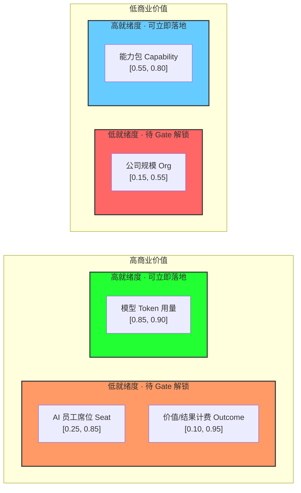
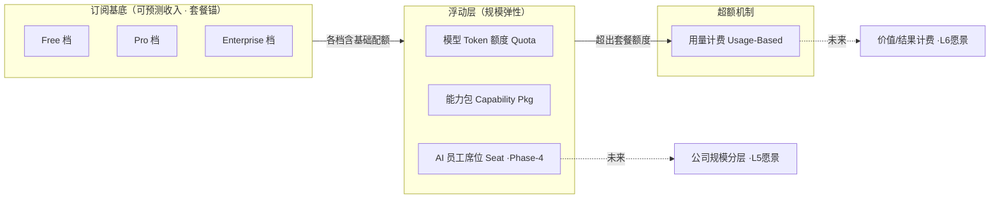
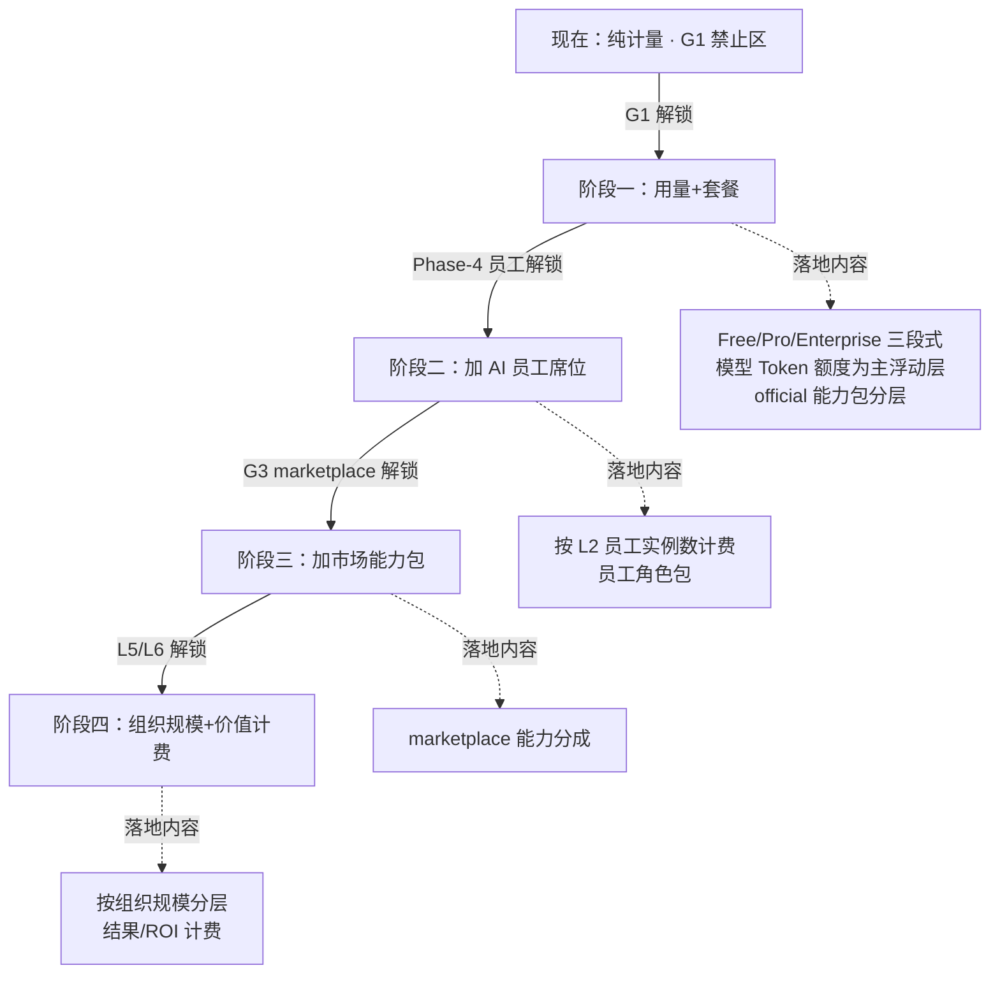
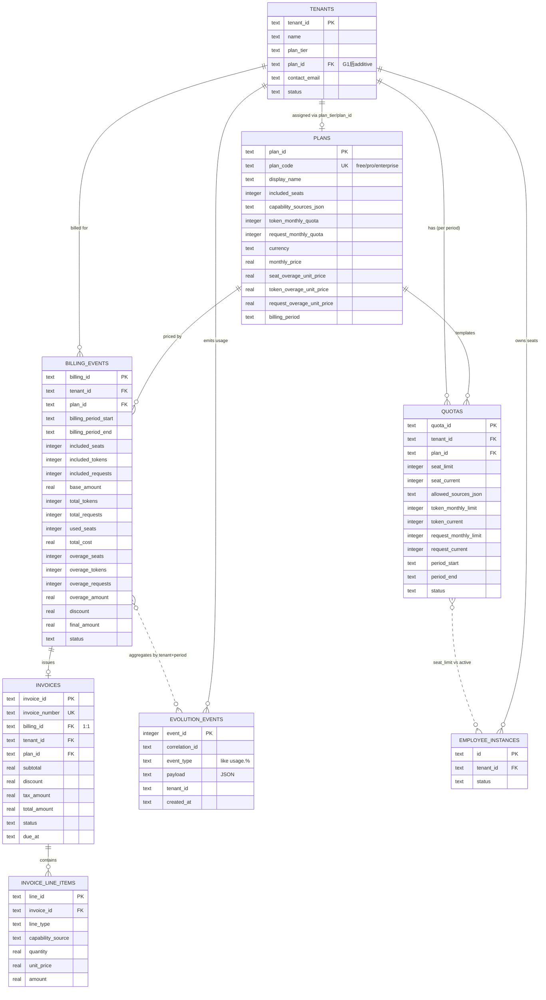
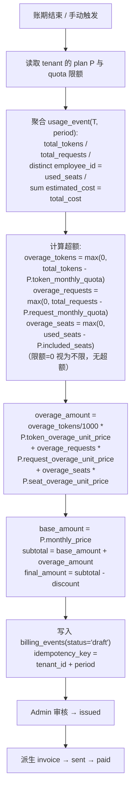

# Curis 商业化定价模型研究（Phase-7.5 Commercial Validation）

> **研究阶段**：Phase-7.5 Commercial Validation —— 评估 Curis 商业化模型（卖什么、怎么定价、Billing MVP 需要什么数据构造）。
> **协作团队**：`software-phase75-pricing-research`（主理人齐活林 / 产品经理许清楚 / 架构师高见远）。
> **文档性质**：**纯研究** —— 不写代码、不开发支付系统、不修改 Admin 治理、不实现 L5/L6 经济层。
> **边界铁律**：所有计费构造属 G1 禁止区（L6），须总控决策席 gate 解锁后方可实施；当前仅做计量与策略设计。
> **相关文档**：`docs/research/domain/usage-billing-research.md`（技术计费机制，本文不重复，仅引用）。
> **作者分工**：Part A 产品经理许清楚（商业/市场/竞品策略）；Part B 架构师高见远（Billing MVP 数据模型蓝图）；Part C 主理人齐活林（综合结论与桥接）。

---

## 0. 文档总览（主理人汇编）

**核心结论（一句话）**：Curis 应卖「**AI 公司订阅**」——以**分层订阅基底**为锚，以**模型 Token 用量**为主浮动标的，以**能力包**为差异化内容，以**AI 员工席位**为 Phase-4 后的特色维度；公司规模作包装、价值计费作 L6 愿景。Billing MVP 通过 `plan`（套餐目录实体）/`quota`（运行时配额）/`billing_event`（账期聚合）/`invoice`（应付单据）四个构造支撑该混合模型。

**定价维度 → plan 字段桥接表（主理人综合）**

| 推荐售卖维度 | 映射到 Curis 层 | 在 `plan` 中的落点（B 部分设计） | 前置 Gate |
| --- | --- | --- | --- |
| 分层订阅基底（Free/Pro/Enterprise） | L6（套餐锚） | `plans.plan_code` / `monthly_price` / `display_name` | G1 |
| 模型 Token 用量（主浮动标的） | 模型网关用量 | `plans.token_monthly_quota` + `token_overage_unit_price` → `quota.token_current` → `billing_event.overage_tokens` | G1（计量现已具备） |
| 能力包（official/私有/市场） | L3 能力层 | `plans.capability_sources_json` | G1 + G3（marketplace） |
| AI 员工席位（数字员工） | L2 员工层 | `plans.included_seats` + `seat_overage_unit_price` → `quota.seat_current` vs `employee_instances` | Phase-4（C1） |
| 公司规模（Org） | L5 公司层 | 仅作 Enterprise 档**包装描述**，不进入实时计费 | L5 gate |
| 价值/结果计费 | L6 经济层 | 仅作愿景（invoice `line_type` 预留扩展位） | L6 gate（当前禁止） |

**文档结构**
- **Part A** — 商业化定价策略（许清楚）：市场/竞品、六大主题、维度映射、套餐示例、分阶段路线。
- **Part B** — Billing MVP 数据模型蓝图（高见远）：`plan`/`quota`/`billing_event`/`invoice` 四个构造的 ER 图、SQL 草图、gate 边界。
- **Part C** — 主理人综合结论与路线：桥接验证、gate 路线图、开放问题、下一步。

---

# Part A：商业化定价策略（产品经理 · 许清楚）

> 聚焦：商业 / 市场 / 竞品策略——卖什么、怎么包装、定价心理、竞争定位。技术计费机制见 `usage-billing-research.md`。

## A.1 研究范围与边界

### A.1.1 本文与《用量计费研究》的边界

| 维度 | 用量计费研究（已有） | 本文（商业化定价） |
| --- | --- | --- |
| 焦点 | 技术机制：UsageEvent / BillingEvent / Quota / Settlement 字段与状态机 | 商业策略：卖什么、套餐包装、定价心理、竞争定位 |
| 核心问题 | 用量如何转为账单（数据层） | 用量/席位/能力如何包装成可售卖产品（价值层） |
| 是否涉及 G1 禁止区 | 明确划界（只做统计，不扣费） | 在 gate 约束下讨论"未来可卖什么"，不主张现在实现 |
| 产出 | 数据模型 + API 建议 | 定价维度映射 + 套餐示例 + 分阶段路线 |

### A.1.2 Curis 当前"已可计量"的能力盘点（来自 usage_event）

`usage_event`（UsageEvent）已记录以下可计费原始信号，是商业化定价的**数据地基**：

| 可计量信号 | usage_event 字段 | 可支撑的定价维度 |
| --- | --- | --- |
| 调用了哪种能力 | `capability_type`（model / tool / connector） | 能力包 / 用量 |
| 能力来自哪里 | `capability_source`（official / tenant_private / marketplace） | 能力包分层（官方 vs 私有 vs 市场） |
| 用了哪个模型 | `model_name` / `model_gateway_id` | 模型额度（token quota） |
| 消耗多少 | `prompt_tokens` / `completion_tokens` / `total_tokens` | 用量计费（usage-based） |
| 预估成本 | `estimated_cost` | 用量计费金额基准 |
| 调用状态 | `status`（success / failure / timeout） | 质量/成功率统计 |
| 归属租户 | `tenant_id` | 多租户隔离计量 |

> **关键结论**：在全部 5 个候选定价维度中，**只有"模型 Token 用量"是当下即可被数据支撑的**；席位、能力包、公司规模、价值计费都依赖尚未成熟或受 gate 限制的层。

### A.1.3 Gate 约束（决定"现在能卖" vs "未来才能卖"）

| Gate / 层 | 约束 | 对定价的影响 |
| --- | --- | --- |
| **G1（经济/ROI 禁止区）** | 当前禁止自动扣费、配额阻断、折扣、ROI | 现在不能真正"收钱"，但可设计并用 usage_event 积累数据 |
| **L2 员工层** | 当前仅有最小协调器；`employee_id` 统计须 Phase-4（C1 解禁） | "AI 员工席位"现在无法计量，Phase-4 后可卖 |
| **L3 能力层** | `capability_source` 已可统计；marketplace 须 **G3 gate** | official / tenant_private 能力包现在可设计；marketplace 分成未来 |
| **L5 公司层** | 未来层，受 gate 控制 | "公司规模/组织架构"套餐维度现在不可计量 |
| **L6 经济层** | 未来层，受 gate 控制，**当前禁止实现** | "价值/ROI 计费"现在禁止，仅作愿景 |
| **Phase-4 员工 gate** | 员工维度统计解锁 | 解锁后 AI 员工席位成为一等定价维度 |

---

## A.2 市场与竞品情报（Mode 2 市场研究）

### A.2.1 研究方法
- **关键词组**：① "AI agent pricing model 2025" ② "Devin Replit Lindy pricing" ③ "AI employee subscription seat usage" ④ "SaaS usage-based vs seat-based hybrid 2025/2026" ⑤ "AI SaaS tier design free pro enterprise"
- **信息源**：Agentman《2025 AI Agent 定价模型指南》、EMA《8 种 AI Agent 定价模型》、NxCode《2026 SaaS 定价策略指南》、Devin 官方定价页、Intercom/Salesforce/Zendesk 公开定价、Flexera 2025 SaaS 消费报告。
- **处理**：去重、交叉验证、提取可比对数字。

### A.2.2 AI Agent 定价模型全景（EMA 8 模型 + Agentman 4 核心）

| # | 模型 | 收费标的 | 典型代表 | 适用条件 |
| --- | --- | --- | --- | --- |
| 1 | **Per-Seat（按席位）** | 人类用户数 | 轻量 copilot | 仅当 Agent 是辅助个人的效率助手 |
| 2 | **Per-Agent / 数字员工** | 每个 AI Agent（角色） | "理赔员/客服 Agent" | 角色稳定、自主运行日常职责 |
| 3 | **Usage-Based（用量）** | token / API 调用 / 步骤 / 文档数 | Langbase、Wordware | 负载波动大、计算密集 |
| 4 | **Per-Action / Workflow（按动作）** | 每完成一个工作流 | 工单解决、KYC | 高容量、结构化流程 |
| 5 | **Per-Output（按产出）** | 每份交付物（报告/摘要） | 内容密集型 | 按成品而非过程计量 |
| 6 | **Outcome-Based（结果）** | 可衡量的业务影响 | Intercom Fin $0.99/解决 | 结果可归因、可建基线 |
| 7 | **Subscription（订阅）** | 固定月/年费换访问 | 起草助手、研究助理 | 用量稳定、辅助型 |
| 8 | **Hybrid（混合）** | 基底费 + 浮动层 | Intercom、Devin、Ema | 企业混合负载，**正成为市场标准** |

> Agentman 补充的 4 核心与之高度重合：Per-Execution（按次任务）、Outcome-Based、Per-Conversation（$2/对话，Salesforce Agentforce）、Usage-Based。

### A.2.3 SaaS 定价趋势（2025–2026）

| 信号 | 数据 / 来源 | 对 Curis 的含义 |
| --- | --- | --- |
| **混合定价成主流** | 85% SaaS 领导者已采用用量或混合；61% 用混合模型（Flexera 2025） | Curis 应默认走混合，而非纯 seat 或纯 usage |
| **纯用量占比有限** | 纯用量 ~21%，平台费含用量 37%，固定费 23%（SBI 2025） | 纯 usage 难预测，需基底费兜底 |
| **Per-Seat 在 AI 场景失效** | "AI 可替代多名用户、客户共享账号、用量差异大却同价"（NxCode） | 不能把 AI 员工当普通 SaaS 席位卖 |
| **结果计费在支持场景起飞** | Intercom Fin AI：$0.99/次解决，ARR 增长 393%、达八位数（NxCode） | 结果计费是高价值方向，但需可归因 |
| **积分制作桥梁** | Figma/HubSpot/Salesforce 在席位计划上叠加 AI 积分 | 可用"模型额度积分"平滑过渡 |

### A.2.4 竞品定价快照

| 竞品 | 核心模型 | 具体价格/结构 | 可借鉴点 |
| --- | --- | --- | --- |
| **Devin（Cognition）** | 订阅基底 + 配额 + 按席 + 超额用量 | Free $0 / Pro $20 / Max $200 / Teams $80+ $40/全职席；超额按 API 价 | **混合标杆**：基底订阅 + 模型配额 + 席位 + 用量四件套 |
| **Intercom Fin** | 席位 + 结果计费 | 人类客服按席 + AI $0.99/次解决 | 结果计费在支持场景的高增长验证 |
| **Salesforce Agentforce** | 按对话 + 积分 | $2/对话；自定义 Agent 用 AI Credits | 预建 Agent 按次、自定义用积分 |
| **Sierra.ai** | 结果计费 | 按业务成果（线索/成交） | 销售场景结果计费 |
| **Langbase / Wordware** | 纯用量 | token / API 调用 | 开发者友好，但复杂度高 |
| **Agentman** | Per-Execution | 每完成 1 个任务固定价（SMB） | 可预测、对小微企业友好 |

### A.2.5 关键市场信号（结论性）
1. **混合定价是收敛方向**——企业既要预算可测（基底），又要规模弹性（浮动）。
2. **纯 Per-Seat 不适合 AI 公司产品**——AI 员工会"吃掉"人类席位，按人头收费自相矛盾。
3. **结果/价值计费是高价值但高门槛方向**——仅当结果可归因（如客服解决量）才成立。
4. **模型 Token 用量是最通用、最易计量的浮动标的**——几乎所有 AI 产品都绕不开。
5. **"数字员工 / 按 Agent"叙事正在成形**——把 AI Agent 当"角色化员工"卖，契合 Curis 的 L2 员工层定位。

---

## A.3 六大定价主题分析

### A.3.1 AI 公司产品定价模式
Curis 定位是 **AI Company System**（多租户 AI 公司系统），最终产品是"公司"，当前 MVP 是 AI Task Executor。因此 Curis 天然适合 **"数字员工/公司"叙事**：卖的是"一支 AI 团队的能力"，而非"一个软件 license"。**推荐母模型**：以"AI 员工 + 能力 + 模型额度"构成的产品包，而非单点工具订阅。

### A.3.2 SaaS 套餐设计
用 Free / Pro / Enterprise 等分层，把复杂定价收敛为少数可比较的档位，降低决策成本。
- **门槛档（Free）**：低门槛获客，限制模型/配额，引导升级。
- **主力档（Pro）**：包含高频所需，价格锚定（Devin $20、Notion $10）。
- **企业档（Enterprise）**：自定义、SSO、专属部署、议价。
- **升级钩子**：超额用量、更多席位、更高级模型、私有能力。

### A.3.3 AI Agent 按什么收费（收费标的）
本质问题：**客户为 Curis 的哪一部分付钱？**
- 为"AI 员工的数量"付钱？（L2）
- 为"能用哪些能力"付钱？（L3）
- 为"模型 Token 额度"付钱？（模型网关用量）
- 为"公司/组织规模"付钱？（L5）
- 为"产生的业务价值"付钱？（L6）

### A.3.4 usage-based pricing（按用量计费）
按可衡量消耗（token、调用、步骤）计费。**优点**：公平、低门槛、与成本挂钩。**缺点**：预算不可测、收入波动、客户为控成本少用而抑制采用。**Curis 适配**：数据已具备（tokens/estimated_cost），是混合模型"浮动层"最佳标的，但**不应单独使用**（需基底费 + 封顶）。

### A.3.5 seat-based pricing（按席位 / AI 员工数）
- **人类席位**：给使用控制台的管理员收费（传统 SaaS seat）。
- **AI 员工席位（数字员工）**：按 L2 的 AI 员工实例数收费——Curis 的特色维度。
**Curis 适配**：高度契合 L2 员工层与"AI 公司"叙事；但当前仅最小协调器，无法计量（须 Phase-4）；纯按席会在 AI 替代人力场景失效——应把"席"定义为"AI 员工角色"，而非人类用户。

### A.3.6 capability-based pricing（按能力计费）
按可使用的"能力包"收费（官方能力包、高级工具包、私有能力、市场能力）。**Curis 适配**：`capability_source` 三态天然支持能力分层；official 能力包可现在设计；marketplace 分成须 G3 gate；可作为套餐的"差异化内容"，与用量/席位组合。

---

## A.4 Curis 应该卖什么：定价维度 × 分层架构映射

### A.4.1 映射总表

| 定价维度 | 映射到 Curis 层 | 依托字段 / 机制 | 前置 Gate | 现在就绪度 |
| --- | --- | --- | --- | --- |
| **模型 Token 用量** | 模型网关用量（L3 上游） | `total_tokens` / `estimated_cost` | G1（仅计量，不扣费） | 🟢 高（数据已有） |
| **能力包（Capability）** | L3 工具层 | `capability_type` / `capability_source` | G1 + G3（marketplace） | 🟡 中（official/私有可设计） |
| **AI 员工席位（Seat）** | L2 员工层 | `employee_id`（Phase-4） | Phase-4（C1） | 🔴 低（尚未计量） |
| **公司规模（Org）** | L5 公司层 | 组织架构 / 部门 | L5 gate | 🔴 低（未来层） |
| **价值/结果计费** | L6 经济层 | ROI / 业务成果 | L6 gate（**当前禁止**） | ⛔ 禁止（仅愿景） |

### A.4.2 商业价值 × 实施就绪度（Mermaid 象限图）



**读图结论**：唯一"高价值且现在可落地"的是**模型 Token 用量**（G1 解锁后第一刀）；能力包居中（official/私有可现在设计，marketplace 待 G3）；AI 员工席位、公司规模、价值计费在"高价值·待 Gate"区。

### A.4.3 推荐混合模型构成（Mermaid 流程图）



---

## A.5 核心问题回答与推荐

> **核心问题**：Curis 应该卖什么？在「AI 员工数量 / 能力包 / 模型额度 / 公司规模 / 使用价值」中如何选择、组合并论证。

### A.5.1 五个维度逐一点评

| 维度 | 是否推荐作为主卖点 | 论证 |
| --- | --- | --- |
| **AI 员工数量（Seat）** | ✅ 推荐（特色，Phase-4 后主推） | 完美契合"AI 公司"叙事与 L2 员工层；当前无法计量，需 Phase-4 解锁后成为一等维度。 |
| **能力包（Capability）** | ✅ 推荐（差异化内容） | `capability_source` 三态天然支持分层；official/私有可现在设计，是套餐间"内容差异"的最佳载体。 |
| **模型额度（Token Quota）** | ✅✅ 强烈推荐（第一浮动标的） | 数据已具备（tokens/estimated_cost）；通用、易计量、与客户成本挂钩；G1 解锁后最稳的收费抓手。 |
| **公司规模（Org）** | ◐ 推荐作"包装维度"而非计量维度 | L5 未来层，现在不可计量；可作为 Enterprise 档"定位描述"，不用于实时计费。 |
| **使用价值（Value）** | ◐ 仅作 L6 愿景 | L6 当前禁止实现；结果计费门槛高（需可归因），留作长期演进方向。 |

### A.5.2 推荐组合（结论）
**推荐：分层订阅基底 + 模型额度（用量）为主浮动层 + 能力包为差异化内容 + AI 员工席位为 Phase-4 后特色维度；公司规模作包装、价值计费作 L6 愿景。即"混合定价（Hybrid）"。**

**理由**：① 市场已验证（85% 用混合，Devin/Intercom 均为混合标杆）；② 数据可行（token 已有）；③ 叙事一致（AI 员工+能力贴合"AI 公司系统"定位）；④ 风险可控（基底保收入可测，超额封顶控风险）；⑤ 演进平滑（随 Phase-4/G3/L5/L6 逐步解锁，套餐自然"加维度"）。

---

## A.6 套餐设计示例（Free / Pro / Enterprise）

> 以下为**商业包装示例**，非技术实现。字段映射说明每个套餐"卖什么"。

### A.6.1 套餐对比矩阵

| 维度 | **Free** | **Pro** | **Enterprise** |
| --- | --- | --- | --- |
| **基底订阅** | $0 | $XX/月（锚定价） | 定制议价 |
| **AI 员工席位（L2）** | 1 个最小协调器 | 最多 N 个员工角色 | 不限 / 按角色议价 |
| **能力包（L3）** | 官方基础包（official） | 官方标准包 + 私有能力(tenant_private) | 全量 + marketplace(G3 后) |
| **模型额度（Token Quota）** | 低额（如 1M tokens/月） | 中额（如 50M tokens/月） | 高额 / 不限（协商） |
| **模型范围** | 限定基础模型 | 含前沿模型（frontier） | 全模型 + 专属网关 |
| **用量超额** | 达额阻断 | 按 usage-based 计费 | 封顶 + 协商价 |
| **公司规模定位（L5 包装）** | 个人/小团队试用 | 成长型团队 | 200+ 员工组织 |
| **治理/安全** | — | 基础用量看板 | SSO / 专属部署 / 集中管控 |
| **价值计费（L6）** | — | — | 未来可选（ROI 分成） |

### A.6.2 各套餐"卖点"文案示例
- **Free**：「免费体验你的第一个 AI 员工 + 官方基础能力 + 每月 1M Token。低风险上手，随时升级。」
- **Pro**：「按需扩展的 AI 团队：N 个员工角色 + 标准能力包 + 50M Token 额度，超额按量计费。成长团队首选。」
- **Enterprise**：「面向规模化组织：不限员工角色、全量能力（含未来市场能力）、高额/不限 Token、SSO 与专属部署。按组织规模与价值定制。」

### A.6.3 升级钩子设计

| 从 → 到 | 触发升级的钩子 |
| --- | --- |
| Free → Pro | Token 额度耗尽、需要前沿模型、需要私有能力 |
| Pro → Enterprise | 员工角色数触顶、需要 SSO/集中管控、组织规模扩大 |
| 任意 → 用量超额 | 超额自动转 usage-based，自然引导扩档 |

---

## A.7 定价心理与竞争定位

### A.7.1 定价心理
- **锚定**：Pro 档设为"主力锚"（参考 Devin $20 / Notion $10 区间），Free 显便宜、Enterprise 显"无上限"。
- **低门槛获客**：Free 档限制模型与额度，但保证"能用"，降低首次决策成本。
- **可测性优先**：每个套餐给出"含 X Token / Y 员工 / Z 能力"，让客户一眼算清预算（对抗纯 usage 的焦虑）。
- **扩展钩子**：超额用量 + 角色/能力增量，制造自然的向上销售路径。

### A.7.2 竞争定位差异

| 对比对象 | Curis 差异化定位 |
| --- | --- |
| **Devin（开发者向）** | 不限于 coding，定位"通用 AI 公司/多租户"，卖"AI 团队"而非"编码 Agent" |
| **Intercom Fin（客服向）** | 跨职能（不只客服），结果计费留作 L6，不以单一解决量计费 |
| **Salesforce Agentforce（平台重）** | 多租户开箱即用，无重平台绑定与隐性 license 成本 |
| **Langbase/Wordware（纯用量）** | 用混合模型，给非技术买家预算可测性 |

**一句话定位**：*「Curis 把 AI 员工、能力包和模型额度打包成可随组织成长的 AI 公司订阅——预算可测，规模弹性。」*

---

## A.8 实施路径（分阶段，对齐 Gate）



| 阶段 | 解锁条件 | 可售卖维度 | 商业动作 |
| --- | --- | --- | --- |
| **阶段一** | G1 解锁（仅计量→可计费） | 模型额度 + official 能力包 + 套餐 | 上线 Free/Pro/Enterprise，用量超额计费 |
| **阶段二** | Phase-4（员工维度） | + AI 员工席位 | 推出"员工角色包"，强化 AI 公司叙事 |
| **阶段三** | G3（marketplace） | + 市场能力包分成 | 能力市场变现，平台网络效应 |
| **阶段四** | L5/L6 解锁 | + 公司规模分层 + 价值计费 | 组织级定价与 ROI 分成（愿景） |

> **现在该做的（不越界）**：在 G1 禁止区内，用 usage_event 持续积累 tokens/cost/status 数据，并定好套餐"包装定义"，待 gate 解锁即可平滑计费。

---

## A.9 结论与建议（产品经理）
1. **卖什么**：Curis 应卖「**AI 公司订阅**」——分层订阅基底为锚，模型 Token 额度（用量）为主浮动标的，能力包为差异化内容，AI 员工席位为 Phase-4 后特色维度；公司规模作包装、价值计费作 L6 愿景。
2. **模型选择**：采用 **混合定价（Hybrid）**，而非纯 seat / 纯 usage / 纯 outcome。理由：市场已验证、数据可行、叙事一致、风险可控。
3. **第一刀**：G1 解锁后，优先把**模型 Token 用量**做成套餐额度 + 超额用量计费——唯一当下就有数据的浮动标的。
4. **分层映射**：模型额度→模型网关用量；能力包→L3；AI 员工席位→L2（Phase-4）；公司规模→L5；价值→L6（禁止）。
5. **风险与禁忌**：严格遵守 G1 禁止区；纯 per-seat 不适合 AI 场景；结果计费门槛高，不急于进入。
6. **行动建议**：短期积累数据 + 冻结套餐包装定义；中期（Phase-4）做 AI 员工席位一等维度；长期（G3/L5/L6）逐层加能力市场、组织规模、价值计费。

---

# Part B：Billing MVP 数据模型蓝图（架构师 · 高见远）

> 类型：**纯设计蓝图** —— 不写代码、不实现支付、不修改任何现有源文件、不改动 Admin 治理。扩展并引用 `usage-billing-research.md`。

## B.0 前置声明（无实现、无 Admin 改动）

| 声明项 | 内容 |
| --- | --- |
| 本文性质 | 数据模型设计蓝图，仅输出结构（ER 图 + SQL 草图 + 映射表 + gate 边界）。 |
| 是否改代码 | **否**。不创建任何表，不修改 `database.py` 的 DDL / `_ensure_column`，不新增或修改 `main.py` 任何端点，不动 `result_store.py` 的 `usage_event` 写入路径。 |
| 是否改 Admin | **否**。Admin 当前仅读 `usage`（fail-closed），本设计所有计费构造属 G1 禁止区，实现须 G1 gate 解锁后由独立计费作业/端点承担，不并入现有 Admin 只读契约。 |
| 与计费研究关系 | 计费研究已定义 `billing_events` SQL、`usage_daily_summary`、quota 概念与 G1/G3 gate。本文：① 将 `plan_tier` 标签升级为 `plans` 一等实体；② 把 quota 由概念扩展为可落地表；③ 为 `billing_events` 增补 `plan_id` 与「额度 vs 用量」超额拆分；④ 新增 `invoice` / `invoice_line_items` 推荐设计。 |
| 现状基线 | `plan_tier` 仅是 `tenants` 上的 additive 文本标签；`usage_event` 已落地（只读统计）；`plan` / `quota` / `billing_event` / `invoice` 均**未实现**。 |

## B.1 设计总览与核心决策

### B.1.1 四个构造的语义分层

| 构造 | 语义 | 与既有系统的关系 | 落地表？ |
| --- | --- | --- | --- |
| `plan` | 定价计划**目录**（套餐模板）：打包席位/能力包/token 月额度/请求月额度/单价。 | 将 `tenants.plan_tier` 标签**升级为实体**；`plans.plan_code` 与 `plan_tier` 取值对齐。 | 设计 → G1 后建 `plans` |
| `quota` | 按租户的**运行时配额实例**：由 `plan` 派生，承载 per-tenant 的限额与当前计数。 | 扩展计费研究中的 quota draft 至席位/能力来源/token·月/请求·月。 | 设计 → G1 后建 `quotas` |
| `billing_event` | **账期聚合账单（运行记录）**：由 `plan`（额度 vs 用量）驱动超额计算，状态机 `draft→issued→paid`。 | 对齐计费研究 `billing_events` SQL，新增 `plan_id` + included/overage 拆分列。 | 设计 → G1 后建 `billing_events` |
| `invoice` | **发票/应付单据**：由 `issued` 状态的 `billing_event` 派生，含明细行（席位/能力包/超额用量）。 | **本文新增推荐**：独立 `invoices` + `invoice_line_items`，与聚合记录解耦。 | 设计 → G1 后建 |

### B.1.2 关键决策
1. **`plan` 与 `plan_tier` 双轨并存（向后兼容）**：保留 `tenants.plan_tier` 文本标签（Admin 现有筛选/编辑契约不变），G1 后 additive 增加 `tenants.plan_id` FK → `plans`。`plans.plan_code` 与 `plan_tier` 取值 1:1 对齐，迁移零破坏。
2. **`plan` 是模板，`quota` 是实例**：`plans` 存套餐定义（含单价）；`quotas` 存每个租户当前账期的限额快照与实时计数。
3. **`billing_event` 是「聚合运行记录」，`invoice` 是「应付单据」**：二者 1:1，但职责分离。
4. **超额由 `plan` 额度驱动**：聚合时以 `plan` 的 `included_*` 限额对比账期 `usage_event` 实际用量得出 `overage_*`，与 `quota` 实时计数同源，但 billing 期末从原始 `usage_event` 重算以保证准确。
5. **能力包用 JSON 数组表达来源白名单**：`capability_sources_json`（plan）/ `allowed_sources_json`（quota），取值 ∈ {`official`, `tenant_private`, `marketplace`}；`marketplace` 仅在 G3 后进入套餐。

## B.2 Mermaid ER 图（plan / quota / billing_event / invoice / tenant / usage_event）



> `BILLING_EVENTS }o..o{ EVOLUTION_EVENTS` 与 `QUOTAS }o..o{ EMPLOYEE_INSTANCES` 为「派生/聚合」关系（非物理 FK）；`billing_event` 不逐行持有 `usage_event` 外键，期末按 `tenant_id + period` 聚合重算。

## B.3 plan（定价计划/套餐目录）

### B.3.1 定位
计费研究已指出：`tenants.plan_tier`（`free`/`pro`/`enterprise`）**仅是标签**，不参与计费逻辑。本设计将其升级为 `plans` 一等目录实体，使套餐成为可配置、可扩展的**打包单元**。`plans.plan_code` 与 `tenants.plan_tier` 取值对齐（1:1），保证现有 Admin 按 `plan_tier` 筛选/编辑契约**零改动**；G1 后 additive 增加 `tenants.plan_id` FK。

### B.3.2 打包内容定义

| 维度 | 字段 | 含义 |
| --- | --- | --- |
| AI 员工席位 | `included_seats` | 含席位数；`0` 表示不限（仅 enterprise 用）。运行时对比 `employee_instances` 活跃数。 |
| 能力包 | `capability_sources_json` | 允许的能力来源数组 ∈ {`official`, `tenant_private`, `marketplace`}。 |
| 模型 token 月额度 | `token_monthly_quota` | 含 token/月；`0` 表示不限。 |
| 请求月额度 | `request_monthly_quota` | 含请求数/月；`0` 表示不限。 |
| 价格（G1 禁止区） | `monthly_price` / `*_overage_unit_price` / `currency` | 仅目录定义；MVP 不生效，G1 后由计费作业读取。 |

### B.3.3 SQL 草图（`plans` 表）

```sql
create table if not exists plans (
  plan_id                   text primary key,
  plan_code                 text not null unique,   -- 对齐 tenants.plan_tier: free/pro/enterprise
  display_name              text not null,
  description               text not null default '',
  -- 打包内容
  included_seats            integer not null default 0,   -- AI 员工席位（0 = 不限）
  capability_sources_json   text not null default '["official"]',  -- 允许的能力来源数组
  token_monthly_quota       integer not null default 0,   -- 含模型 token/月（0 = 不限）
  request_monthly_quota     integer not null default 0,   -- 含请求数/月（0 = 不限）
  -- 价格（G1 禁止区：仅目录定义，MVP 不生效）
  currency                  text not null default 'USD',
  monthly_price             real not null default 0,      -- 套餐基础月费
  seat_overage_unit_price   real not null default 0,      -- 超出席位单价 /席/月
  token_overage_unit_price  real not null default 0,      -- 超出 token 单价 /千 token
  request_overage_unit_price real not null default 0,     -- 超出请求单价 /请求
  billing_period            text not null default 'monthly',
  is_active                 integer not null default 1,
  created_at                text not null default current_timestamp,
  updated_at                text not null default current_timestamp
);
```

### B.3.4 示例行（Free / Pro / Enterprise）

```sql
insert into plans (plan_id, plan_code, display_name, included_seats,
  capability_sources_json, token_monthly_quota, request_monthly_quota,
  monthly_price, seat_overage_unit_price, token_overage_unit_price, request_overage_unit_price)
values
  ('plan_free', 'free', 'Free',
   3, '["official"]', 1_000_000, 2_000,
   0, 0, 0, 0),
  ('plan_pro', 'pro', 'Pro',
   15, '["official","tenant_private"]', 50_000_000, 50_000,
   49, 9, 0.002, 0.01),
  ('plan_enterprise', 'enterprise', 'Enterprise',
   0, '["official","tenant_private","marketplace"]', 0, 0,
   499, 0, 0, 0);
```

| plan_code | 席位 | 能力包 | token/月 | 请求/月 | 月费 | 超额单价（席/token/请求） |
| --- | --- | --- | --- | --- | --- | --- |
| free | 3 | official | 1M | 2,000 | $0 | 无 |
| pro | 15 | official + tenant_private | 50M | 50,000 | $49 | $9 / $0.002(千) / $0.01 |
| enterprise | 不限 | + marketplace | 不限 | 不限 | $499 | 无（包干） |

## B.4 quota（配额）

### B.4.1 定位
计费研究给出 quota 概念字段但**未落地**。本设计将其扩展为可落地表，覆盖：**席位、能力来源、token/月、请求/月**（不止 token）。`quota` 是 `plan` 的**per-tenant 运行时实例**：限额从 `plan` 派生，计数实时递增（供实时阻断用），账期末随 `billing_event` 重算对账。一个租户每个账期一行（`unique(tenant_id, period_start)`），保留历史可审计。

### B.4.2 SQL 草图（`quotas` 表）

```sql
create table if not exists quotas (
  quota_id                 text primary key,
  tenant_id                text not null,                -- FK -> tenants
  plan_id                  text not null,                -- FK -> plans（限额来源）
  plan_code                text not null default 'free',
  -- 席位
  seat_limit               integer not null default 0,  -- 0 = 不限
  seat_current             integer not null default 0,  -- 当前活跃 employee_instances 数
  -- 能力来源白名单（派生自 plan）
  allowed_sources_json     text not null default '["official"]',
  -- 月度额度
  token_monthly_limit      integer not null default 0,
  token_current            integer not null default 0,
  request_monthly_limit    integer not null default 0,
  request_current          integer not null default 0,
  -- 账期与重置
  period_start             text not null,
  period_end               text not null,
  reset_at                 text,
  -- 状态
  status                   text not null default 'active'
                            check (status in ('active','exceeded','paused')),
  created_at               text not null default current_timestamp,
  updated_at               text not null default current_timestamp,
  unique (tenant_id, period_start)
);
create index if not exists idx_quotas_tenant_period on quotas(tenant_id, period_start);
```

### B.4.3 与 `plan` / `usage_event` 的协作
- **派生**：租户绑定 plan 时，由 `plans.included_*` 写入 `quotas.*_limit`、`allowed_sources_json`、`seat_limit`。
- **实时计数**：每次 `usage_event` 写入后递增 `token_current` / `request_current`；每次 `employee_instances` 启用递增 `seat_current`。触及 `*_limit` 时 `status='exceeded'`（G1 后触发阻断/告警）。
- **期末对账**：`billing_event` 聚合时不读 `*_current`（可能中途重置），而是从原始 `usage_event` 按账期重算，保证账单准确。

> 本 MVP 采用「月度为主 + 席位硬计数」简化模型。`daily` 子限额可后续作为 `quotas` additive 列加入，不在本草案强制。

## B.5 billing_event（账单事件）

### B.5.1 与计费研究对齐
计费研究已给出 `billing_events` SQL（含 `plan_tier`、聚合字段、状态机）。本设计**保持该结构**，并做两处对齐扩展：① 新增 `plan_id`（FK → `plans）替代纯文本 `plan_tier`；② 新增 included/overage 拆分列，使聚合**由 `plan` 额度驱动**。

### B.5.2 SQL 草图（`billing_events` 表，扩展版）

```sql
create table if not exists billing_events (
  billing_id               text primary key,
  tenant_id                text not null,
  plan_id                  text not null,                -- 新增：关联 plans（替代纯 plan_tier）
  plan_code                text not null default 'free',
  billing_period_start     text not null,
  billing_period_end       text not null,
  currency                 text not null default 'USD',
  -- 套餐含包（开票时快照自 plan）
  included_seats           integer not null default 0,
  included_tokens          integer not null default 0,
  included_requests        integer not null default 0,
  base_amount              real not null default 0,      -- = plans.monthly_price
  -- 实际用量（聚合 usage_event）
  used_seats               integer not null default 0,
  total_requests           integer not null default 0,
  total_tokens             integer not null default 0,
  total_cost               real not null default 0,      -- 聚合 estimated_cost（预估成本）
  -- 超额（由 plan 额度 vs 用量驱动）
  overage_seats            integer not null default 0,
  overage_tokens           integer not null default 0,
  overage_requests         integer not null default 0,
  overage_amount           real not null default 0,
  -- 金额
  discount                 real not null default 0,
  subtotal                 real not null default 0,
  final_amount             real not null default 0,
  status                   text not null default 'draft'
                            check (status in ('draft','issued','paid','disputed','void')),
  issued_at                text,
  paid_at                  text,
  created_at               text not null default current_timestamp,
  updated_at               text not null default current_timestamp
);
create index if not exists idx_billing_events_tenant_period
  on billing_events(tenant_id, billing_period_start);
```

### B.5.3 状态机（沿用计费研究）
```
draft → issued → paid
         ↓         ↓
      disputed   void
```

### B.5.4 聚合如何由 plan（额度 vs 用量）驱动



> 沿用计费研究幂等（`idempotency_key = tenant_id + period`）、失败请求默认计入、currency 统一、marketplace 分成（G3）规则，并保留「限额=0 即不限」使 Free/Enterprise「不限」语义自然成立。

## B.6 invoice（发票/账单单据）

### B.6.1 决策：独立 `invoices` 表，而非仅 `billing_events` 的 'issued' 状态
**推荐：独立 `invoices` + `invoice_line_items` 表。** 理由：① 职责分离（`billing_event`=算多少，`invoice`=开什么）；② 明细行需独立子表；③ 支付/税务元数据（tax/due/invoice_number）属单据范畴；④ 行业对齐（Stripe 等均为 usage record 与 invoice 分离，1:1 派生）。

> 轻量替代（不推荐）：保留 `billing_events` 作为"issued 即发票"，仅新增 `invoice_line_items(billing_id)` 子表。缺点是单据元数据无家可归，聚合与单据耦合。

### B.6.2 SQL 草图（`invoices` + `invoice_line_items`）

```sql
create table if not exists invoices (
  invoice_id               text primary key,
  invoice_number           text not null unique,
  billing_id               text not null unique,        -- 1:1 由 issued billing_event 派生
  tenant_id                text not null,
  plan_id                  text not null,
  currency                 text not null default 'USD',
  subtotal                 real not null default 0,
  discount                 real not null default 0,
  tax_amount               real not null default 0,      -- 未来（G1 后定义税率策略）
  total_amount             real not null default 0,
  status                   text not null default 'draft'
                            check (status in ('draft','sent','paid','void')),
  issued_at                text,
  due_at                   text,
  paid_at                  text,
  created_at               text not null default current_timestamp,
  updated_at               text not null default current_timestamp
);

create table if not exists invoice_line_items (
  line_id                  text primary key,
  invoice_id               text not null,
  line_type                text not null,                -- base|seat|capability|token_overage|request_overage
  description              text not null,
  capability_source        text,                        -- 仅 capability 行（official/tenant_private/marketplace）
  quantity                 real not null default 0,
  unit_price               real not null default 0,
  amount                   real not null default 0,
  created_at               text not null default current_timestamp
);
create index if not exists idx_invoice_lines_invoice on invoice_line_items(invoice_id);
```

### B.6.3 明细行派生规则（从 billing_event + plan）

| line_type | 来源 | quantity | unit_price | 说明 |
| --- | --- | --- | --- | --- |
| `base` | `plans.monthly_price` | 1 | `monthly_price` | 套餐基础月费 |
| `seat` | `overage_seats` | `overage_seats` | `seat_overage_unit_price` | 超出席位（含包内席位不收费） |
| `capability` | `allowed_sources_json` | 1/来源 | 0 或 G1 后定义 | 能力包行（official 免费；tenant_private/marketplace 可定价） |
| `token_overage` | `overage_tokens` | `overage_tokens/1000` | `token_overage_unit_price` | 超额 token |
| `request_overage` | `overage_requests` | `overage_requests` | `request_overage_unit_price` | 超额请求 |

> `invoices.subtotal/discount/total_amount` 与 `billing_events.subtotal/discount/final_amount` 保持一致；`tax_amount` 为 G1 后扩展列（默认 0）。

## B.7 构造归属映射表（设计-only vs L6 / G1 gate）

| 构造 | 当前状态 | 所属层 | 前置 gate | 实现范畴 | 本文产出 |
| --- | --- | --- | --- | --- | --- |
| `usage_event`（evolution_events） | ✅ 已实现（只读统计） | L5（现状） | 无 | 纯计量，不触及 G1 | 引用，不重定义 |
| `plan_tier` 标签 | ✅ 已实现（标签） | L5（现状） | 无 | Admin 只读筛选 | 保留，对齐 `plans.plan_code` |
| `plans`（目录实体） | ❌ 未实现（设计） | L6（未来） | **G1** | 目录表 + 单价 + 关联 | §B.3 SQL 草图 |
| `quotas`（运行时配额） | ❌ 未实现（概念→表） | L6 | **G1** | 限额实例 + 实时计数 + 阻断 | §B.4 SQL 草图 |
| `billing_events`（聚合） | ❌ 未实现（SQL 已定义） | L6 | **G1** | 聚合作业 + 状态机 + `plan_id` | §B.5 扩展 SQL |
| `invoices` / `invoice_line_items` | ❌ 未实现（本草案新增） | L6 | **G1** | 单据 + 明细 + 支付态 | §B.6 SQL 草图 |
| `usage_daily_summary`（预聚合） | ❌ 未实现（研究已提） | L6 | 数据量增长 gate | 实时聚合性能下降后引入 | 引用，不复述 |
| `marketplace` 能力包 / 分成 | ❌ 未实现（未来） | L6 | **G3**（双签） | `allowed_sources` 含 marketplace + 分成 | §B.1.2 / §B.8 提及 |

## B.8 前置 gate 与边界

### B.8.1 各 gate 解锁的能力

| Gate | 解锁条件 | 解锁的构造/能力 |
| --- | --- | --- |
| **G1**（经济/ROI 计算） | 总控决策席 gate | `plans` 实体激活（`plan_tier`→`plan_id`）；`quotas` 运行时 + 阻断中间件；`billing_events` 实现 + 聚合作业 + 状态机；`invoices`/`invoice_line_items`；折扣/超额/税率规则；货币与汇率策略；账单端点（非 Admin 只读）。 |
| **G3**（Marketplace 跨租户计费） | 总控决策席 + 安全边界席双签 | `plans.capability_sources_json` 可含 `marketplace`；`billing_events` 增 `marketplace_revenue_share`；按分成规则计算提供方/消费方。 |
| **Phase-4**（员工维度） | C1 解禁 | `usage_event` payload 携带 `employee_id`（已落地）；席位计数对比 `employee_instances` 活跃数。 |
| **数据量增长 gate** | SQLite 单租户事件 > 10 万 | `usage_daily_summary` 预聚合表 + 定期作业（计费研究已提）。 |

### B.8.2 边界规则

| 规则 | 说明 |
| --- | --- |
| Admin 只读不变 | `/api/platform/usage` 仍仅 SELECT、fail-closed、`tenant_id` 必填；**不新增计费写入路径到 Admin**。计费写入由 G1 后独立作业/端点承担。 |
| `plan_tier` 标签保留 | 现有 Admin 对 `plan_tier` 的查看/编辑/筛选契约不变；`plan_id` 为 G1 后 additive，不破坏现状。 |
| G1 禁止区 | `plan`/`quota`/`billing_event`/`invoice` 全部属 L5L6 经济计算禁止区；第一版只统计（`usage_event`）不做自动扣费，与计费研究结论一致。 |
| 租户隔离 | `quotas` / `billing_events` / `invoices` 全部带 `tenant_id`，聚合与查询 fail-closed，沿用 `evolution_events` 隔离语义。 |
| 不可变 vs 可变 | `usage_event`（append-only）与 `billing_events`（状态机）、`invoices`（可变）分表；聚合记录与应付单据独立。 |
| 无实现承诺 | 本文不创建表、不修改任何 `.py` 源文件、不写支付/扣费代码；仅提供数据结构蓝图供 G1 解锁后实施参考。 |

### B.8.3 未决 / 假设
1. **税率策略**：`invoices.tax_amount` 默认 0，具体税率 G1 后由总控决策席定义。
2. **`marketplace` 单价**：`capability` 明细行的 marketplace 定价与分成比例 G3 后定义。
3. **日限额**：本 MVP 采用月度 + 席位硬计数；`daily` 子限额留作 `quotas` additive 列。
4. **`plan_id` 迁移**：假设 G1 后通过 `tenants.plan_tier` → `plans.plan_code` 回填 `plan_id`，无需租户数据重导。
5. **币种**：默认 `USD`，多币种汇率 G1 后定义。

## B.9 结论（架构师）
1. **`plan_tier` 升级为 `plans` 一等实体**：打包 AI 员工席位、能力来源白名单、token/月额度、请求/月额度与单价；`plan_code` 与现有 `plan_tier` 取值 1:1 对齐，保证 Admin 契约零改动。
2. **`quota` 由概念落为 per-tenant 运行时实例**：扩展至席位/能力来源/token·月/请求·月；限额从 `plan` 派生，实时计数供 G1 后阻断，期末从原始 `usage_event` 重算对账。
3. **`billing_event` 由 `plan` 额度驱动超额**：新增 `plan_id` 与 included/overage 拆分列，使聚合显式体现「套餐含包 vs 实际用量 vs 超额」，状态机沿用 `draft→issued→paid`。
4. **`invoice` 推荐独立表**：与聚合记录 1:1 解耦，新增 `invoices` + `invoice_line_items`，明细行由 `billing_event` + `plan` 派生，支持单据号、到期日、税、支付态。
5. **全部计费构造属 G1 禁止区（L6）**：须 G1 gate 解锁后由独立计费作业/端点承担；`marketplace` 能力包与分成另需 G3 双签；`usage_event` 保持现状。
6. **纯设计、无实现**：不创建任何表、不修改源文件、不改动 Admin 治理，仅扩展并引用 `usage-billing-research.md`。

---

# Part C：主理人综合结论与路线（齐活林）

## C.1 策略与数据模型的桥接验证
Part A 推荐**混合定价**，Part B 的 `plan` 实体将该策略落地为可配置数据结构，二者一一对应：
- **分层订阅基底** ← `plans.plan_code` + `monthly_price`（Free/Pro/Enterprise 1:1 对齐现有 `plan_tier`）。
- **模型 Token 用量（主浮动标的）** ← `plans.token_monthly_quota` + `token_overage_unit_price` → 实时 `quota.token_current` → 期末 `billing_event.overage_tokens`。这是当下唯一有 `usage_event` 数据支撑的维度，是 G1 解锁后第一刀。
- **能力包** ← `plans.capability_sources_json`（official/tenant_private/marketplace）。
- **AI 员工席位** ← `plans.included_seats` + `seat_overage_unit_price`，运行时对比 `employee_instances`（Phase-4 后计量）。
- **公司规模 / 价值计费** ← 当前仅作 Enterprise 包装描述 / L6 愿景，预留 `invoice_line_items.line_type` 扩展位，不进入实时计费。

## C.2 Gate 路线图（合并 A.8 与 B.8）

| 阶段 | 解锁 Gate | 新增售卖维度 | Billing 构造落地 |
| --- | --- | --- | --- |
| **现在** | —（G1 禁止区） | 无（仅计量+策略设计） | `usage_event` 只读统计；冻结套餐包装定义 |
| **阶段一** | G1 | 模型额度 + official 能力包 + 套餐 | `plans` / `quotas` / `billing_events` / `invoices` 实体 + 聚合作业 + 端点（非 Admin） |
| **阶段二** | Phase-4（C1） | + AI 员工席位 | `employee_id` 计数接入 `quota.seat_current` 与 `billing_event.used_seats` |
| **阶段三** | G3（双签） | + marketplace 能力包分成 | `capability_sources_json` 含 marketplace；`billing_events.marketplace_revenue_share` |
| **阶段四** | L5/L6 | + 公司规模分层 + 价值/ROI 计费 | 组织级定价与 ROI 分成（愿景） |

## C.3 开放问题与下一步
1. **税率策略**（G1 后由总控决策席定义）：`invoices.tax_amount` 默认 0。
2. **marketplace 单价与分成比例**（G3 后定义）。
3. **日限额**：本 MVP 采用月度 + 席位硬计数，`daily` 子限额留作 additive 列。
4. **实际价格带**：本次研究未定具体数字（Pro 月费以 `$XX` 占位），待商业决策填充。
5. **下一步建议**：
   - 短期（当前）：持续用 `usage_event` 积累 tokens/cost/status 数据；冻结 Free/Pro/Enterprise 包装定义；不越 G1 禁止区。
   - 中期（G1 解锁）：依 Part B 蓝图实施 `plans`/`quotas`/`billing_events`/`invoices`，优先上线「模型额度套餐 + 超额用量计费」。
   - 长期（Phase-4/G3/L5/L6）：逐层叠加 AI 员工席位、能力市场、组织规模与价值计费。

---

*—— 本文为 Phase-7.5 Commercial Validation 纯研究产出，由产品经理（许清楚）与架构师（高见远）协作、主理人（齐活林）汇编。不含任何代码、支付实现或 Admin 治理改动。技术计费机制详见 `docs/research/domain/usage-billing-research.md`。*
