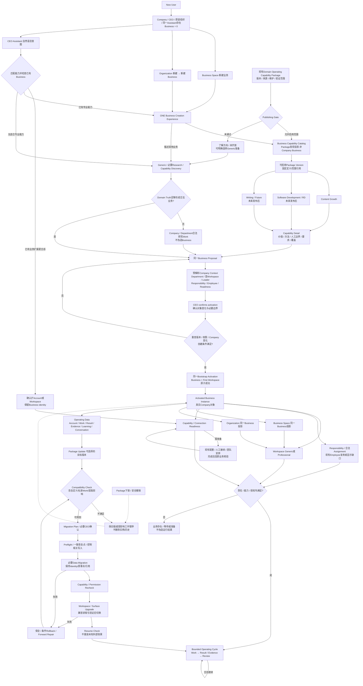

# CURIS — BUSINESS CAPABILITY CATALOG & ACTIVATION DERIVATION

Authority Class: RESEARCH
Status: Review
Disposition: PRODUCT CONTRACT CANDIDATE — REVIEW DEFERRED BY CEO; MIGRATION EXTENSION ADDED
Date: 2026-09-15 Asia/Shanghai
Owner: Product Research / Codex；接受责任为 CEO / Product Authority Owner
Target Authority: 现有 Product Blueprint 及其派生合同，待窄幅 Patch
Next Gate: CEO REVIEW WHEN RESUMED — 本轮暂不Review

**Verdict: A. ACTIVATION PRODUCT CONTRACT READY。** 此 verdict 只评价下述候选产品关系是否闭合；不授予 Content Growth 或其他 Package 发布资格，不表示实现、UI或当前 Authority 已更新。

## 1. Problem

Company 的运行目录回答“我的公司正在经营什么”；Package 定义回答“系统准备了什么专业方法和环境”。Business=0 合法，却不能使新用户只能面对空目录、猜测系统擅长什么。缺的是从已发布专业定义到用户明确授权创建实例的发现与启用链。

本轮只补这条链，不重做七区、Company层级、能力执行合同或专业工作空间设计。Catalog 不拥有 Business identity；看过/收藏/打开详情/起草 Proposal 都不是经营启用。研究完成也不能默认给新公司生成 Content Growth、RD 或 Writing。

推导方法：先消费当前 Consolidated Truth → 比较概念 → 逐步生命周期 → 字段与交互 → A–J反证 → 影响清单。以下“裁决”全部是 RESEARCH DECISION，等待CEO接受。

## 2. Existing Product Truth

|证据|Authority / 有效范围|已有合同|本轮缺口|
|---|---|---|---|
|S1 `docs/00_Context/PRODUCT_DOCUMENT_POINTER.md` Current Required Input / 2026-09-15登记|Frozen Truth Router|当前Blueprint→Map→UI→Shared/Domain；旧研究不能覆盖Current|不增加第八入口；本轮不改Pointer|
|S2 `docs/01_Product/Curis_Product_Blueprint.html` 当前Consolidation与Professional Strategy|唯一Product Authority，Current|Business0；Verified-first；三质量轴；Package=Domain Operating Capability Package；模糊意图合法|缺未启用发现到启用的完整合同|
|S3 `docs/01_Product/Curis_Product_Master_Map.md` Professional Workspace Strategy / Workspace Engineering|Current派生产品展开|配置→派生→组合→必要研究；Generic合法；Package不得绑定employee_id；升级尽量保持identity|缺统一创建Surface及其字段/状态|
|S4 `docs/01_Product/Curis_Product_UI_Blueprint.html` Bootstrap / 产品空间|Current派生UI合同|复杂工作Main；Proposal确认；Business页面不等专业Builder|缺Catalog/Detail/Activation的空间和回程|
|S5 `docs/03_Design/Curis_Company_OS_Shared_Authority.md` Phase A/A.1、§9、§10–18|Current/Frozen scoped rules|原装组织；canonical parent；Business+firstWorkspace原子；责任与Assignment；readiness、权限与恢复|缺Activation作为以上规则的统一消费流程|
|S6 `docs/01_Product/Curis_Product_Context.md` §1.1/1.1A/1.1B|Frozen模块Context|Business持续身份；至少首Workspace；Generic→Professional尽量identity-preserving|需要新用户路径的简短说明|
|S7 `docs/03_Design/Curis_Content_Growth_Domain_Authority.md` §0.1/1.2/5.4|Frozen Domain scope|Content Growth当前Candidate非Verified；Channel/Account≠Workspace；账号失效不删历史|可作为第一个发布验收实例，不能本轮升级Verified|
|S8 `docs/03_Design/Curis_Workspace_Shell_Contract_And_Shared_Patterns.md` Current spatial / F1|Frozen Shell|Main完整工作；Utility辅助；Assistant独立；必要人工接续|创建可占Main，无需改变Four-Pane|
|S9 `docs/01_Product/CURIS_PRODUCT_STRUCTURE_BASELINE_PRE_DESIGN_RESEARCH.md` §2–4|Frozen结构|七区、原装组织、同一员工身份、Business0|没有默认专业Business|
|S10 `docs/reviews/CURIS_PRODUCT_TRUTH_CONSOLIDATION_REVIEW.md`|Review / 执行证据；仍记录Final Review门槛|已消费产品决定，不等实现接受|本轮不以研究宣布UI可启动|
|S11 本目录Full App Derivation / Expression V2 / Experience Map|RESEARCH / provenance|既有Proposal、缺口、设置与回程推导|只作为前轮理由，不补写Current事实|

15个受保护输入文件的本轮hash见 `evidence/activation-input-manifest.json`；含只为不变校验读取的CURRENT_STATE/Visual Standard，未据其重做实现或视觉判断。本文未发现需要自行仲裁的Current Authority结构冲突；旧被明确supersede的措辞不作为新冲突。

Package First在当前链内通过“优先匹配既有经验证Package、配置/派生/组合，Generation最后”消费。没有因为文件名带package就读取商业订阅包或旧模板Runtime作为Authority。

## 3. Concept Reconciliation

|候选解释|判断|理由|
|---|---|---|
|Catalog是新canonical业务能力对象和运行系统|拒绝|会复制Package与Capability，无法解释实例边界|
|Catalog是Template商店/安装中心|拒绝|经营需要目标、组织、权限；模板安装不能替代Proposal|
|Catalog是Company已开通Business列表|拒绝|混淆可用定义与公司事实|
|Catalog是已发布Domain Operating Capability Package的用户发现投影|采用|复用已有定义/版本/来源/验证证据，Activation才创建Company实例|

内部研究术语保留 **Business Capability Catalog**，但“Business Capability”仅指完整经营能力的产品描述，不新增Capability类型。普通用户：创建页主语为“新建业务”，发现区为“Curis可以帮助经营的业务”，详情为“内容增长”等具体名称。人才与能力仍用“员工、技能、连接与工具”。不在两个入口都摆一个含义不明的“能力库”。

业务能力、业务方案、业务实例分开：能力是Package所承载的可提供方法；方案是应用到本公司目标的Proposal；Business是确认后形成的真实经营身份。“业务方案”不能成为新的持久业务类型。

## 4. Business Capability / Package / Business关系

|名称|最终候选定义|是否新增canonical对象|
|---|---|---|
|Domain Operating Capability Package|现有Workspace Package的专业定义与交付语义；方法、工作环境、责任要求、能力要求、评估与边界|否，复用现有Package|
|Business Package|若使用，只作上述Package的非正式简称；正文优先使用完整术语以免误认新包|否|
|Business Capability|Package支持的一类完整经营价值的用户投影；并非Employee tool/skill capability|否|
|Catalog|可发现、可解释发布范围的Package集合投影|否；允许索引/缓存实现，不成为新产品真源|
|Business Proposal|既有Bootstrap结构化提案，应用Package+Intent+Company Context|否，不另建Catalog Proposal系统|
|Activation|既有Business Bootstrap的明确确认与实例化流程|否，不另建Template Runtime|
|Business Instance|用户Company的canonical Business持续身份；可有多个Workspace|复用现有Business|
|Workspace|Business中的实际经营环境；选定Package版本形成专业环境或Generic环境|复用现有Workspace|

一个Package可用于零到多个Business/Workspace。Business不等于某个Package版本，也不因升级版本变换ID。首版一个发现条目指向一种主Package及明确适用发布范围，不把每个配置/版本变成一张“业务”。已有Derived/Composed解析仍在Workspace Engineering内，不能创建Catalog组合Runtime。

**CANDIDATE PRINCIPLE — AVAILABLE DEFINITION ≠ ACTIVATED COMPANY BUSINESS。** 未启用的定义无Company Business identity、无Workspace、无Business Assignment、无Business Work/Result；实例创建后才由Company真源投影到Business Space/Organization。为起草Proposal发生的合法研究可归Company或Department既有Work，不得借此伪造尚不存在的Business。Package验证环境中的测试结果也不是新用户的Business Result。

## 5. Catalog Ownership

PRODUCT OWNER：Company OS产品负责人负责统一发现/创建合同；各专业Domain维护者负责Package适用范围、方法、验证证据与支持；Curis发布责任人批准可推荐版本。不是让每个用户Company的空间工程员工负责发布全局官方目录。

STORAGE / TRUTH：专业定义、版本、来源、维护者、范围和验证记录来自现有Package/Workspace Engineering合同；Catalog读取其发布允许集合，Company上下文只派生适配/已有关联实例/readiness。显示文案随该定义的受控版本维护，不保存一套可独立修改的业务真相。现有Verified Registry等完整实现仍是架构方向；本轮定义其产品输入输出，不声称已有发布数据库或Schema。

三种来源：

- Curis Official：研究→定义→受控Package→按范围验证→发布审查→目录投影。Official只说明来源。
- User-created：用户业务意图默认进入Generic/复用解析；个人Business不会自动变成可发布Package。后续抽象成Package需去除公司数据、版本与维护责任，并通过同样Gate；默认公司私有，不自动上传或公开。
- Third-party：沿用已有Partner/Community provenance，不将来源写死为官方。未来通过相同Gate和信任/许可审查，当前不设计上传、交易、评价、分成、Marketplace Runtime或第三方执行新权限。

发布真源与公司可访问范围相交才可展示。撤销信任与停止新启用由发布责任控制；Business数据生命周期仍属于用户Company。

## 6. Discovery

唯一推荐 **B：可复用Catalog Surface，由统一Business Creation承载**。它在创建流程中占Main，拥有自己的列表/详情回程状态，但不是一级区，也不是业务运行列表的一个假Business。

|入口|携带上下文|动作|回程|
|---|---|---|---|
|Business Space，0或N个Business|Company、来源视图/筛选、可选Department|新建业务→同一Creation|取消回原目录位置；成功默认进新Business，保留回业务空间|
|Organization Center → 新建 → 新建业务|Company、选中Department/对象、组织视图位置|同一Creation；Department只是建议值|成功回原Organization并选中新Business；显式“进入业务”打开它|
|Global CEO Assistant|原Conversation、自然语言Intent、合法Company context|匹配→解释推荐→同一Proposal/详情可展开|返回同一Conversation；成功回复真实Business链接，不复制实例|

Organization新建菜单明确“新建部门 / 新建业务”；员工动作使用现有“添加员工”路径（招募/创建按既有权限），不经Business Activation，不在此发明员工流程。选中Business时不能把Business嵌套Business，系统解析其Department作为建议。

Business0：明确没有自己的业务，但有原装组织；提供“新建业务”和描述其他需求的入口，可通过Assistant发起。不会显示经营Result/假运营卡片。Business已有5项时同一按钮、同一逻辑，不另做Empty专用Bootstrap。

首版条目少，可直接浏览，不强制搜索或分类器。增长到20/50项时，同一Surface提供名称/经营结果/适合对象搜索、领域分类与可用范围筛选；筛选无结果始终保留“描述其他业务”。推荐来自解释性适配，不承诺模型排序，不用复杂配置页才能创建。保持查询/滚动/选中项返回状态；Search/Filter只改变投影，不引入canonical分类系统。

## 7. Capability Detail

详情唯一任务：“这是否适合我的经营意图，启用后会发生什么？”

|决策问题|必须内容|边界|
|---|---|---|
|做什么|经营对象、一句话价值、适合/不适合场景|Content Growth是持续经营内容账号，不是单次生成文案|
|得到什么|目标结果类型、如何衡量、可见证据|不许保证涨粉/收入数字；区分期望与已证明覆盖|
|怎么经营|研究判断→策略/内容→发布或人工交接→反馈/复盘，允许迭代|只是可理解方法摘要，不是固定DAG|
|Curis负责什么|已经支持的活动与范围|每项指明可执行、需连接、人工完成或不支持|
|我负责什么|素材/账号、必要确认、现实操作、人工发布等|不能把核心缺失藏在“AI自动”后面|
|准备什么|账号类别、访问权、模型/媒体功能需求、必要输入|普通语言优先，具体技术Provider在配置时再选择|
|可靠到哪里|发布范围、验证说明、已知限制、维护者|Official≠Verified，不能写100%自动化|
|现在能开始吗|创建阻塞/执行准备、将要形成的业务与边界|公司缺连接≠Package未通过发布Gate|

列表不承担所有解释。详情默认显示影响启用决策的限制；完整验证记录/Package版本/技术兼容在“验证与版本详情”。未来能力与当前支持分栏，未来不计入启用价值承诺，也不能激活。

## 8. Publishing Gate

不能把产品完整、实现存在、验证通过、用户已配置压成一个分数或枚举。沿用Product Form / Provenance / Assurance三轴，再派生“允许新启用的范围”和公司readiness。后两者是判断，不新建同义版本状态机。

|Gate|最低条件|证据 / 决策责任|
|---|---|---|
|P1 产品定义完整|明确经营对象、目标/评估、适合边界、方法、Workspace定义、责任、人工边界|Domain Product审核；研究存在不算通过|
|P2 能力合同完整|所需能力/连接、失败/恢复、Result/Evidence、权限、Activation/退出/迁移合同|Shared+Domain一致性Review|
|P3 实现覆盖可陈述|逐项当前可执行/人工/未支持；可验证的Package与目标产品兼容|实施Owner提供范围，不能只拿页面/按钮|
|P4 范围化真实验证|所推荐经营范围的可执行链有真实结果/证据、必要人工返回、失败恢复；版本/Provider/已知缺口绑定|独立验证与维护者；不是“全产品都完成”才可发布|
|P5 发布决定|维护者、许可/来源、支持/迁移政策、准确用户承诺、停用新启用机制|产品发布责任人批准具体版本/范围|
|P6 Company activation readiness|创建条件/连接/账号/权限动态校验|不改变P1–P5成熟度，只影响该Company下一步|

正式推荐“你可以启用”须P1–P5对所承诺范围成立。支持人工环节可发布，但必须在该范围有完整可闭合结果链，不能靠“人工可做一切”掩盖专业能力不存在。实验/预览仅在明示受限范围也通过相应验证且风险可控时开放，不能凭Candidate标签豁免Gate。

未通过者可作为“了解中的业务方向”展示详情但默认不混在可启用集合、无正式启用按钮；可进入明确Generic准备/研究路线。既有Assurance保留Candidate/Unverified，不因显示“有限范围可用”整体升级Verified。例：只验证图文+人工发布范围时，视频自动发布仍是未支持。

**当前Content Growth未获本轮发布批准。** S2/S7仍为Professional Workspace Candidate。本文第9/12节是其发布Gate通过后的首次启用完整合同；今天若无P1–P5证据，只能诚实展示尚未开放，并给Generic准备入口，不能让UI假装已正式可经营。

## 9. Activation

### 逐步推导：为什么每一步存在

|步|动作|为什么存在 / 产生什么|没有产生什么|
|---|---|---|---|
|L01|Curis形成专业方法与Package|承载可维护专业定义|用户Business|
|L02|发布Gate核验版本与范围|防止研究冒充可经营|Company资源授权|
|L03|投影Catalog|给用户发现准备好的业务|经营列表项|
|L04|打开详情|理解价值、适用性与限制|运行状态|
|L05|点击启用内容增长|表达采用意向，进入同一Bootstrap Proposal|立即创建/安装/外发|
|L06|读取合法Company Context|复用已有部门/业务/员工；避免重复|无授权跨公司读取|
|L07|收集一句话目标与必要事实|识别本业务还是现有业务扩展|要求完整商业计划|
|L08|系统形成Proposal|把Package配置到本公司，标出假设与缺口|把建议组织当已存在|
|L09|确认必要事实与高影响边界|CEO只确认系统不能代理的选择|包替CEO选择预算/高权限|
|L10|CEO确认创建与启用|授权具体组织变化及准备范围|一揽子发布/购买授权|
|L11|重查Company/Package/权限变化|防陈旧提案、重复确认、撤下版本|悄悄换版本或Department|
|L12|原子创建Business+首Workspace|满足canonical组织关系，返回唯一成功身份|半个Business成功|
|L13|落实Leader/Responsibility/Assignment|用真实员工承担真实责任|按Package新造重复员工|
|L14|检查能力与连接并组织准备|决定哪类Work可开始、谁解决缺口|把未连接说成运行中|
|L15|同一事实投影到业务/组织|用户能找到创建结果并回工作现场|两份Business记录|
|L16|启动已授权、具备条件的Work/Cycle|兑现经营而非仅完成配置|创建即保证所有经营结果|

L06–L09先解析Department/团队建议；L11再校验并在确认快照内落地。不能CEO确认后才静默决定新的部门/团队。

### 用户语言裁决

“安装”拒绝作为主动作：它表达技术交付，不能覆盖经营授权；“添加业务”可作入口但不解释持续性；统一入口“新建业务”，详情“启用内容增长”，确认按钮“确认创建业务”，完成后“进入工作空间 / 开始准备 / 开始经营”由readiness决定。内部Package获取/安装由既有Workspace Engineering处理，不新增插件安装页。

复杂技术安装未完成时只显示“正在准备工作环境”与真实失败原因，不能显示创建成功。纯执行能力未Ready则允许完成合法Business创建，进入准备状态，详见第11节。

## 10. Business Proposal

Proposal复用既有Conversation→Structured Proposal→必要确认。输入是Intent + 合法Company Context + 选定Package/Generic解析结果。首先解释“我建议这样开展”，展示目标、归属、首工作环境、负责人、准备缺口和将发生的变化。

用户可只说“我想做小红书”。系统可建议“先明确账号定位与内容方向”，把目标/品牌未知写成待研究，不要求马上回答所有问题。只有无法判定是真实新业务还是扩展既有业务、缺合法归属或无法确定授权目标等核心歧义才追问。

默认名称可用“内容增长”或从用户品牌推导；同名提醒与实例链接帮助区分，不以名字作为唯一ID，不强迫为了技术唯一性填表。Workspace默认“内容增长工作空间”或与具体经营范围相关名称，不以“小红书账号1”机械划分。

Department解析顺序：合法入口建议 → 相容现有经营部门 → 提议新部门。两原装支持部门不因存在就默认变成内容业务归属；空间工程协助准备不等于拥有该Business。若没有相容部门，Proposal连同Business建议“内容业务部”等可改名称，CEO一次确认结构变化；创建部门权限不足则在此阻塞，不先生成孤儿Business。

Leader与员工优先复用现有符合资格/容量的员工，通过现有Organization Routing落实Assignment。能力匹配不是只按名字/部门推断。缺合适Holder时诚实列责任缺口，可提议后续招募/配置，不能未经授权自动创建一批员工或把空间工程员工永远派去运营。

## 11. Readiness

区分三道问题：**Package能否被推荐**（发布Gate）；**Business能否合法成立**（结构与同意）；**某类Work现在能否执行**（准备）。

创建必要条件：授权创建者、合法Company与Department、明确“要建立的经营方向/范围”足以形成身份、可创建合法首Workspace、确认的Proposal仍有效。专业路径还需选定Package版本具备允许启用范围且可形成承诺环境。模糊策略合法，不要求完整品牌/预算/账号；但无法判断操作对象或归属时不能擅自决定。

|缺口|允许创建？|表达与处理|会阻塞什么|
|---|---|---|---|
|缺Model|通常允许|业务已建立，AI工作需配置；进入现有Model设置并回本业务复查|依赖模型的研究/执行；不能伪造AI生成Proposal，保留可确定信息与手工确认|
|缺Provider/媒体功能|通常允许|列受影响工作与可用人工/替代路径，用户选择才绑定|相应生成/发布/分析工作|
|缺平台Account|内容增长通常允许|先做策略/资料等已授权准备；账号连接后核验身份|具体账号发布/抓取私有数据|
|缺执行Permission|允许合法建业务，不能执行被禁动作|由真正授权者处理；配置连接不等审批通过|对应Work；外部动作仍单独Gate|
|缺创建Department/Business权限|不允许|保存Proposal，交有权者确认；不绕权限|实例创建本身|
|Package环境无法解析/验证/创建|专业Activation不成功|留Proposal，可明确选择Generic；不能静默降级|专业Business+首Workspace成功交付|
|缺负责员工/Assignment覆盖|允许结构成立，显示未具备经营责任|待安排负责人，复用既有责任和人才入口|不能“开始经营”；已授权准备也必须有真实承责者|
|核心经营身份无法合理判定|不允许|只问关键事实，或先Company研究|实例创建|

关键判断不是“外部账号总可选”，而是该事实是否决定业务身份/授权范围，或只决定后续某动作能否做。例如可先创建品牌内容增长，但用户明确要接管一个无法辨识归属的既有业务时，必须先确认对象/权利。业务所依赖现实服务尚无承接能力时，Generic只可开展被验证的研究/准备，不能宣称可运营现实服务。

工作级readiness随时失效：账号断连保留Business与历史；权限撤回停止新动作；重新连接返回原Proposal/Business/Work，再核验而非自动重发。准备清单有影响、下一步、责任者与返回上下文，不汇总成误导性的“80%可经营”。

## 12. Business Instance Creation

CEO确认后提交同一Proposal快照及确认记录。重试/双击/重开先查询这次确认的真实结果，不能新建第二实例。技术实现以后落在既有Bootstrap和持久化规则，不在本文设计表或Activation Runtime。

Business+首Workspace必须原子成功。若Proposal包含新Department，创建链失败不得留下被显示为成功的空部门/Business；实现阶段需在既有组织创建语义中证明这一用户可见一致性。外部账号授权不能塞进数据库原子成功承诺：先授权账户属于独立正常连接动作，取消创建也不会删除用户账号或已合法连接，需要明确保留说明。

合法角色/责任要求与已解析Assignment记录必须如实落地或明确报告未落实；任何失败不造假Holder。成功至少明确“业务已建立”及“可准备/可经营/需要处理”的真实含义。只有核心实例持久化未成功时才称创建失败；后续Provider缺口不把已成功Business回报成失败或再次新建。

### Content Growth首个实例：端到端

1. 新用户Company/CEO/原装组织已有，Business列表为0。点击新建业务，发现内容增长。其开放前提是第8节发布Gate通过；本轮不是这个证据。
2. 查看价值、适用平台/账号范围、经营方法、人工发布边界、可用与未支持范围。点击启用进入Proposal。
3. 用户说“想给我的茶品牌做小红书内容”，无需立即填平台账号、团队、DAG。系统可推导默认名“茶品牌内容增长”、初始目标“确认定位并启动内容经营”，未知品牌资料待补。
4. 读取公司：无相容经营部门则提议新部门；推荐首Workspace与合法Leader/责任覆盖。缺Holder、模型、账号分别明示，不用默认支持部门掩盖缺口。
5. 确认页给出将创建的Department（若有）/Business/首Workspace、责任配置、首批可做准备及外部动作边界。CEO可改必要事实，确认创建。
6. 持久成功后Business Space显示一个真实Business，Organization同一ID进入Department关系；原员工目录不复制员工。缺账号时显示“账号尚未连接”，不是正在发布或有增长。
7. Business Space来源默认进入新Business Main；显示准备摘要，点击进入首Workspace。存在缺口时在同一Business内处理，配置回原处，不强迫跳入全屏设置向导。
8. 有模型/合法员工且准备Work已获授权，可先研究定位/整理资料；没有条件则保留等待，不造研究结果。账号正常连接后，首个账号Work仍核验权限、方案和外部动作批准；结果按真实证据进入经营反馈。
9. 责任覆盖、关键连接与启动边界满足后进入首个有界Operating Cycle；是否后台继续沿用现有opt-in合同。创建确认不等于开启后台或无限预算。

## 13. Organization Projection

Package只声明Recommended Responsibility与Required Capability，不拥有Company部门/员工。Company Context Resolution将要求应用到实际组织；同Employee可跨Business任职但必须有合法Assignment与隔离Context。

成功效果：现有Department下新增Business（或明确确认新增Department）；Business至少首Workspace；责任实例及已落实员工服务关系；Package版本关联、准备状态与后续Work关联。公司CEO、Assistant、原装员工身份不替换。未落实责任作为缺口，不能用假Employee补图。

Organization和Business Space读取同一事实。Organization来源完成后回原地图选中新增Business，显示名称/归属/准备与负责人情况，可进入同一Business/Workspace。刷新、重启、返回都不能再次Activation。业务空间从任何视角均可找到同一Business。

## 14. Repeated Activation

“已启用”不是Catalog全局布尔开关。对当前Company派生“已有N项相关业务”，可打开实例或创建新的经营方向；不禁止再次使用同Package。

|判据|优先扩展现有Business|优先新Business|
|---|---|---|
|目标与成功标准|同一经营目标，账号只是渠道扩展|独立经营目标/价值评价|
|品牌与策略|同品牌、兼容定位/策略与治理|不同品牌且独立策略/约束|
|预算/责任|同一预算与责任链可解释|独立预算/问责/经营边界|
|数据与权限|现有Scope可合法容纳|需要业务级隔离且不能混用|
|团队工作方式|现有Workspace可承担；必要时新Workspace|Business层边界本身不同|

新Account不自动新Workspace；同Business需独立经营现场/责任边界才加Workspace，单纯平台、内容类型、筛选不同不够。两个不同品牌可合法有两个内容增长Business，但若用户明确统一组合经营，品牌不同不是强制拆分条件。

存在歧义时Proposal展示“扩展现有X / 建立独立业务”及理由，只问这一关键选择。多个合格Business时不擅自选最近使用者。已有账号绑定关系可能跨Workspace，继续按现有Domain授权与写入协调，不因需要扩展而复制Account identity。

## 14A. Package Version / Business Instance Migration

# BUSINESS PACKAGE MIGRATION CONTRACT

Authority Class: RESEARCH；Status: Review；Disposition: PRODUCT CONTRACT CANDIDATE — REVIEW DEFERRED BY CEO。
本节由CEO追加，补足长期演进；不代表前文已经接受。以下版本、计划与记录都是现有Package/Workspace Engineering/Work/Decision/Backup的合同细化，不创建第二Migration系统或新canonical业务类型。

### 14A.1 四层真相与复用依据

**Business Instance Identity ≠ Package Version ≠ UI Version。** Package可以升级，UI可以重构，Capability/Provider可以替换；Business identity和原历史事实不能因此丢失、重建或被追溯改义。

|层|拥有的真相|升级时不能发生什么|
|---|---|---|
|PACKAGE DEFINITION|既有Domain Operating Capability Package，方法、对象语义、责任要求、能力、工作面声明及兼容范围|新版定义覆盖旧版定义，使旧记录失去解释依据|
|BUSINESS INSTANCE|真实Company/Department下的Business、Workspace、实际配置及版本应用关系|重新Activation、重新建Business或复制员工来完成升级|
|BUSINESS DATA TRUTH|Account、Work、Result、Evidence、Learning、Conversation与责任/授权历史|重编号、删旧字段事实、把旧方法结果伪装成按新方法产生|
|UI EXPRESSION|一个App/UI版本如何读取并呈现多个受支持的数据/Package版本|用组件名称或页面重命名决定业务对象迁移；旧版数据直接隐藏|

复用S3 Master Map Professional Strategy：Verified绑定version/scope/evidence/maintainer/migration policy；Workspace Engineering负责版本兼容，优先identity-preserving升级，不安全才sibling Workspace+controlled Handoff。复用S3 Team Operating：保存immutable Operating Definition Version。复用S5 Shared §15/17/18：效果未知先核验、Database+Managed Files+Manifest备份、停止相关写入、保全回退、Resume Check、版本与能力复验。S6 Product Context保留Business/Workspace身份规则。

这些已有的是原则与基础合同；尚不足以回答旧字段/多实例不同版本/切换期间写入/回退窗口。本节补产品约束，不声称现有Runtime已经实现迁移编排或通用版本兼容层。具体算法/Schema/安装制品另走正式Issue。

### 14A.2 完整生命周期推导

|步骤|存在原因|产出与停止边界|
|---|---|---|
|M01 Package v1被启用|建立稳定来源关系|记录实际采用版本与配置，不引用“latest”作为执行依据|
|M02 长期经营积累数据|形成用户事实，不属于Package样例|记录当时方法/能力/授权/对象语义来源，保留引用|
|M03 v2发布|提供可选演进，不等实例已升级|目录新启用版本与既有实例应用版本分开|
|M04 Compatibility Check|判断这个实例是否能升级|结合实际版本、数据、Company自定义、责任、连接、在途Work与UI支持范围；未知即不能宣称兼容|
|M05 Migration Plan|把变化与影响变成可理解决定|源/目标版本、对象/字段映射、工作暂停范围、权限差异、备份/回退条件、维护窗口与负责人|
|M06 必要确认与Preflight|防陈旧计划/无权限/无恢复点|重大影响经既有Decision；执行前再查源版本/修改/空间/支持条件，变化则重计划|
|M07 建立一致恢复点与控制写入|防迁移丢数据或旧新代码混写|按真实影响范围暂停领取/写入或使用已验证兼容机制；不能仅关闭UI|
|M08 Data Migration（仅必要时）|转结构而不改原事实意义|验证副本/转换结果；映射来源、计数/引用、unknown与保留字段；失败不宣布v2生效|
|M09 Capability / Permission Recheck|新方法不等新能力已可执行|新Provider/权限明确确认；失败可保业务并阻塞对应工作，不假Ready|
|M10 Workspace / Surface Upgrade|让新表达能读真实数据|校验目标UI读写旧/新数据、历史阅读、链接与实际配置；仅视觉变化跳过Data Migration|
|M11 验证后切换有效版本|避免半完成状态成为当前真相|数据、定义与读取路径协调切换；成功记录唯一应用结果，同一计划重试不重复变换|
|M12 Resume Check / Continue Operating|安全恢复同一业务|核验在途/未知效果、责任/权限与排程；新Work采用新有效配置；不自动重放外部写|

顺序不是新的引擎DAG。兼容补充字段或纯UI更新可跳过无必要步骤，但不能跳过相应兼容/权限/历史可读判断。M07的并发策略由实现验证决定：无法证明在线兼容就停相关写入，不能默认不停机迁移。

### 14A.3 25项合同裁决

|#|问题|候选合同|
|---|---|---|
|1|Package如何版本化|稳定Package identity + 不可变发布版本；每版绑定对象/字段/方法/能力/Surface合同、依赖和读写兼容范围、验证/迁移/支持依据。可用semver表达，但不能只凭major/minor判断安全；不另建Version系统|
|2|Business记录版本吗|记录实际应用关系与历史。Business可聚合多个Workspace及Package版本，不能用单一business.package_version覆盖全部；Workspace/配置引用有效Package版本，Business展示汇总与差异。Work固定其实际采用的版本依据|
|3|Operating Method变化|形成新的既有Operating Definition版本及影响提案；明确新Work/新Cycle生效点。受保护目标、策略、评价口径或重大责任变化须确认；旧结果保原方法，后续重评另追加有来源评价|
|4|对象新增/删除/重命名|新增不凭空生成经营事实；纯改名保ID及旧名称/引用解析；语义变化需显式映射，不是假rename。停用对象保历史只读访问；拆分/合并需可追溯新关联和确认，原记录不删除、不复用旧ID表达新含义|
|5|新增字段初始化|确定性派生须保来源与转换版本；无法确定用unknown/未填，不能补0/成功/授权等假事实。只阻塞依赖该字段的动作；确为迁移一致性必需且不可推导则迁移前补事实|
|6|废弃字段历史|不再用于新写入不等删除；保留旧值、当时单位/含义和历史读取路径。删除数据是单独保留/授权政策，不得夹带升级清理|
|7|长期对象identity|Business/Account/Work/Result/Evidence/Learning沿用原ID与Scope、来源、时间和关系；文件保持引用可解。迁移记录不是新经营Result；既有结果不得被改成新版模拟结果|
|8|进行中Work|保当时方法/能力/输入与批准快照；可安全用旧执行器完成则保留所需兼容路径，否则在安全边界等待/交接/重新计划。不能热换到v2；EFFECT_UNKNOWN先核验，不能以升级重跑|
|9|Conversation解释|保消息原文/顺序/作者/时间/当时Scope及对象引用；历史标签可显示“当时版本”。新UI解析旧引用，失效权限显示受限而不是泄露；新总结是追加解释，不替换原发言|
|10|新Responsibility|Package只声明要求；Company内产生具体责任提案，检查已有责任可否复用。重要变更经确认，新责任在有合法Holder前是缺口，不假称团队就绪|
|11|Assignment迁移|维持Employee identity；旧Assignment/责任历史保留有效时段。职责变更按实际影响重新确认/绑定与容量校验；不能把过去Work改挂新Holder或从Package硬写employee_id|
|12|新Capability|作为该Workspace/责任的需求与可选择能力进入readiness，按现有能力更新机制检查版本/兼容/测试；可发现不等已绑定/已获权限|
|13|新Provider|不自动启用或替换；新外发目的地、凭证/账号、成本/条款边界由用户合法选择并验证。复用已连接Provider也要核查适用Scope，不从“连接存在”推导授权|
|14|新权限|扩大范围、目标、费用或外部副作用必须重新确认；已有授权仅在同范围、仍有效且适用时复用。Package升级确认不等动作审批，旧快照变参失效|
|15|新UI读取旧数据|先识别记录/Workspace实际合同版本，使用受控兼容读取/投影；无支持时明确受限并保历史入口，不用新默认值冒充旧字段事实。不能让UI组件私自执行数据迁移|
|16|UI变化是否迁数据|纯布局/样式/导航表达通常不需要；读模型/存储结构/对象语义变了才需兼容或迁移。UI发布版本、Package版本、数据格式版本分开关联，不要求一一同步|
|17|失败恢复|切换前保留原有效版本与数据；部分转换不作为当前状态。崩溃后根据既有执行记录核验是否已切换，不能重复转换。切换后失败先控制写入、保全新增数据，按回退条件或forward repair处理|
|18|Backup / Preflight|凡改变持久数据/解释或不可逆配置，必须有与影响范围一致且已校验的恢复点与Preflight；复用Shared §17。纯可逆展示更新不强制全公司备份。备份排除Credential/Cookie/Keychain Secret/Browser Profile|
|19|Rollback|支持有条件回退，不承诺任意逆转。能安全保留升级后新事实且旧读写兼容时才回退；有不可逆转换/新版本写入/外部效果则需兼容修复或明确迁移方案。旧备份不能覆盖掉其他Business和新经营数据|
|20|停留旧版|允许在明确支持与安全兼容窗口内延后，不强迫每个Business同时升级。旧版被安全撤销或基础依赖不可用时暂停受影响动作并给迁移路径，不删除业务，也不保证无限期旧版执行|
|21|自动升级|仅已授权更新政策覆盖、已验证兼容、无新增权限/费用/重要方法与责任变更、无数据丢失且回退/历史可读条件成立的低风险更新；semver minor本身不够|
|22|CEO确认升级|高影响方法/评价口径、重要责任、对象语义/拆合、权限/Provider/预算变化、非可逆迁移、显著停运或回退代价；普通低风险维护按已授权政策不逐次打扰|
|23|Deprecated支持|明确停新启用、维护截止/兼容范围、替代与迁移路径；实例和历史仍在。停止支持不能作为删除数据许可；安全问题按范围暂停执行|
|24|不同Business版本共存|按各Workspace实际应用版本读取/执行；共享Core/存储变更必须验证所有受影响版本。无法兼容共存时给公司级影响计划和确认，不先升级一个后破坏另一个，不自造第二Runtime|
|25|保护正在经营|先实例影响检查→安全边界→一致恢复点→变换/验证→有效版本切换→Resume Check；可用范围、数据/引用、责任与权限不变量未证明不得继续经营；只停真实受影响范围|

### 14A.4 数据与版本不变量

- 版本不等身份：Business ID不变，Package引用和UI版本可变；普通升级Workspace ID亦应不变。确需sibling Workspace是显式新环境与controlled Handoff，旧Workspace/历史保留，不伪装原地更新或再建Business。
- 历史事实不追溯改义：原Result/Evidence保原度量、单位、窗口和来源；例如旧“曝光”不能重标为新版“有效触达”。新算法可生成独立有版本的派生比较，不能覆盖原数值。
- 新字段不伪造事实：新增“发布成功时间”不能拿Work完成时间填充；新增“授权状态”不能默认已授权；缺证据就是unknown。
- 数据转换不执行经营：迁移不调用发布/购买/发消息来“补齐数据”；不创造历史业务Result，不重复计Usage、不克隆Account。
- 数据保留与访问授权分开：保留Conversation/Evidence不授予新员工阅读权；版本升级不得放宽旧Scope检查。
- 切换可识别：用户只能看到已验证的有效版本或明确的升级中/待恢复状态，不能宣称v2完成但仍由v1写入不兼容格式。有效版本关联与数据切换须具一致性，具体事务/锁机制留实现Issue。
- Shared storage不是实例私库：恢复一个Business时不能直接恢复整公司旧备份覆盖其他Business新增数据；无法证明隔离恢复时扩大维护影响说明并制定保全方案，不能静默操作。

### 14A.5 Migration Plan与用户表达

复用Workspace Engineering的工作/提案及既有Decision/Result/Evidence记录；Migration Plan是其中的结构化内容，不新设Migration Project/Job/Registry。升级完成记录是工程证据，不冒充Business经营成果。

|字段|标记|规则|
|---|---|---|
|受影响Business/Workspace与当前有效版本|REQUIRED · SYSTEM DERIVED · READ ONLY|真实实例，允许不同Workspace不同版本|
|目标Package版本及发布/兼容依据|REQUIRED · SYSTEM DERIVED · READ ONLY|不可变目标；禁止latest作为确认对象|
|方法/对象/字段/责任/能力/UI变化摘要|REQUIRED · SYSTEM DERIVED · READ ONLY|无变化也明确；重大项默认可见|
|Company自定义与映射冲突|REQUIRED · SYSTEM DERIVED · READ ONLY|保用户覆盖项；不能用Package默认覆盖策略、名称、预算|
|数据映射/默认值来源/旧字段保留|REQUIRED · SYSTEM DERIVED · READ ONLY · ADVANCED|未知/无损性可检验，不要求CEO设计迁移脚本|
|在途Work、待审批和未知效果处置|REQUIRED · SYSTEM DERIVED · READ ONLY|完成/等待/交接策略及影响范围|
|权限/Provider/预算差异|REQUIRED · SYSTEM DERIVED · USER INPUT|用户确认必要增量；不重复索取仍有效授权|
|停运范围、时间与生效时点|REQUIRED · SYSTEM DERIVED · USER INPUT|自动政策已覆盖可无需逐次确认；公司级影响不得隐藏|
|恢复点范围、排除项、完整性与Preflight结果|REQUIRED · SYSTEM DERIVED · READ ONLY|纯UI无数据变更可明确不适用及原因|
|回退条件/不可逆点/升级后新数据保全|REQUIRED · SYSTEM DERIVED · READ ONLY|不能只写“支持回滚”|
|验证标准、负责人、下一步和返回入口|REQUIRED · SYSTEM DERIVED · READ ONLY|既有Workspace Engineering责任和原业务回程|
|确认快照、检查时间与应用结果|REQUIRED · SYSTEM DERIVED · READ ONLY · ADVANCED|源/目标或重大影响变化使旧计划失效；重试查同一结果|

入口：Business/Workspace中的有更新提示→Main影响提案；证据细节按需Utility；必要确认复用Decision。进度说明检查/准备/迁移/验证/待恢复及影响，不新增全局Migration Console。用户可选择合规延后、在允许时开始升级、处理准备或查看失败原因。失败按钮不是无条件“重试”；必须根据当前切换阶段和数据事实给安全动作。完成回同一业务，可追溯采用版本与工程证据。

### 14A.6 长期演进反证

|Case|攻击|合同要求 / 推导检查|
|---|---|---|
|MV1|v2改“账号”名称，旧链接404|显示名变化保Account ID与旧引用解析，不迁成新Account|
|MV2|新增必填增长基线，旧业务无该值|unknown；只阻塞依赖计算并补证据，不自动填0|
|MV3|删除旧指标后历史报告无法阅读|保旧指标语义/值/阅读路径，新分析另追加|
|MV4|发布请求已外发，升级时超时|EFFECT_UNKNOWN先核验；不得用v2换Provider再发布|
|MV5|数据已转换但有效版本切换前崩溃|识别同计划阶段，原有效数据仍可用或明确维护状态；不重复变换|
|MV6|v2已运行一天，用户点回滚|保这一天真实数据；未证明逆向兼容不能恢复旧快照覆盖|
|MV7|只更新UI组件，要求新建Workspace|拒绝；先兼容读取，不把展示重构当身份迁移|
|MV8|Business A升v2，B保v1，共用DB|所有受影响读写兼容检查；不得按A需要删B仍用字段|
|MV9|新责任自动复制员工并改旧Work作者|拒绝；复用身份，新Assignment保有效期和历史归属|
|MV10|Package默认策略覆盖CEO已改策略|显示实例自定义差异，保留或明确确认；不盲目套默认|
|MV11|旧版安全撤销但用户选择永不升级|保实例/数据，阻止受影响动作，提供迁移/人工路线，不强制清空|
|MV12|恢复A把B当天Result抹掉|拒绝公司级旧快照直接覆盖；需隔离保全证明或受控全影响计划|

以上为产品合同反证，不是已运行测试。实施验收至少包括旧数据样本、关系/引用完整性、在途外部效果、变换中断/重试、升级后新增数据回退、多实例混版、旧Conversation读取及权限负向验证。现有G6-V和执行恢复证据可复用，迁移特定场景仍需新正式Issue证明，不据本报告宣称完成。

## 15. Update / Deprecation

具体长期演进以新增§14A BUSINESS PACKAGE MIGRATION CONTRACT为准；本节仅汇总更新/下架策略。复用Package Version、Operating Definition版本、Permission、Workspace Engineering与既有Decision/Review。不建立Catalog Updater或把Learning直接发布为Package。

|变化|处理原则|CEO可见|
|---|---|---|
|说明/不改变行为的兼容修复|在既有版本政策和许可范围内可更新；记录来源|必要时轻量更新记录，不打断每个Work|
|新增可选能力、不增加权限/费用且不改方法|可展示可用；不自动替换Business配置|业务内“有新能力可了解”|
|Operating Method、重要责任、目标/策略边界改变|影响比较→Proposal/必要Decision→明确应用范围与时间|旧/新差异、风险、现有计划影响|
|新Provider、更高权限、数据外发或费用变化|新授权与连接readiness，不能自动绑定/继承|需要你确认/准备什么|
|在途Work|固定已采用的输入/方法/能力版本；不热换执行语义|继续旧版本；若安全不允许，暂停核验后重新计划|
|高风险/不兼容升级|预检、回退/迁移方案；不能安全原地则同Business siblingWorkspace+controlled Handoff|ID/历史/证据保留，说明新工作环境|
|Package停止新启用|从可启用集合撤下，已有Business不消失|业务中的支持提示与替代路线|
|安全撤销或依赖彻底不可用|阻止相关新动作，保留历史，核验在途；不得保证旧版永久可执行|受影响范围、人工接续/迁移/等待|

Business记录应用过的Package版本引用，原历史不被新目录文案改写。Catalog入口下架、Package支持终止、Business暂停/退出是三件事；业务退出必须走用户已有授权流程。新版本发布不自动读取/上传用户Learning，也不改重要责任Holder。

## 16. Generic Business Route

没有匹配专业包不是不能建Business。遵循现有Resolution顺序：先Verified Match/配置/派生/安全组合，再判断Domain Truth是否够Generic；不足时做有界研究；Generation最后。

Generic仍是同一Business类型，Workspace Form为Generic；不是“Generic Business”新canonical类。若目标/归属足以成立，可创建真实Business+Generic Workspace，诚实描述当前能做的研究、规划、资料与协调。若连合法目标/关键风险边界不能判定，先在Company/Department既有Work中研究，不能用不存在的Business ID归属研究。

宠物寄养例：可以提案建立“宠物寄养业务筹备”，用Generic做需求、资源与经营方案研究；不能把未验证的现实服务能力标为Professional，不能生成虚构客户/经营结果。现实执行前需要相应事实与责任，是否能开始某动作按readiness，不假装“所有行业都能自动经营”。

未来有相容Professional Package：先匹配原Business目标、数据、责任和权限；优先保持Business与Workspace ID升级，历史与引用不丢。不能安全原地迁移时在同Business下建siblingWorkspace并受控交接；不能为了升级再建第二Business或静默删除Generic。User业务的成功经验成为未来Package需要另行抽象和发布Gate，不自动分享。

## 17. Talent & Capability Boundary

人才与能力回答“公司需要谁、员工用什么能力/连接完成工作”；Catalog回答“可以开始哪类持续经营”。一个Package引用多项责任/员工能力要求，不捆绑具体Employee，也不把Provider当团队成员。

缺员工/工具从准备项进入既有人才与能力；缺连接/模型进入既有配置，保留Business/Proposal return context；完成后回原处重新检查。人才与能力可有上下文“用于这项业务”的关联，不另放完整业务Catalog，不创建第二个新建业务逻辑。

用户语言：新建业务中的“可开展的业务”；业务内“团队与准备”；人才与能力中的“员工/技能/连接”。内部Business Capability不作为人人必须学习的新术语。

## 18. CEO Assistant Route

“帮我运营我的抖音账号”→识别长期经营意图→查本Company已有Business与账号上下文→匹配内容增长→解释适用与已知限制→同一Proposal。若已有合格Business，先建议扩账号而非重复启用；若新业务，明确请求一次创建确认。

Assistant可以预填用户原话，缩短Catalog浏览，但不能跳过价值/范围解释和必要事实确认。用户无需先懂目录在哪里；可打开同一详情复核。Conversation保持原身份，Proposal/成功链接引用同一对象；主流程状态不是另存一份Assistant创建状态。

未知业务→告知无成熟匹配→Generic/研究路线，绝不只答“没有模板”。没有模型时，不伪造语义匹配成功；允许手动浏览Package、编辑可确定提案事实，AI研究等待配置。

## 19. Product Expression

|Surface|Entry / Context|必须内容|Primary Action|Return与状态|
|---|---|---|---|---|
|Business Creation / Catalog|三入口共享Company/Intent/来源|可开展业务投影、简述价值/重要限制、描述其他业务、按规模出现查找|查看业务；描述其他业务|回来源；保查询/选中/滚动|
|Business Capability Detail|Catalog或Assistant引用|第7节决策内容、发布范围、公司准备摘要|启用具体业务→Proposal；未开放则Generic准备/返回|回原列表/Conversation；未发布不显示可启用|
|Business Proposal / Activation|选包或Generic意图|一句话意图、系统建议、结构变化、准备、待确认事实、首批行动边界|确认创建业务|修改/稍后继续/取消；中断先恢复同提案|
|Readiness projection|Proposal及已建Business|缺口、受影响Work、可先做什么、责任人、配置入口|处理单项准备 / 回原处检查|不成为新一级Setup区；准备非创建失败|
|Created Business Summary|一次确认的持久结果|真实Business/Department/首Workspace、团队覆盖、状态、下一步|按来源进入业务/回组织；进入工作空间|重复回调只重开同实例|

默认成功落点：Business Space来源→新Business Main；Organization来源→原Organization选中新Business；Assistant来源→原Conversation成功摘要与进入业务动作。三者实例、准备合同一致，返回不同是上下文差异。首Workspace通过显式进入打开；不让系统把用户扔进陌生Settings。业务内准备工作可立即开始的前提是在确认中已授权且执行条件成立，外部高影响动作仍独立确认。

## 20. Field Contracts

标记采用正交属性：REQUIRED/OPTIONAL说明是否必须有；SYSTEM DERIVED/USER INPUT说明来源；READ ONLY说明该Surface不可编辑；ADVANCED说明渐进披露。REQUIRED也可由系统生成，不等于必须CEO填写；未知值必须写未知及下一步，不凭空补齐。下面是产品字段而非Schema。

### Catalog Item

|字段|标记|来源/规则|
|---|---|---|
|名称|REQUIRED · SYSTEM DERIVED · READ ONLY|Package用户名称；不按版本复制条目|
|一句话经营价值|REQUIRED · SYSTEM DERIVED · READ ONLY|结果导向，不保证收益|
|适合对象/经营对象简述|REQUIRED · SYSTEM DERIVED · READ ONLY|一条可理解范围；长说明详情|
|启用可用范围/重要限制|REQUIRED · SYSTEM DERIVED · READ ONLY|发布范围而非Company配置状态|
|已有相关业务数量与入口|OPTIONAL · SYSTEM DERIVED · READ ONLY|仅当前Company权限内；不能禁二次启用|
|来源标识|REQUIRED · SYSTEM DERIVED · READ ONLY|简明可信来源；Official不等验证|
|分类/搜索关键词|OPTIONAL · SYSTEM DERIVED|条目多时用于查找；不做新canonical对象|
|版本/技术Provider/安装状态|OPTIONAL · ADVANCED · READ ONLY|不在普通列表显示；Provider状态不替发布状态|

### Capability Detail

|字段|标记|来源/规则|
|---|---|---|
|名称及适用范围|REQUIRED · SYSTEM DERIVED · READ ONLY|绑定具体Package发布范围|
|What it does / 经营对象|REQUIRED · SYSTEM DERIVED · READ ONLY|解决哪类持续经营|
|Expected outcome / 衡量与证据|REQUIRED · SYSTEM DERIVED · READ ONLY|期望、已验证范围区分|
|适合/不适合场景|REQUIRED · SYSTEM DERIVED · READ ONLY|允许用户判断不应启用|
|Operating model摘要|REQUIRED · SYSTEM DERIVED · READ ONLY|解释方法，不展示DAG|
|Curis负责 / 用户负责|REQUIRED · SYSTEM DERIVED · READ ONLY|包括Human Handoff回程|
|所需账号/资料/功能/授权|REQUIRED · SYSTEM DERIVED · READ ONLY|业务语言；不要展示密钥|
|逐项能力覆盖与限制|REQUIRED · SYSTEM DERIVED · READ ONLY|可执行/人工/未支持；unknown保留|
|Company准备摘要|REQUIRED · SYSTEM DERIVED · READ ONLY|未检查不能显示Ready|
|维护来源/支持边界|REQUIRED · SYSTEM DERIVED · READ ONLY|谁维护，何时信息有效|
|版本/验证范围/证据/迁移详情|REQUIRED · SYSTEM DERIVED · READ ONLY · ADVANCED|详情可展开；重要风险必须默认可见|
|启用/未开放原因/Generic出口|REQUIRED · SYSTEM DERIVED · READ ONLY|没有证据不显示“可经营”|

### Business Proposal

|字段|标记|来源/规则|
|---|---|---|
|Company上下文|REQUIRED · SYSTEM DERIVED · READ ONLY|合法来源；不让用户重填Company ID|
|CEO意图/经营方向|REQUIRED · USER INPUT|可复用原话；一句模糊目标合法|
|建议Business名称|REQUIRED · SYSTEM DERIVED · USER INPUT|可改；同名不是identity|
|Package/Generic路径与范围|REQUIRED · SYSTEM DERIVED|用户改变路径需重新提案，不静默降级|
|目标与当前假设|REQUIRED · SYSTEM DERIVED · USER INPUT|目标暂定合法；高影响边界须确认|
|Department归属/是否新增|REQUIRED · SYSTEM DERIVED · USER INPUT|可改合法项；新增结构明确确认|
|首Workspace名称/形态/范围|REQUIRED · SYSTEM DERIVED · USER INPUT|自动建议；不要求设计IA|
|Leader/责任覆盖/拟Assignment|REQUIRED · SYSTEM DERIVED|候选员工有依据；缺Holder诚实显示|
|必要待确认事实|REQUIRED · SYSTEM DERIVED · USER INPUT|没有则明确无；只问身份/授权/高影响必要项|
|账号/品牌资料|OPTIONAL · USER INPUT|不收密钥；核心身份确需时升为该提案必要事实|
|初始准备/Work范围|REQUIRED · SYSTEM DERIVED · USER INPUT|明确是否同意先做可执行准备；不默认全外发|
|预算/权限/自动化边界|REQUIRED · SYSTEM DERIVED · USER INPUT|未知则不授权收费/高影响外发；后台另opt-in|
|能力与责任缺口|REQUIRED · SYSTEM DERIVED · READ ONLY|影响/下一步/承责入口|
|拟新增/复用Company对象摘要|REQUIRED · SYSTEM DERIVED · READ ONLY|禁止Package员工ID硬绑定|
|依据版本与确认有效性|REQUIRED · SYSTEM DERIVED · READ ONLY · ADVANCED|实质变化必须默认提示并重新确认|
|返回上下文与提案恢复关联|REQUIRED · SYSTEM DERIVED · READ ONLY · ADVANCED|业务/组织/Conversation来源；技术ID不主显示|

### Activation Readiness

|字段|标记|来源/规则|
|---|---|---|
|创建可成立判断|REQUIRED · SYSTEM DERIVED · READ ONLY|结构/权限/确认/首Workspace，不等执行Ready|
|目标活动与缺口类别|REQUIRED · SYSTEM DERIVED · READ ONLY|Model/Provider/Account/Permission/Holder等|
|当前事实与检查时间|REQUIRED · SYSTEM DERIVED · READ ONLY|未检查=未知；不得沿用过期Ready|
|受影响Work/可先做什么|REQUIRED · SYSTEM DERIVED · READ ONLY|部分受阻不说整个Business失败|
|解决动作/责任人/返回位置|REQUIRED · SYSTEM DERIVED · READ ONLY|无Holder时不假分派|
|连接对象选择/必要授权|OPTIONAL · USER INPUT|进入现有配置流程，不能后台静默绑定|
|替代/人工路径及限制|OPTIONAL · SYSTEM DERIVED · USER INPUT|用户明确选择；替代不扩大范围|
|详细错误/Provider测试依据|OPTIONAL · SYSTEM DERIVED · READ ONLY · ADVANCED|脱敏；不显示Token/日志大墙|

### Created Business Summary

|字段|标记|来源/规则|
|---|---|---|
|Business真实身份与名称|REQUIRED · SYSTEM DERIVED · READ ONLY|持久成功才有；默认不显示ID|
|Department真实归属|REQUIRED · SYSTEM DERIVED · READ ONLY|新建/复用事实|
|首Workspace及进入动作|REQUIRED · SYSTEM DERIVED · READ ONLY|与Business同次原子成功|
|已落实责任/负责人/剩余缺口|REQUIRED · SYSTEM DERIVED · READ ONLY|Assignment未落实不能说团队就绪|
|当前准备/经营状态|REQUIRED · SYSTEM DERIVED · READ ONLY|创建成功不等正在经营|
|已授权下一步与需确认事项|REQUIRED · SYSTEM DERIVED · READ ONLY|能够执行才开始；外部动作仍核验|
|Business Space / Organization回链|REQUIRED · SYSTEM DERIVED · READ ONLY|同一实例两投影|
|Package版本/创建确认依据|REQUIRED · SYSTEM DERIVED · READ ONLY · ADVANCED|Generic明确无专业包，不伪造版本|
|首个Work/Cycle/结果链接|OPTIONAL · SYSTEM DERIVED · READ ONLY|只有真实存在才显示，不能生成演示结果|

## 21. Interaction Decisions

比较发生在字段与流程推导之后；以下只定Surface责任，不画UI、不定像素/视觉。

|任务|Main|Drawer|Modal / Popover|唯一推荐及原因|
|---|---|---|---|---|
|Catalog|支持20/50项查找、Generic描述、返回|仅适合少量有界选择，扩展会挤压阅读|Popover不适合经营决策；Modal易成为长表单|Main中的可复用Catalog，七区不变|
|Capability Detail|价值、方法、限制、准备可以完整阅读|适合补充，但不适合主决策内容|不宜放长文/多状态|Main详情；列表回程保状态，Utility只放验证证据等补充|
|Activation / Proposal|支持系统提案、关键事实、配置往返与恢复|可改一项名称/归属|Modal仅最终有界确认或离开未保存提示|Guided Main，沿用Conversation→Proposal语义；不是强制每字段一步的wizard|
|Readiness|Business内完整准备摘要与工作入口|查看一个缺口细节可用|简短授权提示按既有规则|Business/Proposal内投影；配置走已有Main并返回|

返回不会停止已经确认的Work。提交前离开保提案可稍后继续；点击取消丢弃本次未确认草稿不会生成Business。提交中不提供假“撤销创建”：先核验是否已提交成功，再进入真实Business；已创建后如需退出，使用既有业务退出流程而不是删除回滚按钮。

## 22. Exception Walkthroughs

### 第一轮异常验证

|#|场景|期望路径/不变量|结论|
|---|---|---|---|
|1|Business0|有原装组织；发现入口；不默认业务实例|闭合|
|2|已有5个Business|同一创建；先查重复/扩展；回原上下文|闭合|
|3|Package可用缺Provider|可建结构；对应Work等待；设置回原业务|闭合|
|4|缺平台账号|通常可建；不发内容，不虚构账号/数据|闭合|
|5|部分能力未验证|只允许发布已验证范围；核心范围未过Gate不正式启用|闭合；当前CG发布证据仍未授予|
|6|确认前取消|无Business/Workspace/Assignment/经营Result；已合法连接不被删除|闭合|
|7|提交中断|查询同确认结果；已成功重开原Business，未成功恢复Proposal|闭合；不新建第二次|
|8|创建成功某能力未Ready|真实Business+首Workspace保留，准备缺口阻塞对应Work|闭合|
|9|同能力再次启用|按目标/责任/隔离判断新Business或扩展|闭合|
|10|Package更新|版本与影响核验；在途固定；高影响重新确认|闭合|
|11|下架|停新启用；保留Business/历史；安全撤销只影响相关执行|闭合|
|12|没有匹配包|Generic或Company研究；不宣称Professional|闭合|
|13|Generic后有Professional|优先保ID升级；必要siblingWorkspace受控交接|闭合|

### ACTIVATION ADVERSARIAL REVIEW — 第二轮独立反证

这里的PASS是推导合同自洽，不是Runtime/用户测试PASS。

|Case|攻击/第一轮容易犯错之处|收口后的修正与可检验结果|Verdict|
|---|---|---|---|
|A|新用户不懂Package，列表却称能力库；研究中的CG被画成Ready|用户语言“新建业务/内容增长”；详情解释价值；只有发布Gate通过才启用，当前Candidate不能冒充已发布|CONTRACT PASS；CURRENT OFFERING NOT VERIFIED|
|B|Assistant一句话静默建业务|先匹配/查已有业务→同Proposal→确认；同Conversation返回真实结果|PASS|
|C|SaaS开发用另一套RD新建页|未来Software Development使用相同Package投影/Proposal/原子创建，只有Domain需求不同|PASS；不授予未来包可用状态|
|D|宠物寄养没模板就拒绝，或假专业|Generic筹备与有界研究；核心身份不足先Company研究；现实动作按可验证能力|PASS|
|E|第二抖音账号误建Business|先显示当前Business扩账号建议；账号不强制新Workspace|PASS|
|F|两个品牌被Catalog已启用按钮禁止|可新两个独立Business；按目标/预算/策略/责任/隔离解释，不靠Package单例|PASS|
|G|更新新增高权限Provider被自动继承|发布版本与实例应用分开，新的权限/连接/费用需确认，在途不热换|PASS|
|H|Catalog撤下导致用户Business不显示|Company投影不依赖Catalog可见性；历史与实例保留，另处置执行安全|PASS|
|I|Organization创建走不同对象类型/返回路径|同Proposal与成功ID；只改变入口Context和回程，不改创建语义|PASS|
|J|50项时不可发现，首版为1项写死|同Main可扩搜索/分类/筛选；少量先浏览，无结果有Generic；不加一级导航|PASS|

追加攻击：①CEO确认后Package撤下→重查发布Gate，停在Proposal不静默换版；②选中的Department被移动/删除→重新解析并请求实质变化确认；③无Model→不假称AI已研究，手工可确认结构或等待；④无Leader→业务可暂存但不能报开始经营；⑤双击/网络未知→同确认查结果；⑥仅取消Proposal却删除OAuth连接→禁止；⑦Package试图绑employee_id→拒绝声明并由组织解析；⑧初始Work收费/发布→创建确认不能越过独立授权。

反证后的重要修订：正式发布与Company准备分轴；已有关联业务显示数量而非唯一“已启用”；提交中断先查结果；当前Content Growth只作首个待验证实例；无负责人允许暂存但不运营。没有靠新增Runtime对象解决这些问题。

## 23. Activation Map

# BUSINESS CAPABILITY DISCOVERY & ACTIVATION MAP

虚线表达引用/影响；这是产品结构和生命周期图，不是UI图。Catalog中RD/Writing/Future仅表示未来发布位置，不表示今天已可启用。

读图约束：图中的Research不是每次强制执行；Activity可被合法复用证据替代。Generic到Proposal使用同一确认和原子创建，不绕过Department。Operating Cycle只有可执行且已授权才发生；没有任何Catalog→Work捷径。

## 24. Existing Blueprint Impact

本轮不修改下表文件。CEO接受后执行 **BUSINESS ACTIVATION PRODUCT TRUTH PATCH**，只填缺失合同，不重做全量Consolidation。

|正式目标|已有足够部分|所需窄幅补充|禁止范围扩张|
|---|---|---|---|
|Product Blueprint Business Bootstrap / Package / Business Space|层级、模糊意图、Package语义、Generic原则|Catalog发现投影、统一创建、未启用/实例界限、Publishing与readiness分离|不建第二Business类型/导航|
|Master Map|通用Proposal、业务/组织投影|五组字段合同、入口、回程、原子创建/异常、重复启用判据|不复制整份研究为第二Map|
|UI Blueprint|Main/Utility、Conversation→Proposal|Creation/Detail/Guided Main、0/N一致入口、成功回程、缺口恢复|不冻结像素或画UI|
|Company OS Shared Authority|parent/firstWorkspace、Responsibility/Assignment/权限|Activation消费规则、Package不得决定组织、未知提交/准备与经营区分|不改完整执行/Model/Recovery合同|
|Product Context|Company0与Package First|“会什么→启用→经营”的短入口说明|不整篇改写|
|Business Space相关合同|真实Operating Work Directory|0/N新建按钮进入共享Creation；成功同一事实|不预置CG/RD假Business|
|Organization相关合同|真实结构与员工关系|新建菜单业务分支、Department Context、成功选中回程|不再做Catalog列表|
|Package First / Workspace Engineering既有Current段|三轴、复用顺序、版本/升级|发布范围投影、引用关系、更新/下架不决定实例生命周期|不新建Package Authority/Marketplace Runtime|
|Talent & Capability既有段|员工/技能/连接|与可开展业务区分，readiness配置回程|不做第二业务创建器|
|CEO Assistant既有段|自然语言/Proposal/确认|匹配、既有业务扩展判断、同流程入口|不静默创建|
|Content Growth Domain Authority|Account多绑定/逐账号结果、Candidate状态|原则上无需改；本轮只作为实例引用|不重写Domain、不升级Verified|
|Product Pointer / Change Log|唯一入口与变更治理|正式Patch若入口变化才更新Pointer；Change Log记录已接受窄变更|本研究不改Pointer/CURRENT_STATE|

现有Shared/UI足够承载Main创建，Shell无须改；Visual Standard不受影响。是否存在单独Business Space/Organization合同以正式Patch时Current引用定位，不新造文件填名称空缺。

### 14A增量对正式Patch的影响

Package/Workspace Engineering现有段补不可变版本、实例应用关系、Compatibility Check与Migration Plan；Shared已有Backup/Resume规则被引用，不复制第二迁移机制；Master Map补迁移提案12项字段；UI Blueprint补影响/准备/验证/失败回程和旧数据读取；Business/Workspace合同补混版与identity不变量。Domain仅在实际对象语义需迁移时由对应Domain审查，本轮不改。新增实施验证保留NOT RUN。

## 25. Remaining Questions

没有留给UI设计师自行决定的结构关系：Catalog定义/归属、Package关系、三入口、确认、组织效果、readiness、重复启用、版本/下架与Generic路径均已有唯一建议。

仍须后续执行而不阻塞本轮合同判定的事项：

1. CEO接受候选后才进入窄Patch；这不是本报告可以自己完成的Authority晋升。
2. Content Growth发布负责人补P1–P5证据及精确可推荐范围。当前Candidate事实保持；证据未达标时不得画可用业务或宣称可经营。
3. 技术Issue验证原子创建、重复确认恢复、组织关系与权限落地、Package版本引用；不因本文定义了字段就声明持久化已存在。
4. UI阶段决定具体版式、措辞、列表密度与在实际条目规模下何时显露搜索；不改变上述字段/关系。
5. 未来第三方来源与私有Package发布实现另行授权，不是首版Activation必需依赖。

No implementation acceptance；No Current Authority promotion；No default user Business。上述是发布/实现/审查Gate，不是Catalog与Business之间仍待发明的关系。

## 26. Final Verdict

**A. ACTIVATION PRODUCT CONTRACT READY**

`Business=0 → Discovery → Detail → Proposal → CEO Confirmation → Canonical Business + First Workspace → Organization / Responsibility / Assignment → Honest Readiness → Authorized Operating` 已形成完整候选合同。Generic与Assistant进入同一链；可发现定义与Company实例没有混淆。

新增§14A完成25问、12项Migration Plan字段及MV1–MV12反证，长期升级与继续经营链已纳入图。CEO已要求本轮暂不Review；本文件仍未接受，不能进入正式Patch或执行迁移。

A不是“Content Growth今天已经可正式启用”，不是Runtime验收，不宣布UI Restart。具体Package只有发布Gate通过才进入可启用集合；本轮仍为PRODUCT CONTRACT CANDIDATE。

Verdict / Disposition: A / SUBMITTED FOR CEO REVIEW — NOT ACCEPTED.
Owner: CEO / Product Authority Owner.
Next Action: CEO接受后进行 BUSINESS ACTIVATION PRODUCT TRUTH PATCH，仅修改真正受影响正式段落。
Target Authority: 唯一Product Blueprint → Master Map → UI Blueprint → applicable Shared/Product Context。
Next Gate: 窄Patch一致性审查 → PRODUCT TRUTH CONSOLIDATED FOR UI INPUT确认 → CURIS UI DESIGN RESTART。

STOP FOR CEO REVIEW.
