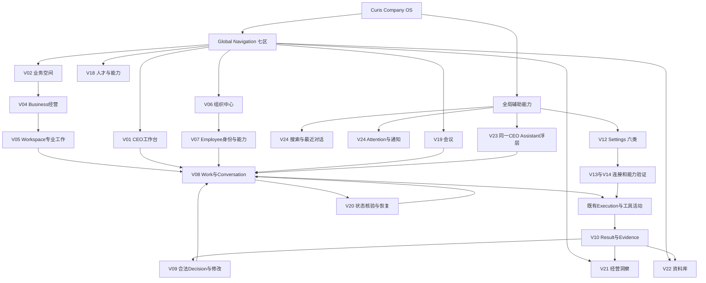
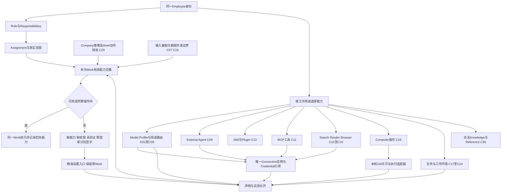
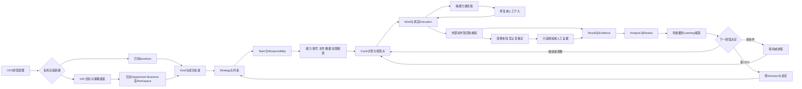
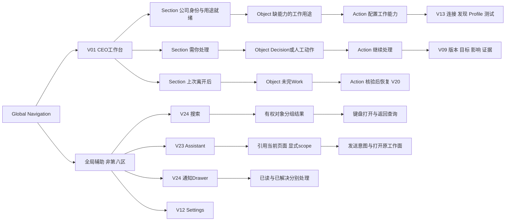
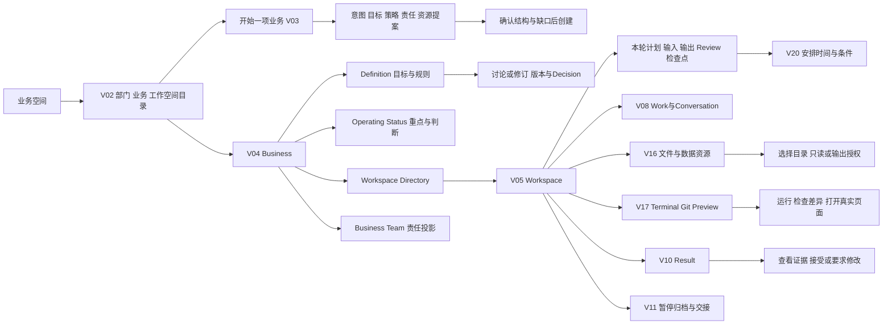
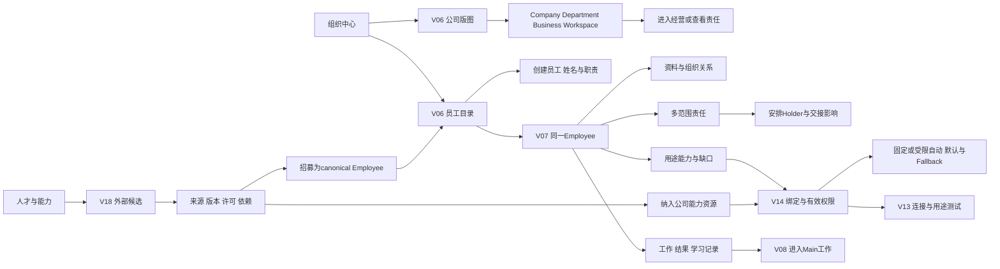
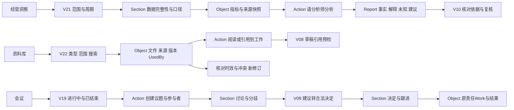
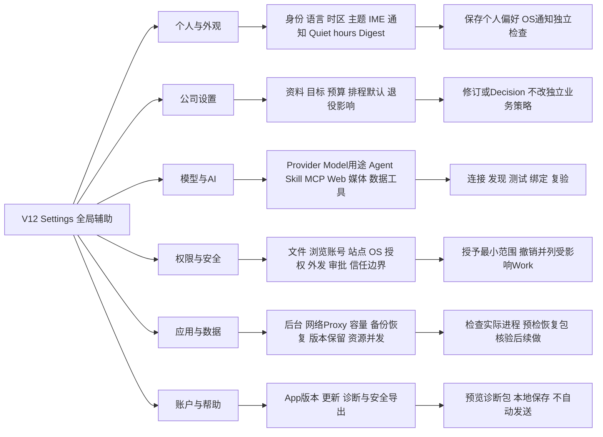
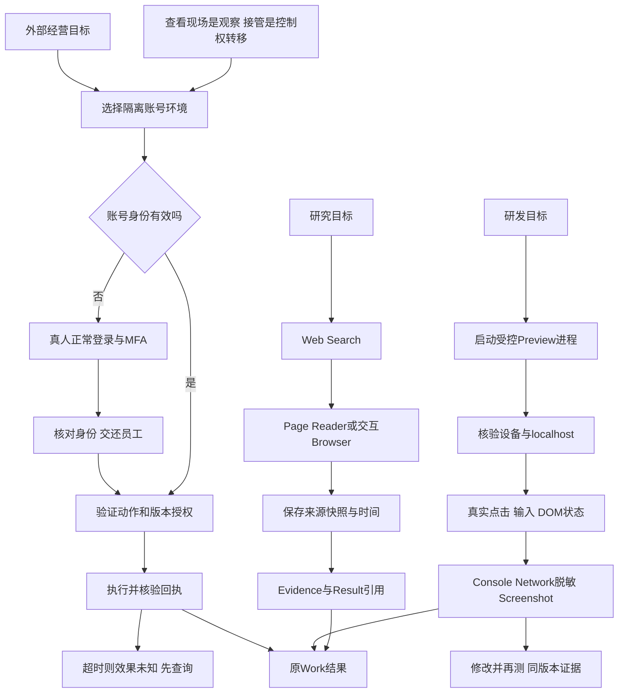
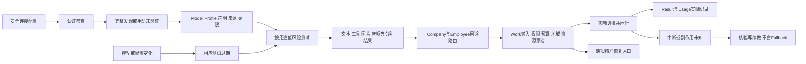

# CURIS FULL PRODUCT EXPERIENCE MAP

Authority Class: RESEARCH
Status: Review
Disposition: CANDIDATE MAP — NOT AUTHORITY / NOT UI DESIGN
Date: 2026-09-15 Asia/Shanghai

读法：V编号对应同目录Expression V2的Surface；C编号对应完整18步推导。箭头表示入口、引用或工作连续性，**不表示所有关系都是父子Schema，也不表示图中的能力已经实现**。七导航保持；Settings、搜索、通知和CEO Assistant是全局辅助。所有新合同待CEO Review及Blueprint仲裁。

## 图1 — Curis Full Product Architecture

## 图2 — Employee Capability Architecture

## 图3 — Business Operating Experience

经营链复用同一Work/Result/Decision；继续不是无条件创建新Cycle，已存在则打开原对象。Account是外部资源，Project/文件夹是工作资源，二者均不代替Workspace。

## 图4A — CEO工作台与全局辅助展开

## 图4B — 业务空间展开

## 图4C — 组织与人才展开

## 图4D — 洞察、资料库与会议展开

## 图4E — Settings六类到实际设置

每个设置详见Expression V2内S001–S077，共77条14字段合同。某个Work的排程/素材规格属于对象内输入，Settings只提供继承规则及定位，不另存一份同名值。

## 图5 — 三条Browser工作链与返回

## 图6 — 模型就绪与运行状态

## Gate

地图覆盖所有七导航及全局辅助、Employee能力架构、Business运行链、Browser和Model依赖。它是一份候选地图，不能作为Runtime能力存在的证明。G1–G6的产品合同和可交付边界须CEO Review后进入Blueprint Deep Reconciliation。结论仍为 **C. NOT READY — CAPABILITY GAPS REMAIN**；**STOP FOR CEO REVIEW**。
