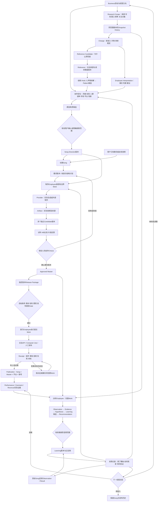
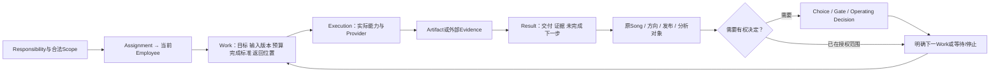
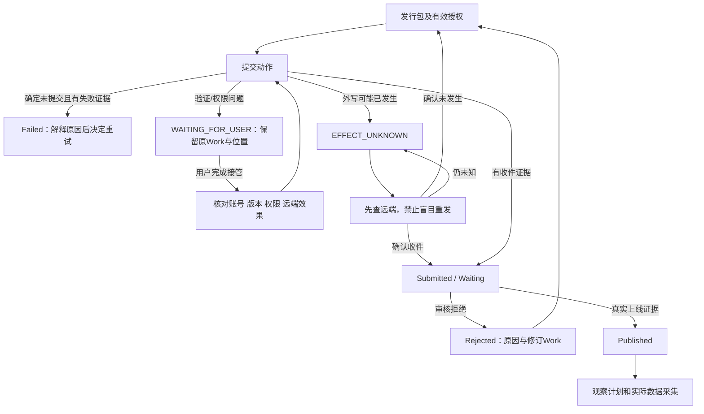

# Curis Music Business — 关系图与交接合同

Authority Class: RESEARCH
Status: Review
Disposition: CEO ACCEPTED RELATIONSHIP CANDIDATE / HTML EXPLORATION ACCEPTED；非Frozen、非Runtime图
Baseline: 工作区 HEAD 78cacbd0857cc36c9f3fe0e4b11346489993b728（含既有未提交资料）
Updated: 2026-09-23
Module: Music Business
Owner: CEO / Product
Supersedes: None
Target Authority: 本轮不写入。
Next Action: 随结构Candidate保留；按Closure移交Final UI与专项能力验证。
Next Gate: Final UI Master或真实Capability/Platform/Runtime专项验证；Authority吸收另需CEO Gate。

来源与证据等级统一见[结构候选§12](CURIS_MUSIC_BUSINESS_PRODUCT_STRUCTURE_CANDIDATE.md#12-来源定向补证与旧稿处置)，HTML接受边界见[探索Closure](CURIS_MUSIC_HTML_EXPLORATION_CLOSURE.md)。本图是产品关系，不是Runtime DAG、数据库Schema或强制线性操作向导；所有Music增强均为CANDIDATE。配套[断点审计](CURIS_MUSIC_BUSINESS_GAP_AUDIT.md)。

## 1. 完整经营关系

图中每个执行/研究Work都有Result，见§2，避免画成“只有最后分析才产出Result”。定位与方向可以多次修订，歌词与声音可以交替推进；已有素材允许进入Song后补定位。等待某个Choice不会冻结独立歌曲。

HTML已验证两条入歌路径：**已接受Direction→创建Song并继承固定方向版本**，或**直接创作→先建方向待确认的Song草稿→在Song内与制作Employee讨论并确认**。自然语言、引导标签与员工会话共同形成候选；标签不是Provider Prompt。Market首页先显示Scope/Evidence/Change，再让Employee解释。上述是产品表达验收，不等于后台自动扫描、生成或外部发布。

## 2. Employee / Work / Provider / Artifact / Result / Decision位置

- **Employee**：长期身份及责任承担者，可兼岗；不是Provider名称或一次请求。
- **Work**：一次有边界的研究、改词、生成、准备发行、核验、分析等。Song 1→N Work；每个Work有Owner。
- **Provider**：专业执行来源或外部通道，可能不同请求、多个输出、失败或未知。换Provider不换Song/Employee身份。
- **Artifact**：实际歌词/音频/封面/包等，有归属和版本；报告不取代真实文件。
- **Result**：Work回报，引用Artifact/Evidence，说明已做和未做、接收责任及下一去向。完成一项研究Work不等于歌曲完成。
- **Decision**：三种判断目的复用现有决定机制，不新造三个系统；登录接续不是默认经营决策。人确认后还要分别检查应用和外部生效。

## 3. 对象归属与基数

| 对象/关系 | 基数与责任 | 不可混同的事实 |
|---|---|---|
| Company→Department→Business→Workspace | 沿用Current；Music在合法Business/Workspace内 | Song不是新组织层级 |
| Business→市场资料、定位候选、Learning | 多条、长期可修订；按合法范围复用 | 不能默认跨业务读取未授权资料 |
| Reference↔Pattern↔Direction | 多对多证据引用；保存具体来源和版本 | Pattern推断不变为平台事实；多次引用不变成多份独立证据 |
| Direction→Song | 一个方向可派生多Song；直接创作Song可先待确认；每次Work固定Direction版本 | 改方向不热切在途Work、不改旧Candidate输入；新基线须显式重比较 |
| Song→Work | 一对多，制作/发行/分析可交错；各Work有Owner | Song状态不能只取最近Work状态 |
| Work→请求→Candidate | 一Work可多请求，一请求可多独立音频版本 | 请求成功但缺音频，不能算可试听Candidate完成 |
| Song→Lyrics/Audio/Cover版本 | 各自版本化，成品与发行包明确组合 | 改歌词文本不改变旧音频唱词 |
| Choice→Approved Master | 指向一个确切录音版本和批准记录；Song保多个历史Master | “当前Master”不能覆盖发行历史 |
| Master→Release Package | 一个Master可有多个目标平台包/包版本 | 平台要求、封面或署名变更需重查对应包 |
| Package→Submission→Publication | 包可有多次尝试；Publication按Song×Master×平台×账号×可核发行事实独立；同Song可多次发行 | 单一Song“发布状态”仅是汇总；同一次尝试的重复登记合并证据，不制造重复发布 |
| Publication→Observation/Comment/Revenue | 多时点、多指标；先归可核Publication，无法确认时只保平台作品/账号粒度 | 不明Master/版本不能强挂最新版本；账号粉丝不拆给歌曲 |
| Analysis→Learning→应用记录→后续Observation/Result | 结论候选、接受、具体采用、后续验证相互独立 | 调用/采用次数不是验证次数；无目标作品后续证据保持待验证 |
| 音乐语义锚点 | Song整体、固定音频版、结构段落、时间区间、歌词行或人声片段分型且注明依据 | 无真实对齐不把评论或器乐时间点伪装成精确歌词/唱法位置 |
| Employee→资产 | Employee管理/编辑资产；逻辑归属Business/Song | 离岗/换人不删除资产或历史作者 |

这是关系约束，未决定表、接口、对象ID格式或存储实现。外部Song ID、ISRC等只作已核对映射，不能替代内部身份或仅凭同名自动关联。

## 4. 每一次交接的输入、接收和完成证据

| 起点→接收点 | 交付与Result返回 | 接收责任/人参与 | 完成证据 / 失败返回 |
|---|---|---|---|
| O2经营→R1研究 | 目标、市场范围、预算/频率和研究问题 | E-R接受研究Work | 有来源快照或说明访问缺口；Result回研究及O1 |
| R1→R2拆解 | 具体Reference、为什么研究、可用材料 | E-R/E-P | 逐项特征及证据；不能听则标音频未分析 |
| R2/L1→R3定位 | Pattern/Learning版本、适用范围和反例 | E-R；用户确定偏好 | 定位保存、冲突/待探索项可见；不满足回来源 |
| R3→R4方向 | 风格/受众/语种/市场等已定要求 | E-R/E-P；用户Choice | Direction能逐项解释继承/变更，未确认保持候选 |
| R4→P1/P2 | Direction与采纳理由，关联Song | E-P接受；不得丢用户自有素材 | 同Song可找到来源、歌词/结构任务及负责人 |
| P2→P3 | 指定歌词/结构/方向快照、允许探索范围 | E-P | 发起前核对能力/费用/输入；冲突回P2，不能静默剪裁 |
| P3→P4 | 音频真实引用、每个Candidate身份、来源和差异 | E-P准备；有权人听选 | 能播放目标版本；失败/URL失效回P3明确缺口 |
| P4→P5 | Choice、确切候选、质量与未完项 | 有权创作者/审阅人 | 批准记录引用音频版本；AI建议不直接变Master |
| P5→D1 | Master和必要素材/权利线索 | E-D接手发行Work | 包引用固定版本；不全则列缺项回制作/用户 |
| D1→D2 | 指定包、平台账号、有效发布授权 | E-D；必要用户Gate | 合法通道可执行；未知政策/权限停在原包 |
| D2→D3 | 提交尝试/回执、远端状态证据 | E-D核验 | 提交与上线分开；未知先查，拒绝回D1不删Master |
| D3→A2 | 核对过的发布映射、观察窗口和所需数据 | E-A | 获得实际数据或记录不可得；计划到期不等有数据 |
| A2/A3→A4 | 指标、评论、发布版内容及来源/口径 | E-A＋E-P | 五层分析及反证；映射不清退回补证而非猜版本 |
| A4→L1/O2 | 经验候选、行动建议、证据/限制 | 有权用户/Leader | 接受/拒绝/继续观察记录；无决定不改重大策略 |
| L1→R3/P3→L2 | 学习版本、采用内容、验证条件 | E-R/E-P采用，E-A回访 | 本次输入确实包含改变；下一证据回L2，失败也保留 |

修订Direction的接续检查：待开始Work可重核新版本；在途Work先固定原输入与外部效果，再决定继续、取消或新增Work；旧Candidate/Lyrics/Master/Release Package/Publication保持各自历史引用，新版不能静默继承批准。Business跨Song会话的目标对象、版本与行动责任尚未通过HTML验证，不能只凭对话文本触发制作Work。

共同交接字段：合法Scope、目标对象及版本、输入来源、原Work/Result、交付、Owner/接收者、Done标准、未完成项、下一动作/检查时间、原位置。缺接收者则明确未接续，不以“已派发”当完成。

## 5. 发布与恢复分支

RE核对时若发现已收件则转Waiting，已上线则转Published；只在确认尚未发生且原授权仍有效时回提交。图中的恢复回路不是自动重试许可。用户放弃保留尝试及未知事实；平台不支持查询时保UNKNOWN，不以用户沉默推定成功。

## 6. 连续性反例走查（文档推演，未运行）

| 场景 | 本合同应有结果 |
|---|---|
| 从自有纯音乐开始，没有歌词 | 同Song导入为待审候选；定位后补，歌词不适用；试听与发行检查仍成立 |
| 两个输出来自同一Provider请求 | 两个可独立选择版本，Master可明确选其中一个 |
| 用户改定位后旧候选回来 | 保旧输入快照，显式过期；用户重比较，不覆盖新方向 |
| 换Provider或Employee离岗 | Song、版本、历史来源不变；新Work记新来源，合法交接责任 |
| A平台上线、B平台未知 | A继续观察，B先核验；不重发A，不把全Song标失败 |
| 评论只有“这首不错”，没有时间点 | 挂歌曲整体；不伪造副歌锚点或逐秒行为证据 |
| 用户选了B Master但下一天链接失效 | 批准历史仍在，资产不可用需恢复；不标可发布 |
| 新版B未发、A仍在平台 | 指标和评论归A或版本未知，不归本地B |
| 经验采用后效果差 | 保采用记录和反例，修订适用范围或停用，不隐藏失败 |
| 用户第二天重开 | 还原对象和待决、先核验外部效果，再继续；无后台能力不假称夜间完成 |

Verdict: CEO接受关系Candidate及HTML表达；Market→Reference→Direction、两条入歌路径、Song内创作和采用/验证分离经探索验证。外部运行、权限、持久化与平台能力仍未验证；PF-06跨Song/Business会话目标仍待Final UI。

CURIS MUSIC BUSINESS RELATIONSHIP CANDIDATE — HTML EXPLORATION RECONCILED / NOT FROZEN

STOP。
