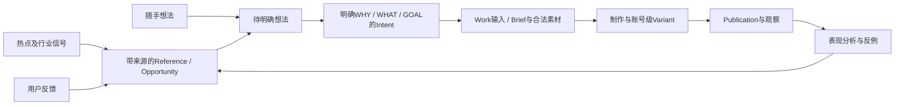
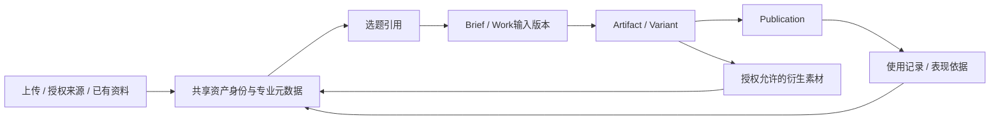
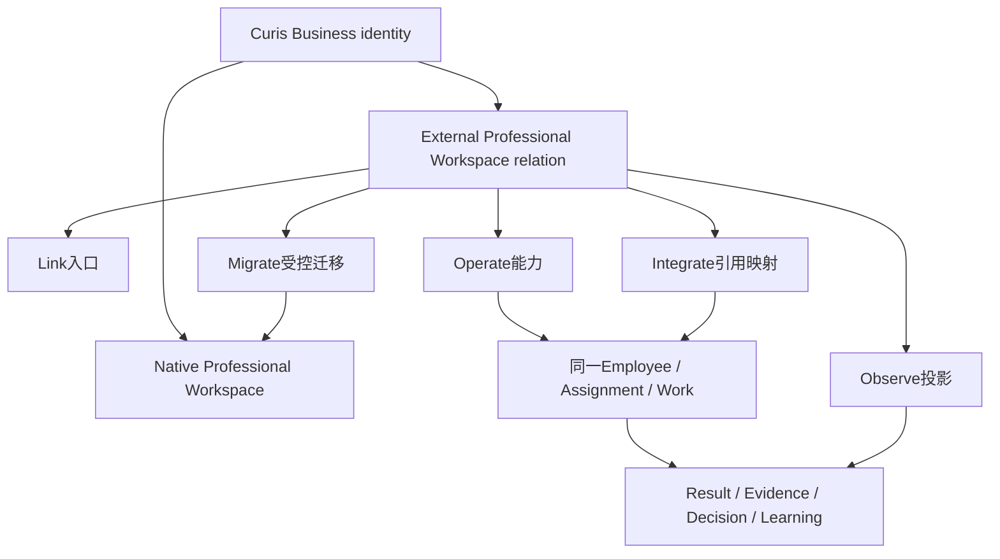

# CURIS CONTENT GROWTH PROFESSIONAL WORKSPACE REFERENCE STUDY

Status: Review
Authority Class: RESEARCH / REFERENCE-INFORMED PRODUCT CANDIDATE
Disposition: COMPLETE WITH TARGETED GAPS — NOT CURRENT AUTHORITY
Date: 2026-09-16 · Asia/Shanghai
Owner: CEO / Product Review
Next Gate: STOP FOR CEO REVIEW

## 1. Executive Summary

**Content Growth可以先作为独立专业产品被定义，再装入Curis；这与Current Product Truth兼容。** 当前Blueprint已经允许业务采用自己的专业工作面、对象、动作与交互，并将Professional UX列为Package一等资产。不能把此认识解释成另造一套Employee/Work/Result，或先写任意Web App再绕过Package约束嵌入。

本轮最明确的缺口是**DEFINED BUT NOT PRODUCTIZED**：已有账号目标、策略、Intent、Variant、Publication、指标口径和恢复语义，但主要专业Surface、动作入口、Quick Capture、Return、手录数据等还不足以直接交给设计师。不能据此说Curis没有这些业务能力定义，也不能把定义完整说成实装领先。

Workbuddy最值得学的是**具体操作链**，不是其完整经营模型：低成本记选题、形式分流、把关、手动发布包、从发布对象去补数据、从数据建议复制选题。其页面明确使用模拟引擎；真实发布、数据同步、复杂账号策略、商业结果与长期Learning没有被验证。

选取四个开源参考：Postiz、BrightBean、TryPost和Content Dashboard。前三个用于分发、团队/品牌和专业导航；第四个是研究/表现的窄范围对照，不是成熟多平台标杆。Hype Engine和Social Stats通过资格筛选后不做深挖。

候选采用**稳定Workflow工作区＋Format制作方法＋Account适配＋Platform约束**的Hybrid。默认仍是经营结果面；局部导航候选为经营、研究与选题、内容制作、发布、账号、复盘、素材，专业设置低频进入。具体菜单尚未获得批准。

本轮四份文档可供产品Review；**不是正式设计输入或Authority Patch授权**。结论B：开源登录后交互、真实人工回程与30账号负担仍需针对性验证；本轮没有通过这些实操验收。

## 2. Research Method / Evidence Index

### 2.1 执行顺序与证据等级

实际顺序为Workbuddy只读操作→六个GitHub候选核查→四个项目的官方页面/文档及固定commit前端静态检查→Current Curis对照→候选与反证。没有先读Curis再带答案找样本。

- **OBSERVED**：在用户电脑Workbuddy实际进入页面/打开未提交弹窗。浏览器看到官网只证明网页文字/入口存在，不等登录后产品实操。
- **OPEN-SOURCE REFERENCE**：固定commit的前端菜单/模板/字段/动作代码。证明该版本存在对应表达，不证明部署成功或外部效果。
- **DOCUMENTED**：官方指南或README；与上述两级分开。
- **CURIS CURRENT**：Current authority的目标产品合同。
- **INFERENCE / CANDIDATE**：推导/建议，不覆盖Current。
- **NOT OBSERVED**：本轮未观察到；不能反推产品绝不存在。

没有点击会保存/生成/发布的Workbuddy动作。打开“新选题/新形象/指定热点”查看字段后取消；“去录入”仅导航，未编辑会失焦保存的数字。无真实Token/Key、社交绑定、付费、外发或删除。

### 2.2 原始来源

| ID | Source | 本轮使用范围 |
|---|---|---|
| W | [Workbuddy模板公开原页](https://static.workbuddy.cn/workbuddy/playbook/cases/newmedia-factory-workbench/output.html)；本机WorkBuddy 5.5.6内当前模板 | 七个模块的实际AX/屏幕观察及只读弹窗；模板自己的版本未知；“本地模板/本地SVG模拟” |
| P0 | [Postiz repository](https://github.com/gitroomhq/postiz-app) | README、LICENSE、树、前端菜单及入口文件 |
| P1 | [Postiz产品位置指南](https://docs.postiz.com/general/where-things-live) | Rail/Channel/Calendar与非独立页入口；官方界面图 |
| P2 | [Postiz Global / per-channel](https://docs.postiz.com/general/composer/global-vs-per-channel) | 共享稿、脱离编辑、回到共享的覆盖风险 |
| P3 | [Postiz动作与统计](https://docs.postiz.com/general/posts/actions-and-stats) | Duplicate/Statistics、丢回执后关联已发布内容、错误提示 |
| P4 | [Postiz Analytics](https://docs.postiz.com/general/analytics) | 账号与单帖分离、平台支持差异、空数据原因 |
| B0 | [BrightBean repository](https://github.com/brightbeanxyz/brightbean-studio) | 固定模板，详见§6 |
| B1 | [BrightBean官方产品页](https://brightbean.xyz/studio/) | 实际浏览官方介绍/截图/登录入口；不是实际编辑器操作 |
| T0 | [TryPost repository](https://github.com/trypostit/trypost) | 固定Vue页面/菜单，详见§6 |
| T1 | [TryPost用户指南](https://docs.trypost.it/knowledge-base/introduction) | Workspace、账号entry、资产/标签/签名、独立发布与通知 |
| T2 | [TryPost官网](https://trypost.it/en) | 实际浏览；品牌/审批为官方表述，未实操 |
| C0 | [Content Dashboard repository](https://github.com/tenfoldmarc/content-dashboard) | Sidebar及七个产品页面的静态检查 |
| H | [Hype Engine repository](https://github.com/brudex/hype-engine) / [官方演示](https://hypeengine.cachetechs.com/) | 初筛；Demo实际跳至登录；README自称早期v0.1.0 |
| S | [Social Stats指定候选](https://github.com/cbsshekhawat18-lab/social-stats-social-media-manager) | 搜索及README资格信息；同名项目不混合 |

本轮下载：`/tmp/curis-newmedia-reference-20260916/`。`qualification.json`保留GitHub元信息；各项目有README、可获取LICENSE、tree.json和source/精准前端文件。没有clone进Curis，没有运行未知安装脚本，没有为本轮安装数据库/OAuth/付费API。源码下载不是运行验收；无本地运行项目。

UI观察证据是本会话Computer Use返回的实际页面AX与屏幕观察，下面Journal保留关键字段/动作；**未另行保存一套原始截图文件**，本轮不声称像素测量或完整截图证据包。需视觉复核时只针对列明缺口追加采集。

### 2.3 Research Journal

| Product | Mode / version | Action | Observed | Not executed / limitation |
|---|---|---|---|---|
| Workbuddy | macOS Desktop 5.5.6，模板版未知 | 七模块逐个进入 | 菜单、默认页、空态、字段、主动作 | 未验证真实执行/持久化/云同步 |
| Workbuddy | 选题中心 | 开新选题、取消；开指定热点、关闭 | 标题、形式可空、备注；模拟搜索说明 | 未保存/搜索热点/转选题/开工 |
| Workbuddy | IP形象库 | 开新形象、取消 | 全局唯一名字、描述、候选定妆图说明 | 未生成/保存 |
| Workbuddy | 发布→数据 | 点去录入 | 到数据表；数字失焦保存提示；复制选题入口 | 未改值/复制选题/登记已发布 |
| Hype Engine | Chrome Web | 官方Live Demo | 登录页，无公开工作区直接入口 | 不新建账号 |
| BrightBean | Chrome Web | 官方页→登录 | 介绍/截图、Google/email登录 | 未注册或进入工作区 |
| TryPost | Chrome Web | 官方页 | 导航、产品入口/文档 | 未注册/付费试用 |
| Postiz | Official docs + source | 定点读导航/编辑/动作/统计 | 具体路径与恢复说明 | 未登录后操作 |
| 四开源仓库 | GitHub固定commit | 元信息、前端菜单/相关Surface | 见§6 | 未生产环境启动、未平台接通 |
| Curis | Current authority | 外部研究完成后读取 | §23来源及分层 | 不读实现反推目标，不改Authority |

## 3. Workbuddy Product Anatomy

### 3.1 实际Surface inventory

| Surface | Entry | Purpose | Primary Object | Primary Action | Secondary Action | Next | Return |
|---|---|---|---|---|---|---|---|
| 选题中心 | 左栏默认 | 今天发什么 | 待做选题/热点 | 记一个新选题、开工 | 指定热点、转选题、放弃 | 开工结果未执行；概念接内容制作 | 左栏/关闭弹窗 |
| 内容工厂 | 左栏 | 四条产线及制作队列 | 形态/制作项 | 产线卡未见独立创建按钮 | 看队列状态 | 既有项显示完成→草稿箱 | 左栏 |
| IP形象库 | 左栏 | 保持人物形象一致 | 三个现有角色/出演数 | 创建新形象 | 看角色说明/锁定状态 | 新建保存未执行 | 取消弹窗/左栏 |
| 草稿箱 | 左栏 | 成品把关 | 待审核内容 | 空态，无实际审核按钮可验证 | 看通过/打回计数 | 指向发布，但本轮未走通 | 左栏 |
| 发布中心 | 左栏 | 分发及登记 | 待发/已发布内容 | 去录入（既有行） | 成品包说明/已发布登记说明 | 去录入实际到数据看板 | 左栏 |
| 数据看板 | 去录入/左栏 | 表现与手录 | 产线表现/数据行 | 编辑数字（未执行） | 一键复制选题（未执行） | 复制后的状态未知 | 左栏 |
| 系统设置 | 左栏 | 模型/模板运行参数 | 配置、演示参数 | 保存/连通测试（未执行） | 同步/重置（禁止执行） | 未验证 | 左栏 |

### 3.2 默认面与内容工厂

默认“今天发什么”显示待做、今日热点、制作中等摘要，下面直接给选题与热点行。每条选题带形式、来源、待做、时间和角度说明，再给开工/放弃。高频入口靠近工作对象，而不是先让用户理解所有系统概念。

四条产线实际文字：长图文“生文写稿→生图/搜图→自动排版”；短图文“封面大字→文生图→emoji正文”；口播“口播稿→AI配音→IP形象合成”；微短剧“剧本分镜→生图/生视频→剪辑合成”。长图文关联公众号，短图文关联小红书，所以它是**形式优先但含平台假设**，不是纯粹平台无关。产线卡点击没有进入新的制作面，不能编造每条线的编辑器或运行状态。

### 3.3 IP、草稿、发布、数据、设置

IP形象有名称、人设/声音、出演次数和锁图说明，解决重复出镜的一致性。出演后锁定旧图、新形象另建是模板选择；Curis长期使用更应研究版本保留，不能机械禁止演进。

草稿箱实际为空，显示必须把关、不可跳过及原始素材可下载。只证明该模板说明和空态，不证明完整审核实现。

发布中心明确“能直发就直发，不能直发就打包手动发”；说明图文包/视频包组成和手动完成后登记。既有发布行有“去录入”，真实进入数据面。数据面包含阅读/播放、点赞、评论、转发/收藏，提示蓝框失焦保存；公众号为演示抓取，其它平台手录。它有产线表现建议和复制选题入口，因此不能说它完全没有数据到行动；但没有证据说明建议如何计算、复制怎样关联来源。

设置混合模型API、本地模拟引擎、爆款阈值、热点保留期和演示速度。只有阈值/保留规则可能属于专业参数；API Key、演示速度、云表计数不是Curis行业产品答案。未读取实际Key。不同区块的演示数值不一致，不作为真实经营指标分析。

## 4. Workbuddy Operation Language Inventory

| Action（实际文字） | Surface | Trigger | Input | Result | Next | Why useful |
|---|---|---|---|---|---|---|
| 记一个新选题 | 选题中心 | 顶部按钮 | 标题必填、形式可空、备注 | 打开表单OBSERVED；保存未做 | 保存后状态NOT OBSERVED | 降低想法进入系统的门槛 |
| 指定热点 | 选题中心 | 顶部按钮 | 关键词 | 弹窗及模拟声明OBSERVED | 搜索未执行 | 用户可主动定研究范围 |
| 转选题 | 热点行 | 每行按钮 | 当前热点上下文；具体后续未知 | NOT EXECUTED | 未观察 | 来源到意图有明确动词 |
| 开工 | 选题行 | 每行按钮 | 当前选题；后续输入未知 | NOT EXECUTED | 未观察 | 比抽象“执行Intent”易理解 |
| 放弃 | 选题行 | 每行按钮 | 当前选题 | NOT EXECUTED | 未观察是否可恢复 | 允许筛掉不做事项；不能假软删除 |
| 创建新形象 | IP库 | 顶部按钮 | 名称1–20、描述10–500、图候选说明 | 新建弹窗OBSERVED | 保存未做 | 长期角色资产可明确维护 |
| 去录入 | 已发布行 | 行按钮 | 已有内容上下文 | 实际进入数据看板 | 数字可编辑 | 缺数据有就近回收入口 |
| 一键复制选题 | 数据看板 | 建议区按钮 | 当前表现建议 | NOT EXECUTED | 未观察 | 不让用户看完图后自行找创建入口 |
| 换一批 | 热点区 | 按钮 | 未观察 | NOT EXECUTED | 未观察 | 仅记录入口，不验证推荐质量 |
| 搜索热点 / 保存选题 / 保存形象 | 三个弹窗 | 确认按钮 | 相应表单 | 未提交 | 未观察 | 表单存在不等持久化成功 |

“送审”“送发布”“登记已发布”的完整按钮链未实操；“已发布”主要来自发布包提示文本。报告不将CEO最初举例自动当观察事实。

## 5. GitHub Candidate Qualification

按产品互补性筛选，不按Star排序。元信息为2026-09-16读取GitHub公开API，pushed_at不是代码质量或真实部署日期。

| Repo | Stars | Last push UTC | License | Qualification |
|---|---:|---|---|---|
| gitroomhq/postiz-app | 35881 | 2026-09-15 13:01:34 | AGPL-3.0 | SELECT：成熟度相对高，分发/回执/账号/统计定位具体 |
| brightbeanxyz/brightbean-studio | 2329 | 2026-09-15 17:43:35 | AGPL-3.0 | SELECT：Ideas与Post分离、审批/工作区有互补价值 |
| trypostit/trypost | 616 | 2026-09-14 17:39:41 | AGPL-3.0（API/README；LICENSE路径404） | SELECT：品牌/多Workspace、AI创建与账号级结果 |
| tenfoldmarc/content-dashboard | 2 | 2026-06-03 15:26:57 | MIT | SELECT AS CONTRAST：研究/Hooks/表现；不授予成熟标杆身份 |
| brudex/hype-engine | 0 | 2026-09-12 21:33:33 | AGPL-3.0 | DEFER：早期v0.1.0；Demo登录；与排程样本重叠 |
| cbsshekhawat18-lab/social-stats-social-media-manager | 本轮未核查数值 | 精确时间NOT CHECKED | README标MIT，未独立LICENSE核验 | DEFER：自称early-stage；名称歧义；没有高于已选样本的明确证据优势 |

不继续扩大样本。后三项绝不因“有功能列表”认定可靠。TryPost许可文件路径未确认，代码复用必须另查，不能凭API标记授予集成许可结论。

## 6. Selected Open-source Deep Dives

### 6.1 Postiz

固定commit `12136dcc5c43213b4b8c1fb8d0626fcc5e45665b`。核心定位是多Channel分发。菜单源码`apps/frontend/src/components/layout/top.menu.tsx`的`useMenuItem`包含Calendar/Agent/Analytics/Media等；`apps/frontend/src/app/(app)/(site)/launches/page.tsx`和`analytics/page.tsx`为页面入口。源码与官方指南相互支持，但本轮未进入实际账号环境。

| Surface | Entry | Purpose | Object | Primary | Secondary | Next | Return |
|---|---|---|---|---|---|---|---|
| Calendar | rail / launches | 组织发布时间 | channels/posts | Create Post/空时间格 | 筛选channel、卡片动作 | Composer | Calendar |
| Channel context | Calendar侧栏 | 管理发布目的地 | 已连账号/分组 | Add Channel | 菜单设置/slots/分组 | 连接/设置 | 同Calendar |
| Composer | Create/slot | 共同内容与渠道适配 | Global稿/各channel内容 | 编辑并排期 | 脱离Global、预览 | 发布项 | 原日历 |
| Post actions/statistics | 卡片hover | 复用/了解效果/修复关联 | 某发布项 | Duplicate/Statistics | Preview/关联已发URL | 新稿/统计 | 原卡片 |
| Analytics | rail | 账号维度指标 | 支持的数据账号 | 选择范围 | 查询支持限制 | 指标 | 原账号范围 |
| Media / Agent / Settings | rail | 素材、AI协助、低频配置 | media/agent session/settings | 依功能进入 | 返回当前任务 | 编辑或配置 | 原工作入口 |

特别有价值：已经发出但丢失远端ID时，从统计入口关联URL或远端近期帖子，避免把超时机械处理成重发[P3]。局限：这不证明完整无API手动发布/手录指标。官方文档也承认部分常用功能藏于modals不易发现[P1]；Curis应借动作就近，避免关键入口只能hover发现。

日常流程（DOCUMENTED）：看Calendar→从空位/创建进入→选账号与调整内容→安排时间→看失败/统计→复用。Goal/Strategy/Experiment/accepted Learning闭环NOT OBSERVED。Postiz是发布/恢复参考，不是整个Content Growth经营模型。

### 6.2 BrightBean Studio

固定commit `77d9a80c451b3104ed2cb27181ffcdefb5550961`。检查`templates/base.html`（Sidebar/New/Idea modal/Channel reconnect）、`templates/calendar/calendar.html`、`partials/publish_calendar_shell.html`、`_post_actions_menu.html`、`templates/analytics/_post_detail.html`、`_no_analytics_state.html`与`composer/partials/idea_card.html`。模板为产品表达证据，未跑Django环境。

| Surface | Entry | Purpose | Object | Primary | Secondary | Next | Return |
|---|---|---|---|---|---|---|---|
| Publish | Workspace入口/Sidebar | 内容状态与排程 | post/queue | 进入内容 | Calendar/list/drafts/sent/approval视图 | 编辑/审阅 | 同Publish范围 |
| New→Idea | Sidebar New | 先捕捉想法 | idea及media引用 | 建想法表单 | 选组/标签/素材 | idea工作面 | 关闭/原页面 |
| New→Post | Sidebar New | 明确制作发布稿 | post | 进入Composer | 渠道差异/素材 | 排期 | Publish |
| Create Idea | Sidebar | Ideas工作区 | ideas/group | 组织想法 | 转为Post（官方说明） | Composer | 题池 |
| Channels | Sidebar独立区 | 连接/健康 | channel/account | 看账号/连接 | 失效重连按钮 | OAuth修复 | 原Workspace |
| Analytics | Sidebar | 指标及单帖 | metrics/post | 选范围/看详情 | 无数据说明 | detail | 原统计 |
| Social Inbox / Notifications | Sidebar | 反馈/事件 | feed/notification | 路由存在，内部流程未深查 | NOT OBSERVED | UNKNOWN | Sidebar |

“New→Idea”与“New→Post”分离有直接源码证据，并允许Idea携媒体引用，支持Quick Capture及素材进入工作。Workspace选择跳Publish体现工作上下文而不是每次重新选所有账号。低频成员/设置与频道名单分区。局限：菜单“Intelligence”有条件，不能把它当所有版本均可用；统一社交Inbox本轮只确认入口。复杂学习/商业结果未证。

### 6.3 TryPost

固定commit `e28f42d028245ccd34f91321c602f34b0077f6c8`。检查`resources/js/components/AppSidebar.vue`、`pages/posts/Create.vue`的`startFromScratch`/AI view、`posts/Show.vue`的独立platform entry、`analytics/Index.vue`的账号选择/平台组件、`assets/Index.vue`、`settings/workspace/Brand.vue`、`welcome/Goals.vue`。Laravel/Vue栈，仅产品静态检查。

| Surface | Entry | Purpose | Object | Primary | Secondary | Next | Return |
|---|---|---|---|---|---|---|---|
| Calendar / Posts | Sidebar | 时间及状态组织 | posts | Create Post | all/scheduled/published/draft | Create/Edit | Calendar/list |
| Create | 全局创建入口 | 从零或AI创建 | 新稿 | scratch / AI wizard | 可携日历日期 | 编辑器 | 返回源页面（未实操） |
| Post detail | Posts | 看每目标效果 | platform entries | 查看内容/指标 | 看关联账号 | 详情 | 原Posts |
| Connections | Workspace菜单 | 账号管理 | social accounts | 管理连接入口 | 各平台连接流程 | 连接 | Workspace |
| Analytics | Sidebar | 账号分析 | selectedAccount/date range | 选账号 | 选时间窗 | 对应平台图表 | 原范围 |
| Assets / Brand | Workspace/Settings | 复用媒体和品牌约束 | media/brand | 进入资产或品牌表单 | 配置适用项 | Post生成/编辑 | 原Workspace |
| Welcome Goals | onboarding路由 | 初次目标选择 | goal choices | 选择继续 | just exploring互斥选项 | onboarding下一步 | 未运行 |

不能把Welcome Goals的存在误判为持续Account Goal/Strategy闭环。官网“所有网络一张图”的营销表述也不覆盖源码中按selectedAccount渲染平台组件的实际组织。独立逐账号entry有利于理解部分失败，但其整组汇总状态不能替换Curis逐Publication事实规则。审批/实时协作仅官方说明，本轮未实测；不写成Observed。

### 6.4 Content Dashboard

固定commit `d75bdd201c1f8ba62deb53f04ff024965f124e86`。检查`components/Sidebar.tsx`、`app/page.tsx`、`hooks/page.tsx`的`HooksPage`、`competitors/page.tsx`、`content/page.tsx`、`schedule/page.tsx`、`financials/page.tsx`。无官方可直接进入的Demo在本轮被确认；Supabase/Graph/Drive等依赖较重，停止搭建，静态查看足够用于窄范围产品对照。

| Surface | Entry | Purpose | Object | Primary | Secondary | Next | Return |
|---|---|---|---|---|---|---|---|
| Overview | MAIN | 汇集账号/近期信息 | 指标与研究摘要组件 | 入口存在，具体操作未完整验证 | 看模块 | 专项页 | Sidebar |
| Performance | CONTENT | 找高表现内容 | 最近Instagram帖子 | 刷新/查看 | outlier/指标比较 | 原帖 | 列表 |
| Hooks | CONTENT | 复用有效开头表达 | templates/hooks/creators | Copy | Views/Outlier/Recent、自有/收藏筛选、原帖 | 外部使用；无直接建立Intent链证据 | 同筛选 |
| Competitors | CONTENT | 研究外部作者 | profiles/content | 页面内竞品查询/列表 | 源内容 | Hooks研究 | Sidebar |
| Schedule | PUBLISHING | 视频队列分发 | ready/scheduled/published/failed | 安排发布/失败重排入口 | caption Regenerate、平台选择 | 发布计划 | 原队列 |
| Content Calendar | PUBLISHING | 时间组织 | scheduled content | 路由确认；本轮未读内部页 | NOT OBSERVED | UNKNOWN | Sidebar |
| Revenue / Financials | MAIN | 财务数据 | Stripe收入/订阅/交易 | Refresh | 搜索/类型筛选 | 交易详情展示 | 原列表 |

有价值的是“表现→可复制Hook→原帖证据”的中间层；局限是复制文本还不是完整Research→Brief→Production闭环，财务页也没有证明内容归因。源码中的加载失败只结束loading等边界提示不足以当成熟恢复参考。不要复用其个人Instagram视角作为Curis30账号架构。

## 7. Professional Workspace Reference Matrix

完整33维横向表见[CURIS_CONTENT_GROWTH_REFERENCE_MATRIX.md](CURIS_CONTENT_GROWTH_REFERENCE_MATRIX.md)。每格说明组织方式，未观察项不填假YES/NO。对照得到三个稳定判断：

1. 日历/发布导向产品也将账号选择与功能导航分开；重要Domain对象不必独占整个侧栏。
2. 想法、制作、分发、分析之间需要明确转化动作；用一个“新建内容”无法覆盖所有来源。
3. 工作台专业感来自连续动作、真实状态与范围，而非把所有数据塞进一页。参考的经营模型普遍未证实达到Curis目标中的责任/学习深度。

## 8. Navigation Pattern Comparison

| 工作类 | 参考如何组织 | 稳定工作区还是过滤 | 候选裁决 |
|---|---|---|---|
| Research / Ideation | W选题中心、B Ideas、C Hooks/Competitors | 稳定问题，来源/作者是子维度 | 研究与选题作为一面；热榜不独立一级 |
| Planning | P/B/T Calendar、B queue | 时间视图，不等全部经营计划 | 计划归经营；发布日历归发布 |
| Production | W内容工厂、其它Composer | 稳定专业问题，Format是方法分流 | 内容制作；不把每种形态做一级导航 |
| Publishing | 各参考均有队列/日历状态 | 稳定工作区 | 自动、人工、核验同一发布责任 |
| Account | P/B侧栏channels、T Connections | 管理入口＋上下文/targets | 独立Portfolio入口＋局部筛选 |
| Asset | W IP、P/T Media | 复用资源工作区 | 素材含品牌/IP视图，共享底层资料身份 |
| Analytics | 专用面/账号图表/帖子detail | 稳定问题；日期平台是筛选 | 复盘含数据质量与下一步 |
| Engagement | B有Inbox，其他不足 | 高频证据不足 | 首版反馈作为研究/账号入口；不先造客服Inbox |
| Commercial | C Stripe页，其他本轮未证 | 应与经营结果相关，不默认复制财务后台 | 只承接相关商业结果及来源 |
| Settings | 低频配置 | 不是日常工作面 | 专业规则本地、共享能力用Shared |

**Local Navigation与Context要在语义上严格区分**：前者选稳定工作问题，后者选当前问题里的对象/范围。可以同Pane，不等于同一个概念；关闭Context后仍必须知道当前在制作什么、为谁制作，并能找回局部导航。

## 9. Account Placement Study

**ACCOUNT PLACEMENT DECISION（CANDIDATE）：账号是长期经营对象，具有Portfolio、详情、筛选、目标和分析维度多种UI角色；不是唯一导航轴。**

W没有实际多账号Portfolio证据，因此不能据它否定账号经营。P/B Channel侧栏证明账号在分发现场很重要；T Analytics selectedAccount证明账号是统计范围；Current Curis Domain §5.4则要求目标/策略/历史/学习。候选把这些组合，不混同身份与摆放。

30账号下使用品牌/平台/健康筛选、保存视图和具体目标清单；发布选择与界面筛选分离。跨Workspace只能看到合法绑定/授权范围；一个账号关联多Workspace不等于全部策略和凭据可互读。

## 10. Platform Placement Study

**PLATFORM PLACEMENT DECISION（CANDIDATE）：平台放在Channel事实、账号来源、制作规格、分发Target和指标来源中。**不占稳定专业一级导航；确有平台专项问题时提供该视图而非另建Workspace。

这与Current的Channel / Channel Account定义相容。Current并未要求Platform-first导航，所以不能报告“Frozen平台结构错误”。问题是Stress Frame可能过度把对象选择当完整IA；本轮未对那两张Figma做新审查，不将其缺陷当现场证据。

## 11. Content Organization Study

| 组织轴 | 适用 | 不适用 |
|---|---|---|
| Platform-first | 规格核验、账号连接、渠道发布、指标解释 | 全部研究/制作导航 |
| Format-first | 选择需要的制作方法、工具与产物 | 替代账号策略/商业目标 |
| Workflow-first | 稳定工作区与当前状态 | 强迫所有内容跑固定DAG |
| Campaign-first | 有真实共同目标的计划/系列关联 | 首版无活动也强迫建Campaign |
| Hybrid | 工作区按问题，制作按形态，变体按账号，发布按目标/时间 | 同时堆五套平行导航 |

本轮推荐Hybrid。共同选题允许多账号适配；形式不是一个Business、账号也不是一个Workspace。全局复用只限合法上游资产，不能把B账号私有语气/策略带进A。

## 12. Production Line Study

**值得作为候选，不值得现在新增canonical实体或Runtime。**W中的口播和微短剧区别不只是视频尺寸，而是输入、人物、脚本、工具和把关不同；这证明“生产方法入口”有产品价值。其他样本多从Composer出发，没有证明一套固定四产线适合所有业务。

| 概念 | 最小含义 | 例子 | 归属候选 |
|---|---|---|---|
| Format | 产物表现形态 | 长文、图文、音频、视频 | 内容/规格元数据 |
| Production Line | 可复用制作方法与输出/审核合同 | 口播、访谈剪辑、微短剧 | 既有Package方法＋Skill组合的产品投影 |
| Platform Variant | 某具体账号的适配成品 | 某抖音账号的视频/文案版本 | 已有Variant |

Podcast、Newsletter、Livestream、长视频等不因研究列名就变已支持能力。Production Line只在真实能力/需求成立时提供。Current的Intent→Platform Form→Account Context→Variant不改；Format-first入口不意味着忽略平台规格直到发布前。

## 13. Quick Action Inventory

| Action | Frequency（推断） | Where | Context needed | AI involved | Manual/Auto | Result |
|---|---|---|---|---|---|---|
| 记灵感/新选题 | 高频 | W顶端，B New→Idea；候选全工作台可达 | 合法保存范围，账号可后选 | 可选 | 人工输入 | 笔记/待明确选题 |
| 搜热点/看来源 | 按需 | W指定热点，C研究 | 主题/合法来源 | 可聚合 | W为模拟；候选需真实来源 | 可追溯信号 |
| 转选题 | 高频 | W热点行 | 来源与目标 | 可建议角度 | 人确认或合法策略内自动 | Intent候选 |
| 开工 | 高频 | W选题行 | 意图/范围/必要Brief | 可选实际能力 | 按授权 | 原责任下Work/产物 |
| 上传/引用素材 | 高频 | B Idea/P/T编辑及Media | 来源/授权/范围 | 可提取描述 | 人工/合法导入 | 既有素材引用 |
| 新建草稿 | 高频 | P Create、T scratch/AI | 工作范围 | 可选 | 手工/AI | 可编辑草稿 |
| 送审/请求修改 | 风险驱动 | W只见把关声明；B模板/文档 | 版本/标准/责任 | 可检查 | 按权限 | Review结果 |
| 安排发布 | 高频 | P/B/T Calendar | 具体账号/版本/时间 | 可建议 | 明确授权后 | 发布计划 |
| 准备手动包/登记 | 条件高频 | W发布说明 | 账号/版本/目的地 | 整理，不假执行 | 人工接续 | 报告＋核验 |
| 去录入 | 定期 | W已发行 | Publication/指标窗 | 可辅助提取 | 人录入 | 来源明确的观测 |
| 复用/复制选题 | 定期 | W数据建议、P Duplicate、C Copy | 原内容/表现依据 | 可建议 | 用户触发 | 新工作/选题关联 |
| 创建实验/调整策略 | 周期性 | Curis候选复盘 | 假设/证据/批准边界 | 建议 | 依权限Review | 既有Work/Decision |

前3个低成本捕捉入口可全工作台近手（搜热点仍在研究面）；发布、审批、录入、重试必须靠近对象并说明目标。这里“高频”是研究推断，未做真实用户频率统计。

## 14. Research / Topic Flow

**CONTENT ORIGIN MAP（CANDIDATE）：**

转化不等复制所有原文。保存来源、目标与为何值得做，允许先记录再补全。C的Copy Hook证明可复用中间层，未证明自动转Brief；W的转选题仅入口Observed。Curis候选需有从新Work回源选题的双向关联，不新增Topic Runtime。

## 15. Asset / Reference Flow

**ASSET / REFERENCE REUSE LOOP（CANDIDATE）：**

素材不是Reference的竞争系统：文件字节、身份、权限与通用检索复用Shared；专业预览、镜头/封面、人物声音、品牌适用、平台规格及使用关系归Domain投影。不得把所有生产中间文件自动沉淀为公司正式知识；用户可筛选值得复用的版本。品牌/IP人设不是Employee身份，配音/肖像许可也不是模型能力。

## 16. Publishing Operation Language

完整逐状态表在[操作合同§4](CURIS_CONTENT_GROWTH_OPERATIONAL_PRODUCT_EXPRESSION_CANDIDATE.md#4-publishing-operation-language)。核心链：继续制作→必要把关→安排时间→逐账号执行/手动包→登记与核验→看效果→下一步。

自动、半自动与人工是动作的实际执行方式，不是三套发布系统。Unknown需核验；Timeout不等失败且未发生。P3支持“关联已发内容”这种恢复入口；W支持人工包可见性。不能因为提供下载包就说自动发布，也不能因为用户点已完成就伪造平台Receipt。

同组账号只能有**派生摘要**（如3成功、1待核验）；它不是新的Publication总体真相，也不改变BEST_EFFORT/ALL_REQUIRED对尚未执行部分的治理。原生定时、Curis本地计划和人工提醒必须分别表达。

## 17. Manual Data Entry

推荐**Publication Detail为单帖录入入口，Account Detail为账号级入口，复盘待补列表为聚合入口**。三者写回同一观测事实，不造Analytics Inbox第二数据源。

字段、时间/快照、订正、人工/同步冲突见[操作合同§3](CURIS_CONTENT_GROWTH_OPERATIONAL_PRODUCT_EXPRESSION_CANDIDATE.md#3-manual-data-entry-product-candidate)。该合同补的是入口、最少输入及回程；metric/unit/source/window/collectedAt/Unknown已经是Current要求。

W的“转发/收藏”合并显示可用于简化模板，但不适合Curis跨平台口径。累计播放截至时点≠昨日新增播放；录入时间≠数据观测时间。不要为了简单失焦保存而丢掉来源/历史。少量关键指标按决策窗口请求，避免每天几十字段的维护税。

## 18. Analytics → Action

本轮不能一概说参考都是ANALYTICS DEAD END：W确有复制选题入口，P可Duplicate，C可复制Hook。但“从图表到被验证的下一策略”仍未证实。

候选要求每个洞察有观察事实、范围/窗口、推断与局限、推荐动作、回链。可直接创建下一选题/实验Work、复用内容、调整批准范围内计划；高影响策略改变走P7。accepted Learning由已有授权Review产生，AI分析不直接改永久方法。没有可行动结论时允许“证据不足，先补这一项数据”，而非强行生成增长建议。

## 19. AI Placement

| Work area | AI有价值的介入 | 必须保留的直接操作 | 不应复制 |
|---|---|---|---|
| 研究 | 总结来源、去重、解释相关性 | 看来源/记想法 | 无源热点生成 |
| 计划 | 结合目标/节奏提出下一步 | 调整必要事实/批准范围 | 全局聊天代替计划面 |
| 制作 | 草拟/改写/媒体生成/适配 | 人工编辑、版本比较 | 只有聊天输出没有可编辑产物 |
| 发布 | 规格与缺项检查、包整理 | 明确目标/人工接续 | AI宣称成功替代Receipt |
| 复盘 | 解释口径、找反例、提出实验 | 看原数据/补数据 | 自动“接受学习” |

P的独立Agent面、T的AI Wizard与B的API/MCP是不同入口，不必全部复制。Curis复用现有Employee Conversation与Shared能力；专业Inline Action携当前对象/输入版本进入同Work，AI不可用时非AI操作仍合法。

## 20. Business Outcome

内容表现与商业结果分层：播放/互动/完播用于判断内容；线索/有效咨询/转化/收入必须有合法来源、时间、归因范围、成本及不确定性。C的Stripe收入页证明产品可以把收入作为Surface，但没有证明某条内容导致收入。

平台认证、提现、平台规则详情、原生商品/团购选择、复杂广告/创作者设置交给平台。Curis只需要相关状态、官方入口、必要摘要和Human Handoff回程，不复制钱包或承诺收益。Provider可承担数据同步/提交，但不能承担Curis员工的经营责任或分析判断。

## 21. External Workspace Integration

五级框架有用，但**不是必须逐级解锁的单轴成熟度**。可能能Observe但不能Operate，或只能Computer Use操作却没有稳定结构化读取。应按授权与能力分别声明，不显示一个笼统“已接入”。

| 程度 | Curis知道/拥有 | 外部系统仍拥有 | 必要合同 / 限制 |
|---|---|---|---|
| Link | 合法链接、关系说明/来源 | 所有外部业务记录 | 打开入口不证明读取或执行 |
| Observe | 带外部ID/来源/时间的只读投影及Evidence | 原始账号/外部任务/数据的来源事实 | freshness/范围/冲突/撤权明确 |
| Operate | canonical Employee/Assignment授权的同一Work与尝试证据 | 外部执行Task/Session和真实效果 | API/MCP/Computer Use各自可用性；未知效果先核验 |
| Integrate | canonical Work/Result引用关系与被接受的公司结论 | 外部域记录仍是其原始来源 | 映射、幂等关联、事件去重、回程、单一写Owner |
| Migrate | 经受控迁移接管的域数据和Workspace | 未迁移记录/平台事实/历史来源 | 映射验证、稳定identity、备份、切换、回退条件 |

外部Task ID作为origin/ref，不默默再复制成一个可独立执行的Curis任务。Curis主动委派产生一个canonical Work；导入观察到的外部任务先是外部记录，不因可见就成为委派。外部成品可成为Artifact/Result引用；来源Evidence只增补，不双向覆盖。外部账号不创建第二Employee；外部系统自己的用户身份只作Actor provenance。

**Truth原则候选：**同一字段/动作明确唯一write owner；外部原始指标保持source，Curis接受的经营结论归canonical Review/Decision。双方编辑冲突时停同步该字段并暴露差异，不靠最后写入覆盖历史。停用连接不删除外部来源或CurisBusiness。

Package First兼容“Package声明外部依赖/适配能力与Surface入口”；**External Workspace Adapter尚非已核查的完整Current合同**。不能因此创建第二Package类型或Adapter Runtime。本轮只是缺口与候选，API/MCP能接Postiz/TryPost也不证明端到端身份/恢复已闭合。

## 22. External Agent Boundary

- Employee → 可用External Agent Capability：员工用其执行工作，Employee identity与责任留在公司。
- Business / Workspace → External Professional Workspace relation：连接的是完整专业产品，可能内部包含Agent；不自动变Employee。
- Provider → 外部执行/数据能力来源：有具体动作与支持范围，不等Business，不等工作台，也不是责任Holder。

三者可以组合，不能把添加一个Agent当作迁入一个完整专业工作台。技术能力可用、权限有效、外部对象已映射、数据可信分别核验。

## 23. Curis Current Comparison

本节在外部研究之后读取：

| Current source | Status / Authority Class | 适用范围 |
|---|---|---|
| [Pointer](../../00_Context/PRODUCT_DOCUMENT_POINTER.md) Current Required Input | Frozen / Truth Router，2026-09-15 | 定位唯一Current链，不把Research Ledger当Authority |
| [Blueprint](../../01_Product/Curis_Product_Blueprint.html) | Frozen / CURRENT PRODUCT TRUTH | Company OS固定、专业工作区开放；Professional UX一等资产；Activation/Package身份边界 |
| [Master Map](../../01_Product/Curis_Product_Master_Map.md) §8及Professional Workspace | Frozen / Current | 已有账号字段/抽象动作/Return；Domain Navigation由Package声明 |
| [UI Blueprint](../../01_Product/Curis_Product_UI_Blueprint.html) | Frozen / Current UI contract | 默认经营结果、专业Main、按需Context/Utility；具体设计OPEN |
| [Domain Authority](../../03_Design/Curis_Content_Growth_Domain_Authority.md) §1–5.4 | Frozen / CURRENT DOMAIN | Intent/账号级Variant/Publication、账号经营、指标/人工/Provider边界 |
| [Shared Authority](../../03_Design/Curis_Company_OS_Shared_Authority.md) §10–19 | Frozen / Current scoped contracts | Employee/Work唯一性、能力、人工、效果未知、备份与迁移 |
| [Shell](../../03_Design/Curis_Workspace_Shell_Contract_And_Shared_Patterns.md) §0/§1 | Frozen / Shared空间合同 | Domain Navigation与Context可共用Pane；Main独立成立 |
| [RD Instance](../../03_Design/Curis_RD_Workspace_Instance_Spec_v1.md) | RD INSTANCE APPROVED；Shared supersession显式 | 仅轻量域对象/责任反证；旧员工栈不是当前Main定义 |

读取结果：Activation/Migration已在9月15日Current补丁中承接，不能再把本会话之前研究稿当未决Current。Content Growth仍Professional Workspace Candidate，未因文档存在获得Verified/发布资格。本轮不改这些状态。

| Classification | Finding |
|---|---|
| ALREADY STRONG（目标定义） | 长期Account Goal/Strategy/Cycle、身份/责任、逐账号真实效果、Unknown、人工回程、accepted Learning、商业结果证据 |
| DEFINED BUT NOT PRODUCTIZED | 研究/制作/发布/复盘已有语义，但局部导航与主要Section/动作/录入回程不足 |
| MISSING（本轮最小Current链） | 独立Persona资产版本/专业Production Line的具体产品合同、外部Workspace映射完整合同未找到 |
| OVER-ABSTRACTED | “生产Variant/读取数据/Review/继续”未必足以告诉用户按钮在哪里、点后得到什么 |
| OVER-PLATFORMED | Current未规定平台一级导航；只能报告某种表达风险，不能判Frozen错误 |
| OVER-ACCOUNTED | Current允许多账号且不强制一账号一Workspace；防止设计把Account选择当全部IA |
| KEEP AS IS | Company层级、账号/Workspace分离、Target≠Eligibility、逐Publication真相、共享身份/恢复/学习 |

**未发现需自行选择的Current Authority冲突。**新建议不改变Frozen；若后续要把默认面换成纯生产或强制所有内容人工审核，则需CEO明确Review，而不是本轮静默改写。

## 24. Gap Classification

| Gap | 具体问题 | 当前还是新增 | 建议 |
|---|---|---|---|
| OBJECT GAP | IP/Persona专业素材关系、外部Workspace关系未形成完整合同 | 真缺口候选，不直接新表 | 先证明专业元数据/引用够不够 |
| CAPABILITY GAP | 实际媒体制作/平台发布/数据接通未本轮验证 | 不能靠研究提升Verified | 另立能力验证，不补假UI |
| SURFACE GAP | 对象语义齐，缺完整专业工作区组合 | 主要产品化缺口 | 七局部工作区候选 |
| ACTION GAP | 开工/送审/核验/补数据缺具体入口 | 多数已有抽象动作 | 操作表达附件 |
| ENTRY GAP | 灵感/来源/成品如何进入不清 | 能力与入口断层 | Quick Capture、多来源进入 |
| RETURN GAP | 看平台/修连接/分析之后如何接回 | Shared有原则、Domain需展开 | 保对象/版本/筛选/Work |
| MANUAL BOUNDARY GAP | User Required有语义，无具体录入/发布包字段 | 产品表达缺口 | 原Publication/Account处理 |
| INFORMATION GAP | 某面最少应该看什么未落定 | 不新增经营模型 | 明确字段和数据质量 |
| NAVIGATION GAP | Local Navigation与局部Context混用 | Shared可承载，语义待澄清 | 问题导航与对象选择分层 |
| PRODUCT LANGUAGE GAP | 内部Intent/Variant/Eligibility直出 | 已有对象的用户表达 | 选题、账号版本、可发布条件等候选 |

## 25. Native / Reuse / Wrap / External Matrix

每行推荐只用规定枚举；WRAP只是未来候选，不等许可/实施批准。

| Capability | Product Need | Existing Curis Truth | Mature Reference | Recommendation |
|---|---|---|---|---|
| 账号经营/目标/策略到下一步 | 独立专业价值 | Domain §5.4 | 各参考闭环未证 | NATIVE |
| 选题/制作/发布专业IA与动作 | 用户实际工作 | Package Surface声明 | W/B/P/T | NATIVE |
| Intent/Variant/Publication领域关系 | 内容与逐账号事实 | Domain已有 | P/T部分相似，不能替换 | NATIVE |
| Employee/Assignment/Work/Result | 公司责任连续 | Shared已有 | 无需外部替代 | REUSE |
| Conversation/模型/Agent/Permission | 不重复能力系统 | Shared §10–19 | P/T不同AI入口仅参考 | REUSE |
| 文件/Reference/Evidence/通知/Handoff | 跨域同一真源 | Shared已有 | P/B/T部分能力 | REUSE |
| Persona/品牌素材产品视图 | 持续内容一致 | 账号tone已有，资产关系需补 | W/T | NATIVE |
| 日历/过滤/状态组织模式 | 排程效率 | 专业View合法 | P/B/T | REFERENCE |
| 媒体预览/转码/编辑组件 | 制作实际能力 | Shared工具可消费 | 现有仓库未做组件复用评审 | WRAP |
| 多平台Uploader/数据采集 | 发布/数据责任不能缺 | Provider边界已有 | P/T/B API可供后续验证 | EXTERNAL |
| 既有用户专业工作台 | 不强制重建 | 外部Task引用原则已有 | P/T/B API/MCP | EXTERNAL |
| 平台认证/提现/复杂商品/规则 | 现实平台责任 | User Required可接续 | 平台本身 | EXTERNAL |
| 模拟引擎速度/云表计数页 | 模板技术演示 | 非业务需求 | W | NOT NEEDED |
| 独立Line/DAG/第二任务系统 | 没有必要新增 | Shared明确唯一 | Hype Flow不宜照搬 | NOT NEEDED |
| 完整克隆Scheduler/Creator Center | 不能成为专业差异 | 可复用执行，不复制全产品 | 各样本 | NOT NEEDED |

产品参考价值与代码复用价值见附件A。所有选中项目代码复用均NOT ASSESSED；许可/跨栈/维护风险未闭合，不能因“WRAP媒体组件”推导“直接搬AGPL整个产品”。

## 26. Reference-informed Product Candidate

独立产品定义：**让内容团队围绕目标持续完成选题、制作、跨账号分发、真实反馈和下一步的运营工作台。**默认经营结果面；稳定专业工作区与当前对象范围分开；按方法制作、按账号适配、按实际能力执行；结果有来源、下一步有责任。

详见[独立工作台架构](CURIS_CONTENT_GROWTH_STANDALONE_WORKSPACE_ARCHITECTURE.md)。它不是Workbuddy放大版：不沿用固定四产线/模拟引擎/全人工审核；也不是Postiz加聊天：保留研究、账号策略、证据和接受学习闭环。

## 27. Operational Product Expression

完整页面/Section/User Sees/Primary/Secondary/AI/Manual/Context/Drill-down/Return见[操作表达附件](CURIS_CONTENT_GROWTH_OPERATIONAL_PRODUCT_EXPRESSION_CANDIDATE.md)，包括22个核心Surface/子视图行、最少输入、数据手录和逐状态发布动作。

这不是23个一级页面；很多是同一对象的详情或状态View。多个入口复用同一动作和事实，例如“去录入”与“待补数据”都进入原Publication观测输入。设计师仍需设计视觉与交互，但不应自行发明主要对象职责。

## 28. Standalone Workspace Architecture

完整Navigation→Surface→Object→Action图见[独立架构附件](CURIS_CONTENT_GROWTH_STANDALONE_WORKSPACE_ARCHITECTURE.md#standalone-structure-map)。三层分析框架有效但不是三套导航：

- Professional Operating：结果/目标/本轮重点/下一步。
- Professional Work Areas：研究、制作、发布、复盘、素材及账号经营。
- Working Context：Account、Intent、内容版本、Publication、Reference、筛选。

“独立成立”是用户价值/专业流程完整，不要求独立部署、独立登录、独立数据库。未来Writing/RD可用同一检验，不需要复制七个内容导航。

## 29. Curis Host Mapping

| Concern | Professional Workspace Owns | Curis Company OS Owns | Shared / Integrated |
|---|---|---|---|
| Navigation | 专业问题与局部菜单声明 | 公司七区及Shell空间 | Context可承载局部导航，Main可达 |
| Domain Objects / Actions | Intent/Variant/Publication/账号动作 | 身份/隔离约束 | 合法对象引用与授权 |
| Employee Identity / Responsibility | 声明所需责任WHAT | canonical身份/Assignment/WHO | 专业面投影Holder与Work |
| Conversation | 当前专业对象上下文 | 同一Conversation/Composer | 完整对话Main |
| Work | 专业输入/完成判据 | 唯一Work lifecycle/执行来源 | 不因切面另建Work |
| Result / Evidence | 专业结果解释/呈现 | canonical真源、不可伪造证据 | Artifact/Publication关联 |
| Decision | 专业建议/影响 | P7及批准边界 | 不是所有审核都Decision |
| Human Handoff | 告诉人需完成哪些平台动作 | 同Work接续/验证/回程 | 专业包与平台入口 |
| Model / Agent / Provider | 当前动作需要什么能力 | 统一连接/选择/权限/Usage | Provider不成为员工 |
| Permission | 账号/内容/动作约束 | 有效授权及安全边界 | 变化重新核验 |
| Reference | 专业预览/适用性/使用关系 | 身份、文件、范围/来源 | 无第二素材真源 |
| Analytics | 指标口径/领域比较 | 合法数据/Evidence/共享分析能力 | 真实0与Unknown分开 |
| Learning | 领域假设/适用范围 | 授权Review与accepted Learning | 不自动改永久方法 |
| Notification | 提供真实领域事件 | 唯一通知/待处理机制 | 原对象回程 |
| Settings | 节奏/品牌/方法/把关规则 | 凭据/模型/系统/通用权限 | 缺口定向跳转并返回 |
| Business Identity | 消费所属Business与Workspace | canonical Company层级 | 不由平台/产线产生新Business |

Local Navigation与Context可共用同一个左Pane，但前者回答“我要做哪类工作”，后者回答“这项工作针对什么”。本轮不把Context改名当答案。Shell默认Nav+Main；展开局部导航、关闭后的重入与范围可见性是待明确交互合同，不要求四列常驻。

## 30. Adversarial Review

| Attack | 判定与修正后的候选 |
|---|---|
| 1 只是放大Workbuddy？ | 否；去固定四产线/模拟成功，保账号策略、真实效果与学习；W仅操作语言证据 |
| 2 只是抄Postiz？ | 否；Calendar仅发布视图，研究/经营不是Calendar附属 |
| 3 功能太多？ | 有风险；计划/审核/日历为现有面子视图，Engagement/Commercial不各开新导航 |
| 4 又变CMS？ | 以Goal/真实反馈/下一步检验，而非文章数量 |
| 5 又变Scheduler？ | 发布只一段；研究来源和长期账号经营必须存在 |
| 6 又变Dashboard？ | 每项判断有行动/来源；没有证据就明确待补，不堆卡片 |
| 7 仍Platform-first？ | 平台是约束/目标/数据来源；不作默认工作区 |
| 8 Account过度控制？ | 想法可先记；跨账号工作面按需选范围，发布前具体Target必须明确 |
| 9 Production Line稳定吗？ | 只有W具体证据，跨方法稳定性未实测；降为可选方法投影，非canonical对象 |
| 10 忽略长期账号经营？ | 保Goal/Strategy/Plan/历史/学习，不以Connections页替代 |
| 11 忽略商业结果？ | 表现与商业结果分开；不承诺无证据收入归因 |
| 12 AI重复？ | 模型/Agent/Conversation复用Shared；Inline只携专业上下文 |
| 13 素材重复资料库？ | 共享身份/文件/权限，专业元数据/View，不建第二库 |
| 14 导航太多？ | 七局部工作区是上限候选，不同于七公司区；低频设置折入既有入口，未Ready不摆空墙 |
| 15 高频动作够近？ | Quick Capture全工作台；高风险动作靠对象。真实频率/可达仍需用户验证 |
| 16 无法自动怎么办？ | 原Work手动包→报告→核验→返回；不伪成功 |
| 17 数据有下一步？ | 洞察到选题/实验/计划的引用链；不强行每图生成建议 |
| 18 10平台30账号？ | 分组/搜索/保存视图/逐目标异常；不并列30编辑器；尚未完成交互负载验证 |
| 19 一年后仍可用？ | 版本/来源/订正/历史、按时间筛选归档视图；Package升级保Identity；未验证真实年量性能 |
| 20 能独立成专业软件？ | 产品职责候选成立；实际能力/用户价值验证未完成，不宣称商业产品已成立 |

轻量RD反证：Current RD已有人/责任、Version/Build/Test/Review/Blocker等专业对象；旧员工Workstation堆叠不能自动证明独立研发工作区完整。RD也应该交付Default Surface、Local Navigation、专业对象动作/Entry/Return及手动边界。这里只给跨域原则，不重研RD、不重画或修改Instance。

**PROFESSIONAL WORKSPACE PRODUCT CONTRACT（治理候选）：**每个Professional Package发布前需要能审阅的Product Thesis、Default Surface、Local Navigation、Core Surfaces、Domain Objects、Primary/Quick Actions、输入与结果、AI/人工边界、Settings Owner、Entry/Return、Result/Feedback、Identity-preserving Migration及真实证据。它补充现有Package UX一等资产的验收清单，不是第二Package规范，不在本轮Frozen。

## 31. Open Questions

| Targeted gap | 为什么影响产品 | 下一步只查什么 |
|---|---|---|
| 开源参考登录后实操不足 | 源码/文档不能证明操作负担、焦点/返回与真实失败流程 | 获得合法只读Demo/隔离环境后，只走Idea→Post→Review与账号切换；不用重搜项目 |
| W未提交写动作 | 不能证明开工/送发布/复制选题的实际接续 | 如后续授权独立可修改测试副本，再验证这三条；当前用户模板不动 |
| 生产方法长期稳定性 | 固定产线可能过早僵化或每任务一条 | 用图文、口播、已有成品三种日常任务验证同一方法投影 |
| 30账号/10平台可达与手录负担 | 筛选/目标误用会产生真实发布风险 | 专门产品走查账号范围与3种数据录入窗口；无需完整高保真 |
| External Workspace完整映射 | 当前只有共享原则，双写/外部自主工作治理尚未完成 | 选一个Provider做身份/单写Owner/Unknown效果/撤权合同验证 |
| 商业价值 | 产品候选不等用户愿意持续使用 | 真实运营者用一周计划与复盘资料验证是否减少切换/漏项 |

代码复用许可与模块适配NOT ASSESSED，不阻塞模式Review，但阻塞直接WRAP采购/移植决策。对比不需要为每个产品搭完整OAuth/数据库，也不值得再扩大相似样本。

## 32. Final Recommendation / CEO Questions

1. **Workbuddy最值得学什么？** 对象有近手动作，尤其记选题→制作、发布→补数据，产品语言比抽象对象名具体。
2. **最大局限？** 模拟引擎；多账号经营、真实外部效果、商业归因及学习未证。
3. **继续参考哪几个？** Postiz、BrightBean、TryPost；Content Dashboard作窄范围研究/表现对照。
4. **为什么？** 分别补分发恢复、Idea/审批、品牌/多账号entry、Hooks/原帖依据，避免重复样本。
5. **稳定导航模式？** 按研究/制作/发布/复盘等工作问题组织，账号与平台作为多种局部角色。
6. **默认首页做什么？** 表明当前经营结果与下一步；Scheduler默认日历有其定位，Curis不必照搬。
7. **Quick Capture价值？** HIGH；最小输入先记录，之后补目标，减少想法丢失和创建成本。
8. **Account放哪里？** 账号Portfolio/详情＋各面Filter/Context＋具体Publishing Target，身份不随位置变。
9. **Platform放哪里？** Channel事实、规格、来源、筛选、分发；不是Workspace身份。
10. **Platform-first还是Format-first？** Hybrid；制作按方法/形态，适配按账号/平台，稳定导航按工作问题。
11. **Production Line值得吗？** 值得候选方法视图；不新增固定四产线或执行Runtime。
12. **Research/Topic/Content关系？** 来源/机会→明确意图→Work输入/Brief→产物/账号Variant，保来源回链。
13. **素材如何入生产？** Brief/Intent关联合法引用、版本；衍生成品按许可回素材视图。
14. **发布自动/手动？** 同一Work、逐账号能力与事实；包/人工报告/核验，不假回执。
15. **手动数据在哪录？** Publication或Account详情；待补数据只聚合入口。
16. **Analytics如何回行动？** 依据→建议→选题/实验/计划/Decision，接受学习另按授权。
17. **AI嵌在哪？** 研究解释、Brief、起草/适配、校验、数据说明与下一步；直接编辑保留。
18. **参考常有而Curis抽象的？** 稳定局部导航、创建分支、状态视图、账号筛选、素材进入、就近补数/恢复。
19. **Curis已领先什么？** 当前目标合同对长期经营、责任、逐账号效果、Unknown、证据/学习更明确；不等实装或用户体验领先。
20. **最大问题缺Feature还是Productization？** 主要缺产品化，但媒体/执行真实可用性不能靠文档补齐。
21. **独立核心IA？** 经营、研究与选题、内容制作、发布、账号、复盘、素材；低频专业设置。
22. **能独立成为软件？** 价值主张与操作职责成立为候选；需实际能力和一周使用验证，不能仅因在Curis里宣称成立。
23. **装入后什么保持？** 专业工作区职责、对象动作与来源/回程，复杂制作和复盘保Main。
24. **Shell如何承载？** Domain Navigation与当前Context语义分开，可共Pane；Main关闭侧栏仍自成立。
25. **外部工作台如何接入？** 分别声明Link/Observe/Operate/Integrate/Migrate能力、write owner与映射；不是一键统一已接入。
26. **External Agent位置？** Employee可用执行能力；完整External Workspace是业务环境关系，Provider是执行/数据来源。
27. **Native什么？** 专业经营模型、IA/动作、领域适配和逐账号连续性。
28. **Reuse什么？** Employee/Work/Result/Conversation/权限/模型/通知/Reference/Handoff。
29. **Wrap什么？** 可独立核验的媒体/编辑组件候选；本轮未批准任何仓库移植。
30. **External什么？** 平台发布/数据适配、已有专业系统、平台原生复杂后台；责任仍在Curis。
31. **需要统一Professional Workspace Product Contract吗？** 需要候选验收清单，复用Package First，不建第二规范Runtime。
32. **可以进入产品真相修订吗？** 可以交CEO进行有针对性的产品Review；尚不能自动进入Authority Patch。先接受候选与明确缺口，之后再决定正式Reconciliation范围。

### Final Verdict

**B. COMPLETE WITH TARGETED GAPS**

Workbuddy七个模块完成只读解剖；六个GitHub候选完成筛选，四个样本完成限定产品级研究；Current对照、三份附件及反证已形成。开源登录后实操/30账号负担/人工动作写后状态尚未验证，不能将本报告写成端到端产品验收或Verified Professional Workspace。

**Curis Product Authority / Shell / Code / Database：UNCHANGED。**
**Workbuddy Template：UNCHANGED；NO PUBLISH / NO ACCOUNT BINDING / NO KEY INPUT。**
**Figma / Make / UI / Implementation：NOT STARTED。**
**NEXT：CEO REVIEW；不自行进入CONTENT GROWTH PROFESSIONAL PRODUCT TRUTH RECONCILIATION。**
