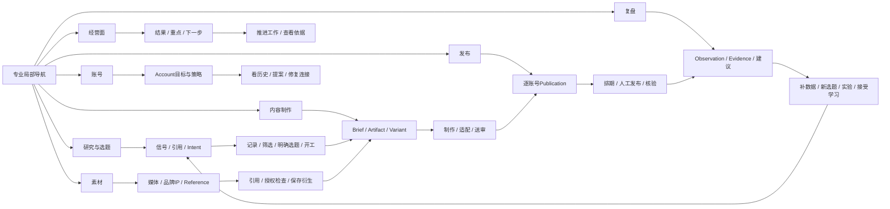

# STANDALONE NEW MEDIA OPERATIONS WORKSPACE

Status: Review
Authority Class: RESEARCH / PRODUCT CONTRACT CANDIDATE
Disposition: REFERENCE-INFORMED CANDIDATE — NOT CURRENT AUTHORITY
Date: 2026-09-16
Owner: CEO Product Review
Next Gate: STOP FOR CEO REVIEW

## Product Thesis

这是一款给独立创作者和小型内容团队使用的多账号新媒体运营软件：把值得做的选题变成合适的内容，把内容可靠地送到正确账号，把真实反馈变成下一轮行动。用户每天打开它，是为了知道今天该推进什么、完成制作和发布、解决等待事项、判断哪些做法值得继续，而不是为了看AI聊天记录或累计生成数量。

独立价值来自**选题到行动的连续性、多账号差异化、自动/人工混合执行、证据可追溯的经营反馈**。如果只能提供生成文案＋排期，它没有足够理由替代Postiz、AI Writer或平台创作者中心。上述独立价值是产品候选，不是现有Curis交付证明。

## Evidence and scope

- W：Workbuddy当前新媒体模板，七个模块实际只读进入；演示引擎，不是实发验证。
- P：Postiz官方用户指南＋固定commit前端菜单；未进入登录后产品。
- B：BrightBean固定commit模板/菜单/动作＋官方产品截图与登录入口；未创建账号。
- T：TryPost固定commit Vue页面＋官方用户指南；未进入登录后产品。
- C：Content Dashboard固定commit页面；窄范围Instagram研究/排程参考，非成熟多平台标杆。
- 详细URL、commit、限制及Surface Inventory见[主报告](CURIS_CONTENT_GROWTH_PROFESSIONAL_WORKSPACE_REFERENCE_STUDY.md)。下文全部为CANDIDATE，不能提升为Frozen。

## Professional Local Navigation

| 稳定工作区 | 用户要解决的问题 | 为什么长期存在 | 不包含什么 |
|---|---|---|---|
| 经营 | 现在结果如何、这轮做什么、今天先做什么 | 把长期目标和当日工作接起来；不把首页交给内容队列 | 全部KPI墙、第二任务系统 |
| 研究与选题 | 值得做什么、为什么值得做 | 灵感、热点、反馈和内容机会需要积累与筛选 | 每个来源网站一个导航 |
| 内容制作 | 把选定主题做成可审阅成品 | 制作、版本、平台/账号适配、把关是一类连续专业工作 | 每种平台一个Workspace |
| 发布 | 什么待送出、何时、是否真的成功 | 排期、逐账号执行、人工接续与核验同责 | 伪造统一发布成功状态 |
| 账号 | 每个经营账号的目标、定位、表现与健康 | 账号是长期经营对象，不只是OAuth列表 | 以账号树取代所有工作区 |
| 复盘 | 哪些结果可信、意味着什么、下一步做什么 | 数据质量、分析、实验、接受学习形成闭环 | 无行动出口的数据Dashboard |
| 素材 | 找到、使用、保留可复用的内容资产 | 媒体/品牌/IP资产需要专业预览与使用记录 | 第二套通用文件和资料库 |

这是七个**专业局部工作区候选**，与Curis七个公司一级区数量没有关系。专业设置为低频入口。首版不能实际提供的能力在相关Surface诚实说明，不展示空的“全能模块”。计划在经营/选题中形成，日历是发布的时间视图；审核是内容制作的状态视图，不再各增一个一级局部导航。Campaign/系列先作可选筛选及关联，不新建Campaign Runtime。

## Default Operating Surface

保留经营结果面的职责：经营状态、本轮重点、最新判断、下一步。先展示真实结果/变化及其时间与数据缺口，再给当日待推进的内容、待把关、待手动发布、待补数据、待核验事项。无真实例外不造告警；无数据显示不知道什么以及如何开始，不填0。

“今日”是同一经营面的时间视图；不是将默认面改成纯待办，也不是新增Operating Console。用户能从结果直接打开相关账号/内容/Publication，完成动作后回到原范围和滚动位置。无需每次先挑一个账号才能记录想法。

## Core Surfaces and objects

- 经营面：Goal、批准策略、当前计划/既有Cycle、相关Work、可信结果与下一步。
- 研究面：来源/Reference → Opportunity；选题池把已明确的WHY/WHAT/GOAL投影为Content Intent。随手笔记先保留为引用/草稿，不要求立即成立完整Intent。
- 制作面：Intent、制作Brief（既有Work输入/引用视图）、合法共享Artifact、账号级Variant、版本和Review。不把脚本草稿/Prompt写入Intent。
- 发布面：选定Target、Eligibility、逐账号Publication、真实回执、计划时间/平台定时能力、核验动作。
- 账号面：Account Portfolio、公司账号身份与合法binding、定位/Goal/Strategy/节奏/历史。
- 复盘面：数据来源与采集时点、观察窗、指标口径、Evidence、分析建议、实验Work、accepted Learning。
- 素材面：既有文件/Artifact/Reference的专业视图；内容形态、授权/来源、适用范围、版本、使用记录；Persona/品牌素材是候选专业元数据，不新增人员身份。

## Quick Actions

工作台内全局可达：记灵感、添加选题、上传/引用素材。输入最少事实；账号可后选，范围必须可辨。其余动作靠近对象：选题开工、送审、排期、准备手动发布、登记发布、录入数据、根据复盘建立下一步。不能把十几个高风险按钮永久摆在顶部。

## Account Placement

Account同时具有不同角色：

1. **身份**：真实长期经营资产，独立于所在页面。
2. **专业导航**：“账号”进入Portfolio，管理目标/策略/连接；不是每个账号都成导航项。
3. **Context/Filter**：制作、发布、复盘各自的账号范围；范围显式且可清除。
4. **Target**：某次分发选定的具体账号，不等于“当前筛选账号”。
5. **分析维度**：同口径比较；支持查看某账号历史。

30账号场景需账号搜索、平台/品牌分组、异常过滤和保存视图；不常驻30行账号树。批量选择必须展示实际目标及例外，不把列表筛选隐式升级成发布授权。

## Platform Placement

平台是分发Channel、账号来源、形态约束和指标来源，也可以是筛选维度。平台约束出现在Variant编辑、发布校验和指标定义处。它不是默认专业一级导航，更不是Workspace identity。平台原生认证、提现、复杂商品选择、规则详情留在平台，以状态、来源链接和人工回程承接。

## Production Organization / Production Line

采用**工作流程稳定、形态用于制作分流、账号/平台用于适配**的Hybrid。

- Content Format：长文章、图文、视频、音频等输出形态；不把全部未来格式列为已支持。
- Production Line：针对某形态重复可用的方法、输入、工具要求、把关和输出合同的组合。口播视频与微短剧可能同属短视频格式，却有不同人物、脚本与合成流程。
- Platform Variant：同主题在具体账号上的成品适配，包括平台规格和账号语气。

生产线值得进入候选，但只是专业方法的可选择投影，复用Package method/Skill composition/Work；不新增Line执行器或第二Workflow。平台约束尽早参与Brief，不能到发布最后一步才发现不能用。允许跳过不需要的制作步骤、导入已有成品；不要求每条内容都完整跑四条产线。

## Publishing

同一发布工作面提供队列/日历视图。每个账号分别说明：可自动提交、需人工、缺连接、未知支持、等待核验。准备发布→必要Review/授权→执行或人工包→核验→Publication事实。失败重试只作用于安全可重放的目标，已经成功的账号不重发。排程意图≠平台scheduled_at；错过时点不能默认补发。

人工包包含账号、内容版本、媒体、标题/正文/标签、必要平台提醒、目标入口；下载包或打开平台不等于发布完成。用户报告链接/时间后仍保留人工来源及验证状态。

## Analytics → Action

复盘先给数据质量，再比较同口径指标，再解释不确定性，再提出可操作建议。动作：据此创建选题、复用某内容、调整已批准范围内计划、建立小实验、提交高影响策略决定。每个动作带回来源与Observation Window；生成建议不自动变永久Learning。

区分内容表现（播放、互动、完播）与商业结果（线索、转化、归因收入及成本）。没有归因证据不能把流量换算收入；不复制平台钱包、订单和广告后台。

## Manual Boundaries

主入口是Publication Detail的“录入表现”；复盘“待补数据”聚合相同记录，账号详情处理账号级数据。录入对象、指标口径/单位、观测时点或窗口、来源和人工标记。空值不填0，新增观测不覆盖旧事实，订正保留历史。完整字段与发布动作见[操作合同](CURIS_CONTENT_GROWTH_OPERATIONAL_PRODUCT_EXPRESSION_CANDIDATE.md)。

## Assets / AI / Settings

素材通过选题或Brief引用进入制作，产出的成片/封面可按授权重新入库；保留源、衍生版本和使用关系。人格/IP素材不是Employee，不套用Workbuddy“出演后永久不可改”硬规则；版本化更新、保留历史使用更适合长期业务。

AI嵌入研究归纳、选题建议、起草/改写、形态适配、校验、数据解释和下一步提案。普通编辑仍直接可用；自动执行必须过既有权限/能力检查。共享Assistant协调跨工作区，不替代专业页面。

专业设置只放目标受众/品牌语气、合法目标账号集合、节奏、把关标准、相关方法选择、指标更新提醒和业务授权摘要。模型/API/凭据和系统配置用宿主统一能力；平台复杂设置回平台。

## Standalone structure map

图是产品职责关系，不是UI稿或Runtime状态机。

## CURIS HOST MAPPING

| 独立工作台职责 | Curis装配 | 必须保留/边界 |
|---|---|---|
| 专业Local Navigation | Workspace Package声明，Context Pane可承载；Main保留可发现的切换入口 | 局部导航与局部筛选语义分开，即使共用Pane；不增加公司一级区 |
| 专业Main | 当前selected Professional Surface | 制作/复盘复杂工作保留完整Main，不挤到Utility |
| 当前账号/内容/素材选择 | 当前Surface bounded Context | 关闭Context后Main仍说明当前范围；不展示全公司树 |
| 辅助来源/回执预览 | Utility | 长时间编辑回Main；关闭不丢工作 |
| 员工、责任、Work、Result/Evidence、Decision | Company OS canonical truth的领域投影 | 无第二身份、队列或学习真源 |
| AI、Provider、Permission、通知、人工接续 | 共享能力，在专业对象处进入并原路返回 | 不在专业设置再建API Key体系 |
| 账号/Intent/Variant/Publication/指标口径 | Content Growth domain | 保持逐账号事实、Target≠Eligibility；Production Line不取代冻结关系 |

**兼容性裁决：**“先证明专业产品独立成立，再装入Shell”的产品推导顺序兼容当前Blueprint；并不授权先造一个独立技术monolith再iframe嵌入。Package First与受控Registry保持。当前Shell已经容纳Domain Navigation；需要澄清Local Navigation/Context的可达与职责合同，不需要本轮改名或改Four-Pane。
