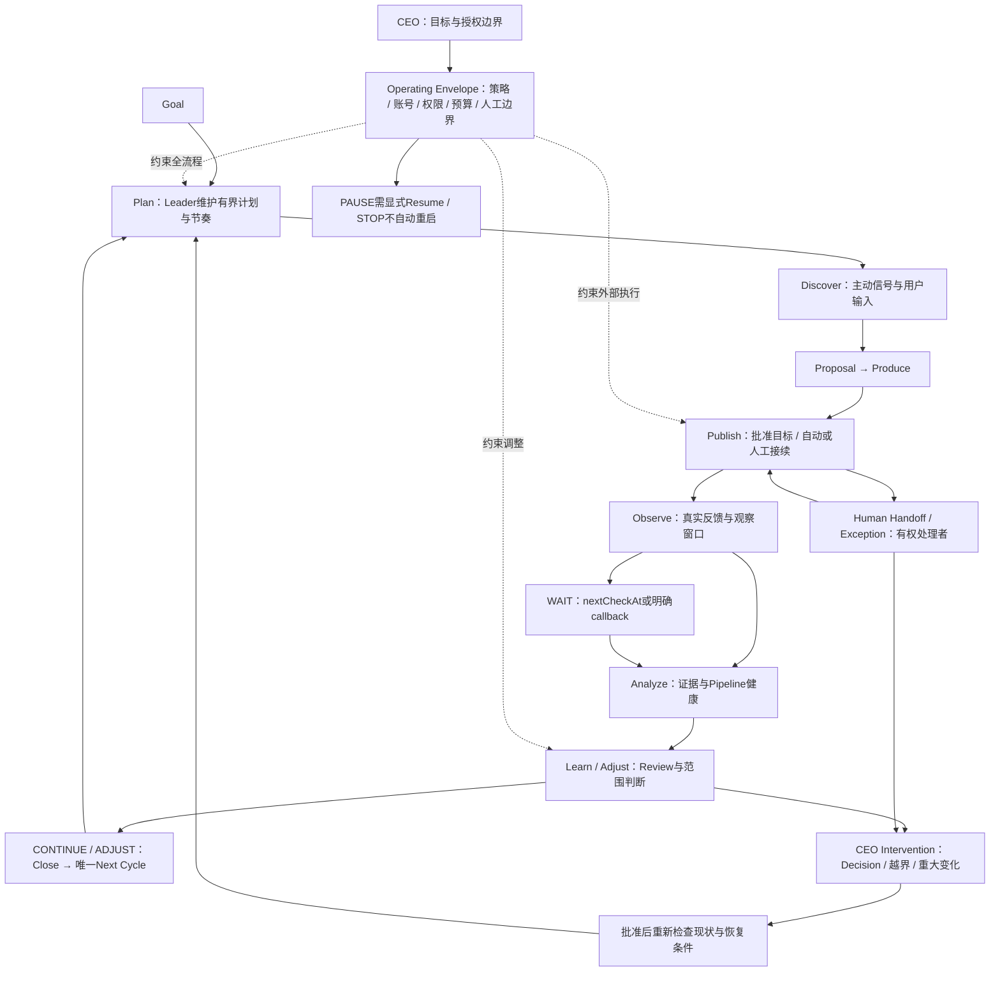
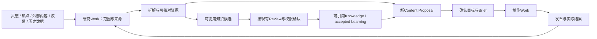
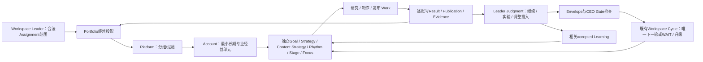
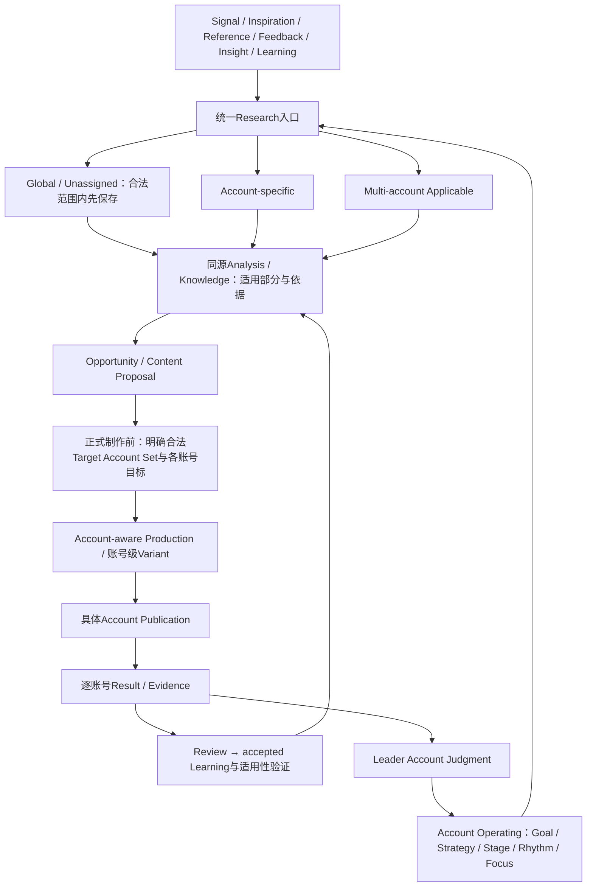
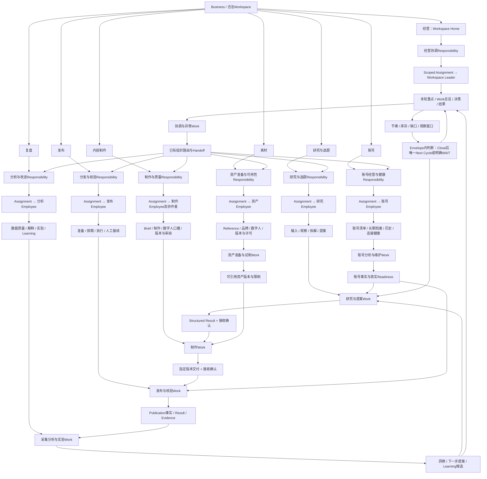
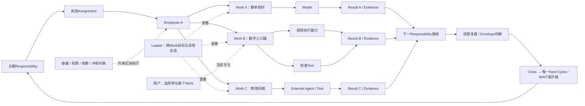

# CONTENT GROWTH PROFESSIONAL WORKSPACE PRODUCT STRUCTURE — CANDIDATE

Status: Review
Authority Class: RESEARCH / PRODUCT STRUCTURE CANDIDATE
Disposition: PRODUCT STRUCTURE CANDIDATE READY FOR CEO REVIEW — NOT CURRENT AUTHORITY
Date: 2026-09-16
Owner: CEO / Product Review
Next Gate: STOP FOR CEO REVIEW

## 1. Product Structure

**最终候选：一个Content Growth Professional Workspace，包含7个长期专业工作区（1个经营首页＋6个专业工作区），由一支有明确责任边界的AI专业团队持续经营。** Work Area在本文指专业Surface集合，通过既有Professional Surface + Shared Work Area表达，不是新的Workspace、组织节点、执行Scope或与Shared Work Area平行的系统。

目标是经营账号、把有根据的内容机会变为可用成品、可靠分发并让反馈进入下一轮，而不是让CEO管理七套工具。CEO既能直接操作对象，也能找负责员工讨论和委托；员工在授权范围内持续推进工作，页面只是同一工作的入口与投影。

### 1.1 两项必要修正

1. **Workspace Leader对本Workspace经营负责，不天然拥有整个Business。** 一个Business可以有多个Workspace。首页类似本工作空间的经营工作台，不能复制公司CEO Desk或替代Business整体管理。只有另有Business Leader Assignment时，同一个人才能在相应范围处理整个Business；身份一人、责任范围分开。
2. **Employee不是某个Responsibility本身，也不是一次性Agent Session。** Employee是稳定公司身份，通过可变Assignment持续承担一个或多个责任；Responsibility在换人后仍存在，历史不改写。用户所说“长期Responsibility Owner”作为员工的产品角色成立，不能作为一对一身份定义。

关系保持：

```text
Work Area / Surface（声明需要什么工作）
→ Responsibility 1..N / Requirement（WHAT）
→ 既有Organization Routing
→ scoped Assignment
→ Employee 0..N（当前责任承担者，缺员诚实显示）
→ Work 0..N（每个具体Work有明确Owner / 协作者）
→ 可用Model / External Agent / Tool
→ Structured Result / Evidence
→ 下游责任接续或经营判断
```

每工作区有一个主要责任域，可有多个细分Responsibility；每项责任的当前accountable Holder必须明确。多人共同工作不是模糊共同Owner。页面不硬编码employee_id，切换页面不建员工、Work、Cycle或Session。

### 1.2 输入与Authority核对

- RESEARCH：[上一轮主报告](CURIS_CONTENT_GROWTH_PROFESSIONAL_WORKSPACE_REFERENCE_STUDY.md)、[矩阵](CURIS_CONTENT_GROWTH_REFERENCE_MATRIX.md)、[操作表达](CURIS_CONTENT_GROWTH_OPERATIONAL_PRODUCT_EXPRESSION_CANDIDATE.md)、[独立架构](CURIS_CONTENT_GROWTH_STANDALONE_WORKSPACE_ARCHITECTURE.md)，均Review/Candidate；本轮未修改。
- VIDEO OBSERVATION：此前已查看[大华AI视频](https://www.douyin.com/video/7679718469675404596)的章节画面/字幕；00:18账号作品与复盘，00:25–00:50主动收藏/对标与关键词，01:07内容任务，01:20数字人口播，01:28剪辑样式，01:40技能入口。只作为演示证据，非底层能力验收。本轮没有继续搜索或重做竞品操作。
- CURIS CURRENT：[Blueprint](../../01_Product/Curis_Product_Blueprint.html) Professional Workspace/Activation、[Master Map](../../01_Product/Curis_Product_Master_Map.md) Professional Workspace / Multi-Surface及Content Growth Account Operating、[Shared Authority](../../03_Design/Curis_Company_OS_Shared_Authority.md) §0.1/9/10–19、[Domain](../../03_Design/Curis_Content_Growth_Domain_Authority.md) §1–5.4、[Shell](../../03_Design/Curis_Workspace_Shell_Contract_And_Shared_Patterns.md) Current spatial applicability，均按各自Frozen/Current范围消费；[Pointer](../../00_Context/PRODUCT_DOCUMENT_POINTER.md)仅作路由。
- 并行产品关系有Current支持；Master Map明确parallel multi-Work等仍有Product→Implementation Gap。本轮不检查Runtime，不授予实现验收。
- 未发现Current要求固定常驻Context Pane；它是Adaptive。语义Context与Pane分开兼容现合同，见§8。
- 本文的菜单、责任分解、数字人管理、知识拆解字段和具体页面合同均为CANDIDATE，不能因为本文完成而成为Current。

## 2. Final Local Navigation

| Navigation | Purpose | Responsibility | Responsible Employee Pattern |
|---|---|---|---|
| 01 经营 | 结果、本轮重点、下一步、跨责任协调 | Workspace经营领导与计划协调 | 一个有效Workspace Leader Holder；其他责任Owner提供真实结果，不固定新建员工 |
| 02 研究与选题 | 信号→分析/知识→内容提案 | 内容研究、机会判断与选题质量 | 研究责任Owner＋按需资料分析/选题协作者；同人可兼任 |
| 03 内容制作 | Brief→账号适配→可审阅成品 | 内容制作质量与交付 | 制作责任Owner；按Work分给文案/视觉/视频等具备能力的Employee |
| 04 发布 | 逐账号排程、执行、核验与恢复 | 分发正确性、回执与人工接续 | 发布责任Owner＋各Work Owner；Provider不成为负责人 |
| 05 账号 | 长期档案、绑定、准备状态与历史；当前策略执行进入经营 | 账号经营与合法绑定/策略维护 | 账号经营责任Owner；可按账号集合委派，不一账号强配一员工 |
| 06 复盘 | 本期概览→趋势→对比→分析→下一步；缺数就地提示 | 经营分析、效果判断与学习建议 | 分析责任Owner；可由公司Analyst经合法Assignment服务，不复制Analyst |
| 07 素材 | 素材、品牌、数字人、参考资产的可用性与复用 | 专业资产质量、授权、版本与使用 | 素材责任Owner；数字人资产可有专责或兼任，不自动新增Employee |

**明确不新增导航：**数字人在素材内设稳定栏目；数字人口播在内容制作内设制作入口。计划归经营，日历归发布，草稿/把关归制作，实验/待补数据归复盘。平台、格式、账号选择是相应对象/过滤维度；专业设置是低频入口，能力库/模型配置复用Shared。专业局部7项与公司一级7区是不同层级。

账号与复盘不合并：前者维护长期档案/绑定/准备状态，后者负责“证据支持什么结论”；当前账号怎样经营由经营Account View解释和推进。制作与素材不合并：前者交付某项成品，后者持续维护多项工作共同依赖的资产。允许一人兼任，不能因兼任抹掉职责和结果标准。

## 3. Workspace Home

经营页是**Leader Operating Surface**：默认经营本Workspace合法账号组合（Portfolio），可下钻Account Operating View。不是团队状态Dashboard，也不是第二账号详情。原持续经营和Professional Work Area合同按CEO反馈“基本接受”继续保留；本轮新增Account经营与研究适用性仍待Review，未升级Current Authority。

**CANDIDATE：Content Growth是Portfolio Operating，Account是本专业域最小长期经营单元。** Account不是第五Runtime Scope，不新增Account Cycle；Workspace Leader只负责其Assignment覆盖的账号组合，不天然获得整个Company或其它Workspace的账号权限。每Account保留独立定位、受众、阶段、Goal、Strategy、Content Strategy、Rhythm、Focus、Experiment、Result、Learning和Next Step；可引用共同品牌依据，但不能由同Workspace推定策略相同。

| Scope | Section | User Sees | Leader Responsibility | Primary Action | Drill-down |
|---|---|---|---|---|---|
| Portfolio | 组合经营与账号分布 | 正在经营的平台/账号、阶段、定位摘要、可信趋势/未知、投入建议 | 判断组合优先级，不跨口径相加播放量/收入或用总量掩盖单账号异常 | 讨论组合/进入账号经营 | 同Account Operating View |
| Portfolio | 本轮重点与资源安排 | 优先账号、当前Plan、各账号Work/容量及已用/在途预算；为何投入这里 | Envelope内协调研究/制作/发布/复盘，避免单账号挤占全部资源 | 调整授权内优先级/参与Work | 原专业区及Work |
| Portfolio | 供应与节奏健康 | 按账号的有效库存、待把关/发布、窗口、即将断档、阻塞及不确定性 | 按账号节奏补Work，不能用A库存掩盖B缺口 | 看缺口/安排准备 | 制作/发布/复盘 |
| Portfolio | 结果、实验与经营判断 | 重要Result、账号增长/停滞/异常、实验窗口、可比依据、需调整账号 | 决定继续、实验或调整投入，受保护变化升级 | 看依据/讨论判断 | Account经营/复盘 |
| Portfolio | 下一轮与待决定事项 | 下一Plan、检查时间、责任；有事才出现Decision/Human Handoff | 接续唯一下一Cycle或明确等待；带建议升级 | 讨论下一轮/处理必要决定 | 原提案/Work/Decision |
| Account | 身份、阶段与目标 | 平台、唯一账号身份、定位/赛道、受众、阶段、当前Goal及证据/版本 | 理解经营现实、维护目标连续性；改受保护目标必须Gate | 和Leader讨论/看档案 | 账号长期档案 |
| Account | 策略、内容方向与节奏 | Strategy、Content Strategy、Tone/Format/Content Mix、发布频率、当前Focus及理由 | 解释并维护批准范围；不自动套用其它账号策略 | 讨论方向/发起针对研究 | 研究/原策略提案/发布 |
| Account | 当前推进与供应 | 相关Work/Owner、库存、排期、投入、阻塞和当前问题 | 调度责任和资源，保持账号节奏 | 参与Work/看缺口 | 原专业工作区 |
| Account | 实验、结果与学习 | 当前实验/观察窗口、最近可信Result、Evidence、相关accepted Learning及限制 | 判断继续/实验/增减投入；不把样本不足当策略失败 | 解释结果/看实验 | 复盘及原证据 |
| Account | Leader判断与下一步 | 当前问题、判断理由、建议行动、下一检查/准备、必要Decision | Envelope内推进，越界请求CEO | 与Leader讨论/参与下一步 | 研究提案/具体Work/Decision |

每Scope都允许直接与同一合法Leader讨论；对话引用当前Scope和对象，不新建Leader身份。Work列表服务经营判断，不以员工忙闲作为首页目标。空组合显示无合法账号/绑定或必要事实缺口；账号无数据显示Unknown、应补什么、下一检查，不造趋势。关闭页面不暂停经营。

#### Operating Scope切换合同

默认Portfolio → 可按Platform分组/过滤 → 选择具体Account进入Account Operating View。Platform只是Channel筛选，不是新的经营身份；选中“抖音”不等于选中所有抖音账号作为制作/发布目标。切换后Goal、Strategy、结果、Work、Learning及对话的新请求范围随所选Account显示；已运行Work不变更输入。返回Portfolio恢复原范围/筛选，跨区下钻携带账号与来源，返回原经营位置。本轮不指定Tab/Selector等视觉形式。

同平台多账号必须凭稳定Account Identity区分；重命名不更换身份。合法绑定/访问权限失效时显示相应Readiness/访问边界，不删除历史或悄悄改选其它账号。Portfolio聚合只包含当前合法可见事实，不泄露其它Workspace知识。

#### 经营页与账号工作区：同事实、不同任务

| 事实/动作 | 账号工作区 | 经营Account View | 真相与写入边界 |
|---|---|---|---|
| Identity/Platform/Binding/Connection | 管理长期档案与准备状态 | 必要摘要、阻塞和入口 | 同一Account/合法绑定/连接事实，不复制 |
| Positioning/Stage/受众 | 查看长期定义及历史依据 | 解释其对当前Goal/策略的影响 | 同一已批准事实；变更走既有提案/Gate |
| Goal/Strategy/Content Strategy/Rhythm | 历史引用与“进入经营”入口 | 当前维护、解释、授权内安排及变更提案主入口 | 引用同Goal/Strategy/Plan，不建立第二编辑器/策略库 |
| Result/Evidence/Learning | 账号历史档案与来源 | 当前判断所需投影 | 原Result/Publication/Evidence/Learning为事实源，页面均为视图 |
| 当前Work/Next Step | 关联入口 | 经营调度与下一步 | 同Work及已有Cycle/Plan，无Account Operating Runtime |

账号工作区回答“有哪些账号、长期资产与准备如何”；经营回答“现在怎样经营”。从档案进入经营或从经营看档案，保持同Account与返回路径。账户长期画像不因某次经营视图切换产生新对象。

### 3.1 CONTINUOUS OPERATING CONTRACT

**CANDIDATE：在CEO给定目标、策略、权限、预算和人工边界内，团队持续经营；不要求CEO每轮重新点击开始。** 复用[Shared Authority](../../03_Design/Curis_Company_OS_Shared_Authority.md) §0.1、经营生命周期及Shared执行服务合同。Operating Envelope在这里是既有Approved Strategy Envelope及相关Permission/Budget/Human Boundary的产品汇总，不是新授权对象或第二策略系统。

#### 3.1.1 Next Cycle Trigger

| 时点/触发 | Leader与团队做什么 | 连续性与边界 |
|---|---|---|
| 首次目标与经营授权成立 | 形成有范围、期限、结果标准的当前Plan，启动已有Cycle/Work | 模糊意图先提案；不把讨论当无限托管 |
| 制作/发布完成 | 记录成品与各Publication真实效果，检查观察条件及其它计划Work | 发布成功不等于增长成功，也不必立即开启新Cycle |
| 观察窗口到期、既有nextCheckAt或明确callback满足 | 重新读取真实数据、缺口、样本与外部状态，进行有依据复盘 | 复用现有result-driven/scheduled review；不新增通用事件引擎 |
| 复盘支持CONTINUE/ADJUST | Leader在Envelope内确认下一有界Plan，Close当前Cycle并产生exactly one successor | CEO无需重新启动；新Work引用已批准目标/策略和本轮证据 |
| 数据不足或实验尚未成熟 | WAIT并写明原因、nextCheckAt或明确callback、负责人及可做的准备 | WAIT无active Cycle；不能以虚构结果强行ADJUST；允许依合同带着不确定性CONTINUE |
| 需要越界决定 | ESCALATE，保留原目标、证据、建议与恢复条件 | 不创建未授权运行；无关且仍获授权的工作按原合同处理 |
| 当前全部Work完成 | 检查Plan结果、观察条件和下一步，作出CONTINUE/ADJUST/WAIT/ESCALATE等已有判断 | “任务清空”不能成为默认停止原因 |
| PAUSE / STOP | PAUSE需显式Resume；STOP仅CEO或预授权terminal policy | 后续信号不能绕过暂停/停止自动重启 |

每Workspace operating scope最多一个active Cycle；一次Close只产生唯一后继。重复/错过触发合并后重新检查现状，不能重复创建Work或补发过期外部内容。观察Publication可以跨周期留存，后继计划不重建旧Publication/Result。若证据不足以改策略，团队可以在既有合同允许时继续其它已批准工作；不能为“持续”制造忙碌或另开隐藏Cycle。

#### 3.1.2 Operating Rhythm

| Leader维护的经营事实 | 来源/意义 | 页面与动作 |
|---|---|---|
| 当前目标、账号阶段 | 已批准Goal/Account判断及证据 | 经营“当前经营”；查看依据，越界变化提Decision |
| 本周期重点 | 当前有界Plan、优先级、责任与期限 | 经营“本轮重点”；团队自主安排已批准Work |
| 发布节奏 | 各账号允许频率、已排/已发布与准备量 | 发布日历；在范围内调度，不能超过上限 |
| 观察窗口、实验等待 | Publication时间、口径、最小样本和实验条件 | 复盘显示为何等待、何时检查，不把Unknown当0 |
| 内容库存 | 已确认选题、在制、待把关、可发布成品及适用账号 | 经营摘要→制作/发布原对象；过期或不适用内容不算可用库存 |
| 待补数据 | 缺失指标、来源、观察时间、负责人 | 复盘待补数据→原Publication/Account录入入口 |
| 下一轮准备 | 已有机会、提案、依赖和预计供应缺口 | 经营“结果与下一轮”；提前研究/准备，仍按当前授权和Cycle规则 |

这是既有事实的经营表达，不增加一个节奏Runtime。首页以“下一步/为什么/谁负责/何时再检查”组织，不新增Dashboard墙。例：未来三天需两条可发布内容，当前只有一条且另一条缺授权，Leader可在已有预算内安排替代选题；不能擅自使用未授权人物。

#### 3.1.3 Proactive Discovery与受众反馈

研究责任包括授权范围内按节奏检查热点、关键词、对标内容、评论/私信需求、高频问题、用户反馈、平台反馈和历史表现。形成有来源的Research Signal，判断是否值得研究，再进入Opportunity表达、Research Work或Content Proposal；无新发现也是合法结果，不为填满队列虚构机会。

```text
合法自动读取 / 用户提交链接、截图、文字
→ 记录来源、账号/内容关联、时间与访问限制
→ Research Signal（专业表达，复用已有来源/分析事实）
→ 去重、相关性与可信度判断
→ Opportunity / Topic Proposal 或 Account Insight
→ 授权范围内研究/制作Work，或策略Decision
→ 结果与下一轮验证
```

用户可在研究区直接说“这些评论反复问价格，分析是否值得做一期”，也可从账号/复盘将反馈交给负责团队。系统保留原链接/截图/文字及未知字段；无法自动读私信时诚实说明，不要求用户填完整表单。读取需求不等于授权回复私信、联系用户或公开发布；不新增互动中心。涉及受保护定位/受众/商业模型的旧策略失效迹象提交CEO Gate，研究员工不能自行改写。

#### 3.1.4 Pipeline Health

| 经营投影 | 来源事实 | Leader可采取的动作 |
|---|---|---|
| 待研究/已确认选题 | Research Work、已接受提案 | 在授权范围补研究、排序，避免重复机会 |
| 制作中/待把关 | 制作Work、版本与审阅结果 | 协调依赖/容量，不能跳过必须Review |
| 待发布 | 已批准成品、目标Account、排期与Readiness | 合法排程；未批准版本不算库存 |
| 等待数据 | Publication及观察窗口/数据缺口 | 安排检查或人工补录，不重复发布 |
| 即将断档 | 已批准节奏与可用库存、交付依赖、真实预计完成时间比较 | 提前补充当前Plan内Work或提出调整；预测有不确定性时明示 |
| 阻塞 | 权限、预算、Owner、Provider或上游缺口 | 有权则恢复/重排；越界升级并给替代方案 |

Pipeline不是新的状态真源。一个内容可有多个Work、多个Publication，按目标和内容关联聚合，不能把Work数量当内容库存。跨账号可用性、版本、时效和质量不同，不能简单求和。只用已有事实推导健康程度，不新建Pipeline Runtime或统一硬编码阈值。

#### 3.1.5 Operating Envelope

| 边界 | 必须明确 | 范围内/范围外 |
|---|---|---|
| 目标与策略 | Goal、Success Contract、定位、受众、内容方向及受保护边界 | 战术/假设/Work优先级可按授权调整；目标、定位、受众、商业模型变化CEO Gate |
| 账号与发布 | 重点账号、渠道、频率范围、自动发布许可 | 只对已授权目标和版本操作；新增账号权限/高影响承诺不能推定 |
| 人工Review | 哪些内容、风险、阶段必须人工，谁可批准 | 提交原Human Handoff并等待；不因CEO离线自动跳过 |
| 品牌/数字人 | 可用人物、声音、资产版本、授权用途与限制 | 合法复用；范围外用途/撤权不得继续，人物不是Employee |
| 预算与容量 | 额度、时间范围、已用/在途承诺及可判断的剩余 | 计入在途成本避免并行超额；额度不明不视为无限，超限请求决定 |
| Capability/Provider | 可调用能力、连接、数据/外部写权限 | 替换仅在已批准范围；新Provider/更高权限需相应确认 |
| 升级规则 | 重大策略变化、Exception、不可逆影响、超预算、缺必要事实 | 在最低有效责任范围处理；需要CEO的事项带影响、建议和证据升级 |

Envelope内自主经营，Envelope外请求CEO或相应有权批准者。没有足够授权时诚实等待，不以“一周无人参与”作为越权理由。持续经营意味着知道下一步或明确等待条件，而非必须每天产生内容。授权修订保留版本与在途影响，不能静默重解释旧Work。

### 3.2 CONTINUOUS OPERATING LOOP



图中Next Cycle始终受one active Cycle及唯一后继约束；WAIT/ESCALATE不是隐藏执行。非CEO即可处理的人工步骤由合法责任人接续，不强迫全部人工事项上升CEO。

## 4. Team Structure

一支canonical Operating Team责任边界，不规定7人或每页固定一人。上述7类责任必须有Owner或诚实缺口；一名Employee可兼任多个，一个领域可有多名协作者。团队容量、技能与质量要求决定人数。

- Workspace Leader负责目标理解、优先级、跨责任冲突和整体结果；Business方向改变向适当Leader/CEO升级。
- 研究Owner负责提案依据与知识可复用性；制作Owner负责成品；发布Owner负责目标/效果；账号Owner负责长期档案与准备连续，Leader负责当前经营策略判断；分析Owner负责口径/判断；素材Owner负责资产可用性。
- 某Work的Owner可以不是该区Owner，但必须由合法Assignment证明；区域Owner仍负责该责任域的覆盖/质量，不抢占所有执行。
- 专业质量检查可由其他具备资格的Employee完成；需要独立审查的工作不得因一人兼任而把自审冒充独立审核。
- 无人承担时显示“研究责任未落实”等缺口；不要显示虚构姓名或把System/Provider充作Employee。权限未授予即便Holder存在也不可执行。

### 4.1 PROFESSIONAL WORK AREA CONTRACT

**CANDIDATE：每个Local Navigation进入一个长期Professional Work Area，以既有Professional Surface + Shared Work Area呈现专业对象、动作和工作；不是新canonical对象或Surface Runtime。**

```text
Work Area → Responsibilities 1..N → scoped Assignment
         → Current Employees 0..N → Work 0..N
```

Work Area长期存在；Work是其中不断产生、推进、完成的具体工作，例如分析视频A、搜索热点、完善提案C。一个员工可在多个区承担责任，一个区可多人协作；组织换人/缺员不改变七项专业IA。当前0人是必须表达的缺口，正常有人负责时支持1..N；不是“其它区一人，制作区多人”。制作可按文案、脚本、视觉、视频、数字人、剪辑、字幕/包装、质量检查分责任，但简单Work可一人完成，复杂工作按既有Work关系并行/串行协作，不硬建八名员工。

| 通用声明字段 | 最低产品合同 |
|---|---|
| Name | 稳定专业工作场所名称，不以员工姓名命名 |
| Purpose | 长期经营职责及用户为什么到这里 |
| Responsibilities | 1..N职责要求、责任边界及质量标准 |
| Current Team | Assignment解析的0..N Employee、当前责任覆盖与缺口；每项Work明确Owner |
| Professional Surface | 专业对象、Section、当前范围、主要操作；不以Agent日志代替工作内容 |
| Work List / Work State | 与本区相关Work、Owner、状态/依赖和下一步；复用Shared Work Area，不复制Work |
| Conversation Entry | 可向当前负责团队表达意图，路由到有效Assignment；多责任不明确时只澄清必要范围 |
| Direct Actions | 保留开工、查看、确认、发布、重试、筛选、打开平台等适合明确操作的入口 |
| Structured Results | 实际交付物、版本、完成标准、限制，引用同一Result事实 |
| Handoff In / Out | 接收什么、交给哪项责任、接收确认和退回原因 |
| Result / Evidence | 结果、依据、来源与未知可追溯；专业列表和Work详情看到同一事实 |
| Learning | 可沉淀解释/知识候选，按Shared Review接受，不自动晋升真相 |
| Empty / No Owner / Blocked | 无工作说明真实起点；无Owner显示责任缺口；阻塞说明原因/责任人/恢复条件 |

团队对话流程：理解意图 → 必要澄清/Proposal → 合法执行 → 更新原专业对象与Work事实 → Structured Result → 必要Handoff。记录灵感、分析视频、找选题、调整方向、解释数据、规划下一轮优先允许自然语言；按钮仍可触发同一入口，不能要求用户填传统表单才可委托。没有Owner时保留输入并说明未开始，经既有组织路由处理，不能虚构团队应答或悄悄执行。

| 工作区 | 团队交流例子 | 更新原专业Surface的结果 |
|---|---|---|
| 经营 | “按现有预算规划下一轮” | 当前计划、下一检查与相关Work |
| 研究与选题 | “分析这个视频，组合A主题+B Hook+C节奏” | 来源拆解、知识引用、提案 |
| 内容制作 | “用已授权人物把这份脚本做成口播” | 指定资产版本的制作Work与成品 |
| 发布 | “说明哪些可以按计划发布” | Readiness/排期；执行仍遵守发布许可 |
| 账号 | “这个账号近期方向是否失效” | Account Insight与策略提案，不静默改定位 |
| 复盘 | “解释数据并提出可验证的下一步” | 依据、实验或下一轮Work建议 |
| 素材 | “整理这个品牌可用的人物和声音” | 同一资产库中的范围、授权、版本、可用能力 |

数字人继续仅由素材管理人设、外观、声音、授权、版本、适用范围、历史使用和当前能力；制作消费这些资产。未来Digital Human Production Flow属于后续候选，本轮不新增导航或流程系统。

## 5. Work Area完整页面合同

以下“自主”均指有效策略、权限、预算、能力和输入范围内；不存在自动绑定账号、扩大权限或无预算批量生成的隐含授权。状态、Work、Result、Learning均消费既有系统，不新增每区Runtime。

### 5.1 经营

| 项目 | 内容 |
|---|---|
| Purpose | 本Workspace账号Portfolio与单Account经营判断、计划及跨责任协调；不代替整个Business管理 |
| Responsibility | 经营领导、优先级、责任覆盖、例外与下一步 |
| Employee | 一个当前Leader Holder，可由多个责任Owner协作；无固定人数 |
| Sections / User Sees / Direct Actions | 按§3 Portfolio五个Section与Account五个Section；切换经营范围、看依据、参与、讨论与处理必要决定 |
| Conversation | “这周先建立信任，不追求数量”；“为什么三个内容还没发布”；“我只看口播A，其余按原计划” |
| Employee Autonomous Work | 汇总真实结果、按批准边界组织计划/工作、协调阻塞、追踪未接续工作 |
| Work | 本轮计划、优先级调整建议、例外协调、阶段经营说明 |
| Parallel Work | 多条内容工作链并行；协调Work与CEO讨论可同时进行；同一计划版本变更需顺序裁决 |
| Input | Business方向、账号计划、各责任Result/Evidence、现实例外 |
| Output | 明确范围的计划/下一步、分工要求、经营判断或升级建议 |
| Handoff | 研究/制作/发布/账号/分析对应责任；按既有Routing，不逐项找CEO |
| Drill-down | 原Work、账号、内容、Result、必要Decision |
| Result / Evidence | 首页摘要指向同一Result/Evidence；不另存“Leader版结果” |
| Learning | 组织效率/计划效果的建议；经授权Review接受，不因总结自动改制度 |

### 5.2 研究与选题

| Section | User Sees | Direct Actions / AI工作 | 下一步 |
|---|---|---|---|
| 快速输入 | 灵感、链接、文件、反馈入口；保存范围明确，账号可后选 | 记灵感、添加参考；“分析这个视频”发起有范围的研究 | 原研究Work |
| 持续关注 | 对标账号、主题/关键词、来源、最近检查、可用/受限状态 | 管理关注范围/看来源；员工在合法能力/节奏内研究 | 新Opportunity或无新发现 |
| 机会与选题池 | 来源、相关目标、是否已分析、提案/制作关系 | 打开、筛选、暂不做、完善提案；AI说明值得做与反例 | 选题详情 |
| 拆解与知识 | Theme/Hook/Opening/Structure/Rhythm/Visual/CTA、依据时间段与适用限制 | 看原段、修正分析、提出可复用条目；不复制原作者整稿 | 可检索知识候选 |
| 内容提案 | 主题、内容任务（信任/咨询等）、目标受众/账号建议、形式/方法、依据、预期判据 | 开工、修改必要事实；“A主题+B Hook+C节奏” | 制作责任接续 |
| 研究工作 | 当前Owner、各Work状态、等待资料、输出引用 | 参与指定Work/继续原讨论 | 回同选题或来源 |

| 项目 | 内容 |
|---|---|
| Purpose | 从多种信号形成有依据的内容方向，沉淀可复用知识而非堆链接 |
| Responsibility | 研究真实性、选题适合度、提案可执行性与知识来源 |
| Employee | 研究Owner；分析/行业研究协作者按Assignment参与，可一人多Work |
| Conversation | “为什么值得做”；“找相似高表现内容但别照抄”；“把这个灵感变成建立专业信任的提案” |
| Employee Autonomous Work | 按批准范围发现/分析、去重、找反例、形成提案、维护来源新鲜度；不伪抓取成功 |
| Work | 来源拆解、对标分析、选题评估、知识组合、内容提案 |
| Parallel Work | A视频拆解/B反馈研究/C选题完善可并行；同提案并发修改保版本，不能互相覆盖 |
| Input | 开放Content Origin；明确账号时按需消费其Goal/Strategy/Stage/Focus/accepted Learning；适用性见§5.2.1 |
| Output | 带证据的研究Result、知识候选、Content Proposal；接受必要事实后消费既有Intent |
| Handoff | 满足制作输入时交制作责任；缺资产请求素材，缺方向询问账号责任，重大策略才Leader |
| Drill-down | 原来源/时间段、知识依据、Intent/提案、Work、相关历史内容 |
| Result / Evidence | 研究Result连原来源/获取时间/覆盖范围，提案回链；视频演示不冒充实际能力验证 |
| Learning | 拆解知识可复用但不是有效策略定论；效果验证后的学习另Review |

### 5.2.1 ACCOUNT APPLICABILITY CONTRACT

共享研究与知识，但不能成为无范围混合池，也不为每个Account复制知识库。以下GLOBAL/UNASSIGNED、ACCOUNT-SPECIFIC、MULTI-ACCOUNT是专业表达，不新增canonical Scope/权限枚举；“Global”仅指当前合法可见研究范围内尚未定用途，绝不意味着全公司公开。

| Research Scope | 用户意图/自动处理 | 结果与边界 |
|---|---|---|
| GLOBAL / UNASSIGNED | “这个Hook很好，先存下来”；保存来源、可见范围和分析请求 | 不强迫先选账号；尚不能据此正式制作/发布 |
| ACCOUNT-SPECIFIC | “帮这个小红书品牌号找AI职场选题”；读取合法现有经营事实 | 结果优先回答该账号Goal/Stage/Focus下是否值得做，保留依据 |
| MULTI-ACCOUNT APPLICABLE | 同Reference不同部分服务A/B | 同一来源引用，逐账号解释适用性，不复制三份Reference |

当用户说“帮这个账号找选题”，系统消费当前明确Account的Positioning、Target Audience、Stage、Goal、Strategy、Content Strategy、Experiment、相关Result与accepted Learning；按需读取并保留版本/时间和权限。已有合法事实不重复问；目标账号不明确、事实缺失/矛盾或执行所需许可不足时，只澄清必要事项。切换页面不能重写已经接受的研究Work目标。

| Applicability专业字段 | 最低表达 |
|---|---|
| Applicable Account | 稳定账号引用/合法账号集合，或明确尚未分配 |
| Why / Goal relevance | 为什么对当前Goal/Stage/Strategy有用，所依据版本/观察时间 |
| Applicable Part | Theme、Hook、Structure、Rhythm等具体片段/机制及来源位置 |
| Confidence / Evidence | 事实、推断、不确定性与证据引用；无证据不编造评分 |
| Restriction | 不适用账号/场景、版权与使用范围、平台/品牌/受众限制 |
| Historical validation | 曾在哪个账号、什么目标下使用，关联Work/Publication/Result；没有就标未验证 |
| Learning relation | 是否已有accepted Learning或仅知识候选，保留Review状态 |

这些内容归于Reference Analysis / Knowledge / Proposal的专业表达，复用已有引用和结果系统。**Current Domain §1.3的Content Opportunity仍可不绑定账号**：账号适用建议不把原始Opportunity改成强制账号对象，也不自动成为Distribution Target或发布许可。来源权限收紧时重新检查访问；适用性不能扩大权限。

例：同Video A的Theme适合小红书A，Hook适合抖音B，Structure可供A/B参考。记录同一Reference上的分析与适用解释；A的成功不自动证明B有效。账号目标/定位变化时原分析保历史，重新评估当前适用性，不覆盖旧结论。

#### Content Origin与开工门槛

Hot Topic / User Inspiration / External Video / Competitor / Audience Feedback / Analytics Insight / Historical Learning / Other Reference共用输入→研究→适用判断→Opportunity/Proposal路径，不分别造工作流。对资料做通用研究、保存、资产准备允许未分配；**Content Proposal进入正式内容制作前必须明确Target Account或合法Account Set**。

目标可由已有Default Set、AI Recommendation与用户覆盖按现有合同形成，不必每次手填，但必须可见、确定且合法；平台名或“全部”未解析为账号集合不够。每个目标明确Goal/成功标准、Tone、Format、Persona/资产限制、Platform Constraint；跨账号冲突由账号级Variant适配，不能用平均策略。Target≠Eligibility：目标暂不可发布仍保留目标和阻塞原因，不偷偷删账号。制作授权不等于自动发布授权。

共享Knowledge记录来源、曾用账号/Goal、真实结果、当前适用/不适用和Learning状态；不复制Account私库。A主题＋B Hook＋C Rhythm＋Account X自己的accepted Learning可组合新Proposal，保留来源链及原创/许可限制。新结果回到对应账号验证，泛化为跨账号知识需明确证据和适用范围。

### 5.3 内容制作

本区以§5.3.1开工/方法合同及§6.1协作Scope为细化依据；下表Section按方法选用，不代表固定Tabs。

| Section | User Sees | Direct Actions / AI工作 | 下一步 |
|---|---|---|---|
| 制作队列 | 标题、内容任务、形态、Work Owner、阶段、阻塞和下一动作 | 继续制作、导入已有成品、按形态/状态筛选 | 对应制作Work |
| Brief / 目标 | WHY/WHAT/GOAL、信任/咨询等内容任务、受众、已明确Target Deliverables、必要规格、引用与输入版本 | 修改必要事实、讨论角度；员工提出结构/制作方法 | 制作产物 |
| 制作与编辑 | 当前脚本/媒体/版本、实际可用方法、质量要求 | 直接编辑或要求改写/生成；保留人工与AI改动 | 可审阅Artifact |
| 数字人口播 | 数字人/声音版本、授权与适用账号、脚本、当前可用合成能力、费用/限制、结果预览 | 选择数字人、管理该数字人、生成/修改口播；普通视频可跳过 | 口播Artifact→剪辑 |
| 剪辑与包装 | 原片版本、字幕/封面/包装要求、全屏/小窗/横屏等实际可用方法 | 编辑或委托剪辑；具体样式不冻结成全平台枚举 | 成片/账号版本 |
| 账号适配与把关 | 每账号定位/规格、Variant、差异、来源/授权、审核结论 | 适配该账号、预览、请求修改、通过必要把关 | 发布责任 |

| 项目 | 内容 |
|---|---|
| Purpose | 将提案转成达到输出合同的实际成品，支持用户直接编辑和AI协作 |
| Responsibility | 内容质量、事实与素材使用、账号适配及交付完整性 |
| Employee | 制作Owner＋按Work解析的文案/视觉/视频Employee；数字人不是Employee |
| Conversation | “保留A观点，用B的开头节奏，改成我们的表达”；“用这个数字人但语速慢一点”；“先做两种开头供我比较” |
| Employee Autonomous Work | 形成结构/脚本、使用合法素材、按适用方法生成/编辑、规格检查、请求素材修复、整理交付 |
| Work | 文案制作、口播合成、剪辑包装、账号适配、质量检查；不是每个工具调用都另建Work |
| Parallel Work | 不同内容A/B/C、独立封面与脚本、不同账号变体可并行；依赖脚本的合成等待指定版本就绪 |
| Input | 提案/Intent、内容任务、Account Context、研究知识、素材/数字人版本，或用户已有原片 |
| Output | Artifact/脚本/成片、账号级Variant、把关结论、可发布交付说明 |
| Handoff | 成品到发布；资产缺口到素材；研究依据不够返回研究；不是CEO复制文案给下一人 |
| Drill-down | 产物编辑、Variant比较、数字人详情、原素材、Work及Employee对话 |
| Result / Evidence | 真实产物版本及制作/审核依据；生成完成不等发布或商业成果 |
| Learning | 质量/方法效果候选；未经外部效果验证不得标为增长策略已证实 |

### 5.3.1 Production Contract — Reconciled Candidate

| 概念 | 定义与边界 | 例子 |
|---|---|---|
| Content Format | 最终内容表现形态；非平台/员工/工具 | 图文、文章、视频、音频 |
| Production Method | 制作方法，决定输入、必要责任和质量检查 | 图文排版、数字人口播、真人素材口播、混剪、分镜生成、屏幕演示 |
| Output Specification | 具体可验证交付要求，仅显示适用字段 | Orientation、Aspect Ratio、Resolution、Duration、Pages、Word Count、Subtitle、File Requirement |
| Production Line | 按Format＋Method形成的稳定专业分组/视图 | 图文制作、口播制作及其实际可用方法；不冻结四条线，不新增Runtime/Team/Task |
| Production Workflow | 本次Work按Method、规格、Capability和Review Boundary形成的步骤/依赖投影 | 必要脚本、合成、剪辑、QA及可并行准备；不是固定12 Tabs或用户手画DAG |

长/短通常由篇幅或时长规格表达，口播是方法/表达类型；“短视频”和“口播视频”不是天然互斥产线。分组展示不得重复计算同一Work，跨线队列使用唯一Work事实。只展示当前支持或诚实标记缺口的方法，列出示例不等于已实现。数字人继续在素材管理、制作使用。

#### 开工与Target Deliverables

Account Goal/Strategy → Content Need（既有Brief/提案中的经营需要） → Research/Topic → Content Proposal → Target Deliverables → Production。

Target Deliverable是本次交付合同的产品表达，复用既有Proposal/Brief、Work输入输出、账号Variant/Artifact关系；不因此新建canonical Deliverable Runtime。每项拟交付至少具备：

| 字段 | 来源/系统默认 | 开工门槛 |
|---|---|---|
| Target Account / Account Set | 合法Account Pool、既有默认集合、推荐与用户覆盖 | 解析成明确账号集合；不是只选Platform |
| Business Purpose / Success Criteria | Account Goal/Strategy、Content Need、Proposal | 各目标目的/判据可解释；制作质量验收与发布后经营效果分开 |
| Format / Method | Proposal建议、账号内容策略、实际能力 | 方法足够明确且可执行；无方法能力时保留准备/阻塞，不假装已开工执行 |
| 必要Output Specification | 平台硬约束＋Account策略默认＋本次内容需要＋Capability限制 | 影响当前生产步骤的规格先确定；不适用字段不出现 |
| Human Review Requirement | Envelope、许可、风险/品牌边界 | 明确哪些步骤/版本由谁把关；不能因自动生成省略 |
| 依据与约束引用 | 目标/策略/素材版本、权限、已批准预算等既有事实 | 可追踪、无冲突；缺必要事实才询问 |

系统预填并显示关键交付摘要，只确认真实分歧；不是让CEO填写完整技术表。Envelope允许时团队可自主确认并推进，不要求每轮人工点击。Target≠Eligibility：账号暂时不能发布，仍可在其它条件满足时制作并显示发布阻塞；禁止静默删目标。正式制作许可不等于发布许可。

平台硬约束优先；策略和内容需要在其内确定规格。若要求冲突，给影响和替代建议，不静默降规格。研究/灵感保存、可行性研究与素材准备可先进行，不被正式内容开工门槛误阻。探索Method本身可成为准备Work，其结果不冒充已确认交付。

规格按当前步骤所需逐步精化：文章无Resolution，视频无Pages；Orientation与Ratio应一致；字幕/文件标准影响产物时提前明确。3:4八页、9:16六十秒、2000–2500字只是本次示例，非平台永久规则。后续改规格/方法保留输入版本、影响和重新审阅需求，不能重写已发布事实。

#### 多交付与Work / Variant拆分

一个Proposal可以为小红书品牌号生成图文、抖音创始人IP生成数字人口播、公众号账号生成文章。只生产批准的目标交付集合，不生成Account×Format笛卡尔积。

| 判断 | 推荐关系 |
|---|---|
| 方法/独立Artifact明显不同，需不同Owner、Deadline、Approval或独立Retry边界 | 拆关联Work，共享Proposal/Research/素材引用，各自输入输出和接续明确 |
| 方法与主要产物可复用、Owner和执行/审核边界相容，仅账号化轻量适配 | 可同Work维护账号级Variant，各Variant仍绑定一个Account |
| 部分共用、部分独立 | 共用上游步骤/Artifact版本，下游独立Work或Variant；不复制研究来源 |
| 同账号多次修改 | 优先同Work/Variant产物版本；不是每次对话或工具调用创建Work |

任何Work划分都要保“哪个交付由哪个Work/Variant实现”的回链；同一交付不能被重复开工。跨账号一个Work可有多Variant，但不创造绑定多账号的单一Variant。同账号不同形式若需独立制作，形成明确的关联制作事实，不能以改写既有Variant破坏旧交付。失败重试只影响明确版本/目标，成功事实保留。

#### Production Team与Step合同

当前团队可以覆盖Production Owner、Copy、Script、Visual、Digital Human、Video、Editing、Subtitle/Packaging、QA等责任；按本次Method选择必要Responsibility，而不是每Work激活全体。图文无需无关数字人/视频步骤；口播是否需要数字人取决于所选方法。简单Work可一人兼任，复杂Work可多人串并行，独立审核要求不能由自审冒充。

Production Work → 既有Workflow Step引用 → Responsibility → 当前Assignment → Employee → Input/Version → Artifact/Result → Next Step。

| Step字段 | 最低表达 |
|---|---|
| Purpose | 为什么需要此步，与Target Deliverable的关系 |
| Status | 真实进展，区分执行、等待依赖、Blocked、Review与已完成；消费既有状态，不新增状态机 |
| Dependency | 前置输入/检查、串行或可并行关系，以及后续接收条件 |
| Responsibility / Current Employee | 要承担什么、当前有效Assignment/承担人和协作者；无Owner诚实显示 |
| Input | 来源对象与准确版本、必要范围及许可 |
| Artifact / Version | 本步产物、版本、作者/引用关系；尚无产物不造预览 |
| Blocker | 缺什么、影响什么、谁能处理与恢复条件 |
| Review Result | 检查依据、通过/需修改/未知及人工要求；不把工具返回当经营成功 |
| Conversation Entry | 携Work/Step/实际承担人/输入产物版本/依赖讨论，返回同一步 |

这是执行事实的产品投影，不新造Node Runtime。某步骤只是工具调用且没有独立责任边界，不必升级独立Work。Step内同Owner推进不是Handoff；真正责任转交仍须既有接收确认。

修改Hook产生新脚本版本，说明哪些合成/字幕/审核引用受影响；未受影响步骤可继续，受影响步骤等待更新输入或重新检查。旧成品与已发布结果保持历史，不自动覆盖。员工变更保原作者和当前承担人区别，Provider更换仍受能力/许可/预算边界约束。

#### Workflow调整合同（2026-09-16窄幅补充）

来源：CEO本会话授权补合同，以及实际HTML动线审核。以下仍是Product Contract Candidate，未升级Current Authority。复用既有Work/Step、输入产物版本、Assignment、Review和授权；不新建Node Runtime或流程编排系统。

| 调整类型 | 实际含义 | 不改变什么 |
|---|---|---|
| 显示分组/折叠 | 将剪辑、字幕、包装显示为“后期制作”，可展开原步骤 | 依赖、执行状态、责任、审核和结果事实均不变；显示分组不算执行合并 |
| 执行步骤合并 | 输入输出兼容、执行与恢复边界相容的未执行步骤，形成更简短的后续计划 | 原计划引用和责任来源保留；不能省略强制Review/权限检查 |
| 执行步骤拆分 | 将过大的步骤拆成输入输出清晰、可独立检查或并行的步骤 | Work身份与目标交付不变；一个步骤不是一个新Employee/Work |
| Work拆分 | 出现独立交付、Owner、Deadline、Approval或Retry边界 | 按上文Work/Variant合同形成关联Work，共享原Proposal/依据，不能复制开工 |

合并不以“同一个Employee”为充分条件；拆分不以“换了Tool/Model”为充分条件。必须保留独立输入、产物验收、人工把关、权限和失败恢复边界。独立审核人不能因步骤合并变成作者自审。

**入口与职责：**具体制作Work提供“调整制作步骤”；Work/Step交流也可提出同一意图。实际Work Owner协调相关责任承担人形成建议，不强迫CEO手画DAG。界面必须分别表达“折叠显示”和“调整执行计划”。

**调整提案最低信息：**原Work及计划/输入版本、调整原因、变更前后步骤与依赖、责任/当前承担人、目标交付是否变化、复用/失效/待重做的产物版本、预计时间/预算变化与不确定性、受影响审核/权限、恢复条件。没有证据不能编造节省百分比。

| 生命周期 | 产品行为 |
|---|---|
| 未开始 | 校验依赖无环、必需输入和输出接续、责任及Gate完整；在Envelope内且无受保护影响可自主应用并通知，用户请求审阅时先显示影响 |
| 运行中 | 先确认在途执行可停止/等待到安全边界、是否存在外部效果未知；未厘清前保留待调整，不重派造成重复副作用；显示哪些工作继续、哪些等待 |
| 已完成 | 完成事实、作者、输入/产物版本、Review与Evidence保留；只能分组展示或形成新的后续计划/返工版本，不能改写过去为“新步骤完成” |
| 已发布 | 原Publication及使用版本不变；重新制作/发布必须走原有权限与发布流程，不自动覆盖外部结果 |
| 取消/应用失败 | 原计划仍可查看；未生效的调整不改变执行。部分生效显式列出范围、阻塞与修复责任，不虚报全部回滚；外部副作用不可用恢复计划抵消 |

应用前重新核对计划版本，若期间输入或执行状态已改变，应重算影响而非套用过期方案。保留原步骤到新步骤的来源关系、修改者/理由及时间。只撤销尚未执行的计划变更；已经发生的工作保留历史并用后续修复接续。

新增支出、Provider授权、对外副作用、受保护规格/策略或人工边界变化仍走既有相应Gate；不能“一次同意调整”扩大长期经营Envelope。不要求每次折叠或授权内排程都找CEO。

**验收场景：**未开始剪辑/字幕合并；脚本拆成开头与正文且输出接续；并行准备素材；合成运行中申请调整需等待安全边界；已完成脚本保旧版本；强制Review无法删除；缺Owner诚实阻塞；变更失败保原计划与准确执行事实。HTML可模拟这些关系，但必须标模拟，不代表Runtime已支持。

#### 制作页层级与Section适用性

1. **Production Overview**：方法/产线分组与Cross-line Work Queue可共存，显示目标、Work Owner、当前Step、阻塞、下一步；直接进入Work。
2. **Production Line View**：按Format/Method聚合的同Work视图，可深链；是可选路径，不强制三级跳，不另存一套队列。
3. **Specific Production Work**：交付Brief/规格与经营来源、适用Workflow及Step、Employee、Artifact、Conversation、Result/交接；返回保原产线/队列筛选。

§5.3原Section是按方法选用的能力集合，不是每个Work固定展示的Tabs。数字人口播、剪辑/包装仅在方法需要时出现；账号约束进入开工，账号适配不能代替前置规格裁决。没有相关步骤不展示一串空环节。布局、Tab/列表/时间线、Drawer宽度等仍属UI Exploration。

Production负责把已确认Target Deliverable做好，不自行改变Account目标或决定新的Business方向。发现交付不可行/策略矛盾时给出影响与提案，经Leader/权限Gate处理。成品→Publishing→Analytics→Account Operating→Leader Judgment→Next Cycle仍是原持续经营闭环，制作完成不是经营成功。

### 5.4 发布

| Section | User Sees | Direct Actions / AI工作 | 下一步 |
|---|---|---|---|
| 发布准备/队列 | 每账号目标、Eligibility、版本、权限/限制、下一动作 | 检查、安排发布、进入原Work | 排程/执行 |
| 时间视图 | 账号、内容、时区、本地计划与原生定时区别 | 改期提案、看列表；AI建议合理时点 | 同Publication范围 |
| 执行与回执 | 逐账号实际状态、Provider ref、证据、成功/未知/失败 | 看平台、核验、仅安全时重试 | 同发布记录 |
| 人工接续 | 包含文件/文案/目标/目的地/完成判据的发布包 | 下载、打开平台、报告已完成 | 原Work核验后继续 |
| 历史与数据接续 | 真实发布记录、内容版本、观察窗口/待采集 | 查看发布、去录入表现 | 复盘数据责任 |

| 项目 | 内容 |
|---|---|
| Purpose | 正确内容到正确账号，知道外界实际发生什么，并能恢复 |
| Responsibility | 分发目标/时点/授权、效果核验、人工回程和数据采集交接 |
| Employee | 发布Owner；具体批次/账号Work可由其他Employee负责，Provider只是能力 |
| Conversation | “先安排这两个账号，第三个等我”；“刚才平台已发出，别再发，帮我核验”；“改到明天但先判断热点是否过期” |
| Employee Autonomous Work | 已授权计划内检查、提交、查询回执、组织人工包、处理可安全恢复项、交给复盘 |
| Work | 发布准备/执行、回执核验、人工接续、失败恢复；按业务责任需要分Work，不一行强制一新Work |
| Parallel Work | 不同内容/账号且权限容量允许可并行；同目标同版本未明效果不重复提交 |
| Input | 制作Result/Variant、目标集/策略、时间、真实能力与授权 |
| Output | per-account Publication事实、回执/效果未知及下一动作、待观察记录 |
| Handoff | 发布完成或待数据观察交复盘；内容不合格回制作；策略冲突交适当Owner/Leader |
| Drill-down | Publication、Work、Variant、平台、Evidence、相关连接修复 |
| Result / Evidence | 逐账号唯一事实，聚合计数只是投影；人工自报不等平台receipt |
| Learning | 平台约束/失败原因候选，由对应事实与Review支撑，不能无验证推广所有账号 |

### 5.5 账号

| Section | User Sees | Direct Actions / AI工作 | 下一步 |
|---|---|---|---|
| 账号组合 | 平台/品牌、目标、责任、数据新鲜度、连接/可用性 | 搜索/分组、打开账号、关联合法已有资产 | 账号详情 |
| 长期定位档案 | 受众/定位/语气、阶段历史与依据 | 查看历史、补必要事实、进入账号经营 | 同Account Operating View |
| 经营引用与历史 | 已批准目标/策略/节奏的历史引用及当前经营入口 | 查看依据/进入经营；本区不另设计划编辑流程 | 经营Account View |
| 作品与历史 | 各内容、Publication、表现、阶段复盘与学习 | 打开作品/比较/看复盘 | 原作品或分析 |
| 健康与准备 | 连接、发布/数据能力、需用户材料与权限范围 | 定向修复/平台入口 | 回账号及受影响Work |

| 项目 | 内容 |
|---|---|
| Purpose | 维护账号长期经营连续性，不将Account降为OAuth设置 |
| Responsibility | 账号长期档案、身份、绑定与准备状态；向经营Leader提供事实，当前策略/节奏判断在经营 |
| Employee | 账号经营Owner，可按账号集合分工；同一Employee可兼任Leader或其它责任 |
| Conversation | “这个账号以专业信任为主”；“为什么不适合追这个热点”；“第二个品牌是否应分开经营” |
| Employee Autonomous Work | 范围内维护计划、检查健康、使用真实反馈提出策略建议、向研究提出内容需求 |
| Work | 档案核验、连接修复协调、历史整理、阶段经营Review请求；策略建议接续经营Leader |
| Parallel Work | 多账号诊断可并行；同账号受保护策略修改不能并发覆盖；不新Account Cycle Runtime |
| Input | Business/Workspace方向、账号事实、复盘Result、CEO必要事实 |
| Output | 有版本/范围的账号经营说明、内容需求、合法计划与准备缺口 |
| Handoff | 内容需求到研究/制作；数据疑问到复盘；跨范围或重大策略到Leader/CEO |
| Drill-down | 作品、Publication、对应Work、策略依据、Shared Settings |
| Result / Evidence | Account详情投影同一历史；OAuth失效保留账号和事实 |
| Learning | 按账号适用的学习引用；不默认跨账号/Workspace共享私有策略 |

### 5.6 复盘

**默认进入合同（CEO确认，2026-09-16补充）：本期概览 → 可视化增长趋势 → 对比表现 → 分析判断 → 下一步行动。** 简介指当前账号/内容范围、周期、主要变化和数据完整性的简短说明，不是重复功能教程。数据质量与待补不再抢占默认第一屏；在受影响图表/判断处提示，并保留集中补数入口。实验、学习可作为相关工作面，不要求全部常驻首屏。

| Section | User Sees | Direct Actions / AI工作 | 下一步 |
|---|---|---|---|
| 本期概览 | 当前账号/内容范围、周期、关键变化、更新时点与缺口 | 切换范围/周期、查看变化 | 保同范围趋势与比较 |
| 可视化趋势 | 账号增长与内容表现曲线、实际观测点、关键发布/经营事件 | 选指标/区间、查看来源、对选定变化提问 | 对应内容/Publication/Evidence |
| 对比表现 | 同账号不同内容、同内容跨平台；口径、版本、样本和窗口差异 | 选择比较对象、切累计/相同发布后时长、看明细 | 原内容或分析；返回保比较集合 |
| 数据质量/待补 | 对象、必要指标、观察窗、来源、缺失原因、新鲜度 | 去录入、开来源、确认辅助提取 | 同观测事实 |
| 表现与商业结果 | 同口径内容表现；另列有证据的咨询/转化/收入，不强归因 | 按账号/窗口/形式比较 | 原内容/Evidence |
| 判断与反例 | 事实、推断、基线/样本/混杂、适用限制 | 讨论判断、看依据 | 可检验建议 |
| 下一步/实验 | 可执行建议、假设、判据/窗口、责任、关联工作 | 新选题、复用、建立实验Work、提交策略建议 | 对应责任接续 |
| 学习候选与历史 | 已接受/待Review/不适用、来源与范围 | 合法接受/拒绝/补证 | 后续研究与经营引用 |

| 项目 | 内容 |
|---|---|
| Purpose | 确定实际效果、解释不确定性并推动下一步，而不是止于图表 |
| Responsibility | 指标质量、分析结论与学习建议可信度 |
| Employee | 分析Owner，可复用公司Analyst的合法Assignment；数据采集Tool不等分析师 |
| Conversation | “为什么A有播放没咨询”；“这是真趋势还是样本太少”；“据此提出下一轮实验” |
| Employee Autonomous Work | 读取可用数据、指出缺口、比较/找反例、形成建议；不足时等待或请求最少数据 |
| Work | 数据核验、内容/账号复盘、实验分析、学习建议；实验执行交实际责任 |
| Parallel Work | 不同内容/账号/窗口分析并行；相同观察的订正需追溯，不能末写覆盖 |
| Input | Publication/账号数据、人工观测、Goal/策略、成本/商业结果证据 |
| Output | 分析Result、证据限制、下一步/实验提案、学习候选 |
| Handoff | 选题建议到研究，制作改法到制作，策略到账号/Leader；新Work以接收结果为准 |
| Drill-down | 指标定义、原观测、Publication、内容、Work、accepted Learning |
| Result / Evidence | metric/unit/window/source/collectedAt/verification明确；0≠Unknown；保留订正历史 |
| Learning | 授权Review后accepted Learning；AI摘要或爆款一次不自动成为永久方法 |

手录补充：Publication Detail录单帖，Account Detail录账号；本页只是聚合。明确累计快照/区间值、观测时点/窗与采集时间，追加而非覆盖历史。仅请求本次判断必要指标，避免30账号每天重复几十字段。

#### 5.6.1 趋势与比较的产品合同

可视化为必需能力，文字摘要辅助解释，不能用“近7/30天涨了多少”替代可检查的趋势。图形选择可由HTML探索，但不能用装饰曲线假装存在观测数据。

| 分析对象 | 必须表达 | 比较/下钻 |
|---|---|---|
| Account | 平台适用且实际可得的粉丝总量/净增、传播、互动、发布节奏；商业结果另列证据 | 时间范围、同账号前后周期；事件点进入当天相关内容/Work |
| Publication/内容 | 对应账号版本的曝光/阅读/播放、互动与可核验后续结果；仅显示适用指标 | 单篇曲线与内容明细；进入原发布、Artifact版本及观测 |
| 同账号不同内容 | 用户明确选择的多篇内容、形式/主题、发布时间、指标定义和样本 | 自然日期、累计截至值、发布后24h/72h/7d等同龄窗口分开；尚未到达窗口标未成熟 |
| 同内容跨平台 | 既有Content Intent/Proposal关联的Variant与Publication；平台/账号/标题/Hook/时长/形式/版本差异 | 不靠标题相似推定同内容；同口径可比，不同口径并排解释、不强制排名；显示发布时间与分发方式差异 |
| 实验/经营结果 | 基准/对照、样本、窗口、阶段性信号与最终判断；咨询/线索/转化/收入和成本各有证据 | 实验未结束不得无说明判定胜出；内容表现不自动归因商业结果 |

默认显示少量与当前目标相关指标，用户可展开适用维度，不做全指标Dashboard墙。平台、账号、内容形式、主题/系列和日期属于分析范围或分组，不新增导航与canonical分类系统。跨账号不得不加区分地相加粉丝当独立受众；比例汇总须有合法分母，不能直接平均不同样本量的百分比。累计/增量、自然时间/发布后时长与时区必须明确。

**图表可信度：**数值、单位、定义、对象、观测窗/截至时间、采集时间、来源、验证状态和缺口可查；0与Unknown分开，未到观察期与真实低表现分开。只有两个手录点就显示两个观测点，不伪造中间每日数值；连线不能冒充真实采样，估算必须另标且不混入实测。缺数/无权限/不支持/过期有不同说明；空图有补录/来源入口，不能默认零增长。范围变化重新展示同范围数据、比较与分析；加载或失败保原范围，禁止旧结论冒充新范围结果。

**交互接续：**图表异常点/区间→相关Publication/内容明细→原观测/Evidence；返回恢复日期、指标、筛选、比较对象和选择。对曲线“解释这次下降”携同范围和证据进入既有分析员工/Work语义；结果返回该分析，下一步引用原分析形成选题/实验/制作调整或经营提案。不能默默更改Account策略或开启重复Work。

#### 5.6.2 平台指标与按需补录

复用Operational Expression §3同一观测合同。为平台×内容形式×账号/Publication明确适用指标定义、单位、分母、聚合方法、可得来源与权限、采样窗；这是一套字段映射与产品表达，不新增Metric Runtime。平台原生口径与Curis派生指标分别标明；没有已验证定义时显示待核验，不假装全部平台已支持。

抖音观看/互动、小红书传播/互动、公众号阅读/分享等只是待映射指标族，不是本轮核验过的完整官方字段清单。区分人数/次数、播放/曝光、累计/区间及图文/视频。明确“打开率”“收藏率”“完播率”的定义与分母；若平台只提供原生比率，保留其来源与定义，不倒造原始人数。

“完整支持适用字段”不等于“一次必须填全部”：单项待补只请求当前判断必要值；对象、口径、来源默认能确定则带入，可展开适用指标。允许截图/导出辅助提取后确认，未读出值保Unknown。空值不算已补齐，部分填写保部分缺口；计数非负整数、比率范围/单位、日期/窗口按定义校验，0合法。观测追加，纠错保旧值及原因；自动与人工冲突待核验，不以最近输入无条件覆盖。复用既有观察窗口与提醒，不新造采集系统。

### 5.7 素材（含数字人管理）

| Section | User Sees | Direct Actions / AI工作 | 下一步 |
|---|---|---|---|
| 素材与参考 | 文件/来源、用途、授权、版本、使用记录 | 搜索、上传、引用、补许可说明；AI描述/检索 | Brief/制作 |
| 品牌表达 | 品牌语气/视觉依据、适用范围与已认可版本 | 引用、提出更新 | 内容制作/账号适配 |
| 数字人 | 人物名称/人设、形象/声音、适用品牌账号、授权/可用性、版本、历史作品 | 创建定义、编辑候选、选择版本、试制、进入口播 | 制作Work |
| 数字人详情 | 当前可用组合、来源、许可、限制、历史使用及受影响工作 | 引用当前版本、提出新版本、查看作品、修复能力 | 原制作对象/素材列表 |
| 待准备与资产质量 | 缺素材/许可/规格/声音、请求来源、Owner和影响 | 补资产、委托准备、核验 | 原请求Work接续 |
| 衍生与使用 | 原片→脚本/封面/成片关系、被哪些内容引用 | 保留可复用版本、看来源 | 未来合法工作 |

| 项目 | 内容 |
|---|---|
| Purpose | 让多条内容工作持续获得可用、可信、可追溯的素材和稳定出镜角色 |
| Responsibility | 资产身份/授权/版本/质量、数字人形象声音一致性与制作可用性 |
| Employee | 素材Owner，可细分数字人资产责任；一个或多个Employee按Assignment承担 |
| Conversation | “建立适合这个品牌的数字人候选”；“这个人物只用于账号A”；“换声音但保留旧作品依据” |
| Employee Autonomous Work | 在许可范围整理/描述/去重建议、响应素材请求、检查适用性、维护版本和使用关系 |
| Work | 素材准备、数字人定义/试制、许可核验、版本更新影响检查、资产质量修复 |
| Parallel Work | 不同素材/人物准备并行；同人物新旧版本可被不同Work引用，禁止静默替换在途引用 |
| Input | 品牌/账号要求、合法素材与许可、制作请求、用户提供的真实形象/声音使用权 |
| Output | 可用资产/数字人版本、使用限制、试制证据或诚实能力缺口 |
| Handoff | 资产就绪通知原制作Work；不是为每次取素材重新转移整个制作责任 |
| Drill-down | 数字人/声音/文件版本、授权来源、试制Work、历史成品、共享能力设置 |
| Result / Evidence | 共享Artifact/Reference事实＋专业元数据；数字人预览不证明合成能力已可用 |
| Learning | 适用性/质量经验，经Review引用；不把人物样貌当Employee身份 |

数字人合同候选：稳定资产标识、名字、人设、适用品牌/账号、外观/声音来源与许可范围、版本、当前可用制作能力/限制、历史使用/试制结果。真人肖像/声音需真实授权，不因用户拥有图片就推定可克隆。Model/Provider配置仍Shared，人物不绑定某个永久Provider。

数字人不是每条视频必需；录屏、动画、产品展示、混剪可走其它方法。创建人物定义≠人物生成完成≠口播制作成功。新外观/声音形成新版本，旧作品保原版本；撤权阻止新使用并显示受影响Work，不删除历史事实。制作页“管理此数字人”进入同一详情，返回原脚本/Work，不能形成第二数字人库。

## 6. Employee Presence

页面默认表达“这个工作区由谁负责”，而不是永久摆放一个聊天机器人。

| 所在位置 | 必须表达 | 用户操作 | 禁止误读 |
|---|---|---|---|
| 工作区 | 当前范围、Responsibility、有效Assignment对应负责人；有多人时区分负责人和协作人 | 与负责人讨论、查看其负责的相关Work | 一个页面只能绑定一个员工 |
| 工作区工作列表 | 每个Work的目标、Owner、真实状态、下一步或等待原因 | 进入、参与、查看结果；按已有权限停止/重试 | 员工正在聊天所以其它Work暂停 |
| Employee详情 | 本范围职责、多个Work及各自状态；能力与当前可执行条件分开 | 选择某个Work继续讨论 | 一个笼统“忙碌”代表所有Work都在执行 |
| Work详情 | 实际Work Owner、协作者、当前执行能力和证据 | 看进度、澄清、批准、停止当前Work | 工具名称就是Employee身份 |

状态必须来自事实：排队、等待输入、执行、阻塞、结果待审分别解释具体原因，消费Shared状态语义；本轮不增加状态枚举。没有合法Assignment时显示“待分配负责人”，进入已有组织路由，不虚构已在工作的员工。执行能力不可用时保留真实Owner和Work，不伪造进度。关闭页面或切换会话不构成停止Work。

### 6.1 Employee Collaboration Scope — Reconciled Candidate

同一Conversation System支持四种**交流范围/接收语义**，不是四套Conversation Runtime、组织Scope或会话数据库。共用入口处理不能抹掉指定Employee、Work或Step身份。保留原Conversation连续性，消息/引用按当时范围和当前权限校验。

| Scope | 必须携带的合法Context | 默认接收与路由 | 结果归属/返回 |
|---|---|---|---|
| Work Area / Team Intent | Workspace、Work Area、User Intent、当前Account Scope和Selected Object（如有） | Responsibility→有效Assignment→Employee；显示谁接、负责什么及必要路由理由 | 意图明确后提案/既有Work或新Work，结果更新原专业Surface |
| Specific Employee | 指定Employee、当前有效Assignment、Work Area、Account/Object、Work（如有） | 保持指定交流人；缺适用Assignment只问必要范围，不按关键词偷偷换人 | 原对象/员工讨论；委派他人执行须解释接收人、原因与状态 |
| Specific Work | Work、实际Work Owner、Account/目标集、Input版本、Current Artifact/Version、状态 | 实际Work Owner接住；区域负责人不能冒充Owner | 同Work/产物，返回原列表或详情及选中状态 |
| Workflow Step | Work、既有Step/执行步骤引用、Responsibility、当前Assignment/Employee、Input/Artifact版本、上下游依赖 | 当前步骤责任承担人接住；无有效承担人显示缺口并走既有路由 | 修改回同Work/Step与产物版本，明确下游影响 |

没有Artifact的早期Work显示尚未产生；不可读对象显示权限缺口，不补造Context。指定Employee讨论某Step但并非其当前承担人时：可以合法咨询该Employee，但执行修改由Step责任承担人接收；清楚区分“我在问谁”和“谁执行”，不静默改变Owner。Step/Work入口优先使用其明确引用，页面当前Account筛选不能覆盖已接受Work目标。

新意图和对既有Work的讨论需要区分，不因每条消息自动创建Work。转交按既有Handoff接收确认；消息保留实际sender，旧消息不因换人重绘成新员工身份。异步结果归发起的Conversation/Work/Step，即使用户已切换页面；草稿和未发消息不能自动提交到另一个范围。没有Owner时保留输入并说明未执行，不以System/Provider替代Employee。

### 6.2 Work Area Team Presence — Reconciled Candidate

每区统一Responsibility 1..N、Employee 0..N、Work 0..N。产品必须能读到当前责任、各员工承担什么、有效Assignment和相关Work，并分别提供**交给本区团队**与**找这名Employee**入口。并非要求两块固定UI；员工入口可以来自真实负责关系或团队详情，但不能只留一个含糊“与团队交流”。

Work显示实际Owner；Step显示实际承担人/协作者与当前产物。多人不等于多人共同模糊负责；每项责任/Work有明确accountable Holder或缺口。零员工、离岗、Assignment变化不会删除专业区或历史产物。组织调整不改专业IA，模型/外部Agent/数字人都不成为Employee。

## 7. Conversation vs Direct Action

| 场景 | 分类 | 直接操作 | 对话示例 | 相同的产品结果 |
|---|---|---|---|---|
| 保存输入 | HYBRID | 记灵感、加入研究 | “先记下这个想法” | 保存输入及来源，不自动开始所有后续制作 |
| 分析参考 | HYBRID | 分析此参考 | “分析这个视频的开头和节奏” | 有明确范围的研究Work |
| 组合选题 | HYBRID | 完善提案、开工 | “组合A主题和B开场，面向账号C” | 同一Content Proposal/制作入口 |
| 解释判断 | CONVERSATION | 可从证据发起讨论 | “为什么值得做？反例是什么？” | 有来源的解释；不必每句都创建独立Work |
| 制作调整 | HYBRID | 改写、生成候选、选择版本 | “保持观点，缩成一分钟” | 同一Work中的修改或明确的新Work |
| 数字人使用 | HYBRID | 选人物、试听、试制 | “用品牌A的形象做口播” | 引用同一资产版本和许可范围 |
| 发布承诺 | DIRECT / 有界HYBRID | 确认排期、批准发布 | “按已确认方案发布到账号A” | 相同权限、目标与外部副作用确认；不绕过门槛 |
| 故障处理 | HYBRID | 核验、重试 | “查清是否已发布再继续” | 先核验外部效果，再决定是否重试 |
| 页面操作 | DIRECT | 打开、筛选、返回、切换范围 | 不要求用户用聊天代替 | 不产生业务Work |
| 复盘转行动 | HYBRID | 建选题、建实验、提议策略调整 | “验证这个结论，不要直接改策略” | 可追踪的下轮提案/Work |

按钮和自然语言共用已有Work/Proposal入口、校验和授权，不建立第二套聊天任务系统。意图模糊时可以先讨论和提案；只有账号、范围、外部效果等必要事实不明才追问。重复点击或重复表达同一执行请求应识别已有Work，不能无提示重复投递。对话上下文变化不静默改写正在执行的Work范围。

## 8. Context语义

**CANDIDATE：Context首先是工作语义，用户无需管理一个固定叫“Context”的区域。**

Employee/Work按现有权限获得Business、Workspace、当前专业工作区、对象、Work、必要Reference/Knowledge及相关历史Result/Learning。自动获得指“合法识别并按需读取”，不是自动获得所有公司数据，也不是将全部历史注入每次执行。

| 信息 | 用户自然看到的表达 | 获取边界 |
|---|---|---|
| 所属范围 | 当前业务、工作空间、账号范围 | Assignment及对象归属共同限定 |
| 当前对象 | 选题、脚本、Publication、人物版本 | 明确选中对象；跨对象请求需要可解释范围 |
| 依据 | 引用、来源、历史结果、知识条目 | 摘要优先、按需展开；来源和权限仍保留 |
| 工作依据 | 本Work目标、输入版本、承诺 | 切换页面不替换已接受输入 |
| 局部选择 | 筛选、账号、时间、Campaign | UI筛选不自动改变授权或历史统计定义 |

当前Shell合同已允许Context/Utility按需出现，并非强制固定四栏；本候选未发现必须固定展示Context区域的Authority冲突。Local Navigation负责稳定工作区，账号/对象/筛选承担局部Context；可以由Shell适配承载，但本轮不裁决几列、尺寸或改名。高影响执行前重新核对授权和关键事实；失效引用显示缺口，不能悄悄用其它账号/版本替代。

## 9. Parallel Work

**产品合同允许一个Employee同时负责并推进多个Work，也允许多个Employee推进同一Business的不同Work。实际执行并发受能力、容量、权限和资源约束；这不是Runtime并行验收结论。**

| 情形 | 产品行为 | 限制与反馈 |
|---|---|---|
| Employee A拥有Work A/B/C | 各Work独立目标、进度、Owner、结果和讨论入口 | 排队与执行必须区分；不将Employee定义成单任务会话 |
| 多Employee同业务工作 | 研究下一批、制作本批、发布已批准批、复盘历史可同时进行 | 保留输入依赖；未批准内容不提前发布 |
| 单Work调用多个能力 | 一个Owner可以编排Model、External Agent和Tool | 工具调用不必逐个变Employee或独立Work |
| 共享人物/素材 | 多Work引用明确版本并行制作 | 更新资产不替换在途输入 |
| 同对象有冲突修改 | 显示依赖/等待，保留各版本和选择依据 | 不允许最后写入者静默覆盖 |
| 同账号/浏览器/额度资源 | 根据真实执行条件排队或等待 | 不假定共享登录会话支持并行操作 |
| 前后依赖 | 下游可准备无依赖部分，关键输入就绪后继续 | 不用空结果充当完成 |

Leader按目标/本轮重点查看所有Work、Owner、依赖、结果和异常，不需要逐条转发。一个Active Workspace Cycle容纳多个Work，不按员工或工作区另造Cycle。

用户选择“参与这个Work”只切换关注和讨论对象；其它Work继续按原授权推进。“交给团队”意味着在已确认目标、权限、预算/资源及人工边界内自主推进，不等于无限授权。停止默认针对明确Work；如请求全局暂停，必须明确范围和在途外部效果。这里仅定义产品反馈，不设计调度器、锁或新的Runtime。

## 10. Work Owner vs Responsibility Owner vs Execution Capability

| 概念 | 回答的问题 | 示例 | 生命周期 |
|---|---|---|---|
| Responsibility | 这类长期工作谁应承担 | 内容制作质量和交付 | 稳定职责，不随当前员工消失 |
| Responsibility Owner | 当前由谁承担该职责 | Assignment指定Employee A | 按范围和有效Assignment确定 |
| Work Owner | 这个具体工作由谁负责完成 | Work 1为A，Work 2为B | 每个Work责任明确，变更保留记录 |
| Collaborator | 谁协助 | 研究员工提供参考分析 | 不自动成为共同最终负责人 |
| Execution Capability | 用什么执行 | Model、Codex、Browser、视频Provider | 可替换，但受许可、版本和能力条件限制 |
| 数字人 | 内容中谁出镜 | 品牌讲解人物资产v2 | 创作资产，不是员工或执行工具 |

Employee是稳定身份，通过Assignment承担长期Responsibility；可以持有多个Assignment。不能永久等同某个Responsibility，也不能因换模型重新创建Employee。专业工作区显示责任负责人，具体Work显示实际Owner及必要执行信息；技术日志按需展开。转交Owner必须经过现有交接确认，保留前后Owner和证据。

## 11. Knowledge Composition



| 拆解表达 | 记录什么 | 限制 |
|---|---|---|
| Theme / Hook / Opening | 主题、吸引机制、开场方式 | 引用源片段；不将流量相关性写成因果 |
| Structure / Rhythm | 信息顺序、停顿、转折、密度 | 时间点或片段依据；不凭标题补全视频 |
| Visual / CTA | 画面方法、下一步引导 | 区分可观察表达与效果推测 |
| Why it works | 对受众、场景、目标的假设及反例 | 未验证时明确假设 |
| Reuse conditions | 适用账号、格式、限制与历史验证 | 不把他人内容的成功保证套到本账号 |

这些是分析结果和知识条目的表达字段，不新增八类canonical对象。Reference是来源，分析是解释，Knowledge候选是可复用提炼，Learning须遵守现有接受合同；不能保存一条链接就称已完成学习。

例：“A的主题＋B的Hook＋C的节奏＋本账号过去的Learning”形成新提案，保留各来源、选择理由、适用性与目标。系统产出原创Brief，不复制他人脚本。若目标是建立专业信任，提案强调解释质量和相关反馈；若是获取咨询线索，明确可追踪行动与证据边界。两者不替代Business Goal，也不把播放量直接当收入。

## 12. Handoff

默认闭环：研究与选题 → 内容制作 → 发布 → 复盘 → 下一轮研究/经营调整。账号和素材按需要提供长期策略、账号条件及可复用资产；Leader仅在异常、冲突、策略改变、重要Decision时介入。

**结果可用不等于责任转移。** 同Owner继续Work只是推进；下一阶段可以按已批准经营定义创建/路由下游Work；真正的Handoff必须按现有合同由接收方确认承担责任。

| 交付内容 | 最小表达 |
|---|---|
| 目标与范围 | 来源Business/Workspace、相关账号/对象、上游Work |
| Structured Result | 交付物引用、版本、达到的标准、未完成部分 |
| Evidence | 来源、验证结果、未知与人工记录标识 |
| 下游要求 | 下一责任、需完成什么、依赖与限制 |
| 权限与边界 | 已批准事项、仍需确认事项、外部副作用限制 |
| 接收结果 | 接收/不接收的真实状态与原因，谁仍负责 |

上游保留至接收确认前的责任，不能发出即算对方已接管。拒收/超时进入已有异常路由；不反复创建同一工作。下游发现缺输入回到原交付关系请求补充，不让CEO复制粘贴。已完成结果保留；补充和修订建立可追溯版本/关联Work，不重写历史已接受事实。

正常转化：选题通过 → 制作接收Brief；制作通过 → 发布接收指定版本与目标；发布确认/失败/未知 → 复盘读取相应事实。外部效果未知时先核验，不能自动重发；部分账号成功时分别保留Publication结果，不能重跑成功项。复盘提出的重大策略变更仍需相应Decision，而非自动扩大下一轮权限。

### 12.1 ACCOUNT OPERATING MAP



增减投入/实验是授权内Plan判断；Stop若指停止Operating Series，仍仅CEO或预授权terminal policy，不因Account视图出现按钮而扩大权限。暂停某项Work与终止经营分开。图中Account不生成第二Cycle或Result系统。

### 12.2 RESEARCH APPLICABILITY MAP



## 13. Complete Workspace Map

以下是产品关系图，不是UI布局；每区统一Responsibility 1..N → Assignment → Employee 0..N → Parallel Work。Employee节点代表按Assignment解析的身份，可复用，也可由多名员工协作。每个Work经合法Capability得到Result后Handoff；具体能力关系见§14。经营连续性见§3.2。



## 14. Parallel Work Map



多Work可独立推进，但图不保证全部同时占用执行资源；等待必须诚实显示。选择Work B讨论不暂停A/C。一个Work调用多个工具，其责任仍由Work Owner承担。

## 15. 与上一轮Operational Expression差异与反证

| 变化 | 本轮收敛 | 保留边界 |
|---|---|---|
| 页面职责 | 从Surface/Action扩展到Responsibility、Assignment与具体Work | 没有新增Organization体系 |
| 首页 | 从运营摘要收敛为Leader经营入口，重点/Work/异常/结果 | 不是第二CEO Desk，也不默认跨Business负责 |
| 员工 | 长期责任承担者＋多Work入口 | 不固定员工数量，不一页一员工 |
| 对话 | 解释、提案、参与与直接动作共同工作 | 不把全部软件变聊天框 |
| Context | 合法工作语义与自然对象范围 | 不要求固定Context区，不改Shell |
| 研究知识 | 来源拆解→知识候选→组合提案→验证 | 不新增拆解字段对象体系 |
| 数字人 | 素材中的长期资产管理＋制作中的使用路径 | 不同于Employee；非所有视频必需 |
| 视频补充 | 账号阶段、参考输入、目的明确、剪辑接续成为具体页面动作 | 演示中的自动能力未验证，不升级为实际可用事实 |
| Handoff | Structured Result、接收责任、异常返回与版本依据 | 不把所有结果通知都称责任转移 |
| 并行 | 一Employee多Work、多员工协作、能力可替换 | 不宣称Runtime已通过并行验收 |

### Adversarial Review

| 攻击场景 | 修正后的合同 |
|---|---|
| 七个导航变七个固定员工 | 按Responsibility→Assignment解析，允许复用/多人协作 |
| 一个员工三项Work，同时CEO聊天 | 会话参与指定Work；其它Work按原权限推进，容量不足诚实排队 |
| 当前区无合法负责人 | 显示待分配并进入现有组织路由，不生成虚构员工 |
| Work成功但下游拒收 | 原责任保留至接收确认，缺口按原关系补充 |
| 重复发出开工请求 | 查找关联已有Work，不默认双重执行 |
| 发布效果Unknown | 先核验，禁止以重试制造重复发布 |
| 多平台部分成功 | 每个Publication保留事实，仅处理未完成目标 |
| 缺Provider或许可 | Business/对象仍存在，受影响Work等待；不伪造运行 |
| 人物换声影响三条在途视频 | 明确版本，旧Work继续引用旧版或经影响确认迁移 |
| 有真人照片但没有克隆授权 | 不能据此开展克隆，可准备合法替代方案 |
| 参考爆款就称形成Learning | 来源与推测分开，按现有接受流程沉淀 |
| 30账号使左栏无限增长 | 稳定七区；账号Portfolio/筛选/目标承担多账号维度 |
| 复盘只留下图表 | 每个结论可进入选题/实验/策略提案，并保留依据 |
| 页面关闭即丢失工作 | Work及其责任/结果连续，页面仅观察和参与入口 |
| 经营首页默认控制整个Business | Workspace Leader只在有效范围内负责，跨范围需Assignment |
| 研究与素材重复知识库 | 素材提供资产/来源视图，研究产出解释；复用Shared知识事实 |

## 16. 完整性检查、CEO Review与Final Verdict

以下YES是**产品合同层**通过，不是当前自动经营、Provider或并行Runtime验收；持续经营有前提和停止边界。

| 检查 | 判定 | 合同依据 |
|---|---|---|
| 1. CEO一周不参与，团队知道下一件事？ | YES | 已批准Envelope、Leader节奏、Plan及nextCheckAt/callback；越界时知道等待什么而非擅自继续 |
| 2. 当前Work全部完成后自然接下一轮？ | YES | 不默认停止；CONTINUE/ADJUST唯一后继，证据不足WAIT，暂停/终止不自动重启 |
| 3. 研究员工主动发现机会？ | YES | 授权热点/关键词/对标/受众反馈/历史表现→Research Work/Proposal |
| 4. Leader知道Pipeline即将断档？ | YES | 节奏、有效库存、账号适用性、依赖与真实预计交付比较；数据不足显示不确定性 |
| 5. 团队知道自主与CEO边界？ | YES | §3.1.5明确目标、账号、资产、发布、Review、预算、权限与保护策略 |
| 6. 每区允许1..N Employee？ | YES | 统一0..N实际覆盖，0为真实缺口，组织改变不改IA |
| 7. Employee同时负责多Work？ | YES | 独立Owner/状态/依赖与资源约束，不以单会话定义员工 |
| 8. 用户通过Conversation参与？ | YES | 七区团队入口，直接意图与按钮进入同一Work/Result系统 |
| 9. 仍是专业工作台而非Agent Monitor？ | YES | 专业对象/Section/动作优先，Shared Work Area提供相关工作，日志按需 |
| 10. 数字人仍为资产非Employee？ | YES | 素材管理，制作使用，身份/许可/版本与员工和Provider严格分开 |

**CONTENT GROWTH PRODUCT STRUCTURE READY FOR UI EXPLORATION — PRODUCT CONTRACT CANDIDATE，待CEO接受。** 十项均在有界授权的产品意义上闭合，不承诺无人介入条件下无论发生何事都连续执行。这里的Ready不是启动UI的授权。

CEO待Review：持续经营五项合同、统一Work Area合同、七区不变、数字人位置不变。具体Business的预算数值、发布频率、观察窗口和必须人工Review规则由已有提案/授权合同落实，本轮不硬编码通用数值。缺少这些必要事实时显示Readiness缺口，不默认为无限许可。

数字人/平台执行覆盖、真实调度与并发/恢复验收仍未在本轮验证；不能由此文升级实现状态。当前Authority已提供bounded Cycle、唯一后继、WAIT/PAUSE/STOP、Envelope与Professional Surface + Shared Work Area基础，未发现需要另造系统的冲突。

本轮只更新本文件。上一轮Operational Expression及其它研究证据不变；不修改Blueprint、Master Map、UI Blueprint、Shared/Domain Authority、Shell、Visual Standard、代码、数据库，未commit/push。

### 16.1 本轮Account / Research Final Review

| 问题 | 结论与边界 |
|---|---|
| 1. 最小长期经营单元是Account？ | YES，专业域意义；不成为新Runtime Scope |
| 2. Leader经营Portfolio并下钻单Account？ | YES，在其Workspace/Assignment合法范围 |
| 3. 每Account独立Goal/Strategy/Rhythm/Stage/Result？ | YES，同Workspace不推定共用策略，缺事实诚实显示 |
| 4. 经营页成为Leader Operating Surface？ | YES，Portfolio/Account各五个经营Section，工作状态只服务判断 |
| 5. 灵感可未绑定保存？ | YES，Global/Unassigned不意味着无限公开 |
| 6. 针对账号研究自动消费其Context？ | YES，合法、按需、相关版本；仅缺必要事实才追问 |
| 7. 一Reference服务多个账号不复制？ | YES，按部分、理由、证据、限制表达Applicability |
| 8. 开工前明确Target Account Set？ | YES，正式内容制作门槛；早期保存/研究不受此阻碍 |
| 9. 结果回到对应账号判断？ | YES，账号级Publication/Result/Evidence→Review→Leader→下一步 |
| 10. 账号区和经营页避免重复？ | YES，档案/绑定/Readiness与当前经营判断分工，共享同一事实与返回路径 |

十项在产品合同层明确。保持 **CONTENT GROWTH PRODUCT STRUCTURE READY FOR UI EXPLORATION — CANDIDATE**。没有新增导航、竞品研究、UI或Runtime；本轮仅修改本文件，Operational Expression不需同步改动。不存在以Applicability修改Opportunity强制绑定、以Account经营新增Cycle或以Portfolio新增策略系统的结构性Gap。仍待CEO接受本轮Account/Research候选；不将原合同“基本接受”扩大成Authority写入授权。

### 16.2 Employee / Production Reconciliation

CEO已接受HTML Review核心结论C并授权本轮候选对照；不修改历史Review结论。§6.1–6.2明确四种协作Scope与真实团队分工，§5.3.1明确五个制作概念、Target Deliverables、Work/Variant拆分、Step最小合同和两级必达＋可选产线视图。

**PRODUCT EXPRESSION RECONCILED — READY FOR TARGETED HTML REVISION（CANDIDATE，待CEO Review后单独授权HTML修改）。** Ready指限定缺口已关闭，不表示当前HTML已修复、浏览器审查已补验、执行能力已验收或Authority已升级。详细十问、验收与边界见[本轮对照记录](CURIS_CONTENT_GROWTH_EMPLOYEE_COLLABORATION_AND_PRODUCTION_RECONCILIATION.md)。

**STOP FOR CEO REVIEW。** CEO接受后，下一轮才单独启动CONTENT GROWTH WORKSPACE — HIGH FIDELITY EXPLORATION，仅探索Content Growth专业团队工作台，不画CEO Desk、Business Space、Organization或完整App。本轮不开始UI。
