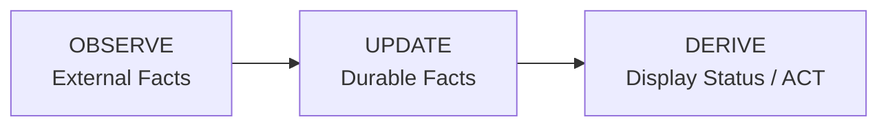

# Agent Orchestrator (Untrivial-ai) docs/architecture.md — head
# repo: /Users/yy/Documents/Curis AI Workspace/RD_MULTI_AGENT_RESEARCH_LAB/repos/agent-orchestrator @ 8e48682

# Agent Orchestrator Architecture

Agent Orchestrator is a long-running Go daemon that supervises multiple parallel AI coding agent sessions. Project sessions own isolated git worktrees; projectless standalone workers own AO-managed plain-directory workspaces. Every session commits to one interface mode at a time. A TUI session runs its agent inside a tmux/conpty runtime; a Chat session runs a native protocol controller without an agent terminal runtime. Codex and all ACP Chat processes live in detached per-session hosts so daemon/desktop replacement reconnects without stopping an in-flight turn. The ACP host additionally preserves connection setup, JSON-RPC correlation, pending interactions, and acknowledged prompt replay while the replacement daemon rebuilds its typed controller. A durable handoff may move a compatible native conversation between TUI and Chat, but both controllers are never live at once. The daemon coordinates both through the same session, lifecycle, workspace, storage, and observation boundaries.

## Table of Contents

- [Mental Model](#mental-model)
- [System Overview](#system-overview)
- [Core Architectural Principles](#core-architectural-principles)
- [Component Architecture](#component-architecture)
- [Data Flows](#data-flows)
- [Persistence and CDC](#persistence-and-cdc)
- [Status Derivation](#status-derivation)
- [Lifecycle Management](#lifecycle-management)
- [Observation Loops](#observation-loops)
- [HTTP Layer](#http-layer)
- [Terminal Multiplexing](#terminal-multiplexing)
- [Browser Runtime Bridge](#browser-runtime-bridge)

---

## Mental Model

The fundamental architecture follows a simple three-stage pipeline:

**Key insight:** Display status is never stored. It is computed at read time from durable facts.

### Durable Session Facts

The only persistent session state is:

- `activity_state` — What the agent last reported (`active`, `idle`, `waiting_input`, `blocked`, `exited`). `waiting_input` is an agent at an empty prompt awaiting its next instruction; `blocked` is an agent stopped on a pending permission/approval decision — automation must never inject input into a blocked session.
- `is_terminated` — Whether the session should be treated as over
- `session_mode` plus its runtime/provider handle and generation — The currently committed controller epoch
- `session_interface_transitions` — Durable checkpoints for an in-progress or completed TUI↔Chat handoff
- PR facts — `pr`, `pr_checks`, `pr_comment` tables

### What is NOT Durable

Display status like `working`, `needs_input`, `ci_failed`, `mergeable` are **computed at read time** by the service layer from the durable facts above.

---

