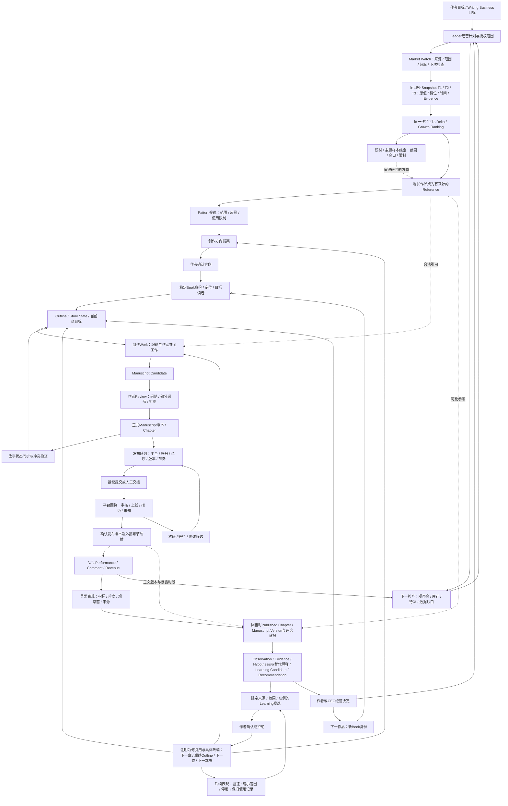
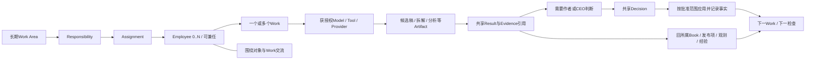

# Writing Business Relationship Map

Authority Class: RESEARCH
Status: Review
Date: 2026-09-21
Disposition: CEO ACCEPTED HTML EXPLORATION DIRECTION — RELATIONSHIP CANDIDATE RECONCILED; NOT CURRENT AUTHORITY
Owner: CEO / Product
Next Action: 保留产品关系，待独立 Authority Patch Gate 与真实能力验证。
Target Authority: 后续独立 Gate 确定；本轮不更新 Current Authority。
Next Gate: Final UI Master 或真实平台 / Runtime 验证按需重开 Writing。

## 1. 完整经营与创作关系

下图是产品关系，不定义新的Runtime对象。Reference、Pattern、Analysis等名称表示专业内容或共享对象的投影；具体canonical归属在后续Authority对账中确认，不新增平行存储。

持续经营不是等待整本书完结：已发章节等待反馈时，后续章节可以创作，研究和其它作品可以并行。作者尚未采纳的稿件不计可发布库存。缺章级数据时分析只能保留书级观察，不从图中的箭头推断数据一定存在。Snapshot比较还必须同平台、同来源/榜单、同范围、同指标与单位、同一作品；题材升温只是样本研究线索。Learning被引用不等于正文或大纲自动改写，被使用不等于有效性得到验证。

## 2. Employee、Work、Artifact、Decision的位置

编辑默认可承担多项责任，不必预先配置一整支多Agent团队。角色拆分取决于真实责任与产能。Provider不是Employee；平台编辑和读者是外部反馈来源。结果回原对象，Conversation保引用而不是复制正式正文或创建第二个Result。

普通选择、正式版本采纳、发布授权、经营转向分别表达；不把所有讨论画成异常，也不将一条赞同消息当成无限发布授权。

## 3. 身份、版本与外部事实

| 长期事实 | 身份 / 版本处理 | 谁拥有事实 | 下游规则 |
|---|---|---|---|
| Book / Volume / Chapter | 内部稳定身份；标题/序号可变 | Curis内创作对象；平台有独立外部ID | 通过确认映射连接，不按同名自动合并 |
| 正式正文 / Candidate | 作者采纳、写入读回、版本分开 | 当前正式稿在Book中；候选不覆盖它 | 发布明确选中版本；回退保历史 |
| Publication | 账号＋外部书章＋提交与回执记录 | 平台决定外部上线/审核状态 | 用户报告与已核验回执区分；未知先核验 |
| Performance / Revenue | 指标口径、窗口、来源、订正与发布时间 | 平台数据是外部来源；Curis保存观测证据 | 不能把书收益分摊伪装章收益 |
| Comment | 来源、时间、原文/合法片段、原锚点 | 平台/读者原反馈；Curis保存授权引用 | 推断Scene/Character关联标待确认 |
| Market Watch / Snapshot | 来源、范围、频率与检查时间；每次原始榜位、指标、单位、窗口和证据 | 平台/公开来源提供外部事实；Curis保存研究快照 | 可比才计算增长；移除关注不删历史快照 |
| Analysis | 引用正文版本、观测与对照证据 | Curis分析产物 | 相关性不是因果；保替代解释 |
| Learning | 来源正文版本、范围、反例、接受/停用、使用与验证记录 | 复用共享Learning/Knowledge | 跨作品需授权；使用处记录改编理由；旧应用不随修订被改写 |

例：平台第20章仍为v2，本地已接受v3。v2期间观测关联v2；后续重新发布v3后另记发布变化。读者究竟看到哪个版本无法确认时标混合暴露，不能宣称v3改善数据。旧段落删除后保旧版锚点，不自动挂到相似的新段。

## 4. Handoff最小内容

| 交接 | 必须带什么 | 接收与返回 |
|---|---|---|
| 研究→方向 | 来源/时间/合法文本范围、拆解、局限、建议 | Leader/编辑形成方向提案；返回参考 |
| 关注→参考 | 观察范围、多期原始快照、同口径变化、样本限制与未知项 | 研究Employee提出增长作品参考；拆解后才能进入方向，不把榜单变化当创作结论 |
| 方向→作品 | 作者确认的定位版本、读者、平台、原创差异、未知 | 编辑进入Book/章目标；不把参考写成Canon |
| 创作→发布 | Accepted版本、章序、目标账号/平台、授权状态 | 发布负责人；缺口留队列而非假上线 |
| 发布→反馈 | 外部ID、线上版本、上线时间与证据、下次观察 | 分析责任；结果回发布项和报表 |
| 反馈→修订 | Observation、原文锚点、假设、反证、建议范围 | 编辑生成Candidate；回原分析及作者Review |
| 表现→归因 | 指标/窗口/粒度、线上正文版本、评论原话/反例、锚点可信度 | 分析Employee分开观察、证据、假设、替代解释、候选与建议 |
| 分析→经验→创作 | 适用范围、来源版本、反例、作者接受状态、具体改编与回访计划 | 当前编辑将经验带入章/大纲等创作依据；不自动改正文，后续反馈回经验验证 |
| 分析→经营 | 目标偏差、成本/质量/合同风险、选项与不确定性 | Leader提案，作者/CEO决定；回原作品 |

断连不删书；重新打开恢复当前对象、正式稿、候选、最近结果、待决、发布未知和下一检查。数据采集失败不阻止合法手写；外部效果未知不自动重发。作品暂停后仍保留历史数据和必要回执核验。

来源和平台证据见[主报告](CURIS_WRITING_BUSINESS_PRODUCT_STRUCTURE_CANDIDATE.md)§11–12；边界反证见[Gap Audit](CURIS_WRITING_BUSINESS_GAP_AUDIT.md)。本图不代表Runtime已经实现。

2026-09-23 对账：CEO接受的是 HTML Exploration 的产品动线；上图为候选关系投影。原型读数、扫描、平台回执及模型输出不能替代真实平台或 Runtime Evidence。见 [Closure](CURIS_WRITING_HTML_EXPLORATION_CLOSURE.md)。
