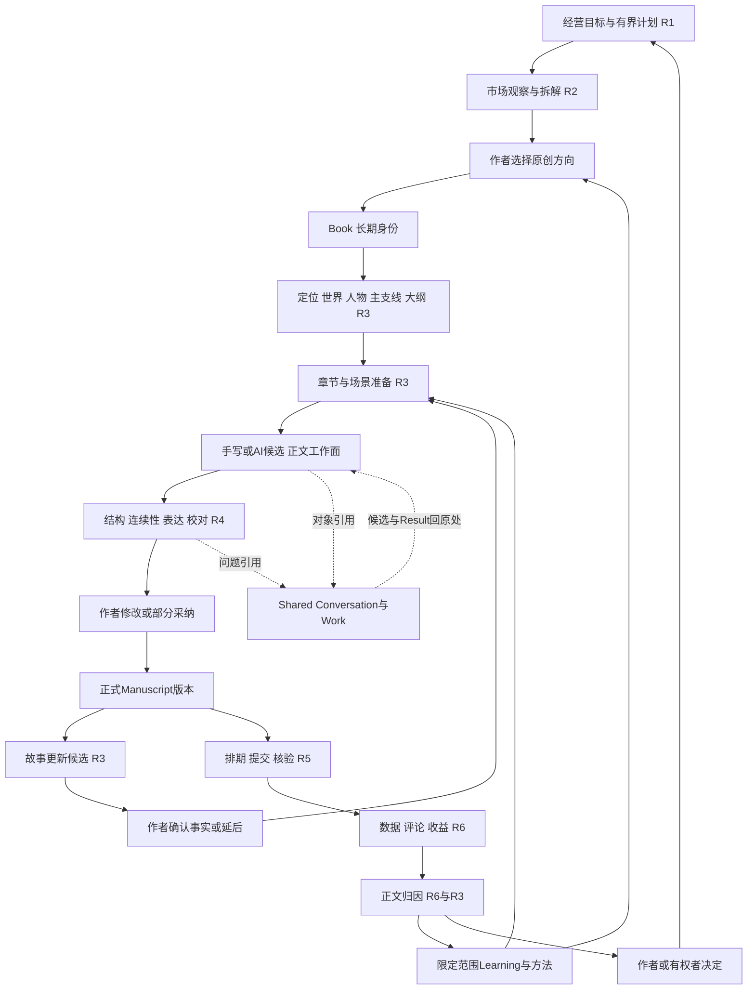
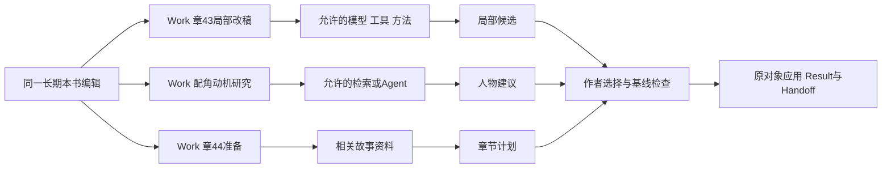

# Curis Writing：四产品能力收敛与完整功能交互设计候选

Authority Class: RESEARCH
Status: Review
Date: 2026-09-22
Disposition: INTEGRATED PRODUCT DESIGN CANDIDATE — READY FOR CEO REVIEW；非实现验收。
Owner: CEO / Product（裁决）；Writing 产品负责人（后续合同整合）；设计与实现方（批准后执行）。
Next Gate: CEO Review → 按批准范围整合产品输入 → 定向设计/实现 → 独立交互验收。此文不自动授权修改 HTML、Authority 或 Runtime。

## 0. 本轮结论、读法与真相边界

**Writing 应是一项有长期经营能力、同时具备深度小说创作内核的专业业务。** 六区保持：经营、市场与方向、作品、连载发布、读者与收益、写作经验。作品内部必须能真正构思、建世界、塑造人物、规划情节、维护大纲、写正文、讨论改稿、审校和延续故事；这些不是“故事状态”四个字可以代替的能力。

四款产品贡献互补：世界档案馆提供故事世界与资料组织参考；NovelFlow提供长篇上下文、候选裁决与恢复参考；妍语提供专业选择和分阶段创作支架的实际观察；OpenWrite提供正文—讨论—局部回写的实际观察。**不把四份研究当成四款产品全部能力均通过实测。** 本轮只读取既有研究，没有重新操作最新 Curis HTML，故不宣布任何历史原型问题仍存在或已修复。

这份文档是既有 [Writing Business 候选](CURIS_WRITING_BUSINESS_PRODUCT_STRUCTURE_CANDIDATE.md) §13 的详细交互补充，经营、发布、数据事实继续继承该文；不是第二份 Current Blueprint。旧证据、历史验收和原研究保持原样。本文的页面合同、责任编排及采用决策均为 **CANDIDATE**；共享宿主约束属于 **CURRENT**；外部能力分别标注来源证据等级。

阅读顺序：§2 看产品范围 → §3 看员工如何工作 → §5–10 看页面与逐步操作 → §11 看连续性和恢复 → §13 看反证验收。页面合同是工作职责，不等于必须制作同等数量的独立路由、Tab 或卡片。

## 1. 四产品采用账：采用的是能力与操作，不是复制界面

来源编号及绝对路径在§15。下列“已纳入”仅表示进入本文候选，不能写成 Curis 已实现。

| 参考能力 | 来源 / 证据强度 | Curis采用与落点 | 不照搬 / 未验证边界 |
|---|---|---|---|
| 背景、人物、关系、时序、世界、资料与正文协作 | S1 视频观察与平台摘要，具体项目见原报告 | D08–D10 故事资料、阶段状态与证据；D12 写作按需引用 | 不把摘要中的每项功能当实际操作成功；不要求每书都有地图 |
| 从已有小说提取资料、卷章编辑、成书导出 | S1 视频观察；S2 官方文档 | D05 导入预览分类；D11 卷章；D16 导出与恢复 | 提取先候选，不能因“导入完成”把猜测升为事实 |
| 四级大纲、作者纲与 AI 参考分离 | S2 官方功能文档 | D07 全书—卷—章—场景可选层级，讨论建议与作者计划分开 | 不强制每本书填满所有层级，不照搬固定双栏 |
| 角色认知域、关系阶段、伏笔证据、空间连续性 | S2 官方文档；S1 部分支持 | D09/D10 可新增、改动、定位原文、确认生效范围、检查影响 | 关系图只是视图，图中连线不自行创造 Canon |
| 上下文账本、候选局部采纳、多轮审校、版本恢复 | S2 官方文档 | D12–D16 写作依据、差异、审校与恢复；§4 通用确认合同 | 不引入第二 Work/版本系统，不复制可视化流程引擎 |
| 题材、读者、视角、基调、爽点/避雷、全书风格、本次要求 | S3 OBSERVED | D06 分层可编辑定位；D12 展示实际本次依据与冲突 | 不以标签数量代表质量，不把男频等同男主，不假称平台完整分类 |
| 背景→角色→主线→分卷→章纲→正文的渐进展开 | S3 OBSERVED；章纲样本为人工录入 | §6 推荐创作路径，各阶段能手写、讨论、确认、跳过非必要项 | 不复制固定十步门禁、固定十维世界或必需人数 |
| 静态人设与动态状态、字段保护、框架变更影响 | S3 UI及操作观察，部分更新效果未通过 | D09 定义/动态/认知分开；D15 状态更新候选 | 锁定不代表正确；不把“生成已完成”当章已定稿 |
| #文件/正文选区→讨论→局部修改→重开 | S4 OBSERVED 短样本 | D12–D14 对象引用进入 Shared Conversation，部分采纳回原文 | Curis保稳定对象/版本锚点，不只用行号；不宣称百万字可靠性 |
| 保存正文并更新摘要/人物状态 | S4 OBSERVED 短样本 | D15 连贯的正文确认与故事同步，但两项结果分别可见 | 不自动将模型推断变正式故事事实，失败不回滚已保存正文 |
| 备忘录、起名、格式整理 | S4 OBSERVED，部分下游未证实 | D06/D09/D12 近手动作，名字选中可用于目标对象，备忘可转计划 | 不增三个一级工具导航，不把排版当审校 |
| 风格提炼、拆书、扫榜→写作方法 | S4 入口观察，执行会员阻断；S2 方法复用为官方说明 | D03 合法参考拆解；D06 声纹样例；D22 方法与经验复用候选 | 采用理由是专业需要，非声称外部效果已验证；不追加付费研究 |
| 独立图谱、3D地图、角色酒馆、通用工作流画布 | S1/S2 文档或推导，各项非等强证据 | 保文字关系、地点、非正式对白演练；复杂可视化列可选扩展 | 不进入首轮必需面；没有独立任务价值不做新导航 |
| 深层经营、真实发布反馈、证据归因、跨作品经验 | S5 已有Curis候选 | D01、D17–D22 保留并与创作连接 | 这是Curis合同覆盖优势，不是已验证执行优势 |

## 2. 产品结构：业务六区＋作品内部专业工作面

| 长期工作区 | 首次进入应解决的问题 | 核心工作面 | 主要责任 |
|---|---|---|---|
| 经营 | 当前写什么、偏差在哪、谁在推进、哪些需要我决定 | 作品组合、当前计划、决定、下一检查 | 经营统筹，使用真实 scoped Leader |
| 市场与方向 | 哪个方向值得写，我能写出什么不同 | 市场观察、持续关注、参考拆解、方向提案 | 市场研究；方向由作者/有权经营负责人确认 |
| 作品 | 继续这本书，或把想法真正写成书 | 作品库→本书；本书概览、构思与规划、故事资料、正文、审校 | 本书编辑为长期创作责任人 |
| 连载发布 | 哪一版哪一章何时在哪发布，外部结果如何 | 队列/排期、提交与回执、账号和作品映射 | 发布责任 |
| 读者与收益 | 谁在读、哪里变化、赚了多少、为什么可能变化 | 趋势与比较、补录、评论、内容归因、收益 | 反馈分析；内容解释与本书编辑协作 |
| 写作经验 | 哪些方法值得再用，什么时候不能用 | 经验检索、范围检查、作者方法、应用回访 | 编辑＋分析，共享 Learning/Knowledge/Skill |

**本书内部推荐五个稳定入口**：本书概览、构思与规划、故事资料、正文创作、审稿与校对。作者可直接恢复上次章节，不强制每次先过概览。构思中的“定位、故事线、大纲”和资料中的“世界、人物、关系、时序、伏笔”是就地对象集合/模式，不向业务导航继续平铺。版本、依据、导入、导出、设置是当前对象动作，不各立工作区。

书内正文时，卷章目录负责定位；当前章纲和人物资料按需展开；正文获得连续阅读与编辑空间。故事资料需要系统修改时可成为完整专业 Main，而不是永远挤在一条侧栏里。首页不铺全部人设/所有大纲，不把每本书缩成只有“进入正文”的卡片。

Book 是专业项目对象，不是新的 Company OS scope 或每书自动创建一个 Workspace。多个 Book 可在同一 Writing Workspace 内工作；权限和 Assignment 仍依合法 Business/Workspace 范围，Book 引用用于当前工作限定。跨 Workspace 读稿另核权限。

## 3. AI Employee 到底是谁，怎样嵌入专业工作

### 3.1 责任，而不是功能按钮的人格化

| 责任代码 | 长期职责 / 用户认识 | 主动工作 | 不得替作者做的事 |
|---|---|---|---|
| R1 经营统筹 | 负责这项写作业务或当前Workspace的真实Leader；维护作品组合与节奏 | 发现库存/资源/数据缺口，维护下一检查，安排已授权研究与准备 | 无依据停书、改作者追求、越界增加费用；Workspace Leader不冒充Business Leader |
| R2 市场研究 | 替作者收集、拆解、比较，不替作者选择人生题材 | 有界扫描来源、研究候选、汇总带出处的方向 | 下载无权全文、把竞品剧情变本书事实、把排名变收入预测 |
| R3 本书编辑 | 长期理解本书，帮助构思、写作、改稿与故事连续性 | 准备章纲/候选、检查前后承接、整理待确认事实、追踪未决 | 静默改正式正文/设定、用聊天猜测覆盖作者稿 |
| R4 审校责任 | 对具体范围提出有证据的问题与补丁 | 执行结构/连续性/表达/校对方法，复查修订 | 用评分自动定稿；同一员工自查冒称独立审校 |
| R5 连载发布 | 对选定稿件、平台目标、排期与回执负责 | 检查库存和映射，推进授权提交、核验未知 | 未获权限发布；把“提交成功”报告成上线 |
| R6 反馈分析 | 对读数口径、读者反馈、归因假设与经验验证负责 | 到观察窗收数/提醒补录，比较，提出解释和实验 | 用书级收益摊出章级收入，假定某段文字造成增长 |

这些是**责任集合，不是强制六个员工、六个Agent或六种新身份**。本书编辑可承担R3＋R4，多本书可共享编辑；独立审查、持续负荷或权限边界有需要时再分配另一员工。分析可由已有公司分析师通过 Assignment 支持。角色未分配就显示缺口，不能假造在岗姓名。作者是作品创作裁决者；CEO和作者同一人时不要求重复批准；不同时按真实权限处理。

统一关系：`Work Area → Responsibility 1..N → Assignment → Employee 0..N → Work 0..N`。专业对象负责人、当前 Work Owner、本次执行者分别表达；Provider/模型/外部写作工具是执行能力，不用它们的名字替代 Curis 员工身份。

### 3.2 在哪里看到人，如何找人

| 作者所在位置 | 默认存在感 | 交流入口携带什么 | 结果返回哪里 |
|---|---|---|---|
| 业务经营 | Leader正在处理的偏差/决定，最近自主行动；不做头像墙 | 当前范围、计划、选中作品、相关依据 | 原计划/决定及受影响作品 |
| 新建书或构思 | 本书编辑给当前问题、两三种可编辑建议 | 当前想法、暂定定位、已选/未定项 | 定位/故事方案候选，不自动创建完整世界百科 |
| 人物/世界/大纲 | 当前条目的负责编辑、最近修改或待确认建议 | Book＋条目/节点＋版本＋当前字段/选择 | 同一条目差异；确认后才更新，保原位置 |
| 正文/选区 | 写这章/改这段的实际负责人，当前候选/产物出处 | Book/Chapter/稿件版本/选区＋意图 | 同章候选对比；采纳后定位回改动处 |
| 审稿问题 | 谁提出问题、具体证据、谁负责改 | 问题/原文/审查版本/作者回应 | 问题讨论、局部候选、复查结果 |
| 发布等待 | 发布责任人说明等什么、已做什么 | 稿件快照/平台/Publication/回执 | 原发布对象；不新开无关聊天 |
| 评论或数据异常 | 分析责任人的解释与局限；需要时请编辑看正文 | 原读数/时间窗/线上版本/评论锚点 | 原分析→选定改稿/后续计划或经验候选 |

点击姓名/头像查看 Shared Employee Detail；明确“与编辑讨论/就此问题交流”或共享展开入口进入 **Main 内的 Shared Work Area**。遵守现有 Shell：完整 Conversation 不放 Utility，也不另造 Writing 聊天系统。专业内容和交流可在 Main 中按当前活动分配空间；正文阅读不因每页常驻巨大聊天框被挤压，返回保留章/版本/选区。具体像素、开合样式留后续设计，不在本轮擅改共享合同。

员工不是只显示“Owner：某某”。有工作时自然表达“编辑正在对照上一章检查知情边界”“审校返回2处问题”“等你选择开头”；无工作时保真实责任入口，不假装正在生成。模型日志、token、检索参数进入按需详情。

### 3.3 讨论如何变成实际修改

1. 作者从对象进入，系统自动附上范围；换书/换对象不能悄悄改变正在讨论的引用。
2. 纯解释、比较、问原因可直接讨论，不强制每句生成 Work。要求生成/改写/研究/检查等可验收动作时，形成或继续同一有范围 Work。
3. 员工说明这次将处理什么；模糊意图只问影响执行的必要事实。作者可直接修改，也可让员工提出选择。
4. 输出是**解释、批注、修改候选或结构化研究结果之一**，界面明确类型与落点；不能一律只有聊天文字，也不能一律自动写入。
5. 作者可继续追问、自己改候选、部分采纳、拒绝、暂留；无需重复粘贴原对象。接受和实际应用分开记录。
6. 应用后显示原位置、实际变化、版本和未完成同步；Result引用同一专业产物，聊天不成为第二份正式正文。
7. 若员工转交责任，保原讨论与作者要求、输入版本、未决、结果引用；不用作者重新讲一次。

## 4. 所有页面共用的操作合同

**页面第一层**：当前对象/范围、真正的专业内容、当前需要的动作、相关责任人与未决。信息不足写“未定/未收集”，不是零；没有Owner仍可手写，AI执行给分配或恢复入口。说明、版本依据、高级设置按需，不堆满首屏。

**每次修改的最小合同**：目标对象与范围、当前基线、目标/保留/禁止改变项、用到的资料、负责人、允许动作、结果去向。界面显示自然语言摘要，作者不填写内部 ID。昂贵或批量操作另外显示范围、估计/上限或费用未知、关联动作和停止点；不靠“免费”字样隐藏模型费用。

**确认链**：讨论建议 → 可编辑候选 → 作者选择 → 实际应用/保存 → 必要的故事状态同步 → 下游重新核验。作者手写直接保存成草稿是合法路径，不必先生成AI候选；正文正式确认和对外发布仍不同。

**部分采纳**：独立片段可逐项采纳；相互依赖的改动解释依赖，让作者一起采纳或先改建议。不做“选一条却替换全章”。作者改过基线时，旧候选停止直接覆盖，重对比/重定位；不能靠段落序号或相同标题猜目标。

**作者控制**：计划、正文事实、读者知情、人物知情/误信、AI猜测、参考作品内容分开。作者保护的字段/片段不可被后台写回；普通创作选择是正常流程，不画成异常。自动研究/检查不等于自动接受正文。

**返回与恢复**：从列表→对象→员工→候选→原对象，保筛选/书/章/版本/滚动/选区；切换保编辑缓冲或提供保存/放弃/取消。刷新后保稿件、未决、讨论与输入范围，明确任务是否恢复、未知还是等待，不能假称进程仍跑。

以下D01–D22都继承本节，因此不在每行复制同样的状态、版本和保存要求。

## 5. 经营与市场：页面、功能及操作合同

| ID / 页面职责 | 页面应显示什么 / 布局主次 | 用户怎么做、员工怎么介入 | 输出 / 下一步 / 价值 |
|---|---|---|---|
| D01 经营与计划 | 作品组合紧凑列表：目标/正式进展/可发布库存/更新承诺/当前风险；优先显示需要作者的决定，再是团队已做/正做/下一检查。选书看该书，不平铺所有细节 | 作者继续写、讨论节奏/资源、批准或暂缓建议；R1读正式库存与真实排期，准备有依据的调整，不自动停书。计划详情并列原计划/建议/影响 | 决定落到同一Book计划或相关Work；作品点回D06/D11，排期去D17。0书可定方向/直接开书；新空书显示“定位待完善”，不是不存在 |
| D02 市场观察与关注 | 按平台、分类、榜种、观察时间筛选；有来源的作品/趋势及未知覆盖。关注集合可展开目标、获取方式、频率、最近/下次、失败。不是热度卡墙 | 加来源/编辑条件/暂停/恢复/移除/立即检查；R2在授权方式与预算内扫描。API/MCP/正常Browser/人工是实际连接事实，不能仅下拉选个名称就视为可用 | 信号→D03参考或D04方向；失败保已有快照并给补充来源入口。移除只停止未来关注，保研究历史；没时间序列不画趋势 |
| D03 参考、拆书与笔记 | 原文/合法片段是主体；章范围和来源可见，按需看主题、Hook、人物动机、冲突、结构、节奏、文风、原文证据与局限；用户笔记/讨论决议可编辑 | 贴链接/导入有权稿/选章/选段→“分析这段为何有效”；R2返回定位拆解，R3可比较是否适合本书；作者确认笔记或方法，不能只加“讨论”按钮无结果区 | “用于新书方向/附到当前章/保存方法”。引用原资料，不复制成Canon；学习叙事规律而非搬剧情。导入失败可改章节识别再预览 |
| D04 创作方向 | 作者兴趣与能力、平台/读者/题材、核心承诺、差异、长度节奏、样本依据与风险；比较少量方案，允许直接编辑，不强制全填 | 作者从R2研究或一句意图发起；R3提原创核心、R1看资源可行性；选择采用/继续讨论/暂存；“用于已有书”先看影响 | 新书→D05/D06；已有书→定位/后续规划候选；不直接重写正文。市场结论保来源日期和未知，作者可以不追热点 |

### 工作流A：市场到新书，不让研究成为孤岛

| 步骤 | 作者 / 页面动作 | 员工负责什么 | 可检查结果与下一步 |
|---|---|---|---|
| A1 D02 | 看明确日期和分类的榜单/自贴链接，选“研究此方向” | R2整理样本、合法来源、偏差 | 研究范围与Work；无合法全文就只分析可得内容 |
| A2 D03 | 选择章节/片段/问题，看拆解并讨论 | R2给引用和解释；区分事实与假设 | 确认的笔记/待验证Pattern，保原文返回 |
| A3 D04 | 指定自己想保留/避开的内容，比较方向 | R3提出原创变化；R1核现实更新能力 | 可编辑方向方案；读者、题材、视角、风格是分开的决定 |
| A4 D05/06 | 接受方向并开书，或附到已有Book | R3建立所选目标对象和引用 | 同一方向来源进入本书定位；不自动生成几十个角色或整书 |
| A5 D07 | 从核心冲突展开主线/结局/大纲 | R3按作者选择准备计划 | 本书可继续写，研究结果在写作依据中可定位、可取消使用 |

## 6. 从想法到故事：Book 页面合同与创作支架

| ID / 工作面 | 页面应显示什么 | 直接操作＋员工协作 | 输出、接续与具体目的 |
|---|---|---|---|
| D05 作品库与接入 | 书名、题材摘要、创作/连载真实状态、最近位置、负责编辑、待作者项；创建提供“从想法开始/导入旧稿/先手写”，不是只建空卡 | 新建/改名/打开/归档；R3接一句意图。导入选择文件、分类与章识别预览；关联外部作品不等于导入全文。作者确认重复项新增/替换/保留 | 稳定Book/章身份→D06或D11；失败项单独修，已成功不重复导入。归档保稿件与外部承诺，需看在途影响 |
| D06 本书概览与构思定位 | 默认“继续第X章”、编辑当前判断、待选方案、必要的故事/连载提醒；定位详情含暂名/一句故事、目标读者、题材、平台、视角、基调、主题、长度、作者禁区、声纹样例 | 手改或“和编辑完善这个想法”；支持从背景、人物、结局、场景起步；起名/记灵感就地入口。题材可搜/多选/自定义；选择转成可编辑表达要求 | 定位版本、灵感笔记或具体规划候选→D07–D12；平台未定不阻止手写。灵感讨论决议能更新原笔记并选用于人物/大纲/章节 |
| D07 故事线与多级大纲 | 故事前提→主线/支线/转折/高潮/结局；按需要展开全书/卷/章/场景。选节点看目的、事件因果、人物弧线、情绪、悬念和结束状态；计划与已写事实分开 | 新增/编辑/重排/拆合计划；“保持动机换一种转折/把这卷细化三章”；R3给多个候选或局部差异。可从已有正文提取摘要，不自动用摘要覆盖计划 | 作者确认的计划→选章准备；变化列受影响后续纲/人物/已写稿。已发章不随计划重排改外部身份；结局仍是计划非Canon |
| D08 世界、背景与场景资料 | 时代/地理/社会/势力/规则/物品等按本书需要出现；条目有条件、代价、限制、例外、来源与适用时期。地点可文本描述并关联路线，地图可选 | 作者建条目或R3建议补充；逐字段改/锁定、导入、讨论规则矛盾；场景资料可附有权图片/参考。现代题材不预填修炼十维 | 已确认设定或待核候选→相关章节依据。规则改变给受影响稿件与修订选择；不自动重生成整本书 |
| D09 人物、关系与认知 | 人物目标/动机/弱点/背景/弧线/声纹样例；静态设定和随章节变化状态分开；关系有双方、方向、阶段、起止、事件证据；知情/误信/秘密明确时点 | 新增/改名/别名/编辑/合并重复预览；“让配角有自己的动机”“比较两人对白”；R3提差异。角色对话演练明确非正式，仅选中结论转候选 | 角色资料供D12场景；修改名字保持ID，全文替换另预览。关系/认知变更注明生效章，历史状态保留，不将作者知道变角色知道 |
| D10 时序、伏笔与承诺 | 按故事时间/叙述章节分别查看事件、地点、参与者、先后；伏笔列计划埋设/实际证据/推进/预计回收/实际回收/放弃及理由 | 建/改事件、关联原文、调整时间/回收范围、查看冲突；R3找旅行/知情/因果问题，提醒该兑现的承诺；作者确认/延期/拒绝 | 章准备引用当时事实；正式章产生新证据后更新候选。计划第8章回收不等于已回收；删除条目先检查引用，历史用归档保留 |

### D06 的选择怎样真正作用于写作

| 层次 | 允许表达 | 作用与冲突处理 |
|---|---|---|
| 作者偏好 | 自有正/反例、希望保留的声纹、常见不喜欢的表达 | 作者授权可跨作品引用；不是默认全书共享私稿 |
| 本书定位 | 男频/女频/不限等读者意向；都市/玄幻/科幻/仙侠等题材；视角、基调、主题、篇幅 | 维度不混同；平台分类单独映射。选项只是输入，不承诺特定平台收稿 |
| 本书表达方法 | 叙述距离、句式节奏、对白差异、描写密度、正反例、禁用套路 | 可编辑正文式规则，选择后可看到转成什么要求；不显示海量标签墙 |
| 当前章/场景/选区 | 本章目的、临时风格、要保留和禁止揭示、改写力度 | 当前范围内可覆盖表达偏好；涉及已确认事实或核心方向的冲突先说明并由作者裁决 |

默认采用当前明确请求＋适用的已确认资料；它们互相矛盾时**不以简单“最新指令优先”偷偷篡改Canon**。作者可确认探索一个非正式分支，也可正式修订设定。未选模板仍能写。不能只保存“科幻/克制”标签却不在本次写作依据说明其用法。

### 工作流B：从灵感到可写的一章

1. **D06 收到种子**：作者说“一个档案员收到未来来信”；R3确认最影响当前创作的疑问，例如想写悬疑还是冒险。作者可暂定，不被问完所有字段才开始。
2. **D06 比较方向**：页面显示可改的一句故事、冲突、视角和基调；编辑解释不同选择的后果。作者选定或手改，形成定位候选/确认版。
3. **D08/D09 建必要基础**：先建这章会用到的规则、人物动机与知情。R3提候选，作者确认必要部分，其余待探索；可从人物先走，顺序不强制。
4. **D07 规划走向**：R3提供主线和结局可能性，作者选择当前计划；展开卷/章时只细化需要的范围。并行结局只是备选，不是两套正式历史。
5. **D07/D12 章与场景准备**：本章目的、人物、冲突、进入/结束状态、揭示边界；R3检查与前章、伏笔、规则关系。空白项说明未知，不编造已确认资料。
6. **D12 创作**：作者手写、让员工续写/生成，或先试一个开头；结果进入草稿/候选，不直接“完成章节”。
7. **D13/D14 修改与审校**：选段讨论→局部候选→作者部分接受→复查；不中断其它人物研究和独立章节任务。
8. **D15 确认并维护连续性**：正式稿保存，摘要/人物/伏笔待更新可连贯检查；完成后回同章，可写下一章或加入D17。

## 7. 真正写作、审校、恢复：不能被业务外壳省略

| ID / 工作面 | 页面内容与第一层动作 | AI员工介入与作者交互 | 结果与返回 |
|---|---|---|---|
| D11 卷章组织与恢复位置 | 卷章层级、标题、草稿/正式/线上版本差别、字数口径、当前待选；支持搜本书正文/纲/人名/资料，结果按类型分组、带片段与位置 | 新章/改名/排序/移动/归档；R3可建议拆章，作者预览身份与发布映射影响。返回上次正文位置；搜索能定位历史版但须标识 | 同一Chapter不因改名重建；当前编辑缓冲保留。章拆合先预览内容与引用映射，已有Publication保原快照；失败返回原结构 |
| D12 正文创作与章节准备 | 正文为视觉主体，当前书章/保存状态/正式与草稿区别清楚；章目标、场景顺序、当前相关员工轻量可达；当前依据按需展开，不常驻技术栏 | 手写/保存/撤销/查找替换；选区→讨论/续写/扩写/改写/校对；“从此续写”明确插入点。R3能解释、提候选、检索资料；准备阶段选引用/排除/保护片段 | 新草稿或D13候选；目标字数是意向，显示实际口径。不允许生成覆盖作者未保存文本；失败保输入、已有稿与部分产物 |
| D13 候选与差异审阅（正文内模式） | 原文/建议差异、原因、作用范围、当前基线；长文可阅读全文。作者修改候选仍标未正式。多个方案只选目标方案比较 | 接受选中/拒绝/继续讨论/改后采纳；R3处理反馈。独立片段可分选，依赖片段提示组合。纯问答不强制出现采纳按钮 | 应用到当前草稿，正式确认走D15（可以是一次连贯操作）；保存读回后才称已应用。旧候选过期转重对比，旧稿不丢；回原章改动处 |
| D14 审稿与校对 | 默认当前章，也可选卷/全书/选区；按结构连续性/表达声纹/语言校对分组的问题队列；点问题看原文、证据、解释和建议，正文仍可读 | 作者选择检查范围/方法，R4检查；查看/讨论/修这处/忽略附理由/复查。可交回R3修改，分清提出问题的人与改稿的人；无Owner可分配，非每种检查建员工 | 有定位的Review Result＋局部Candidate→D13；复查绑定新版本。找不到问题诚实说明覆盖，不能等于全书无错；排版另为可撤销动作 |
| D15 正文确认与故事同步 | 提交正式时展示章/版本/未决问题；可“确认正文并检查故事更新”“仅确认正文”“继续修改”。同步看摘要、人物现状、关系、伏笔、时序的建议与原文证据 | 作者决定正文；R3抽取更新候选，逐项/明确范围确认或延后；冲突与无证据推断不可自动转事实 | 正式Manuscript、独立同步状态、下一章可用依据；正文成功同步失败只重试同步，不重写正文。下一章提示相关待核，不封锁无关创作 |
| D16 版本、导入导出与恢复（对象动作） | 可阅读全文/对比的草稿与正式历史、作者/员工改动来源；导出范围/版本/格式/题名章序预览；备份涵盖作品资料与引用关系 | 历史查看/比较/恢复为新草稿；导出全书/卷/选章；TXT/MD基础、DOCX等按实际实现显示可用。恢复预览新副本/替换影响与在途对象；R3解释变化，不静默恢复 | 实际可打开的文件/恢复结果，回原Book；旧正式/线上记录保留。备份不含凭证，导出不冒充发布，未实现格式诚实不可用 |

### 审校具体检查内容与效果边界

| 检查 | 看什么 | 返回什么，作者怎么用 |
|---|---|---|
| 故事/结构审稿 | 本章目的、推进与重复、冲突、人物动机、悬念、情绪、承诺兑现、场景作用 | 锚定情节的问题和可选修法；可修改后续纲而不急于改已发章 |
| 连续性与事实 | 当时人物状态/知情、时间旅行、地点路线、规则代价、伏笔、前章结束状态 | 原文＋相冲突的证据＋确定矛盾或待作者说明；不拿未来大纲指责当前人物尚未知情 |
| 表达与作者声纹 | 套话、重复比喻/动作、抽象概括、角色台词趋同、视角游移、节奏单一 | 具体句段、作者自有正反例、局部候选；不承诺“去AI率”或通过平台检测 |
| 语言校对 | 错别字、标点、指代、称谓、语病、格式一致性 | 可批阅的问题，不自动改有意方言/角色口癖；作者词表可解释豁免 |
| 平台反馈复查 | 适用规则、编辑/平台实际反馈、发布版本、原文范围 | 改稿候选或人工处理事项；规则未知不能写“已合规”，无定位不假造问题段 |

### 工作流C：作者说“这段太慢，只改开头”

| 步骤 | 页面/作者动作 | 员工与系统行为 | 完成判据 |
|---|---|---|---|
| C1 D12 | 选开头三段，点“与编辑讨论”并说目的 | Shared Conversation带本书/章/版本/选区；定位实际R3/Work Owner | 作者不用再粘贴全章；不会切到另一书或员工 |
| C2 交流 | 询问慢在哪里，或直接要求局部改写 | 编辑先解释时只返回分析；执行改写时固定范围、保留事件和禁止改变项 | 不把解释请求自动变成覆盖操作 |
| C3 D13 | 看两种开头并继续讨论 | 候选原文/改文及理由可读；可试不同节奏，仍保原稿 | 用户知道候选未应用，能回全文理解上下文 |
| C4 D13 | 只接受第二段，可自行改候选 | 检查局部依赖和基线；过期则重新对比/让作者选择 | 其余正文逐字不受此操作影响；拒绝项不混进正式稿 |
| C5 D12/14 | 回原位置阅读，要求复查 | 应用读回、保存状态；R4按新版本复查相关问题 | 不用打开任务监控找产物；问题闭合或仍待改理由清楚 |
| C6 D15 | 确认新正式稿，保线上旧版 | 涉及故事事实才提同步，纯措辞不制造大量Canon更新 | 正式v3、线上v2、待同步项分开，发布修订另走D17 |

### 工作流D：修改世界规则或人物秘密

D08/D09选条目→编辑或讨论→R3提出字段差异→作者确定生效时期与“只改未来计划/涉及已写事实”→查看影响：未来章纲、已写段、已发布版、相关伏笔→作者确认设定版本及需要创建的修订工作→R3只准备相应候选→各章作者审阅→同步、复查。不能“同步”按钮连带重写整本书。未来秘密揭示不回填成角色过去就知道；人物误信可作为当时真实心理状态，但不等于世界客观事实。

### 工作流E：旧稿接入与专业编辑基本功

- 导入：选有权文件→预览解析/卷章识别→分类正文/纲/资料/参考→逐项处理重复和编码/空内容→确认范围→保存稳定章身份→提取设定候选→作者确认→恢复到要写的章。导入报告给成功/失败/未决项和回程；不用聊天回复代替真正稿件。
- 查找替换：选本章/卷/全书与草稿/正式版本范围→预览匹配与替换→作者选择→应用到可编辑稿→记录修改并可撤销。已发布文本不可被本地替换改写；批量含保护片段先处理，不忽略保护。
- 本书搜索：查人名/事件/关键词→结果标正文/计划/资料及版本→打开准确位置→带引用讨论→回结果筛选。不同Book默认隔离。
- 历史恢复：看完整旧版→与当前比较→恢复为新草稿→审阅→需要时确认新正式版。撤销最近输入不等于恢复任意正式历史。
- 导出：选范围与正式/草稿→预览章序/题名/排版→确认→真实文件→核验可打开、内容范围及版本。若某章只有候选，不能悄悄导出为正式。

## 8. 发布、读者、收益和学习：每个动作都接回创作

平台字段沿用S5的已核验类别与未完成项，本轮未重查官方规则。下列为产品合同，**不是宣称番茄/起点均有同一API或同一指标**。

| ID / 页面 | 页面应显示什么 / 能做什么 | 作者与员工交互 | 输出 / 下一去向 |
|---|---|---|---|
| D17 连载队列与排期 | 按Book/平台/时间查看章序、选定正式稿、库存和提交状态；未正式候选不算可发布库存 | 选章加入、调整时间、暂停；R5核账号映射/章序/权限/版本/合同要求。作者确认外部动作范围；自动执行仅在既有授权内 | Publication计划→提交/回执；缺接口可导出后人工提交。已发v2和本地v3并列关联，不混为一版 |
| D18 账号映射与发布详情 | 账号、平台书/章映射、当前能力/断连；详情展示稿件快照、回执、链接、审核中/退回/未知及下一动作 | 添加/修正/断开；打开平台、登记提交、核验、处理退回。R5在未知时先查，不默认重试；登录/验证码交用户 | 核验上线才启动对应观察；待人工保提交位置。断开保历史，在途需核验；退回可带平台反馈进D14 |
| D19 表现、收益与补数据 | 先选书/平台/明确日期或发布年龄，再看趋势/章比较/数据表；来源覆盖与更新时间可见；收益预估/结算/到账分开。可补录真实可得字段 | 切指标/对比可比章节/点异常/导入/手录/订正；R6核对象、定义、单位、时间、分母；截图识别需用户确认 | Observation与Evidence→D21；缺章级数据保书级，Unknown不补0，不用账期代替任意时间窗；订正留旧值并标受影响分析 |
| D20 评论洞察 | 主题簇、原评论/反例、采样覆盖、人物/剧情/节奏/文风反馈；可定位到确有证据的章/段/角色 | 展开原文、纠正主题/锚点、选“交给编辑看”；R6聚类，R3解释正文；推测位置需确认 | 反馈问题→D14或后续D07/D12；用户猜剧情不是Canon。不自动替作者回复、删除或公开互动 |
| D21 内容归因与行动 | 变化→证据→解释假设/替代解释→经验候选→建议；对照实际线上文本版本，不只读当前草稿 | 作者问“为何第43章变好”；R6分析口径与外因，R3看情节/对白/悬念，作者选择再观察/后续试验/局部改稿/调计划 | 带范围的Learning候选→D22；明确目标的改稿→D13；经营变更→D01。数据不足只提出待验证假设，不能宣称因果 |
| D22 写作经验与作者方法 | 本书/跨书适用范围、正反例、证据强弱、验证次数、最近应用/待复核；方法含作者偏好与表达练习，经验含有证据的判断 | 接受/修订/停用/质疑/用到某章；R3选适用方法，R6在新反证/规则变更/验证窗口到时提出复核。风格提炼可来自有权正文，先给可编辑特征和样例 | 下一章写作依据或新书方向引用同一Learning/Knowledge；需执行的可复用方法经作者确认绑定现有Skill，不新建方法引擎 |

### 工作流F：正式章节→上线→理解读者→改善下一章

1. D15确认正式章；作者选择D17，R5检查目标与版本，未满足发布条件只等待这次发布，不否定本书存在。
2. D17选择节奏、范围与方式；无接口时明确谁在平台完成什么、回来提供什么，不给假自动发布。
3. D18提交后保存回执/人工报告；Unknown先核验，审核中继续等，失败才选择相应恢复。线上版本独立固定。
4. 到观察窗口，R6从合法通道收数；缺数据在D19列待补对象/字段/来源入口，人工按真实层级录入，留时间与订正。
5. D19点异常章→D21；D20可将评论簇和原文带入同一分析，R3引用那次已发布稿，不用后来改好的草稿解释旧读者反应。
6. R6/R3输出五层分析，作者选择后续章试用、改当前稿、保持或再观察；不因一个指标变化全书改风格。
7. D22接受经验需范围/反例/验证计划；D12开始下一章能看到建议“来自哪次分析、适合什么、不确定什么”，可排除。
8. 新章发布反馈进入原经验的应用回访；反例触发复核、收窄或停用，不抹历史。D01在下一检查用真实反馈更新经营判断。

## 9. 小工具与专业资料：近手，但每个都要有落点

| 能力 / 入口 | 具体操作 | 产物去向 / 边界 |
|---|---|---|
| 随手记 / D06及当前写作动作 | 输入文字/链接/截图/文件，明确本书或待归属；可编辑、讨论；确认讨论结论更新笔记 | 选择“用于章目标/人物/故事线/保留参考”；未选择不自动变Canon。无须每页重复四个大按钮 |
| 起名 / D09人物或D08地点字段 | 指定类型、时代/语言风格、禁用重名→候选及理由→选择 | 填入当前候选字段；确认后保存人物/地点。同名检查不证明原创性或全球无重名 |
| 风格样例 / D06、D22 | 选择自有/有权文本范围→提炼可观察特征、正反例→作者改写规则→试改一小段→决定适用范围 | 写作方法引用，不等于训练模型；同一作者不同书可不同声纹；不照搬整位作者表达 |
| 非正式人物演练 / D09 | 选人物当时状态、假设场景、目的，要求员工模拟对白并分析是否符合动机 | 演练始终非正式；仅选定台词/结论进入正文/设定候选，不自动发生在故事中 |
| 资料附件 / D03、D08、D12 | 导入本地可用格式→看识别/来源/归属→选择引用范围；解析失败保原文件并可手动摘要 | 关联Book或Reference，生成时说明是否实际读取；文件存在≠已进入本次模型输入 |
| 排版 / D12、D16 | 预览段落缩进、空行、标点样式范围→应用→可撤销 | 不改剧情，不混同校对；格式整理不让正式/草稿身份改变 |
| 阅读 / D12 | 收起非必要面、调整阅读偏好、继续原位置；朗读仅在能力可用时提供 | 阅读宽度由长文任务决定；朗读、地图绘制、3D图谱为可选，不阻塞写作闭环 |

## 10. 完整团队工作图与并行原则

**一个员工可以并行负责多个 Work，不等于允许并发覆盖同一份稿。** R3可同时研究配角、准备第44章候选、回复第43章修改；R2可持续研究，R5处理已确认旧章发布，R6分析读者；作者等待某候选时不锁死整个Workspace。

| 场景 | 产品行为 |
|---|---|
| 不同Book/独立资料 | 在合法范围和预算内并行；Conversation绑定各自Assignment与对象，不串稿 |
| 同章多个候选 | 可并行准备不同方案；都标基线，作者接受一份后其它需重对比，不最后写入者覆盖 |
| 第44章依赖第43章结尾 | 第43章未定时可研究/试写，标临时依据；不得说已基于最终结尾；正式接续前重新核验 |
| 章已在发布队列，本地修订 | 队列保持原快照；作者明确选择替换并重新检查，不能静默切换待发布内容 |
| 多员工协作 | 一个Work有可辨的结果负责人；贡献/审校/发布各有实际责任；交接带产物、依据、未决、下一人 |
| 员工被换岗/无Assignment | 保历史作者和Result；新Holder接续当前未决，不改写旧署名；缺口阻止依赖该责任的执行，不阻止作者手写 |
| 模型或Provider失效 | 原员工责任不变，能力不可用明确；允许经授权替代或等待，不能伪造结果或重新创建员工 |
| 批量检查/生成 | 列明确章范围、输入、费用边界和每章结果；可停止后续任务，保已完成候选；未采纳不算正式库存 |

### 持续经营如何不变成无限自动写书

Operating Envelope明确作品范围、研究来源、可执行的准备/检查、预算、节奏、读稿范围、是否允许候选批量准备、发布权限、必须作者确认的变化。R1维护正式库存、待审候选、待数据、承诺风险和下一检查；R2主动发现，R6到窗口复盘。所有当前Work结束后仍根据计划安排下一次合法检查或准备；缺少作者选择时说清等待并继续独立工作，不暗中接受稿件绕过去。方向重大调整、停书、正式正文/设定裁决和外部权限按真实授权处理，不因“持续”失去边界。

## 11. 长期事实、写作依据与恢复的完整合同

| 事实层 | 谁确认、如何使用 | 不能混淆 |
|---|---|---|
| 作者草稿与编辑缓冲 | 作者保存/自动保存提示、离开保护；可恢复 | 未保存内容不被后台回写覆盖 |
| 正式正文版本 | 有权作者确认，应用读回；后改建新版本 | 不是模型成功、不是审校通过、不是已发布 |
| 故事计划 | 作者接受当前规划，可保备选 | 结局/伏笔计划不是已发生 |
| 正文发生事实 / 故事资料 | 有来源的提取候选经确认；保时点、矛盾、主观认知 | 作者知道、读者知道、人物误信、世界事实不同 |
| 当前任务依据 | 记录实际使用的版本/片段/排除项/未知 | 检索到≠使用过；界面显示资料≠模型实际读入 |
| 平台快照与观测 | 实际提交版本、回执、数据源/时间/定义 | 线上v2的数据不归本地v3；Unknown不等0 |
| 经验与方法 | 来源、适用范围、反例、使用/验证记录 | 一次有效不成普遍规则，跨书不能带走未授权正文 |

写作依据入口显示：当前任务目标、章/场景计划、前章结束状态、当时人物/关系/知情、必要世界规则、未兑现承诺、选用Reference/经验及作者临时要求。支持检索添加、排除、查看冲突、固定必要资料；不用用户学习 token 槽位。资料不足可缩小任务或明确探索，截断不能静默丢关键约束。此为产品可检查性合同，不发明新的 Context Runtime。

恢复需覆盖：断网或生成失败、保存失败、切书/刷新、旧候选、故事同步失败、外部结果未知、评论旧锚点、经验已停用。每种都保已确认事实与未完成输入，并给回原对象的下一动作。重试只针对未完成步骤；故事同步失败不重生成稿；发布未知不重复提交；锚点失效保旧版引用、明确未定位，不自动贴到相似段。

归档书/章/资料保引用与历史，不能删除已发布回执/收益事实。物理目录、备份Provider、密码和API Key管理仍用Shared能力，不做第二文件管理器。UI重构/Package更新不能重新创建Book、Chapter、Publication或历史Result；本文只消费既有版本/迁移边界。

## 12. 与既有设计的差异、分工及不采用项

| 本轮发现 | 本轮具体补齐 | 不应如何修 |
|---|---|---|
| 能力已有名词，缺新增/编辑/讨论/应用闭环 | D06–D15对象操作、候选落点、影响范围、返回与验收 | 给每个名词再加一张卡或Tab |
| 创作引导浅，题材和风格只是标签 | 四层可编辑要求、自由起点、章依据和冲突处理 | 强制十步向导、全书先建完百科 |
| 员工像页头聊天入口 | 责任分工＋对象/选区/问题路由＋具体Result回原对象 | 给每一页固定一位虚构员工，或把模型名当人 |
| 审校和改稿混为“一键优化” | 结构/连续性/表达/校对分开，问题证据→局部补丁→复查 | 全章覆盖、去AI率承诺、分数自动接受 |
| 长期创作维护不清 | 正文确认与事实同步连贯但分状态；知情和历史范围明确 | 生成完自动把所有推断变Canon |
| 资料/灵感/方法有入口没去向 | 转方向/纲/章目标/设定候选/可复用方法，保来源 | 新造第二Knowledge或只提供复制按钮 |
| 深创作与业务经营可能脱节 | 正式库存、发布快照、反馈原文、经验应用回访贯通 | 用经营报表代替写作，或将写作缩成匿名Chatbot |

**职责分工**：Domain拥有Book/章/故事资料/写作方法的专业表达、作者动作与内容判断；Company OS拥有Employee身份、Assignment、Work、Conversation、Result、Evidence、权限、Provider与通用恢复机制。Domain结果引用Shared事实；不复制第二队列/对话真源。Business/Workspace层级责任按现有范围路由。

**当前Authority对账**：本轮读取Pointer路由及Blueprint/Master Map/UI Blueprint相关条目，Shell §3.1/Employee Presence/§3.14、Shared既有责任语义。候选可在现有框架表达，未要求变更四Pane或员工宿主：专业编辑/复杂讨论在Main，详情/辅助证据在Utility；姓名/头像不是私造聊天按钮；完整Conversation不迁右栏。新增写作专业字段、作者选择与事实同步的具体动作仍待正式采纳，本文不能赋予新增Runtime权限。

**不做首轮前置**：3D图谱、地图生成器、通用DAG编辑器、技能商店复制版、独立角色聊天平台、每功能一个Agent、全部平台后台重造。这些被明确保留为可选/不采用，未用省略它们来省略关系、空间逻辑、方法复用或真实作者协作。

## 13. 反证与下一阶段逐条验收

本节是**待执行的产品验收标准**，不是本轮测试成绩。历史原型缺陷只作为回归场景，不声称最新HTML仍有同一缺陷。

| Case | 用户真实路径 | 必须看到的闭合结果 / 反证失败条件 |
|---|---|---|
| T01 模糊开书 | 一句想法→先写一场景 | 能暂定题材直接手写；若必须填齐世界/男女主/全书纲才开放，失败 |
| T02 专业选择 | 设读者/题材/视角/风格→开始章任务 | 本次依据可读且说明范围；只存标签不进入任务，失败 |
| T03 从人物或结局开始 | 写角色秘密/结局→反推故事线 | 可形成计划并回该对象；强迫从市场再走一遍，失败 |
| T04 资料管理 | 新建/编辑人物关系、事件、伏笔→挂证据→调整范围 | 原身份与历史保留，计划/事实分明；只可看不可改，失败 |
| T05 大纲到正文 | 改卷目标→细化章纲→场景→生成 | 每一步可讨论/编辑，改上游提示下游；生成完默认正式，失败 |
| T06 局部讨论 | 选段→找实际编辑→两轮讨论→只采纳一段 | 人/对象/版本不串台，未选正文不变，回同位置；只有聊天回复，失败 |
| T07 手写与过期候选 | AI生成期间手写保存→接受旧候选 | 提示重对比，不丢手写；直接覆盖，失败 |
| T08 审校 | 检查章节→看证据→忽略一项、修改一项→复查 | 新旧审查版本可辨，能回全文；只有“评分85”无定位，失败 |
| T09 正文与事实 | 确认正文但延后人物同步→下一章 | 正式稿保留，相关待核明确；全部假称同步或全文重生成，失败 |
| T10 旧稿/搜索/导出 | 导入重复章→查人名→改名→导出选卷 | 分类确认、ID稳定、替换预览、实际文件范围正确；一律覆盖或假下载，失败 |
| T11 多书多Work | 同员工同时改A书和研究B书 | 正确Assignment与对象，候选、资料、对话不串；同名角色串入，失败 |
| T12 发布版与反馈 | v2上线、v3本地→查看v2评论/表现 | 分析定位v2；将新稿解释成旧反馈原因，失败 |
| T13 无API/未知发布 | 导出人工提交→记录未知→核验 | 保原范围，先查结果不盲重发；没有接口就业务断链，失败 |
| T14 经验回用 | 分析→接受范围→下章使用→反证 | 可看何处使用/何时复核/如何停用；经验只收藏不回写作，失败 |
| T15 缺Owner/模型 | 作者进入正文，AI能力不可用 | 仍可手写保存，缺口修复后回原请求；假装生成成功，失败 |
| T16 长期恢复 | 保存草稿/待选/资料→退出重开 | 回正确书章与未决；仅聊天历史在而稿件丢，失败 |
| T17 不做报表墙 | 经营→继续章→讨论→返回 | 经营只给判断与接续，正文足够阅读；关系散在十张卡且需复制上下文，失败 |
| T18 不无限托管 | 一周不介入但有授权计划 | 研究、检查、候选准备继续；等作者的点明确；绕过作者自动定稿，失败 |
| T19 字段保护 | 锁定人物秘密→批量改写 | 保保护范围、报告冲突，不暗改；“锁定”只有图标，失败 |
| T20 Reference不是正文事实 | 外部拆书→选择方法用于本书 | 只传被选规律/资料范围，来源留存；竞品人物进入本书Canon，失败 |

结构反证结果：六区足以承载业务；书内五个入口足以承载专业创作，复杂集合在对象模式展开；不需要增加“AI中心/工具中心/角色中心”等一级区。设计阶段若把D01–D22机械变22个菜单即违反本合同。若为了减法删掉字段编辑、作者采纳、结果回程或未知恢复，同样违反。

## 14. 最终裁决与交付边界

**产品设计候选：READY FOR CEO REVIEW。** 本轮已把四产品的高价值能力映射到六区、书内工作面、员工责任、作者动作、结果与连续工作流；可以据此检验后续设计是否遗漏专业写作能力，而不是让设计Agent自己发明主要关系。

仍为开放/待验证：外部平台具体账号可用指标、AI相关规则与接口；OpenWrite会员三功能实际效果；长篇生成/检索质量；性能、可访问性、真实持久化与跨版本锚点可靠性。这些不靠文档宣称完成。具体员工姓名/人数、界面像素和展示组件非本轮冻结项；责任与操作链不能因此省略。

后续Owner与动作：CEO选择接受/定向修订；产品负责人按批准范围把本文整合进下一轮唯一探索输入，避免旧Brief与新细节并行指挥；设计者表达页面，实施者交真实交互证据；Codex再以T01–T20独立验收。**此刻不发送WorkBuddy指令、不修改HTML、不开始UI、不回写Current Authority。**

本轮只新增本文件并在既有研究候选加交叉引用；正式Pointer/Index、Blueprint、Master Map、UI Blueprint、Shared/Shell、Runtime均不改。原研究证据和历史验收不改；不commit/push。

## 15. 来源与可追溯索引

- S1 [世界档案馆研究](</Users/yy/Documents/大魔王知识库/资料/世界档案馆：AI 长篇写作智能体产品结构研究.md>)：视频观察、平台摘要、推导分层；不是本轮新实测。
- S2 [NovelFlow研究](</Users/yy/Documents/大魔王知识库/资料/NovelFlow：本地 AI 长篇写作工作台功能拆解与工作原理.md>)：§4能力、§7工作流，官方资料为主；非Curis实现事实。
- S3 [妍语会员工作流深拆](reference-capability-reconciliation/CURIS_YANYUWRITE_MEMBER_WORKFLOW_DEEP_DIVE.md)：§4–8观察、§10–12采用与限制；真实短样本，不等于长篇质量通过。
- S4 [OpenWrite桌面研究](openwrite-desktop-study/CURIS_OPENWRITE_DESKTOP_RESEARCH.md)：§3–4真实操作、§5–8采用边界；高级功能仅入口观察。
- S5 [Writing Business候选](CURIS_WRITING_BUSINESS_PRODUCT_STRUCTURE_CANDIDATE.md)、[关系图](CURIS_WRITING_BUSINESS_RELATIONSHIP_MAP.md)、[Gap Audit](CURIS_WRITING_BUSINESS_GAP_AUDIT.md)：既有经营合同与Book深度补充。
- S6 [旧研究能力采用审计](reference-capability-reconciliation/CURIS_WRITING_REFERENCE_CAPABILITY_ADOPTION_AUDIT.md)、[作者动线历史复审](author-flow-reaudit/WRITING_AUTHOR_FLOW_REACCEPTANCE_REVIEW.md)：补齐动作与回归场景；不当作最新原型测试。
- S7 [Curis写作Agent原研究](</Users/yy/Documents/大魔王知识库/Curis_Workspace_完整知识库/03_技术架构/Curis 写作 Agent 产品框架与功能定义.md>)：一名结果负责人＋方法、作者裁决、证据与恢复；属于研究，不以旧Runtime词汇覆盖现有系统。
- S8 [跨业务Grammar](../professional-workspace-product-language-2026-09-21/CURIS_PROFESSIONAL_WORKSPACE_PRODUCT_GRAMMAR_COMPARISON.md)、[视觉语言候选](../professional-workspace-product-language-2026-09-21/CURIS_PROFESSIONAL_WORKSPACE_VISUAL_LANGUAGE_BASELINE_CANDIDATE.md)：Calm Density、Artifact视觉中心、Employee行动主体；候选不是新Authority。
- Current约束：[Pointer](../../00_Context/PRODUCT_DOCUMENT_POINTER.md)、[Blueprint](../../01_Product/Curis_Product_Blueprint.html)、[Master Map](../../01_Product/Curis_Product_Master_Map.md)、[UI Blueprint](../../01_Product/Curis_Product_UI_Blueprint.html)、[Shared Authority](../../03_Design/Curis_Company_OS_Shared_Authority.md)、[Shell](../../03_Design/Curis_Workspace_Shell_Contract_And_Shared_Patterns.md)。用于责任身份、宿主、scope、结果与权限边界；不因本研究改写。

## 16. 创作选择清单：完整记录、按需展示、最终全部可达

补充日期：2026-09-22。来源：CEO要求创作标签完整记录、探索可少展示、正式UI不得遗漏；S3提供多维选择模式参考。**下表是Curis首版标签词库候选，不是妍语原站逐字标签全集，也不是平台官方分类表。** 从四产品研究和专业构思需求收敛；批准后作为设计覆盖清单。写作类型可扩展，有限词库不可能穷尽全部文学表达，所有适用维度保留自定义与暂不确定。

“全部加入最终UI”指：所有批准维度、选项和操作都可发现、可选择、可修改、可作用于工作；**不是全部同时展示，更不是全部必填**。探索版可仅放代表性样本，但必须记录简化项；正式版不允许把省略当删除。此清单是现有定位/写作偏好/章节要求的产品字段，不创建第二标签Runtime或提示词平台。

### 16.1 首版完整候选词库

选择规则：单＝当前范围通常一个主值；多＝可组合并确定主次；组合＝基础选择＋可编辑说明；任一项均可“待定/自定义”。表中选项为本轮要保留的候选范围，不代表模型一定遵循。

| 编号 / 维度 | 候选选项（完整记录本轮范围） | 选择与所属范围 | 对构思/生成的具体作用 |
|---|---|---|---|
| L01 作品形态 | 长篇小说、中篇小说、短篇小说、短篇合集 | 单；本书 | 决定结构建议与人物规模，不强制分卷 |
| L02 读者分区 | 男频向、女频向、不限定 | 单；本书定位 | 记录目标市场意向；不推定主角性别、感情线或读者个人性别 |
| L03 主要题材 | 都市、现实、校园青春、职场、历史、架空历史、玄幻、奇幻、仙侠、武侠、科幻、悬疑、推理、惊悚、冒险、言情、游戏竞技、体育、童话/儿童文学 | 多，选主次；本书 | 给故事承诺和资料建议；允许科幻＋悬疑等组合，不合并成一条不可解释标签 |
| L04 细分方向 | 都市生活、行业职场、家庭群像、商战创业、校园成长；太空探索、赛博朋克、人工智能、时间旅行、末日生存；探案解谜、社会悬疑、密室推理；东方玄幻、西方奇幻、修真成长、江湖侠义；古代言情、现代言情；电竞、体育竞技 | 多；按题材相关性推荐，全部可搜索 | 帮作者缩小方向；不是固定父子排他分类，不适用不展示空字段 |
| L05 时代与空间 | 当代、近未来、远未来、古代、近代、架空时代、多时间线；现实城市、小镇乡村、校园、职场、异世界、太空、封闭空间 | 组合；本书/场景 | 形成背景建议；标签不能代替具体地点与世界规则 |
| L06 主角结构 | 单主角、双主角、群像、多视角主角 | 单；本书，可解释例外 | 帮规划叙事重心；不强制男女双主角 |
| L07 核心故事驱动 | 解谜、求生、复仇、成长、守护、寻找、救赎、竞争、探索、关系变化、权力冲突、职业目标 | 多，标核心；本书/故事线 | 编辑把抽象驱动转成具体人物目标、阻力与代价 |
| L08 情节机制 | 穿越、重生、循环、系统、身份隐藏、身份互换、契约、试炼、任务挑战、误会、卧底、失忆 | 多；可不选；本书/故事线 | 提供构思支点；选择后明确机制限制，不默认生成套路剧情 |
| L09 冲突来源 | 人与人、人与组织/制度、人与环境、人与技术、人与自我、价值观冲突、关系冲突 | 多；故事线/章 | 帮明确阻力；落到具体行动，不能只把冲突标签塞入提示 |
| L10 核心主题 | 自由与责任、身份与归属、信任与背叛、记忆与真相、成长与代价、爱与失去、权力与正义、技术与人性、家庭与自我 | 多；本书 | 指导选择和价值张力，不要求正文直接讲道理 |
| L11 情感/关系线 | 无核心感情线、爱情、亲情、友情、师徒、搭档、宿敌；慢热、并肩成长、关系修复、相互试探、破镜重圆 | 组合；故事线 | 允许非爱情作品；关系名称/发展速度分开，具体人物仍在D09 |
| L12 叙事人称 | 第一人称、第三人称、第二人称实验表达 | 单；本书，章可有明确例外 | 约束叙述方式；第二人称非默认推荐但不删除作者选择 |
| L13 认知视角 | 限知、全知、多视角交替、不可靠叙述 | 组合；本书/章/场景 | 明确谁能知道什么；多视角不等于全知，具体知情仍读故事状态 |
| L14 叙事时序 | 顺叙、倒叙、插叙、双线交织、多线并行、非线性 | 组合；本书/卷/章 | 组织讲述顺序；不更改事件实际发生时间 |
| L15 整体基调 | 轻松、幽默、温暖、治愈、热血、紧张、冷峻、悲凉、荒诞、黑色幽默、浪漫、史诗感 | 多，主调/局部反差；本书/章 | 避免把互补情绪一概判冲突；作者可规定何处转调 |
| L16 语言风格 | 简洁直接、口语自然、克制留白、细腻感性、诗性意象、冷硬简练、古典雅致、纪实、讽刺、对白驱动 | 多，主次；作者方法/本书/章 | 转成可编辑要求与样例；“高级/优美”不能作为唯一验收标准 |
| L17 节奏与描写 | 快节奏、均衡推进、慢热铺陈；短句为主、长短交替；行动优先、对话优先、心理细描、环境氛围、细节留白 | 组合；本书/章/选区 | 选择后解释改的是事件密度、句式还是描写，三者不混成一个快慢开关 |
| L18 读者期待/情绪回报 | 逆境突破、能力成长、谜底揭晓、身份揭示、公平伸张、智谋取胜、关系推进、情感共鸣、探索发现、伏笔兑现 | 多；本书/章 | 表达期待与兑现计划，不能用爽点标签替代因果与人物动机 |
| L19 开篇/章末方法 | 开篇：行动切入、异常事件、人物困境、关键对话、悬念引入、氛围铺垫；章末：疑问、选择、反转、危险、情绪余韵、阶段落点 | 单或组合；章/场景 | 编辑提供适合本章的方法；并非每章必须悬崖式悬念 |
| L20 结局方向 | 圆满、遗憾、悲剧、开放、阶段性完成、暂未决定 | 单；全书/故事线 | 帮反推人物弧线与承诺；始终是计划，不是已发生事实 |
| L21 作者禁区/避免项 | 避免强行降智、重复套路、无因反转、机械说教、重复比喻、滥用误会、人物声纹趋同、视角越界、过量信息堆砌、过度血腥描写；其他自定义内容边界 | 多；本书/任务 | 具体检查与保留要求；不是绕过平台规则，也不提供规避AI检测选项 |
| L22 篇幅与生产节奏 | 短篇/中篇/长篇意向；目标字数范围自填；章节长度范围自填；完稿后发布/边写边连载；更新计划自定 | 组合；本书/章/发布计划 | 数值使用范围输入，不伪造统一字数标准或强制日更；发布计划引用D17 |
| L23 修改任务要求 | 续写、扩写、压缩、重写、润色、对白调整、节奏调整；轻度/中度/深度；保留事件、保留人物动机、保留视角、保留选定句、仅改选区 | 组合；当前任务 | 是操作参数，不是永久本书标签；力度不能越过明确保护项 |
| L24 作者样例与自定义方法 | 正面样例、反面样例、角色对白样例、自有写作规则、已接受经验；来源/范围/允许使用方式 | 引用＋自由文本；作者授权范围/本书/任务 | 不要求把风格只能压成标签；引用的正文与权限明确，可预览、排除和更换 |

平台/站点不是风格标签。目标平台从已有连接或待定目标选取；“起点风/番茄风”等外部产品用语不直接充当Curis正式写作风格或规则。平台实际分类与本书题材有独立映射和核验日期，不能把本表当当前平台分类全集。

### 16.2 标签选择器不是长表单

- **入口**：D06定位摘要上的“调整创作方向”；D12本次要求；D09声纹等相关字段的就地编辑。首屏仅显示当前关键已选项和明确“更多/调整”入口，不把24组铺成24块。
- **探索阶段代表覆盖**：至少走L02–L04类型、L12–L17视角与表达、L21禁区、L23当前任务、L24自定义样例；其他组允许少量选项占位，但README必须逐组列出省略，不用“已支持标签”笼统算完成。
- **选择过程**：分组浏览＋搜索→选择/取消→已选汇总→编辑自动整理的自然语言要求→确认作用范围→保存。标签多时按组折叠，单个选择器内部滚动，不把正文页不断向下撑长。
- **修改安全**：标签修改先留草稿，可取消；确认时列变化和作用于本书/本章/选区，不改进行中Work的已固定输入。需要重做时作者明确发起新候选。
- **员工帮助**：作者可说“不知道怎么选”；编辑给两三组方向、解释体验差别，作者可改或不用。推荐是建议，不自动勾满；已手选项不被推荐静默替换。
- **冲突处理**：第一人称与第三人称同范围混用需解释；科幻＋悬疑可兼容；轻松主调＋某章悲凉可以局部覆盖。助手不能以标签词面冲突禁止文学创作。
- **效果验证**：本次写作依据保最终文字要求与选择来源；生成后可对照实际文本，不能“模型收到标签”就宣称文风达成。
- **最终交付清点**：L01–L24逐项记入口、选项、自定义、持久化、任务应用、修改/取消与验收结果。仅在文档有记录不算最终UI已完成；被CEO明确裁掉的项必须留Disposition，不能默默消失。

## 17. 去掉全局导航后的三栏职责与逐工作面分配

### 17.1 三栏是可使用的空间，不是永久占位

本轮称“左/中/右”仅为说明，不更名Frozen Shell：

- **左：Context**。Writing专业导航、当前Book/集合/卷章定位和有需要的筛选。回答“我在哪、查看哪一项”。不是再放一套全局导航，也不显示所有作品所有人物的无穷树。
- **中：Main**。当前专业内容和真正工作：经营判断、方向比较、故事规划、正文、候选对比、审稿、分析；以及当前相关Shared Work Area。回答“正在做什么、产物是什么、我能做什么”。
- **右：Utility**。选中对象的属性、有限编辑、参考/证据/版本检查和专业小工具，默认收起。回答“为完成当前工作还需看/改什么”。不能成为永久员工聊天栏或第二个主编辑器。

全局导航并未被产品删除；这里只讨论Writing获得的剩余工作空间。左、右都能收起和调宽；Main必须保当前书/章/页面名、必要状态与打开选择器的入口，不能因左栏收起就无法切换或理解当前工作。打开右栏不能把正文挤成不可读窄条：可收左栏、关闭右栏、或对允许的证据/详情使用既有放大阅读；具体宽度留HTML验证。

左栏层级：Workspace层显示六专业区；进入Book后显示当前书和书内五入口，按当前入口显示相关集合，如正文卷章。保“返回作品/切换专业区”，不同时平铺六区＋五入口＋全部资料树。正文中的章目录属于左Context，不能再额外加第四根作品目录栏。

### 17.2 页面分配矩阵

| 页面合同 | 左Context：定位/集合 | 中Main：不可被藏掉的工作主体 | 右Utility：点开才出现 | 弹框/下拉的有限用途 |
|---|---|---|---|---|
| D01 经营与计划 | 六区入口、必要作品范围 | 当前偏差/决定、作品组合、团队已做/正做/下一步；复杂计划比较与决定 | 当前计划属性、资源依据、相关证据摘要与检查 | 选作品/日期；简短选择确认，不塞完整经营报告 |
| D02 市场与关注 | 来源/分类/关注集合 | 市场信号与对比、关注状态和维护动作 | 某来源详情、扫描频率/方式等有限编辑 | 新增来源、平台分类筛选；不是无限来源设置长页 |
| D03 参考拆解 | 参考集合、当前书/章范围 | 原文与拆解、笔记、讨论后形成的决议；长参考可阅读 | 来源/授权/适用范围、证据检查 | 选导入文件/选章/选择应用目标 |
| D04 方向提案 | 候选方向集合或原来源 | 方向内容与差异、作者可编辑方案、员工建议、采用动作 | 某方向标签/依据/局部条件 | 标签选择器、创建目标选择；完整方向比较留Main |
| D05 作品库与接入 | 作品集合/必要分类 | 作品列表、继续创作、新建/接入；复杂导入预览和冲突处理 | 选中书的基础属性/归档影响摘要 | 简短新建、文件选择；多批导入不能挤小弹框 |
| D06 本书与构思 | 当前Book、书内入口 | 一句故事/当前方案、继续章节、待作者选择、编辑判断；完整构思与修改 | 定位和风格等有限属性编辑、关联参考 | 常见单选下拉；完整标签选择弹框。已选摘要留Main |
| D07 故事线/大纲 | 故事线/卷章节点集合 | 当前故事推进、多级纲内容、分支比较、节点移动/拆合影响 | 所选节点的目的/人物/情绪等短属性、证据 | 选择关联人物/移动目标；长纲编辑直接Main |
| D08 世界背景 | 当前资料分类/条目集合 | 规则、地点和背景的完整内容、冲突比较；系统修订 | 来源、生效范围、保护字段、关联章 | 新条目类型、引用选择；复杂世界不是狭窄属性表 |
| D09 人物关系 | 人物/关系集合 | 人物长内容、弧线、关系阶段与认知解释；非正式演练所需专业内容 | 当前人物短属性、声纹标签、当时状态依据 | 起名选择、关系对象选择、认知范围选择 |
| D10 时序伏笔 | 时间/章节范围、条目集合 | 时序/承诺内容、计划与发生证据、冲突和变更 | 所选条目的来源、回收范围等有限编辑 | 选关联章/事件，确认影响 |
| D11/D12 卷章与正文 | 卷章目录/搜索结果 | 稿件、当前章目标摘要、保存/正式状态、当前相关员工与操作；章节准备可切Main模式 | 章目标有限编辑、当前设定/参考、写作依据检查；不放另一本稿件编辑器 | 搜人物/引用、简短写作要求、范围选择；不在弹框读整章 |
| D13 候选审阅 | 原章目录可收起 | 原文/候选与差异、部分采纳和继续讨论；给长文足够空间 | 修改原因/输入依据/历史检查 | 单次范围或冲突选择；完整Diff不压进小弹框 |
| D14 审稿校对 | 当前书/卷/章或问题集合，按模式取其一 | 正文及问题定位、建议与复查动作；可在Main内有轻量问题条，不再加全高固定栏 | 证据/问题来源/检查范围等补充 | 发起检查的范围/方法选择 |
| D15 正式确认与同步 | 原章位置保留 | 正文确认、更新候选、作者裁决和实际同步结果；复杂变更对比 | 每项更新的原文证据、影响检查 | 无复杂差异时做短确认；不能一弹框打包接受未知事实 |
| D16 版本/导出/恢复 | 历史集合或原章目录，按当前模式 | 持续稿件比较/恢复预览仍在Main；导入恢复冲突也在Main | 只读历史/Result检查可Utility及放大 | 范围/格式/文件目标和最终确认，不能用下载成功替代内容核验 |
| D17 连载排期 | Book/平台/时间范围 | 队列/日历、版本/章序/实际等待和操作 | 单条排期属性、稿件/权限检查 | 简单改时间/选发布目标 |
| D18 映射与回执 | 当前账号/Book或队列来源 | 多项映射维护、复杂人工接续与发布处理 | 单个回执/证据/连接摘要与有限编辑 | 简单绑定选择/确认；真正平台登录依共享Browser能力 |
| D19 数据收益 | Book/平台/粒度选择；常用时间/指标也可在Main工具条 | 趋势、对比、明细、复杂导入补录；保指标口径与Unknown | 来源/订正历史/选中记录的少量字段编辑 | 单次手录/日期选取；大量映射不做窄表单 |
| D20/D21 评论归因 | 反馈主题/书章/分析集合 | 评论与正文关系、五层分析、对照和下一行动 | 原始证据/旧版引用/指标定义检查 | 改分类、定位选择、行动目标选择 |
| D22 写作经验 | 经验范围/类型/集合 | 经验、正反例、适用检查、方法编辑与应用回访 | 来源/最近使用/验证记录 | 应用到某章、停用理由、范围选择 |

本表决定信息职责与入口，不规定必须表格/Card/几列。单个Main内部可以为当前任务做比较或局部排列，但不借此形成永久第四/第五工作栏。右栏显示“查看哪一项”，对象切换前保存或取消未保存编辑；左栏筛选和右栏对象范围不能悄悄互相覆盖。

### 17.3 弹框、下拉、右栏、Main的选择规则

| 内容类型 | 首选 | 为什么 / 何时升级 |
|---|---|---|
| 少量单选、简单筛选、常用标签 | 下拉/Popover，支持键盘与搜索 | 快速选择，不遮整页；选项繁多或需解释时转分组选取 |
| 跨组创作标签、需要比较后一次确认 | 有界选择弹框 | 搜索、组切换、已选摘要、确认/取消完整；仅控制本次选择，不承载长篇创作 |
| 边看当前正文边调章目标/少量风格参数 | 右Utility有限编辑 | 保持原文可见，显示作用范围；本轮设定只在保存后生效，不每勾一个就触发生成 |
| 当前人物/节点属性、参考来源、输入依据 | 右Utility | 给主工作补充信息，默认不抢空间；正文有清晰返回锚点 |
| 完整构思、长大纲、正文、长候选对比、综合审稿、复杂经营决定 | Main | 这是当前工作本身；不能为追求少滚动而挤进抽屉 |
| 证据/Result只读检查 | Utility，必要时按现有合同放大 | 放大阅读不是新聊天栏或新系统；关闭回原工作 |
| 持续员工交流 | Main.Shared Work Area | 继承既有Conversation合同；可收起但不会停止工作，右栏不放完整对话 |

一次只打开一个主要Utility检查对象；相关子项在同一栏内切换并可返回，不层层叠抽屉。标签弹框关闭回原编辑草稿；取消不生效，确认不立即生成。需要继续和编辑讨论时带上选择草稿进入Shared Conversation，保待确认状态；不在标签弹框再造第二聊天框。

### 17.4 三条具体动线验证

**构思选标签**：D06主区看故事想法与当前定位摘要→“调整方向”→弹框搜索/按组选择题材、读者、风格→编辑给可选建议，作者可查看解释、改成自己的文字→确认本书范围→主区摘要更新→从章准备检查本次实际继承。选项库再丰富，也不把构思页面撑成超长勾选表。

**写作中临时改变节奏**：D12主区保持正文→“本章要求”展开右Utility→选均衡/快节奏并补充“只收紧开头，不改事件”→保存当前章要求→从选区找编辑执行→Main中的候选比较→部分采纳→回原段。改变标签不等于修改已保存正文，也不把本章偏好自动改成全书偏好。

**审稿中查看人物依据**：D14主区看到问题及正文→点人物证据→右Utility显示人物在该章的知情与来源→需要全面修改人物时明确“打开人物资料”进入D09 Main，保返回审稿的锚点→完成后回同一问题→重新核验。不是在右栏里一直扩成第二套人物工作台。

### 17.5 收起、空间与滚动验收

- 左右关闭仍知道当前书/章、状态、主要动作，并能重新打开导航/选择器；不是只能阅读不能操作。
- 一般集合左栏独立滚动，Main按专业内容滚动，Utility在自身范围滚动；不因一栏长把整应用无限拉长。正文自然长文滚动应保留，不能硬分页掩盖阅读需求。
- 标签组不全部展开；已选摘要可展开完整列表；无选择时不留巨大占位。搜索能找到不在首屏的正式选项。
- 缩窄窗口先收非必要检查面，保护正文、图表和比较可读性；不以极小字号实现“装得下”。具体断点/宽度要在下一轮真实窗口测试，不在文档假称通过。
- 员工入口靠当前对象/工作/问题；不会因右栏关闭而找不到人，也不在三栏各重复一套同一员工状态。
- 未保存标签/属性、正文与候选分别保各自草稿；切Book、切右栏对象、关闭弹框均不能无提示丢失或保存到错误目标。

## 18. 下一步裁决：先补齐有限合同，再定向HTML验证

**不继续盲目扩HTML，也不等到所有像素都在文档设计完。** 本轮先补齐L01–L24选择库、D01–D22三栏分工和弹框/Utility/Main选择规则，关闭“设计方还要自己发明有哪些选项、放哪一层、确认后改哪里”的问题。具体组件细节、宽度、开合视觉和长文阅读体验交给HTML实验。

下一轮仅需在既有六区结构上验证四个代表性工作面：①D06构思＋标签选择；②D12正文＋章目标右栏＋员工交流；③D13/D14候选审阅/审稿＋证据检查；④D19数据比较＋来源右栏。其他页面按分配矩阵核对，不再重做整套业务架构。展开/关闭左/右、切换对象、编辑取消、窄窗口和返回位置都要实际点击。

探索允许缩减可选项数量，但不能删维度、后续落点或误导为完整；交付时附L编号覆盖表。最终UI必须逐项补齐已批准候选词库的可达功能与操作链，并验证实际进入任务依据。正式实现还需真实数据/模型与保存恢复验收；HTML勾选效果不等模型质量保证。

本轮仍只补研究候选，不改HTML、Shell、Authority或Runtime。CEO随后明确授权将本补充用于下一轮WorkBuddy HTML探索；此授权不等于升级Current Authority或最终UI验收。执行入口见 [WorkBuddy定向修订指令](WORKBUDDY_WRITING_TAGS_AND_WORKSPACE_COMPOSITION_REVISION.md)，无需再扩竞品研究。

STOP FOR CEO REVIEW。
