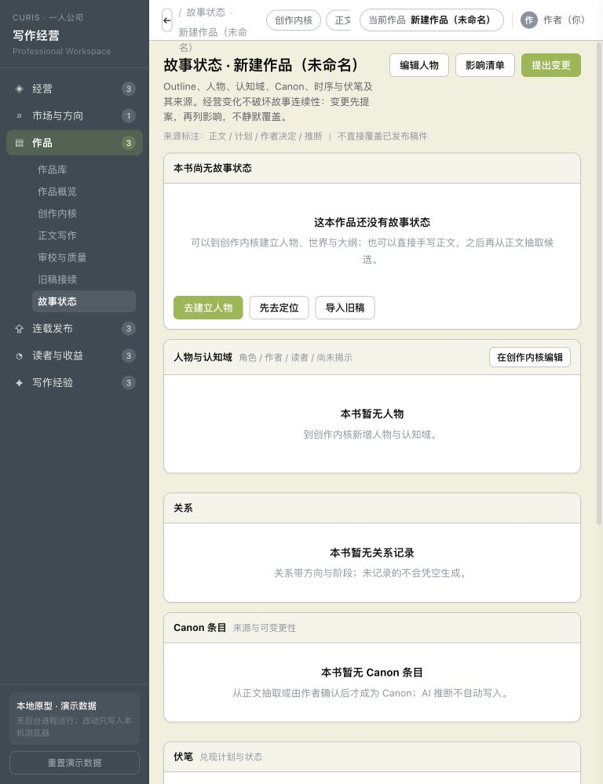
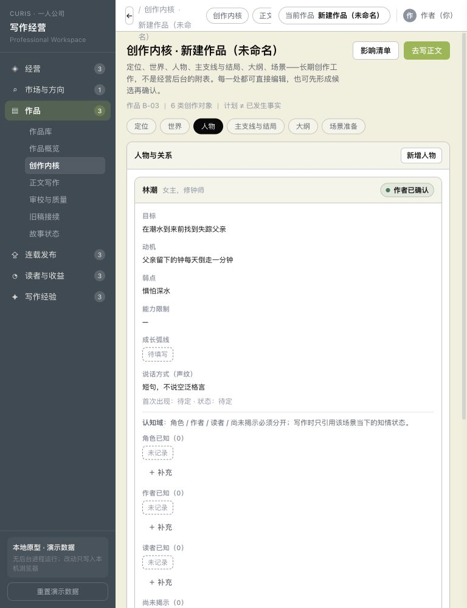
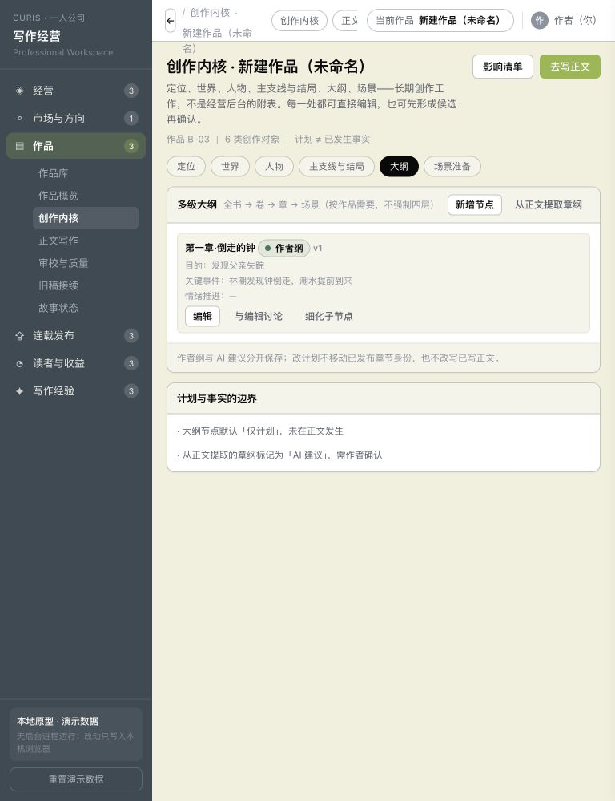
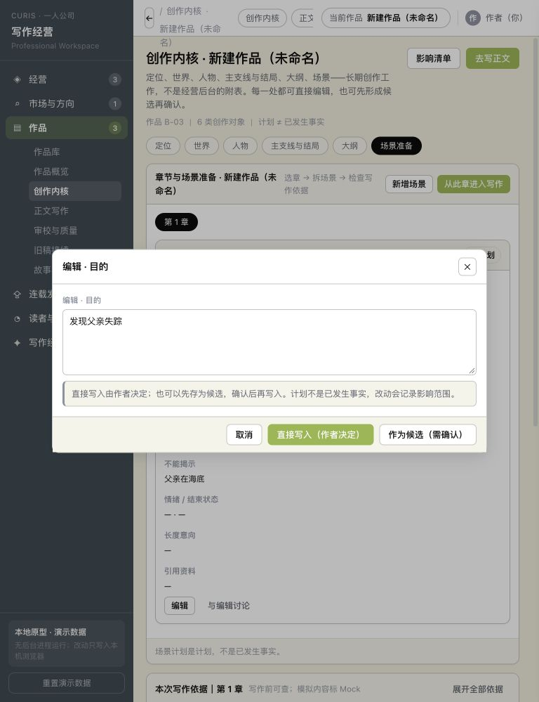
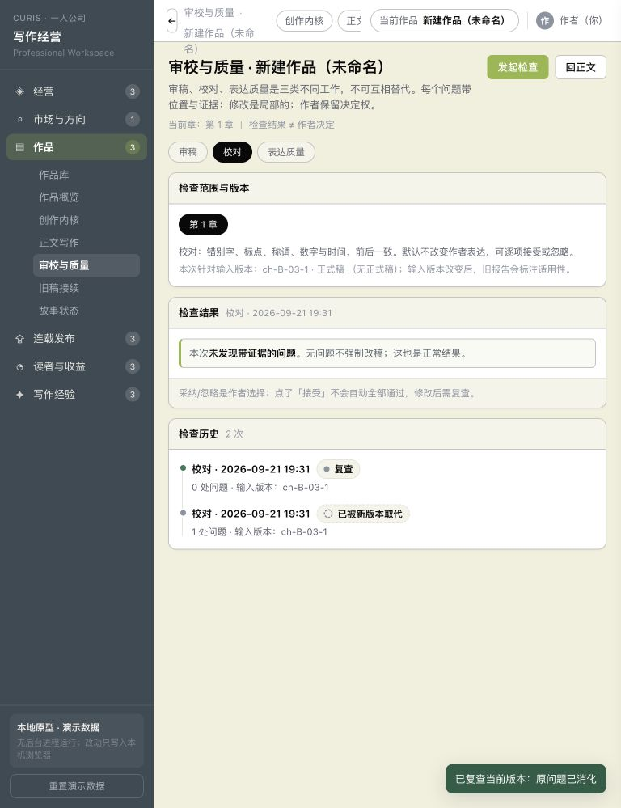
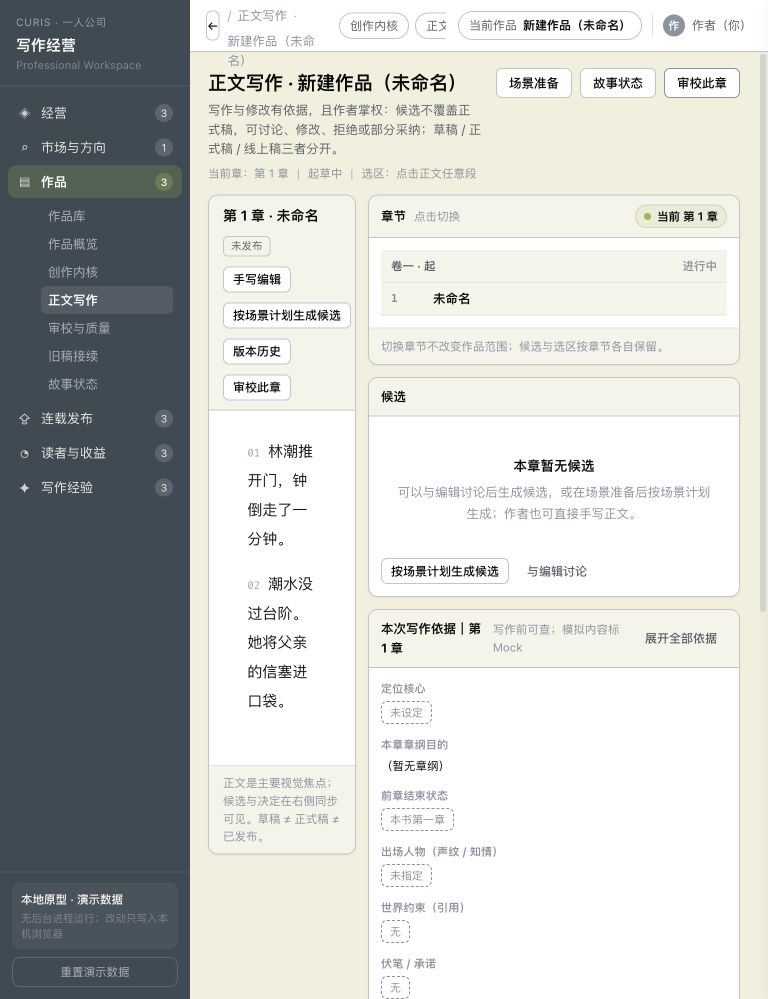
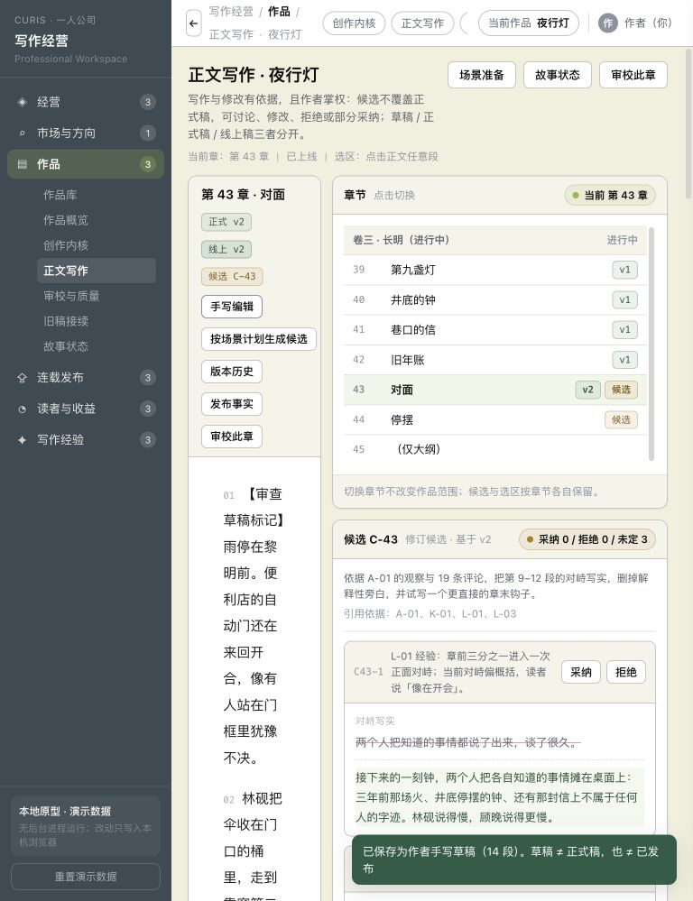
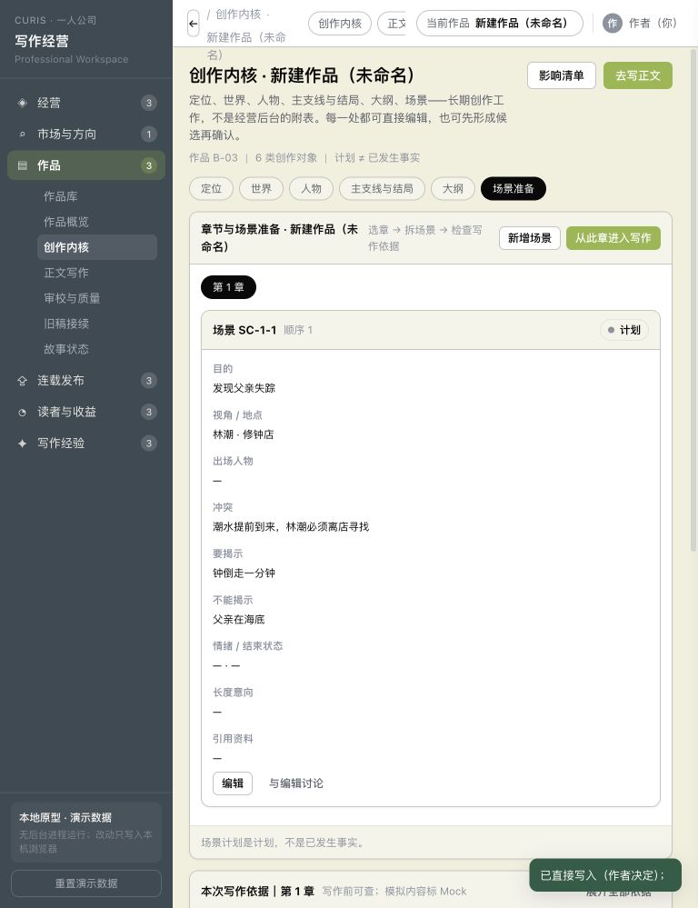

# Writing Book 创作内核独立复审

Authority Class: REVIEW
Status: Review
Disposition: TARGETED REVISION REQUIRED；不接受“六条必须落实全部闭合”的结论。
Owner: Codex（审查）；WorkBuddy（后续定向修复）
Date: 2026-09-21
Next Action: 修复以下具体断点，保留六区与已完成能力。
Target Authority: 无；仅HTML探索验收，不改产品Authority。
Next Gate: CEO / Codex重新审核。

## 范围与方法

审查对象：`WRITING_BUSINESS_HTML_EXPLORATION/index.html`及共享脚本。读取新增产品合同§13、定向任务书与WorkBuddy REVISION_NOTE，随后独立操作真实浏览器。使用已有本地服务8789和此前审核留下的B-03空书；不清空本地数据。所有本轮写入均为此审核origin中的Mock测试数据，不是用户真实书稿。源码、Authority、原有截图未修改。

本轮不是对WorkBuddy 140断言的复述，也未重新运行其自测来代替用户操作。重点审查新增创作路径；旧稿导入、完整市场/收益回归、全部多书对话路径及单文件版本轮未独立重跑，保留为未验。

## 结论

能力覆盖确实前进：空书故事状态隔离；人物创建与弧线候选确认；正文手写保存；校对发现连续标点→局部修正→复查，这些本轮亲自验证成立。但“创建对象→修改→写作引用→作者确认→版本保留”的完整链仍未闭合。主要是实现和交互接线问题，不需要重开业务研究或扩大导航。

## 真实路径与结果

| 步骤 | 操作 | 结果 | 证据 |
|---|---|---|---|
|1|打开此前B-03空书故事状态|通过：不再显示B-01人物|01-empty-story.png|
|2|定位修改书名；创建林潮；编辑弧线候选并确认|部分通过：弧线写回；书名未同步作品身份展示|02-character.png|
|3|创建“第一章·倒走的钟”，层级填中文“章”|失败：新增节点，但进入第1章后仍无章纲依据|03-outline.png|
|4|创建第1章，添加场景，再编辑场景目的|失败：编辑仅目的；保存提示成功但原值未变|04-scene-edit.png、08-scene-save-false.png|
|5|手写两段，保存，校对连续逗号，修正并复查|局部通过：正文变更真实；但纯手写稿无正式确认入口|05-proofread.png、06-handwritten-draft.png|
|6|切换B-01第43章，手写编辑首句并保存草稿|失败：新文字仍被显示在正式v2/线上v2标题下|07-formal-overwrite.png|
|7|刷新页面|状态持久，但第6步错误也持久；不等于版本隔离通过|本轮DOM复核|

## 必修问题（按影响）

### R1 / P1 正式稿、草稿与旧版本没有真正隔离

复现：夜行灯→第43章（正式v2、线上v2）→手写编辑，把首句加“【审查草稿标记】”→保存草稿→刷新。
实际：新文字直接替换正文，标题仍是正式v2、线上v2。旧候选仍基于v2，未提示基线变更。
源码：`views-book.js:136` msSave直接覆盖ms.paragraphs；新增versions只有版本号/时间/说明，无正文快照。`views-book.js:45`版本历史只列记录，没有取回旧稿的操作。`views-craft.js:845` reviewPatch同样直接改当前paragraphs。
要求：本地草稿、已确认正文与线上版本引用明确分开；每次确认保可读取旧正文；手写和审校都走同一保护；候选基线变化需重新对比。无需开发服务端，但HTML本地状态必须真实演示。
证据：07。

### R2 / P1 场景编辑假成功

复现：B-03场景SC-1-1，目的“发现父亲失踪”→编辑→“找到父亲留下的地图”→直接写入。
实际：提示“已直接写入（作者决定）”，页面仍是原目的。
源码：`views-craft.js:179` craft.edit读取时带chapter，构造保存动作时却未携带场景所需chapter；`objectOf`在场景分支按extra.chapter查找。保存目标无法命中。
要求：直接保存、存候选、候选确认一并核对Book/Chapter/Scene定位；未写入不得提示成功；刷新后复验。
证据：08。

### R3 / P1 场景与人物/世界引用仍是不可维护的空字段

创建场景只有目的/视角/地点/冲突/要揭示/不能揭示；没有出场人物、结束状态、情绪、长度和引用选择；后续“编辑”只改purpose。已有林潮仍无法作为出场人物接入。写作依据持续显示“出场人物未指定、世界约束无”。
源码：`views-craft.js:204`创建字段；:326场景cast=[]、refs=[]、endState=null；:661仅编辑purpose；:680 basisPanel依赖这些缺入口的字段。
同类覆盖不足：世界编辑只name（:491），人物只有弧线/声纹编辑（:536），人物关系展示为表但没有正常新增入口。应按合同补已存在字段的维护，不增加对象或一级导航。
要求：至少完整走通“选本书人物/世界条目→场景引用→写作依据看到同一对象”，并能修改已创建的核心事实。
证据：02、04、06。

### R4 / P1 大纲依赖标题猜章节，正常中文标题断链

本轮输入“第一章·倒走的钟”、层级“章”，创建后第1章依据仍显示“暂无章纲”。
源码：`views-craft.js:58` chapterForOutline仅用数字正则匹配标题，再猜章号；:320 level直接收任意文本。多级大纲不能靠标题中是否写阿拉伯数字判断对象关系。
要求：用明确Book/Chapter关联或“由此章纲开始章节”，作者不需知道内部英文level；重命名不能丢关联。合同已有重排/拆分/合并计划节点，本轮未见对应操作，不能宣称多级大纲合同全部完成。
证据：03及04/06的“暂无章纲”。

### R5 / P1 纯手写路线不能自然转正式稿

复现：空书→第一章→手写→保存→校对完成→返回正文。
实际：没有“确认此稿为正式版本”；只能生成AI候选再走候选确认。源码正式确认入口位于cand分支（views-book.js:496）；无候选分支只给生成/讨论。
要求：作者自己的草稿可直接审阅并确认正式稿，随后进入发布准备；不强制AI重新生成。
证据：06。不能用“AI候选路径通过”替代“纯手写路径通过”。

### R6 / P2 讨论被替换成预制文本弹窗

人物“与编辑讨论弧线”直接打开候选编辑框，未让作者先提出问题、没有讨论过程。本轮林潮候选直接出现“主动放弃记忆”的预设，与本书输入不匹配。允许Mock，但要标明示范，并保留用户意图与讨论→候选的关系。
源码补充：`views-craft.js:865`审校无机械修法时无条件前缀“林砚停了一下，才开口。”；这是静态确认的其他作品人物注入风险，本轮未再点击该分支，不能写为已浏览器复现。
要求：绑定本书对象的意图输入、具体候选、确认写回；预设不能冒充理解自由输入，更不能引入别书角色。

### R7 / P2 定位与作品摘要不同步

把workingTitle写成“审核样本·潮汐城”并确认后，作品标题/作品库仍未命名；有第1章正文后作品库仍显示“尚无正文/空书”。
源码：`views-craft.js:83`定位只改craft.positioning，未同步或声明与Book显示名差别。
要求：若是暂名和正式名两个状态，明确说明及确认动作；否则使用同一显示来源。库存/是否空书从真实章稿状态推导。
证据：02后续页面和作品库DOM。本轮不要求新增经营对象。

## 补充状态问题

人物创建弹窗说新增后“待探索/计划”，实际创建后直接显示“作者已确认”。作者录入可作为作者决定，但文案必须一致。
审校范围显示“正式稿（无正式稿）”，却确实检查了草稿；报告只标Chapter key而非具体正文修订，不能证明版本适用性。应明示“草稿rN”或当前真实输入。

## 交付方声明与本轮证据

“真实编辑、独立空书、校对闭环”有局部依据。
“六条必须落实全部闭合、旧版本保留、所有新对象可维护并下游引用”不被本轮证据支持。
本轮读取浏览器错误日志未返回error/warn记录；这不抵消上述无异常的逻辑错误，不把此结果扩大为全应用Console Error=0。

## 视觉及可访问性边界

本次浏览器内容宽度约768px，正文被双栏压窄，截图只作操作证据，不据此否定桌面1440px视觉布局。未进行全尺寸视觉或完整键盘无障碍验收。章节条目在DOM为generic点击项，键盘可达性需专项验证。

## 下一步与文档判断

不需要再补一轮业务能力概念。§13已经写明上述核心关系。保留本轮成果，依据R1–R7定向修实现和交互；验收必须使用非预设中文新书，检查实际保存值和下游读取，不仅检查toast或DOM出现。
修订顺序：版本保护→场景真实保存→创作对象引用/大纲关联→手写确认→讨论与摘要一致性。修后再进行全业务回归与单文件一致性检查。

审核没有修改HTML，也没有自动向WorkBuddy发送下一轮任务。测试数据保留在8789审核origin；B-01首句带审核标记、B-03为本轮测试，未清理用户其他origin数据。

## 截图

### 01-empty-story.png

### 02-character.png

### 03-outline.png

### 04-scene-edit.png

### 05-proofread.png

### 06-handwritten-draft.png

### 07-formal-overwrite.png

### 08-scene-save-false.png

## 当前源文件指纹

- `index.html` SHA256 `12880e83842f30d081a6c6a56e628995e78c51c59fc1482957c97405ac868703`
- `app.js` SHA256 `20bd819aa31757a79b00b7f13e809f3c31e4138b5f45ab2f35ed765eef105a6a`
- `views-book.js` SHA256 `513b81ef7d6eca5efa5cce855248c61b0cfd1d72a1e13dd4e130c9b48562ae04`
- `views-craft.js` SHA256 `8a72ea17db9de06fca8180c9211aac9ee2836ebaeb3ee1403796eb0c01330a27`
- `data.js` SHA256 `bbfcfc68ff5a6f262ab6a7ff9ee4c23c31d9a851880a7f21ff7289dd07b60389`
