# Employee Default Skill Mapping（官方员工默认 Skill 绑定方案评审）

> **作者**：高见远（架构师，software-architect）
> **主理人**：齐活林（交付总监）
> **阶段**：Phase-1 Skill Foundation Bootstrap（Design Only · 评审 + 绑定指南，零代码、零运行时改动）
> **对齐**：`docs/research/domain/official-skill-catalog-v1.md`（PM 许清楚：105 Skill / 10 字段 / 3 Pack，本评审全部 `skill_name` 取自该目录）；`docs/contracts/official-skill-catalog-contract.md`（官方 Skill 能力库契约，提供 `skill_id` 映射）；`docs/contracts/employee-template-contract.md`（Employee Template）；`docs/contracts/ai-company-template-system.md` §2.3（`default_skill`）；`admin-workspace-template-boundary.md`（Admin 不强制、不修改用户实例）
> **范围说明**：本评审设计 **Employee Template → `default_skills`** 官方默认绑定。这些是 Admin 提供的"开箱即用"官方默认能力集；Workspace 创建员工实例时可整体采用或按公司需求增删覆盖。**零代码、不实例化、不修改 Workspace Runtime。**

---

## 0. 文档定位与引用

- **本评审是 `employee-template-contract.md` 中 `default_skills` 字段的填充指南**（该契约当前仅含 `default_skill` 单数引用；本评审建议扩展为 `default_skills` 数组，见 §4）。
- 所有 `skill_name` **严格取自** PM 的 `official-skill-catalog-v1.md` 真实条目（105 条），**无编造、无外部引入**。
- `skill_id`（`skl_*`）取自 `official-skill-catalog-contract.md` 附录 A，用于与官方目录稳定关联。

---

## 1. 读取 v1 目录（来源真实性核验）

- 已读取 `docs/research/domain/official-skill-catalog-v1.md`，确认其包含 **105 个真实 Skill**（Pack A 52 / Pack B 31 / Pack C 22），每个含 10 字段。
- 本评审引用的全部 `skill_name` 均在该 105 条集合内（逐条核对见 §5 验收速览）。
- **零编造**：凡本评审出现的 `skill_name`，均可在 v1 目录找到同名 heading。

---

## 2. Employee Template → `default_skills` 绑定表

> 每张表给出：employee_template（id / 名称 / role 类型）、默认 skill 列表（引用 v1 `skill_name`，附 `skill_id` 与 `category`）、说明（开箱即用官方默认能力）。
> `category` 使用 `official-skill-catalog-contract.md` §2 的受控 key。

### 2.1 et_backend_engineer — Backend Engineer AI

- **role 类型**：Backend Engineer
- **说明**：后端服务开发与接口实现的开箱即用能力集（含 Python 开发、API 设计、数据库设计、Debug 等）。

| skill_name | skill_id | category |
|---|---|---|
| python_development | skl_ai_rd_python_development | development |
| backend_development | skl_ai_rd_backend_development | development |
| api_design | skl_ai_rd_api_design | architecture |
| api_implementation | skl_ai_rd_api_implementation | development |
| database_design | skl_ai_rd_database_design | architecture |
| sql_development | skl_ai_rd_sql_development | development |
| debugging | skl_ai_rd_debugging | development |
| refactoring | skl_ai_rd_refactoring | development |
| code_review | skl_ai_rd_code_review | development |
| test_driven_development | skl_ai_rd_test_driven_development | development |
| git_workflow | skl_ai_rd_git_workflow | development |
| concurrency_programming | skl_ai_rd_concurrency_programming | development |
| algorithm_implementation | skl_ai_rd_algorithm_implementation | development |
| documentation_writing | skl_ai_rd_documentation_writing | development |
| typescript_development | skl_ai_rd_typescript_development | development |

### 2.2 et_frontend_engineer — Frontend Engineer AI

- **role 类型**：Frontend Engineer
- **说明**：前端组件/页面开发与交互优化的开箱即用能力集（含 React 开发等）。

| skill_name | skill_id | category |
|---|---|---|
| react_development | skl_ai_rd_react_development | development |
| frontend_development | skl_ai_rd_frontend_development | development |
| typescript_development | skl_ai_rd_typescript_development | development |
| debugging | skl_ai_rd_debugging | development |
| refactoring | skl_ai_rd_refactoring | development |
| code_review | skl_ai_rd_code_review | development |
| test_driven_development | skl_ai_rd_test_driven_development | development |
| git_workflow | skl_ai_rd_git_workflow | development |
| documentation_writing | skl_ai_rd_documentation_writing | development |
| mobile_development | skl_ai_rd_mobile_development | development |

### 2.3 et_architect — Architect AI

- **role 类型**：Architect
- **说明**：系统架构设计与技术决策的开箱即用能力集。

| skill_name | skill_id | category |
|---|---|---|
| system_design | skl_ai_rd_system_design | architecture |
| api_design | skl_ai_rd_api_design | architecture |
| database_design | skl_ai_rd_database_design | architecture |
| tech_selection | skl_ai_rd_tech_selection | architecture |
| performance_design | skl_ai_rd_performance_design | architecture |
| security_design | skl_ai_rd_security_design | security |
| architecture_review | skl_ai_rd_architecture_review | architecture |
| microservice_design | skl_ai_rd_microservice_design | architecture |
| data_modeling | skl_ai_rd_data_modeling | data |
| integration_design | skl_ai_rd_integration_design | architecture |
| scalability_design | skl_ai_rd_scalability_design | architecture |

### 2.4 et_tech_lead — Tech Lead AI

- **role 类型**：Tech Lead
- **说明**：技术协调、质量门禁与发布节奏的开箱即用能力集。

| skill_name | skill_id | category |
|---|---|---|
| system_design | skl_ai_rd_system_design | architecture |
| architecture_review | skl_ai_rd_architecture_review | architecture |
| code_review | skl_ai_rd_code_review | development |
| release_planning | skl_ai_rd_release_planning | product |
| refactoring | skl_ai_rd_refactoring | development |
| git_workflow | skl_ai_rd_git_workflow | development |
| test_retrospective | skl_ai_rd_test_retrospective | testing |
| performance_design | skl_ai_rd_performance_design | architecture |
| tech_selection | skl_ai_rd_tech_selection | architecture |

### 2.5 et_product_manager — Product Manager AI

- **role 类型**：Product Manager
- **说明**：需求分析、PRD 设计与用户研究的开箱即用能力集（含需求分析 / PRD设计 / 用户研究等）。

| skill_name | skill_id | category |
|---|---|---|
| requirement_analysis | skl_ai_rd_requirement_analysis | product |
| prd_design | skl_ai_rd_prd_design | product |
| user_research | skl_ai_rd_user_research | product |
| user_story_writing | skl_ai_rd_user_story_writing | product |
| competitive_analysis | skl_ai_rd_competitive_analysis | product |
| product_roadmap | skl_ai_rd_product_roadmap | product |
| acceptance_criteria_design | skl_ai_rd_acceptance_criteria_design | product |
| feature_prioritization | skl_ai_rd_feature_prioritization | product |
| product_metrics_definition | skl_ai_rd_product_metrics_definition | product |
| release_planning | skl_ai_rd_release_planning | product |

### 2.6 et_qa_engineer — QA Engineer AI

- **role 类型**：QA Engineer
- **说明**：测试设计、自动化测试与质量保障的开箱即用能力集（含测试设计 / 自动化测试等）。

| skill_name | skill_id | category |
|---|---|---|
| test_design | skl_ai_rd_test_design | testing |
| automated_testing | skl_ai_rd_automated_testing | testing |
| performance_testing | skl_ai_rd_performance_testing | testing |
| integration_testing | skl_ai_rd_integration_testing | testing |
| regression_testing | skl_ai_rd_regression_testing | testing |
| test_retrospective | skl_ai_rd_test_retrospective | testing |
| acceptance_criteria_design | skl_ai_rd_acceptance_criteria_design | product |
| test_driven_development | skl_ai_rd_test_driven_development | development |
| debugging | skl_ai_rd_debugging | development |

### 2.7 et_devops_engineer — DevOps Engineer AI

- **role 类型**：DevOps Engineer
- **说明**：容器化、CI/CD 与部署运维的开箱即用能力集（含 Docker / CI/CD / 部署等）。

| skill_name | skill_id | category |
|---|---|---|
| dockerization | skl_ai_rd_dockerization | devops |
| cicd_pipeline | skl_ai_rd_cicd_pipeline | devops |
| deployment | skl_ai_rd_deployment | devops |
| monitoring | skl_ai_rd_monitoring | devops |
| canary_release | skl_ai_rd_canary_release | devops |
| infrastructure_as_code | skl_ai_rd_infrastructure_as_code | devops |
| log_analysis | skl_ai_rd_log_analysis | devops |
| incident_response | skl_ai_rd_incident_response | devops |

### 2.8 et_data_engineer — Data Engineer AI

- **role 类型**：Data Engineer
- **说明**：数据建模、管道与数据访问的开箱即用能力集（数据相关 Skill）。

| skill_name | skill_id | category |
|---|---|---|
| data_modeling | skl_ai_rd_data_modeling | data |
| data_pipeline_development | skl_ai_rd_data_pipeline_development | data |
| sql_development | skl_ai_rd_sql_development | development |
| database_design | skl_ai_rd_database_design | architecture |
| integration_design | skl_ai_rd_integration_design | architecture |
| scalability_design | skl_ai_rd_scalability_design | architecture |
| performance_design | skl_ai_rd_performance_design | architecture |

### 2.9 et_security_engineer — Security Engineer AI

- **role 类型**：Security Engineer
- **说明**：安全设计、评审与线上应急的开箱即用能力集（从目录中合理补充的安全角色）。

| skill_name | skill_id | category |
|---|---|---|
| security_design | skl_ai_rd_security_design | security |
| code_review | skl_ai_rd_code_review | development |
| architecture_review | skl_ai_rd_architecture_review | architecture |
| incident_response | skl_ai_rd_incident_response | devops |
| log_analysis | skl_ai_rd_log_analysis | devops |
| integration_design | skl_ai_rd_integration_design | architecture |

### 2.10 et_mobile_engineer — Mobile Engineer AI

- **role 类型**：Mobile Engineer
- **说明**：移动端开发的默认能力集（从目录合理补充）。

| skill_name | skill_id | category |
|---|---|---|
| mobile_development | skl_ai_rd_mobile_development | development |
| react_development | skl_ai_rd_react_development | development |
| typescript_development | skl_ai_rd_typescript_development | development |
| frontend_development | skl_ai_rd_frontend_development | development |
| debugging | skl_ai_rd_debugging | development |
| git_workflow | skl_ai_rd_git_workflow | development |
| code_review | skl_ai_rd_code_review | development |
| test_driven_development | skl_ai_rd_test_driven_development | development |

### 2.11 et_content_operator — Content Operator AI（内容运营）

- **role 类型**：Content Operator
- **说明**：内容运营全链路开箱即用官方默认能力（含爆款分析 / 选题规划 / 内容策划 / 脚本创作 / 视频优化 / 数据复盘等），覆盖 Pack B 全部 31 个 Skill。

| skill_name | skill_id | category |
|---|---|---|
| viral_analysis | skl_ai_content_viral_analysis | content_analysis |
| topic_planning | skl_ai_content_topic_planning | topic |
| trend_research | skl_ai_content_trend_research | topic |
| content_planning | skl_ai_content_content_planning | content_planning |
| content_brief_writing | skl_ai_content_content_brief_writing | content_planning |
| content_series_planning | skl_ai_content_content_series_planning | content_planning |
| content_calendar | skl_ai_content_content_calendar | content_planning |
| script_writing | skl_ai_content_script_writing | script |
| hook_writing | skl_ai_content_hook_writing | copywriting |
| copywriting | skl_ai_content_copywriting | copywriting |
| title_optimization | skl_ai_content_title_optimization | copywriting |
| video_optimization | skl_ai_content_video_optimization | video |
| editing_guidance | skl_ai_content_editing_guidance | video |
| cover_design_advice | skl_ai_content_cover_design_advice | design |
| thumbnail_strategy | skl_ai_content_thumbnail_strategy | design |
| multi_platform_distribution | skl_ai_content_multi_platform_distribution | distribution |
| content_repurposing | skl_ai_content_content_repurposing | distribution |
| email_newsletter | skl_ai_content_email_newsletter | distribution |
| seo_optimization | skl_ai_content_seo_optimization | seo |
| brand_voice | skl_ai_content_brand_voice | brand |
| data_retrospective | skl_ai_content_data_retrospective | data_analysis |
| platform_algorithm_research | skl_ai_content_platform_algorithm_research | data_analysis |
| content_performance_dashboard | skl_ai_content_content_performance_dashboard | data_analysis |
| competitor_content_watch | skl_ai_content_competitor_content_watch | data_analysis |
| fan_operation | skl_ai_content_fan_operation | operations |
| community_management | skl_ai_content_community_management | operations |
| ugc_campaign | skl_ai_content_ugc_campaign | operations |
| influencer_collab | skl_ai_content_influencer_collab | operations |
| livestream_script | skl_ai_content_livestream_script | livestream |
| content_audit | skl_ai_content_content_audit | audit |
| paid_promotion | skl_ai_content_paid_promotion | promotion |

### 2.12 et_growth_commercial — Growth / Commercial AI（商业运营）

- **role 类型**：Growth / Commercial
- **说明**：商业运营全链路开箱即用官方默认能力（含市场分析 / 用户研究 / 销售策略 / 商业计划 / 财务分析等），覆盖 Pack C 全部 22 个 Skill。

| skill_name | skill_id | category |
|---|---|---|
| market_analysis | skl_ai_commercial_market_analysis | market |
| gtm_strategy | skl_ai_commercial_gtm_strategy | market |
| user_research_biz | skl_ai_commercial_user_research_biz | user_research |
| icp_definition | skl_ai_commercial_icp_definition | user_research |
| sales_strategy | skl_ai_commercial_sales_strategy | sales |
| sales_enablement | skl_ai_commercial_sales_enablement | sales |
| business_plan | skl_ai_commercial_business_plan | business_plan |
| financial_analysis | skl_ai_commercial_financial_analysis | finance |
| unit_economics | skl_ai_commercial_unit_economics | finance |
| financial_modeling | skl_ai_commercial_financial_modeling | finance |
| pricing_strategy | skl_ai_commercial_pricing_strategy | pricing |
| channel_management | skl_ai_commercial_channel_management | channel |
| partnership_development | skl_ai_commercial_partnership_development | channel |
| customer_success | skl_ai_commercial_customer_success | customer_success |
| churn_analysis | skl_ai_commercial_churn_analysis | customer_success |
| growth_hacking | skl_ai_commercial_growth_hacking | growth |
| revenue_operations | skl_ai_commercial_revenue_operations | commercial_ops |
| business_kpi_design | skl_ai_commercial_business_kpi_design | commercial_ops |
| crm_management | skl_ai_commercial_crm_management | commercial_ops |
| fundraising_materials | skl_ai_commercial_fundraising_materials | fundraising |
| competitor_monitoring | skl_ai_commercial_competitor_monitoring | competition |
| brand_strategy_biz | skl_ai_commercial_brand_strategy_biz | commercial_brand |

### 2.13 et_sre_platform — SRE / Platform Engineer AI

- **role 类型**：SRE / Platform Engineer
- **说明**：可观测性、基础设施与稳定性的默认能力集（从目录合理补充）。

| skill_name | skill_id | category |
|---|---|---|
| monitoring | skl_ai_rd_monitoring | devops |
| infrastructure_as_code | skl_ai_rd_infrastructure_as_code | devops |
| canary_release | skl_ai_rd_canary_release | devops |
| incident_response | skl_ai_rd_incident_response | devops |
| log_analysis | skl_ai_rd_log_analysis | devops |
| dockerization | skl_ai_rd_dockerization | devops |
| cicd_pipeline | skl_ai_rd_cicd_pipeline | devops |
| deployment | skl_ai_rd_deployment | devops |
| scalability_design | skl_ai_rd_scalability_design | architecture |
| performance_design | skl_ai_rd_performance_design | architecture |

---

## 3. 边界说明（Admin 提供官方默认集，Workspace 可增删覆盖）

- **Admin 职责**：提供上述 13 类 Employee Template 的 `default_skills` 官方默认集（开箱即用能力）。
- **Workspace 职责**：创建员工实例时，**可整体采用**官方默认集，或**按公司需求增删/覆盖** `default_skills`（如为某角色追加行业专属 Skill、移除不适用 Skill）。
- **Admin 不强制、不修改用户实例**：`default_skills` 是"建议默认值"而非"锁定约束"；实例所有权归 Workspace（见 `admin-workspace-template-boundary.md` 两条铁律）。
- **不实例化**：本评审仅定义绑定关系，不生成任何 `EmployeeInstance` / `EmployeeSkillBinding`。

---

## 4. 与 `employee-template-contract.md` 的关系

- **现状**：`employee-template-contract.md` 的 `EmployeeTemplate` 字段集含 `default_instructions` / `default_capability_types` 等，但**未含 `default_skills` 数组**；`ai-company-template-system.md` §2.3 有单数 `default_skill`（`st_` 引用）。
- **本评审定位**：本映射是 **Employee Template 的 `default_skills` 字段填充指南**。建议把 §2.3 的 `default_skill`（单数）扩展为 `default_skills`（数组，`string[]`，引用 `skill_id` `skl_*` 或 `st_*`），以承载完整开箱即用能力集。
- **落地点（Gate E）**：`default_skills` 字段落地为 EmployeeTemplate 元数据（设计态），经 gate E 评审后由 Workspace 在实例化时消费。
- **与运行时解析**：Admin 目录层 `default_skills` 引用 `skill_id`（`skl_*`）；Workspace 实例化时解析为 `EmployeeSkillBinding.skill_template_id`（`st_*`，见 `skill-runtime-contract.md`），并写入 `template_version_snapshot`（快照隔离，`follow_latest` 默认 false，见 `template-versioning-policy.md`）。

```mermaid
flowchart LR
    CAT["Admin 官方 Skill 目录<br/>（skill_id: skl_*）"]
    ET["EmployeeTemplate.default_skills<br/>（本评审填充指南，Gate E）"]
    WS["Workspace 实例化"]
    BIND["EmployeeSkillBinding.skill_template_id<br/>（st_*，运行时）"]
    SNAP["template_version_snapshot<br/>（快照隔离）"]

    CAT ==>|"① 只读引用 skl_*"| ET
    ET ==>|"② 按公司需求增删/覆盖"| WS
    WS ==>|"③ 解析为 st_* 绑定"| BIND
    BIND --> SNAP
    style CAT fill:#dfe,stroke:#333
    style ET fill:#efe,stroke:#393
    style WS fill:#fec,stroke:#333
    style BIND fill:#fec,stroke:#333
```

---

## 5. 验收速览（Acceptance Overview）

| 验收项 | 结果 |
|---|---|
| 绑定员工 Template 类别数 | **13 类**（Backend / Frontend / Architect / Tech Lead / PM / QA / DevOps / Data / Security / Mobile / Content Operator / Growth-Commercial / SRE-Platform） |
| 覆盖任务强制要求 | ✅ Backend、Frontend、PM、QA、DevOps、Data Engineer、Content Operator、Growth/Commercial 全部覆盖 |
| 引用的真实 Skill 总数（去重） | **105 / 105 = 100%**（v1 目录全部 Skill 至少被一个角色引用一次） |
| 引用的 Skill 总条目（含跨角色重复） | ≈ 156 条绑定 |
| 是否全部 `skill_name` 来自 v1 目录 | ✅ **是**，零编造、零外部引入（逐条取自 `official-skill-catalog-v1.md`） |
| `skill_id` 关联 | ✅ 全部可映射到 `official-skill-catalog-contract.md` 附录 A 的 `skl_*` |
| 边界合规 | ✅ Admin 提供默认集、Workspace 可增删覆盖、Admin 不强制/不修改实例 |
| 红线 | ✅ 零代码、不实例化、不修改 Workspace Runtime、未开发 Marketplace/交易 |

> 覆盖率说明：Pack A（52）、Pack B（31）、Pack C（22）全部被至少一类员工默认绑定引用，验证官方 Skill 资产库与员工角色的对齐完整性。

*—— Employee Default Skill Mapping（纯设计/评审，零代码）。与 ADR-0017 一致，仅 design-only reservation。*
