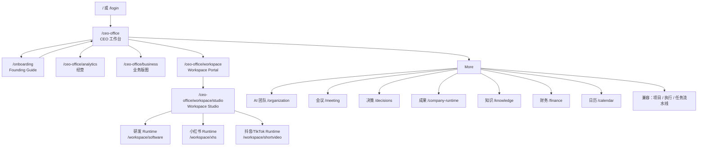

# Curis 当前实现与产品偏航审计

Status: Review  
审计日期：2026-08-13  
审计范围：当前工作区中的代码、页面、路由、Runtime API、数据库结构、当前文档，以及本轮隔离运行产生的真实交互证据。

## 0. 结论先行

如果今天第一次打开当前版本，Curis 更像是：

> 一个正在从 Project/Task-first 迁移到 Company OS 的 Runtime 工作台：它已经有 CEO 空态、FoundingRun 创办链路、Workspace Portal、Workspace Studio，以及研发/小红书/抖音三条不同的业务 Runtime 垂直切片；但“CEO 经营一家 AI 公司”的日常经营、会议、决策、财务、日历、成果闭环仍未完整落地。

当前真正跑通的主路径是：

```text
首次进入
→ 表达经营意图
→ FoundingRun：INTENT_CAPTURED
→ CLARIFYING
→ PROPOSED
→ CEO_CONFIRMED
→ 输入公司名称并建立 Company
→ CEO Desk
→ Workspace Portal
→ Workspace Studio 保存 Blueprint Draft
→ 进入某个业务 Workspace Runtime
→ 建立 Cycle 或 ContentItem
→ 等待 Simulation / 执行 / Evidence / CEO 验收
```

这条路径的技术骨架已经明显成形，但它目前把大量 Runtime 内部概念直接带到了用户前台：FoundingRun、Blueprint、Role Slot、Capability Binding、Simulation、Operating Version、Verification、Evidence、Acceptance 等。结果是，用户已经能看到“系统如何运行”，却还不能稳定地感受到“我的公司正在经营并产生成果”。

本轮没有修改 Blueprint、Runtime、业务代码或既有用户变更，也没有提交。报告和本轮截图位于同一审计目录。

## 1. 证据边界与数据源卫生

### 1.1 本轮使用的事实来源

- 当前工作区代码，重点包括 `frontend/app/ceo-office/**`、`frontend/app/onboarding/**`、`frontend/components/terra/**`、`frontend/lib/runtimeApi.js`、`backend/app/api/**`、`backend/app/runtime/**`。
- 当前权威文档：`docs/00_Context/CURRENT_STATE.md`、`docs/01_Product/Curis_Product_Context.md`、`docs/08_Change_Log/CHANGE_LOG.md`，以及当前 Frozen 模块文档。
- 当前工作区的 SQLite 结构和记录。
- 使用当前代码启动的隔离后端、隔离 SQLite 和当前前端的真实浏览器交互。
- 本轮截图：
  - [CEO 工作台空态](./01-ceo-office-empty.png)
  - [Founding Guide](./02-founding-guide.png)
  - [经营意图已记录](./03-founding-intent-captured.png)
  - [澄清阶段](./04-founding-clarifying.png)
  - [公司提案阶段](./05-founding-proposed.png)
  - [CEO 确认阶段](./06-ceo-confirmed.png)
  - [公司建立后 CEO Desk](./07-ceo-office-company-created.png)
  - [Workspace Portal 空态](./08-workspace-portal-empty.png)
  - [Workspace Studio Draft](./09-workspace-studio-draft.png)
  - [研发 Workspace Runtime](./10-rd-workspace-runtime-empty.png)
  - [小红书 Workspace Runtime](./11-xhs-workspace-runtime-empty.png)
  - [小红书 ContentItem](./12-xhs-content-item.png)
  - [抖音 / TikTok Workspace Runtime](./13-ttk-workspace-runtime-empty.png)

### 1.2 必须区分的两个数据库事实

当前仓库中的 `data/curis.sqlite` 为空业务基线：本轮读取到 Company、Business、Department、Employee、Project、Task、Artifact、Outcome、Commitment、Workspace、Workflow Run、Knowledge 等核心业务记录均为 0；Catalog、Template、Capability 等定义数据存在。

工作区中另有一个已存在的旧进程曾连接到其他数据库，浏览器最初看到过一家公司、多个 Workspace 和员工。这些记录与当前 `data/curis.sqlite` 不一致，已作为环境/进程串线证据丢弃，未当作当前产品事实。

为验证当前实现，本轮使用了唯一的 `/tmp/curis-current-audit-20260813.sqlite` 隔离数据库，浏览器中建立了一家审计公司、三个 Workspace，并创建了一条小红书 ContentItem。隔离数据没有写回仓库数据库。

因此，本文同时报告两层事实：

1. **空基线事实**：新用户打开当前版本时看到的真实状态。
2. **隔离运行事实**：当前代码在完成建公司、搭建 Workspace、创建第一条内容后能达到的状态。

不要把隔离数据误读成仓库已经预置的产品数据。

## 2. Current Screen Map：当前真实页面与导航

### 2.1 一级导航与隐藏入口

当前 `TerraNavData.js` 定义的产品导航分为四层，但桌面默认只把四个入口放在主侧栏：

| 入口层级 | 页面 / 路由 | 当前用途 | 真实状态 |
|---|---|---|---|
| 一级 | CEO 工作台 `/ceo-office` | 公司快照、待处理、风险、Workspace、AI 员工、Assistant | 有真实 Runtime 读取；新公司可显示 Company 与 CEO Assistant；空态真实且不填充样例 |
| 一级 | 经营 `/ceo-office/analytics` | 经营简报、事项过滤、公司脉搏 | 有页面和读取逻辑；无数据时显示 UNKNOWN/空态；尚未形成日常经营闭环 |
| 一级 | 业务版图 `/ceo-office/business` | 展示 Business Workspace 卡片并进入 Workspace | 有真实 Workspace 列表；当前更像 Workspace 索引，不是业务结果地图 |
| 一级 | 工作空间 `/ceo-office/workspace` | Workspace Portal，进入或搭建业务办公室 | 有真实列表、空态和 Studio 入口 |
| More / AI 组织 | AI 团队 `/ceo-office/organization` | 旧组织/部门/员工管理入口 | 页面存在；本轮隔离浏览器页面出现 `Failed to fetch`，但对应后端 API 直接返回 200，属于当前入口/API 环境断裂，不能据此断言后端对象不存在 |
| More / 经营工具 | 会议工作台 `/ceo-office/meeting` | 会议、纪要、待办入口 | 页面只有“规划中”，v1 暂不建设 |
| More / 经营工具 | 决策室 `/ceo-office/decisions` | 待决策事项列表 | 页面能显示空态；代码明确说明没有专用决策审批端点，按钮只是本地占位，不会关闭真实决策 |
| More / 公司资源 | 成果库 `/ceo-office/company-runtime` | 结果、事实、成果读取 | 页面存在，当前显示“未读取事实”；需要 Agent 完成、CEO 验收和外部结果 |
| More / 公司资源 | 知识库 `/ceo-office/knowledge` | 知识条目、导入、手工录入 | 有数据库表和 API；本轮隔离浏览器页面也出现 `Failed to fetch`，直接 API 返回 200 |
| More / 公司资源 | 财务 `/ceo-office/finance` | 成本、收支、经营财务 | 页面只有“规划中”，v1 暂不建设 |
| More / 公司资源 | 日历 `/ceo-office/calendar` | 公司日程与重要节点 | 页面只有“规划中”，v1 暂不建设 |
| 底部 | 公司设置 `/ceo-office/settings` | 公司资料、品牌主题、通知偏好 | 页面可编辑本地 Draft；还不是完整 Company Runtime 设置 |
| 底部 | 帮助与反馈 `/ceo-office/help` | 使用指引与反馈 | 页面存在，内容是规划中/文档导向 |
| 兼容入口 | 旧项目 `/ceo-office/projects` | Project/Task-first 旧工作面 | 代码和 API 仍存在，已从主产品入口下沉到 More |
| 兼容入口 | 旧执行 `/ceo-office/execution`、`/execution/pipeline` | Workflow/Execution 旧运行面 | 代码和 API 仍存在，作为兼容路径 |

全局还有：`/login` 本地 Owner 登录、`/onboarding` Founding Guide、`/ceo-office/workspace/studio` Studio、研发 `/workspace/software`、小红书 `/workspace/xhs`、抖音/TikTok `/workspace/shortvideo`。`/reports`、`/brainstorm`、`/runtime-trace`、`/capabilities` 等存在直接路由或旧模块，但不在默认 CEO 主导航中；`/reports` 还含有静态 Q2 示例内容，不能算实时经营事实。

### 2.2 当前真实 Screen Map



### 2.3 页面层面的总体判断

- **真实可交互**：CEO 空态、Founding Guide、Workspace Portal、Studio、研发/小红书/抖音 Runtime 的主要创建表单和状态读取。
- **真实后端但前台不完整**：Company、CEO Assistant、Role Slot、AI Employee、Capability Binding、Workspace Blueprint、Cycle、ContentItem、Simulation、Evidence/Acceptance 相关 Runtime 对象。
- **前台 Prototype/Placeholder**：会议、财务、日历、部分决策操作、帮助与反馈、成果库的当前空态、静态 Reports。
- **兼容性遗留**：Project、Task、Department、Employee、Workflow/Execution、旧 Guide。它们仍可被代码和路由访问，但已经不应继续作为新用户心智主线。

## 3. 真实用户主路径

### A. 从零创建公司

本轮从空基线真实执行：

| 阶段 | 用户看到什么 | 用户动作 | 系统实际写入/生成 | 去向 |
|---|---|---|---|---|
| 1. 首达 | `公司尚未建立`；不填充项目或示例数据 | 点击 `开始创办公司` | 进入 Founding Guide | `/onboarding` |
| 2. 表达意图 | `从经营意图开始创办公司`，一个意图输入框 | 输入经营意图，点击建立 | FoundingRun → `INTENT_CAPTURED` | 同页 |
| 3. 澄清 | 澄清状态 | 点击 `开始澄清` | FoundingRun → `CLARIFYING` | 同页 |
| 4. 提案 | `PROPOSED`，但页面没有展示完整公司/业务提案内容 | 点击 `形成公司提案` | FoundingRun → `PROPOSED` | 同页 |
| 5. CEO 确认 | 只能确认或退回提案 | 点击 `确认公司提案` | FoundingRun → `CEO_CONFIRMED` | 同页 |
| 6. 建公司 | 只要求公司名称；提示同一事务会创建 Company 与首个 CEO Assistant | 输入名称，点击建立公司 | Company、CEO_ASSISTANT、组织版本等 Runtime 对象 | `/ceo-office` |
| 7. 建立后 | CEO Desk 显示 Company、0 个 Workspace、1 个 CEO Assistant | 可进入 Workspace Portal 或打开 Assistant | Company 已存在；CEO Assistant 状态为 `CREATED` | Workspace Portal |

用户可见的核心动作约 5 次点击（不含输入），但实际是 6 个 FoundingRun 状态阶段。它建立的是“公司壳 + CEO Assistant”，不是用户所期待的完整“公司设定 → 首个业务 → AI 团队 → 启动”。

本轮建立后的 Desk 真实显示：`审计演示 AI 公司 · Runtime 快照 · 0 个工作空间`，1 个 AI employee 实际上是 CEO Assistant；Assistant UI 仍显示“未命名 Assistant / 尚未设置角色”，责任为“未记录”，没有专业 AI 员工。这里已经出现了第一处产品落差：后台确实生成了身份对象，前台没有把它解释成一个可工作的 CEO 身份。

### B. CEO 日常经营

当前真实路径是：

```text
CEO 工作台
→ 经营（简报 / 公司脉搏）
→ 业务版图或 Workspace Portal
→ 具体 Workspace Runtime
→ Cycle / ContentItem
→ Simulation / 执行 / Evidence
→ 成果库或 CEO 验收
→ 决策 / 反馈
```

但本轮没有跑出完整闭环：

- 空公司没有事项、风险、机会或经营指标，经营页面显示 UNKNOWN/空态。
- 成功建公司后，CEO Desk 能读到 Company、Workspace 数量、Assistant 和团队快照，但没有“今天发生了什么”的真实经营叙事。
- 决策页面可以展示空态，但代码中的 `handleDecide` 只是 `console.log`，且注释明确说没有后端 decisions 审批端点。
- 会议页面明确是规划中。
- 成果库页面没有读取到事实；它要求 Agent 完成、CEO 验收和外部结果后才会出现成果。
- 因此当前可以进入“运行前准备”和“建立工作对象”，还不能证明 CEO 能从结果到反馈、决策、关闭并进入下一日。

结论：**CEO 日常经营是页面骨架 + Runtime 基础，不是当前已经闭合的产品主循环。**

### C. 创建新业务 / 新部门

当前有两条并存路径。

#### 新的 Company OS / Workspace 路径

```text
CEO 工作台
→ Workspace Portal
→ 搭建业务空间
→ Studio 选择 RD / XHS / TTK 模板
→ 填办公室名称、目标结果、CEO 验收证据、失败与人工备用路径
→ 保存 Blueprint Draft
→ 进入具体 Workspace Runtime
→ 建 Cycle 或 ContentItem
→ Simulation、能力/人员检查、CEO 批准后才可 Operate
```

用户真正填写的业务语义只有 4 个字段；Studio 同时展示 `Discover → Blueprint → Compose → Bind → Staff → Simulate → Approve → Operate` 八阶段、计划岗位、能力绑定、检查数和仿真场景数。对于 CEO 来说，后半段已经从“表达业务意图”变成“操作一套 Runtime 装配流程”。

#### 旧 Organization / Guide 路径

`/ceo-office/organization`、`/guide` 仍保留 Department、Employee、Project 的旧 CRUD/创建方式；它们不是当前 FoundingRun 的连续路径。也就是说，“创建新部门”没有一个当前明确的 Company → Business → Department → Workspace 主路径，而是落入旧组织入口或通过 Studio 间接产生 Role Slot / AI Employee。

当前新业务创建并没有独立的一等 Business 创建向导；Workspace 更像业务的可运行载体。工程部的职责在技术上被 Studio 的模板、计划岗位、能力要求、仿真和审批流程承接了一部分，但前台仍把这些装配概念直接交给 CEO。

### D. 三类 Workspace 运行

| Workspace | 当前外观与对象 | 真正可做的事 | 与其他 Workspace 的差异 | 当前判断 |
|---|---|---|---|---|
| 软件研发 | `研发办公室 · 运行现场`；以 Cycle、八阶段、证据、CEO 验收为主 | 建立研发 Cycle，填写交付结果和执行引用，进入 Simulation/执行/验收 | 业务对象是 Cycle，阶段包括研发、QA、验收等 | 领域语义已出现，但尚未跑完一轮真实交付 |
| 小红书 | `小红书运营办公室 · 运行现场`；以 ContentItem、不可变版本、发布回执、互动反馈为主 | 建立内容意图，填写平台版本、稿件/素材引用；本轮成功创建一条 ContentItem | 使用内容版本、发布和互动对象，不使用研发 Cycle | 领域差异真实存在；本轮只到 UNVERIFIED 内容事实 |
| 抖音 / TikTok | `抖音 / TikTok 运营办公室 · 运行现场`；独立短视频 ContentItem、版本、回执、互动 | 与 XHS 类似的内容创建与后续验证路径 | 独立 business type、模板与角色/能力要求 | 当前主要是独立模板和标签，尚未证明独立的经营反馈闭环 |

三者都复用 `WorkspaceRuntimeView` 和同一套运行现场结构：状态头、Simulation、创建工作对象、失败/人工备用路径、Evidence/Acceptance 方向。它们不是完全相同的业务对象，但前台仍共享同一套 Runtime 思维和屏幕骨架。AI 员工目前是 `PROPOSED` 候选与角色槽位，并非已经在三间办公室中以明确岗位身份工作。

## 4. Current Domain Inventory：当前真实产品对象

状态说明：

- **A 仅文档定义**：只在 Blueprint/文档中定义，本轮未在当前代码或数据中确认。
- **B 前端 Prototype**：页面/组件/静态展示存在，但不是完整真实对象。
- **C Runtime 状态**：状态机、Runtime 事件或快照中存在。
- **D 后端 API**：有可调用 API/服务。
- **E 数据库/持久化**：有表、记录或可持久化结构。

| 一等对象 | 当前状态 | 当前真实形态 | 是否已成为产品核心 |
|---|---|---|---|
| Company | C/D/E | FoundingRun 确认后创建；CEO Desk、Workspace Portal 读取 | 是，但当前更像 Company 壳 |
| Business / Business Direction | C/D/E，前台混合 | 有 `business_directions` 和 Workspace business type；没有独立的新业务向导 | 部分核心，尚未成为 CEO 主语义 |
| Department | C/D/E（旧路径） | `departments`、`department_instances`、旧组织 API；不在新 Founding 主线 | 不是当前 Runtime 主核心 |
| Role Slot | C/D/E | Studio 保存后产生计划岗位，例如 Product AI、Engineering AI、QA AI | 是 Runtime 内部对象，前台暴露过多 |
| Employee / AI Employee | C/D/E | CEO Assistant 可创建；专业 AI 员工以候选/提议状态出现；旧 Employee 也存在 | 是，但“岗位→员工→能力”尚未成为清晰前台主线 |
| Capability | C/D/E | Catalog、绑定、Capability Supply Review、状态检查存在 | 是底层 Company Resource；尚未自然融入 CEO 体验 |
| Workspace / Blueprint | C/D/E | RD/XHS/TTK 模板、Draft、版本、工作空间 Runtime | 是当前最完整的业务前台对象 |
| Commitment | C/E，前台缺失 | `commitments` 表和 Runtime 状态存在 | 不是用户当前可见核心 |
| Cycle | C/D/E | RD Runtime 的主要工作对象；可创建但本轮未执行到关闭 | 是研发 Workspace 核心，但只覆盖一条垂直 |
| Run / Simulation | C/D/E | `runtime_simulation_runs`、旧 `workflow_runs`、Simulation UI | 是底层核心；直接成为前台门槛 |
| Outcome | C/D/E | 有 `outcomes`、交付结果字段和 API | 仍未通过真实外部结果形成闭环 |
| Evidence | C/D/E | Evidence condition、verification、trace、handoff 等结构存在 | 技术核心；真实外部 Evidence 尚未证明 |
| Handoff / Acceptance | C/D/E | Handoff、CEO Acceptance、Decision Packet 状态结构存在 | 设计已进入 Runtime，用户闭环未完成 |
| Decision | C/D/E，B 前台占位 | Runtime 里有审批/修改/拒绝和回滚；决策室没有专用审批 API，按钮本地占位 | 理念核心，当前前台未完成 |
| Meeting | D/E，B | `strategy_meetings` 等结构存在；页面规划中 | 尚未成为产品能力 |
| Knowledge | D/E，B | `knowledge_entries`、导入/录入 API 与页面存在；当前页面读取不稳定 | 是公司资源底座，不在经营主循环 |
| Memory | D/E，B | `memory_entries` 和相关入口存在 | 技术存在，用户未感知 |
| Asset / Artifact | D/E，B | `artifacts`、成果库页面、结果引用存在 | 后台存在，前台没有真实成果流 |
| Finance / AI Usage | D/E，B | AI usage、business metrics、billing 相关表/API；财务页面规划中 | 尚未成为产品能力 |
| Calendar Event | A/B | 日历页面和目标定义存在；当前未确认可运行的一等日程对象 | 只有目标/页面 |
| CEO Assistant | C/D/E + B | Global Assistant、assistant identity、CEO_ASSISTANT、通知/命令 Runtime | 是跨界核心，但当前创建后仍未命名/未设角色 |
| Project / Task / Workflow / Execution | D/E + 旧前台 | 旧业务主线的 API、表、页面仍完整；新导航降为兼容入口 | 技术遗产，不应继续主导新体验 |
| Model / Agent / Tool / Skill | D/E | Catalog、model gateway、tool、capability registry 和绑定存在 | 应是岗位/员工背后的可替换实现，不应是 CEO 身份主线 |

### 4.1 哪些对象已经成为产品核心

当前最真实的产品核心不是单独的 Company 或页面，而是这组组合：

```text
Company
→ CEO Assistant
→ Workspace Blueprint
→ Role Slot / Capability Binding
→ Simulation / Resource Check
→ Cycle 或 ContentItem
→ Evidence / Acceptance
```

它是当前最有技术完成度的 Runtime 核心。问题在于，这组组合已经成为用户必须理解的产品表层，而不是安静地支撑 CEO 的公司经营体验。

## 5. Runtime 到底在驱动什么

### 5.1 实际是混合模型

表层试图表达模型 A：

```text
CEO
→ 公司
→ 业务
→ 组织 / 员工
→ Workspace
→ 工作
→ 成果
```

底层实际主要由模型 B 驱动：

```text
FoundingRun
→ Company / CEO_ASSISTANT
→ Workspace Blueprint
→ Role Slot / AI Employee / Capability Binding
→ Simulation Run
→ Resource Check / CEO Approval
→ Operating Version
→ Cycle 或 ContentItem
→ Execution / Evidence / Handoff / Acceptance
→ Decision / Close
```

同时旧系统还保留第三条兼容链：

```text
Company
→ Department
→ Employee
→ Project
→ Task
→ Workflow
→ Artifact
```

### 5.2 哪套是用户表层，哪套是 Runtime 底层

- **用户表层**：CEO Desk、经营、业务版图、Workspace Portal、AI 团队、Studio、三类 Workspace 页面。
- **Runtime 底层**：FoundingRun 状态、组织角色与能力绑定、Simulation、Approval、Operating Version、Cycle/ContentItem、Evidence/Acceptance 状态机。
- **兼容底层**：Project/Task/Workflow/Execution 及 Department/Employee 旧模型。

### 5.3 Runtime 是否反过来控制 UI

已经发生，而且是当前主要偏航来源。真实例子：

- CEO 建公司后，页面显示 `Runtime 快照`、`org-v1`、`CEO Assistant CREATED`，但没有把它翻译成“公司已经有一位 CEO Assistant，下一步需要建立首个业务”。
- Studio 直接显示八段 Runtime 生命周期、`Blueprint Draft`、计划角色、能力检查、仿真场景数。
- RD 页面要求先建立 Cycle，再进入 Simulation、AI 执行、CEO 验收。
- XHS 页面直接显示 `ContentItem`、不可变版本、`UNVERIFIED`、发布回执和互动事实。
- 三类 Workspace 的状态栏都以 `DRAFT / Simulation 未通过` 为主要状态，而不是以“办公室正在筹备什么业务结果”为主要状态。

这些 Runtime 状态对可信运行很重要，但它们现在占据了 CEO 的主要视觉和操作路径。

## 6. Product Drift Map：从原始 Curis 到当前 Curis

```text
原始 Curis
CEO 拥有并经营一家 AI 公司
→ 我的公司
→ 我的业务
→ 我的部门和 AI 员工
→ 我的数字办公室
→ 公司正在发生什么
→ 需要我决定什么
→ 产生了什么成果
        ↓
中间演化
Project / Task / Workflow-first
→ 组织、员工、项目、任务、执行、Artifact
→ 能力、模型、Agent、Tool、Workflow 被逐步结构化
→ 为了可信执行加入 Commitment、Cycle、Run、Evidence、Acceptance
        ↓
当前 Curis
Company OS 外壳
→ FoundingRun 创办状态机
→ Workspace Studio 装配 Blueprint
→ Role Slot / Capability Binding / Simulation / Approval
→ RD Cycle 或 XHS/TTK ContentItem
→ Evidence / Acceptance / Operating Runtime
同时保留旧 Project / Task / Execution 兼容入口
```

### 6.1 从哪个阶段开始偏航

偏航不是从加入 Runtime 状态机开始的。Commitment、Cycle、Run、Evidence、Acceptance 是可信执行所需要的技术进步。

明显偏航发生在两个具体变化之后：

1. **把内部 Runtime 生命周期直接变成 CEO 建设 Workspace 的主界面**：Studio 从“业务工程部根据意图搭办公室的工作台”变成 CEO 自己操作八段装配链。
2. **把 Workspace 的首屏主语从业务结果改成运行门槛**：DRAFT、Simulation、Capability、Resource Check、Operating Version、UNVERIFIED 出现在业务名称和结果之前。

这使 Curis 从“AI 公司 / 数字办公室”向“经营 Runtime / 企业管理系统”移动。Project/Task 遗留不是唯一原因；新的 Runtime 技术本身被放到了错误的产品层级。

### 6.2 最近增加的价值与被放错层级的内容

有价值的技术进步：

- FoundingRun 可恢复的创办状态机，而不是一次性表单。
- Company 与 CEO Assistant 的事务性创建。
- Workspace 模板独立装配，RD、XHS、TTK 有不同业务对象。
- Simulation、Capability、Evidence、Acceptance、失败与人工备用路径的 fail-closed 方向。
- 旧 Project/Task 已被标记为兼容入口，不再是默认 CEO 主导航。

被放错层级的内容：

- `FoundingRun`、`ORG-001`、`Role Slot`、`Capability Binding`、`Blueprint Draft`、`Operating Version`。
- `Simulation 未通过`、`UNVERIFIED`、`runtime snapshot` 等内部事实没有先翻译成 CEO 可行动的事实。
- 研发/内容办公室的八阶段运行结构直接成为用户主要导航，而不是由业务工程部和 Workspace 内部承担。
- 决策、会议、成果、知识、财务、日历尚未完成，却已经以完整产品导航的形式并列出现，造成“系统很大但公司还没开始经营”的感受。

## 7. 逐项偏航审查

标记含义：✅ 保持原始方向；⚠️ 有偏移但可保留；❌ 已明显偏离或当前只是空壳。

| 项目 | 标记 | 当前是什么 | 原来应该是什么 | 差异与可能原因 | 建议 |
|---|---|---|---|---|---|
| CEO 工作台 | ⚠️ | Company 快照、事项、风险、Workspace、AI 员工、Assistant 空间 | CEO 每天经营公司的第一现场 | 结构方向对，但首达后只有壳，Assistant 未命名，Runtime 术语先于业务事实；迁移先做了骨架 | 保留，重写首屏叙事与下一步 |
| 经营 | ⚠️ | 经营简报、六维公司脉搏、筛选事项 | 公司今天发生什么、哪些事需 CEO 决定、下一步是什么 | 当前无数据时多为 UNKNOWN，且与 Desk 分散；经营对象还未产生真实结果 | 保留，合并为可行动的 CEO 日视图 |
| 业务 | ⚠️ | 业务版图主要列出 Workspace 卡片 | 业务方向、结果、经营状态和办公室 | 业务被 Workspace 代理，缺少业务目标/结果/价值语义 | 保留，重新解释，不再只是 Workspace 索引 |
| 公司 / AI 组织 | ⚠️ | 新 Runtime 角色槽位与旧部门/员工 CRUD 并存 | 岗位 → 员工 → 能力，模型可替换 | 两套组织模型并存；新员工仍显示为候选/提议，旧入口又暴露技术组织 | 保留概念，合并身份语义，旧 CRUD 下沉 |
| Workspace Portal | ⚠️ | 公司下的 Workspace 列表、状态、进入/搭建 | 公司各业务的数字办公室入口 | 真正可用且不生成样例，但更像 Runtime 目录，业务个性不足 | 保留，增强业务结果和负责人表达 |
| Workspace Runtime | ⚠️ | RD 的 Cycle、XHS/TTK 的 ContentItem、Simulation、证据与失败路径 | 每个业务独立装修、独立工作方式的数字办公室 | 业务对象已差异化，屏幕骨架和 Runtime 门槛仍高度统一 | 保留底层，重做前台主语义 |
| Workspace Studio | ⚠️ | 选择模板、填 4 项业务字段、保存 Blueprint Draft，展示八阶段装配 | 业务工程部按 CEO 意图搭建办公室；缺能力则告诉 CEO 接入 | 把工程部内部装配台直接给 CEO；高级 Runtime 状态暴露过早 | 保留但重解释；CEO 看结果，工程角色看装配 |
| Meeting | ❌ | 规划中页面 | 会议用于同步、纪要、决策与待办闭环 | 页面没有运行能力；先铺入口后补能力 | 暂不扩张页面，待真实经营闭环后重做 |
| Decision | ❌ | 空态可见，操作是本地占位 | CEO 对真实 Decision Packet 做批准、拒绝、反馈并关闭 | 后端审批能力与前台决策室脱节；没有真实决策闭环 | 重做真实垂直闭环；删除占位动作 |
| Finance | ❌ | 规划中页面 | CEO 看成本、收入、投入回报与经营风险 | 只有表/API/目标定义，没有前台能力 | 暂不处理，等待经营事实 |
| Knowledge | ⚠️ | 条目/导入 API 与页面存在，但本轮页面读取失败 | 公司可积累并调用的知识与 IP | 底层存在但不在公司经营流中，且入口存在读取断裂 | 保留底层，合并到公司资源/Assistant 语义 |
| Assets / 成果 | ⚠️ | Artifact/Outcome 结构存在，成果库显示未读取事实 | CEO 看到已经产出的可验收成果 | 缺少真实外部结果、验收和结果读取闭环 | 保留，优先完成一条成果链 |
| Calendar | ❌ | 规划中页面 | 公司重要节点和 CEO 经营节奏 | 只有页面和概念 | 暂不处理 |
| CEO Assistant | ⚠️ | 全局浮层、身份、通知/命令 Runtime、CEO_ASSISTANT | CEO 的第一位 AI 员工，主动帮助经营 | 技术身份已创建，但前台仍“未命名/未设置角色”，不能完成日常代办 | 保留并前置，先完成身份与一项可验证代办 |
| Business Runtime | ⚠️ | 状态机、Transition Log、Simulation、Operating Version 等底层 | 让业务办公室可靠运行而不打扰 CEO | 技术方向正确，产品层级过高 | 下沉到底层；只给 CEO 事实、原因、负责人、下一步、恢复 |
| Commitment | ⚠️ | 表和状态存在，前台主线缺失 | 公司/业务对结果的承诺 | 被 Cycle/Run 术语替代，用户不知道承诺是什么 | 保留为业务语义，先补回结果承诺表达 |
| Cycle | ⚠️ | RD 运行现场的首个工作对象 | 研发办公室的业务周期/交付节奏 | 对研发有意义，但创建它仍是 Runtime 操作，尚未连接 CEO 决策 | 保留，改成“本周期要交付什么” |
| Evidence | ⚠️ | Verification、Evidence、Trace、人工备用路径存在 | 结果可信的证据 | 可信机制是价值，但当前只有未验证或空态，CEO先看到门槛 | 保留，默认显示事实与缺口，不显示内部对象名 |
| Outcome | ⚠️ | 结果字段、Outcome/Artifact API 存在 | 最终产生的业务成果与反馈 | 当前可创建工作对象，不能证明外部结果和 CEO 验收闭合 | 保留，优先做一条真实 Outcome 闭环 |

## 8. Complexity Audit：完成一个目标需要多少成本

步骤数按当前代码和本轮真实路径估算；输入文字不计为点击。无法完整跑通的地方明确标注“未验证”，不把设计上的状态当成已完成产品能力。

| CEO 目标 | 当前实际步骤/门槛 | 直观性 | 必要业务语义 | 只是内部概念暴露 | 可自动完成 / Assistant 代办 |
|---|---|---|---|---|---|
| 创建公司 | 进入创办 → 建 FoundingRun → 澄清 → 形成提案 → 确认 → 输入名称建立；约 5 次主要点击 + 6 个状态阶段 | ⚠️ 意图入口直观，提案内容不足 | 经营意图、公司确认 | FoundingRun 状态直接呈现，且没有首个业务 | Assistant 可代填澄清、生成公司提案和首个业务草案 |
| 创建新业务 | 当前没有独立业务向导；进入 Portal → Studio → 选模板 → 填 4 个字段 → 保存；约 2 次点击 + 4 个字段，之后还要 Runtime 门槛 | ⚠️ 能搭空间，不像创建业务 | 目标结果、验收证据、备用路径 | 八阶段、Blueprint、能力检查 | Assistant/业务工程部应根据意图生成首版 Workspace |
| 创建部门 | 主线未提供；通常需打开 More → AI 团队或旧 Guide → 创建 Department/填写表单/保存；约 3–5 步，当前未在新主线验证闭环 | ❌ 不直观 | 部门职责、负责人、成员 | 旧 Department/Instance 与新 Role Slot 并列 | 由业务工程部根据重复责任自动建议，不让 CEO 先建空部门 |
| 招募/替换 AI 员工 | Studio 自动产生候选角色/员工 → 能力绑定 → Simulation → Resource Check → CEO Approve；约 4 个 Runtime 门槛；替换 Agent 的完整 UI 未验证 | ⚠️ 角色配置可解释性不足 | 岗位、责任、能力、CEO 批准 | Role Slot、AI Employee status、Provider/Model binding | Assistant 先给岗位候选；替换模型只改变承担者，不改变岗位 |
| 搭建 Workspace | Portal → Studio → 选模板 → 填 4 字段 → 保存 Draft；保存后还要建立 Cycle/ContentItem、Simulation、资源检查、审批、Operate | ⚠️ 第一段短，完整目标很长 | 业务目标、结果、验收、失败备用 | `Discover…Operate` 八段、Blueprint v1、Capability Binding | 默认模板、默认角色、默认仿真；缺能力只产生采购/接入任务 |
| 启动业务 | 当前保存后仍 `DRAFT / Simulation 未通过`；需工作对象 → 仿真 → 执行 → Evidence → CEO 验收 → Operating/关闭，至少 6 个门槛 | ❌ “保存”不等于启动且下一步不够聚焦 | 第一个可交付结果、CEO 验收 | SimulationRun、Operating Version、Execution ref | Assistant 自动跑预检和仿真；CEO 只批准经营风险 |
| 处理异常 | 后端有 fail-closed、人工备用、暂停/恢复/回滚方向；本轮未实际制造并跑完异常闭环 | ⚠️ 机制存在，用户成本未证实 | 原因、负责人、下一步、恢复 | trace、transition、rollback、verification 状态 | Assistant 汇总异常、发起有限重试、升级给 CEO |
| 做一次决策 | 决策室读取经营事项；点击批准/拒绝目前只是本地占位，不能关闭真实 Decision | ❌ 当前不能算完成 | 事实、选项、影响、CEO 决定、后续责任 | Decision Packet 状态与前台脱节 | Assistant 准备 Decision Packet，CEO 一次确认 |
| 查看公司今天发生了什么 | CEO Desk 看快照 → 经营看脉搏 → Assistant 浮层看摘要；约 1–3 个页面，空态下没有真实事件 | ⚠️ 入口多但主叙事弱 | 事件、结果、风险、待决策 | Runtime snapshot、counts、UNKNOWN | Assistant 生成单一日简报，直接带下一步和异常恢复 |

复杂度的核心问题不是状态数量本身，而是“用户目标”和“Runtime 目标”没有被分层。当前每个业务动作都同时要求 CEO 理解业务目标、组织装配、能力供给、仿真、执行、证据和验收。

## 9. OpenOPC 作为使用成本镜子

这里不主张复制 OpenOPC，只比较用户完成相似目标时感知到的成本。此前对 OpenOPC 的真实交互观察显示，它把 Company/Task 模式、组织成员、岗位/员工、Provider/Model 和执行细节分层；用户前台主要完成组织名称、成员/岗位、办公室/团队、招聘、分配、启动和 CEO 批准，模型配置藏在更深处。它也保留失败上下文，但终端失败后往往需要重新发起请求，并不等于更强的恢复闭环。

| 目标 | 当前 Curis 的感知成本 | OpenOPC 的感知成本 | 为什么 OpenOPC 更简单 | Curis 不应复制的部分 |
|---|---|---|---|---|
| 创建公司 | FoundingRun 多状态，但最终只建立 Company + CEO Assistant | 先建立组织/公司，默认信息更多 | 默认值多、步骤短、内部状态隐藏 | 不应牺牲 Curis 的 CEO-first 和可恢复事实 |
| 组建团队/组织 | Role Slot、AI Employee、Capability Binding、Simulation、Approval 叠加 | 先看到成员/岗位/团队名册，再做招聘 | 组织语义直接，复杂配置后置 | Curis 仍需保留岗位与员工分离 |
| 招募员工 | 候选角色、资源检查、审批是多段门槛 | Vacant Role → Hire → Roster | 直接动作、前台名词少 | Curis 不应把 Model/Agent 当员工身份 |
| 分配工作 | Workspace Blueprint → Cycle/ContentItem → Simulation | Company Mode/Task Mode 中直接分配 | 任务目标直接可见 | Curis 仍应让任务是 Workspace 内部结果，不回到 Task-first |
| 启动运行 | DRAFT → Simulation → Provider/Capability → Approve → Operate | 公司/任务模式后直接运行，失败才暴露 | 默认设置和高级配置隐藏更深 | Curis 不能用 Mock 或假连接换取“已运行” |
| 查看状态 | Desk、经营、Workspace Runtime、Simulation、成果库分散 | Company/Task 模式与状态更集中 | 前台对象少、入口更单一 | Curis 要保留 Evidence、Acceptance、Recovery 的可信状态 |
| 员工成长/记忆 | Memory/Knowledge 有底层对象，但不在主日常流 | 直接看到员工/公司上下文和成长信息 | 信息组织围绕员工/公司，而不是 Runtime 表 | Curis 应让记忆服务岗位和业务，而不是另建技术中心 |
| 替换 Agent | 当前没有验证过完整的“保持岗位不变、替换承担 Agent”动作 | Provider/Model 可作为承担者更换 | 身份和实现层分得更清楚 | Curis 应明确岗位不变、承担者可替换 |
| 日常经营 | Curis 的会议、决策、财务、日历仍有空壳/规划中页面 | 组织、任务、公司模式更直接 | 日常动作少、默认值多、术语自然 | Curis 不应变成简单 Task Manager |

OpenOPC 的简单性主要来自：默认值更多、流程更短、术语更自然、高级配置隐藏更深、前台一等对象更少。Curis 当前的使用成本主要来自：内部状态被逐个变成屏幕、同一事实在多个页面重复表达、业务创建和 Runtime 装配没有分层、以及页面已经出现但经营闭环尚未完成。

## 10. 最终四份结论

### A. Current Curis：如果今天第一次打开

我会感觉这是一个“有很强运行控制台倾向的 AI 公司工作台”。它会先告诉我公司是否存在；我可以表达经营意图，经过一串可恢复状态建立 Company，然后去 Workspace Portal 搭建业务办公室。Studio 会让我选择研发、小红书或短视频模板，填写业务结果、验收证据和失败备用路径，再把我带进一个显示 Draft、Simulation、角色、能力、Cycle 或 ContentItem 的运行现场。

它已经不是单纯的项目管理工具，也不是只有静态原型；它确实拥有 Company、Workspace、Runtime 状态机、不同业务对象和可信执行的底层骨架。但我还不能自然地感到“我的 AI 团队正在替我经营公司”：首个业务、专业 AI 员工、日常简报、会议、真实决策、外部成果、反馈、财务和日历都没有形成完整主循环。

### B. What We Built

#### 已完成或接近可用

- Company 空态与不生成虚假示例数据。
- 可恢复的 FoundingRun 创办状态链。
- Company 与 CEO Assistant 的 Runtime 创建。
- Workspace Portal 与 Studio 的真实 Blueprint Draft 保存。
- RD、XHS、TTK 三种 Workspace 模板和独立业务类型。
- RD 使用 Cycle，XHS/TTK 使用 ContentItem、版本、发布回执和互动反馈模型。
- Runtime 状态、Simulation、能力绑定、失败/人工备用路径、Evidence/Acceptance 的底层基础。
- 全局浮动 Assistant 入口和 Company/Workspace/Employee 快照读取方向。
- Project/Task/Execution 从默认产品入口降为兼容入口。

#### 半完成

- CEO Desk：有公司/团队/Workspace 快照，无完整经营叙事。
- 经营/业务版图：有页面和部分读取，有空态和计数，无真实公司日循环。
- AI 组织：新 Runtime 角色与旧 Department/Employee 并存，入口读取不稳定。
- Workspace Runtime：对象建模和状态门槛真实存在，但没有完整执行—证据—验收—关闭证据。
- CEO Assistant：身份对象已创建，但仍未命名、未设置清晰岗位责任、未展示真实代办。
- Knowledge、Artifacts、Outcomes：底层表/API 存在，前台没有稳定的经营结果流。
- Decision：Runtime 的审批方向存在，决策室前台没有真实审批端点。

#### Prototype / Placeholder

- Meeting 页面。
- Finance 页面。
- Calendar 页面。
- Help/Feedback 页面。
- Decision 操作按钮。
- 成果库当前“未读取事实”壳。
- Reports 中的静态 Q2 内容。

#### 只有文档或目标定义

- 完整 CEO 日常经营闭环。
- 业务工程部作为独立的“根据意图装配办公室并在缺能力时请求接入”的完整体验。
- Workspace 作为真正独立装修的数字办公室，而不是同一 Runtime 外壳的多个类型。
- 会议、财务、日历作为可运行的一等经营能力。
- 员工成长、记忆、Agent 替换在岗位不变前提下的完整用户体验。

#### 底层有但前台没有体现

- Commitment、Outcome、Evidence、Handoff、Acceptance、Decision Packet。
- Knowledge/Memory/Artifact 的部分数据结构。
- Capability Supply 与 Provider/Model readiness 的部分治理能力。
- Runtime Trace、Transition Log、Operating Version、Rollback/Recovery 的部分机制。

### C. Product Drift Map

产品的关键迁移不是“从简单变复杂”这么抽象，而是：

1. 原始 Curis 以 CEO、公司、业务、岗位、员工、办公室和成果为主语。
2. 中间阶段累积了 Project、Task、Workflow、Execution、Department、Employee 等企业管理对象，并将能力、模型、Agent、Tool 结构化。
3. 为解决可信执行，增加 Commitment、Cycle、Run、Simulation、Evidence、Acceptance、Operating Version 等 Runtime 机制。
4. 当前实现把这些 Runtime 机制直接放到了 CEO 的创建和运行界面，导致 CEO 先学习如何装配 Runtime，再等待公司真正开始经营。

因此当前偏航点不是“有 Runtime”，而是 **Runtime 从底层可靠性机制上浮成了前台产品主语义**。技术进步本身应保留；产品层级需要纠正。

### D. Correction Recommendation

#### 1. 保持不动

- Company OS fixed / Workspace open 的总体方向。
- Company、CEO Assistant、Workspace Portal、三类独立 Workspace 模板。
- RD/XHS/TTK 业务对象差异，不把所有 Workspace 重新压成 Project/Task。
- Simulation、Evidence、Acceptance、失败关闭、人工备用和真实状态不造假的底线。
- 全局浮动 Assistant，不增加第三列侧栏。
- Project/Task/Workflow 作为内部或兼容能力，不重新夺回主导航。

#### 2. 简化 UI

- 首次创办只让 CEO 关注：经营意图、公司提案、首个业务、最小 AI 团队、启动检查。
- 默认隐藏 FoundingRun、ORG 编号、Role Slot、Capability Binding、Blueprint 版本和 Operating Version。
- 把 `DRAFT / Simulation 未通过 / UNVERIFIED` 翻译为事实、原因、负责人、下一步和恢复动作。
- 每个页面只保留一个当前目标，不让 CEO 同时做业务设计、组织装配、能力治理和执行调试。

#### 3. 下沉到底层 Runtime

- FoundingRun 状态机细节。
- 组织版本、Role Slot、AI Employee proposal、Capability Binding。
- Blueprint Draft 的内部版本、SimulationRun、Resource Check、Operating Version。
- Trace、Transition Log、workflow/execution 引用、技术级 Provider/Model readiness。

#### 4. 页面合并方向

- CEO Desk、经营简报、Assistant 今日摘要合并成一个“今天发生了什么 / 需要我决定什么 / 下一步”的日常入口。
- 业务版图与 Workspace Portal 至少统一事实和跳转，不再让一个页面只列业务、另一个只列 Workspace。
- 成果、Knowledge、Memory、Artifact 可形成统一的公司资源阅读层，但先完成真实成果读取再扩张页面。
- Meeting 与 Decision 以后可以围绕真实经营事项合并成“CEO 讨论与决策”流；当前不建议为两个空壳继续加功能。

#### 5. 保留但重新解释

- Workspace Studio：保留给业务工程部/Assistant 的装配工具；CEO 看到业务结果和验收约束，不直接操作八段装配流程。
- AI 团队：保留，但首屏必须表达“岗位 → 员工 → 能力 → 当前承担 Agent/Model”，明确模型可替换。
- Workspace Runtime：保留运行可信度和不同业务对象；把内部状态收进“运行详情/高级信息”。
- Project/Task/Execution：保留现有兼容能力，默认隐藏在业务 Workspace 内部。

#### 6. 恢复的核心体验

```text
CEO 表达经营意图
→ Assistant 解释公司和首个业务
→ 业务工程部搭出最小办公室
→ CEO 看到岗位和 AI 员工
→ 一键完成启动检查
→ 办公室以自己的业务方式工作
→ CEO 每天只看到事实、结果、异常和需要决定的事
```

#### 7. 下一轮只允许改 5 件事

1. **完成 First Arrival 的业务意义**：从“建立 Company + CEO Assistant”推进到可见的 Company Thesis、首个 Business、最小 AI Team 和 Launch Check。
2. **收敛 CEO 日常入口**：做出一个真实的“今天发生了什么 / 需要决定什么 / 下一步”纵向闭环，消除 Desk、经营、Assistant 的重复空态。
3. **把 Runtime 门槛后置**：默认以业务事实和恢复动作呈现，Simulation、Capability、Operating Version 等进入运行详情。
4. **只完成一条完整 Workspace 结果链**：优先 RD 或一个内容 Workspace，跑通创建工作对象 → 执行 → Evidence → CEO 验收/拒绝 → 反馈 → 关闭，并保留真实失败状态。
5. **完成一次岗位与 Agent 解耦**：让 CEO 能看到岗位、员工、能力，并在岗位不变时替换承担 Agent/Model；缺能力时走 Capability Supply，不用假连接填充。

以上是纠偏顺序，不是本轮实施授权。下一轮应先针对这五件事建立新的 Issue、Runtime/Simulation Review 和独立验收边界。

## 11. 审计结论

当前 Curis 已经有一条可信 Runtime 的技术脊柱，也已经有三种可装配的业务 Workspace 原型。它真正缺的不是更多页面或更多状态，而是把这些技术成果重新放回正确层级：

> 让 Runtime 负责保证公司工作真实、可恢复、可验收；让 CEO 前台只负责理解公司、业务、员工、办公室、结果和决定。

本轮到此停止，不对现有实现做纠正性修改。
