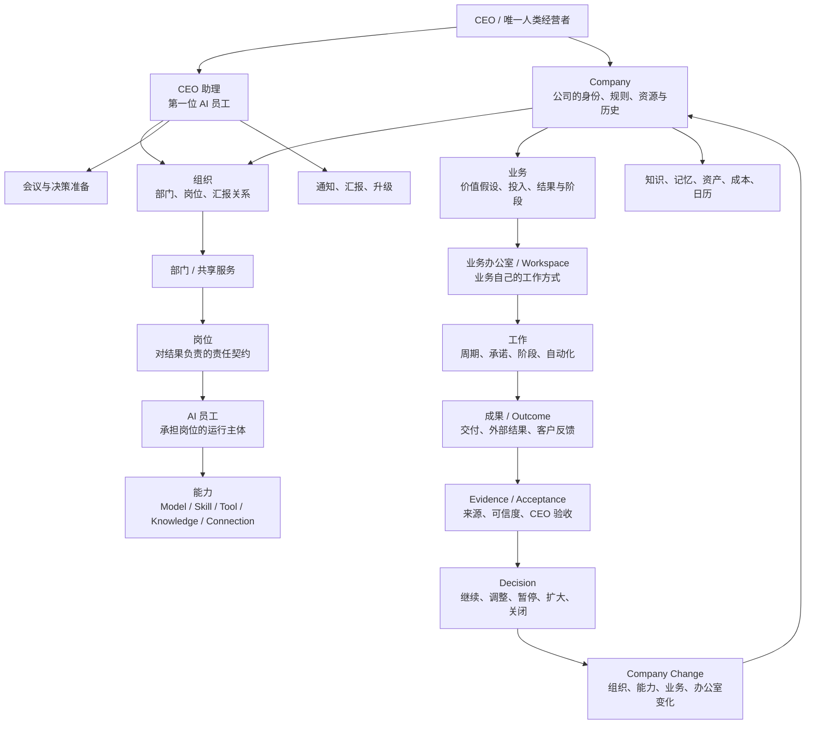
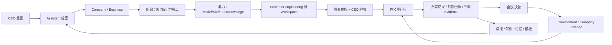

# Curis Product Master Map v1.0

Status: Review  
审查日期：2026-08-13  
性质：产品重新定基线、完整产品总图与连续开发路线。  
实现约束：本轮不修改业务代码、Runtime、数据库、Blueprint，不提交。

## 0. 这份文件要冻结什么

这不是旧页面的汇总，也不是继续扩充当前 Runtime 门禁的功能清单。它试图冻结一件更基础的事：

> Curis 到底是一家什么样的 AI 公司软件；CEO、AI 员工、业务、办公室、能力、知识、结果和决策如何互相形成闭环；哪些概念属于 CEO 看到的产品，哪些概念只属于底层运行。

本文件是 `Status: Review` 的唯一主入口。CEO 审查通过前，它不能取代当前唯一 Blueprint、Frozen Product Context 或 ADR；审查通过后，才应把确认的部分回写到正式产品权威文档，并建立连续开发 Issue。

### 0.1 输入材料与事实等级

本次重新推导使用了：

- `docs/01_Product/Curis_Product_Blueprint.html`（Blueprint 5.0，当前目标产品形态）。
- `docs/01_Product/Curis_Product_Context.md`（Frozen 产品边界、角色、关系和不变量）。
- `docs/00_Context/CURRENT_STATE.md`（当前交付事实和阻塞边界）。
- `docs/08_Change_Log/CHANGE_LOG.md`（最新产品与 Runtime 变化）。
- `docs/plan/curis-product-completion-roadmap-evoflow-2026-08-10.md`（已有产品路线输入，不直接照搬）。
- [当前实现与产品偏航审计](../20260813_current_state_product_drift_audit/Curis_Current_State_and_Product_Drift_Audit.md)及其真实浏览器截图。
- 当前 `frontend/`、`backend/app/`、Runtime API、数据表、`curis-ui-prototype/` 和设计原型。
- `/Users/yy/.codex/worktrees/7157/Curis AI Workspace/docs/01_Product/Curis_Product_UI_Flow_Pack.html`（16 个目标页面线框与页面合同）。

该 UI Flow Pack 来自另一个 worktree，属于目标页面输入，不是当前工作区的实现事实；当前实现判断仍以本工作区代码和真实浏览器证据为准。

### 0.2 三种事实必须分开

| 类型 | 意义 | 本文件如何使用 |
|---|---|---|
| 当前事实 | 代码、页面、API、数据库和真实交互已经证明的东西 | 用于“当前 → 目标差距地图”，不把目标态写成已完成 |
| 目标定义 | CEO 需要的完整产品形态 | 用于世界模型、能力合同、页面和用户动线 |
| 开发路线 | 把目标变成可验证纵向切片的顺序 | 用于 Master Development Roadmap，不反过来删减产品 |

当前工作区还有大量脏改动；本轮保留不动。上一轮真实审计也确认：仓库活动数据库是空业务基线，隔离运行可以建立 Company、三个 Workspace 和一条 ContentItem，但不能把隔离数据当作默认产品数据。

## 1. Curis 产品真相

### 1.1 一句话定义

> Curis 是一款 Desktop-first AI Company Operating System：一位 CEO 通过 CEO 助理建立并经营一家公司，AI 员工在不同业务办公室中承担责任、使用公司能力、交付可以被验收的真实成果，并把结果反馈为下一轮组织、业务和资源决策。

### 1.2 用户真正购买的不是 Runtime

CEO 购买的是：

```text
我有一家公司
→ 我知道谁在负责什么
→ 我能把新业务搭起来
→ 我不用亲自推动每一个内部步骤
→ 我能看到真实结果、成本和风险
→ 我能在关键处做决定
→ 公司会因为结果而变得更强
```

任务、阶段、周期、运行、模拟、证据、验收、版本、重试和回滚都可以存在，但它们的目的只有一个：保证上面这条公司经营体验真实、可恢复、可审计。

### 1.3 Curis 不是什么

- 不是 Task Manager；Task 是办公室内部执行记录。
- 不是 Workflow Platform；可复用工作方式属于 Workspace 内部。
- 不是 Agent Center；Agent/Model 是员工岗位背后的可替换承担者。
- 不是 BI Dashboard；指标只服务公司判断，不是产品根。
- 不是 CRM、ERP、聊天机器人或能力插件货架。
- 不是一组统一看板；Workspace 的前台工作方式必须随业务变化。

### 1.4 三层产品结构

| 层 | 面向谁 | 核心问题 | 产品表现 |
|---|---|---|---|
| CEO Experience | CEO | 今天公司发生了什么，我需要决定什么？ | CEO Desk、Assistant、经营、业务、AI 团队、Workspace、资产 |
| Company Operating System | CEO + AI 组织 | 公司如何通过人、业务、资源和结果持续经营？ | Company、组织、部门、岗位、员工、能力、业务、办公室、会议、决策 |
| Local Runtime | 系统、Assistant、内部工程角色 | 这些责任如何真实发生、失败、恢复和留下证据？ | State Machine、Cycle、Run、Evidence、Acceptance、权限、成本、日志、回滚 |

### 1.5 产品不变量

1. 没有结果目标，不能建立正式业务。
2. 没有明确责任，不能启动工作。
3. 有 Capability 不代表有可用 Capacity。
4. 内部完成不等于外部结果。
5. 没有来源和证据，不能标记 Verified。
6. Unknown、Stale、Conflict、Waiting、Blocked 都是真实状态。
7. 高影响变化必须有影响预览、模拟、CEO 决定和可逆路径。
8. AI 只能在授权范围内自动执行，不能静默改变高影响公司状态。
9. 岗位和员工是产品身份；Model/Agent 可以替换，不应改变岗位责任。
10. 业务退出要保护承诺、完成交接、释放资源并保留学习。
11. 外部平台没有连接时，必须提供明确的 CEO 手动反馈路径，不得填充演示数字。
12. 一个页面只有一个主行动；配置动作与经营动作分开。

## 2. Curis 公司世界总图

### 2.1 总体关系



### 2.2 对象定义总表

| 对象 | 它是什么 / 为什么存在 | 谁使用 / 谁创建修改 | 关键关系 | 生命周期 | 最终产生什么 |
|---|---|---|---|---|---|
| CEO | 公司最终经营责任人和唯一人类用户 | CEO 创建意图、确认公司、批准高影响变化；Local Owner 维护身份 | 拥有 Company，治理 Assistant、组织、业务和资源 | Owner 建立 → 经营 → 交接/迁移 | 决策、资源选择、公司方向 |
| CEO 助理 | Company-level Chief of Staff，也是第一位 AI 员工 | Company 建立时默认生成；CEO 配置和授权；Assistant 自己运行 | 向 CEO 汇报，协调专业员工和 Workspace | Created → Configured → Operating → Evaluating → Upgraded/Reassigned | 日报、准备材料、分流、跟进、升级 |
| Company | 一家 AI 公司的身份、规则、资源、历史和经营边界 | CEO/Assistant 提案，CEO 确认；CEO 修改公司宪章 | 包含组织、业务、能力、资产、财务和决策 | Proposed → Active → Growing → Paused/Restructuring → Closed/Archived | 公司状态、变化和经营上下文 |
| 组织 | 责任、汇报、共享能力和容量的结构 | CEO/Assistant 提议；CEO 批准高影响变更 | 由部门、岗位、员工、汇报关系组成 | Draft → Simulated → Approved → Operating → Reorganized | 谁对什么结果负责 |
| 部门 | 具有重复责任或共享能力的稳定组织聚合 | 由业务责任反复出现时创建；CEO 批准拆分/合并/关闭 | 支持多个业务，可拥有岗位和共享能力 | Proposed → Forming → Active → Paused → Merged/Archived | 稳定的责任域和协作能力 |
| 业务工程部/职能 | 把业务意图变成可工作的办公室的公司级服务 | 默认能力必须存在；是否显示为组织部门由公司规模决定；Assistant 调度 | 连接 CEO 意图、研究、岗位、能力与 Workspace | Available → Designing → Delivering → Maintaining | Workspace 草案、供给缺口和交付版本 |
| 岗位 | 对一个结果负责的长期责任契约 | 由业务/部门责任产生；CEO/Assistant 设计；CEO 批准高影响变更 | 绑定员工、能力、输入输出、验收、汇报 | Proposed → Ready → Assigned → Vacant → Retired | 稳定责任，不随模型变化 |
| AI 员工 | 承担岗位、执行工作、提交证据、升级异常的 AI 主体 | CEO/Assistant 招募或配置；部门负责人管理；CEO 可暂停/替换 | 一个员工可承担一个或多个受控岗位，但每个岗位有明确 Owner | Candidate → Simulated → Approved → Available → Working/Waiting/Blocked → Suspended → Archived | 工作结果、日报、经验、成本和升级 |
| 能力 | 可被员工在边界内安全调用的供给组合 | CEO/能力负责人发现、接入、验证、授权、分配 | 由 Model、Skill、Tool、Knowledge、Connection、Policy 组成 | Discovered → Connected → Verified → Authorized → Assigned → Observed → Replaced/Revoked/Archived | 可调用工作能力和运行记录 |
| 模型 | 生成/推理的具体执行提供者 | CEO 接入或选择；系统验证；Assistant 推荐 | 是员工承担岗位的一个可替换实现 | Configured → Tested → Active/Fallback → Degraded → Disabled | 调用、成本、延迟、错误和回退 |
| Skill | 可复用的专业方法、规则或操作能力 | 能力中心/业务工程部接入；CEO 授权 | 绑定能力包、岗位或 Workspace 版本 | Discovered → Installed → Verified → Versioned → Active → Deprecated | 可复用方法和版本来源 |
| Tool | 本地工具或外部动作工具 | 能力中心接入；CEO 授权副作用 | 有权限、数据范围和副作用级别 | Connected → Permissioned → Tested → Active → Limited/Revoked | 外部动作、回执和错误 |
| 外部连接 | 平台、数据、浏览器、文件或 API 的入口 | CEO 授权；系统诊断；Assistant 监控 | 给 Tool/Workspace 提供外部输入或输出 | Discovered → Authorized → Verified → Expired/Degraded → Revoked | 外部结果或明确的手动替代 |
| 知识 | 可检索、可引用、带来源和权限的公司信息 | CEO、员工、导入器、浏览器和成果共同产生；权限负责人修改 | 作用域到 Company/Department/Role/Workspace/Work | Captured → Classified → Permissioned → Indexed → Used/Cited → Updated/Expired → Archived | 可引用上下文和新知识 |
| 记忆 | 员工、Assistant 或公司在连续工作中保留的经验上下文 | 员工运行、CEO 反馈、复盘产生；CEO 可查看/纠正 | 是 Knowledge 的动态经验层，不替代来源资料 | Created → Used → Confirmed/Corrected → Consolidated → Expired/Archived | 更好的下一次判断和连续性 |
| 业务 | 一组有价值假设、投入、责任和外部结果的经营单元 | CEO 提出；Assistant/Business Engineering 分析；CEO 立项/调整 | 可跨多个部门和多个 Workspace | Idea → Proposed → Approved → Incubating → Operating → Reviewing → Scaling/Paused → Closed | 价值、损益、学习和公司选择 |
| Workspace | 某项业务独立装修的数字办公室和工作方式 | Business Engineering 搭建；CEO 验收；业务负责人维护 | 属于业务，使用岗位、能力、知识、节奏和外部连接 | Draft → Simulated → Approved → Operating → Revised → Paused/Archived | 业务运行现场、版本和工作成果 |
| 工作 | 在业务办公室中对一个结果的具体责任周期 | CEO/Assistant/员工根据业务创建；员工执行；CEO 验收 | 可包含 Commitment、Cycle、阶段、自动化、交接 | Planned → Ready → Running → Waiting/Blocked → Accepted/Rejected → Closed | 可验收的 Outcome、证据和反馈 |
| 自动化 | 由节奏或事件触发的可重复工作方案 | CEO 用自然语言提出；Assistant 生成预览；CEO 生效 | 绑定 Workspace、岗位、输入、成本、负责人和触发器 | Draft → Simulated → Enabled → Running → Paused/Changed → Archived | 定期汇报、复用运行和下一次预览 |
| Commitment | 对业务结果的明确承诺、负责人、期限和证据要求 | 会议/决策/CEO 创建；Owner 修改进展 | 连接 Business、Work、Employee、Evidence、Decision | Proposed → Accepted → In Progress → At Risk → Fulfilled/Breached → Closed | CEO 可追踪的公司承诺 |
| Cycle | 有起止和复盘的经营/交付周期 | Workspace/Assistant 创建；CEO 可调整 | 包含 Work、Stage、Handoff、Outcome | Planned → Running → Awaiting Acceptance → Accepted/Rejected → Reviewed → Closed | 周期结果、学习和下一周期建议 |
| 成果 / Outcome | 完成的内部交付或外部业务结果 | 员工提交，外部连接/CEO 反馈补充；CEO 验收 | 来自 Work，关联 Evidence、Asset、Decision | Produced → Submitted → Verified/Unverified → Accepted/Rejected → Reusable/Archived | 公司资产、客户价值或明确的失败 |
| Evidence | 证明某个结果/状态的来源、时间、内容和可信度 | 系统、Tool、员工、CEO 手动录入；不能随意修改 | 支撑 Outcome、Acceptance、Decision | Captured → Reviewed → Verified/Unverified/Conflict → Superseded/Archived | 可追溯事实，不是成功徽章 |
| 会议 | 为事实、争议、方案和决策召集相关人/AI 的经营场 | Assistant 准备；CEO 发起/确认；员工参与 | 产生 Decision Proposal、Commitment 和 Follow-up | Proposed → Prepared → In Session → Summarized → Awaiting CEO → Closed | 决议、承诺、责任和后续 |
| 决策 | CEO 依据事实和影响改变公司状态的正式经营选择 | Assistant 准备；CEO 批准/拒绝/修改/延后 | 改变 Business、Org、Capability、Workspace 或 Budget | Draft → Ready → Decided → Executing → Observing → Reviewed → Closed | Company Change 和回看结果 |
| 财务/成本 | 投入、成本、收入、预算、容量与价值的经营事实 | 系统采集，CEO 查看/设预算/调整；员工只能提交 | 关联 Model、Employee、Business、Workspace、Outcome | Estimated → Accrued → Reconciled → Reviewed → Archived | 成本健康、ROI/价值判断和预算决策 |
| 日历 | 承诺、节奏、验收、会议和检查点的时间视图 | Assistant 生成；CEO 调整 | 关联 Commitment、Meeting、Automation、Review | Proposed → Scheduled → Due → Done/Overdue → Rescheduled/Cancelled | 经营节奏，不是独立任务日历 |
| 通知 | 需要 CEO/员工注意的变化、风险、请求和回执 | 系统/Assistant 生成；接收者处理 | 回到对象详情和经营动作 | Created → Delivered → Read → Actioned/Snoozed → Closed | 不丢失的下一步 |
| 洞察/经营分析 | 对事实、趋势、风险、成本、结果的解释 | Assistant/分析能力生成；CEO 校验/使用 | 引用 Evidence、Outcome、Cost、Decision | Generated → Reviewed → Used → Superseded | 建议、风险和决策材料 |
| 公司资产 | 可复用成果、模板、证据包、报告、决议和知识 | 员工产出；CEO 验收、授权和归档 | 来源于 Outcome/Meeting/Decision/Knowledge | Draft → Accepted → Indexed → Reused → Superseded/Archived | 复用能力和公司 IP |
| 权限/策略 | 规定谁能看、调用、写入和造成什么副作用 | CEO/系统设置；组织和连接影响 | 作用于 Company、Employee、Capability、Knowledge、Workspace | Draft → Reviewed → Active → Changed/Revoked | 安全可逆的授权边界 |

### 2.3 三个容易混淆的边界

1. **业务不等于 Workspace**：业务是价值和经营选择；Workspace 是为业务搭出的工作场所。一个业务可以有多个办公室，一个办公室不能代替业务的价值判断。
2. **岗位不等于 AI 员工**：岗位是长期责任；员工是当前承担者；Model/Agent 是员工背后的实现。替换模型不改变岗位。
3. **成果不等于任务完成**：内部执行只产生候选输出；必须有来源、外部回执或 CEO 验收，才能产生可用成果。

## 3. 公司组织地图

### 3.1 默认组织

```text
CEO
└── CEO 助理 / Chief of Staff（默认存在、不可从公司能力中删除）
    ├── 业务工程职能（默认可用；按公司规模显示为系统部门或服务）
    ├── 公司级专业岗位（按责任产生，不预填头像）
    └── 各业务 Workspace 的 AI 员工
```

业务工程部的准确定位是：**默认存在的公司级业务装配能力，不必在第一天把它渲染成一个空的组织部门**。当业务数量、共享能力和交付责任达到阈值时，它可以正式形成 Department；在此之前，它由 CEO Assistant 调度，前台以“搭建业务办公室”呈现。

### 3.2 部门什么时候成立

以下任意条件持续出现，Assistant 应建议成立部门：

- 同类责任横跨两个以上业务并持续两个以上周期。
- 多个岗位共享昂贵或敏感能力，需要统一容量、权限和培训。
- 结果需要统一质量标准、预算和汇报。
- CEO 已经无法只通过业务办公室管理同一责任域。

成立部门不是为了填组织树，而是为了稳定责任、共享能力和降低协作成本。没有重复责任时，业务直接拥有岗位即可。

### 3.3 员工进入岗位

```text
业务结果缺口
→ 形成岗位 Role Contract
→ 推荐承担者和能力组合
→ 预览权限、成本、风险、容量和影响
→ 隔离模拟正常/失败/越权
→ CEO 批准
→ 员工上岗
→ 进入 Workspace 工作、交接、汇报、验收
```

岗位 Contract 至少包含：结果、责任边界、输入、输出、验收、汇报对象、升级条件、可用能力、数据范围、预算和替代承担者。

### 3.4 员工跨部门协作

- 一个员工可以被一个主部门管理，同时以明确的 Affiliation 支持多个业务或项目。
- 每次跨部门协作都必须有一个业务/工作上下文、交付物、接收人和截止点。
- Assistant 负责协调和冲突升级，不用平级 Agent 群聊代替组织关系。
- 多部门共同完成一个业务时，业务拥有最终 Outcome；各部门交付 Commitment 或 Handoff。
- 一个部门支持多个业务时，容量、优先级、成本和冲突必须进入 CEO 可读的健康事实。

### 3.5 调岗、替换、暂停、归档

| 动作 | 业务语义 | 必须保留 |
|---|---|---|
| 调岗 | 责任从一个岗位/业务转给另一个岗位 | 原岗位、交接记录、未完成承诺、权限变化 |
| 换员工 | 当前承担者更换，但岗位和验收不变 | Role Contract、历史结果、经验、证据、成本 |
| 换模型 | 实现层替换，岗位身份不变 | 员工身份、职责、上下文、可回滚版本 |
| 暂停 | 暂停执行和外部副作用 | 原因、挂起的工作、通知、恢复条件 |
| 离职/归档 | 不再承担新责任 | 交接、权限撤销、成果、经验、历史运行 |
| 成长 | 根据结果、反馈和复盘更新能力 | 版本、来源、CEO确认、可回退旧经验 |

## 4. 业务经营地图

### 4.1 什么叫一个业务

业务不是一个 Workspace 名称，也不是一个项目列表。一个正式业务至少包含：

```text
客户/对象与问题
→ 价值假设
→ 目标 Outcome
→ 需要的投入、能力和组织
→ 负责人和 Workspace 组合
→ 外部结果来源
→ 成本/收益/风险
→ CEO 的继续/调整/暂停/扩大/关闭选择
```

### 4.2 业务生命周期

```text
CEO 意图
→ Business Proposal
→ 价值/风险/资源分析
→ CEO 立项
→ 形成最小业务团队和办公室
→ 首个工作周期
→ 外部结果/CEO 验收
→ 复盘
→ 继续 / 调整 / 扩大 / 暂停 / 关闭
```

业务的成功不是“Workspace 已启动”，而是：在预定投入和风险边界内，产生了被接受的结果，或产生了足够可信的失败/学习，使 CEO 能做下一步决定。

### 4.3 跨部门经营

```text
一个业务
├── 业务负责人 / Outcome Owner
├── 业务工程部：设计办公室与能力供给
├── 研究/分析部门：外部事实与机会
├── 研发部门：产品/系统交付
├── 内容/增长部门：市场与反馈
└── 财务/运营职能：成本、节奏、风险
```

部门不是业务的替代品。部门提供可复用责任，业务决定在何时调用哪些责任以及是否继续投入。

## 5. 办公空间地图

### 5.1 Workspace 的前台定义

> Workspace 是一个业务的数字办公室：有自己的目标、团队、工作方式、节奏、输入、输出、外部结果窗口和 CEO 介入点。它不是统一项目管理页面。

### 5.2 Workspace 目录与生命周期

```text
Workspace Portal
├── 目录：按业务列出办公室、目标、负责人、阶段、健康和下一步
├── 模板：研发、内容、短视频、金融、研究等可复用起点
├── 自定义：业务工程部按目标改造岗位、能力、节奏和结果窗口
├── 搭建：草案、影响、供给缺口、失败出口
├── 试运行：正常、缺能力、权限失败、外部结果缺失、人工备用
├── 交付：CEO 验收并生成 Operating Version
├── 运行：办公室自己的工作区、团队状态、工作和结果
├── 改造：基于结果或业务变化产生新 Draft，旧版本可追溯/回滚
└── 归档：关闭外部动作、完成交接、保留成果和学习
```

### 5.3 CEO 看到什么 / 业务工程部使用什么

| CEO 前台 | 业务工程部后台/上下文工具 |
|---|---|
| 我要什么业务办公室 | 业务拆解、外部研究、模板对照 |
| 需要哪些资源、何时可用、有什么风险 | Role Contract、Capability Plan、权限/数据窗口 |
| 什么时候能开始工作 | Simulation、供应检查、影响预览、交付门禁 |
| 谁负责、结果是什么、哪里需要我 | Stage Contract、Handoff、Evidence、Acceptance |
| 结果不好，下一步怎么办 | 版本差异、失败场景、重试/回滚、替代方案 |

CEO 不应该先操作八段装配状态；Business Engineering 可以使用八段内部工具，但交付给 CEO 的是办公室方案、成本、风险、预计结果和一键验收。

### 5.4 三个起始模板

| 模板 | 独特业务对象 | 前台必须优先表达 |
|---|---|---|
| 研发办公室 | Product/Engineering/QA、Cycle、代码/构建/测试、版本验收 | 本周期交付什么，谁在负责，证据是否足够 |
| 小红书办公室 | ContentItem、平台版本、发布回执、评论/私信/互动、线索 | 哪些内容将发布，CEO 要确认什么，平台反馈如何回流 |
| 抖音/TikTok 办公室 | Video/Script/Version、发布回执、播放/完播/互动/订单 | 内容节奏、视频结果和下一轮增长调整 |

统一的是 Company OS 语义：负责人、结果、证据、CEO 决定、权限和恢复。前台布局、工作对象和业务语言可以完全不同。

## 6. 产品能力总表

### 6.1 能力合同的读法

下面每行按用户要求压缩回答 16 个产品问题：

1. Why/为什么存在；2. Entry/入口；3. User/谁使用；4. Do/能做什么；5. Create/怎么创建；6. Configure/怎么配置；7. Use/怎么使用；8. Reuse/怎么复用；9. Modify/怎么修改；10. Archive/怎么删除/归档；11. Relations/关联；12. Success/成功；13. Failure/失败；14. Empty/空态；15. Auto/可自动化；16. CEO/System/CEO 决定与底层归属。

| 能力 | 1–4：存在、入口、使用者、动作 | 5–10：创建、配置、使用、复用、修改、归档 | 11–16：关联、成功、失败/空态、自动化、CEO 与底层 |
|---|---|---|---|
| 公司创建与管理 | 让 CEO 从零拥有真实公司；首次进入；CEO/Assistant；表达意图、提案、公司章程 | Assistant 生成草案；CEO 配置名称、方向、规则；日常使用 Desk；可复制公司模板但不复制数据；修改章程需影响预览；关闭前完成业务交接 | 关联组织、业务、资产、权限；Company + Assistant + 首个经营上下文成立；提案过期/冲突/无结果目标；Assistant 可准备，CEO 确认；FoundingRun/Company 状态在底层 |
| CEO Assistant | 把公司复杂性翻译成 CEO 的每日下一步；Desk/浮层/通知；CEO；汇报、准备、分流、跟进、升级 | 建公司时默认生成；配置身份、责任、语气、能力和权限；每天使用；经验/模板复用；CEO 可改职责/替换承担模型；离开公司时归档交接 | 关联全部 Company OS 对象；日报、决策包和跟进真实落地；缺模型/权限时明确阻塞；首次无公司显示自我介绍而非空聊天；自动汇总但高影响动作需 CEO；Assistant Runtime 在底层 |
| 组织/部门/岗位 | 让 CEO 知道谁对什么负责；AI 团队/对象详情；CEO/Assistant/部门负责人；建组织、部门、岗位、汇报和容量 | 由业务责任提出；配置 Role Contract、共享能力和预算；在业务中使用；岗位模板复用；结构变更需影响预览；部门关闭前转移责任 | 关联 Employee、Business、Workspace、Capability；责任图一致且无孤儿承诺；冲突/过载/无负责人；无员工显示岗位空缺；Assistant 建议，CEO 批准高影响；组织版本/关系在底层 |
| AI 员工与招聘 | 把岗位变成可工作的责任主体；AI 团队/Assistant；CEO/Assistant；招聘、上岗、汇报、评价、暂停、替换 | Role Contract 产生候选；配置能力、权限、预算、节奏；工作/交接/日报；经验和岗位模板复用；可换模型不换岗位；归档前交接并撤权 | 关联岗位、能力、业务、Workspace、Outcome；可承担工作并提交证据；能力缺失/越权/失败/过载；无员工显示岗位空缺；Assistant 推荐/准备，CEO 批准；Employee/Role/State/Evidence 在底层 |
| 模型 | 为员工提供可替换推理能力；能力中心；CEO/系统；添加、测试、默认、备用、观测 | 接入 Provider/模型和凭证引用；配置连接/预算/回退；被员工调用；模型配置可跨 Workspace 复用；版本/默认可改；停用/归档需替代者 | 关联 Capability、Employee、Usage、Cost；真实调用成功并可追溯；认证/额度/延迟/失败；无模型显示缺供给；Assistant 推荐可自动预检，CEO 授权连接；Gateway/Usage 是底层 |
| Skill | 让专业方法可复用而不是散落提示词；能力中心/Assistant；CEO/业务工程部/员工；接入、版本、启停、绑定 | 导入/选择 Skill；配置版本、许可、参数；员工运行中调用；以 Capability/Workspace 模板复用；升级需兼容检查；停用需影响检查 | 关联 Model、Tool、Knowledge、Role；运行输出符合验收；版本/许可/配置错误；空目录说明尚无公司能力；可自动诊断，CEO 批准高影响；注册/版本在底层 |
| Tool/外部连接 | 让员工产生真实外部输入/输出；能力中心/Workspace；CEO/员工；授权、读写、回执、手动替代 | 选择连接、权限、数据范围和副作用；配置授权/限额；在工作中调用；连接模板复用；权限可收窄/替换；撤销需停止未完成副作用 | 关联 Workspace、Evidence、Cost、Policy；产生外部回执或明确手动证据；未授权/过期/额度/冲突；空态解释“尚未接入”及手动路径；系统自动健康检查，CEO 决定授权；Gateway/Policy/Trace 底层 |
| 能力中心 | 把模型/Skill/Tool/Knowledge 变成可用供给；AI 团队或设置；CEO/业务工程部；发现、接入、验证、授权、分配、成本、替换 | 从目录/外部资料加入；配置来源、权限、版本、成本、风险；绑定岗位/员工/Workspace；能力包可复制；供给变化产生新版本；撤销/归档不删运行历史 | 关联全公司责任链；供给可用且分配后可调用；目录漂移/权限/成本阻塞；新公司显示最小可配置供给而非假数据；Assistant 可提出方案/预检，CEO 授权；Resource Check/Binding/Registry 底层 |
| 知识库 | 让公司和员工能基于有来源的信息工作；公司资产/Assistant/对象上下文；CEO/员工/导入器；导入、分类、检索、引用、更新 | 来源可为文件、网页、视频、图片、浏览器收藏、外部库、对话、成果和经验；配置范围、权限、标签、更新策略；工作中按范围检索；知识包/引用复用；修订/冲突处理；归档保留来源 | 关联 Company/Dept/Role/Workspace/Work/Memory；员工引用正确来源；解析失败/过期/冲突/无权限；空态说明可导入方式；自动索引、去重、过期提醒，CEO 定范围；索引/检索/权限在底层 |
| 记忆与员工经验 | 保持连续性并把结果变成能力；员工详情/Assistant/成果复盘；CEO/员工；记录、确认、纠正、提炼 | 从工作、反馈、会议、成果产生；配置范围、可信度和保留期；下一次工作引用；可沉淀为 Skill/Knowledge/Template；CEO 可纠正；过期/删除保留审计来源 | 关联 Knowledge、Outcome、Role、Business；经验可验证且能改善下一次结果；错误记忆/冲突/过期；新员工无经验显示空但有公共知识；系统提炼，CEO 确认公司规则；Memory/Context Package 底层 |
| 业务与业务版图 | 让 CEO 管理价值组合而非项目集合；业务版图/Assistant；CEO/Assistant；提出、立项、投入、复盘、扩大、暂停、关闭 | 意图生成 Proposal；配置客户/问题、价值、Outcome、投入、负责人、风险；通过 Workspace 运行；成功业务可复制模式；修改需影响预览；关闭保护承诺和学习 | 关联 Dept/Employee/Workspace/Outcome/Finance/Decision；有真实结果或可信学习；无结果/不盈利/风险；空态是“尚无业务”+首个业务动作；Assistant 分析，CEO 立项/退出；Business/Outcome/Decision 底层 |
| Workspace Portal/Studio | 让业务有可装修、可交付、可重用的办公室；工作空间；CEO/Business Engineering；目录、模板、搭建、模拟、交付、改造 | 模板或空白起步；配置目标、岗位、能力、节奏、验收和备用路径；运行版本提供办公室；成功办公室可复制为 Draft；版本修改不覆盖运行；关闭归档并保留结果 | 关联 Business/Org/Capability/Knowledge/External/Work；能进入办公室并得到结果；缺能力/模拟失败/CEO拒绝；无办公室显示建设第一间；Assistant/工程部自动生成草案，CEO 验收；Blueprint/Version/Simulation 底层 |
| 工作/周期/自动化 | 把业务承诺变成可执行、可重复的结果责任；Workspace；CEO/员工/Assistant；创建工作、运行周期、复用节奏、事件触发 | 由 Outcome/Commitment 生成；配置输入/输出/Owner/节奏/预算/验收；员工执行；保存为 Workspace 方案；变更生成新版本；停止后保留运行事实 | 关联 Employee/Capability/Evidence/Outcome/Calendar；工作产生交接和证据；失败/等待/越权/无输入；空态说明第一项工作如何开始；Assistant 可排程/预检/提醒，高影响仍需 CEO；Cycle/Run/Task/Workflow 是底层 |
| 成果、Evidence、资产 | 把工作产出转成可验收、可复用的公司资产；成果库/Workspace；CEO/员工；提交、审查、验收、引用、复用 | 由工作/会议/外部反馈产生；配置来源、可信度、权限；CEO 验收后入资产；可在新业务引用；修订生成新版本；归档不抹历史 | 关联 Outcome/Decision/Knowledge/Cost；有来源且被接受；无证据/冲突/拒绝；空态不填充成果；自动收集但 CEO 判断价值/验收；Artifact/Evidence/Acceptance 底层 |
| 会议 | 把复杂事实和争议变成可控的公司变化；经营工具/Assistant；CEO/相关 AI；准备、召集、讨论、总结、形成提案 | Assistant 从事项发起；配置议题、参与者、资料、时间；自然讨论；会议模板复用；CEO 可改议题；关闭需承诺/无行动说明 | 关联 Evidence/Decision/Commitment/Calendar/Workspace；形成可追踪决议；无事实/分歧未解/参与者不可用；空态显示可从事项发起；Assistant 自动准备/纪要，CEO 决策；Meeting Runtime 底层 |
| 决策 | 让 CEO 真正改变公司，而不是点按钮结束事项；事项详情/会议/Desk；CEO；看事实、方案、影响、批准/拒绝/修改/延后 | Assistant 生成 Decision Proposal；配置选项、投入、风险、期限、证据；CEO 决定并回写；决策模板/方案复用；变更可补充；关闭要回看结果 | 关联 Business/Org/Capability/Workspace/Finance/Calendar；公司状态和责任真实变化；证据不足/冲突/拒绝/执行失败；无待决策显示真实空态；Assistant 代准备，CEO 必须决定；DecisionPacket/Transition 底层 |
| 财务/成本/健康 | 让 CEO 知道公司花了什么、产出了什么、是否值得继续；经营/资产；CEO/Assistant/系统；预算、成本、收入、价值、容量、健康 | 系统从 Model/Tool/Employee/Business 收集；配置预算/阈值/分摊；按日/周期观察；健康模板可复用；调整预算/模型；归档周期不删事实 | 关联 Usage/Outcome/Decision/Calendar；成本可追溯且对应结果；账本缺失/高成本低产出/超预算；新公司显示无数据而非健康分数；Assistant 预警，CEO 调整投入；Usage/Metric/Finance 底层 |
| 日历/通知/经营分析 | 让公司按节奏运行、重要变化不丢失；Desk/经营工具；CEO/Assistant/员工；排程、提醒、趋势、风险、检查点 | Commitment/Meeting/Automation 自动生成；配置时间、优先级、通知；每天查看；节奏模板复用；CEO 调整；取消/延期保留原因 | 关联所有有截止点的对象；及时提醒并能回到主对象；过期/重复/未知；空态是无承诺/无检查点；Assistant 生成下一次运行预览，CEO 调整；调度/聚合/通知底层 |
| 搜索/导入/导出/浏览器 | 让公司能吸收外部事实并找回内部资产；全局搜索/资产/Assistant；CEO/员工；搜索、收藏、导入、导出、采集 | 从文件、网页、视频、图片、聊天或浏览器采集；配置来源和权限；在对象上下文检索；导出证据包/知识包；修订；撤回/归档保留来源 | 关联 Knowledge/Outcome/Employee/Workspace；来源和权限完整；解析失败/权限/过期；无数据说明可从哪里开始；自动去重/摘要，CEO 确认入库；索引/浏览器/导入管线底层 |
| 权限/设置/备份恢复 | 保护公司数据、外部副作用和本机连续性；设置/上下文抽屉；CEO/系统；身份、权限、主题、连接、备份、恢复 | 首次 Owner 创建；配置 Company/Role/Tool 权限；运行中检查；设置模板可复用；变更须影响预览；撤销/归档不删审计 | 关联所有对象；越权 fail-closed 且可恢复；失效凭证/备份损坏/数据冲突；新公司只显示必要设置；系统做诊断，CEO 授权和恢复；Identity/Policy/DB/Trace 底层 |

## 7. 核心能力生命周期

### 7.1 AI 员工

```text
岗位产生
→ 结果/责任/输入/输出/验收定义
→ 招聘候选
→ 推荐并绑定能力
→ 正常/失败/越权 Simulation
→ CEO 批准
→ 上岗与节奏/预算
→ 工作、交接、汇报
→ Outcome/Evidence/Acceptance
→ 评价健康、成本、容量和经验
→ 调岗或跨部门协作
→ 替换员工/替换模型
→ 暂停与有限恢复
→ 交接、撤权、离职/归档
```

不能把“Agent 卡片出现”算作员工完成。完成条件是：岗位有结果责任；员工有授权能力；至少完成一次真实工作；提交证据和成本；CEO 或外部接收者完成验收；失败能解释、暂停并恢复。

### 7.2 知识库、记忆、成果的关系

```text
外部资料 / 文件 / 网页 / 视频 / 图片 / 浏览器 / 聊天
                         ↓
                   Knowledge（有来源的资料）
                         ↓ 被员工检索和引用
Work / Meeting / Outcome / CEO Feedback
          ↓                       ↓
   Memory / Employee Experience   Asset / Evidence
          ↓                       ↓
   员工下一次连续工作        Knowledge / Decision / Template 复用
```

- Knowledge 是可引用事实资料；必须有来源、范围、权限、更新时间。
- Memory 是连续经验；可以错误、过期和冲突，不能自动升级成公司规则。
- Outcome/Asset 是工作成果；被 CEO 验收后才适合沉淀为公司知识或模板。
- Evidence 是证明事实的证据，不是知识本身。
- CEO 反馈可以修正 Memory，也可以形成明确的 Company Policy/Skill 版本。

完整链路：

```text
采集
→ 解析/去重
→ 来源与权限
→ Company/Department/Role/Workspace 范围
→ 索引检索
→ 员工引用
→ 结果与出处
→ 更新/过期/冲突处理
→ CEO 确认
→ 复用或归档
```

### 7.3 能力中心

```text
发现
→ 接入
→ 连接/版本/许可验证
→ 权限与数据范围
→ 形成 Company Capability
→ 分配岗位/员工/Workspace
→ 运行观察（结果、成本、容量、失败）
→ 诊断、替换或回退
→ 撤权/归档
```

能力中心的“成功”不是目录中有资源，而是某位员工在某个 Workspace 中可安全调用，并能看到真实调用结果、错误、成本和撤销路径。缺模型、缺工具、凭证过期、权限不足和额度耗尽都必须成为可读的 Capability Supply 状态。

### 7.4 会议

```text
事项/机会/异常
→ Assistant 准备背景、事实、未知、议题、参与者
→ CEO 确认会议范围
→ AI 员工按责任参与讨论
→ 标记事实/观点/建议/异议/未知
→ 形成 Decision Proposal
→ CEO 批准/拒绝/修改/延后
→ 生成 Commitment、Owner、Due Date、Evidence Requirement
→ 回写业务 Workspace
→ Assistant 跟进、提醒、复盘
→ 关闭
```

多 AI 讨论永远不自动等于公司决策。会议无事实时可以先暂停并补知识；CEO 不确认时，提案保持草案。

### 7.5 决策

```text
事实（来源/时间）
→ 问题（变化/未知）
→ 方案（投入/影响/风险）
→ CEO 决策（继续/调整/暂停/扩大/关闭）
→ 公司变化（责任/能力/业务/Workspace/预算）
→ 执行与结果
→ 回看（是否达到目标、学到什么）
```

决策必须改变至少一个真实对象或明确记录“不改变”的理由；决策按钮不能只是前端本地状态。

## 8. 用户全场景体验地图

### 8.1 第一次使用

```text
打开 Curis
→ 确认 CEO 身份和称呼
→ 最小模型向导：连接一个能工作的模型，或先浏览 Curis
→ Company Welcome：Assistant 介绍自己，公司说明下一步
→ CEO 说出经营意图
→ Assistant 提出 Company Thesis + 第一业务 + 最小团队方案
→ CEO 修改/确认
→ Company、CEO 助理、首个业务和最小组织建立
→ Assistant 解释现有能力与缺口
→ Business Engineering 形成办公室方案
→ CEO 看预计结果、成本、风险、验收和备用路径
→ CEO 确认
→ 进入第一间业务办公室
→ 开始第一项真实工作
```

### 8.2 每天打开

CEO 首屏只回答五个问题：

1. 昨天发生了什么变化？
2. 今天有哪些业务正在工作？
3. 哪些结果已产生、哪些尚未验证？
4. 哪些事情需要我决定或授权？
5. 如果我今天不进入具体办公室，Assistant 会继续推动什么？

首屏动作：处理一件最重要的经营事项。进入对象后能回到 Desk 的原位置，并保留上下文。

### 8.3 公司成长地图

```text
新业务
→ 业务提案与价值判断
→ 复用成功 Workspace 或交给 Business Engineering 新建
→ 识别岗位/能力/知识缺口
→ 形成组织和能力变更预览
→ CEO 批准
→ 运行、反馈、复盘
→ 复制有效模式或关闭失败模式
```

### 8.4 CEO 不主动打开办公室

Assistant 仍应：读取运行状态、汇总结果、检测等待/失败/外部回执、准备日报、提醒承诺和在高影响处升级。它可以继续低风险、已授权的工作，但不能替 CEO 批准发布、增加预算、改变组织或关闭业务。

## 9. 完整产品页面地图

### 9.1 CEO 主入口

UI Flow Pack 的 16 页顺序是：`CEO 身份 → 最小模型向导 → Company Welcome → CEO Desk → 业务版图 → Workspace Portal → Studio → 研发办公室 → 小红书办公室 → 抖音/TikTok 办公室 → AI Team → 能力中心 → Workspace Workflow → Knowledge → Schedule → Results/Decision`。其中 Company 的正式提案/确认应作为 Welcome 前后的内嵌步骤，不应被省略；Workflow、Knowledge、Schedule 和 Results/Decision 是办公室与经营动作的上下文页面，不必全部成为一级导航。

| 页面 | 谁进入 / 目的 | 首屏与主动作 | 进入/离开 | 空态、加载、失败、阻塞、成功 |
|---|---|---|---|---|
| CEO 身份 | 首次用户；确认“我是谁” | 姓名、称呼、CEO 身份；主动作“继续” | `/login`/首次进入 → 模型向导；可稍后设置头像 | 无身份要求输入；本机工作空间失败可重试；成功保留 Owner 身份 |
| 最小模型向导 | 首次用户；让 Assistant 至少有一个可工作的模型 | 服务、模型、连接状态；主动作“连接并继续”，次动作“先看看 Curis” | CEO 身份 → 模型向导 → Company Welcome | 未选模型不打开凭证；连接失败保留选择并重试；跳过不伪造已连接 |
| Company Welcome | 已建立 Company 的 CEO；解释公司和 Assistant | Company 名称、Assistant 身份/责任、尚无办公室；主动作“去 CEO Desk”，次动作“直接搭建办公室” | 模型向导/Company 创建 → Welcome → Desk/Portal | 公司已建立但无办公室；读取失败回上次位置；成功明确下一步 |
| First Arrival | 新 CEO；建立公司 | Assistant 身份、经营意图、公司/第一业务草案；主动作“确认公司方向” | `/`/`/login` → First Arrival → CEO Desk | 空公司不是空后台；加载显示正在准备草案；提案冲突可退回；成功进入 Company + 最小团队 |
| CEO Desk / 今日经营 | 每日 CEO；了解变化并处理一事 | Assistant 汇报、变化、待决策、异常、团队和时间线；主动作“处理最重要事项” | 任意页面可返回；处理后回原位置 | 无业务显示下一步；数据未知不造健康；失败显示事实/原因/负责人/恢复；成功形成决策/结果 |
| 经营 | CEO；看公司健康和方向 | 业务组合、结果、投入、风险、成本、趋势；主动作“调整一个经营选择” | Desk/导航 → 经营 → 业务/决策 | 无数据显示未建立事实；指标延迟标 Stale；冲突进入证据审查 |
| 业务版图 | CEO；管理价值组合 | 业务卡片含 Outcome、投入、阶段、风险、负责人、下一决定；主动作“进入业务/创建业务” | Desk/Assistant → 业务详情 → Workspace/Decision | 尚无业务显示首个业务动作；提案/运行/暂停/关闭状态清楚 |
| AI 团队 | CEO/Assistant；看组织和员工责任 | 组织图、员工卡、岗位空缺、容量、健康；主动作“创建/调整一个岗位” | Desk/公司 → 员工详情/岗位抽屉 | 无员工显示 CEO 助理与岗位缺口；连接失败不显示旧数据；员工异常进入详情 |
| 能力中心 | CEO/Business Engineering；提供可用能力 | 资源目录、连接状态、缺口、成本、风险；主动作“接入/验证/分配能力” | AI 团队/Assistant/Studio → 能力详情 → 绑定预览 | 空目录说明可添加；未授权/额度/过期/冲突均真实；成功显示可调用而非仅已注册 |
| Workspace Portal | CEO；看公司办公室 | 按业务列办公室、目标、负责人、阶段、健康和下一步；主动作“进入/搭建办公室” | 业务/Desk → Portal → Runtime/Studio | 无办公室显示第一间办公室；加载不生成模板；失败不展示样例 |
| 业务 Workspace | CEO/员工；在业务方式中工作 | 办公室身份、团队、当前工作、结果、反馈、CEO 介入点；主动作随业务而定 | Portal/Business → Workspace；完成回业务/Desk | 草案、运行、等待、阻塞、结果未知、验收、关闭都有业务语言 |
| 公司资产 | CEO/员工；复用成果和知识 | 成果、Evidence、Knowledge、Memory、成本和引用上下文；主动作“复用/引用/沉淀” | Outcome/Desk/导航 → 资产详情 → 回业务 | 无成果显示如何产生第一份；权限/过期/冲突可审查 |
| 经营工具 | CEO/Assistant；开会、审议、确认 | 会议、决策、证据审查；主动作“形成一个可追踪决定” | Desk/通知 → 会议或决策 → 回写对象 | 无待办显示真实空态；占位按钮禁止存在；决策成功必须改变真实对象 |
| 设置与恢复 | CEO；身份、连接、数据、安全和主题 | Owner、连接、权限、备份、恢复、主题、诊断；主动作“修复一个阻塞” | 底部设置/错误抽屉 | 无连接提示手动路径；恢复失败保护数据库和审计 |

### 9.2 二级页、详情、抽屉和内部工具

| 类型 | 页面/工具 | 只服务什么 |
|---|---|---|
| 对象详情 | Employee、Role、Business、Workspace、Outcome、Evidence、Decision、Knowledge、Capability | 当前对象的责任、来源、状态、影响和一个主动作 |
| Context Drawer | Assistant 事项、影响预览、Evidence Review、能力绑定、交接 | 不离开原经营上下文完成一次确认/审查 |
| 高级设置 | Model Gateway、数据范围、权限、预算、连接诊断、版本差异 | CEO 或授权高级操作者处理供给与安全，不作为默认入口 |
| Business Engineering 工具 | 业务研究、模板映射、岗位/能力设计、Stage Contract、Simulation、版本发布 | 内部装配和交付，不直接作为 CEO 首屏 |
| Workspace Workflow | 办公室内可复用工作方式、触发、负责人和确认点 | 先选办公室，再预览/启用；不升级成顶层 Workflow 平台 |
| Knowledge | 文件/网页/手动资料、范围、引用和过期 | 让员工在工作上下文中有依据；失败保留来源并可手动补录 |
| Schedule | 经营节奏、下一次运行、静默时段和负责人 | 不要求 CEO 学 Cron；安排后可暂停、改期、看运行记录 |
| Results / Decision | 结果摘要、来源、未知、补录、确认、修改、继续/暂停 | 结果回原办公室，并把真实决定带回 CEO Desk |
| Runtime 详情 | Cycle、Run、Transition、Trace、Retry、Rollback、Workflow 子执行 | 解释真实运行、失败、恢复和审计；用人话摘要包住技术细节 |
| 兼容页面 | Project、Task、旧 Execution、旧 Guide | 作为迁移输入/Workspace 内部记录，不能成为新产品主导航 |

每个页面必须提供：Empty、Loading、Failure、Waiting、Blocked、Unknown、Conflict、Success 八种状态；成功状态必须说明产生了什么、下一步去哪里以及能否撤销。

## 10. 全链路交互地图



| 链路 | 用户动作 | 系统必须写入 | 完成后的去向 |
|---|---|---|---|
| 创建公司 | 表达、修改、确认 | FoundingRun、Company、Assistant、公司规则 | CEO Desk + 首个业务 |
| 创建第一业务 | 描述问题、价值、结果、投入 | Business Proposal/Bet、Owner、Outcome | 业务详情 + Business Engineering |
| 建部门 | Assistant 说明重复责任，CEO 确认 | Department、责任、共享能力、迁移影响 | AI 团队 |
| 招 AI 员工 | 提出岗位，配置能力，模拟并批准 | Role、Employee、Binding、组织版本 | 员工工作面 |
| 换模型 | 选择替代者，比较成本/质量/风险 | 新 Capability Version、Employee 承担者变更 | 员工详情，岗位不变 |
| 接入能力 | 连接、权限、测试、分配 | Capability、Policy、Resource Check、Usage | 能力中心/Workspace |
| 建知识库 | 导入、分类、授权、索引 | Knowledge、Source、Scope、Index | 资产/员工工作 |
| 员工用知识 | 在授权范围检索并引用 | Context Package、引用 Evidence、Outcome | 结果详情/新知识 |
| 搭办公室 | 业务工程部拆解和试运行 | Workspace Draft、Version、Stage、Role、Capability | CEO 验收/办公室 |
| 拆外部 Agent | 研究其职责/输入/输出/限制，转成 Role/Skill/Tool | Curis Role Contract、Capability Plan、来源记录 | Studio，不复制品牌/黑盒 |
| 跨部门协作 | 创建明确 Handoff 和接收责任 | Commitment、Handoff、Due、Evidence Requirement | 双方员工/业务 |
| 开会 | 准备事实、讨论、形成提案 | Meeting、Decision Proposal、引用 | CEO 决策 |
| 执行决定 | 批准并观察 | Decision、Company Change、Commitment | Workspace/组织/能力 |
| 产生成果 | 提交产出、补外部结果、CEO 验收 | Outcome、Evidence、Acceptance、Asset | 资产/经营分析 |
| 复用成果 | 引用、复制、沉淀 | Knowledge/Template/Memory 版本 | 新业务/新周期 |
| 自动重复 | 设节奏/事件、预览下一次运行 | Automation、Schedule、Cost Estimate | Assistant/日历 |
| 异常 | 查看事实、恢复/暂停/升级 | Failure、Trace、Retry、Rollback、通知 | CEO 决策/恢复 |
| 关闭业务 | 评估结果、完成交接、释放资源 | Close Decision、承诺处理、资产和学习 | Company Growth/Archive |

## 11. 底层运行支撑地图

### 11.1 四层分工

| 层 | 对象 | CEO 默认看到什么 |
|---|---|---|
| 产品语义层 | Company、Business、Department、Role、Employee、Capability、Workspace、Outcome、Meeting、Decision | 人话、责任、结果、风险、下一步 |
| 业务运行层 | Commitment、Cycle、Stage、Handoff、Acceptance、Automation、Feedback | “谁在做、何时回报、为什么等待/阻塞、我需不需要决定” |
| 可信执行层 | Run、Simulation、Evidence、Verification、Version、Transition、Retry、Rollback、Workflow 子执行 | 结果摘要、来源、恢复动作；高级详情可展开技术证据 |
| 基础设施层 | Tenant/Owner、DB、Model Gateway、Connector、Policy、Usage、Trace、Backup | 连接状态、成本、权限和诊断；不把表/ID当产品对象 |

### 11.2 可见性规则

**CEO 默认不需要看到：**

- `FoundingRun`、`ORG-001`、`RoleSlot`、`CapabilityBinding` 的内部 ID。
- `workflow_run:<id>`、数据库表名、Transition Log、Trace Event。
- Blueprint 版本哈希、底层状态枚举、模型网关方言。

**高级详情需要看到：**

- 运行版本、Evidence 来源、执行引用、权限范围、成本拆分、模型/Skill/Tool 版本。
- 失败链、重试次数、回滚范围、受影响的岗位/工作/外部副作用。
- Simulation 与 Operating 的差异、旧版本和生效时间。

**必须翻译成人话再显示：**

| 底层事实 | CEO 前台语言 |
|---|---|
| `Simulation 未通过` | “这间办公室还不能开始工作，因为平台授权未完成；你可以去授权，或先使用手动回传。” |
| `CAPABILITY_BINDING=PROPOSED_NOT_AUTHORIZED` | “员工方案已准备好，但公司还没有授权它使用这项能力。” |
| `UNVERIFIED` | “这条结果已记录，但还没有可信来源或 CEO 验收。” |
| `Handoff WAITING` | “上一位员工已交付，下一位员工还没有接收；责任在 X，预计 Y。” |
| `Rollback` | “已暂停这次组织变更，员工权限已撤回；原方案仍可恢复。” |
| Provider/Quota error | “模型额度已用完；系统已暂停新的外部动作，可切换备用模型或稍后重试。” |

### 11.3 运行对象的单一真相

- Task/Workflow/Execution 可以作为内部子执行，但不能直接写成 Business Outcome。
- Simulation 证明“方案在隔离条件下可行”，不代表 Operating 已产生外部结果。
- Evidence 必须带来源、时间、对象、可信度和是否被 CEO 接受。
- Acceptance 和 Decision 必须是持久化业务事实，不允许只有本地按钮状态。
- Retry 必须遵守 CEO 授权的有限范围；高影响副作用不能无界重试。
- Rollback 必须保护已产生的外部事实、撤回内部授权并保留历史，不删除审计。

## 12. 完整性压力测试

目标产品地图必须能支持以下场景。当前状态只作为差距，不把“尚未开发”留成产品定义缺口。

| 场景 | 目标地图应如何支持 | 当前判断 | 需要补齐/保护 |
|---|---|---|---|
| 第一次使用 Curis | Assistant 介绍 → 意图 → 公司/业务/最小团队 → 第一办公室 | ⚠️ 当前 FoundingRun 已有，但第一业务/团队/能力仍不完整 | First Arrival 纵向闭环 |
| 建立一家内容公司 | Company Thesis → 内容业务 → 内容/增长岗位 → XHS/TTK 办公室 → 结果/互动/线索 | ⚠️ 模板和 ContentItem 有，外部结果与经营判断未闭合 | 内容业务 Outcome、互动回流、成本/线索 |
| 建立金融投资部 | 业务提案 → 研究/风控/组合岗位 → 数据连接/知识权限 → 金融办公室 → 风险/收益决策 | ⚠️ 世界模型支持，当前没有金融 Workspace | 业务模板、金融数据权限、风险/审批规则 |
| 新增软件业务 | Business → 研发岗位/能力 → 研发办公室 → Cycle → Evidence/Acceptance | ✅ 目标链完整；当前 RD Operating Cycle 已有重要底层进展 | 真实连续运行和 CEO 日常入口 |
| 招聘研究员工 | Role Contract → 能力建议 → 模拟 → 批准 → 工作/引用/评价 | ⚠️ Runtime 候选/审批已存在，产品招聘面未完成 | Employee UX、岗位健康和知识引用 |
| Claude 换 Codex、岗位不变 | 保留 Role/Employee/Outcome，只替换承担者 Capability Version | ⚠️ 模型网关底层有，前台岗位/员工/模型分层需清晰 | 替换预览、回滚、结果对比 |
| 上传 500 篇资料 | 批量导入 → 解析/去重/权限/索引 → 进度/失败清单 → 可检索 | ⚠️ Knowledge 基础有，规模化导入/冲突/进度未证明 | 导入队列、限额、失败恢复、来源 |
| 内容员工每天用知识库 | Automation → 资料范围 → 岗位调用 → 引用 → 日报 → 过期提醒 | ⚠️ 目标有，自动化与知识使用未闭合 | Schedule、Citation、Memory、成本 |
| 优秀成果沉淀为公司知识 | CEO 验收 Outcome → 选择沉淀范围 → Knowledge/Template 版本 | ⚠️ 对象存在，前台资产闭环未完成 | Asset/Knowledge 转换、权限和来源 |
| 一个部门支持三个业务 | 共享部门容量/优先级 → 各业务 Commitment → 冲突升级 | ⚠️ Affiliation/部门结构有，容量经营未完成 | Capacity、分配和跨业务冲突 |
| 三个部门共同完成一个业务 | Business Outcome → 多部门 Handoff → 汇总验收 | ⚠️ Handoff 底层有，前台协作与会议未完成 | 多部门协作、责任和验收 |
| 缺一个工具 | 能力缺口 → Assistant 解释影响 → 采购/接入建议或手动路径 | ✅ fail-closed 方向有；CEO 产品动作不足 | Capability Supply 前台和采购记录 |
| 模型额度耗尽 | 立刻停止新副作用 → 显示额度/成本 → 备用模型或人工路径 → 有限恢复 | ⚠️ Gateway/fail-closed 有，CEO 日常语义需补 | Quota、Fallback、预算和恢复 |
| 员工失败 | 员工/工作暂停 → 原因/责任/证据 → 重试/转派/暂停 → 保留经验 | ⚠️ 研发失败方向有，跨业务统一闭环未证明 | 员工健康、重试政策、经验沉淀 |
| 业务没有收益 | 事实/成本/假设 → Decision Proposal → 调整/暂停/关闭 | ⚠️ 业务和决策模型有，财务/经营分析未完成 | Unit economics、关闭路径 |
| 关闭一个业务 | 停止新工作 → 完成/转交承诺 → 撤销能力/释放容量 → 资产归档 → 复盘 | ⚠️ 目标定义有，产品和 Runtime 纵向未完成 | Close Runtime、资产和组织变化 |
| 复制成功办公室 | 选择已验收版本 → 新业务上下文 → 权限/连接/结果范围重新确认 | ⚠️ Blueprint 可复用方向有，复制产品动作未完成 | Fork/Copy、不可静默共享数据 |
| 拆解外部 Agent | 研究来源 → Role/Skill/Tool/Knowledge 映射 → 风险/许可 → 自己的 Workspace Draft | ⚠️ 研究能力和 Studio 可承接，流程未形成 | Provenance、许可、映射工具 |
| CEO 一整天不打开办公室 | Assistant 读取状态、汇报、低风险自动运行，高影响升级 | ⚠️ Assistant 浮层和快照有，主动经营未完成 | Operating Day、通知、自动化 |
| 公司扩大到几十个 AI 员工 | 组织层级、部门容量、员工健康、权限、成本和汇报摘要 | ⚠️ 对象有，规模化信息架构/健康/批量操作未完成 | 分层视图、筛选、批量安全动作 |

### 12.1 压力测试结论

世界模型可以承载全部场景；当前缺口集中在四个闭环，而不是缺少更多名词：

1. First Arrival 没有从 Company 延伸到第一业务/最小团队/第一办公室。
2. Capability、Employee、Knowledge 没有被一条用户可执行路径连接起来。
3. 真实结果、会议、决策、财务和关闭没有形成持续经营环。
4. 规模化组织、自动化和 Assistant 主动运行仍主要是目标定义。

## 13. 当前 → 目标差距地图

| 当前实现事实 | 目标层级 | 判断 | 处理 |
|---|---|---|---|
| `/ceo-office` CEO Desk、Company 空态、Runtime 快照 | CEO 今日经营 | 已完成但放错/不完整 | 保留事实读取，改成单一经营入口 |
| Founding Guide 的 FoundingRun 状态链 | 首次创办 | 半完成 | 保留可恢复状态，补 Company Thesis/Business/最小团队，不把状态枚举当主叙事 |
| UI Flow Pack 的 16 页线框：CEO 身份、模型向导、Company Welcome、Desk、业务、Portal、Studio、三业务、AI Team、能力、Workflow、Knowledge、Schedule、Results/Decision | 目标页面合同 | 目标已定义，当前代码只部分对应 | 保留页面顺序、主/次操作、空态/失败态和返回路径；不把线框当实现证据 |
| Company + CEO_ASSISTANT 物化 | 公司身份与首位员工 | 已完成，前台解释不足 | 保留事务性、幂等、隔离；补身份、责任和下一步 |
| Workspace Portal | 业务办公室目录 | 半完成 | 保留 Runtime 投影，改显示业务目标、结果、负责人和健康 |
| Workspace Studio 八阶段、Role Slot、Capability Binding、Simulation | Business Engineering 内部工具 | 已完成但放错层级 | 下沉为工程/高级工具，CEO只看方案/风险/验收 |
| RD Cycle、XHS/TTK ContentItem/Version/Receipt/Interaction | 业务 Workspace Runtime | 有价值的技术进步 | 保留并分别完成真实结果闭环，前台保留业务差异 |
| ORG-001、Resource Check、CEO APPROVE/MODIFY/REJECT、Operating Version、回滚 | 可信员工/能力激活机制 | 有价值的底层机制 | 保留，翻译成“方案已验证/未授权/已生效/已撤回” |
| `workflow_run:<id>` 执行桥、Evidence、Acceptance、DecisionPacket | 可信执行支撑 | 有价值的底层机制 | 保留为子执行和证据，不把 ID/状态上浮 |
| Global Assistant 浮层和 Provider | Assistant Runtime | 方向正确但未成 Chief of Staff | 保留浮层边界，补主动汇报、代办、会议和回到对象 |
| `/ceo-office/analytics` | 经营分析 | 只有基础/空态 | 合并到 Operating Day 和业务结果，避免指标孤岛 |
| `/ceo-office/business` 主要列 Workspace | 业务经营 | 已完成但语义错位 | 业务成为主语，Workspace 成为办公室载体 |
| `/ceo-office/organization` 旧 Department/Employee CRUD | AI 组织 | 只做了旧页面/兼容事实 | 新建 Role→Employee→Capability 体验，旧 CRUD 下沉 |
| `/ceo-office/decisions` 本地占位动作 | CEO 决策 | 只做了页面 | 删除占位；接入持久化 Decision/Company Change |
| Meeting/Finance/Calendar 规划中页 | 完整经营能力 | 只有页面 | 页面不扩张，按真实纵向闭环实现 |
| Knowledge/Memory/Artifact/Outcome 数据/API | 公司资产与知识 | 底层有，前台没体现 | 先串入一条 Outcome→Evidence→Asset→Knowledge 链 |
| Project/Task/Workflow/Execution 旧入口 | Workspace 内部执行 | 迁移输入/兼容能力 | 不删除数据；隐藏主入口，逐条转为内部子执行 |
| `curis-ui-prototype/` 静态页面和示例内容 | 设计研究/参考 | Prototype，不是产品事实 | 可提取业务表达，禁止当作完成证据 |
| 财务/日历/成本/自动化 schema/API | 持续经营 | 底层或目标存在 | 由真实 Outcome/Commitment 驱动，禁止先堆 Dashboard |

### 13.1 最近 Runtime 工作的价值判断

最近增加的 Runtime 机制不应重写。它们解决了真实问题：租户/CEO 隔离、幂等物化、候选组织和能力供给分离、Simulation 与 Operating 分离、CEO 审批、原子激活、回滚、Evidence、Acceptance、失败暂停和显式执行引用。

纠正方向是“降层 + 翻译 + 串回经营”，不是删除这些机制，也不是继续在其上增加更多门禁页面。

## 14. Curis Master Development Roadmap

本路线把产品关系作为开发顺序。每阶段都必须是可运行的纵向切片；完成后自动进入下一阶段的条件已写在每阶段末尾。普通代码错误、测试失败、迁移、页面状态缺失和内部状态机调整不构成等待 CEO 的阻塞。

### Phase 0：产品事实与主入口收束（不写业务代码）

- **目标**：确认唯一产品主语义，清除旧页面/Prototype/fixture 的事实混入。
- **输入**：本 Master Map、Blueprint 5.0、Current State、UI 审计、Runtime 定义。
- **修改范围**：产品文档、导航契约、事实分类、Issue/Allowed Files；不改业务代码。
- **依赖**：无。
- **必须完成**：CEO 审查产品世界模型；确认业务不等于 Workspace；确认岗位/员工/模型分层；确认 Business Engineering 的前台/后台边界；确认主导航和页面合并方向。
- **用户可见结果**：暂不要求新功能；团队不会再从旧页面反推产品。
- **自动/端到端测试**：文档引用检查、路由事实盘点、fixture/legacy 分类检查、主导航唯一性检查。
- **验收**：唯一主入口和唯一产品真相得到 CEO 认可；无未决的根本产品冲突。
- **不允许破坏**：不改 Blueprint 内容、不清理用户数据库、不把 Runtime 机制删除。
- **进入下一阶段**：生成正式 Issue，明确 First Arrival/Operating Day/Assistant 文件边界。

### Phase 1：First Arrival + CEO Assistant + Operating Day

- **目标**：让 CEO 从空公司到“我的公司今天正在经营”的第一条体验成立。
- **输入**：Company/FoundingRun/Assistant Runtime、CEO Desk 当前骨架。
- **修改范围**：First Arrival、Assistant identity、CEO Desk、Operating Day、返回路径。
- **依赖**：Phase 0、Company 物化、现有隔离边界。
- **必须完成**：CEO 身份确认；最小模型向导（允许先浏览但不伪造连接）；Company Welcome；Assistant 自我介绍；Company Thesis；第一 Business Proposal；最小 AI Team；下一步/缺口；日报、待决策、异常、结果、时间线；事项可回对象。
- **用户可见结果**：新用户不止建立公司名称，能理解第一业务、团队和办公室下一步。
- **自动/端到端测试**：fresh/restart；proposal stale/conflict；Company+Assistant 幂等；Desk unknown/failure；通知回对象。
- **验收**：CEO 能从空状态完成 Company→Business→Minimum Team→下一步，不看到无意义 Runtime ID。
- **不允许破坏**：真实空态、不造示例数据、浮动 Assistant 不变第三列、Company/Assistant 事务和隔离不变。
- **进入下一阶段**：CEO Desk 能产生至少一条真实“需要补能力/搭办公室”的动作。

### Phase 2：Capability Supply → Employee 可用

- **目标**：CEO 能把模型、Skill、Tool、Knowledge 接入并分配成某位员工可安全使用的能力。
- **输入**：Capability Registry、Model Gateway、Resource Check、Knowledge 基础。
- **修改范围**：能力中心、连接诊断、资源详情、授权/分配抽屉、员工能力卡。
- **依赖**：Phase 1 Assistant 能解释缺口；现有 Runtime Binding/Resource Check。
- **必须完成**：至少两种模型配置；一个 Skill 接入/停用；一个连接测试；权限/成本/数据范围；分配给岗位/员工/Workspace；真实调用/失败/回退/撤权。
- **用户可见结果**：能力中心不再是目录，而是“可用/不可用/为什么/下一步”的供给系统。
- **自动/端到端测试**：缺凭证、额度耗尽、目录漂移、跨租户、停用、回退、重启、真实 Usage。
- **验收**：CEO 能从接入到一次真实运行，看到结果、错误、成本和可撤销路径。
- **不允许破坏**：密钥不落库、fail-closed、权限双检查、未授权不激活。
- **进入下一阶段**：至少一个岗位拥有真实可调用能力并能提交结果。

### Phase 3：AI Team / Organization

- **目标**：让岗位和员工成为可治理、可协作、可成长的责任主体。
- **输入**：Phase 2 能力供给、Role/Employee/Organization Runtime。
- **修改范围**：AI Team、组织图、岗位详情、员工详情、健康/容量、招聘/替换/暂停。
- **依赖**：能力可用、Employee/Role/Binding 状态机。
- **必须完成**：Role Contract；招聘/Simulation/CEO 批准/上岗；岗位不变换模型；跨部门 Affiliation；交接；健康/成本/容量；暂停/归档/恢复。
- **用户可见结果**：CEO 一眼看懂谁负责什么、谁工作、谁等待、谁阻塞、谁能力不足。
- **自动/端到端测试**：换模型保留岗位；多业务共享部门；员工失败转派；权限撤销；归档保留成果和经验。
- **验收**：一个员工完成一项真实工作并被 CEO 验收；替换/暂停/恢复全链条留证。
- **不允许破坏**：不把 Agent 列表升级成产品核心，不绕过岗位/能力/权限。
- **进入下一阶段**：员工可以被业务办公室真实委派，并向 CEO/Assistant 汇报。

### Phase 4：Business Engineering + Workspace Studio

- **目标**：业务工程部可以根据业务意图交付一间真正可工作的办公室，CEO 不操作内部装配细节。
- **输入**：业务模型、组织/能力、RD/XHS/TTK 模板、现有 Studio Runtime。
- **修改范围**：Business Proposal、Workspace Portal、Studio 的 CEO 前台与工程上下文工具。
- **依赖**：Phase 2/3；业务 Outcome、Role Contract、Capability Supply。
- **必须完成**：模板/空白；业务研究；目标/输入/输出/Owner/验收；岗位/能力/知识/数据窗口；失败/人工备用；Simulation；CEO 方案预览/批准；运行版本/回滚；业务办公室首屏。
- **用户可见结果**：CEO 说“我要一间怎样的办公室”，Assistant/业务工程部交付方案、成本、风险和可用时间。
- **自动/端到端测试**：缺能力、权限失败、Simulation 失败、CEO 拒绝、版本失效、回滚、复制不共享数据。
- **验收**：从一句业务描述到进入业务办公室，不需要 CEO 先理解八段 Runtime。
- **不允许破坏**：Workspace 开放、三业务差异、Runtime fail-closed、版本可追溯。
- **进入下一阶段**：至少一间办公室可以承接真实 Work，并显示下一检查点。

### Phase 5：三业务纵向经营闭环

- **目标**：研发、小红书、抖音/TikTok 各自用自己的工作方式产生真实结果。
- **输入**：Phase 4 Workspace、现有 RD Cycle/XHS/TTK ContentItem、真实能力。
- **修改范围**：三类 Workspace Runtime 前台、外部结果/手动 Evidence、Assistant 上下文。
- **依赖**：员工可用、能力供给、Workspace Operating Version。
- **必须完成**：RD Cycle→代码/测试/验收/下一周期；XHS Content→审核/发布/互动/线索/复盘；TTK Video→发布回执/指标/反馈；未授权/延迟/冲突/拒绝/失败；结果回写 Business/Desk。
- **用户可见结果**：办公室像真实业务，不像统一 Runtime 控制台。
- **自动/端到端测试**：真实或明确手动结果窗口；Evidence/Acceptance/Decision；重启恢复；失败恢复；不使用 fixture。
- **验收**：三条业务至少各完成一条从目标到结果/可信失败的完整链路。
- **不允许破坏**：不把外部未验证写成成功，不把 Simulation PASS 当经营结果。
- **进入下一阶段**：至少一个真实结果能进入资产/知识并触发经营决策。

### Phase 6：Meeting → Decision → Commitment

- **目标**：会议成为公司状态变化的受控入口。
- **输入**：真实业务结果、Evidence、Employee/Assistant、Decision Runtime。
- **修改范围**：Meeting Workbench、Decision Room、Commitment、回写和跟进。
- **依赖**：Phase 1、3、5。
- **必须完成**：会前事实/未知/议题；AI 参与；事实/观点/异议；Decision Proposal；CEO 决策；Commitment/Owner/Due/Evidence；Workspace 回写；Assistant 跟进/关闭。
- **用户可见结果**：讨论后公司真的发生变化，且 CEO 知道谁负责下一步。
- **自动/端到端测试**：事实不足、CEO 延后、拒绝、执行失败、承诺逾期、会议关闭。
- **验收**：一次会议产生可执行承诺，承诺结果可回到会议/决策复盘。
- **不允许破坏**：讨论不自动生效；前端本地占位动作不得保留。
- **进入下一阶段**：至少一项 Commitment 真实完成并影响下一轮业务。

### Phase 7：自动化、资产、知识、财务、日历与公司成长

- **目标**：公司可以连续运行、学习和扩大，而不是每次都由 CEO 手工推动。
- **输入**：Phase 5/6 的真实 Outcome、Cost、Commitment、Knowledge。
- **修改范围**：Automation、Calendar、Assets、Knowledge/Memory、Finance/Health、Business Portfolio/Close。
- **依赖**：结果和决策事实稳定。
- **必须完成**：自然语言节奏；事件触发；下一次运行预览；成果/证据收件箱；知识沉淀；成本/结果健康；复制办公室；暂停/关闭业务；释放资源。
- **用户可见结果**：CEO 能看一段时间内公司如何运行、花了什么、学到什么、应该扩大还是退出。
- **自动/端到端测试**：定时运行、重复去重、额度耗尽、知识冲突、业务关闭、复制隔离、备份恢复。
- **验收**：CEO 可连续几天不打开具体办公室，仍能从 Desk 了解真实公司并做决定。
- **不允许破坏**：不先建 Dashboard 再找事实；不删除关闭业务的证据和学习。
- **进入下一阶段**：完整 CEO 一天和公司成长场景通过。

### Phase 8：Desktop 长期使用交付

- **目标**：完整产品可长期、稳定、可恢复地使用。
- **输入**：Phase 1–7 所有真实链路。
- **修改范围**：打包、启动、单实例、备份/恢复、主题、中文、焦点、可访问性、全状态。
- **依赖**：产品闭环完成，不为打包掩盖功能缺口。
- **必须完成**：1440×900/1024×768；深/浅/系统主题；键盘与焦点；全页面 Empty/Loading/Failure/Waiting/Blocked/Unknown/Conflict/Success；本机数据迁移和恢复。
- **用户可见结果**：这是一款可长期经营公司的 Desktop App，而非本地演示壳。
- **自动/端到端测试**：打包隔离 HOME、启动/停止、重启、升级、备份、恢复、单实例和完整 CEO 一天。
- **验收**：新鲜打包 Desktop 完成从空公司到结果/决策/下一周期的证据闭环。
- **不允许破坏**：不把本地证据当外部分发，不碰活动数据库，不绕过真实 Provider/手动反馈。
- **进入下一阶段**：进入 CEO 审查和正式冻结；商业化拆分另立产品决策。

### 14.1 默认继续与真正阻塞

默认：记录 → 自主处理 → 测试 → 继续。

只有以下情况才真正阻塞：

1. 必须改变已经冻结的产品核心。
2. 两个产品方向不可兼容。
3. 要删除不可恢复的数据。
4. 要产生真实外部不可逆副作用。
5. 涉及真实付费。
6. 涉及正式发布。
7. 必须由 CEO 做商业取舍。

普通代码错误、测试失败、数据迁移、页面状态缺失、接口补齐、重构、旧代码迁移、内部状态机调整和普通失败恢复都不应停下来等待 CEO。

## 15. 本轮审查结论

### 15.1 应当冻结的产品主语义

```text
CEO 经营 Company
→ Assistant 连接和推动组织
→ 业务决定价值方向
→ 部门/岗位/员工承担责任
→ 能力让员工能够工作
→ Workspace 让业务拥有自己的办公室
→ Work 产生 Outcome
→ Evidence / Acceptance 把结果变成可信事实
→ Meeting / Decision 改变公司
→ Knowledge / Memory / Asset 让公司学习
→ Cost / Calendar / Automation 让公司持续运行
→ Company Growth 形成下一轮选择
```

### 15.2 当前最重要的纠偏

- 保留最近 Runtime 的真实可靠性机制，不再继续把门禁和内部状态扩成 CEO 主界面。
- 把 First Arrival 从“建立 Company”补成“建立最小可经营公司”。
- 把业务从 Workspace 卡片中解放出来，恢复 Outcome、投入、阶段和决策语义。
- 把 Business Engineering 设为交付办公室的内部能力，CEO 只看方案、风险、时间和验收。
- 让岗位、员工、能力、模型分层稳定，支持换模型不换岗位。
- 先完成一条真实结果 → Evidence → Decision → Company Change 链，再扩展 Meeting、财务、日历和自动化。

### 15.3 下一步

本文件等待 CEO 审查。审查前不修改 Blueprint、不创建业务代码 Issue、不继续沿当前页面/门禁零散扩展。审查通过后按 Phase 0 建立正式产品确认记录，再进入 Phase 1 的受限 Issue。
