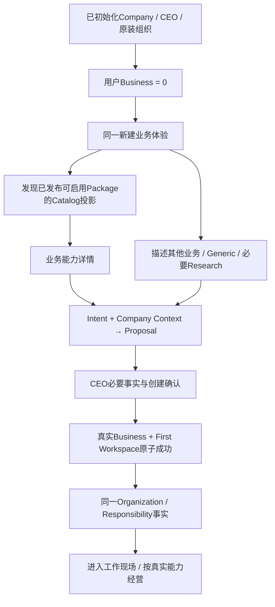
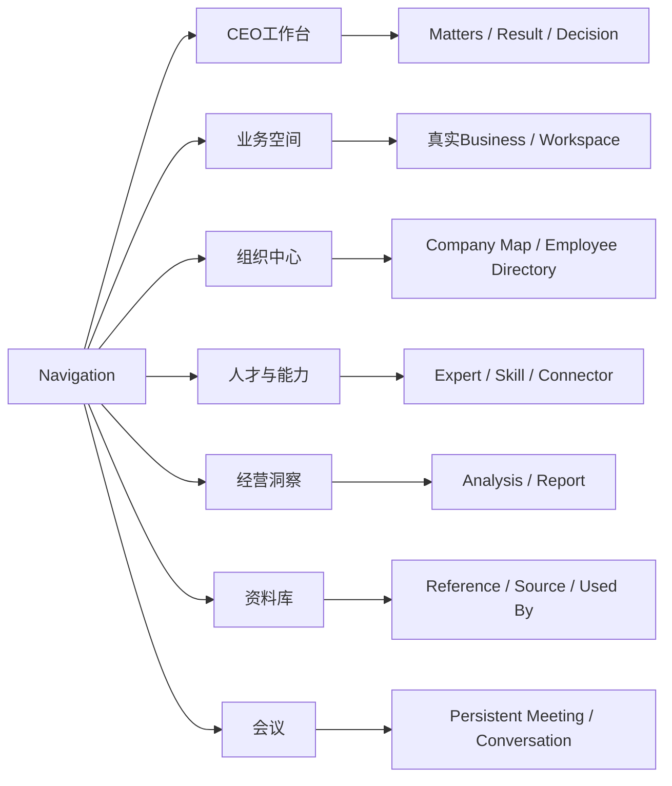
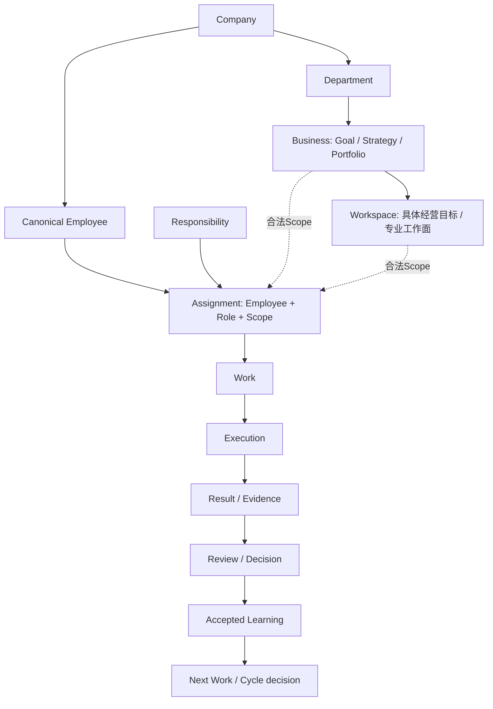
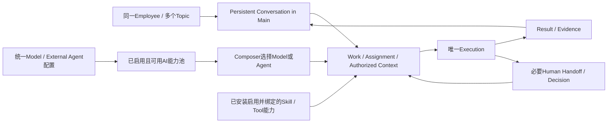
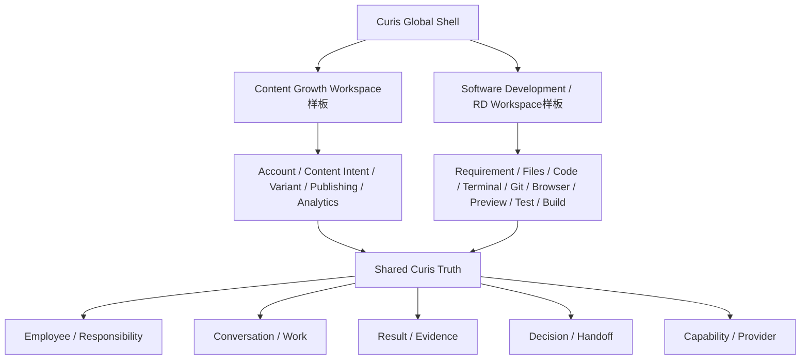
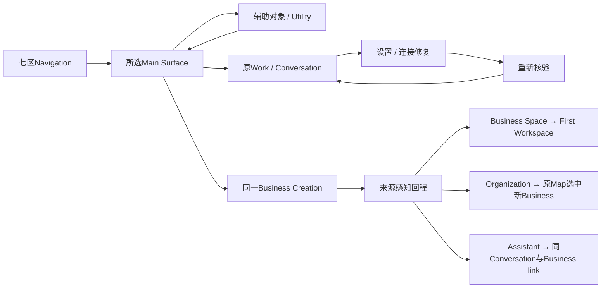

# CURIS FIGMA DESIGN INPUT PACK

Status: Review
Authority Class: REVIEW / DESIGN CONSUMPTION
Disposition: FIGMA DESIGN CONSUMPTION PACK ONLY — NOT A NEW AUTHORITY
Owner: Product / Blueprint
Date: 2026-09-15
Amended: 2026-09-16 — CEO双Professional Workspace压力样板补充
Next Gate: CEO input review → authorized UI Design Restart

## 01. How to Read This Pack

这是正式产品关系的设计消费提取，不是新Blueprint、研究建议集或Runtime验收。默认与Visual Standard一起上传；无需设计师读取本地历史。本文定义“显示什么、在哪里工作、如何回去”，不绘制页面。若与正式源产生新冲突，停止并返回Product Owner，不自行选择。

Source of Truth（下文来源缩写用于追溯，不要求Figma能访问本地链接）：

|代号|文件 / 适用部分|职责|
|---|---|---|
|P|[Product Blueprint](../01_Product/Curis_Product_Blueprint.html)，2026-09-15 Consolidation / Business Activation及Current结构|唯一产品Authority，Status Frozen|
|M|[Master Map](../01_Product/Curis_Product_Master_Map.md)，A1–A6、Current Consolidated Contract、对象/入口表|页面字段/动作展开，不新建模型|
|U|[UI Blueprint](../01_Product/Curis_Product_UI_Blueprint.html)，当前Consolidation/Activation、空间职责、七区、Shared引用|产品承载，不以旧HTML样式决定视觉|
|S|[Company OS Shared](../03_Design/Curis_Company_OS_Shared_Authority.md)，适用Frozen §10–19|共享身份、工作、能力、人工接续、Activation合同；不消费候选段为Frozen|
|H|[Frozen Shell](../03_Design/Curis_Workspace_Shell_Contract_And_Shared_Patterns.md)，§1–3及FDI-01|空间/交互；FDI-01已由CEO消歧|
|V|[Visual Standard V1](../03_Design/CURIS_VISUAL_STANDARD_V1.md)|Direction D视觉语言，不冻结页面composition|

阅读顺序：02–08建立产品模型 → 09–20理解各Surface → 21–22落实路径与字段 → 23–25核对边界。本文的“必须”来自产品合同，不代表对应功能已经交付。Target能力可设计其完整/缺失/失败状态，不能用静态设计宣称运行通过。

首轮Phase 1：Global Product，使用§08A的Content Growth + Software Development / RD双专业样板检验结构，不设计两个完整Domain。Phase 2 Content Growth、Phase 3 RD另按Manifest读适用Domain Authority。概念图不是固定Workflow或页面线框。

## 02. Curis Product North Star

Curis是由CEO驾驭AI Employee持续经营Business的AI公司系统。稳定员工使用合法能力完成真实工作，形成Result / Evidence、判断与后续行动。它不是Agent Monitor、LLM Gateway、Browser产品或IDE。品牌文案可说“交给Curis”；内部身份、业务和历史不依赖品牌名。来源：P Identity / Consolidation；S。

## 03. First-use State

本轮关键场景是**Company初始化后**：Company、CEO、同一canonical CEO Assistant、原装组织和员工已存在；用户Business=0合法。空间工程部有负责人、行业研究、经营方法、空间设计、搭建实施、质量验证六种初始Employee责任；数据分析部至少有Company Analyst。原装员工不是待招聘Catalog条目；姓名可编辑，不以设计Fixture造人。

Business Space真实为空，提供“新建业务”及Assistant意图入口。不得预填Content Growth / RD / Writing为已存在Business。没有已发布Package仍可走Generic路线。零经营数据不画成0业绩或成功。此场景不取消初始化前Welcome可跳过进入真实Empty Curis的既有规则；未建Company时不能虚构上述实例。来源：P/U Phase A及Activation，M A1–A5。

## 04. Seven Navigation Areas

固定七区，不增Browser、Model、Catalog、Migration一级区。来源：P/U七区、M对象合同。

|Name|Purpose|Primary Objects|Primary Actions|Do Not Put|
|---|---|---|---|---|
|CEO工作台|当前公司注意事项与重要结果|Brief、Matter、Result、Decision refs|理解、查看来源、决定、跟进|深度Analytics、每日强制关账、Agent监控墙|
|业务空间|进入真实经营结构与工作空间|当前Department / Business / Workspace入口；Business集合只是真实实例|新建业务、进入/讨论/经营|未启用Package冒充Business、平台=Workspace|
|组织中心|公司版图与人员责任关系|Department Container、Business、Role/Staffing、Employee|公司版图/员工目录双Tab、Focus、新建、查看责任|第二Employee真源、传统HR后台、Catalog|
|人才与能力|招聘与扩展员工可用能力|Expert、Skill、Connector及绑定关系|招聘/创建Employee、安装/启用/绑定|Business Capability Catalog、重复Model管理|
|经营洞察|趋势、比较、归因、评价、报告|Analysis、Report、Evidence、canonical Decision refs|分析、比较、阅读、形成决策输入|CEO Desk副本、假健康分/排名、第二Analytics Truth|
|资料库|Company Reference Space|Reference、Source、Scope、Freshness、Used By|浏览、搜索、阅读、引用、合法导入|文件/RAG管理后台|
|会议|持续经营议题讨论|Meeting、Participants、Conversation、Proposal、Decision、Work/Result refs|发起、讨论、决定、接续、结束|日历、聊天归档目录、审批后台|

## 05. Four-Pane

默认Navigation + Main；Context / Utility按需，不是四列常驻。READING / WORKING / OPERATING共享同一空间系统。来源：U空间/Shared段；H §1–2及FDI-01。

|区域|固定责任与控制|禁止|
|---|---|---|
|Navigation|七区、公司对象搜索、Global Conversation Quick Access、CEO/Settings；T1展开在Nav Header右，收起移Main Header最左|把Quick Access当Assistant；Nav宽度拖拽复制Context行为|
|Left Context|当前Main的局部对象/导航/Context切换；有合法Context时T2固定Main Header左，双向展开/收起|无内容仍T2、disabled占位、空面板；独立关闭×|
|Main|完整Conversation、Work、复杂编辑、Business Creation/Proposal、专业工作与阅读主面|把完整工作塞进Utility；所有专业工作都变成Employee Wall|
|Right Utility|辅助Evidence、Result detail、Reference、Preview、Context detail；T3关闭时Main右，展开后移Utility Header右|完整Employee Conversation；普通Pane独立关闭×|
|Global CEO Assistant|Four-Pane之外可拖动、收起/展开的全局悬浮体；跨七区同identity、同durable Conversation及合法当前Context|占一个Pane；等于CEO Desk/Sidebar；页面切换销毁|

四Pane使用各自Header，不做横跨App的Global Topbar。T2的“常驻”只描述有Context时位置与控制稳定；没有Context时隐藏，Main Header正常使用空间。有内容时，无论Context展开/收起，T2都能控制；不能因收起导致无法重开。T1/T3规则未因FDI-01改变。

Context/Utility可调宽、记忆偏好并保护Main空间；窄空间按合法Overlay/Focus处理。Utility最大化是辅助Overlay，退出遵循×/Esc/背景规则，不等于普通Pane增加关闭×。不要把精确宽度、圆角、图标形状冻结。Workspace偏好隔离，不能串扰。

全局对象搜索从Navigation搜索图标进入：空输入Recent，输入后分组对象结果，显示名称/类型/必要上下文并进入真实对象。不要擅自升级为自然语言命令执行系统。

## 06. Global Object Model

Business是持续经营身份，必须属于Department；Workspace是Business下实际工作空间，不是Business同义词。长期Business至少一个Workspace。Employee是稳定公司身份，Role是角色，Responsibility是责任，Assignment把Employee/Role连接到合法Scope；同一Employee可承担多Business责任，Directory仍一人，数据访问隔离。Company/Department Scope可工作，不以Workspace为所有员工工作的前置。Scope infrastructure不等于全部Scope自主经营已验收。来源：P/M/U Current结构；S。

Business-level Strategy约束所属Workspace方向；Workspace-level目标/策略不默认彼此共享。固定的是责任、Truth、Evidence、Gate与Recovery，不是所有行业一个死Workflow。Cycle Close不等于经营STOP；Leader在Approved Strategy Envelope内调整，越Goal/Success/Positioning/受保护边界/重大预算/高影响承诺才CEO Gate。一次AI总结不能自动成为Learning或永久Skill。

## 07. Business Creation & Catalog

来源：P Activation；M A1–A5；S §19；U Activation。

**ONE BUSINESS CREATION EXPERIENCE / MULTIPLE CONTEXTUAL ENTRIES。** Business Space“新建业务”、Organization“新建→新建Business”、Assistant识别意图，都进入同一Main Creation与Proposal。不是Popover、Utility小窗、Settings或第二创建系统。

Catalog只是已发布可启用Domain Operating Capability Package的发现投影，不拥有Business/Workspace/Employee/Work身份。普通用户说“可开展的业务”。Package说明专业方法、工作面、责任/能力要求、边界、证据和迁移支持；Package不是Company业务。正式发布Gate包含定义、真实执行范围、验证、维护与迁移责任；Official/Candidate/Research均不自动等于Verified或可启用。

发现→Main详情（价值/适用与不适用/如何经营/Curis与用户各负责什么/准备/真实支持与限制/来源/能否启用）→“启用具体业务”只是进入提案，不是立刻任务执行。未发布不得给出可启用承诺；空Catalog保“描述其他业务”。本轮不授权把Content Growth画成当前已发布；可用状态样例必须标“设计样例，假设已通过发布Gate”，不能混作当前事实。

Proposal用户主信息固定为四个问题：**你的目标 / Curis建议怎么开始 / Curis准备先做什么 / 需要你确认或补充什么**。Department、First Workspace、Leader/责任/Assignment、组织变化和缺口作为影响说明；重要变化不可藏，非每项同权卡片，更不是完整组织表单。模糊Intent合法，成熟方法/结构可复用，不强制重复Research；只问真正必要事实。

确认后真实成功必须同时有Business + First Workspace +合法Department。真实责任/Assignment如实显示或显示缺口，不能假员工。重复确认先查同次结果，失败保输入、理由、恢复入口，不假成功。

同Package能服务多个Business。相同品牌/目标/预算/责任/权限边界下增加账号优先扩现有；独立方向/品牌/预算可独立建Business；歧义由Proposal让CEO确认。Assistant先查已有Business，不静默建Department/Business或绑定Provider。

Generic是合法工作环境，不是假Professional；后续专业化优先保Business identity。Business是否合法创建，与具体Work是否有能力执行分开；缺账号/模型不能把Creation变成能力配置向导。来源不同的成功回程见21。

## 08. Global Model / Agent Rule

统一Model / External Agent配置 → 启用且可用的全局AI能力池 → 自动进入所有Employee统一Conversation Composer的合法可选列表；仍受tenant/权限/健康/eligibility约束。“全局”不是跨公司授权绕过。支持主流配置、填写Key启用、自定义Model与External Agent。Provider、Model与Agent不是同一对象。来源：P Activation；M A1/A4及Model合同；S §19.3。

不重复Business绑定Model；不要求创建Employee预绑定唯一固定Model；无Model不阻止合法Business创建。需要AI生成时不能假推理；具体Work需要特殊能力时，在原Work提示缺口并回到同一工作。

连接成功/Chat成功≠Vision、Tool或Computer能力已验证。模型能力显示supported / unsupported / unknown及来源/时间。purpose routing与controlled fallback消费同一能力池，不创造业务私有池。API Key安全输入，不回显secret。模型事实如context limit只读，不默认允许CEO改硬限制。

## 08A. Professional Workspace Stress Examples

**GLOBAL SHELL MUST BE DOMAIN-NEUTRAL。** 双样板说明同一Shell必须承载完全不同的真实工作，不能把Global UI做成Content Growth Shell。这是结构压力说明，不是运行测试、完整Domain规格或页面设计。

### 来源与状态边界

- Content Growth：[Current Domain Authority](../03_Design/Curis_Content_Growth_Domain_Authority.md) §1、§5.4及Activation声明，Status Frozen / CURRENT DOMAIN PRODUCT AUTHORITY；**Professional Workspace仍Candidate，未因本包通过Publishing Gate**。仅提取Account / Intent / Variant / Publication与经营反馈关系。
- RD：[RD Workspace Instance Spec v1](../03_Design/Curis_RD_Workspace_Instance_Spec_v1.md)，原文状态**RD INSTANCE APPROVED**；当前Pointer明确限于域对象/责任及适用解剖。§1的2026-09-15 Current boundary优先于旧布局/首版工具清单；§1a的Artifact Review Request仍Candidate，不升格Shared Pattern。没有发现Current Pointer改指另一新版RD Authority。
- RD共享目标能力来自P/M/U Current Consolidation、S §12 Browser / §16 Professional File Capabilities；不是从旧Design Brief的Reserved列表推断。H当前行为（含FDI-01）覆盖RD旧T2“常驻左”、工位展开、Compact及视觉记录。Workspace Engineering Lifecycle §1.0A只提供已接受Package应用/版本边界，其余方法论Candidate不升格。

### 两种专业压力与分层

Content Growth是持续经营、多账号/平台、多内容对象与数据反馈型样板：Account Goal/Strategy → Content Intent / Variant → Publishing / 外部效果 → Analytics / Review → accepted Learning。Platform/Channel、Account、Variant是Domain对象，不是Workspace，也不是Core固定业务枚举。

RD是工具密集、文件/执行环境、测试验证型样板：Requirement/Goal、文件/代码变更、Version、Build、Test、Review、Blocker、Delivery结果可能成为主要工作对象。它不要求遵循内容生产Workflow。**完整专业操作可在Main，相关目录/责任可在Context，辅助Code/Diff/Preview/Evidence可在Utility**；不是把所有工具永久并排。具体组合由后续RD设计决定。

|层级|本次提取|不升级的内容|
|---|---|---|
|GLOBAL SHARED|Employee/Responsibility/Assignment、Conversation、Work/Execution、Result/Evidence、Decision/Human Handoff、Model/Agent及授权能力入口|不建立第二套员工、Work或Usage|
|DOMAIN PRIMARY SURFACE|CG的Account/Intent/Variant/Publishing/Analytics；RD的Requirement、Files/Code、Version/Build/Test/Review/Blocker与交付现场|不冻结同一Card、Kanban、表格或工具排列；不把Domain对象塞进Core|
|SHARED CAPABILITY的专业使用|File、Terminal、Git、Browser、Preview、Media等按Work的目的/权限使用|G1/G5完整验证未完成不等目标被取消；也不等已经可执行|
|IMPLEMENTATION DETAIL|具体Browser/Terminal引擎、命令、测试框架、端口、CI/部署提供方及Adapter内部实现|不作为固定产品菜单/必选库；实际地址、权限和结果仅在工作需要时真实表达|

Delivery/Deploy是需要真实产物、目标环境、权限与Evidence的交付用途，不在本包新增Deployment系统或宣称自动部署可用；Preview可访问、Test通过、命令退出成功均不等于上线或交付验收。

### Comparison Matrix

|Dimension|Content Growth|Software Development / RD|Global Curis Must Support|
|---|---|---|---|
|Primary Working Object|Account / Content Intent / Variant|Requirement / File / Code / Version / Build / Test|对象保持专业性，非统一经营卡片|
|Professional Main|账号经营、内容、发布、反馈专业工作面；Domain默认经营结果投影不改变全局Main|文件/代码、Terminal、Browser/Preview、Test等真正工作面|selected Domain Primary Surface + Shared Work Area；主工作不被辅助Pane吞没|
|Employee|研究/生产/发布/分析等责任由真实员工承担|研发/验证/交付等责任由真实员工承担|canonical Employee，身份≠Provider，角色例子非固定招聘名单|
|Conversation|经营讨论与当前内容/账号Work|研发讨论与当前需求/代码Work|完整Conversation在Main，同一Shared Composer，不是唯一专业页面内容|
|Work|研究、制作、发布、分析Work|变更、验证、构建、交付Work|唯一Work/Execution与隔离Context，不创建Domain Task Runtime|
|Result / Evidence|产物、发布回执、真实反馈/来源、Learning依据|文件变更、测试/构建证据、预览/交付结果|统一Result/Evidence与Review；未知和未验不伪造成功|
|Capability|Media、Publishing Provider、Browser、Analytics来源|File、Terminal、Git、Browser、Preview、External Coding Agent|同一能力/权限体系，按需进入，不复制全局配置|
|Human Handoff|平台登录/人工操作、发布权限、效果待核验|环境/权限、需人工验证、上线风险或外部效果核验|同六项接续合同；不把所有接续改为CEO Decision|
|Domain Objects / Method|账号/平台适配、Variant、逐账号效果|需求/代码/版本、测试与交付判据|方法不同，共享责任/Truth/Gate/Recovery，不强制死Workflow|

### Browser / External Agent反证

Browser是共享Professional Capability：CG可用于Research、Source reading、合法平台操作与Evidence；RD可用于localhost、UI testing、Preview以及**能力真实支持时**的Console/Network observation与Evidence。入口、Context和使用目的可以不同；必须回原Work。上述是用途压力例子，不冻结一个DevTools面板，也不声称Interactive Browser已通过G1-V。Browser不是第八导航或内容增长专属工具。

Codex / External Coding Agent属于**Global External Agent Capability Pool**，不是新增RD Employee：研发Employee → Main Conversation → 当前RD Work Context → 选择可用Codex / Model → Execution → Result/Evidence。仍按真实启用、健康、权限及Provider支持决定选项；不造“Codex部门/员工”，不每Business绑定Codex，不假定Provider已安装。

### Professional Workspace Stress Map

固定的是Navigation/Context/Main/Utility、Assistant、Employee identity、Conversation、Work、Result/Evidence、Decision、Human Handoff及Capability access；可变化的是**Domain Primary Surface**。不为工具新增Terminal/Git/Browser/IDE导航。不为了视觉统一把两个样板都做成Employee Card Wall、Dashboard、Kanban、Conversation-only UI或通用表格后台。Conversation-first工作关系不等于Conversation-only专业产品。

## 09. CEO Desk

Current Company身份、Brief、Matters、Important Results、Company Operating构成信息责任，不要求分别大型Card。Decision / Exception / Handoff优先Matter类型/下钻。突出真实需要CEO关注、为什么、负责人、来源、下一动作；深度趋势去Insights。普通经营调整由Leader承担，未完成责任/风险/Follow-up接续，不做每日必须“关闭经营日”。无证据不造经营概览。来源：P/M CEO日/Desk；U Consolidation。

重要Result可进入阅读、Evidence及原Work；Decision沿同一P7。已处理事项降为历史/结果，不永久占高Attention。Current Company不等于多Company Switcher授权。信息密度高、表面复杂度低。

## 10. Business Space

只投影真实Company经营对象，包含合法Department/Business/Workspace进入关系；Business集合不混未启用Package。Business=0与N共用新建入口。名称、业务方向、Leader、Workspace数量/快速入口、最近重要Result优先；Risk/Needs CEO仅有事实时；组织/Staffing/来源/新鲜度按需。来源：P/M/U Business及Activation。

Business是整体Goal/Strategy、Workspace集合、结果/资源/风险聚合；Workspace Main承载真实业务对象与Shared Work Area。Professional = Shared Shell + Domain-specific Primary Surface + Shared Team Operating + Shared Employee Work Area；Domain Primary Surface是唯一可最大占视觉面积区域。Generic不吞并Professional，Professional不作为所有业务创建门槛。

Current Operating保持轻量：经营状态、本轮重点、最新判断、下一步。进展优先专业Primary表达，Need/Risk有真实事项才出现。首轮仅用§08A双专业样板校验承载能力，不展开任一完整Domain；对象、工具与Primary可有不同专业表达。

## 11. Organization Center

固定顶部横向双Tab：公司版图 + 员工目录。不要恢复二级左侧Context Navigation。公司版图Department Container → Business-first → Role/Staffing逐步展开；Employee不默认铺满，Workspace为Business下次级执行空间。Business Focus是Map内部状态，不是第三Tab/独立Workspace。来源：U组织中心Current段；M。

Map展示同一Company / Department / Business / Employee / Responsibility / Assignment truth。Vacancy/Risk无可靠来源保持hidden/unknown，不从人数、WAITING/PLANNED推断。“新建”区分Department与Business，后者走同一Creation，成功回原图选中新Business。

## 12. Employee Directory / Detail / Workstation

Directory读取Employee → Role → Business → Department，Workspace弱上下文；同一Employee只一个身份。Employee不是Agent配置。展示姓名/头像、角色、所属/责任、工作、能力、结果和对话入口；只在相关处逐层披露，不复制每项成卡。CEO/Employee头像共享upload/preset/fallback，非必填、与Model无关。来源：P/M Employee；U §8；H §3.1/3.14。

Employee Row为普通两行列表（不做Card）：头像跨两行，行1姓名/岗位，行2职责/状态/展开控制；姓名/头像打开Utility Employee Detail，不另设独立详情按钮；展开箭头/工作行打开Main Workstation。Utility Detail是身份/责任/当前工作/能力与来源等摘要，不承载完整Conversation；开始或回到对话进入Main。员工多Topic不等于多Employee。

Workstation以工作/Conversation持续性为主，合法Context与Output refs可打开Utility。Runtime状态不驱动展开：仅从外部进入Workspace且单一当前working Employee时初始展开一次；进入后由用户控制，不因waiting/completed/failed改变展开。Employee呈现是Idle / Working(正在做什么) / Blocked(为什么)，不要直接暴露Runtime enum。

Global Assistant是CEO协调/搜集/跟进/升级入口，不替Leader、Domain Expert、工程团队默认执行专业研究或建设。Nav Conversation Quick Access列持久Topic、最近活动、Employee/Work来源，支持搜索/重开；dismiss≠delete，不与Assistant混同。

Conversation Surface居中、可读宽度有界且响应式、舒适高度并可拖拽调高；对话自然流，不套Card或AI状态Dashboard。短消息自然流；长文本/Tool/Terminal/Code/Diff/Structured Result可用内部滚动的bounded embedded block，引用/完整查看进Utility。具体px、阈值、样式不冻结。Composer固定语义槽位Input、+ Add、Access、Work Mode、已选资源、Model/Agent执行选择、可选Voice、Send；Provider决定真实可用项，不能因Compact删功能，桌面上下排列仅推荐而非跨尺寸固定。来源：H §3.1/3.5及Delta-X10/X12。

## 13. Talent & Capability

Expert / Skill / Connector的信息职责：找到人或能力、理解真实条件、招聘/安装/启用/绑定。Talent候选≠已招聘Employee；Recruit必须产生canonical Employee。原装员工已经属于Company。来源：P/M/U Talent；S能力边界。

Capability存在≠员工拥有：install/enable → binding → execution availability。Connector定义≠授权连接，外部候选不可用就诚实说明。不能把所有能力自动绑定所有人。

Employee Capability回答“员工用什么工作”（Skill/MCP/Browser/Tool等）；Business Catalog回答“可以开展哪类完整业务”，只在Business Creation。Model/Agent Configuration走统一设置与Composer，不在Talent复制模型管理。

## 14. Operating Intelligence

Analyst-first、Conclusion-first；Hybrid capability envelope + progressive Explore/Benchmark，不把旧Variant A/B/C当并列待选。Company Analyst是真实组织责任主体；展示分析、报告、Evidence与Decision support，不硬编码设计人物。来源：P/M/U Insights Current段。

支持Company/Business范围、期间、趋势、比较、归因、分析报告/研究；对比须同口径、窗口、样本、来源与可用性。成本/速度/质量/失败/验收可解释分离，不合成假Health Score。图必须回答问题，不堆KPI墙。

Fact / Analysis / Unknown / Recommendation区分；来源、新鲜度、验证、缺失、人工记录可追溯。无数据不填0，未连接外部Outcome不能假增长。Report引用Artifact/Result来源并进入existing P7，不建立新Metric/Result/Decision系统。Target自动分析能力不冒充当前交付。

## 15. Knowledge Library

用户名资料库；Company Reference Space。Browse → Search → Read → Reference。Reading Surface为详情主面；Source是来源，Reference供工作引用，Artifact/Result是工作产出，Evidence是支持事实的证据；不能把所有附件/产出自动当已验证Knowledge。来源：P/M/U Knowledge。

Reference Row：标题 → 摘要/搜索命中片段 → 来源/适用范围/更新时间/状态。Browse摘要与Search命中不同，不宣传尚未具备的Semantic/Vector/AI Ranking。Company / Business / Workspace为范围选择器，不固定三级Tab。

首次批量加载 + 显式Load More；约30–50是UX/性能候选，不冻结DB或强制批次。无可靠total只“已显示N”。阅读返回保关键词、筛选、排序、滚动与批次。Work Picker是紧凑选择器：原Work/Employee、合法Company+当前Business/Workspace范围、搜索/简化Rows/已选/添加返回；不是完整Library复制。

Work引用资料→Context→Execution；资料Used By→相关Work/Result/Evidence→原现场；内容不复制，不默认暴露无关Business。合法导入依真实能力：手工/.md/.txt不扩大成PDF/DOCX/Image/Web已支持；Document/OCR目标能力不自动证明Library导入已交付。

## 16. Meetings

Meeting是持久经营讨论对象；CEO离开页面不结束Meeting。Overview当前会议 + 真正结束/归档的历史；历史含议题、结论/Decision、经营Result、参与人、结束时间，不只是聊天日志。来源：P/M/U Meeting；H共享Composer/P7。

Overview → 临时Start Meeting Overlay → 点击开始才创建persistent Meeting → Main Conversation。初始化议题、背景、相关Business/Workspace、推进负责人、canonical Employees、Context refs、CEO模式（参与讨论 / 仅需要决定时通知）。推荐≠自动邀请，可增删，不建联系人系统。

成熟群聊 + structured operating messages：Evidence / Proposal / Decision Request / Decision Result / Work Created / Result Returned自然进入同一Conversation。Decision继续P7；负责人/责任/Work/返回时间是continuity投影，不复制Workspace。结果回同一Meeting，可接受、继续讨论/决定。关闭视图≠结束会议，重入恢复原关系；设计不能作为bounded continuation已运行的证据。

## 17. Settings & Connections

一个设置体系，按事实Owner分层，下面是归属而非要求七个设置Tab。入口来自CEO utility/模型配置、原Work缺口及相关能力Context；完成后回原Work并重验，不自动重新执行外部写。来源：M Current Consolidated §1–9；S §18/19。

|归属|普通用户实际需要|按需/Advanced|不作为用户配置|
|---|---|---|---|
|Personal|身份/头像、语言/时区、主题、通知/安静时段、发送与可访问性偏好|通知隐私/摘要偏好|Runtime租约/进程Owner|
|Company|名称、经营边界、预算/权限政策、备份范围|出站数据政策、保留/恢复影响|复制所有Workspace参数|
|Employee|责任相关可用能力、必要权限|用途偏好与合法覆盖|强制唯一模型绑定、运行拓扑|
|Workspace|当前工作资源与专业设置|专业工具范围|重复全局Key/Model池|
|Provider / Connection|安全凭据输入、授权账号、连接/健康、发现与可用模型/Agent|确有需要的自定义endpoint/组织/区域|secret明文读取、Provider冒充Employee|
|Capability Advanced|必要能力测试、来源与unknown、受控fallback|支持范围内软限制/推理参数|手改模型硬能力、chat推断所有能力|
|System|版本、实际后台状态、存储与诊断、备份恢复入口|诊断导出与影响说明|lease/锁/内部scheduler图|

**Background Target**：opt-in本地后台服务。关闭UI与明确停止/退出不同；显示实际运行与下一步，不因开启选项就显示正在工作。睡眠/关机/登出不承诺持续执行。

**Backup/Restore Target**：DB + Managed Files + Manifest；检查版本/完整性/影响/空间→恢复→需要重连清单→Resume Check。Credential、Cookie、Keychain不进普通备份；不覆盖其它Business新事实、不自动重放外部动作。

**Browser/Tools Target**：Search / Reader / Interactive Browser及File、Terminal、Git、Preview、Document/OCR、Data、Media属于员工完成原Work的能力。Main完整操作，Utility辅助Preview/Evidence；保账号/权限/来源/接管/返回，不创建Browser/IDE一级区。底层实现库不写成普通用户产品菜单。

## 18. Human Handoff

必要人工接续是正常经营状态，不必全是Decision，也不自动扩大CEO权力。固定信息责任六项：AI已完成什么；为什么需要人；要做什么；在哪里做；完成判据；之后如何继续。附合法Work/Scope、Owner、原因、Evidence/核验与下一动作。来源：S §14–15；H §3.11。

User完成声明≠外部事实已经核验，核验后接续同Work。外部写超时可能EFFECT_UNKNOWN，先核验效果，不能FAILED→盲重试。Approval绑定动作/对象/账号/输入/权限/预算等快照；实质变化旧批准失效。

需要经营Decision时复用P7：事情是什么、为什么现在、选项、影响、建议及理由、CEO选择、接续；这些是信息责任，不是八张卡。高影响决定不能用无上下文通知按钮一键代替。普通协调/进度保持安静，真实Need/Risk/Decision才打扰；阈值属Company/个人政策，不由Desk另造。

## 19. Package Update / Migration

Business/Workspace“业务能力有更新” → 看影响/兼容 → Migration Proposal → 必要Decision → 应用/恢复 → 原工作。复杂提案Main，Evidence辅助Utility，不新增Migration Center。来源：P Activation；M A6；S §19。

Business identity ≠ Package version ≠ UI version。稳定Package identity + immutable published version；追溯实际采用版本，不引用latest，多Workspace可合法不同受支持版本。UI布局更新不自行改变数据语义，也不能隐藏旧数据/填假默认值/重建Business。

历史Account/Work/Result/Evidence/Learning/Conversation保护；改名保identity，语义变化显式mapping，新增无证据Unknown，弃用不删历史。在途Work固定方法/输入/权限/批准快照，不热切；EFFECT_UNKNOWN先核验。新Provider、出站目的地、权限、费用、重大责任变更必须相应确认，升级批准不是批准所有外部动作。

兼容低风险且已有政策允许才自动更新；版本号不等于安全。失败恢复显示owner/原因/影响/恢复点/next，不覆盖升级后或其它Business新事实；不能安全原地升级则同Business sibling Workspace受控交接。Package下架仅停止新启用，不删除已有Business；不安全执行停止受影响动作并给迁移/人工路线。以上是Target产品合同，不宣称Migration Runtime已交付。

## 20. State Language

状态属于具体对象，不新增统一“超级状态enum”。来源：M/U Current Consolidation；H §3.1；S Human/Recovery。

|语义|用户需要理解|不得推断|
|---|---|---|
|Unknown / 需要核实|缺少证据、来源不一致、判断尚不确定|填0、默认成功；新增全局Conflict状态|
|Not Connected / 待连接|尚未授权/连接|定义存在即能执行|
|Unavailable|当前范围不能做及原因/可行下一步|假按钮假成功|
|Waiting User|谁需要完成什么、判据、如何续接|全部变成CEO审批|
|Waiting External|等待谁/什么信号、下次检查/返回条件|无限假进度|
|Failed|真实失败原因、影响、安全恢复|未知外部效果当可重试失败|
|Paused|明确暂停与Resume|普通Cycle Close=STOP|
|Completed|相应Work完成及Result/Evidence|已浏览=已接受；一轮完成=Business停止|
|EFFECT_UNKNOWN|外部效果未核实，先检查|重复执行外部写|

Employee仍用Idle / Working描述 / Blocked原因；不是把Work所有状态贴到员工身份。UI展开与状态独立。AI不足时合法浏览/创建事实仍可用，推理/执行动作诚实受限。Design样例与生产事实分开标，不硬编码Fixture人名/账号/业绩。

## 21. Entry / Return Matrix

所有回程保原授权Scope与对象引用，不复制Truth。来源：M A1–A6、Current共同Return及对象表；U/H。

|Entry|Context|Primary action|Destination|Return|
|---|---|---|---|---|
|Business Space新建（0/N）|Company、origin、Intent|发现/描述→详情→Proposal→确认|真实Business + First Workspace|默认首Workspace；可回原目录；取消保来源|
|Organization新建Business|Company/Department建议、原Map Focus|同一Creation|真实Business|回Organization选中该Business|
|Assistant经营意图|同Conversation、合法Context、已有Business|复用/扩展判断→同Proposal|同一创建结果|同Conversation + Business link|
|Catalog Item|查询/筛选/滚动、发布范围|查看详情/选择|Main Detail→Proposal|同Catalog位置或原Assistant|
|Proposal对象引用|当前未丢失提案|看Employee/已有Business/范围|合法对象阅读|回同提案；重大改变重确认|
|Employee Directory|Employee identity、来源|看详情/开始Topic/工作|Utility摘要→Main Conversation/Workstation|回原Directory/Topic与Scope|
|Conversation Quick Access|canonical Topic、Employee/Work|重开|同Conversation Main|保来源；dismiss不删除|
|Work能力缺口|Work/Assignment/Scope、输入|连接/权限/能力修复|同一Settings/Connection|回原Work，重验再继续|
|Work资料选择|当前Employee/合法Scope|选Reference并添加|Compact Picker→原Work|保输入/引用，不复制内容|
|Library Row|query/filter/sort/batches/scroll|阅读/Used By|Reading Surface→Work/Result|恢复列表状态/原引用位置|
|Insights Report|scope/期间/来源|查看Evidence/形成Decision|辅助详情/既有P7|回同Report/Analysis|
|Meeting Overview|Company、议题|Start Overlay→开始|Persistent Meeting Main|回Overview不结束Meeting|
|Meeting Decision/Work|同Meeting identity|既有P7/责任/Work|原工作链|Result回同Meeting；重入不重建|
|Business/Workspace更新提示|实际版本/在途Work/影响|查看/确认合法升级|Main Migration Proposal|原Business/Workspace；失败安全恢复|
|全局对象搜索|Company合法可见范围|选择真实对象|对象所属Surface|保来源可回；不复制对象|

## 22. Required Field Matrix

R=Required信息责任，适用时必须可读/可到达，不代表always-visible或必填；O=Optional/conditional。RO=事实/证据只读，UI不可编造；UI=User Input仅必要输入/决定；SD=System Derived真实读取/有标记建议，不能伪装成落实事实；ADV=Advanced/按需。六列正交，同字段可R+RO+SD。无来源可用Unknown/缺口，不以字段表创建DB schema。来源按P/M/U/S/H在01定义。

|Surface / Source|Required|Optional|Read Only|User Input|System Derived|Advanced|
|---|---|---|---|---|---|---|
|Global Navigation / U,H|七区、选中区、CEO utility、合法搜索/Topic入口|Recent Topic、合法Context cue|真实对象/Topic refs|搜索、选择、reopen/dismiss|分组/活动/选中态|对象来源详情|
|CEO Desk / M,U|Current Company、Brief/Matter/Result责任、来源、next|真实风险/CEO Need、变化摘要|Result/Decision事实|决定/跟进/对话|Brief/归属/待处理原因|Evidence/历史|
|Business Space / M,U|真实名称/方向、Workspace入口、Leader/缺口、新建|重要结果、风险、Staffing|canonical hierarchy/results|新建/选择/合法调整|数量/最近结果|来源/资源摘要|
|Business Creation / M A1|Company、Intent、origin/return、Package或Generic路径、Proposal|已有Business refs、筛选|当前组织/创建结果|意图/必要事实/取消恢复|Department建议、复用建议|发布范围来源|
|Catalog / M A2|display name、价值/适用摘要、source、合法启用范围|查询/分类、可靠已有业务数|发布状态/版本|选择/搜索|Package投影|publication/evidence/version|
|Capability Detail / M A3|经营对象/结果、适用/不适用、方法摘要、Curis/User责任、准备、支持限制、启用原因|相关已有Business|真实支持/来源/维护|启用意向|适用说明投影|validation/migration/support window|
|Activation Proposal / M A4|四问题、Business/Goal、Department、First Workspace、责任建议/缺口、组织影响、必要确认、return|Assignment建议/当前假设|当前Context/发布范围/确认结果|名称/目标/必要边界、扩展或独立、确认|建议结构/initial Work/合法校验|版本/permission/budget/automation影响细节|
|Created Summary / M A5|Business/Department/First Workspace、真实责任/缺口、next/return|实际Package关系|创建事实/同次结果|进入/返回|真实组织与可做Work|结果refs|
|Business / M,U|名称、Goal/Strategy、Leader/责任、Workspace集合、结果/风险来源|Team/资源/当前重点|汇总事实|讨论/目标边界决定|聚合/next|支持来源/版本|
|Workspace / M,U,H|身份/Scope、真实Primary工作对象、Shared Work Area、当前经营四语义|真实Need/Risk、Context/Utility|Result/状态来源|工作/对话/展开|当前重点/判断/下一步|Package/Work版本refs|
|Organization / M,U|双Tab、Dept/Business关系、Focus/返回|可信Vacancy/Risk、Role/Staffing展开|canonical关系|新建/Focus/进入|合法组织投影|关系来源|
|Employee Directory / M,U|姓名/头像、Role/责任、Business/Dept关系、入口|Workspace弱Context|同Employee identity|搜索/选择|归属摘要|Assignment来源|
|Employee Detail / M,H|identity、角色/责任、当前工作、能力及来源摘要|其他Scope/结果refs|能力/Work事实|合法Profile编辑/开始对话|状态/摘要|权限/绑定来源|
|Employee Workstation / M,H|Employee、Work/Assignment、Input/Output/Conversation refs、下一步|Reference/结果展开|已发生执行/Evidence|消息/工作动作/展开|工作进展/合法上下文|执行诊断按需|
|Talent & Capability / M,U|条目身份/类型、真实可用/安装/绑定状态、条件/action|外部候选/说明|Connector授权/来源|招聘、创建姓名头像、安装/绑定|可用性/公司Employee引用|Provider/能力范围|
|Model / Agent Config / M,S19|名称/类型、Provider、连接健康、发现/可用性、能力三态/来源|自定义项/用途偏好|硬限制/来源/测试事实|安全credential输入、启用、选择、必要测试确认|discovery/eligibility/实际usage|endpoint/fallback/支持参数|
|Employee Conversation / M,U,H|topic、Employee、当前Scope/Work、消息、完整Composer、合法AI选择、执行/等待/失败|Context/Reference/Attachment真实支持、Voice真实支持|消息来源/已用能力/Evidence|Text、+入口、Access/Work Mode、选择Model/Agent、Send|可用选项/引用/状态|能力/权限解释|
|Human Handoff / S,H|六信息责任、Work/Owner、reason、criterion、next|外部入口/证据补充|AI已做/核验结果|执行必要人工、提交完成信息|检查/恢复判断|Approval快照/风险来源|
|Operating Intelligence / M,U|scope/期间、结论、Fact/Analysis/Unknown/Recommendation、来源/新鲜度|趋势、可比较对象/样本、成本质量等适用维度|Result/Usage/Evidence|范围/时间/比较、Decision输入|分析/同口径投影|定义/样本/方法/限制|
|Knowledge Library / M,U|标题、摘要或命中、Source/Scope/Freshness/status、阅读/引用/Used By|可靠total、合法导入|来源/使用关系|搜索/筛选/排序/加载更多/引用|Row/命中/已显示数|来源/版本详情|
|Work Reference Picker / U,M|当前Work/Employee、合法scope、搜索/Rows、已选、添加返回|可用过滤|引用身份/权限|选择/取消|合法候选|来源详情|
|Meeting / M,U|议题、负责人/participants、Context refs、CEO模式、Conversation、Decision/Work/Result接续|背景、历史结束信息|同Meeting/Employee/Decision refs|Start、增删推荐人、消息/决定/结束|推荐/状态/返回结果|证据/责任来源|
|Settings / Connections / M,S18|Owner、设置目的、真实状态、影响与原Context返回|适用偏好|能力/健康/系统事实|必要偏好/授权/确认|发现/权限校验|高级参数/诊断，不暴露lease|
|Package Migration / M A6|当前/目标版本、scope、兼容/影响、owner/next、必要确认、preflight/recovery/resume|合法延后/低风险政策选项|真实版本/检查/应用结果|必要确认/安全恢复选择|影响/兼容/在途Work/变更建议|mapping、快照、恢复范围完整性及新数据保护|
|Browser / Web / M §1|原Work/Assignment/Scope、问题/URL/账号/动作、权限、Evidence、reason/next/return|Search/Reader/Interactive适用模式|真实登录/观察/来源|问题/合法动作/接管|提取/限制/外部效果核验|数据出站/账号隔离/截断详情|
|Background / M §4|opt-in、实际工作状态、关闭UI与停止区别、恢复下一步|通知偏好|实际运行/故障|明确启停政策选择|恢复/暂停原因|诊断，不做流程编排|
|Execution Recovery / M §5|Work/动作目标/效果判断、owner/reason、安全next|核验证据|执行/Approval快照|人工核验/必要重授权|可安全续接判定|预算/权限/expiry/动作变更|
|Professional Tools / M §2|原Work、目标资源、权限、输出/Evidence与return|适用cwd/branch/preview/解析质量等|实际工具/资源状态|当前必要工作输入|执行结果/限制|专业参数，不加全局导航|
|Backup / Restore / M §6|范围、manifest/版本/时间、完整性/兼容/影响、恢复点、重连/Resume结果|合法备份策略|检查/备份结果|备份/恢复及影响确认|检查/排除项/需重连清单|文件范围/恢复保护细节|

## 23. PRODUCT FIXED

七区；Company→Department→Business→Workspace；原装组织与Business可0；同一Employee/Assignment；单一Work/Result/Evidence/Decision；Package First；Catalog只是发现投影；统一Main Creation及来源回程；Business＋First Workspace原子成功；全局Model/Agent池；多Business Context隔离；Four-Pane职责与T1/T2/T3；全局Floating Assistant；Main完整Conversation/工作，Utility辅助；完整Shared Composer；Human Handoff及外部效果未知恢复；身份/版本/UI分离、历史保护。来源：P/M/U/S/H。

信息责任不等于独立Card；已经明确的Main/Overlay/双Tab/Row/双向Toggle/返回行为不能以“视觉自由”更改。V冻结Iris #806BE5、Neutral Light/Graphite Dark、PRIMARY/SECONDARY/TERTIARY/QUIET、Typography-first/Accent-last、Calm Density、Open Canvas/Tonal Field与稀缺Card；员工体现责任/连续性，不Agent Wall。设计细节开放不等于重选视觉方向。

## 24. DESIGN OPEN

在V与上述行为内：具体页面composition、字体选择/比例、spacing、边框/圆角/阴影、按钮/图标、消息节奏及bubble表达、Composer外观、Pane chrome、浮动助手外观/拖动handle/动效、信息折叠与密度、专业工作/Result阅读比例、响应式及反馈细节可以设计。不可用这些自由改变责任、回程或必需信息。

Dark Company Space仍待验证；Dark companion #9A89F0仍candidate，不替代当前主accent。旧19张Figma仅结构/IA参考，不是最终composition。先完成Global Product输入审阅，再按授权设计；本包不自动解除任何具体设计批次Gate。

## 25. DO NOT USE / SUPERSEDED CONCEPTS

禁止用作本轮Current输入：旧高保真IA/旧Figma composition/Research/Zcode Prototype；Office当前用户身份、平台或Account=Workspace；默认Content Growth/RD已在用户Company；未发布Candidate可启用；业务级重复Model配置；Employee必须固定Model；Right Utility完整Conversation；Decision-only Human Action；第二Catalog导航/Employee/Work/Result系统；旧Compact缩减Composer；Runtime状态自动展开；绿色#32f08c Current Brand；技术库名当产品能力；用旧Pending删除已批准Target或用Target宣称已实现。

来源原文中的旧日期checkpoint只按明确supersession保历史。后续Content Growth / RD完整设计各走Manifest的Domain批次；Channel / Channel Account ≠ Workspace，Provider不是Domain或Employee。不要由任一样板反向重建Core。不得把本包复制为平行Authority；变更回正式Source，之后刷新消费包。
