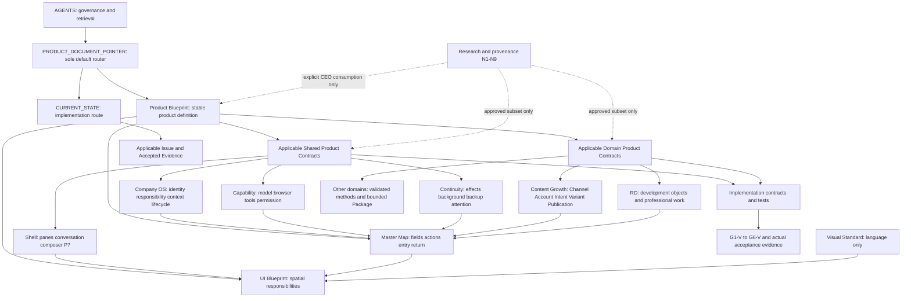
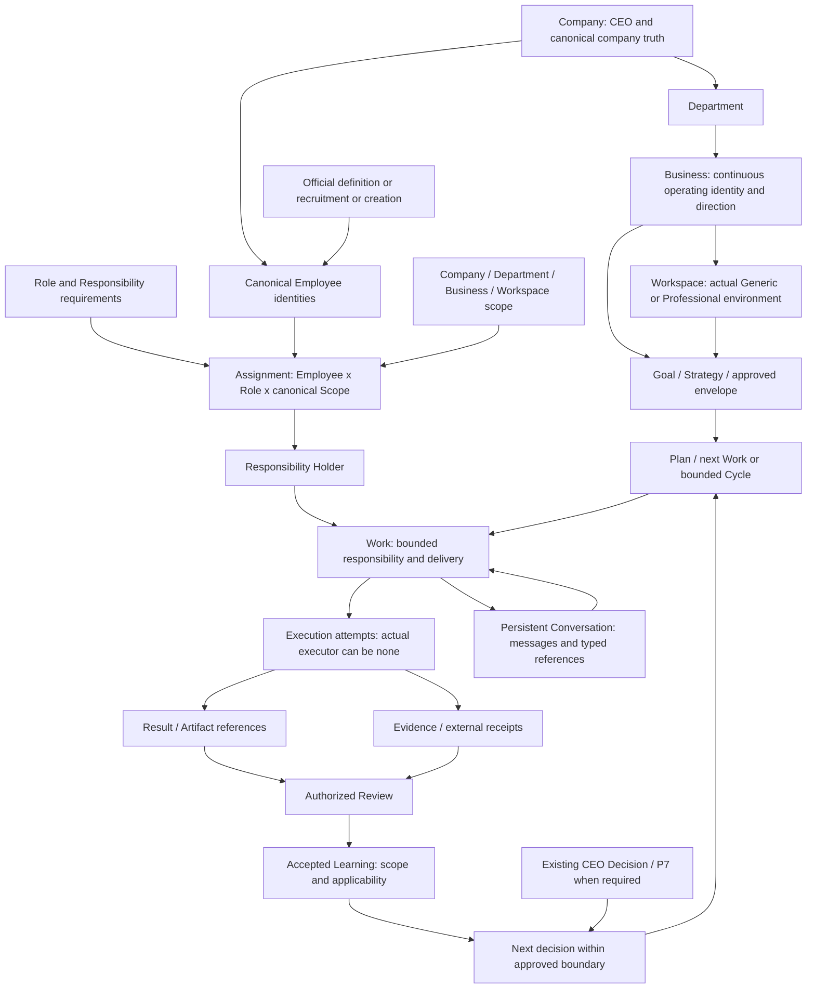
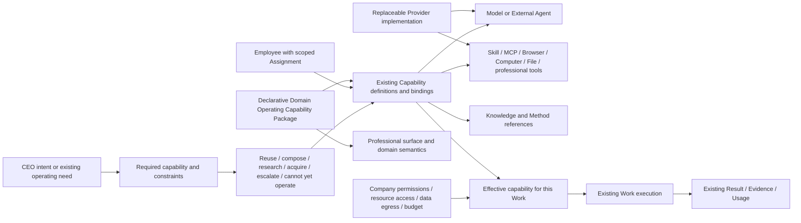
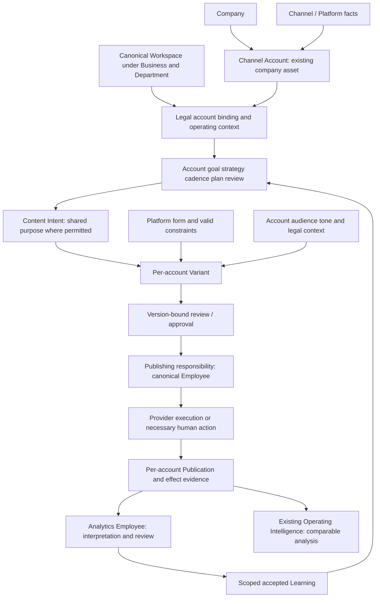
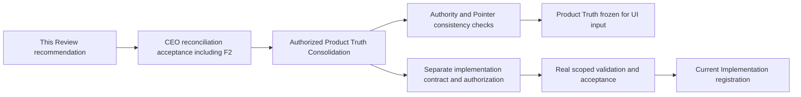

# CURIS PRODUCT TRUTH TARGET MAP

> **2026-09-15 CEO Acceptance / Consumption record**
> 本报告整体仲裁已由CEO接受；F1人工接续≠Decision，F2选择Option A（opt-in本地后台目标）。批准子集已由本轮Product Truth Consolidation写回唯一Blueprint / Master Map / UI Blueprint / Shared / Domain。
> 本文件继续 **Status: Review · Authority Class: PROVENANCE / REVIEW HISTORY**，不是Current Router或Implementation Acceptance。下文保留审查当时的候选/F2待决/本轮不写入等原文，仅为历史时间点；不得重新开放已决定方向。
> Disposition: CONSUMED BY CURRENT PRODUCT TRUTH。Owner: Product Authority。Next Action / Gate: [Consolidation Review](CURIS_PRODUCT_TRUTH_CONSOLIDATION_REVIEW.md) → CEO FINAL PRODUCT TRUTH REVIEW。G1-V～G6-V仍NOT RUN。

Status: Review  
Authority Class: REVIEW / PROPOSED AUTHORITY MAP  
Disposition: TARGET MAP ONLY — NOT CURRENT PRODUCT AUTHORITY  
Date: 2026-09-15  
Owner: CEO / Product Blueprint Authority  
Source: [Deep Reconciliation](CURIS_PRODUCT_BLUEPRINT_DEEP_RECONCILIATION.md) / [Change Plan](CURIS_PRODUCT_BLUEPRINT_CHANGE_PLAN.md)  
Next Gate: CEO FINAL RECONCILIATION REVIEW  
Boundary: NO IMPLEMENTATION / NO AUTHORITY EDIT

## 1. 阅读规则

这不是新Blueprint/Manifest。图中实线表达目标职责/引用，**不是强制Workflow、数据库外键或新Runtime对象**。当前唯一入口仍为 [Product Document Pointer](../00_Context/PRODUCT_DOCUMENT_POINTER.md)，核心产品定义仍为 [Product Blueprint](../01_Product/Curis_Product_Blueprint.html)。新增内容需CEO接受后才被正式合同消费。

Shared框是内容归属，不表示本轮要求每框新建文件。复用现有Company OS、Shell、AI Capability等载体；确需拆分再明确唯一canonical path。技术层实现产品合同，但技术库不能反向定义产品。

## 2. Product authority / consumption map

Research→Current的虚线必须经过Review/CEO Decision；本图不授予消费。G1–G6验证目前未运行，不因为位于图中就成为Accepted。Final Visual / page composition仍未批准；本轮不改变Direction D的视觉语言状态。

## 3. Company operating truth relationships

- Business必须合法归Department且长期至少一个Workspace；Company用户Business可0，原装组织与真实员工仍存在。
- Employee不是Workspace子节点专属副本；同一Employee可多个Assignment。Department归属与服务关系分开。
- Company/Department可以有合法Work/Conversation/Result，不强造Business或Workspace。四scope基础设施的Accepted Candidate不等四层自主经营全部验收。
- 以上是关系图，箭头不要求每次Work全走一遍；Leader不只是Router，责任Holder不等当前执行者。
- Result、Evidence、业务价值不是同一字段；学习须真实依据和授权Review，不是一次AI总结。Loop箭头是有界显式继续，不是永续Session。

## 4. Capability / Provider ownership

Core负责身份/责任/权限/Context/证据/结果/生命周期；Package声明专业组合；Provider提供执行或信息，不拥有Curis Employee/Business/Work。不在Core写XHSResearchFlow/PetBoardingFlow/SaaSFlow。Playbook不新增，Methodology/Package元数据/Skill composition/Operating Definition/Review分工保留。

适配技术候选如Playwright、models.dev、APScheduler、Docling、FFmpeg等只在Implementation层。安装它们不等Capability已验证。模型能聊天不证明能看图，权限已请求不证明实际生效，能力可用不证明有Capacity。

## 5. Content Growth domain map

Account Operating Cycle是拟补的Domain经营周期关系，不是新增canonical execution scope或第二CYCLE Runtime。同一Workspace内多账号工作继续服从已有控制周期、Assignment、资源和外部副作用边界。平台/账号不等Workspace；Business→Platform→Account是经营观察视角，不取代Company层级。

AiToEarn仅是图中Provider位置的部分能力候选；本轮未发布、未集成、不证明收益。Publishing/Analytics员工属于Curis，人数不固定；接口回执与人工“我完成了”都需按真实证据判断。不会创建平台钱包、统一结算Runtime、账号独立素材库或第二分析账本。

## 6. User surface map — no new navigation

|空间|主要责任|新能力怎样进入|
|---|---|---|
|Navigation|七区＋Quick Access/合法全局入口|不新增Browser/Model/Recovery一级区|
|Context|当前Domain对象、局部导航与浏览范围|账号集合/文件等按需；不改变执行scope|
|Main|真正经营/讨论/编辑/专业工作|完整Conversation、复杂Model配置、专业工具工作|
|Utility|辅助Evidence/Result/Reference/Preview/详情|临时观察或放大阅读；不吞并完整工作|
|Global CEO Assistant|跨七区同身份/持久Conversation的协调|必要引导/跟进；不是Leader/Executor或第五Pane|

Company Map / Employee Directory、Operating Intelligence、Library Reading、Meeting各自保持独立产品责任。某能力有多个情境入口不等多个Owner；Settings保持既有结构，77项台账只是候选语义，不画77个设置。

## 7. Target / current separation and gates

本轮停止在第一框。F2唯一方向选择是opt-in本地后台还是App-bound；F1按已有技术授权/人工反馈规则修正P4，仍待CEO接受本轮编辑范围。没有证据将研究闭合、目标能力或页面存在直接连到Implemented。

## 8. 唯一性约束

保留一个Product Blueprint、一个Master Map、一个UI Blueprint、一个Company Truth、一套Employee/Work/Execution/Result/Evidence/P7/Usage。Shared与Domain是被授权的分工，不是多个竞争Blueprint。Research保留可追溯但不默认要求后续设计重新考古几十份文档。

STOP FOR CEO FINAL RECONCILIATION REVIEW。
