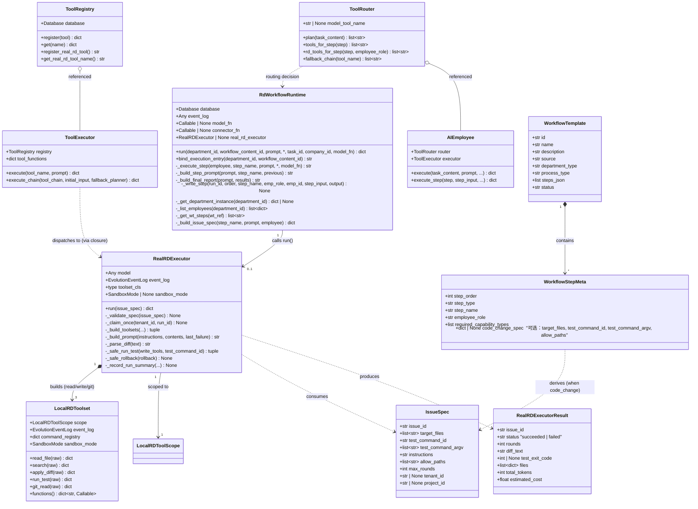
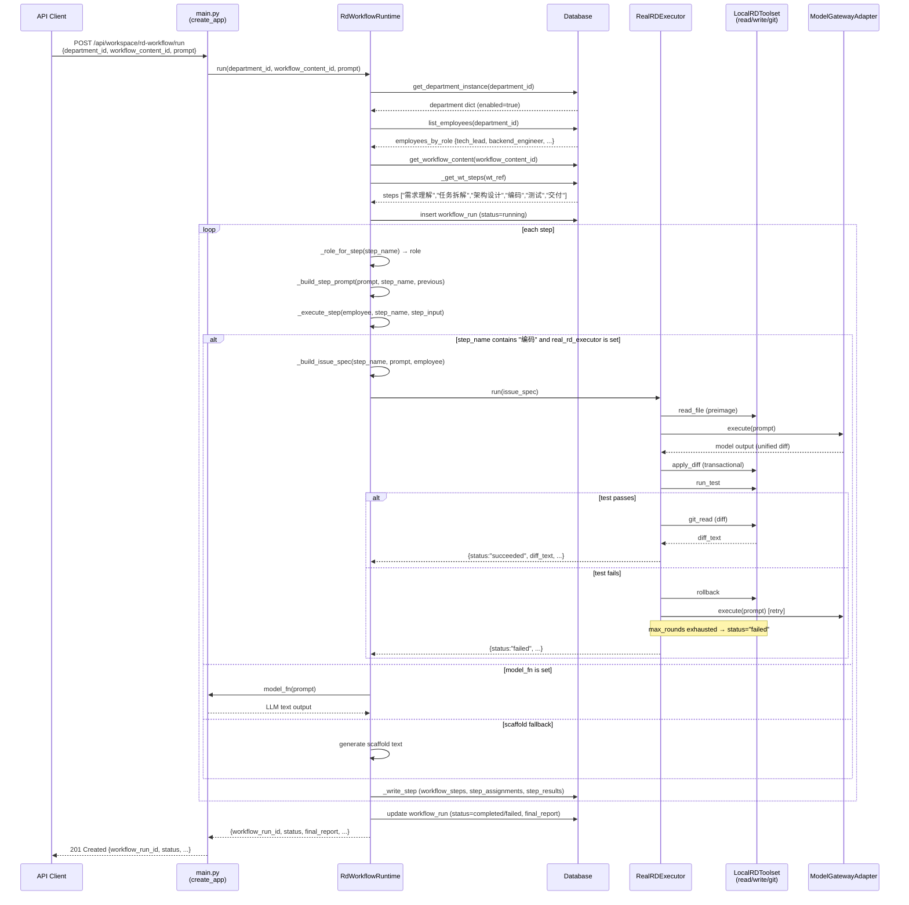
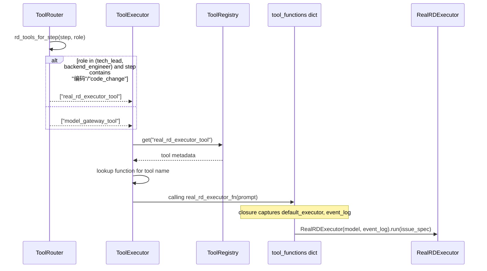
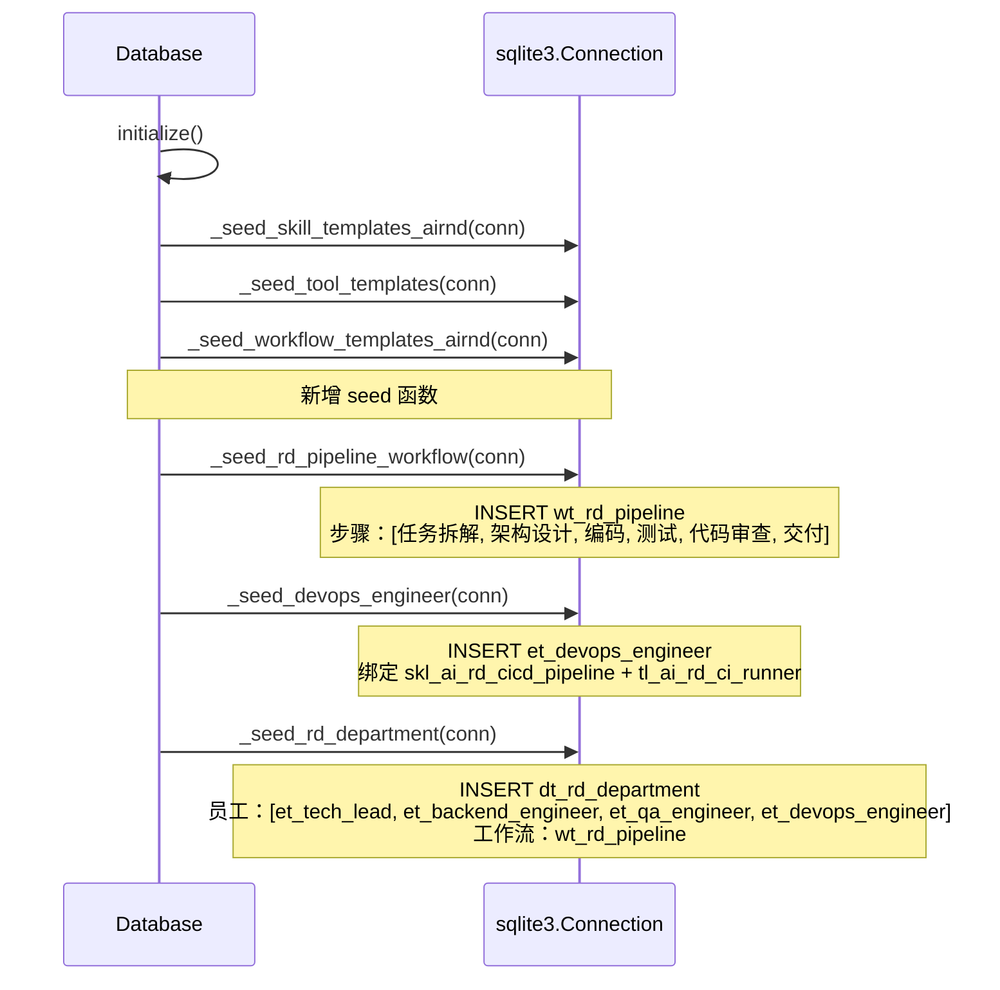
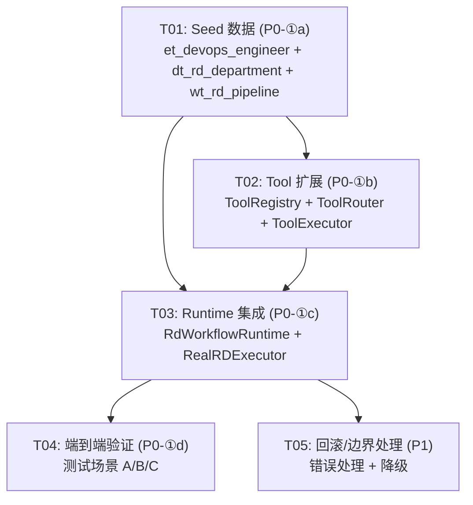

# System Design: P0-① RealRD 研发部工作流闭环

> **架构师**：高见远  
> **项目**：Curis Workspace  
> **分支**：`main`（backend）  
> **HEAD**：8f1b0676

---

## Part A: System Design

### 1. Implementation Approach

#### 核心难点分析

| 难点 | 说明 | 对策 |
|------|------|------|
| **RealRDExecutor 依赖注入** | RealRDExecutor 需要 `ModelGatewayAdapter`（`.execute()`）、`EvolutionEventLog`、`LocalRDToolset` 三个外部依赖，而 ToolExecutor 目前只注册纯 `Callable[[str], dict]` 函数 | 在 `main.py` 的 `create_app()` 中构造闭包捕获已就绪的 `default_executor` + `event_log`，注册为 `real_rd_executor_tool` 的执行函数 |
| **ToolRouter 路由规则扩展** | 当前 `tools_for_step` 只返回模型网关类工具名，无 code/modify 触发 real_rd 的路由 | 在 ToolRouter 新增 `software_rnd_tools_for_step` 方法，按 employee_role + action 判断是否走 real_rd_executor_tool |
| **步骤语义到 Issue Spec 的转换** | RdWorkflowRuntime 的 step 只传 string prompt，RealRDExecutor 需要结构化 `issue_spec`（target_files / test_command / instructions / allow_paths） | 在 `wt_rd_pipeline` 的 steps_json 中为每个步骤附加元数据（`expected_capability` 字段），RdWorkflowRuntime 解析为 `issue_spec` |
| **员工模板扩展（devops_engineer）** | 当前 6 个 et_* 中缺少 devops_engineer | 新增 `et_devops_engineer`，绑定 `skl_ai_rd_cicd_pipeline` + `tl_ai_rd_ci_runner`；新增 `dt_rd_department` 部门模板 |

#### 架构模式选择

- **分层路由**：RdWorkflowRuntime._execute_step 扩展第四分支（model_fn → connector_fn → real_rd_executor → scaffold），各分支职责单一
- **闭包注入**：不修改 RealRDExecutor 构造签名，通过 main.py 闭包捕获已创建依赖
- **幂等 seed**：所有 database.py seed 操作使用 `INSERT OR IGNORE` / `ON CONFLICT DO UPDATE`，可重复运行
- **最小变更**：不修改 `model_gateway.py` / `evolution_event_log.py` / `d1_gateway_client.py`；RealRDExecutor / LocalRDToolset 只扩展不重写

#### 框架选型

无新增框架。全部复用已有：
- `ModelGatewayAdapter` → 提供 `.execute()`（model 依赖）
- `EvolutionEventLog` → 事件审计
- `LocalRDToolset` → 读/写/测试/git 能力
- `ToolRegistry` / `ToolRouter` / `ToolExecutor` → 工具路由链

---

### 2. File List

| # | 文件路径 | 操作 | 说明 |
|---|---------|------|------|
| 1 | `backend/app/database.py` | **修改** | ① seed 新增 `et_devops_engineer` 员工模板；② seed 新增 `dt_rd_department` 部门模板（含 4 员工 + `wt_rd_pipeline`）；③ seed 新增 `wt_rd_pipeline` 工作流模板 |
| 2 | `backend/app/tool_registry.py` | **修改** | 新增 `register_real_rd_tool()` 方法，将 `real_rd_executor_tool` 注册到 tools 表；提供 `get_real_rd_tool_name()` 查询 |
| 3 | `backend/app/tool_router.py` | **修改** | 新增 `rd_tools_for_step(step, employee_role)` 方法：当 role 为 tech_lead/backend_engineer 且 step 含 "编码"、"修改"、"code" 时，返回 `["real_rd_executor_tool"]` 而非仅模型工具 |
| 4 | `backend/app/tool_executor.py` | **修改** | `execute_chain` 增加对 `real_rd_executor_tool` 的分发：当候选工具为 real_rd_executor_tool 时，调 RealRDExecutor.run() 而非模型文本生成 |
| 5 | `backend/app/rd_workflow_runtime.py` | **修改** | `__init__` 增加可选 `real_rd_executor` 参数；`_execute_step` 增加第四分支：当 step 含 "编码"/"code_change" 且 real_rd_executor 就绪时，调 RealRDExecutor.run() |
| 6 | `backend/app/main.py` | **修改** | `create_app()` 中：① 构造 RealRDExecutor 闭包并注册到 tool_functions；② 传给 RdWorkflowRuntime 的 `real_rd_executor` 参数；③ 修改 endpoint 支持 real_rd 所需额外参数 |
| 7 | `backend/tests/test_rd_workflow_real_rd.py` | **新增** | P0-①d 端到端验证：通过 `/api/workspace/rd-workflow/run` 触发 real_rd 分支，验证 RealRDExecutor.run() 被调用并回写结果 |

---

### 3. Data Structures and Interfaces



---

### 4. Program Call Flow

#### 4.1 主流程：API → RdWorkflowRuntime → RealRDExecutor



#### 4.2 ToolRouter 分发流程（P0-①b）



#### 4.3 Seed 数据流（P0-①a）



---

### 5. Anything UNCLEAR

1. **RealRDExecutor 在 RdWorkflowRuntime 中的 issue_spec 构造**：RealRDExecutor.run() 需要完整的 issue_spec（包含 target_files, test_command_id, test_command_argv, instructions, allow_paths）。当前 RdWorkflowRuntime 只拿到一个 text prompt。需要约定：wt_rd_pipeline 的 code_change 步骤在 steps_json 中附加 `code_change_spec` 元数据，或由 RdWorkflowRuntime 根据员工对应的 skill/tool 模板推断。

   **决策**：采用 `code_change_spec` 元数据附加在 wt_rd_pipeline 的 steps_json 中，由 RdWorkflowRuntime._build_issue_spec() 解析。若步骤没有显式 spec，则降级为 scaffold 输出（保持向后兼容）。

2. **devops_engineer 的 skill/tool 绑定**：当前 skl_ai_rd_* 已有 `skl_ai_rd_cicd_pipeline`，但 tl_ai_rd_* 工具中 `tl_ai_rd_ci_runner` 已存在。devops_engineer 的 default_skill 和 default_tool 据此绑定。

3. **wt_rd_pipeline 的 steps_json 格式**：采用与 `official.workflow.software_rnd_sop` 一致的对象数组格式（含 step_type, step_name, employee_role, required_capability_types 等字段），每个 code_change 步骤附加 `code_change_spec` 字典。

4. **测试 fixture 路径**：P0-①d 验证时，`allow_paths` 必须包含 `tools/real_rd_fixture/target_a.py` 和 `backend/tests/test_real_rd_fixture_a.py`。RealRDExecutor 的 workspace root 是仓库根，所以路径应为 `tools/real_rd_fixture/target_a.py` 相对路径。

---

## Part B: Task Decomposition

### 6. Required Packages

无新增包依赖。全部使用已有的标准库和项目依赖：
```
# 已有依赖（通过 backend/requirements.txt 或 pyproject.toml）
pydantic>=2.0.0
fastapi>=0.104.0
```

---

### 7. Task List (ordered by dependency)

| Task ID | Task Name | Source Files | Dependencies | Priority |
|---------|-----------|-------------|--------------|----------|
| **T01** | 项目基础设施 + Seed 数据（P0-①a） | `backend/app/database.py` | 无 | P0 |
| **T02** | ToolRegistry + ToolRouter + ToolExecutor 扩展（P0-①b） | `backend/app/tool_registry.py`, `backend/app/tool_router.py`, `backend/app/tool_executor.py`, `backend/app/main.py` | T01 | P0 |
| **T03** | RdWorkflowRuntime 集成 RealRDExecutor（P0-①c） | `backend/app/rd_workflow_runtime.py`, `backend/app/main.py` | T01, T02 | P0 |
| **T04** | 端到端验证 + 测试（P0-①d） | `backend/tests/test_rd_workflow_real_rd.py`, `backend/app/main.py` | T03 | P0 |
| **T05** | 回滚/补偿 + 边界错误处理 | `backend/app/rd_workflow_runtime.py`, `backend/app/tool_executor.py` | T03 | P1 |

#### 任务详细说明

##### T01: 项目基础设施 + Seed 数据（P0-①a）

- **源文件**: `backend/app/database.py`
- **依赖**: 无
- **优先级**: P0

**内容**:
1. 新增 `_seed_rd_pipeline_workflow(conn)` 方法：
   - 创建 `wt_rd_pipeline` 工作流模板（department_type='software_rnd', process_type='sequential'）
   - 步骤（带 `code_change_spec` 元数据）：
     ```json
     [
       {"step_order":1, "step_type":"task_breakdown", "step_name":"任务拆解", "employee_role":"tech_lead", "required_capability_types":["model"]},
       {"step_order":2, "step_type":"architecture_design", "step_name":"架构设计", "employee_role":"architect", "required_capability_types":["model"]},
       {"step_order":3, "step_type":"code_change", "step_name":"编码", "employee_role":"backend_engineer", "required_capability_types":["model","tool"],
        "code_change_spec":{
          "target_files": ["tools/real_rd_fixture/target_a.py"],
          "test_command_id": "test_fixture_a",
          "test_command_argv": ["backend/tests/test_real_rd_fixture_a.py"],
          "allow_paths": ["tools/real_rd_fixture/target_a.py", "backend/tests/test_real_rd_fixture_a.py"],
          "max_rounds": 3
        }},
       {"step_order":4, "step_type":"qa_verification", "step_name":"测试", "employee_role":"qa_engineer", "required_capability_types":["model","tool"]},
       {"step_order":5, "step_type":"code_review", "step_name":"代码审查", "employee_role":"tech_lead", "required_capability_types":["model"]},
       {"step_order":6, "step_type":"delivery", "step_name":"交付", "employee_role":"tech_lead", "required_capability_types":["model"]}
     ]
     ```

2. 新增 `_seed_devops_engineer(conn)` 方法：
   - INSERT `et_devops_engineer`（id='et_devops_engineer', slug='devops-engineer', role='devops_engineer', department_type='software_rnd'）
   - 绑定 `persona_ref='pt_direct_executor'`, `default_skill='skl_ai_rd_cicd_pipeline'`, `default_tool='tl_ai_rd_ci_runner'`
   - `default_instructions` 包含 DevOps 职责描述

3. 新增 `_seed_rd_department(conn)` 方法：
   - INSERT `dt_rd_department`（id='dt_rd_department', slug='rd-department', name='R&D 研发部门', department_type='software_rnd'）
   - `default_employee_templates_json` = `["et_tech_lead", "et_backend_engineer", "et_qa_engineer", "et_devops_engineer"]`
   - `default_workflow_template_id` = `'wt_rd_pipeline'`

4. 在 `initialize()` 中按顺序调用上述方法（确保在 `_seed_workflow_templates_airnd` 之后、`_seed_employee_templates_phase1` 之后）

**验收条件**：重新 initialize 后，`wt_rd_pipeline` / `et_devops_engineer` / `dt_rd_department` 均已持久化，可被查询。

##### T02: ToolRegistry + ToolRouter + ToolExecutor 扩展（P0-①b）

- **源文件**: `backend/app/tool_registry.py`, `backend/app/tool_router.py`, `backend/app/tool_executor.py`, `backend/app/main.py`
- **依赖**: T01（需要有 seed 数据支持）
- **优先级**: P0

**内容**:

**tool_registry.py**:
1. 新增 `register_real_rd_tool()` 方法：
   - INSERT OR REPLACE `real_rd_executor_tool` 到 tools 表
   - type='executor', description='RealRD 代码修改执行器'
2. 新增 `get_real_rd_tool_name()` → 返回 `"real_rd_executor_tool"`

**tool_router.py**:
1. 新增 `rd_tools_for_step(step, employee_role)` 方法：
   - 当 `employee_role in ('tech_lead', 'backend_engineer')` 且 step 的 step_type 为 `'code_change'` 或 step_name 含"编码"/"修改"时 → 返回 `["real_rd_executor_tool"]`
   - 否则返回 `tools_for_step(step)`

**tool_executor.py**:
1. `execute_chain` 中识别 `"real_rd_executor_tool"`：
   - 当候选工具为 `"real_rd_executor_tool"` 时，调 `tool_functions["real_rd_executor_tool"](initial_input)`，该函数返回的结构已包含 RealRDExecutor.run() 的全部输出字段
   - 无 fallback（real_rd_executor_tool 降级直接失败，不链式回退到模型文本生成）

**main.py**:
1. 在 `create_app()` 中构造 RealRDExecutor 闭包：
   ```python
   def execute_real_rd(issue_spec_str: str) -> dict[str, Any]:
       issue_spec = json.loads(issue_spec_str)
       from .real_rd_executor import RealRDExecutor
       executor = RealRDExecutor(
           model=default_executor,
           event_log=event_log,
           sandbox_mode="off",
       )
       result = executor.run(issue_spec)
       # 将 RealRDExecutor 结果映射为 ToolExecutor 兼容格式
       return {
           "output": json.dumps(result, ensure_ascii=False),
           "cost": result.get("estimated_cost", 0),
           "status": result.get("status", "failed"),
           "total_tokens": result.get("total_tokens", 0),
           "estimated_cost": result.get("estimated_cost", 0),
       }
   ```
2. 将 `execute_real_rd` 注册到 `tool_functions`：
   ```python
   functions = tool_functions or {
       ...
       "real_rd_executor_tool": execute_real_rd,
   }
   ```

**验收条件**：
- ToolRegistry 可注册并查询 `real_rd_executor_tool`
- ToolRouter.rd_tools_for_step 对 code_change 步骤返回 `["real_rd_executor_tool"]`
- ToolExecutor.execute_chain 能分发到 RealRDExecutor.run()

##### T03: RdWorkflowRuntime 集成 RealRDExecutor（P0-①c）

- **源文件**: `backend/app/rd_workflow_runtime.py`, `backend/app/main.py`
- **依赖**: T01, T02
- **优先级**: P0

**内容**:

**rd_workflow_runtime.py**:
1. `__init__` 增加 `real_rd_executor: Any | None = None` 参数
2. 新增 `_build_issue_spec(step_name, prompt, employee, step_meta)` 方法：
   - 从 `step_meta`（即 wt_* steps_json 中该步骤的完整 dict）提取 `code_change_spec`
   - 若无 code_change_spec，返回 `None`（表示不触发 real_rd）
   - 若存在，构造 issue_spec dict：
     ```python
     {
         "issue_id": f"rd-wf-{step_name}-{uuid.uuid4().hex[:8]}",
         "target_files": spec["target_files"],
         "test_command_id": spec["test_command_id"],
         "test_command_argv": spec["test_command_argv"],
         "instructions": prompt,
         "allow_paths": spec["allow_paths"],
         "max_rounds": spec.get("max_rounds", 3),
     }
     ```
3. `_execute_step` 新增第四分支（在 model_fn 分支之前，connector_fn 分支之后）：
   ```python
   # 4) real_rd 执行器（当注入且步骤含 code_change_spec 时）
   if self.real_rd_executor is not None:
       issue_spec = self._build_issue_spec(step_name, prompt, employee, step_meta)
       if issue_spec is not None:
           try:
               result = self.real_rd_executor.run(issue_spec)
               if result.get("status") == "succeeded":
                   return json.dumps({
                       "mode": "real_rd",
                       "status": "succeeded",
                       "diff_summary": result.get("diff_text", "")[:500],
                       "rounds": result.get("rounds"),
                       "files": result.get("files", []),
                       "total_tokens": result.get("total_tokens"),
                   }, ensure_ascii=False)
               else:
                   # RealRDExecutor 返回 failed → 将 workflow_run 标记为 failed
                   self._mark_run_failed(run_id, f"RealRD 执行失败：{result.get('status')}（{result.get('rounds')} 轮）")
                   return json.dumps({
                       "mode": "real_rd",
                       "status": "failed",
                       "reason": f"RealRD executor failed after {result.get('rounds')} rounds",
                   }, ensure_ascii=False)
           except Exception as e:
               self._mark_run_failed(run_id, f"RealRD 执行异常：{type(e).__name__}")
               return json.dumps({
                   "mode": "real_rd",
                   "status": "error",
                   "reason": f"RealRD executor error: {type(e).__name__}",
               }, ensure_ascii=False)
   ```
4. 新增 `_mark_run_failed(run_id, reason)` 方法：
   - UPDATE workflow_runs SET status='failed', final_report=reason
5. `_get_wt_steps` 返回类型从 `list[str]` 扩展为 `list[str | dict]`（兼容既有纯字符串步骤和新的对象数组步骤）

**main.py**:
1. 在 `run_rd_workflow_endpoint` 中，将 RealRDExecutor 传给 RdWorkflowRuntime：
   ```python
   real_rd_executor = RealRDExecutor(
       model=default_executor,
       event_log=event_log,
       sandbox_mode="off",
   )
   rt = RdWorkflowRuntime(
       database, event_log,
       model_fn=execute_model_gateway,
       real_rd_executor=real_rd_executor,
   )
   ```
2. endpoint 的 payload 增加可选 `issue_spec_override` 字段（允许调用方覆盖 issue_spec 的 target_files 等参数）

**验收条件**：
- 当 `wt_rd_pipeline` 的步骤含 `code_change_spec` 时，`_execute_step` 走 real_rd 分支
- RealRDExecutor 返回 succeeded → step_results 含 diff 摘要
- RealRDExecutor 返回 failed → workflow_run 标记为 failed，final_report 含错误详情

##### T04: 端到端验证 + 测试（P0-①d）

- **源文件**: `backend/tests/test_rd_workflow_real_rd.py`, `backend/app/main.py`
- **依赖**: T03
- **优先级**: P0

**内容**:
1. 创建 `backend/tests/test_rd_workflow_real_rd.py`，编写集成测试：

**测试场景 A（正向）**：
- 前置：确保 `tools/real_rd_fixture/target_a.py` 处于 BUG 态（BETA=2）
- 通过测试 API 调用：
  ```python
  client.post("/api/workspace/rd-workflow/run", json={
      "department_id": "dt_rd_department",
      "workflow_content_id": "wl_ai_rd_software_dev_sop",
      "prompt": "修正 target_a.py 中 BETA 常量从 2 改为 3",
      "task_id": "test-e2e-a",
  })
  ```
- 预期：workflow_run status = "completed"，至少有一个 step 的 output 含 `"mode": "real_rd"`，final_report 含 diff 摘要

**测试场景 B（失败路径）**：
- 构造一个无法修复的 issue_spec
- 预期：workflow_run status = "failed"，final_report 含错误原因

**测试场景 C（scaffold 降级）**：
- 不注入 real_rd_executor（传 None）
- 预期：workflow_run 仍完成，但所有步骤为 scaffold 输出

**验收条件**：
- 三个场景全部通过
- A 场景验证 RealRDExecutor.run() 被真实调用且结果写回 workflow_steps
- B 场景验证失败时 workflow_run 状态正确
- C 场景验证降级路径不中断

##### T05: 回滚/补偿 + 边界错误处理（P1）

- **源文件**: `backend/app/rd_workflow_runtime.py`, `backend/app/tool_executor.py`
- **依赖**: T03
- **优先级**: P1

**内容**:
1. `_execute_step` 在 real_rd 分支中对 `RealRDExecutorError` 的脱敏处理
2. 当 RealRDExecutor 抛出非预期异常时，确保 workflow_run 标记为 failed 且不泄漏异常细节
3. 当 `code_change_spec` 中 `target_files` 或 `allow_paths` 不存在/非法时，优雅降级为 scaffold 而非中断整个工作流
4. ToolExecutor.execute_chain 中对 real_rd_executor_tool 的 timeout 包装（防止 RealRDExecutor 超时挂起整个请求）

**验收条件**：
- 所有边界场景有明确的行为定义且可测试

---

### 8. Shared Knowledge

#### 跨文件约定

| 约定 | 说明 |
|------|------|
| **步骤类型命名** | `'code_change'` 用于标识需要真实代码修改的步骤；`'task_breakdown'` / `'architecture_design'` / `'qa_verification'` / `'code_review'` / `'delivery'` 用于非 real_rd 步骤 |
| **code_change_spec 结构** | 必须包含 `target_files` (list[str])、`test_command_id` (str)、`test_command_argv` (list[str])、`allow_paths` (list[str])；可选 `max_rounds` (int, 默认 3) |
| **Role → Tool 映射规则** | `tech_lead` 和 `backend_engineer` → 可路由到 `real_rd_executor_tool`；其余角色保持原有路由 |
| **RealRDExecutor 依赖注入方式** | 在 `main.py` 的 `create_app()` 中通过闭包捕获 `default_executor`（ModelGatewayAdapter）和 `event_log`（EvolutionEventLog），在 `/api/workspace/rd-workflow/run` endpoint 中构造 RealRDExecutor 实例 |
| **issue_spec → prompt 映射** | RealRDExecutor 的 `instructions` 字段 = RdWorkflowRuntime 的 step prompt（含任务描述 + 已完成步骤上下文） |
| **结果回写格式** | `step_results.result` 写入 JSON 字符串，包含 `mode`（"real_rd"/"model"/"scaffold"）、`status`、`diff_summary`（仅 real_rd 模式）等字段 |
| **API 响应格式** | 所有响应使用 `{code, data, message}` 格式（与既有 `run_rd_workflow_endpoint` 一致） |
| **种子数据幂等** | 全部使用 `INSERT OR IGNORE` 或 `ON CONFLICT DO UPDATE`，可重复初始化 |

#### RealRDExecutor 依赖注入细节

```
RealRDExecutor(
    model=default_executor,           # ModelGatewayAdapter 实例（main.py 中已创建）
    event_log=event_log,              # EvolutionEventLog 实例（main.py 中已创建）
    toolset_cls=LocalRDToolset,       # 默认值，可不传
    sandbox_mode="off",               # 本地测试用 OFF，生产用 AUTO/ENFORCE
)
```

注意：
- `default_executor` 必须是具有 `.execute(prompt)` 方法的对象，返回 `{output, total_tokens, estimated_cost, model_gateway_id, model_name}`
- `RealRDExecutor` 的 `model.execute(prompt)` 调用的是 `ModelGatewayAdapter.execute(prompt)`，返回完整 response dict
- `toolset_cls` 默认为 `LocalRDToolset`，可在测试中注入 mock 子类

#### API 端点扩展

`POST /api/workspace/rd-workflow/run` 请求体扩展字段：

```json
{
  "department_id": "dt_rd_department",
  "workflow_content_id": "wl_ai_rd_software_dev_sop",
  "prompt": "修正常量 BETA",
  "task_id": "",
  "company_id": null,
  "issue_spec_override": {
    "target_files": ["tools/real_rd_fixture/target_a.py"],
    "allow_paths": ["tools/real_rd_fixture"],
    "test_command_argv": ["backend/tests/test_real_rd_fixture_a.py"]
  }
}
```

- `issue_spec_override` 可选，提供后覆盖 `code_change_spec` 中的对应字段

---

### 9. Task Dependency Graph



---

### 10. P0-①d 验证方案

#### 测试场景与预期证据

| 场景 | 步骤 | 预期证据 | 通过条件 |
|------|------|---------|---------|
| **A: 正向** | ① 确保 `tools/real_rd_fixture/target_a.py` BETA=2（BUG 态）；② 创建 dt_rd_department 实例和 employee 实例；③ POST `/api/workspace/rd-workflow/run` 传入 wt_rd_pipeline + target_a 指令 | ① HTTP 201；② `workflow_run.status == "completed"`；③ 编码步骤的 `step_results.result` 含 `"mode": "real_rd"`；④ `final_report` 含 diff 摘要；⑤ `target_a.py` 的 BETA 已变为 3 | ①②③④⑤ 全部满足 |
| **B: 失败路径** | ① 构造一个不可修复的 prompt（如要求删除不存在的函数）；② POST 调用 | ① `workflow_run.status == "failed"`；② `final_report` 含 "RealRD 执行失败" 字样 | ①② 满足 |
| **C: 降级路径** | ① 不注入 real_rd_executor（传 None）；② 正常调用 | ① `workflow_run.status == "completed"`；② 所有步骤 output 不含 `"mode": "real_rd"`；③ 编码步骤为 scaffold 输出 | ①②③ 满足 |

#### 回滚条件

若 A 场景在 3 次重试内无法通过：
1. 检查 RealRDExecutor 是否成功调用了 ModelGatewayAdapter.execute()
2. 检查 issue_spec 的 allow_paths 是否包含 fixture 文件
3. 检查 workflow 步骤的 `code_change_spec` 是否被 RdWorkflowRuntime 正确解析

---

### 11. 待明确事项 / 风险

| # | 事项 | 影响 | 建议决策 |
|---|------|------|---------|
| 1 | **`wt_rd_pipeline` 的 seed 时机**：当前 `_seed_workflow_templates_airnd` 在 V2 阶段，`_seed_workflow_runtime_contract` 在 Phase-1。新方法应放哪个位置？ | 执行顺序影响 seed 是否覆盖既有行 | 放在 `_seed_workflow_templates_airnd` 之后，作为独立 `_seed_rd_pipeline_workflow` 方法，在 `initialize()` 末尾调用 |
| 2 | **RealRDExecutor 的 model 参数兼容性**：`default_executor` 是 `ModelGatewayAdapter`，其 `.execute(prompt)` 返回 `dict[str, Any]` 含 `output`、`total_tokens` 等。RealRDExecutor 期望的也是同一结构。但在 `execute_model_gateway` 闭包中，返回值被 `ToolExecutor.execute` 进一步包装。需要确保 `RealRDExecutor.run()` 中 `self.model.execute(prompt)` 拿到的是原始 gateway 响应。 | 响应结构不对齐会导致 RealRDExecutor 解析失败 | RealRDExecutor 直接接收 `default_executor`（ModelGatewayAdapter 实例），不走 `execute_model_gateway` 闭包 |
| 3 | **`_get_wt_steps` 返回类型扩展**：当前返回 `list[str]`，但 `wt_rd_pipeline` 的 steps_json 是对象数组 `list[dict]`。已有代码已兼容两种格式（见 `_get_wt_steps` 的 `isinstance(item, dict)` 分支），但 `_execute_step` 后续需要传递 step 元数据。 | 影响 _execute_step 签名和 _build_issue_spec 入参 | `_execute_step` 增加可选 `step_meta` 参数（type dict），`_get_wt_steps` 返回 list[dict]（每个 dict 含 step_name + 可选 code_change_spec） |
| 4 | **LocalRDToolset 的 workspace root 推导**：`RealRDExecutor._build_toolsets` 使用 `_resolve_workspace_root()`，它从 `backend/app/local_rd_toolset.py` 向上推导 2 级到仓库根。确保 fixture 文件在推导根下可用。 | 路径偏差导致工具集构造失败 | 在测试前验证 `_resolve_workspace_root()` 返回的是仓库根（含 tools/ 和 backend/） |
| 5 | **并发安全**：RealRDExecutor 的 `_claim_once` 使用 `begin immediate` 占锁。当两个 worklow step 同时触发 real_rd 时，第二个会因 `issue_already_running` 失败。在 RdWorkflowRuntime 层面是否需要任务级锁？ | 同一次 run 内多个步骤不会并行；不同 run 之间是独立的 issue_id | 无需额外锁。同一 issue_id 重入被 RealRDExecutor 自身防护 |
| 6 | **测试后清理**：正向场景 A 测试后，`target_a.py` 的 BETA 已变为 3（已修复态）。后续测试需要恢复到 BUG 态。 | 测试顺序依赖 | 测试夹具使用 `git checkout` 恢复 BUG 态，或在 setup/teardown 中管理 |
