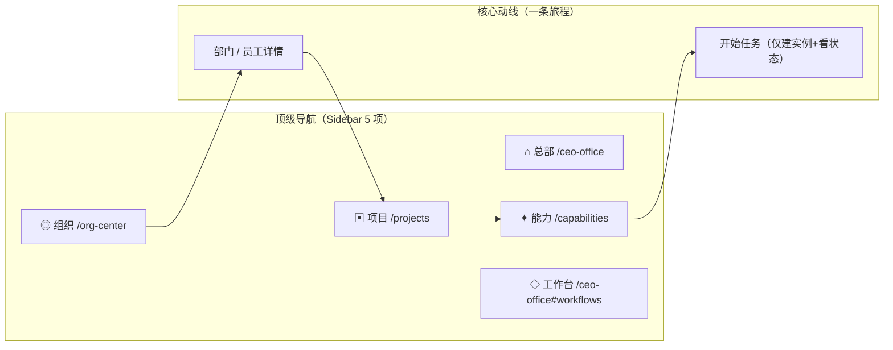
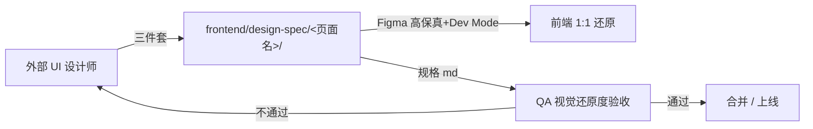
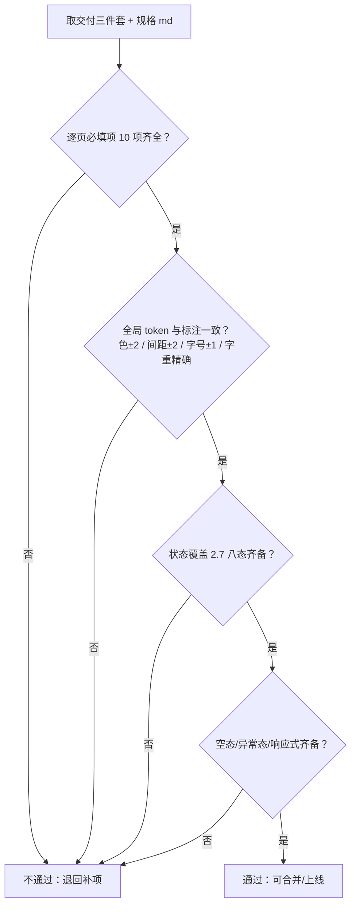

# UI 规范交付模板

> **本文档性质：外部 UI 设计师交付契约 / 前端 1:1 还原标尺 / QA 视觉还原度验收依据。**
> 任何一页 UI 缺少「逐页必填交付项」（第 3 节）中任意一项，即判定为**不合格交付**，前端与 QA 有权退回。

---

## 目录

1. [文档性质与适用范围](#0-文档性质与适用范围)
2. [交付三件套（每页必须交付）](#1-交付三件套每页必须交付)
3. [全局规范（Global Spec）](#2-全局规范global-spec)
   - 2.1 [暗色主题 Token 色板](#21-暗色主题-token-色板取自-ceo--与-themejs)
   - 2.2 [字号层级 Type Scale](#22-字号层级-type-scale)
   - 2.3 [间距系统 Spacing（8pt 基准）](#23-间距系统-spacing8pt-基准)
   - 2.4 [圆角 / 阴影 / 层级](#24-圆角--阴影--层级)
   - 2.5 [共享 Sidebar 5 项导航视觉基准](#25-共享-sidebar-5-项导航视觉基准)
   - 2.6 [通用组件视觉基准](#26-通用组件视觉基准)
   - 2.7 [组件状态规范总表](#27-组件状态规范总表)
4. [逐页交付清单（契约骨架 + 各页填写）](#3-逐页交付清单契约骨架--各页填写)
   - 3.0 [逐页必填交付项（验收门槛）](#30-逐页必填交付项验收门槛)
   - 3.1 [`/ceo-office` 总部 / 工作台](#31-ceo-office-总部--工作台)
   - 3.2 [`/org-center` 组织中心](#32-org-center-组织中心)
   - 3.3 [`/org-center/dept/[deptId]` 部门详情](#33-org-centerdeptdeptid-部门详情)
   - 3.4 [`/org-center/emp/[empId]` 员工详情](#34-org-centerempempid-员工详情)
   - 3.5 [`/projects` 项目中心](#35-projects-项目中心)
   - 3.6 [`/capabilities` 能力中心（只读目录）](#36-capabilities-能力中心只读目录)
   - 3.7 [通用组件 / 抽屉](#37-通用组件--抽屉)
5. [QA 视觉还原度验收标准](#4-qa-视觉还原度验收标准)
6. [红线节（禁止项）](#5-红线节禁止项)
7. [交付物归档路径约定](#6-交付物归档路径约定)
8. [待确认 / 开放问题](#7-待确认--开放问题)

---

## 0. 文档性质与适用范围

| 项 | 说明 |
|---|---|
| 适用范围 | Curis 一人公司自动任务与工作流系统，前端 `frontend/`（Next.js App Router + 纯 JS + Tailwind 3.4 + ceo-office 暗色主题） |
| 适用对象 | **外部 UI 设计师**（交付方）、前端工程师（还原方）、QA（验收方） |
| 强制力 | 设计-first 流程的硬前置。本模板是外部 UI 与内部的「交付契约」，缺项即退。 |
| 设计语言来源 | 全部视觉取值**仅**取自 `frontend/app/globals.css` 的 `--ceo-*` 变量与 `frontend/lib/theme.js` 的 `STYLE` / `COLORS`；**禁止引入任何新颜色、新字体、新阴影**。 |
| 关联事实 | 已确认 IA（顶级导航 5 项）、已确认动线（组织 → 部门/员工 → 项目 → 能力 → 任务）、ADR-0017 后置红线（见第 5 节）。 |
| 语言 | 简体中文；Figma 与仓库内的规格 md 同语言。 |

**顶部导航 IA（已确认，5 项）与核心动线（已确认，一条整体旅程）：**

> 注：「工作台」不是独立路由，是 `/ceo-office#workflows` 锚点（同一页内的工作流实例区块），因此**无独立设计页**，其视觉随 `/ceo-office` 一并交付。

---

## 1. 交付三件套（每页必须交付）

外部 UI 针对**每一个**被覆盖的页面/组件（第 3 节清单），必须同时产出以下三件套，缺一不可：

| # | 交付物 | 形式 | 用途 | 不合格判定 |
|---|---|---|---|---|
| 1 | **Figma 高保真稿** | Figma 文件（含基础交互态） | 视觉与交互事实源 | 缺 hover / 点击 / 抽屉展开 / 空态 / 错误态任一态即为不合格 |
| 2 | **Figma Dev Mode 标注** | Figma Dev Mode 导出 | 前端可直接读：尺寸 / 颜色 / 间距 / 字号 | 关键标注（色值、间距、字号、字重）缺失或不与规格 md 一致即为不合格 |
| 3 | **规格 markdown** | 文本文件，进仓库版本管理 | 1:1 还原与验收的「标尺」，可 diff | 未提交 / 缺逐页必填项（第 3.0 节）即为不合格 |

**交付与回流关系：**

> 三件套必须**相互一致**：Dev Mode 标注的色值/间距/字号 = 规格 md 的取值 = Figma 高保真稿的呈现。出现三处不一致时，以本模板全局规范（第 2 节）的取值为仲裁基准。

---

## 2. 全局规范（Global Spec）

> 本节是所有页面的统一地基。各页规格 md 中，**不得**重定义全局已规定的 token；只能在「页面特有」位置补充本页独有的局部取值（且仍须取自 `--ceo-*` / `STYLE`）。

### 2.1 暗色主题 Token 色板（取自 `--ceo-*` 与 theme.js）

> ⚠️ **红色存在两处取值**（见第 7 节开放问题 #1）：按钮类危险操作沿用 `STYLE.btnDanger` 的 `#e0544e`，错误文字/inline 沿用 `--ceo-red` 的 `#ff8f84`。外部 UI 必须按「用途」而非「数值」套用下表，保持现有分工。

| 语义 Token | CSS 变量 / JS 常量 | 取值 | 用途 | 来源 |
|---|---|---|---|---|
| 主色 / 成功 / Primary | `--ceo-green` / `COLORS.green` / `STYLE.btnPrimary.borderColor` | `#78f0c5` | 主按钮填充、主文字强调、success 状态、LIVE/状态 pill、active 信号点 | globals / theme.js |
| 次强调 / 焦点 | `--ceo-cyan` / `COLORS.cyan` | `#75d9e6` | 链接、焦点 outline、提示强调、orbit signal | globals / theme.js |
| 背景（整页最底） | （shell 底） | `#071012` | 整页背景（叠加两道径向渐变光晕） | globals `.ceo-office-shell` |
| 面板 / 区块背景 | `--ceo-panel` | `rgba(14,29,31,0.72)` | `.ceo-organization` 等区块面板 | globals |
| 卡片软背景 | `COLORS.panelSoft` | `rgba(18,37,39,0.6)` | `STYLE.card` 卡片底 | theme.js |
| 卡片 / 抽屉实心底 | `COLORS.bg` / `COLORS.panel` | `#0c1d1b` / `#122527` | drawer 底 / input·select 底 | theme.js |
| 边框 / 分隔线（弱） | `--ceo-line` | `rgba(166,217,205,0.14)` | 所有 border、分隔线、chip 边框 | globals |
| 边框（抽屉/输入，略亮） | （theme.js line） | `rgba(117,217,230,0.12 ~ 0.2)` | drawer / input / select 边框 | theme.js `STYLE` |
| 文字主 | `--ceo-ink` / `COLORS.ink` | `#eef7f4` / `#edf7f4` | 标题、正文主色 | globals / theme.js |
| 文字次 | `--ceo-muted` / `COLORS.muted` | `#8fa7a3` / `#6e8c87` | 次要文字、kicker、meta、tag | globals / theme.js |
| 表单标签 | （formLabel color） | `#b6cdc8` | `STYLE.formLabel` 标签文字 | theme.js |
| 警告 / Waiting | `--ceo-amber` / `COLORS.amber` | `#efc775` | warning 状态、waiting 信号点 | globals / theme.js |
| 危险（按钮面/操作） | `COLORS.red` / `STYLE.btnDanger` | `#e0544e` | 删除按钮、危险操作确认 | theme.js |
| 危险（错误文字） | `--ceo-red` | `#ff8f84` | 错误文案、inline error、解绑 × | globals |

**状态色映射（statusClass，必须复用，不得自建）：**

| 状态语义 | 触发值 | 信号色 | 文案(`statusLabel`) |
|---|---|---|---|
| active（正常/成功） | `active` / `completed` | green `#78f0c5` | 已启用 / 已完成 |
| risk（风险/失败） | `blocked` / `failed` / `disabled` | red `#ff8f84` 或 `#e0544e`* | 已阻塞 / 已停用 |
| waiting（等待/草稿） | `planned` / `draft` / `idle` | amber `#efc775` | 计划中 / 草稿 / 空闲中 |
| other（其他） | 其余 | muted `#8fa7a3` | 原值大写 |

\* risk 信号点在部门行用 `--ceo-red #ff8f84`；删除类操作按钮用 `#e0544e`（见上表分工）。

**角色 / 部门类型显示必须走映射**（不得直出原始 key）：`roleLabel()`（架构师、后端工程师…）、`deptTypeLabel()`（研发、内容增长、AI 研发）。

### 2.2 字号层级 Type Scale

字体族（**禁止引入 web font**）：`Arial, "PingFang SC", "Microsoft YaHei", sans-serif`。

| 层级 | 字号 | 行高 | 字重 | 字色 | 用途 | 来源 class |
|---|---|---|---|---|---|---|
| 标题 1（Hero H1） | `clamp(34px, 4.6vw, 66px)` | 1.06 | 500 | `#f3faf8` | `/ceo-office` 主标题 | `.ceo-hero h1` |
| 标题 2（Section H2） | `clamp(24px, 2.4vw, 38px)` | ~1.1 | 500 | `#edf7f4` | 各区块标题、抽屉标题 | `.ceo-section-heading h2` |
| 区块子标题 H3 | 20px | — | 500/600 | `#edf7f4` | 抽屉内标题、确认弹窗标题 | 内联 |
| 卡片标题 | 14–15px | — | 600 | `#edf7f4` / `#dceae7` | 卡片主标题 | `.ceo-employee-card` / 部门行 |
| 正文 / 描述 | 13–15px | 1.7–1.8 | 400 | `#cfe3df` / `#c4d5d1` | 说明、briefing、goal/description | `.ceo-briefing-copy` |
| 辅助 / 标签 | 9–11px | — | 700–800 | `#6e8c87` / `#8fa7a3` | kicker、meta、tag、role | `.ceo-kicker` / `.ceo-emp-meta` |
| 按钮文字 | 10–12px | — | 800 | 见按钮规范 | 主/次/危险按钮 | `.ceo-primary-action` |
| 表单标签 | 12px | — | 700 | `#b6cdc8` | `STYLE.formLabel` | theme.js |
| 输入文字 | 14px | — | 400 | `#edf7f4` | input / select / textarea | `STYLE.input` |

### 2.3 间距系统 Spacing（8pt 基准）

基准单位 **8px**。常用取值（来自现有 ceo-* 间距与 `STYLE`）：

| 取值 | 用途 | 取值 | 用途 |
|---|---|---|---|
| 4px | 标签内 gap、焦点环 offset | 24px | 区块间垂直间距、抽屉内按钮组上间距 |
| 6px | 输入 marginTop、tag 内边距 | 28px | 部门组下间距、hero 上下 |
| 8px | 卡片 action gap、chip 内边距 | 30px | `.ceo-organization` / `.ceo-project-panel` 内边距 |
| 10px | status pill 内边距、meta gap | 32px | drawer 内边距、btnSmall 横向内边距 |
| 12px | 小 padding、hero 行内 gap | 54px | `.ceo-operating-grid` 上下 |
| 14px | 卡片网格 gap、卡片内边距 14–16 | 64px | topbar 高度、loading/error 页 padding-top |
| 16px | 标准 padding（admin 参考）、卡片内边距 | 5vw | 内容区左右 padding（桌面） |

- 内容区（`.ceo-office-content`）左右 padding：桌面 `5vw`；≤1024px `4vw`；≤720px `20px`。
- 卡片网格：`repeat(auto-fill, minmax(260–280px, 1fr))`，gap `14px`。
- 抽屉内边距固定 `32px`；formLabel 与控件间距 `6px`；formLabel 下间距 `20px`。

### 2.4 圆角 / 阴影 / 层级

| 类别 | 取值 | 用途 |
|---|---|---|
| 圆角-按钮 | 4px | `.ceo-primary-action` / input |
| 圆角-卡片 | 6px | `STYLE.card`、`.ceo-pkg`、chip |
| 圆角-抽屉 | 8px | `STYLE.drawer` |
| 圆角-员工卡 | 10px | `.ceo-employee-card` |
| 圆角-胶囊 | 999px | `.ceo-status-pill` / `.ceo-pkg` |
| 圆角-tag | 3px | `.ceo-emp-tag` |
| 焦点环 | outline `2px solid #75d9e6`，offset `4px` + `box-shadow 0 0 0 5px rgba(117,217,230,0.14)` | 所有可聚焦元素 `:focus-visible` |
| 阴影（隐性） | 仅光晕（`box-shadow` 内发光，无实体投影） | orbit / `.ceo-mark` / 焦点；**不得**新增 drop-shadow |
| 层级 z-index | Sidebar `10`；overlay/drawer `1000` | 全局统一 |

### 2.5 共享 Sidebar 5 项导航视觉基准

- 容器：宽 `76px`（桌面），`position: sticky; top:0; height:100vh`，右 border `1px var(--ceo-line)`，底 `rgba(5,13,15,0.9)` + `backdrop-filter: blur(16px)`。
- 顶部 `.ceo-mark`：40×40，圆角 13px，绿边 `rgba(120,240,197,0.55)`，字 `C`（绿，`font-weight:900`），内发光。
- 导航项：图标 `font-size:19px line-height:1`、标签 `font-size:9px letter-spacing:0.12em`。
- 颜色：**未激活 `#607b78`**；**激活 `--ceo-green`** + 左侧 `2px` 绿条带 glow（`box-shadow 0 0 12px`）。
- 5 项（icon / label / href）：`⌂ 总部 /ceo-office`、`◎ 组织 /org-center`、`▣ 项目 /projects`、`✦ 能力 /capabilities`、`◇ 工作台 /ceo-office#workflows`。
- 底部 `.ceo-sidebar-foot`：`AI`，`font-size:9px letter-spacing:0.2em`，色 `#607b78`。

> 响应式：≤720px 时 Sidebar 固定到底部、高 64px、横向排列（见第 7 节开放问题 #2 关于 5 项与 `repeat(4,1fr)` 的溢出风险）。

### 2.6 通用组件视觉基准

| 组件 | 视觉基准（必对齐） |
|---|---|
| 按钮 · 主 (`ceo-primary-action`) | 绿填充 `#78f0c5`、字 `#071713`、`border:1px solid #78f0c5`、圆角 4px、min-height 42px、padding `0 18px`、`font-size:12px weight:800` |
| 按钮 · 次 (`ceo-secondary-action`) | 透明底、边 `1px var(--ceo-line)`、字 `#bbcdca`、圆角 4px |
| 按钮 · 小 (`STYLE.btnSmall`) | padding `4px 12px`、font-size 10、min-height 28 |
| 按钮 · 危险 (`STYLE.btnDanger`) | 透明底、字+边 `#e0544e` |
| 按钮 · 危险主 (`STYLE.btnDangerPrimary`) | 填充 `#e0544e`、字 `#071713` |
| 卡片 (`STYLE.card`) | 底 `rgba(18,37,39,0.6)`、边 `1px rgba(117,217,230,0.1)`、圆角 6、padding `14–16px` |
| 抽屉 (`STYLE.drawer`) | 底 `#0c1d1b`、边 `1px rgba(117,217,230,0.2)`、圆角 8、min-width 400 / max-width 560、max-height 90vh、padding 32 |
| 遮罩 (`STYLE.overlay`) | `fixed inset:0 z:1000`、底 `rgba(0,0,0,0.7)`、flex 居中、padding `5vw` |
| 表单输入 (`STYLE.input/.textarea/.select`) | 底 `#122527`、边 `1px rgba(117,217,230,0.15)`、圆角 4、padding `10px 12px`、`font-size:14`、字 `#edf7f4`；focus → 边 cyan（见 2.4） |
| 表单标签 (`STYLE.formLabel`) | 块、`margin-bottom:20`、字 `#b6cdc8`、`font-size:12 weight:700 letter-spacing:0.05em` |
| 状态 pill (`ceo-status-pill`) | 圆角 999、边 `1px rgba(120,240,197,0.25)`、字 green、font-size 9 `letter-spacing:0.08em`；非 active 降透明度 + 灰 `#6e8c87` |
| 能力 chip (绑定面板) | 内联 flex、padding `4px 8px`、边 `1px var(--ceo-line)`、圆角 6、字 `#aec6c2` font-size 10；内 `strong` 绿；解绑 × 红 |
| 空态 (`.ceo-empty-copy`) | 字 `var(--ceo-muted)`、margin `30px 0 0`、左对齐；用语见各页 |
| 错误 (`ceo-inline-error`) | 字 `#d7aaa5`/红、font-size 10、`!` 圆形描边图标 |

### 2.7 组件状态规范总表

> 所有可交互组件必须覆盖以下状态；Figma 高保真稿须给出每个状态的视觉，Dev Mode 须标注差异。

| 状态 | 视觉规则 | 适用 |
|---|---|---|
| 默认 default | 按 2.6 基准 | 全部 |
| hover | 次按钮：底微亮 `rgba(255,255,255,0.02)`、边转亮；卡片：边转 `--ceo-line-strong` 等价（亮 0.2） | 按钮、卡片、导航项、链接 |
| active / pressed | 主按钮：填充略深；导航项：绿条+辉光 | 按钮、导航 |
| focus / focus-visible | outline `2px #75d9e6` offset 4 + ring `0 0 0 5px rgba(117,217,230,0.14)` | 全部可聚焦 |
| disabled | `opacity:0.45` + `cursor:not-allowed`（admin 参考）+ 文字降饱和 | 按钮、select、解绑× |
| loading | 文字变「保存中…/启动中…/删除中…」、禁用交互、按钮禁用态 | 表单提交、开始任务 |
| error | 文字/边框转红 `#ff8f84`/`#e0544e`、inline error 文案出现 | 表单校验、网络失败、绑定失败 |
| empty | 走 `.ceo-empty-copy` 空态 | 列表/目录无数据 |

---

## 3. 逐页交付清单（契约骨架 + 各页填写）

### 3.0 逐页必填交付项（验收门槛）

> 每个被覆盖页面/组件，其规格 md **必须**逐条包含以下 10 项。UI 缺任意一项 = 不合格交付。

| # | 必填项 | 合格标准（缺即退） |
|---|---|---|
| 1 | 页面标识 + 路由 + 一句话用途 | 明确 route（含动态段 `[deptId]`/`[empId]`）+ 一句话定位 |
| 2 | 布局网格 | 栅格/断点/容器最大宽度/内容区宽度（参照全局 2.3） |
| 3 | 配色 token 表 | 引用全局 token；局部取值仍取自 `--ceo-*`/`STYLE` |
| 4 | 间距系统 | 引用全局 8pt；列出本页特有的内外间距 |
| 5 | 字号层级 | 引用全局 type scale；列出本页特有的字号/字重 |
| 6 | 组件清单 + 状态规范 | 列出本页所有组件，每个组件覆盖 2.7 八态 |
| 7 | 空态设计 | 文案 + 视觉（`.ceo-empty-copy` 风格） |
| 8 | 异常态/错误态 | 网络失败、表单校验错、删除二次确认 overlay |
| 9 | 交互说明 | 点击/跳转/抽屉/弹层/二级导航 `?section=` 行为 |
| 10 | 响应式/适配说明 | 桌面/平板(≤1024)/手机(≤720) 三档表现 |

### 3.1 `/ceo-office` 总部 / 工作台

| 必填项 | 本页内容 |
|---|---|
| 标识/路由/用途 | 路由 `/ceo-office`；用途：CEO 经营总部总览（部门/员工/工作流实例/公司包实时事实）+ 工作台（工作流实例区块 `#workflows` 锚点）。 |
| 布局网格 | `ceo-office-shell` = `76px 侧栏 + minmax(0,1fr) 内容`；内容 padding `5vw`。Hero `grid 1.25fr/0.75fr`；operating-grid `1.5fr/0.5fr`。容器无硬上限（流式 + 5vw 留白）。 |
| 配色 token | 全局；Hero 强调绿、orbit 用 cyan/green 光晕。 |
| 间距 | Hero padding `64px 0 54px` 下 border；section 间距 54；org-totals gap 28。 |
| 字号 | Hero H1 `clamp(34,4.6vw,66)`；section H2 `clamp(24,2.4vw,38)`；kicker 10/800/0.24em；briefing 15/1.8。 |
| 组件清单 + 状态 | Topbar（wordmark/office-name/meta/员工目录 secondary-action/avatar-mini）、Hero（kicker/company-line/live-dot/status-pill/h1/strategy-label/briefing/packages/primary-actions）、Orbit（ring/core/signal，纯装饰 aria-hidden）、部门区块（department-grid/row/signal/status-pill）、员工区块（employee-card：name/role/meta/status）、工作流区块（workflow-row/name/id/status pill）、Footer。各组件状态见 2.7。 |
| 空态 | 部门/员工/工作流各自 `ceo-empty-copy`（「当前尚无…事实」）。 |
| 异常态 | 整页 loading 态（「正在读取经营事实…」）、error 态（「经营数据读取失败」+ 错误文案 + 「重新读取」primary-action）；网络失败统一 `.ceo-inline-error` 风格。 |
| 交互 | 点击 Topbar「员工目录」→ `/org-center?section=employees`；部门/员工/工作流卡片当前为只读展示（无跳转）；工作台为页内 `#workflows` 锚点滚动。 |
| 响应式 | ≤1024：hero `1fr/0.55fr`、operating `1fr/280px`、department-row 列收敛；≤720：侧栏转底栏、orbit 隐藏、hero 单列、网格单列。 |

### 3.2 `/org-center` 组织中心

| 必填项 | 本页内容 |
|---|---|
| 标识/路由/用途 | 路由 `/org-center`；用途：组织总览 + 部门 CRUD + 员工 CRUD，二级导航（部门/员工）经 `?section=` 切换（默认 `departments`）。 |
| 布局网格 | 同全局 shell；内容区标准。二级导航为横向 tab 行（`border-bottom:1px var(--ceo-line)`，激活 2px 绿下划线）。卡片网格 `repeat(auto-fill,minmax(260px,1fr))` gap 14。 |
| 配色 token | 全局；tab 激活绿 `#78f0c5`、未激活 muted `#8fa7a3`。 |
| 间距 | 二级导航 margin-top 16；区块 margin-top 24；卡片 gap 14；「+新增」虚线卡 min-height 96。 |
| 字号 | tab `font-size:13 weight:700 letter-spacing:0.04em`；卡片标题 15/600；meta 11、role 11。 |
| 组件清单 + 状态 | Topbar + 二级导航 tab（部门/员工）+ 部门卡片（name/status-pill/deptTypeLabel·id/卡片操作：详情/编辑/删除）+ 员工卡片（name/roleLabel/status·id/操作）+ 「+新增部门」「+新增员工」虚线卡 + 部门/员工表单抽屉 + 删除二次确认 overlay + inline-error。状态见 2.7。 |
| 空态 | 无部门/无员工时列表区空；「+新增」引导卡常驻。 |
| 异常态 | loading 态（StatePanel「正在读取组织中心…」）、error 态（「组织中心读取失败」+ 重试）；保存失败 inline-error；删除 422 非空守卫提示。 |
| 交互 | tab 切换 → `router.push('/org-center?section=xxx')`；卡片「详情」→ `/org-center/dept/[id]` 或 `/org-center/emp/[id]`；「编辑」开 DepartmentFormDrawer/EmployeeFormDrawer；「删除」开确认 overlay；「+新增」开 create 抽屉。 |
| 响应式 | 同全局；卡片网格随宽度自适应换行；≤720 侧栏底栏。 |

### 3.3 `/org-center/dept/[deptId]` 部门详情

| 必填项 | 本页内容 |
|---|---|
| 标识/路由/用途 | 路由 `/org-center/dept/[deptId]`；用途：单部门信息 + 项目列表（按 `department_id` 过滤）+ 归属员工（按 affiliations 过滤）+ 内嵌新增/编辑项目。 |
| 布局网格 | 同全局 shell；Topbar 带「← 组织中心」返回链；三个区块（部门信息 / 项目列表 / 归属员工）。卡片网格 `minmax(260px,1fr)`。 |
| 配色 token | 全局；status-pill 非 active 降透明+灰。 |
| 间距 | 区块 margin-top 16/24；项目卡片 gap 14。 |
| 字号 | 部门名 H2；kicker 10/800；项目卡片标题 15/600；meta 11。 |
| 组件清单 + 状态 | Topbar（返回/编辑/删除）+ 部门信息区块（name/status-pill/deptTypeLabel·id·mission）+ 项目列表区块（项目卡：name/status-pill/负责人/编辑/删除/StartTaskButton，「+新增项目」）+ 归属员工区块（员工卡：name/roleLabel/status·id，链接到 emp 详情）+ ProjectFormDrawer（内嵌）+ DepartmentFormDrawer + 删除确认 overlay。 |
| 空态 | 「该部门暂无项目。」「该部门暂无归属员工（按 affiliations 过滤）。」 |
| 异常态 | loading（「正在读取部门详情…」）、error/not-found（「部门不存在或读取失败」+ 返回总览 primary-action）；保存/删除失败 inline-error。 |
| 交互 | 「+新增项目」→ ProjectFormDrawer(create，预置 `departmentId`，负责人候选=本部门归属员工兜底全量)；项目「编辑」→ edit 抽屉；「删除」→ 确认 overlay（非空守卫）；员工卡 → `/org-center/emp/[id]`；StartTaskButton 见 3.7。 |
| 响应式 | 全局三档；卡片网格自适应。 |

### 3.4 `/org-center/emp/[empId]` 员工详情

| 必填项 | 本页内容 |
|---|---|
| 标识/路由/用途 | 路由 `/org-center/emp/[empId]`；用途：员工基本信息 + 归属部门/项目（真实 affiliations）+ 角色 + **能力绑定面板** + 开始任务。 |
| 布局网格 | 同全局 shell；Topbar 返回/编辑/删除；四个区块：基本信息 / 归属部门·项目 / 快捷操作 / 能力绑定。 |
| 配色 token | 全局；能力 chip 内 `strong` 绿、解绑 × 红。 |
| 间距 | 区块 margin-top 16；归属 chip gap 12；能力区 chip gap 8。 |
| 字号 | 员工名 H2；kicker 10/800；chip 10；meta 11。 |
| 组件清单 + 状态 | Topbar（返回/编辑/删除）+ 基本信息（name/status-pill/roleLabel·id·enabled）+ 归属区块（`.ceo-package` chip：部门链接 / 项目纯 chip）+ 快捷操作（StartTaskButton empId）+ **CapabilityBindingPanel**（绑定 chip 列表 + picker select + 绑定按钮 + 解绑×）+ EmployeeFormDrawer(edit)。 |
| 空态 | 「暂无归属部门」「暂无归属项目」「暂无能力绑定」「选择要绑定的能力…/暂无可绑定能力」。 |
| 异常态 | loading（「正在读取员工详情…」）、error/not-found（「员工不存在或读取失败」+ 返回）；能力读取失败 inline-error；绑定/解绑失败 inline-error。 |
| 交互 | 「编辑」→ EmployeeFormDrawer；「删除」→ 软删除后跳 `/org-center`；归属部门 chip → `/org-center/dept/[id]`；StartTaskButton（按 empId）见 3.7；CapabilityBindingPanel 绑定/解绑走 `setEmployeeCapabilities`。 |
| 响应式 | 全局三档；chip 自动换行。 |

### 3.5 `/projects` 项目中心

| 必填项 | 本页内容 |
|---|---|
| 标识/路由/用途 | 路由 `/projects`（顶级页）；用途：列出全部项目 + 新增项目 + 项目详情抽屉。 |
| 布局网格 | 同全局；内容区标准；卡片网格 `repeat(auto-fill,minmax(280px,1fr))` gap 14；右上「+新增项目」按钮（min-height 36, font-size 11）。 |
| 配色 token | 全局；status-pill。 |
| 间距 | 区块 margin-top 24；卡片 gap 14；空态 margin-top 16。 |
| 字号 | 标题「全部项目（N）」H2；卡片标题 15/600；负责人/部门 meta 11。 |
| 组件清单 + 状态 | Topbar + 「+新增项目」primary-action + 项目卡（name/status-pill/负责人 empNameMap/部门 deptNameMap/详情按钮/StartTaskButton）+ ProjectFormDrawer(create，顶级页额外「所属部门」选择器) + ProjectDetailDrawer + inline-error。 |
| 空态 | 「暂无项目。点击右上角「+ 新增项目」创建第一个项目。」 |
| 异常态 | loading（「正在读取项目…」）、error（「项目中心读取失败」+ 重试）；保存失败 inline-error。 |
| 交互 | 卡片名/「详情」→ ProjectDetailDrawer（按 id 本地过滤）；「+新增项目」→ ProjectFormDrawer(create)；StartTaskButton 见 3.7。 |
| 响应式 | 全局三档；卡片网格自适应。 |

### 3.6 `/capabilities` 能力中心（只读目录）

| 必填项 | 本页内容 |
|---|---|
| 标识/路由/用途 | 路由 `/capabilities`（顶级页）；用途：**只读**能力目录，按 selector 实际返回动态渲染（不虚构类别）。 |
| 网格/配色/间距/字号 | 同全局；卡片网格 `repeat(auto-fill,minmax(260px,1fr))` gap 14；kicker「能力类别」。 |
| 组件清单 + 状态 | Topbar + 按分组渲染的区块（name/能力计数）+ 能力卡（name/type·id/description）；loading（「正在读取能力目录…」）、error（inline-error）、空（「暂无可用能力目录。」）。 |
| 空态 | 「暂无可用能力目录。」 |
| 异常态 | 读取失败 `ceo-inline-error`；无能力时空态。 |
| 交互 | **纯只读，无新增/编辑/跳转**；卡片为展示态（非链接）。 |
| 红线呼应 | 数据仅来自 `getCapabilitySelector()`（走 `/api/workspace/*`）；**禁止**任何写操作 UI、**禁止** `/api/platform/*`、禁止多 Agent 编排/向量库相关 UI（见第 5 节）。 |
| 响应式 | 全局三档。 |

### 3.7 通用组件 / 抽屉

| 组件 | 路由/触发 | 必填交付项要点 |
|---|---|---|
| **ProjectFormDrawer** | `/projects` 与 dept 详情内新增/编辑 | 遮罩+抽屉（见 2.6）；字段：所属部门（仅顶级 create 显示 picker）/ 项目名称* / 项目目标*(textarea) / 描述 / 负责人*(select) / 状态(select: 计划中/进行中/受阻/已完成/已归档)；状态规范见 2.7；校验失败（名称/目标/部门为空）须有提示；提交 loading「保存中…」；取消/保存按钮组右对齐。 |
| **ProjectDetailDrawer** | `/projects` 卡片 | 遮罩+抽屉；字段行（项目 ID/负责人/状态/部门）+ 项目目标 + 描述（white-space:pre-wrap）；loading/error/not-found 三态；「关闭」secondary-action。 |
| **CapabilityBindingPanel** | `/org-center/emp/[empId]` | 绑定 chip 列表（strong 绿 + id + 解绑×红）+ picker select（max-width 320）+ 「绑定」primary-action；状态：loading（「正在读取能力绑定…」）、error（inline-error）、空（「暂无能力绑定」/「暂无可绑定能力」）；绑定/解绑 saving 禁用。 |
| **StartTaskButton** | 项目卡 / 部门项目 / 员工快捷操作 | 次按钮样式（min-height 28, font-size 10）；点击 → `startWorkflow` 仅建实例；loading「启动中…」；成功展示「已创建实例：{id} · 状态：{status}（仅展示创建状态，未轮询执行结果）」；失败展示红字「! {error}」。**红线：只建实例+看状态，不轮询、不声称完成。** |
| **共享 Sidebar** | 全页 | 见 2.5；5 项导航、激活态绿条辉光、桌面 76px / 移动底栏。 |
| **空态 `.ceo-empty-copy`** | 全页 | 统一 muted 文案风格；各页具体文案见 3.1–3.6。 |

---

## 4. QA 视觉还原度验收标准

> QA 以「本模板全局规范（第 2 节） + 各页规格 md（第 3 节）」为标尺，对照 Figma 高保真稿与 Dev Mode 标注逐组件核对。

**逐组件核对维度与容忍阈值：**

| 维度 | 核对方法 | 容忍阈值 | 超出处理 |
|---|---|---|---|
| 色值 | 取 Dev Mode 标注 hex，对比规格 md token 取值 | 同色系 ±2（sRGB 单通道）；禁止出现 `--ceo-*` 之外的颜色 | 偏差 >2 或新颜色 → 记 1 项不通过 |
| 间距 / padding / gap | 量取标注与规格 md | ±2px | 偏差 >2px → 记 1 项 |
| 字号 | 量取标注 | ±1px | 偏差 >1px → 记 1 项 |
| 字重 | 对比规格 md（如 500/600/700/800） | 必须精确一致 | 不一致 → 记 1 项 |
| 圆角 / 层级 | 对比 2.4 | 圆角 ±1px；z-index 必须一致 | 偏差 → 记 1 项 |
| 状态覆盖 | 逐页 2.7 八态在 Figma 是否齐备 | 缺任一态即不合格 | 缺态 → 整页不通过 |
| 空态 / 异常态 | 对照各页 3.x 第 7/8 项文案与视觉 | 文案须一致、视觉须套用 `.ceo-empty-copy` / `ceo-inline-error` | 缺失 → 整页不通过 |

**还原度判定口径（通过 / 不通过）：**

- **通过**：上述所有维度 0 项偏差（或全在容忍阈值内），且三件套一致。
- **不通过**：任意一项超出阈值 / 缺态 / 缺必填项 / 三件套不一致 → 整体退回外部 UI，附偏差清单。
- 验收结论须记录：页面名、偏差项清单（维度+实测值+期望值）、通过/不通过、日期与 QA 署名。

---

## 5. 红线节（禁止项）

> 外部 UI **不得**触碰以下任一项。违反即视为严重不合格，直接退回且不进入验收流程。

**A. ADR-0017 后置红线（产品范围禁止）**

| 禁止项 | 说明 |
|---|---|
| 复杂看板 | 禁止引入拖拽式/列状复杂 Kanban（当前为卡片网格 + 列表） |
| 组织树美化 | 禁止做组织树/层级图美化（当前为部门/员工卡片网格） |
| CEO Office 形象 | 禁止设计 CEO 头像/形象/IP 视觉（当前仅文字「CEO」mini 占位） |
| 员工形象字段美化 | 禁止做员工头像/照片/形象字段 UI（当前仅 name/role/status 文本） |
| 多 Agent 编排 UI | 禁止多 Agent 编排/编排画布类界面 |
| 复杂经济 / 计费 UI | 禁止计费、套餐、账单等复杂经济界面 |
| 向量库相关 UI | 禁止向量库/embedding 检索类界面 |

**B. 技术红线（不可突破）**

| 红线 | 约束 |
|---|---|
| 改动范围 | 仅改 `frontend/`；**不**改后端/平台层 |
| 能力数据 | 只读走 `/api/workspace/*`；**禁** `/api/platform/*` |
| 起任务语义 | 仅建实例 + 看状态，**不**真跑通、不轮询、不声称完成 |
| 语言 | 纯 JavaScript，**无 TypeScript** |
| 依赖 | **不**引入任何新依赖 |
| 视觉 token | 复用 `globals.css --ceo-*` 与 `lib/theme.js STYLE`，**不许新颜色/字体/阴影** |

---

## 6. 交付物归档路径约定

- 根目录：`frontend/design-spec/<页面名>/`
- 每个页面/组件一个子目录，命名建议：

| 页面/组件 | 归档目录 |
|---|---|
| 总部/工作台 | `frontend/design-spec/ceo-office/` |
| 组织中心 | `frontend/design-spec/org-center/` |
| 部门详情 | `frontend/design-spec/org-center-dept/` |
| 员工详情 | `frontend/design-spec/org-center-emp/` |
| 项目中心 | `frontend/design-spec/projects/` |
| 能力中心 | `frontend/design-spec/capabilities/` |
| 通用组件/抽屉 | `frontend/design-spec/components/`（含 ProjectFormDrawer / ProjectDetailDrawer / CapabilityBindingPanel / StartTaskButton / Sidebar / 空态） |

- 目录内容：① Figma 高保真稿导出图（或 Figma 链接 + 版本号）；② Figma Dev Mode 标注导出；③ **规格 markdown（进仓库版本管理、可 diff）**。
- 规格 md 文件名建议 `spec.md`，与本模板第 3 节结构对齐（含 10 必填项）。
- 所有交付物进 Git 版本管理；规格 md 的变更须可 diff，作为 1:1 与验收的标尺。

---

## 7. 待确认 / 开放问题

> 以下点需主理人/相关方拍板；已给出**建议默认值**，未拍板前外部 UI 按建议默认执行。

| # | 开放问题 | 建议默认值 | 影响 |
|---|---|---|---|
| 1 | **红色 token 双值不一致**：`#e0544e`（按钮面/操作）vs `#ff8f84`（错误文字/inline）。是否统一为单一 danger 红？ | 维持现有「按用途分工」：按钮面 `#e0544e`、错误文字 `#ff8f84`；但建议在 `theme.js` 增 `dangerSolid`/`dangerText` 两个命名常量消除歧义 | 全局色板、按钮、错误态 |
| 2 | **移动端 Sidebar 5 项与 `repeat(4,1fr)` 冲突**：globals 响应式把导航格设为 4 列，但 NAV 有 5 项，可能溢出。 | 改为 `repeat(5,1fr)`（或允许横向滚动）；外部 UI 据此出移动底栏稿 | 响应式 Sidebar |
| 3 | **字体**：当前用系统 Arial 栈，无 web font。是否允许引入品牌字体？ | 不允许（技术红线「不引入新依赖/不新字体」）；维持系统栈 | 全局 type scale |
| 4 | **工作台是否独立设计页**：当前为 `/ceo-office#workflows` 锚点。 | 不独立，随 `/ceo-office` 交付；工作流实例区块复用 `.ceo-workflow-row` | IA、3.1 |
| 5 | **能力中心分组类别**：由 `getCapabilitySelector()` 动态返回，不虚构。外部 UI 是否需预置示例分组稿？ | 不预置；以「空态 + 动态分组」为验收基准，示例数据仅用于占位演示 | 3.6 |
| 6 | **验收偏差阈值是否收紧**：本文给色±2/间距±2/字号±1。是否对关键品牌色（green/cyan）收紧到 ±1？ | 维持当前阈值；如品牌方要求严格再单独收紧 | 第 4 节 |

---

*文档维护：本模板由产品经理（许清楚）产出，作为 design-first 流程硬前置。任何 IA / 动线 / 红线变更须同步修订本模板，并通知外部 UI 设计师与 QA。*
