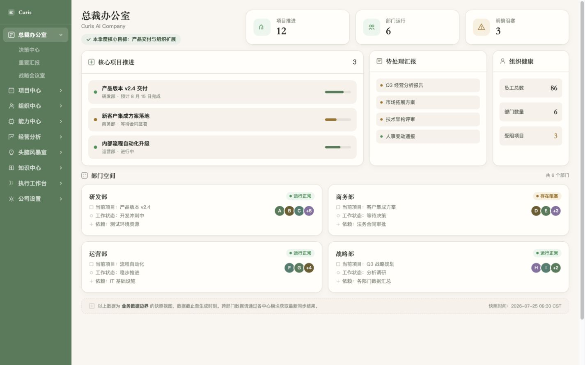
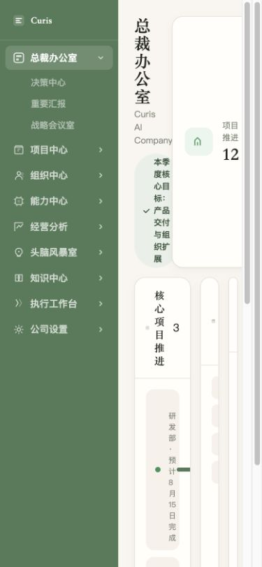
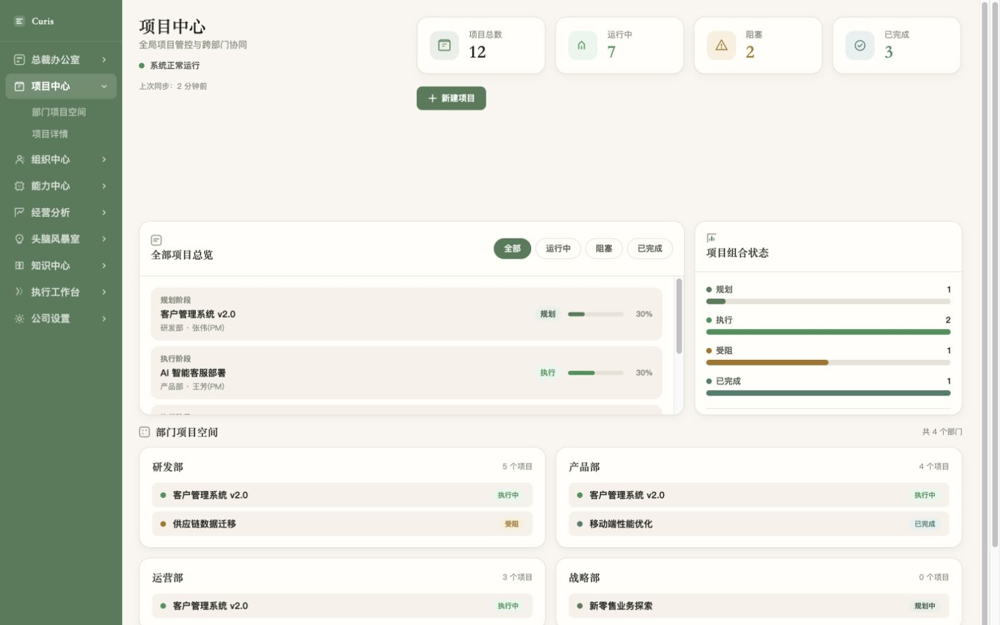
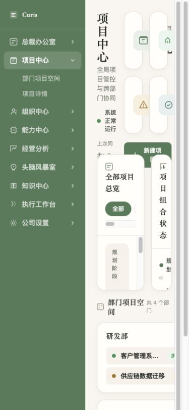
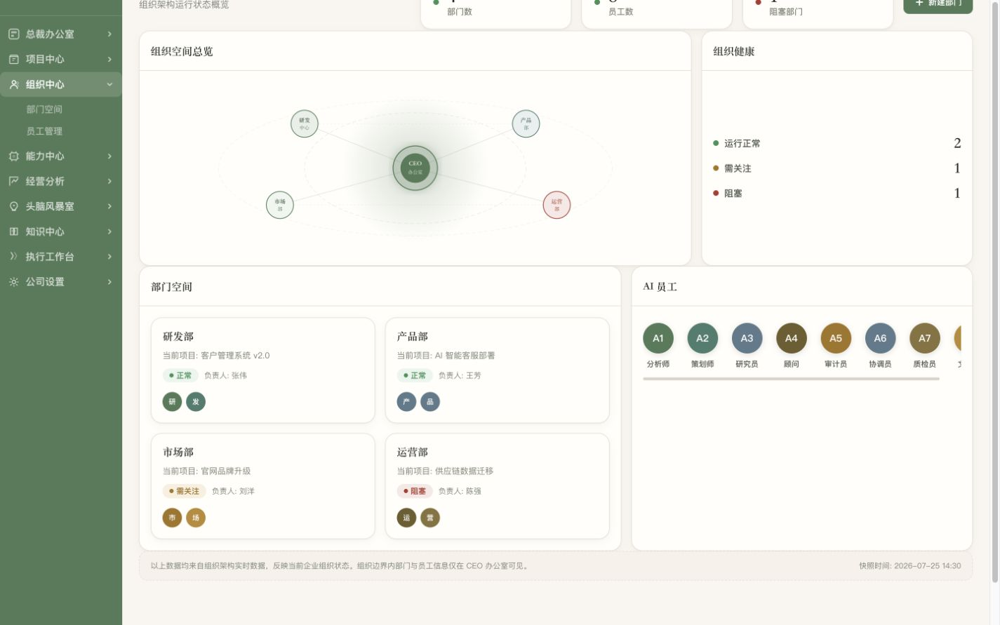
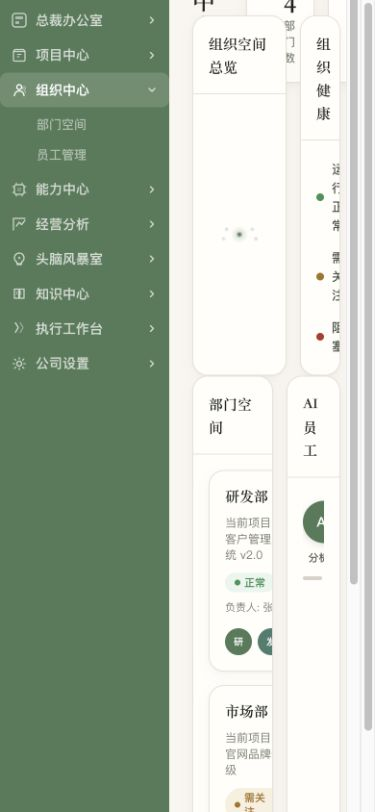
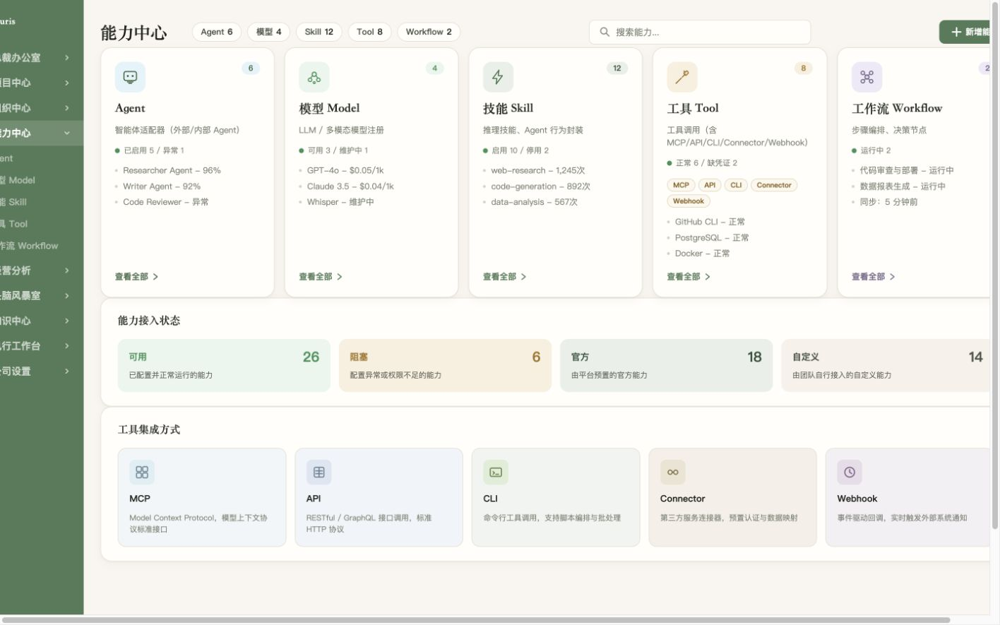
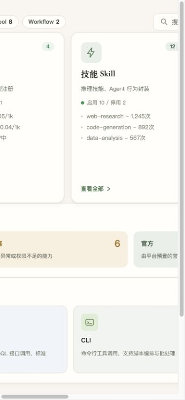
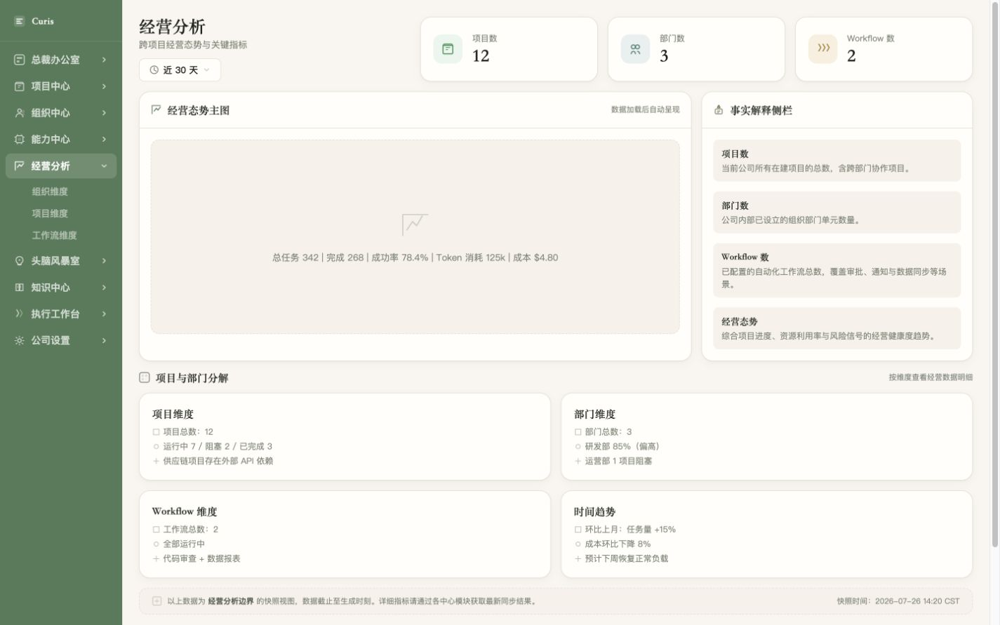
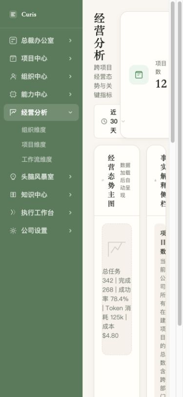

# Curis TRAE UI 前端交互与产品架构审计

Status: Deprecated

> 审计对象：`/Users/yy/Library/Application Support/TRAE SOLO CN/ModularData/ai-agent/work-mode-projects/6a647ad4366e497d35ebfdc7/curis-ceo-office`
>
> 审计结论：**BLOCKED，不进入产品验收或实现交付**。
>
> 视觉主题、字体、颜色以 TRAE 当前项目为准；本报告只审查 Curis 已确认的产品规划、信息架构、事实边界和交互真实性。

> **修订说明（布局调整后）**：示范数据可以保留用于验证版式、密度和状态样式；本报告阻断的是示范数据被误认为生产事实。进入实现前，应在标注/数据映射中明确“示范数据”与“真实读取事实”的边界，并为未接入动作保留诚实的“未接入”状态。

## 1. 审计范围与证据

初审阶段只读检查了 `SPEC.md`、`curis-ceo-office.design`、页面 HTML/CSS、运行中的静态页面和当前截图；以下数量统计均为初审快照。随后按本报告的最小布局修订原则调整了 CEO、组织中心和能力中心页面，未改变视觉主题、字体或示范数据内容。

- 页面文件：43 个 HTML 页面。
- 设计元数据：43 个页面的 `interactions` 均为空（`curis-ceo-office.design`）。
- HTML 按钮：42 个；页面脚本只发现侧栏 chevron 折叠逻辑，未发现对应业务动作的提交、成功、失败或持久化流程。
- 页面通过外部 CDN 加载 Tailwind Browser 与 Lucide（每页重复引用），运行结果依赖外部资源。
- 截图证据：见 [`audit-evidence/`](./audit-evidence/)。

### 代表性截图

| 页面 | 桌面 1440 | 移动 390 |
| --- | --- | --- |
| 总裁办公室 |  |  |
| 项目中心 |  |  |
| 组织中心 |  |  |
| 能力中心 |  |  |
| 经营分析 |  |  |

## 2. Curis 应满足的产品架构

产品主层级：`CEO → Company → Project → Department → Employee → Skill / Tool → Workflow → Task`。Task 是内部执行基座，不是产品入口。

```text
总裁办公室（默认首页：总部驾驶舱）
├─ 决策中心
├─ 重要汇报
└─ 战略会议室

项目中心（默认首页：全部项目总览）
└─ 项目/项目详情（三级）

组织中心（默认首页：组织总览）
└─ 部门空间（三级）
   └─ 员工详情（四级对象详情；部门页提供“新增员工”）

能力中心（默认首页：能力总览）
├─ Skill
├─ Tool
└─ Workflow

经营分析、头脑风暴室、知识中心、执行工作台、公司设置：各自拥有一级默认首页。
公司运行视图：只作为总裁办公室驾驶舱入口，不作为独立产品导航层。
```

导航必须表达层级：一级权重最高；二级缩进、弱化、带 chevron/展开态；三级只在对象上下文中出现。不能把对象详情、维度页或“部门项目空间”与一级中心并列展示。

## 3. 阻断级问题（P0）

### P0-01：示范数据边界未被明确标识

**证据**：总裁办公室显示“项目推进 12、部门运行 6、明确阻塞 3、员工总数 86”；项目中心显示 12 个项目和具体项目名；经营分析显示“总任务 342、完成 268、成功率 78.4%、Token 125k、成本 $4.80”；公司运行视图显示“健康评分 92、异常事件 2、正常运行天数 45”；员工详情显示固定姓名、入职日期、P0 目标与能力。

**问题**：这些值目前属于原型示范数据，尚未连接 Curis 当前批准的 Workspace API 事实源。示范数据本身不阻断版式设计，但若没有标注就会与“读不到就诚实显示未读取/未记录/未分配”的产品规则冲突。页面底部的“快照时间”不能替代数据来源和读取证据。

**影响**：CEO 会把样例数字误判为公司状态，属于产品信任和治理阻断。

**实现前必须补齐**：所有指标在数据映射中标注来源与读取时间；未读取显示空态/局部错误；不存在的成本、绩效、健康评分、预测趋势不渲染。默认页面保留当前示范数据作为布局夹具，同时必须能在空 Company、空 Project、局部读取失败时完成同构布局。

### P0-02：导航层级与产品对象层级混淆

**证据**：总裁办公室侧栏同时列出 `决策中心/重要汇报/战略会议室`、项目二级页和项目详情、组织二级页和员工管理、Agent/Model/Skill/Tool/Workflow、经营分析维度、头脑风暴会话页、知识分层页和执行任务/运行记录；在桌面截图中这些项目视觉上接近同一导航等级。

**问题**：页面文件清单虽标记部分“二级”，实际导航没有稳定的中心 → 子域 → 对象关系；用户会把项目详情、员工管理、工作流维度误解为一级产品入口。

**必须改为**：一级中心点击后永远进入默认首页；二级只在所属一级的展开区显示；三级仅通过列表/空间卡片进入。公司运行视图从总裁办公室驾驶舱进入，不再承担独立导航语义。

### P0-03：主操作是假按钮，交互事实不存在

**证据**：项目中心有“新建项目”、组织中心有“新建部门”、能力中心有“新增能力”，能力子页有新增 Skill/Tool/Workflow，部门详情有“新增员工”，设置页有多处“保存”，决策/会议/报告页有发起、批准、提交等按钮；源码脚本仅实现侧栏 chevron 折叠，设计文件 43 个页面的 `interactions` 全为空。

**问题**：按钮看起来可操作，但没有表单、权限、提交、成功、失败、取消、重试、落库或返回路径。它们构成假操作。

**必须改为**：只有已有产品合同和真实后端能力的动作才可启用；未接入时使用“未接入”状态并禁用/隐藏主按钮，同时解释缺失依赖。特别是“新增能力”应先选择 Skill、Tool 或 Workflow，再进入对应真实创建流程。

### P0-04：390 端是固定桌面画布，不是可用响应式页面

**证据**：`ceo-home.html`、`project-center.html`、`analytics.html` 等使用 `width:1536px;height:1024px;display:flex;overflow:hidden`；能力中心使用固定 `width:1536px`。390 截图出现标题逐字竖排、主内容被裁切、横向滚动条、卡片列无法到达，侧栏与内容同时占据桌面宽度。

**影响**：移动端无法读取首屏目的、无法访问主操作，也无法确认空态/错误态。

**必须改为**：容器宽度 `min(100%, …)`；移动端将侧栏折叠为可访问抽屉/底部入口；12 列改为单列或明确的两列断点；卡片内容可自然换行；任何关键动作在 390 宽度内可见、可点击、可返回。

## 4. 页面级审计

### 4.1 总裁办公室（`pages/ceo-home.html`）

- **合理处**：有 Company 标题、核心项目区域、待处理汇报、组织健康和部门空间入口；“待处理汇报”命名符合已确认裁决。
- **问题**：首屏首先呈现 12/6/3 KPI 卡片，而非 Company、核心项目目标和 AI 公司运行事实；部门空间展示 4 个部门，超过“首页最多展示三个 Department 健康摘要”的约束；“本季度核心目标：产品交付与组织扩展”没有来源说明；所有项目名、人数和状态均为硬编码样例。
- **交互要求**：项目卡应进入项目中心/具体项目详情，待处理汇报进入重要汇报二级页，运行视图只能由驾驶舱入口进入；无数据时保留模块骨架但显示未读取事实。

### 4.2 项目中心（`pages/project-center.html`）

- **合理处**：默认页意图是“全部项目总览”，并提供带文案的“新建项目”，符合产品方向。
- **问题**：项目统计、进度百分比、负责人和部门项目列表为样例数据；筛选“全部/运行中/阻塞/已完成”看起来是控件，但没有过滤交互；部门项目空间、项目详情被侧栏直接暴露为同级导航；“新建项目”没有真实流程。
- **修正边界**：保留总览和“新建项目”入口，但只在真实数据与真实创建合同接入后启用；项目详情只能从项目列表或部门项目空间进入。

### 4.3 组织中心（`pages/org-center.html`）

- **合理处**：默认页有“新建部门”文案入口，符合已确认规划；有组织空间、部门空间和 AI 员工区域。
- **问题**：组织图、CEO 环形关系、四部门状态、负责人姓名和 AI 员工头像均是展示性样例；当前确认的 AI 研发中心、AI 内容中心没有作为明确空间模块出现；页面宣称“实时数据”但只显示固定快照时间；侧栏把员工管理直接暴露为组织中心子项，缺少“部门 → 员工”上下文。
- **修正边界**：组织总览只展示真实部门事实；将 AI 研发中心/AI 内容中心作为部门空间模块；“新建部门”只在组织总览；进入三级部门页后提供“新增员工”。

### 4.4 能力中心（`pages/capability-center.html`）

- **合理处**：有能力总览、搜索和“新增能力”视觉入口；Skill/Tool/Workflow 的卡片方向与当前规划一致。
- **问题**：页面把 Agent、模型、Skill、Tool、Workflow 五类并列为核心产品实体，并继续展示 MCP/API/CLI/Connector/Webhook 工具分类；这超出当前已确认的 Skill/Tool/Workflow 产品范围，且让能力中心退化为后这个e台注册表。卡片中的调用次数、可用数和“官方/自定义”数量均为假数据。390 端横向裁切严重。
- **修正边界**：一级能力中心只保留已批准实体；如 Agent/Model/MCP 要保留，必须先取得独立产品合同。新增动作按上下文明确为“新增 Skill / 添加工具 / 新增工作流”。

### 4.5 经营分析（`pages/analytics.html`）

- **合理处**：有一级默认页意图、时间范围位置和事实解释侧栏。
- **问题**：主图是空白占位，却同时给出任务量、成功率、Token、成本和趋势解释；时间范围控件没有可验证交互；项目/部门/Workflow 维度子页被直接列入导航；分析指标没有数据源、计算口径或“未记录”状态。
- **修正边界**：先实现“事实可用性”而不是 KPI 仪表盘：显示来源、时间窗、读取状态、缺失字段和可追溯链接；没有真实经营合同时显示高完成度空态。

### 4.6 公司运行视图（`pages/company-runtime.html`）

- **合理处**：页面提供返回总裁办公室的入口，结构上更接近驾驶舱内部视图。
- **问题**：标题和右上角直接宣称“实时/已连接”；健康评分、异常事件、运行天数、Agent 健康检查和部门节点均为硬编码；运行事实没有四类读取证据、失败码或局部错误态；页面仍是可直接访问的独立 URL。
- **修正边界**：只作为总裁办公室入口；任何一项事实未读取就标记未读取，不生成评分；连接、刷新、重试必须有真实状态机。

### 4.7 员工详情（`pages/employee-detail.html`）

- **合理处**：页面展示基本信息、职责目标和可用能力，层级意图为对象详情。
- **问题**：固定姓名“张伟”、入职日期、汇报对象、P0 优先级和能力熟练度看起来是真人/真实员工记录；没有来源、编辑权限或缺失字段状态。页面依赖组织中心导航，而不是从部门空间进入。
- **修正边界**：员工详情只能由真实员工对象进入；未分配/未读取显示明确状态；新增员工按钮只在三级部门页，不能在员工详情页制造“新建部门”等越级操作。

### 4.8 执行工作台（`pages/execution.html`）

- **合理处**：作为次级入口存在，没有替代总裁办公室。
- **问题**：291 Task、1,247 Workflow Run、错误 3、具体员工姓名、耗时、Token 和运行记录均是样例；执行队列、Run、Task 没有真实 trace/成果边界；工作台仍用高密度 Dashboard KPI 作为主视觉，容易把 Task 误读成产品入口。
- **修正边界**：保留真实执行能力的次级入口；没有真实运行记录时显示空态，不显示样例运行；所有结果必须可追溯到 Project/Workflow/Trace。

### 4.9 公司设置（`pages/settings.html` 及 `settings-*`）

- **合理处**：公司档案、品牌、通知三个配置域的分组方向合理。
- **问题**：输入框、开关和“保存”按钮没有保存/失败/未保存状态；公司名称、公司规模、部门数、配置完成度、管理员邮箱均被直接填入；页面宣称“配置状态：正常”但没有读取证据；品牌/通知配置与公司事实摘要混在同一首屏。
- **修正边界**：配置值必须区分已保存/未保存/保存失败；敏感或管理员设置需权限边界；摘要只展示已读取事实，不计算“完成度”替代真实状态。

## 5. 交互与状态模型缺口

每个页面至少需要明确以下状态，当前 TRAE 设计未定义：

| 状态 | 必须呈现 | 当前问题 |
| --- | --- | --- |
| Loading | 稳定骨架、无数字占位、说明读取范围 | 直接展示完整样例数据 |
| Empty | 真实创建入口或“暂无数据”解释 | 没有零数据版本 |
| Partial | 成功区域继续显示，失败区域独立重试 | 没有局部错误边界 |
| Error | 失败原因、失败码、重试 | 没有读取错误/权限错误路径 |
| Normal | 来源、更新时间、对象上下文 | 固定“快照时间”冒充实时 |
| Action pending | 禁用重复提交、取消、进度 | 按钮无动作状态 |
| Action success/failure | 反馈、回到对象上下文、保留错误 | 保存/创建/批准无结果 |

## 6. 布局与可访问性问题

1. **固定画布**：所有页面复用 1536×1024 壳层，导致移动端裁切；这不是视觉偏好问题，是信息不可达。
2. **横向滚动**：能力中心在 1440 也出现底部横向滚动；卡片数量超过可读宽度，用户无法知道还有哪些实体。
3. **层级弱化不足**：一级、二级、对象详情使用相近字号和相同链接样式；展开态没有可靠的当前路径/面包屑。
4. **小字号承载关键事实**：大量 10–11px 文案承担状态、来源和依赖信息；在移动端进一步压缩后不可读。
5. **焦点与键盘未知**：截图无法证明键盘顺序、focus-visible、对话框陷阱和错误关联；这些必须在真实交互实现后单独验证，不能从截图声称 WCAG 合规。
6. **外部 CDN 依赖**：Tailwind Browser/Lucide 从 CDN 加载，网络或版本变化会改变页面；产品交付应使用确定性本地资产/构建产物。

## 7. 建议的返工顺序

1. **先锁信息架构**：重做侧栏树和页面路由；一级默认首页、二级分组、三级对象，移除未批准实体的导航曝光。
2. **再锁事实边界**：为每个模块登记真实数据源、字段、读取时间、权限和空/错/局部错状态；删除所有样例数值、姓名、时间和成本。
3. **再定义动作合同**：只保留当前批准的“新建项目、新建部门、新增员工、新增 Skill/Tool/Workflow”及已有执行入口；每个动作补齐 pending/success/failure/cancel。
4. **最后做响应式重排**：以 1440/1024/390 三个断点分别定义布局，不允许固定 1536 画布在移动端缩放或横向溢出。
5. **逐页验收**：每页独立输出三端截图；产品负责人确认实际页面截图后，才进入下一页实现。

## 8. 产品验收门槛

- [ ] 一级导航均有默认首页，二级/三级不再与一级并列。
- [ ] 总裁办公室默认显示总部驾驶舱；运行视图只有驾驶舱入口。
- [ ] 项目中心默认显示全部项目总览，并保留真实“新建项目”入口。
- [ ] 组织中心默认显示组织总览，并包含 AI 研发中心、AI 内容中心空间；组织总览有“新建部门”。
- [ ] 三级部门页有“新增员工”；员工详情不提供越级创建部门操作。
- [ ] 能力中心只显示已批准的 Skill/Tool/Workflow；新增动作按类型进入真实创建流。
- [ ] 所有页面零假数据；未读取、未记录、未分配均诚实显示。
- [ ] 所有按钮都有可验证的真实交互或明确禁用/未接入状态。
- [ ] 390 端无裁切、横向滚动、竖排标题或不可达主操作。
- [ ] 每页 1440/1024/390 截图与产品原型逐页对比，产品确认前不得实现下一页。

**结论**：当前 TRAE 版本可以作为视觉主题和字体的参考实现，但不能作为 Curis 产品交互或信息架构的实现事实源。应先按上述 P0 项重做 IA、事实状态和交互合同，再进入逐页产品验收。
