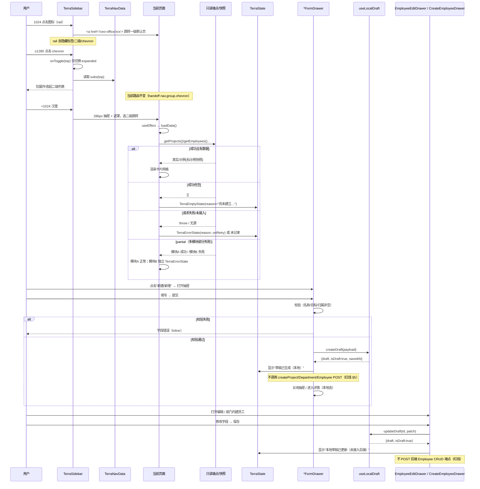
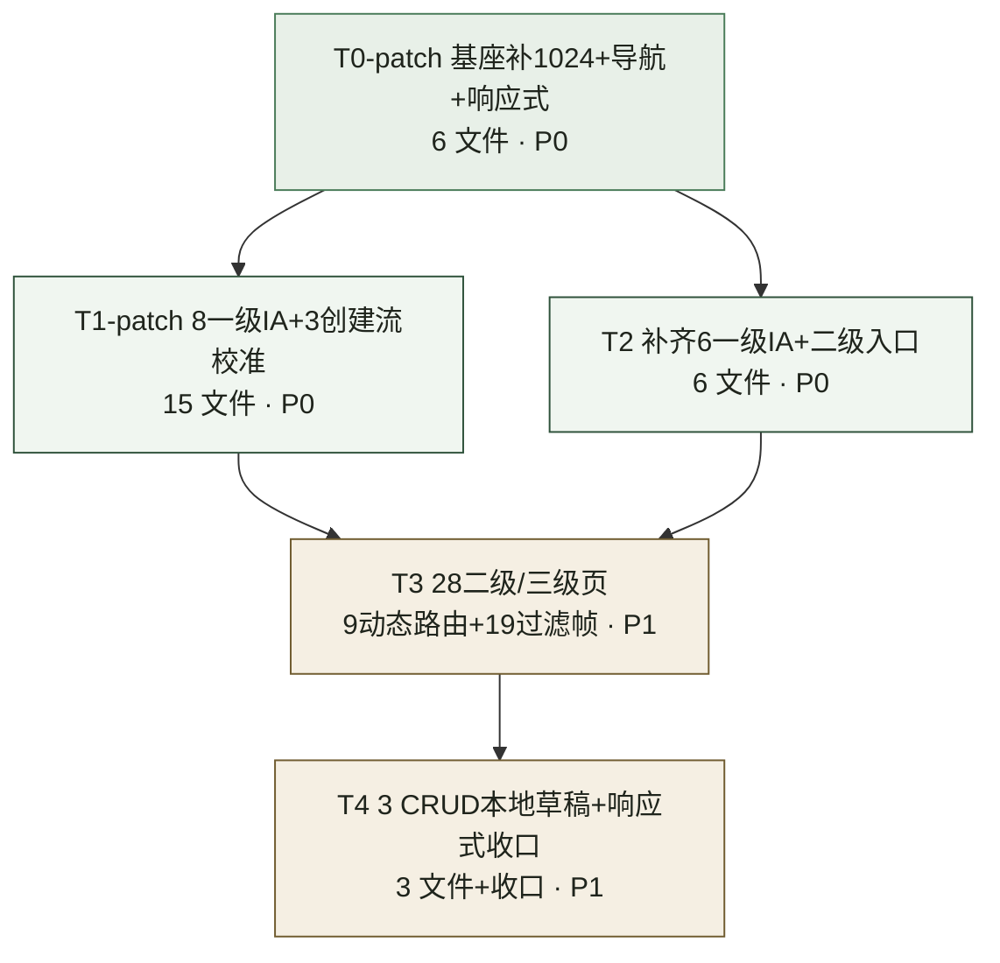

# Curis CEO Office UI V2 · 前端系统设计文档（47 页全量实施计划）

> 版本：V2.1 · 2026-07-27 · 作者：高见远（架构师）
> 性质：**纯前端设计（design-first）**，外部 UI 已交付完整规范，本套件 1:1 还原。
> 事实源：`frontend/design-spec/curis-ui-v2/docs/ui/`（handoff / data-map / secondary-page-contracts / tokens / 三端截图）。
> 交付边界（handoff §8 + 团队纪律）：仅前端改动；不新增 API / 数据库 / Admin / 凭证 / 计费 / Workflow Runtime；写流不 POST 后端、不伪造操作成功；不引入需 npm 安装的新依赖；视觉以 `tokens.json` + `exports/*/*.png` 为唯一标尺。

---

## 0. 文档定位与变更说明

- 本版将旧 T0–T3（原按 13 顶级 IA 计，含误计的 3 个总裁办公室二级项；2026-07-28 校准为 10 顶级 + 3 二级）**重写为覆盖全部 47 页的完整实施计划**，并对齐 2026-07-27 总控越界决策（实现完整 47 页含 CRUD 写流，写流一律前端本地草稿）。
- 现状基线：T0+T1 已落地（28 文件，IS_PASS YES）。本版在已落地基座上 **patch + 补齐**，不推翻重做。
- 关键结论先行：**T0 主题（lib/theme.js + globals.css + tokens）经核对与 `tokens.json` 完全一致，无需返工**；唯一结构性缺口是 **1024 76px 图标态导航未实现**（见 §2.3，由 T0-patch 补齐）。

---

## 1. 方案摘要

| 项 | 结论 |
|---|---|
| 技术栈 | Next.js 16 App Router + **纯 JavaScript（禁 TS）** + Tailwind 3.4（已锁定，不升级） |
| 视觉主题 | **Terra 暖奶油 + 森林绿浅色**（tokens.json 直读）；`lib/theme.js` 的 COLORS/STYLE 与 tokens 同值，**T0 主题不需返工** |
| 现状基线 | Terra 脚手架已落地（T0：theme/globals/tailwind/TerraShell/TerraSidebar/TerraNavData/TerraState/TerraConfirm/TerraResourcePicker；T1：8 个一级 IA 页 + 3 个创建抽屉 + ResourceBindingPanel）。`DATA_COPY` 常量已齐备 |
| 唯一结构缺口 | **1024（76px 图标态）导航未实现**：当前桌面侧栏在 ≥1024 直接显示 220px，缺少 1024–1279 的 76px 纯图标模式（T0-patch 补齐） |
| 核心策略 | **迁移 + 补齐 + 数据态校准**，不另起炉灶；在现有 Terra 脚手架上补齐 6 个一级 IA 页、9 个动态详情路由、3 个 CRUD 本地草稿流，并对 T1 已建页按 v2.0 细节校准 |
| 路由策略 | 全量收敛 `/ceo-office/*`；**对象/维度/类型/视图/作用域一律用 query param（`?dept/?dim/?type/?view/?scope/?tab`）而非独立路由**，保证三端信息顺序一致、不产生路由爆炸；逐对象详情用动态段 `[id]` |
| 数据纪律 | 读取走现有只读端点（或快照）→ 真实/未记录；**写流（部门/项目/员工/编辑）本期只生成本地草稿，不 POST 后端**（红线 + handoff §5） |
| 任务粒度 | 5 桶：**T0-patch**（基座补 1024 + 导航细节 + 响应式）→ **T1-patch**（8 一级 IA 页 + 3 创建流校准）‖ **T2**（补齐 6 一级 IA 页 + 二级入口）→ **T3**（28 二级/三级页 = 9 动态路由 + 19 query 过滤帧）→ **T4**（3 CRUD 本地草稿流 + 共享编辑模式 + 全量响应式收口） |

---

## 2. 实现方案

### 2.1 框架与选型（已锁定，无需新增依赖）

- **Next.js 16 App Router**：页面用 `app/ceo-office/*` 文件系统路由；纯客户端渲染（`"use client"`），不引入 RSC 数据获取（避免触碰后端边界）。
- **Tailwind 3.4**：`terra` 调色板、`fontFamily`（`terra-serif`/`terra-sans`）、`boxShadow`、`borderRadius` 已配置且与 tokens 对齐。本期仅补充 1024 rail 的响应式 class（纯 CSS，不新增 token）。
- **字体**：沿用 `layout.js` 的 `next/font/google`（Literata + Nunito Sans）。内置于 Next，**非 npm 新增**；构建期自托管、无 FOUT。
- **图标**：沿用 `components/terra/TerraIcons.js`（内联 SVG symbol sprite，零依赖）。
- **路由范式（重要）**：
  - 维度/类型/视图/作用域 → **query param**：`analytics?dim=org`、`capabilities?type=skill`、`brainstorm?view=active`、`knowledge?scope=company`、`execution?view=runs`、`settings?tab=brand`、`projects?dept=研发部`。这样 1 个一级页文件即可覆盖多个二级 Frame，且三端信息顺序天然一致。
  - 逐对象详情 → **动态段 `[id]`**：`projects/[id]`、`organization/departments/[id]`、`organization/employees/[id]`、`capabilities/[type]/[id]`、`reports/[id]`、`brainstorm/sessions/[id]`、`knowledge/entries/[id]`、`execution/runs/[id]`、`execution/tasks/[id]`。

### 2.2 主题与 token 结论（T0 主题无需返工）

经核对 `lib/theme.js` 与 `app/globals.css`：

- `COLORS`（bg `#faf6f0`、primary `#4a7c59`、primaryDark `#2f523b`、green `#15935a`、amber `#a8742a`、red `#b83230` …）与 `tokens.json` 同值。
- `STYLE`（overlay/drawer/form/card/button/empty/error）为 Terra 浅色，与已落地 T0 一致。
- `globals.css` 已定义 `--terra-*` 与 `--terra-nav-width-desktop:220px / tablet:76px / mobile:286px` 变量。
- `tailwind.config.js` 已对齐 token 命名与字号（`font-terra-title` 24/700、`font-terra-card` 15/600、`text-sm` 14、`text-xs` 12/500、`text-[11px]` 11）。
- **结论**：配色、字体、token、暗色残留迁移在 T0 已完成，**本期不改动主题层**。T0-patch 仅补齐"应用层"缺口（1024 rail 实现 + 响应式内距 + 导航两级细节 + 共享组件受控能力）。

### 2.3 1024（76px 图标态）导航 —— T0 当前唯一结构性缺口

现状 `TerraSidebar` 桌面侧栏为 `w-[220px] ... lg:flex hidden`，即在 ≥1024 直接显示 220px 全展开，**缺少 1024–1279 的 76px 纯图标态**。补齐方案（纯 CSS 响应式，无 `matchMedia`）：

| 视口 | 导航 | 实现 |
|---|---|---|
| ≥1280（desktop） | 220px 全展开 | `xl:w-[220px]`；标签/二级/chevron `xl:block`，图标常驻 |
| 1024–1279（tablet） | 76px 图标态 | `lg:w-[76px]`；标签/二级/chevron `hidden`（仅 `lg` 下隐藏、`xl` 下显示）；图标可点击跳一级默认页 |
| <1024（mobile 390） | 关闭；汉堡开 286px 抽屉 | 沿用现有 `open` 抽屉模式，不变 |

- `TerraShell` 桌面/平板侧栏：`hidden lg:flex` + 内部 `lg:w-[76px] xl:w-[220px]`；标签与二级包 `hidden xl:block`。
- 内容内距修正（当前 `p-6 lg:p-[24px] md:p-5 sm:p-4` 在 390 误用 24px）：改为 **`p-4 md:p-5 xl:p-6`**（390→16 / 1024→20 / 1440→24）。
- 汉堡按钮仅 `<lg` 显示（当前 `lg:hidden` 正确）。

### 2.4 架构模式

组件化 + 约定式路由 + 共享态组件复用。每页 = `TerraShell` + `TerraPageHead`(24px Literata) + 卡片/列表网格 + 空/错/partial 态。共享态组件（`TerraState` / `TerraPrimitives` / `TerraResourcePicker` / `TerraConfirm`）全站复用，杜绝各页各造。读取走现有只读端点（或快照），写流走 `lib/useLocalDraft`（T4 共享 hook，绝不 POST）。

---

## 3. 文件清单（相对 `frontend/`）

> 标注：**[已建·patch]** = T0+T1 已存在、需按 v2.0 校准；**[新增]** = 本期新建。

### 3.1 基座 patch（T0-patch，6 文件，全为 [已建·patch]）

| 文件 | 动作 | 说明 |
|---|---|---|
| `components/terra/TerraSidebar.js` | patch | 补 1024 76px rail：`lg:w-[76px] xl:w-[220px]`；标签/二级/chevron 在 `lg` 隐藏、`xl` 显示；图标常驻可点击 |
| `components/terra/TerraShell.js` | patch | 内容内距改为 `p-4 md:p-5 xl:p-6`；协调 1024 布局（桌面/平板共渲染、移动抽屉不变）；防横向溢出容器 |
| `components/terra/TerraNavData.js` | patch | 两级细节校准：项目中心二级仅 4 部门、人事部项标记 `isSystem`（不可经新建部门创建）、当前组默认展开逻辑核对；补充 `ORDER` 常量确保 **10 项一级 IA + 3 项总裁办公室二级（决策中心/重要汇报/战略会议室）** 顺序稳定 |
| `app/globals.css` | patch | 补响应式 shell 辅助类（rail 内距、`.no-h-scroll` 防溢出）；核对 `--terra-*` 变量（已齐，确认即可） |
| `components/terra/TerraPrimitives.js` | patch | `TerraSearch` 支持受控 `value`/`onChange`（T1 已用但未生效）；`TerraButton` 补移动端全宽 class 约定 |
| `components/terra/TerraState.js` | patch | `DATA_COPY` 已齐；补 `noRuntimeFact`/`sampleBadge` 辅助导出，统一空/错/partial 文案入口 |

### 3.2 一级 IA 页 patch（T1-patch，15 文件）

| 文件 | 动作 | 对应 Frame |
|---|---|---|
| `app/ceo-office/page.js`（ceo-home） | [已建·patch] | ceo-home · §4.1 |
| `app/ceo-office/projects/page.js` | [已建·patch] | project-center · §4.2 |
| `app/ceo-office/projects/ProjectFormDrawer.js` | [已建·patch] | 创建项目（本地草稿） |
| `app/ceo-office/organization/page.js` | [已建·patch] | org-center · §4.3 |
| `app/ceo-office/organization/DepartmentFormDrawer.js` | [已建·patch] | 新建部门（人事部不可建） |
| `app/ceo-office/organization/employees/page.js` | [已建·patch] | org-employees · §4.3 |
| `app/ceo-office/organization/employees/EmployeeFormDrawer.js` | [已建·patch] | 新增员工（初始归属人事部） |
| `app/ceo-office/capabilities/page.js` | [已建·patch] | capability-center · §4.4 |
| `app/ceo-office/capabilities/ResourceBindingPanel.js` | [已建·patch] | 能力绑定（复用 TerraResourcePicker） |
| `app/ceo-office/decisions/page.js` | [已建·patch] | decision-center · §4.5 |
| `app/ceo-office/reports/page.js` | [已建·patch] | reports · §4.5 |
| `app/ceo-office/strategy-room/page.js` | [已建·patch] | strategy-room · §4.5 |
| `app/projects/page.js` | [已建·patch] | 旧暗色路由 → `redirect("/ceo-office/projects")` |
| `app/org-center/page.js` | [已建·patch] | 旧暗色路由 → `redirect("/ceo-office/organization")` |
| `app/capabilities/page.js` | [已建·patch] | 旧暗色路由 → `redirect("/ceo-office/capabilities")` |

> T1-patch 校准要点（v2.0 细节）：消除"系统正常运行"等假象（handoff §4.1，未接入时显原因）；成本未知统一 `未记录`（不得 $0）；空/错/Partial 态全覆盖；标题 24px Literata（TerraPageHead 已满足）；人事部系统部门不可经新建部门重复创建；新增员工初始归属锁定人事部；示例数据显式标 `示例快照 · 未接入真实数据`；旧暗色子路由（app/org-center/* 下深层文件）随 redirect 一并清理或置 redirect。

### 3.3 补齐一级 IA 页（T2，6 文件，全 [新增]）

| 文件 | 对应 Frame / 二级入口 |
|---|---|
| `app/ceo-office/analytics/page.js` | analytics · §4.5；二级入口 `?dim=org/project/workflow` |
| `app/ceo-office/brainstorm/page.js` | brainstorm · §4.6；二级入口 `?view=active/results` |
| `app/ceo-office/knowledge/page.js` | knowledge · §4.6；二级入口 `?scope=company/project/department` |
| `app/ceo-office/execution/page.js` | execution · §4.6；二级入口 `?view=tasks/runs` |
| `app/ceo-office/settings/page.js` | settings · §4.6；二级入口 `?tab=profile/brand/notify` |
| `app/ceo-office/company-runtime/page.js` | company-runtime · §4.6（由驾驶舱入口进入） |

### 3.4 二级/三级详情页（T3，9 文件 [新增] + 19 个 query 过滤帧）

> 28 个二级/三级页 = **9 个动态路由详情文件** + **19 个 query 过滤帧**（由 T2 一级页以 `?dim/?type/?view/?scope/?tab` 渲染，无独立文件，T3 负责接线与核验）。

| 文件（[新增]） | 覆盖的 Frame |
|---|---|
| `app/ceo-office/projects/[id]/page.js` | project-detail + project-miniapp-detail + project-xhs-workflow-detail（以 demo id 区分内容） |
| `app/ceo-office/organization/departments/[id]/page.js` | department-detail + org-dept（部门详情 / 部门空间视图） |
| `app/ceo-office/organization/employees/[id]/page.js` | employee-detail |
| `app/ceo-office/capabilities/[type]/[id]/page.js` | skill-detail（`type=skill`；其余 type 无独立详情，仅列表） |
| `app/ceo-office/reports/[id]/page.js` | report-detail |
| `app/ceo-office/brainstorm/sessions/[id]/page.js` | brainstorm-session-detail |
| `app/ceo-office/knowledge/entries/[id]/page.js` | knowledge-entry-detail |
| `app/ceo-office/execution/runs/[id]/page.js` | run-detail |
| `app/ceo-office/execution/tasks/[id]/page.js` | task-detail |

**19 个 query 过滤帧（T3 在 T2 页内接线核验，不新增文件）：**
analytics-org/project/workflow（`analytics?dim=`）、capability-agent/model/skill/tool/workflow-list（`capabilities?type=`）、brainstorm-active/results（`brainstorm?view=`）、execution-runs/tasks（`execution?view=`）、knowledge-company/dept/project（`knowledge?scope=`）、settings-brand/notify/profile（`settings?tab=`）、project-dept（`projects?dept=`）。

### 3.5 CRUD 本地草稿 + 响应式收口（T4，3 文件 [新增] + 收口任务）

| 文件 | 说明 |
|---|---|
| `lib/useLocalDraft.js` | [新增] 共享本地草稿 hook：`createDraft/updateDraft/reset`，内部 `useState`，**绝不调用 POST/后端**；统一返回 `{draft, isDraft, savedAt}` 供 UI 显示"草稿已生成（本地）" |
| `app/ceo-office/organization/employees/[id]/EmployeeEditDrawer.js` | [新增] employee-detail 编辑抽屉（本地草稿，不 POST） |
| `app/ceo-office/organization/departments/[id]/CreateEmployeeDrawer.js` | [新增] department-detail 内"创建员工"抽屉（本地草稿，复用 useLocalDraft） |

> 全量响应式收口（T4 末）：1440/1024/390 三档走查、删除二次确认全站串联、`globals.css` 防横向溢出、`git diff --check`、截图与 47 Frame 一一对应。

---

## 4. 47 页面 ↔ 文件映射（全量覆盖核验）

> **IA 层级总览（2026-07-28 校准 · 顶级 10 项）**：IA 层级 ≠ 路由 URL。决策中心 / 重要汇报 / 战略会议室由独立顶级降为「总裁办公室」二级；其余 10 项为顶级。所有路由 URL 保持不变，深链保留。
>
> | 顶级 IA（10） | 默认路由 | 二级 subs（仅导航视觉层级） |
> |---|---|---|
> | 总裁办公室 | `/ceo-office` | 决策中心 → 重要汇报 → 战略会议室（均独立路由，见下方 #8/#9/#10） |
> | 项目中心 | `/ceo-office/projects` | 4 部门（研发部/内容增长部/产品部/运营部，`?dept=`） |
> | 组织中心 | `/ceo-office/organization` | 人事部(跳 `/organization/employees`, `isSystem`)、研发部、内容增长部、产品部、运营部（跳 `/organization/departments/{名}`）；**删除「部门空间」二级项** |
> | 能力中心 | `/ceo-office/capabilities` | agent/model/skill/tool/workflow（`?type=`） |
> | 经营分析 | `/ceo-office/analytics` | org/project/workflow（`?dim=`） |
> | 头脑风暴 | `/ceo-office/brainstorm` | active/results（`?view=`） |
> | 知识管理 | `/ceo-office/knowledge` | company/department/project（`?scope=`） |
> | 执行工作台 | `/ceo-office/execution` | runs/tasks（`?view=`） |
> | 设置 | `/ceo-office/settings` | profile/brand/notify（`?tab=`） |
> | 公司运行 | `/ceo-office/company-runtime` | （由驾驶舱入口进入） |

| # | 页面 | 路由 | 实现文件 | 桶 | 数据来源 |
|---|---|---|---|---|---|
| 1 | ceo-home | `/ceo-office` | `app/ceo-office/page.js` | T1-patch | 只读/未记录 |
| 2 | project-center | `/ceo-office/projects` | `app/ceo-office/projects/page.js` | T1-patch | 只读/未记录 |
| 3 | project-dept | `/ceo-office/projects?dept=` | 同上（query 过滤） | T1-patch | 只读/未记录 |
| 4 | org-center | `/ceo-office/organization` | `app/ceo-office/organization/page.js` | T1-patch | 只读/未记录 |
| 5 | org-employees | `/ceo-office/organization/employees` | `app/ceo-office/organization/employees/page.js` | T1-patch | 只读/未记录 |
| 6 | capability-center | `/ceo-office/capabilities` | `app/ceo-office/capabilities/page.js` | T1-patch | 只读 selector |
| 7 | analytics | `/ceo-office/analytics` | `app/ceo-office/analytics/page.js` | T2 | 只读/未记录 |
| 8 | decision-center | `/ceo-office/decisions` | `app/ceo-office/decisions/page.js` | T1-patch | 只读/未记录 |
| 9 | reports | `/ceo-office/reports` | `app/ceo-office/reports/page.js` | T1-patch | 只读/未记录 |
| 10 | strategy-room | `/ceo-office/strategy-room` | `app/ceo-office/strategy-room/page.js` | T1-patch | 只读/未记录 |
| 11 | brainstorm | `/ceo-office/brainstorm` | `app/ceo-office/brainstorm/page.js` | T2 | 只读/未记录 |
| 12 | knowledge | `/ceo-office/knowledge` | `app/ceo-office/knowledge/page.js` | T2 | 只读/未记录 |
| 13 | execution | `/ceo-office/execution` | `app/ceo-office/execution/page.js` | T2 | 只读/未记录 |
| 14 | settings | `/ceo-office/settings` | `app/ceo-office/settings/page.js` | T2 | 本地/未记录 |
| 15 | company-runtime | `/ceo-office/company-runtime` | `app/ceo-office/company-runtime/page.js` | T2 | 未读取事实 |
| 16 | project-miniapp-detail | `/ceo-office/projects/[id]` | `app/ceo-office/projects/[id]/page.js`（demo id） | T3 | 只读/示例 |
| 17 | project-xhs-workflow-detail | `/ceo-office/projects/[id]` | 同上（demo id） | T3 | 只读/示例 |
| 18 | department-create | 抽屉流 | `app/ceo-office/organization/DepartmentFormDrawer.js` | T1-patch | 本地草稿 |
| 19 | employee-create | 抽屉流 | `app/ceo-office/organization/employees/EmployeeFormDrawer.js` | T1-patch | 本地草稿 |
| 20 | analytics-org | `?dim=org` | `analytics/page.js` | T2/T3 | 只读/未记录 |
| 21 | analytics-project | `?dim=project` | 同上 | T2/T3 | 只读/未记录 |
| 22 | analytics-workflow | `?dim=workflow` | 同上 | T2/T3 | 只读/未记录 |
| 23 | brainstorm-active | `?view=active` | `brainstorm/page.js` | T2/T3 | 只读/未记录 |
| 24 | brainstorm-results | `?view=results` | 同上 | T2/T3 | 只读/未记录 |
| 25 | brainstorm-session-detail | `/brainstorm/sessions/[id]` | `app/ceo-office/brainstorm/sessions/[id]/page.js` | T3 | 只读/未记录 |
| 26 | capability-agent-list | `?type=agent` | `capabilities/page.js` | T1-patch/T3 | 只读 selector |
| 27 | capability-model-list | `?type=model` | 同上 | T1-patch/T3 | 只读 selector |
| 28 | capability-skill-list | `?type=skill` | 同上 | T1-patch/T3 | 只读 selector |
| 29 | capability-tool-list | `?type=tool` | 同上 | T1-patch/T3 | 只读 selector |
| 30 | capability-workflow-list | `?type=workflow` | 同上 | T1-patch/T3 | 只读 selector |
| 31 | department-detail | `/organization/departments/[id]` | `app/ceo-office/organization/departments/[id]/page.js` | T3 | 只读/未记录 |
| 32 | employee-detail | `/organization/employees/[id]` | `app/ceo-office/organization/employees/[id]/page.js` | T3 | 只读/编辑草稿(T4) |
| 33 | execution-runs | `?view=runs` | `execution/page.js` | T2/T3 | 只读/未记录 |
| 34 | execution-tasks | `?view=tasks` | 同上 | T2/T3 | 只读/未记录 |
| 35 | knowledge-company | `?scope=company` | `knowledge/page.js` | T2/T3 | 只读/未记录 |
| 36 | knowledge-dept | `?scope=department` | 同上 | T2/T3 | 只读/未记录 |
| 37 | knowledge-entry-detail | `/knowledge/entries/[id]` | `app/ceo-office/knowledge/entries/[id]/page.js` | T3 | 只读/编辑草稿(T4) |
| 38 | knowledge-project | `?scope=project` | `knowledge/page.js` | T2/T3 | 只读/未记录 |
| 39 | org-dept | `/organization/departments/[id]` | `app/ceo-office/organization/departments/[id]/page.js` | T3 | 只读/建员工草稿(T4) |
| 40 | project-detail | `/projects/[id]` | `app/ceo-office/projects/[id]/page.js` | T3 | 只读/示例 |
| 41 | report-detail | `/reports/[id]` | `app/ceo-office/reports/[id]/page.js` | T3 | 只读/未记录 |
| 42 | run-detail | `/execution/runs/[id]` | `app/ceo-office/execution/runs/[id]/page.js` | T3 | 只读/未记录 |
| 43 | settings-brand | `?tab=brand` | `settings/page.js` | T2/T3 | 本地/未记录 |
| 44 | settings-notify | `?tab=notify` | 同上 | T2/T3 | 本地/未记录 |
| 45 | settings-profile | `?tab=profile` | 同上 | T2/T3 | 本地/未记录 |
| 46 | skill-detail | `/capabilities/skills/[id]` | `app/ceo-office/capabilities/[type]/[id]/page.js` | T3 | 只读/未记录 |
| 47 | task-detail | `/execution/tasks/[id]` | `app/ceo-office/execution/tasks/[id]/page.js` | T3 | 只读/未记录 |

> 覆盖核验：19 核心页全部有文件/路由；28 二级/三级页 = 9 动态路由 + 19 query 过滤帧（均由上述文件渲染）。**47/47 全量覆盖成立。**
>
> **IA 层级标注（2026-07-28）**：本映射按「路由」而非「IA 顶级」排列。其中 #8 决策中心 `/ceo-office/decisions`、#9 重要汇报 `/ceo-office/reports`、#10 战略会议室 `/ceo-office/strategy-room` 的 **IA 层级为「总裁办公室」二级**（导航视觉层级下调，由独立顶级并入总裁办公室分组）；**三条路由 URL 完全不变**，仍为独立页面与深链入口。

---

## 5. 类图（mermaid classDiagram）

> 完整图见 `frontend/docs/ceo-ui-v2-class.mermaid`。

```mermaid
classDiagram
    %% ── 主题与令牌 ──
    class TerraTheme {
        +COLORS: color/spacing/radius/shadow
        +STYLE: overlay/drawer/form/card/button
        +statusLabel() / roleLabel() / deptTypeLabel()
    }

    %% ── 导航与外壳 ──
    class TerraNavData {
        +ITEMS: NavItem[10]  %% 10 一级 IA；决策中心/重要汇报/战略会议室归总裁办公室二级（不计入顶级）
        +ORDER: string[10]
        +findActiveNav(pathname)
    }
    class TerraSidebar {
        +variant: "rail" | "drawer"
        +expanded: map
        +onToggle(top)
        +renderRail()  %% 1024 76px / 1440 220px 纯 CSS
        +renderDrawer() %% 390 286px
    }
    class TerraShell {
        +drawerOpen: bool
        +topCrumb / topbarExtra
        +children
    }
    TerraShell *-- TerraSidebar
    TerraSidebar ..> TerraNavData : 读取两级数据源

    %% ── 通用组件 ──
    class TerraPrimitives {
        +TerraButton() +TerraCard() +TerraCardHeader()
        +TerraEmpty() +TerraBoundary() +TerraTag() +TerraStatusBadge()
        +TerraFact()/TerraFacts() +TerraPageHead() +TerraBackLink()
        +TerraSearch()  %% 受控 value/onChange
    }
    class TerraIcons {
        +TerraIcon(name) +TerraIconSprite()
    }
    class TerraState {
        +DATA_COPY: 未记录/未同步/未分配/未读取事实/示例快照
        +TerraEmptyState() +TerraErrorState() +TerraLoadingSkeleton()
    }
    class TerraConfirm {
        +TerraConfirmDialog(open, onConfirm, disabledReason)
    }
    class TerraResourcePicker {
        +open +onSelect(scope)
    }

    %% ── 共享本地草稿（T4）──
    class UseLocalDraft {
        +useLocalDraft(initial)
        +createDraft() / updateDraft() / reset()
        +isDraft / savedAt
    }

    %% ── 10 一级 IA 页（页面组件）+ 3 二级（总裁办公室：决策中心/重要汇报/战略会议室，仍为独立路由页）──
    class Pages {
        <<interface>>
        +loadData() +renderEmptyOrError() +renderPartial()
    }
    class CeoHomePage
    class ProjectsPage
    class OrganizationPage
    class CapabilitiesPage
    class AnalyticsPage
    class DecisionsPage
    class ReportsPage
    class StrategyRoomPage
    class BrainstormPage
    class KnowledgePage
    class ExecutionPage
    class SettingsPage
    class CompanyRuntimePage
    Pages <|.. CeoHomePage
    Pages <|.. ProjectsPage
    Pages <|.. OrganizationPage
    Pages <|.. CapabilitiesPage
    Pages <|.. AnalyticsPage
    Pages <|.. DecisionsPage
    Pages <|.. ReportsPage
    Pages <|.. StrategyRoomPage
    Pages <|.. BrainstormPage
    Pages <|.. KnowledgePage
    Pages <|.. ExecutionPage
    Pages <|.. SettingsPage
    Pages <|.. CompanyRuntimePage

    %% ── 9 个动态详情页（T3）──
    class ProjectDetailPage
    class DepartmentDetailPage
    class EmployeeDetailPage
    class SkillDetailPage
    class ReportDetailPage
    class BrainstormSessionPage
    class KnowledgeEntryPage
    class RunDetailPage
    class TaskDetailPage
    Pages <|.. ProjectDetailPage
    Pages <|.. DepartmentDetailPage
    Pages <|.. EmployeeDetailPage
    Pages <|.. SkillDetailPage
    Pages <|.. ReportDetailPage
    Pages <|.. BrainstormSessionPage
    Pages <|.. KnowledgeEntryPage
    Pages <|.. RunDetailPage
    Pages <|.. TaskDetailPage

    %% ── 创建/编辑抽屉（本地草稿，T1+T4）──
    class ProjectFormDrawer
    class DepartmentFormDrawer
    class EmployeeFormDrawer
    class EmployeeEditDrawer
    class CreateEmployeeDrawer

    %% ── 关系 ──
    CeoHomePage ..> TerraShell
    ProjectsPage ..> TerraShell
    OrganizationPage ..> TerraShell
    CapabilitiesPage ..> TerraShell
    AnalyticsPage ..> TerraShell
    DecisionsPage ..> TerraShell
    ReportsPage ..> TerraShell
    StrategyRoomPage ..> TerraShell
    BrainstormPage ..> TerraShell
    KnowledgePage ..> TerraShell
    ExecutionPage ..> TerraShell
    SettingsPage ..> TerraShell
    CompanyRuntimePage ..> TerraShell
    ProjectDetailPage ..> TerraShell
    DepartmentDetailPage ..> TerraShell
    EmployeeDetailPage ..> TerraShell
    SkillDetailPage ..> TerraShell
    ReportDetailPage ..> TerraShell
    BrainstormSessionPage ..> TerraShell
    KnowledgeEntryPage ..> TerraShell
    RunDetailPage ..> TerraShell
    TaskDetailPage ..> TerraShell

    Pages ..> TerraPrimitives
    Pages ..> TerraState : 空/错/partial/Loading
    CapabilitiesPage ..> TerraResourcePicker
    ProjectsPage ..> TerraResourcePicker
    OrganizationPage ..> TerraConfirm
    ProjectsPage ..> TerraConfirm

    ProjectFormDrawer ..> UseLocalDraft : 本地草稿(不POST)
    DepartmentFormDrawer ..> UseLocalDraft
    EmployeeFormDrawer ..> UseLocalDraft
    EmployeeEditDrawer ..> UseLocalDraft
    CreateEmployeeDrawer ..> UseLocalDraft
    EmployeeDetailPage ..> EmployeeEditDrawer
    DepartmentDetailPage ..> CreateEmployeeDrawer

    TerraPrimitives ..> TerraTheme : 消费 STYLE/token
    TerraState ..> TerraTheme
    TerraResourcePicker ..> TerraIcons
    TerraShell ..> TerraIcons
```



---

## 6. 程序调用流程（mermaid sequenceDiagram）

> 完整图见 `frontend/docs/ceo-ui-v2-sequence.mermaid`。要点：① 1024 rail 纯图标点击跳一级默认页、chevron 仅 ≥1280 展开二级；② 数据加载空/错/partial 态；③ 创建流本地草稿闭环（不 POST）；④ 编辑/建员工本地草稿闭环（T4）。



---

## 7. 任务列表（有序，含依赖）

### T0-patch · 基座补 1024 + 导航细节 + 响应式（必先做，全站依赖）

- **文件数**：6（§3.1）
- **依赖**：无（起点）
- **对应 handoff**：§1.1 画布、§2 导航、§3.3 响应式、§7 验收（导航/字体/响应式一致性）
- **产出**：
  1. `TerraSidebar.js` 补 1024 76px rail（`lg:w-[76px] xl:w-[220px]`；标签/二级/chevron `hidden xl:block`）；
  2. `TerraShell.js` 内容内距改 `p-4 md:p-5 xl:p-6`、桌面/平板共渲染、移动抽屉不变、防横向溢出；
  3. `TerraNavData.js` 项目中心二级仅 4 部门、人事部项 `isSystem`、当前组默认展开核对、`ORDER` 常量；
  4. `globals.css` 补 `.no-h-scroll` 等响应式辅助类；
  5. `TerraPrimitives.js` 的 `TerraSearch` 支持受控 `value`/`onChange`；
  6. `TerraState.js` 补 `noRuntimeFact`/`sampleBadge` 辅助导出。
- **优先级**：P0

### T1-patch · 8 一级 IA 页 + 3 创建流按 v2.0 校准

- **文件数**：15（§3.2：8 页 + 4 抽屉/面板 + 3 redirect）
- **依赖**：T0-patch
- **对应 handoff**：§4.1–§4.5（ceo-home / project-center / org-center / capability-center / decision-center / reports / strategy-room）
- **要点**：PNG 1:1 还原；消除"系统正常运行"等假象；成本未知=未记录；空/错/Partial 全覆盖；标题 24px Literata；人事部不可重复创建；新增员工归属锁定人事部；示例数据标 `示例快照 · 未接入真实数据`；`TerraSearch` 受控生效；旧暗色 `/projects`、`/org-center`、`/capabilities` 改 `redirect()`。
- **优先级**：P0（与 T2 并行）

### T2 · 补齐剩余 6 一级 IA 页 + 二级子页入口

- **文件数**：6（§3.3）
- **依赖**：T0-patch
- **对应 handoff**：§4.5（analytics）、§4.6（brainstorm / knowledge / execution / settings / company-runtime）
- **要点**：无 PNG，严格按 handoff 文字 1:1；指标/运行事实无源一律 `未记录`/`未读取事实`；统一 `TerraPageHead`(24px) + 卡片头 + 空/错态；二级入口用 query param（`?dim/?view/?scope/?tab`）接线，供 T3 核验渲染；执行工作台不抢占默认首页；公司运行视图从驾驶舱入口进入。
- **优先级**：P0（与 T1-patch 并行）

### T3 · 28 二级/三级页（9 动态路由 + 19 query 过滤帧）

- **文件数**：9 个新增动态路由文件（§3.4）+ 19 个 query 过滤帧在 T2 页内接线与核验
- **依赖**：T0-patch、T1-patch（capability/projects/org/employees 详情）、T2（analytics/brainstorm/knowledge/execution/report/settings 详情）
- **对应 handoff**：各二级/三级 Frame（data-map / secondary-page-contracts）
- **要点**：9 个 `[id]` 详情页按 contracts 字段渲染；project/miniapp/xhs 用 demo id 区分；department-detail 与 org-dept 共用 `[id]` 页；skill-detail 走 `capabilities/[type]/[id]`；严格数据态纪律与三端一致；入口链接从一级页/T2 接线。
- **优先级**：P1

### T4 · 3 CRUD 本地草稿流 + 共享编辑模式 + 全量响应式收口

- **文件数**：3 新增（`lib/useLocalDraft.js` + `EmployeeEditDrawer.js` + `CreateEmployeeDrawer.js`）+ 响应式收口任务
- **依赖**：T3（详情页存在以挂载抽屉）、T0-patch（响应式）
- **对应 handoff**：§5 三类配置流、§8 交付边界、§7 验收
- **要点**：`useLocalDraft` 共享 hook（绝不 POST）；employee-detail 编辑、department-detail 创建员工、org-dept 建员工均为本地草稿；取消/返回/校验错误/提交成功均可见；三端 1440/1024/390 全量走查、删除确认串联、`git diff --check`、截图与 47 Frame 一一对应。
- **优先级**：P1

---

## 8. 依赖包

| 包 / 资源 | 类型 | 说明 |
|---|---|---|
| `next` 16 / `react` 19 / `react-dom` 19 | 已锁定（不升级） | 现有依赖 |
| `tailwindcss` 3.4 / `postcss` / `autoprefixer` | 已锁定 | 现有依赖 |
| **Literata + Nunito Sans** | `next/font/google`（内置） | **非 npm 新增**；构建期自托管 |
| **TerraIcons 内联 SVG sprite** | 现有 `components/terra/TerraIcons.js` | 零依赖 |
| 无其他 npm 依赖 | — | **严禁引入新包**（图表用纯 CSS/HTML，图标内联） |

> 本期**零新增依赖**，完全符合红线。

---

## 9. 共享知识（跨文件约定）

### 9.1 数据态文案常量（handoff §6，全站统一）
已位于 `components/terra/TerraState.js` 的 `DATA_COPY`，所有页面必须引用、禁止硬编码：
```js
export const DATA_COPY = {
  noData: "未记录",          // 数量/状态无源
  unsynced: "尚未同步",       // 来源时间未读
  noOwner: "未分配负责人",     // owner 无
  unassigned: "未分配",       // 项目/部门关系无
  unknownCost: "未记录",      // 成本未知不得写 $0
  noRuntime: "未读取事实",     // 运行状态未读
  sample: "示例快照 · 未接入真实数据",
};
```
- 空态（`TerraEmptyState`）：保留模块标题 + 唯一主操作 + 未接入/暂无记录**原因**。
- 错误态（`TerraErrorState`）：可读原因 + 重试入口；**不显示内部堆栈/密钥**。
- partial 态：成功模块照常，失败模块独立重试，不阻塞整页。
- 示例数据必须显式标 `示例快照 · 未接入真实数据`。

### 9.2 本地草稿模式（T4 共享，`lib/useLocalDraft.js`）
```js
// 伪签名（不写业务实现）
const { draft, isDraft, savedAt, createDraft, updateDraft, reset } = useLocalDraft(initial);
// 任何写操作只更新本地 state；绝不调用 fetch POST / 后端 CRUD 端点。
// UI 统一显示："草稿已生成（本地）" / "本地草稿已更新（未接入后端）"。
```
- 三个 CRUD 流（employee-detail 编辑、department-detail 创建员工、org-dept 建员工）均复用此 hook。
- 草稿**仅前端 state，不持久化**（刷新即丢失）——属 UI 壳预期行为，需在文档/边界提示中声明。

### 9.3 资源选择器 / 共享组件复用
- 资源配置（项目详情、能力绑定）统一复用 `TerraResourcePicker`（模型/Skill/Tool，选后显示 scope）。
- 卡片/空态/错误态/Loading/页头/标签/面包屑/搜索统一复用 `TerraPrimitives` + `TerraState`，禁止各页各造。
- 删除类操作统一走 `TerraConfirm`（禁用须显原因）。

### 9.4 响应式 class 约定（handoff §1.1 / §3.3）
| 视口 | 导航 | 内容内距 | 栅格 |
|---|---|---|---|
| ≥1280 | 220px 展开 | `xl:p-6`(24) | 12 栏 gap 14 |
| 1024–1279 | 76px 图标态 | `md:p-5`(20) | 12 栏 gap 12 |
| <1024 | 286px 抽屉 | `p-4`(16) | 单列；表格转卡片/横滚；主按钮全宽 |

- 不因响应式改信息层级、按钮文案或数据状态。
- 全局防横向溢出：根容器 `overflow-hidden`；长表/宽卡片用 `min-w-0` + 内部 `overflow-x-auto`。

### 9.5 导航两级规则（TerraNavData，全站唯一来源）
- 10 顶 + sub；**决策中心 / 重要汇报 / 战略会议室归「总裁办公室」二级（非顶级）**；route 统一 `/ceo-office/*`。
- 一级 14px/600 + 图标 + chevron；二级 12px/500 缩进 35px。
- 当前组默认展开；当前二级 2px 指示条 + 浅底。
- **项目中心二级只显示 4 部门**（研发部/内容增长部/产品部/运营部项目），不显示具体项目名。
- **人事部系统部门固定、不可从新建部门流程重复创建**（标记 `isSystem`）。
- 一级点击跳默认首页；chevron 仅展开/收起二级（不改路由）。

### 9.6 状态八态实现约定（handoff 交互 stateRules）
统一覆盖 `default/hover/focus/expanded/drawer-open/empty/partial/error/disabled/success`：hover 仅变 border/shadow/背景不移动布局；focus 保留 2px 主色 ring；drawer 点击遮罩关闭；disabled 必须同时显原因；success 仅本地草稿成功态。

---

## 10. 待明确事项 / 风险

1. **settings-brand 品牌色与 Terra token 冲突**：`settings-brand` 允许编辑 `primaryColor` 等品牌色，但 Terra 主题是统一暖奶油+森林绿。本期品牌色仅作本地草稿表单展示、不真正换肤（避免破坏全局 token）；是否允许预览态临时应用需产品确认（建议仅表单内预览，不改 `--terra-*`）。
2. **knowledge / execution 子页数据来源**：二级/三级详情（knowledge-entry-detail、run-detail、task-detail 等）无专属只读端点。本期一律按"未记录/未读取事实"占位 + 示例快照标注，不新增 API（红线）；后续若接入真实数据需产品给端点清单。
3. **CRUD 草稿仅前端 state 不持久化**：employee-detail 编辑 / department-detail 建员工的本地草稿刷新即丢失，属 UI 壳预期；需在页面边界提示"草稿未接入后端，刷新后不保留"，避免被误读为已保存。
4. **analytics 指标"能读则读"边界**：经营分析指标是否允许用现有可读计数（如 `getProjects`/`getEmployees` 数量）填充部分指标、其余 `未记录`？还是本期全 `未记录` 占位？需产品明确边界（建议：能读则读、不能读则未记录，且示例标示例快照）。
5. **company-runtime 运行事实**：handoff §4.6 要求"未读取事实"统一占位、不填假数字；现有后端无专属运行视图端点，本期全 `未读取事实` 占位（不新增 API）。
6. **旧暗色子路由清理**：`app/org-center/*` 深层文件（dept/[deptId]、emp/[empId]、各暗色 FormDrawer）随 T1-patch redirect 一并清理或置 redirect，避免死链与暗色残留。
7. **读取现有只读端点的可用性**：T1 已建页 `fetch` 现有 `/api/workspace/*` 端点；若 QA 环境无后端，须优雅降级为 `未记录`/错误态（不崩溃、不伪造），现有 try/catch 已覆盖，T1-patch 需核验。

---

## 11. 依赖图与实现顺序（mermaid graph）



**实现顺序建议**：`T0-patch →（T1-patch ∥ T2）→ T3 → T4`。
- T0-patch 必须先稳（1024 rail + 响应式是所有页基座）。
- T1-patch 与 T2 互不依赖、可并行由不同工程师认领，均只依赖 T0-patch 的 `TerraShell`/`TerraSidebar`/`TerraState`/`TerraPrimitives`。
- T3 依赖 T1-patch（capability/projects/org 详情）+ T2（其余一级页），先以"项目详情"打样（TerraShell+空态+动态路由+响应式全链路）再铺开其余 8 个详情。
- T4 最后收口 CRUD 本地草稿与三端响应式走查，确保全量 47 页一致性。

---

## 11. IA 调整决策（2026-07-28）

> 性质：**仅导航视觉层级校准，非重新设计**（用户已裁决）。不涉及路由 URL、实现代码、或 IA 合理性重评（PM 阶段结论）。

### 11.1 用户裁决要点
- **A. 顶级 IA 13 → 10**：决策中心 / 重要汇报 / 战略会议室不再是顶级 IA，降为「总裁办公室」二级。
- **B. 总裁办公室 subs 顺序**：决策中心 → 重要汇报 → 战略会议室（依截图视觉顺序）。
- **C. 组织中心 subs 调整**：删除「部门空间」二级项；subs 改为 5 项——人事部（isSystem，跳 `/organization/employees`）、研发部 / 内容增长部 / 产品部 / 运营部（跳 `/organization/departments/{部门名}`）；默认页保持 `/ceo-office/organization` 不变。
- **D. URL 路径完全不变**：`/ceo-office/decisions`、`/ceo-office/reports`、`/ceo-office/strategy-room` 仍是独立路由；IA 层级 ≠ URL 路径，深链保留。

### 11.2 证据来源（事实源）
- `frontend/design-spec/curis-ui-v2/docs/ui/UI_设计与布局规范.md` line 505 / 531 / 556：标题「7.2 决策中心（总裁办公室二级）/ 7.3 重要汇报（总裁办公室二级）/ 7.4 战略会议室（总裁办公室二级）」。
- 同上 line 756：checklist `[ ] 决策中心 / 重要汇报 / 战略会议室只作为总裁办公室二级`。
- 同上 line 29 / 31：导航表 `| 总裁办公室 | 总部驾驶舱 | 决策中心、重要汇报、战略会议室 |`。
- `frontend/design-spec/curis-ui-v2/docs/ui/Curis_TRAE_UI_全站交互审计与IA重构方案_2026-07-27.md` line 55 / 57：表格化定义同 A/B/C。
- 旧版规范 line 273「二级：部门空间、AI 员工」为 v1 早期提法，已被 C 覆盖。

### 11.3 旧 data-map 误读说明
此前本系统设计文档（及下游 data-map 口径）将「决策中心 / 重要汇报 / 战略会议室」按「独立路由 = 顶级 IA」等同计数，得出 13 项顶级 IA，并据此令 `TerraNavData.ITEMS/ORDER` 为 13。这是把"独立页面 / 独立路由"与"顶级 IA 项"混淆的误读——design-spec 早已将三者定义为「总裁办公室二级」。本次校准仅下调其导航视觉层级、将顶级计数由 13 改为 10，并补回组织中心 5 项 subs；**路由、实现文件、URL、47 页映射全部保持不变**。
