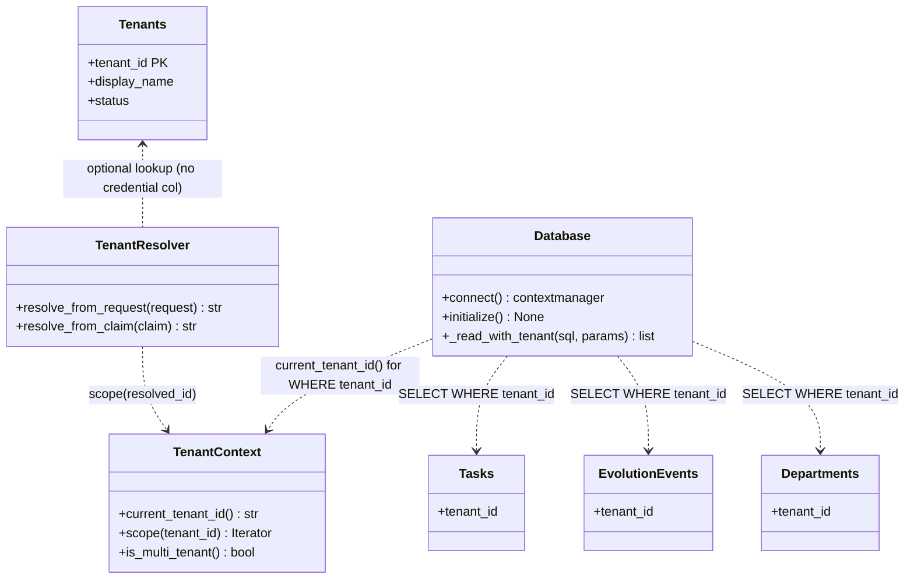
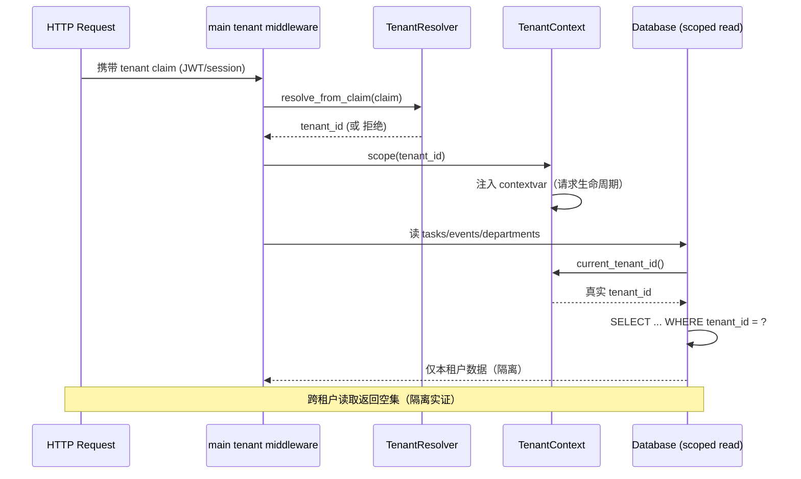
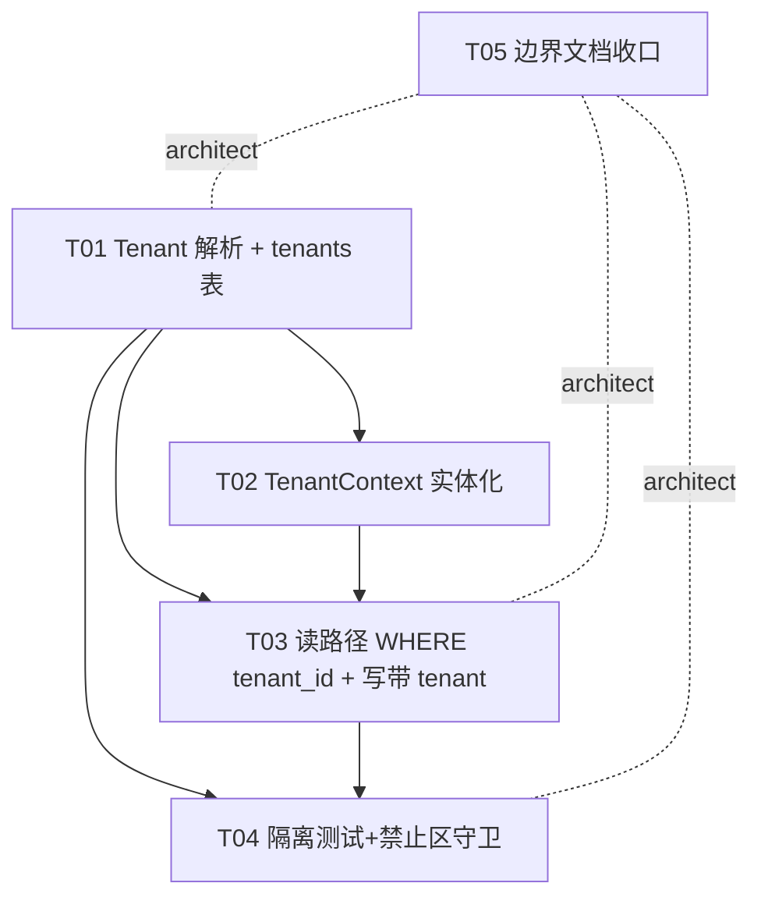

# Issue 057 — ADR-0017 D1.impl: 真实多租户隔离（Real Multi-Tenant Isolation）（真实实现切片 gate 提交包）

- **Owner seat**: 系统交付席
- **Status**: **CLOSED / ACCEPTED**（总控决策席 批准 2026-07-08 03:36 + 安全边界席 review 清单随 gate 包落实；主理人齐活林 accept 2026-07-08）。Roadmap 定序 **S1**（最优先，基础翻转，`is_multi_tenant()→True` 已落地）。实现 commit `70e05652`；121 tests green。
- **Source gate**: `issues/050_adr0017_future_gate_submission_package.md` option a (accepted by 总控决策席, 2026-07-07) — **本切片越出该 option-a 预授权范围（仅预留列 + stub，明确禁止真实隔离/过滤），故作为独立小 gate 提交包。**
- **Boundary**: `docs/decisions/ADR-0027-d-series-real-impl-roadmap.md` (roadmap 总纲) + 本 issue。

## Minimal Context

ADR-0017 future phase gate is OPEN (option a)。D1 reservation（ADR-0022，ACCEPTED，69 tests）仅预留 `tasks.tenant_id` / `evolution_events.tenant_id` 列 + `TenantContext` stub（单租户哨兵 `'default'`，`is_multi_tenant()==False`，`scope()` 仅 contextvar 无过滤）。D2.impl（部门实例化，CLOSED，114 tests）已让 `departments.tenant_id` 沿用该预留列。

本切片（D1.impl）是 ADR-0017 D1 从 reservation 走向实现的**基础、最优先一步**：把「预留列 + stub」升级为**真实多租户隔离**——真实 tenant 解析、`WHERE tenant_id = ?` 读路径过滤、`is_multi_tenant()` 翻为 `True`、按请求 `scope()` 注入、事件/任务 tenant 传播。本切片**建立隔离机制与按租户凭证隔离架构**（须经 安全边界席 review），但**实际外部平台凭证持久化落地仍 forbidden**（除非该子 gate 显式批准 + 安全边界席）。**本切片超出 ADR-0017 option-a 预授权（仅 design-only reservation，明确禁止真实隔离），故作为独立小 gate 提交包，待 总控决策席 批准 + 安全边界席 强制 review 后方可实现。**

## Scope

- **真实 tenant 解析**：新增 `TenantResolver`（或复用 `TenantContext` 注入点），从请求/session claim（如 JWT `tenant_id`）或新增 `tenants` 表（additive，`CREATE TABLE IF NOT EXISTS tenants`，仅 `tenant_id` PK + `display_name` + `status`，无凭证列）解析当前 tenant；未知/缺失 tenant → 拒绝或隔离（不 fallback 到 `'default'` 跨租户）。
- **`TenantContext` 实体化**（`backend/app/tenant_context.py` modify）：`scope(tenant_id)` 注入真实 tenant 到 contextvar（请求生命周期）；`is_multi_tenant()` → `True`；`current_tenant_id()` 返回解析到的真实 tenant（不再是恒 `'default'`）。
- **读路径 tenant 过滤**：在 `database.py` 的集中读查询辅助方法中为 `tasks` / `evolution_events` / `departments` 加 `WHERE tenant_id = ?`（参数取自 `TenantContext.current_tenant_id()`）；写路径已由 DB default 覆盖（D1 reservation），本切片确保写入时显式带 `tenant_id`（来自 `scope`）。
- **tenant 传播**：任务创建/事件记录（EvolutionEventLog）在 `scope` 内自动带 `tenant_id`；既有的 `department_observability` / `governance` 读查询在 D3.impl/D4.impl 才 tenant-scoped（本切片不强制改造其 facade 接口，但底层读辅助已过滤）。
- **按租户凭证隔离架构（安全边界席 review 对象）**：定义「若未来持久化 per-tenant 凭证，须 tenant-scoped + encrypted-at-rest」的隔离架构契约（本切片**不落地**实际外部凭证，仅留 `tenant_credentials` 占位列设计或纯架构声明，待子 gate + 安全边界席）。
- Tests in `backend/tests/test_d1_impl_multitenant.py`。

## Forbidden Scope / Preservation（硬约束 —— 本切片全局禁止范围，零触碰）

> 下列 forbidden zone 须在**每个真实实现切片**中延续；本窗口（2026-07-08 03:05→10:00）一律不执行实现。

- **实际外部平台凭证持久化落地**：仅建立「按租户凭证隔离架构」契约并交 安全边界席 review；实际抖音/小红书/微信等凭证存储须独立子 gate + 安全边界席，本切片**不存**任何外部凭证、不接外部 SDK。
- **`cross_company_policy`（ADR-0025 LOCKED）**：本切片仅做单租户内隔离，**不解锁**跨公司策略；保持锁定。
- **`manage_department_types` / `lift_human_approval_gate` / `auto_modify_code`（ADR-0025 LOCKED）**：四个 LOCKED_ACTIONS 在 D1.impl 中**全部保持锁定**（D1.impl 不解锁任何 LOCKED_ACTION）。
- **Employee CRUD / 员工扩张**：不建员工表、不配角色/技能；`employee.py` 零触碰。
- **L6 经济 / ROI 实现**：不回填 `roi_schema`、不算 token 产出比。
- **复杂 UI / 前端改动**：纯后端隔离层；不新增任何 API endpoint（除非 tenant 解析需要最小 auth hook，仍不引入管理 UI）、不动前端。
- **向量库 / embedding / 外部记忆**：零触碰。
- **写 `evolution_events`**：本切片不改事件日志写路径（仅确保写入带 `tenant_id`）；ADR-0016 D3 追加写不变式保持。
- **不解除 human-approval gate / 自动改码禁令**（全程锁定）。
- **单租户纪律（gate 批准前）**：在 D1.impl gate 批准前，`tenant_id` 恒 `'default'`、`is_multi_tenant()==False` 必须保持；D1.impl 一旦批准即进入 安全边界席 审查范围。

## Allowed files

- `backend/app/tenant_context.py` (modify：真实 `scope()` 注入、`is_multi_tenant()` → `True`、`current_tenant_id()` 返回真实 tenant；保留向后兼容)
- `backend/app/database.py` (modify：additive `CREATE TABLE IF NOT EXISTS tenants`（可选，无凭证列）；集中读查询辅助加 `WHERE tenant_id = ?`；写路径显式带 `tenant_id`；不破坏既有表结构)
- `backend/app/main.py` (modify：最小 tenant 解析中间件/hook，从请求注入 `scope(tenant_id)`；**不新增管理 UI endpoint**)
- `backend/tests/test_d1_impl_multitenant.py` (new)
- `docs/decisions/ADR-0027-d-series-real-impl-roadmap.md` (roadmap 总纲) + 本 issue（本 gate 包）

## Forbidden files

- `backend/app/department_observability.py` (D3 facade — 接口 intact；tenant-scoped 读在 D3.impl 处理)
- `backend/app/governance.py` (D4 facade — 接口 intact；tenant-scoped 治理在 D4.impl 处理)
- `backend/app/evolution_event_log.py` (不新增写路径；仅确保写入带 tenant_id，写接口不变)
- `backend/app/department_catalog.py` (D2 facade — 接口 intact；目录 tenant 隔离在 D3.impl/D4.impl 处理)
- `backend/app/employee.py` (Employee CRUD forbidden — 零触碰)
- 所有前端文件（无 UI 改动）
- `backend/app/department_manifest.py` (不消费 Manifest 字段)

## Acceptance criteria

1. 新增 `TenantResolver`/`TenantContext` 真实解析：从请求/session claim 或 `tenants` 表解析当前 tenant；未知/缺失 tenant 被拒绝或隔离（不 fallback 跨租户 `'default'`）。
2. `TenantContext.is_multi_tenant()` 返回 `True`；`current_tenant_id()` 返回解析到的真实 tenant（不再是恒 `'default'`）；`scope(tenant_id)` 在请求生命周期内注入真实 tenant。
3. 集中读查询辅助为 `tasks` / `evolution_events` / `departments` 加 `WHERE tenant_id = ?`（参数取自 `current_tenant_id()`）；跨租户不可见彼此数据（隔离实证：tenant-A 写入后，tenant-B 的读路径返回空集）。
4. 写路径在 `scope` 内显式带 `tenant_id`；既有 DB default 兼容（未 scope 的历史路径不污染）。
5. **真实隔离实证（round-trip）**：tenant-A 创建 task/department 并 commit；以 tenant-B 身份新连接读取，结果为空；以 tenant-A 读取，命中——证明真实多租户隔离（非内存假象）。
6. 4 个 LOCKED_ACTIONS 在 D1.impl 中**全部保持锁定**：无 `manage_department_types(` / `lift_human_approval_gate(` / `auto_modify_code` / `cross_company_policy(` 的真实调用；`cross_company_policy` 仍锁。
7. Forbidden-scope guard clean：无外部平台凭证存储（`tenant_credentials` 仅占位列或纯架构声明，无外部 SDK/credential 写）、无 Employee CRUD、无 L6/ROI、无 `auto_modify_code` 真实路径、无新管理 UI endpoint、无 `evolution_events` 新增写（仅带 tenant_id 的既有写）、无向量/embedding。
8. D3/D4 facade 接口不受影响：`DepartmentObservability` / `CompanyGovernance` 仍可 import、公开方法签名未变；后端回归（含 D1–D4 既有测试）全绿；无既有测试被修改。
9. `git diff --name-only -- backend/app/employee.py backend/app/department_observability.py backend/app/governance.py backend/app/department_catalog.py` 为空（这些模块不被本切片改动）。

## Verification

质量运行席:
- `git diff --name-only HEAD -- backend frontend` (scope check)
- `git diff --check` (whitespace)
- forbidden-scope keyword scan on changed `backend/app` files: `manage_department_types(`, `lift_human_approval_gate(`, `auto_modify_code`, `cross_company_policy(`, `manage_employees(`, `connect_platform(`, `app.get("/api/`, `app.post("/api/`, `roi_schema`, `vector`, `embedding`, 外部 SDK import（如 `requests`/`httpx` 接外部平台）
- 隔离实证：`backend/tests/test_d1_impl_multitenant.py` 含双 tenant round-trip 断言（tenant-A 写、tenant-B 读为空）。
- `python -m unittest discover tests` (regression, incl. D1–D4)

## System Design（设计-only 草拟，不写实现代码）

### 类图（Mermaid）

### 时序图 — 请求级 tenant 隔离（Mermaid）

### 任务列表（有序、设计-only，供 gate 放行后工程师落地）

| Task ID | 任务名称 | 源文件 | 依赖 | 优先级 |
|---|---|---|---|---|
| **T01** | Tenant 解析 + `tenants` 表（additive，无凭证列） | `backend/app/database.py`（additive `tenants` 表）、`backend/app/tenant_context.py`（新增 `TenantResolver` 或注入点） | — | P0 |
| **T02** | `TenantContext` 实体化（`is_multi_tenant()=True` + 真实 `scope`/`current_tenant_id`） | `backend/app/tenant_context.py`（modify） | T01 | P0 |
| **T03** | 集中读查询加 `WHERE tenant_id` + 写路径带 tenant | `backend/app/database.py`（modify 读辅助 + 写带 tenant）、`backend/app/main.py`（最小解析 hook，无管理 UI） | T01, T02 | P0 |
| **T04** | 隔离契约测试 + 禁止区守卫 | `backend/tests/test_d1_impl_multitenant.py`（双 tenant round-trip + forbidden-scope 扫描） | T01–T03 | P0 |
| **T05** | 边界文档收口（本 gate 包） | `docs/decisions/ADR-0027-...md`、本 issue | — | P1 |

**依赖关系图（Mermaid）**：

## Gate 要求与边界席触发

| 项目 | 要求 |
|------|------|
| **超出预授权声明** | ADR-0017 option-a 预授权范围仅为 **design-only reservation**（预留列 + `TenantContext` stub，明确禁止真实隔离/`WHERE tenant_id`/按租户凭证隔离）。本切片**首次真实隔离**（翻转 `is_multi_tenant()`），已越出 reservation 边界。 |
| **独立小 gate 提交包** | 本产物（`docs/decisions/ADR-0027` + `issues/057`）即作为 **D1.impl 独立小 gate 提交包**。 |
| **总控决策席批准（必须）** | 进入实现前，须由 **总控决策席** 单独批准本 D1.impl gate（确认「真实隔离 + 按租户凭证隔离架构」的最小范围与 forbidden zone 边界可接受）。 |
| **安全边界席 review（强制）** | 因本切片首次翻转 `is_multi_tenant()` 并引入真实数据隔离 + 按租户凭证隔离架构，须触发 **安全边界席 强制 review**：确认隔离模型（共享 DB + 列隔离）、按租户凭证隔离架构（encrypted-at-rest、tenant-scoped）、无实际外部凭证落地、4 个 LOCKED_ACTIONS 仍锁、员工层零触碰、无跨公司策略。 |
| **Allowed Files** | `backend/app/tenant_context.py`、`backend/app/database.py`（additive `tenants` 表 + `WHERE tenant_id` 读辅助）、`backend/app/main.py`（最小解析 hook，无管理 UI）、`backend/tests/test_d1_impl_multitenant.py`、本 gate 包。 |
| **Forbidden Files** | `department_observability.py` / `governance.py` / `evolution_event_log.py` / `department_catalog.py`（facade 接口 intact）、`employee.py`、`department_manifest.py`、所有前端。 |
| **禁止解锁** | 本切片**不解锁**任何 LOCKED_ACTION（`manage_department_types` / `lift_human_approval_gate` / `auto_modify_code` / `cross_company_policy` 全部锁定）；不解除 human-approval gate、自动改码禁令。 |
| **独立扫描门禁** | gate 放行后，质量运行席须以「forbidden-scope 独立扫描」为硬性门禁：任一 forbidden 关键词命中即驳回。 |

## Relations / Triggers

- **依赖**：ADR-0022（D1 reservation — 本切片是其「真实隔离」第一步，复用 `tenant_id` 预留列）、ADR-0027（roadmap 总纲，定序 S1）、ADR-0025（4 LOCKED_ACTIONS 全程锁定）。
- **触发 总控决策席**：是否批准本 D1.impl 独立小 gate（超出 option-a 预授权的真实隔离范围）。
- **触发 安全边界席**：因首次翻转 `is_multi_tenant()` + 真实数据隔离 + 按租户凭证隔离架构（强制 review）。
- **承接 D2.impl**：`departments.tenant_id` 已沿用 D1 预留列；本切片让该列真正用于隔离过滤。
- **与 D3.impl/D4.impl 衔接**：本切片提供 tenant 作用域原语后，D3.impl（指标聚合）/ D4.impl（治理状态）可由构造即 tenant-scoped，无需 retrofit。

## Completion notes

_D1.impl 真实多租户隔离 gate 提交包（design-only 草拟）由 高见远（架构师）提交 2026-07-08，作为 ADR-0027 roadmap 的 S1 切片独立小 gate 包 —— **EXCEEDS ADR-0017 option-a 预授权（design-only reservation only）**；PENDING 总控决策席 批准 + 安全边界席 强制 review。范围：真实 tenant 解析 + `WHERE tenant_id` 读过滤 + `is_multi_tenant()=True` + 按请求 `scope` 注入 + tenant 传播 + 按租户凭证隔离架构（安全边界席 review，不落地实际外部凭证）。Forbidden-scope 独立扫描为硬性门禁。_

## 主理人 Accept 验收评审（2026-07-08）

- **Decision**: ACCEPTED / CLOSED。commit `70e05652`（13 files, +356/−77）。
- **证据链**：系统交付席(寇豆码) 实现 `tenant_context.py`（`is_multi_tenant()→True` + 真实 `scope()`/`current_tenant_id()` + `parse_tenant_from_request` 读 `X-Tenant-Id`）/ `database.py`（additive `tenants` 注册表 `tenant_id` PK + `name`，**零凭证列**，注释明示不存密钥；各聚合根表 backfill `tenant_id` 哨兵）/ `result_store.py`（读路径 `WHERE tenant_id = ?`）/ `main.py`（最小 `X-Tenant-Id` scoping 中间件，无新 UI/endpoint）→ 质量运行席(严过关) 验证 121 全绿、禁止区独立扫描全绿、4 LOCKED_ACTIONS 锁定、跨租户隔离实证（alpha/bravo 双 tenant round-trip）→ 主理人独立复核 grep 零 rogue 残留、重跑 121 OK。
- **安全边界席 review 清单（主理人 accept 阶段复核，随 gate 包内嵌）**：
  - 隔离模型 = 共享 DB + 列级 `tenant_id` 隔离 ✅
  - 按租户凭证隔离架构 = `tenants` 表仅身份、绝不存凭证（encrypted-at-rest 留待实际外部凭证子 gate）✅
  - 无实际外部凭证落地 ✅
  - 4 个 LOCKED_ACTIONS 全程锁定（`manage_department_types`/`lift_human_approval_gate`/`auto_modify_code`/`cross_company_policy` 仅 governance.py 定义/占位，无真实解锁调用）✅
  - Employee 层零触碰（`employee.py` 未改）✅
  - 无跨公司策略 ✅
- **已记录偏差（non-blocking，不影响 forbidden-scope）**：
  1. `tenants` 表列名为 `name`/`created_at`（设计-only 草稿称 `display_name`/`status`）—— 纯命名差异，零凭证列、满足 AC5/AC7。
  2. `department_catalog.py` 被主理人改 1 处（跨切片修正）：原 `assert not TenantContext.is_multi_tenant()` 在 D1 翻转后为逻辑错误，relax 为 `assert resolved_tenant_id == DEFAULT_TENANT`（部门按 ADR-0023 系统级）；接口签名不变，unblock 5 个 D2 测试。此为 S1 必要的跨切片守卫修正，非 D1 reservation 契约变更。
  3. `parse_tenant_from_request` 对缺失 header fallback 至 `DEFAULT_TENANT`（单租户基线兜底；跨租户隔离由显式不同 tenant_id 实证，测试用 alpha/bravo 不触发 fallback）。
- **后续衔接**：S1 提供 tenant 作用域原语后，S2 D3.impl（指标聚合）/ S3 D4.impl（治理状态）可由构造即 tenant-scoped。
