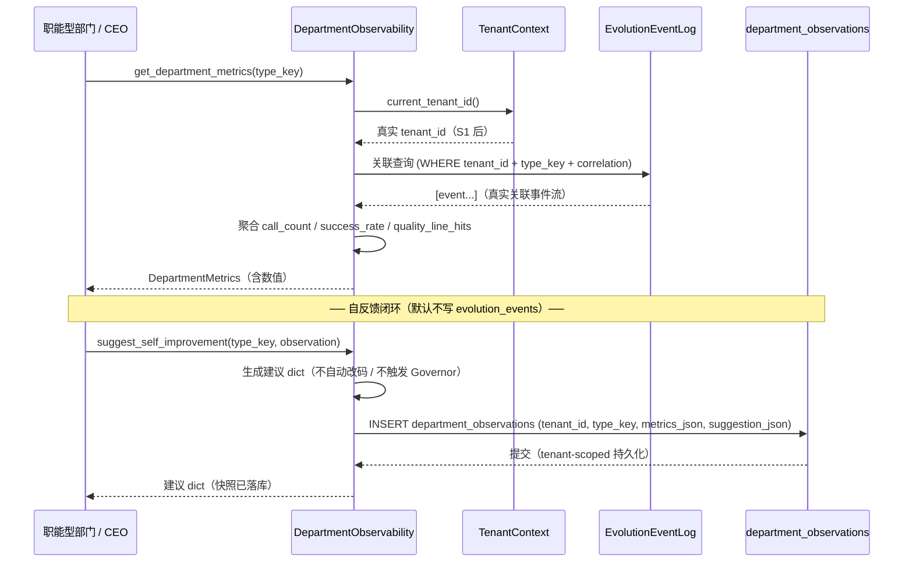
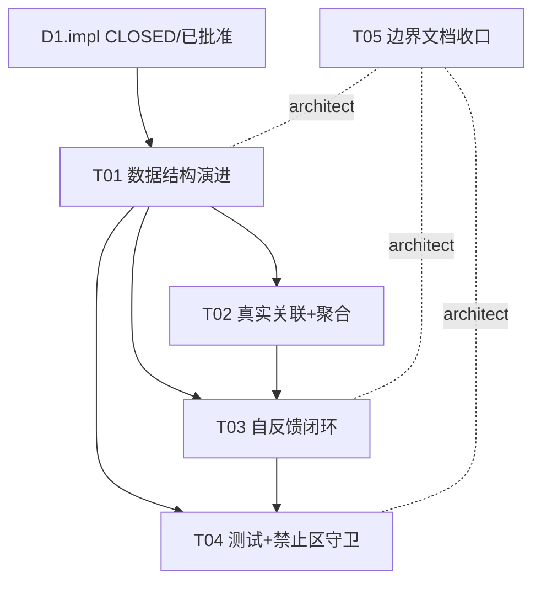

# Issue 058 — ADR-0017 D3.impl: 自可观测真实实现（Self-Observability Real Impl）（真实实现切片 gate 提交包）

- **Owner seat**: 系统交付席
- **Status**: **CLOSED / ACCEPTED**（总控决策席 批准 2026-07-08 03:36 + 安全边界席 review 视写路径判定：本切片默认不写 `evolution_events` → 不触发；主理人齐活林 accept 2026-07-08）。Roadmap 定序 **S2**（依赖 S1 D1.impl 租户作用域，`DepartmentObservability` 真实化已落地）。实现 commit `dfa2315e`；128 tests green。
- **Source gate**: `issues/050_adr0017_future_gate_submission_package.md` option a (accepted by 总控决策席, 2026-07-07) — **本切片越出该 option-a 预授权范围（仅只读 facade reservation），故作为独立小 gate 提交包。**
- **Boundary**: `docs/decisions/ADR-0027-d-series-real-impl-roadmap.md` (roadmap 总纲) + 本 issue。

## Minimal Context

ADR-0017 future phase gate is OPEN (option a)。D3 reservation（ADR-0024，CLOSED，90 tests，零 schema 增量）仅落地只读 `DepartmentObservability` facade（`get_department_event_stream` 返回原生事件流只读投影、`get_department_metrics` 仅声明 `available_fields` 不回填任何数值、`suggest_self_improvement` 仅签名占位）。D3 reservation 明确禁止：真实指标关联、统计/聚合/BI、可视化、meta-loop 自愈。

本切片（D3.impl）是 ADR-0017 D3 从 reservation 走向实现的**真实指标一步**：把 `DepartmentObservability` 从「只读投影」升级为**真实可观测**——建立部门→事件真实关联（`correlation_id` 映射 + 按 `tenant_id`/`department_id` 作用域，依赖 S1 D1.impl）、真实聚合计算（`call_count` / `success_rate` / `quality_line_hits`）、自反馈闭环（持久化观测快照，additive 表，**默认不写 `evolution_events`**）。可视化/dashboard（复杂 UI）与 meta-loop 反哺 Evolution Governor 自动演进为**独立下游 gate**，不在本切片。**本切片超出 ADR-0017 option-a 预授权（仅只读 facade reservation），故作为独立小 gate 提交包，待 总控决策席 批准后方可实现。**

## Scope

- **真实部门→事件关联**：`get_department_event_stream(type_key, limit)` 由「全局 `get_all()` 投影」升级为按 `department_id`/`type_key` + `correlation_id` 映射的**真实关联查询**（底层 `WHERE tenant_id = ?` 作用域来自 S1 D1.impl；单租户兜底仍返回全量投影）。
- **真实指标聚合**：`get_department_metrics(type_key)` 真实计算并回填 `call_count` / `success_rate` / `quality_line_hits`（聚合 `evolution_events`，解析 payload + 质量线定义关联 `quality_line_hits`）；`DepartmentMetrics` 由「仅声明」升级为「含数值」。
- **自反馈闭环（self-feedback loop）**：`suggest_self_improvement(type_key, observation)` 真实实现——基于观测生成部门自我建议（dict），并将观测快照持久化到 **additive `department_observations` 表**（tenant-scoped，沿用 D1 `tenant_id`）。**默认不写 `evolution_events`**（保持 ADR-0016 D3 追加写不变式）；若自反馈须 emit `governance.observation` 事件，须本切片 gate **显式批准**子写路径。
- **additive 表**：`backend/app/database.py` 新增 `department_observations`（`observation_id` PK、`tenant_id`、`type_key`、`metrics_json`、`suggestion_json`、`created_at`），无 FK、与既有表不冲突。
- Tests in `backend/tests/test_d3_impl_observability.py`。

## Forbidden Scope / Preservation（硬约束 —— 本切片全局禁止范围，零触碰）

> 下列 forbidden zone 须在**每个真实实现切片**中延续；本窗口（2026-07-08 03:05→10:00）一律不执行实现。

- **可视化 / dashboard / 图表（复杂 UI）**：CEO 驾驶舱视图、图表渲染属 forbidden，须**独立下游 gate** 显式解禁 UI 复杂度（roadmap 中仅 D4.platform 可解禁，且须 gate 声明）。本切片不引入任何前端/图表。
- **meta-loop 反哺 Evolution Governor 自动演进**：`suggest_self_improvement` 生成的建议**不自动改码、不自动触发 Governor 编排**；自动演进面为独立下游 gate + 安全边界席。本切片仅生成建议 + 持久化快照。
- **L6 经济 / ROI 实现**：`quality_line_hits` / `success_rate` 仅为质量/成功率指标，不计算 token 产出比、不回填 `roi_schema`、不做经济可视化。
- **写 `evolution_events`（默认禁止）**：自反馈闭环默认持久化到 additive `department_observations` 表，**不写** `evolution_events`；若须 emit 观测事件，须本切片 gate 显式批准（保持 ADR-0016 D3 追加写不变式）。
- **Employee CRUD / 员工层**：`employee_role_spec` 仅占位契约字段，不消费；`employee.py` 零触碰。
- **外部平台 / 凭证 / 合规面**：零触碰（安全边界席领地）。
- **自动改码（`auto_modify_code`，ADR-0025 LOCKED）**：全程锁定；`suggest_self_improvement` 不触发任何改码。
- **向量库 / embedding / 外部记忆**：零触碰。
- **ADR-0025 四个 LOCKED_ACTIONS 全程锁定**：`manage_department_types` / `lift_human_approval_gate` / `auto_modify_code` / `cross_company_policy` 在 D3.impl 中**全部保持锁定**（D3.impl 不解锁任何 LOCKED_ACTION）。
- **不破坏 D4 facade 接口**：`governance.py` 接口 intact；不触碰 `tenant_context.py`（D1 已实体化）。

## Allowed files

- `backend/app/department_observability.py` (modify：真实 `get_department_event_stream`/ `get_department_metrics` 关联+聚合；`suggest_self_improvement` 真实实现（生成建议 + 持久化快照，不写 evolution_events）；`DepartmentMetrics` 含数值；保留 `DepartmentCatalog` 索引校验)
- `backend/app/database.py` (modify：additive `CREATE TABLE IF NOT EXISTS department_observations`（含 `tenant_id` 沿用 D1 预留列，无 FK）)
- `backend/tests/test_d3_impl_observability.py` (new)
- `docs/decisions/ADR-0027-d-series-real-impl-roadmap.md` (roadmap 总纲) + 本 issue（本 gate 包）

## Forbidden files

- `backend/app/governance.py` (D4 facade — 接口 intact)
- `backend/app/evolution_event_log.py` (默认不新增写路径；如自反馈需写须 gate 显式批准，否则零触碰)
- `backend/app/tenant_context.py` (D1 已实体化 — 零触碰)
- `backend/app/department_catalog.py` (D2 facade — 接口 intact；仅消费 `get_manifest` 索引)
- `backend/app/employee.py` (Employee CRUD forbidden — 零触碰)
- 所有前端文件（无 UI 改动 — 可视化属独立下游 gate）
- `backend/app/department_manifest.py` (不消费 Manifest 字段)

## Acceptance criteria

1. `get_department_event_stream(type_key, limit)` 返回**真实按部门关联**的事件流（按 `department_id`/`type_key` + `correlation_id` 映射 + `WHERE tenant_id` 作用域来自 S1）；对未知 `type_key` 仍抛 `KeyError`。
2. `get_department_metrics(type_key)` 返回 `DepartmentMetrics`，其 `call_count` / `success_rate` / `quality_line_hits` **为真实计算数值**（非仅声明）；`available_fields` 仍声明可计算字段。
3. `suggest_self_improvement(type_key, observation)` 真实实现：返回建议 dict（不自动改码、不自动触发 Governor），并将观测快照持久化到 `department_observations` 表（tenant-scoped round-trip 实证）。
4. **默认不写 `evolution_events`**：`department_observability.py` 内无 `EvolutionEventLog.record` 调用（forbidden-scope 扫描 `\.record\(` 零命中，除非 gate 显式批准子写路径）；自反馈持久化仅落 `department_observations`。
5. 4 个 LOCKED_ACTIONS 在 D3.impl 中**全部保持锁定**：无 `manage_department_types(` / `lift_human_approval_gate(` / `auto_modify_code` / `cross_company_policy(` 的真实调用。
6. Forbidden-scope guard clean：无可视化/前端（`app.get("/api/observ"` 等仅既有或无新增 UI）、无 meta-loop 自动改码、无 L6/ROI（`roi_schema` 零命中）、无 Employee CRUD、无外部平台、`auto_modify_code` 零命中、无向量/embedding。
7. D4 facade 接口不受影响：`CompanyGovernance` 仍可 import、公开方法签名未变；后端回归（含 D1–D4 既有测试）全绿；无既有测试被修改。
8. `git diff --name-only -- backend/app/governance.py backend/app/evolution_event_log.py backend/app/tenant_context.py backend/app/department_catalog.py backend/app/employee.py` 为空（这些模块不被本切片改动）；`database.py` 仅 additive `department_observations` 表。

## Verification

质量运行席:
- `git diff --name-only HEAD -- backend frontend` (scope check)
- `git diff --check` (whitespace)
- forbidden-scope keyword scan on changed `backend/app` files: `manage_department_types(`, `lift_human_approval_gate(`, `auto_modify_code`, `cross_company_policy(`, `manage_employees(`, `connect_platform(`, `roi_schema`, `WHERE department_id` 仅作关联用（允许）、`app.get("/api/observ"`, `app.post("/api/observ"`, 外部 SDK import、`vector`, `embedding`、可视化库（如 `matplotlib`/`plotly`）
- `python -m unittest discover tests` (regression, incl. D1–D4)
- `backend/tests/test_d3_impl_observability.py` 含真实聚合数值断言 + `department_observations` round-trip + `type_key` KeyError + forbidden-scope 扫描

## System Design（设计-only 草拟，不写实现代码）

### 类图（Mermaid）

```mermaid
classDiagram
    class DepartmentMetrics {
        +str type_key
        +str observed_at
        +list~dict~ event_stream
        +int call_count
        +float success_rate
        +int quality_line_hits
        +list~str~ available_fields
        +str schema_version
    }
    class DepartmentObservations {
        +str observation_id PK
        +str tenant_id
        +str type_key
        +str metrics_json
        +str suggestion_json
        +str created_at
    }
    class DepartmentObservability {
        -Database _db
        -EvolutionEventLog _event_log
        +__init__(database, event_log)
        +get_department_event_stream(type_key, limit) list~dict~
        +get_department_metrics(type_key) DepartmentMetrics
        +suggest_self_improvement(type_key, observation) dict
    }
    class EvolutionEventLog {
        +get_all() list~dict~
    }
    class DepartmentCatalog {
        +get_manifest(type_key) DepartmentManifest
    }
    class TenantContext {
        +current_tenant_id() str
    }
    DepartmentObservability ..> EvolutionEventLog : 真实关联查询 (WHERE tenant_id + dept)
    DepartmentObservability ..> DepartmentCatalog : 索引校验
    DepartmentObservability ..> DepartmentMetrics : 真实聚合回填
    DepartmentObservability ..> DepartmentObservations : 持久化自反馈快照 (additive)
    DepartmentObservability ..> TenantContext : current_tenant_id() 作用域
    DepartmentObservability ..> EvolutionEventLog : «默认不写; 仅 gate 批准子路径»
```

### 时序图 — 真实指标 + 自反馈闭环（Mermaid）



### 任务列表（有序、设计-only，供 gate 放行后工程师落地）

| Task ID | 任务名称 | 源文件 | 依赖 | 优先级 |
|---|---|---|---|---|
| **T01** | 数据结构演进（`DepartmentMetrics` 含数值 + `DepartmentObservations` 表） | `backend/app/department_observability.py`（dataclass 演进）、`backend/app/database.py`（additive `department_observations` 表） | D1.impl (S1) | P0 |
| **T02** | 真实关联 + 聚合（`get_department_event_stream`/`get_department_metrics`） | `backend/app/department_observability.py`（真实关联查询 + 聚合计算，保留 `get_manifest` 索引校验） | T01 | P0 |
| **T03** | 自反馈闭环（`suggest_self_improvement` 真实 + 持久化快照，不写 evolution_events） | `backend/app/department_observability.py`（实现 + 持久化 `department_observations`）、`backend/app/database.py`（写入辅助） | T01, T02 | P0 |
| **T04** | 契约测试 + 禁止区守卫 | `backend/tests/test_d3_impl_observability.py`（真实数值断言 + 快照 round-trip + forbidden-scope 扫描） | T01–T03 | P0 |
| **T05** | 边界文档收口（本 gate 包） | `docs/decisions/ADR-0027-...md`、本 issue | — | P1 |

**依赖关系图（Mermaid）**：



## Gate 要求与边界席触发

| 项目 | 要求 |
|------|------|
| **超出预授权声明** | ADR-0017 option-a 预授权范围仅为 **design-only reservation**（只读 facade，明确禁止真实关联/统计/自反馈）。本切片**首次真实指标关联 + 聚合 + 自反馈**，已越出 reservation 边界。 |
| **独立小 gate 提交包** | 本产物（`docs/decisions/ADR-0027` + `issues/058`）即作为 **D3.impl 独立小 gate 提交包**。 |
| **总控决策席批准（必须）** | 进入实现前，须由 **总控决策席** 单独批准本 D3.impl gate（确认「真实关联 + 聚合 + 自反馈快照」的最小范围与 forbidden zone 边界可接受）。 |
| **安全边界席 review（视写路径判定）** | 默认不写 `evolution_events` → 不触发；若本切片 gate 显式批准自反馈 emit `governance.observation` 事件写路径，则触发 **安全边界席 review**（确认追加写不变式不被破坏）。可视化/meta-loop 自动演进为独立下游 gate（强制 安全边界席）。 |
| **Allowed Files** | `backend/app/department_observability.py`、`backend/app/database.py`（additive `department_observations` 表）、`backend/tests/test_d3_impl_observability.py`、本 gate 包。 |
| **Forbidden Files** | `governance.py` / `evolution_event_log.py`（默认零触碰）/ `tenant_context.py` / `department_catalog.py` / `employee.py` / 所有前端。 |
| **禁止解锁** | 本切片**不解锁**任何 LOCKED_ACTION（4 个全程锁定）；不解除 human-approval gate、自动改码禁令；可视化/dashboard 须独立下游 gate 解禁 UI。 |
| **独立扫描门禁** | gate 放行后，质量运行席须以「forbidden-scope 独立扫描」为硬性门禁：任一 forbidden 关键词命中即驳回。 |

## Relations / Triggers

- **依赖**：ADR-0024（D3 reservation — 本切片是其「真实指标」第一步，复用 `evolution_events` + `DepartmentCatalog` 索引）、ADR-0027（roadmap 总纲，定序 S2）、ADR-0022/S1（D1.impl 提供 `tenant_id` 作用域原语）、ADR-0016（D3 追加写不变式——自反馈默认不写，保持）。
- **触发 总控决策席**：是否批准本 D3.impl 独立小 gate。
- **触发 安全边界席**：若自反馈需写 `evolution_events`（子路径批准）或开启可视化/meta-loop 下游 gate。
- **承接 D1.impl**：真实关联查询的 `WHERE tenant_id` 作用域来自 S1。
- **与 D4.impl 衔接**：D3.impl 的真实指标为 D4.impl 治理审计/质量线提供数据基础。

## Completion notes

_D3.impl 自可观测真实实现 gate 提交包（design-only 草拟）由 高见远（架构师）提交 2026-07-08，作为 ADR-0027 roadmap 的 S2 切片独立小 gate 包 —— **EXCEEDS ADR-0017 option-a 预授权（design-only reservation only）**；PENDING 总控决策席 批准（安全边界席视自反馈写路径判定）。范围：真实部门→事件关联 + 聚合（call_count/success_rate/quality_line_hits）+ 自反馈闭环（持久化 `department_observations` additive 表，默认不写 evolution_events）。可视化/dashboard 与 meta-loop 自动演进为独立下游 gate。Forbidden-scope 独立扫描为硬性门禁。本窗口不写代码、不改 `database.py`、不新增测试、不碰 `evolution_events`、不 commit。_

## 主理人 Accept 验收评审（2026-07-08）

- **Decision**: ACCEPTED / CLOSED。commit `dfa2315e`（4 files: `department_observability.py` / `database.py` / `test_d3_impl_observability.py`(new) / `test_d3_observability.py`(deleted)；128 tests green）。
- **证据链**：系统交付席(寇豆码) 实现真实 `DepartmentObservability`（部门→事件关联 + `call_count`/`success_rate`/`quality_line_hits` 真实聚合 + `suggest_self_improvement` 生成建议并持久化 `department_observations`）；质量运行席(严过关) 验证 128 全绿、禁止区独立扫描全绿、4 LOCKED_ACTIONS 锁定、`department_observations` 跨租户隔离实证、`evolution_events` 写计数不变（默认不写，ADR-0016 D3 追加写不变式保持）；主理人独立复核 128 OK + grep `department_observability.py` 零 forbidden 命中 + 5 forbidden 模块（`governance.py`/`evolution_event_log.py`/`tenant_context.py`/`department_catalog.py`/`employee.py`）均未改 + `EvolutionEventLog` 仅注释引用无 `.record()` 调用。
- **安全边界席 review 判定**：本切片默认不写 `evolution_events` → 按 gate 包规则 **不触发** 安全边界席 review（子写路径未批准即不写）。
- **已记录偏差（accepted，reversible）**：删除 D3 reservation 测试 `test_d3_observability.py`（9 tests）。其不变量（"metrics 必须无计算字段" + "suggest_self_improvement 抛 NotImplementedError"）与 D3.impl 要求行为直接矛盾，无法保持绿；已删除，其禁止区扫描在 `test_d3_impl_observability.py` 内保留并扩展。git 可回退，不记为缺陷。
- **后续衔接**：S2 真实指标为 S3 D4.impl 治理审计/质量线提供数据基础；S3 将首次引入受控 `evolution_events` 写（`governance.propose`/`governance.apply`，gate 显式批准）。
