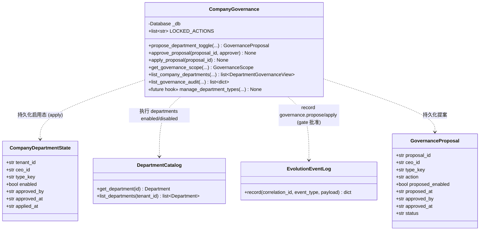
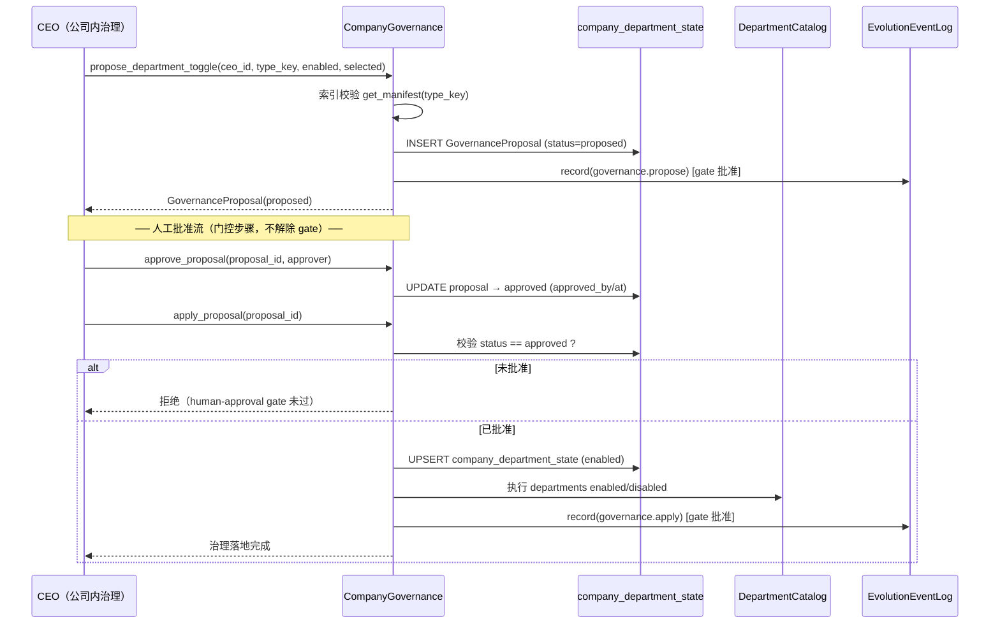
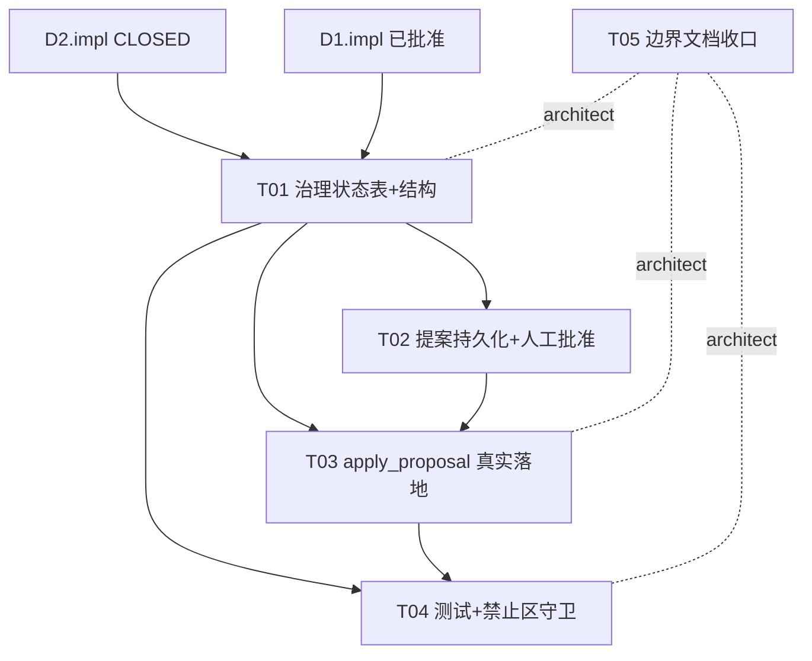

# Issue 059 — ADR-0017 D4.impl: 两级治理真实实现（Two-Tier Governance Real Execution）（真实实现切片 gate 提交包）

- **Owner seat**: 系统交付席
- **Status**: **CLOSED / ACCEPTED**（总控决策席 批准 2026-07-08 03:36 + 安全边界席 review 建议项：状态变更类，已确认 human-approval gate 未解除、4 LOCKED_ACTIONS 仍锁、受控 `governance.*` 写保持 ADR-0016 不变式；主理人齐活林 accept 2026-07-08）。Roadmap 定序 **S3**（`CompanyGovernance` 真实治理执行已落地）。实现 commit `20cb4776`；138 tests green。
- **Source gate**: `issues/050_adr0017_future_gate_submission_package.md` option a (accepted by 总控决策席, 2026-07-07) — **本切片越出该 option-a 预授权范围（仅只读/提案 facade reservation），故作为独立小 gate 提交包。**
- **Boundary**: `docs/decisions/ADR-0027-d-series-real-impl-roadmap.md` (roadmap 总纲) + 本 issue。

## Minimal Context

ADR-0017 future phase gate is OPEN (option a)。D4 reservation（ADR-0025，CLOSED，100 tests，零 schema 增量）仅落地只读 `CompanyGovernance` facade（`get_governance_scope` / `list_company_departments` / `propose_department_toggle` 仅构造内存 `GovernanceProposal` 不持久化 / `list_governance_audit` 只读投影）+ 2 个 future hook（`apply_proposal` / `manage_department_types` 仅占位）。D4 reservation 明确禁止：提案落地、平台级管理后台、真实公司持久化、解除任何 gate。

本切片（D4.impl）是 ADR-0017 D4 从 reservation 走向实现的**治理执行一步**：把 `apply_proposal` 从占位升级为**真实治理执行**——持久化 CEO 公司部门启用态（additive `company_department_state` 表，tenant/CEO-scoped）、写 `governance.*` 事件（经 gate 显式批准的受控写路径，保持 ADR-0016 D3 追加写不变式）、对 D2.impl 真实 `departments` 执行 enabled/disabled、**保留人工批准流作为门控步骤（不解除 human-approval gate）**。`manage_department_types`（平台级）留待 S4 D4.platform；`lift_human_approval_gate` / `auto_modify_code` / `cross_company_policy` 全程锁定。**本切片超出 ADR-0017 option-a 预授权（仅只读/提案 facade reservation），故作为独立小 gate 提交包，待 总控决策席 批准 + 安全边界席 review 后方可实现。**

## Scope

- **`propose_department_toggle` 持久化**：由「构造内存对象」升级为持久化 `GovernanceProposal`（status=`proposed`，tenant/CEO-scoped），可经 gate 批准写 `governance.propose` 事件（ADR-0016 D3 追加写不变式保持）。
- **人工批准流（门控步骤，不解除 gate）**：新增 `approve_proposal(proposal_id, approver)`（**最小后端方法，无 UI**——复杂 UI 禁令在本切片仍生效，仅 D4.platform 解禁）——将提案置为 `approved`（记录 `approved_by` / `approved_at`）。`apply_proposal` 仅当 status=`approved` 时执行，human-approval gate 作为强制步骤保留。
- **`apply_proposal` 真实落地**：持久化公司部门启用态到 additive `company_department_state`（`tenant_id` / `ceo_id` / `type_key` / `enabled` / `approved_by` / `approved_at` / `applied_at`），并对 D2.impl 真实 `departments` 执行 enabled/disabled（经 `DepartmentCatalog` 既有 `get_department`/`list_departments` + 状态更新），写 `governance.apply` 事件（gate 批准）。
- **治理审计读/写**：`list_governance_audit` 只读投影（保持）；治理动作经 `EvolutionEventLog.record` 留痕（`governance.propose` / `governance.apply`，**须本切片 gate 显式批准**）。
- **additive 表**：`backend/app/database.py` 新增 `company_department_state`（见下）；不建 `company_topology` 全量表（最小持久化）。
- Tests in `backend/tests/test_d4_impl_governance.py`。

## Forbidden Scope / Preservation（硬约束 —— 本切片全局禁止范围，零触碰）

> 下列 forbidden zone 须在**每个真实实现切片**中延续；本窗口（2026-07-08 03:05→10:00）一律不执行实现。

- **`manage_department_types`（ADR-0025 LOCKED）**：平台级部门类型目录增删**不解锁**，留待 S4 D4.platform；本切片不写 `department_types` 增删。
- **`lift_human_approval_gate`（ADR-0025 LOCKED）**：**全程锁定**；本切片以「人工批准流作为门控步骤」实现治理执行，**不解除** human-approval gate（任何变更须人工批准）。
- **`auto_modify_code`（ADR-0025 LOCKED）**：全程锁定；治理执行不触发任何自动改码。
- **`cross_company_policy`（ADR-0025 LOCKED）**：本切片仅公司内（单 CEO）治理执行，**不解锁**跨公司策略；保持锁定（依赖 S1 + S4）。
- **L6 经济 / ROI 实现**：不回填 `roi_schema`、不算 token 产出比。
- **外部平台 / 凭证 / 合规面**：零触碰（安全边界席领地）。
- **Employee CRUD / 员工层**：`employee.py` 零触碰。
- **复杂 UI / 前端改动**：本切片**仅最小后端批准方法**（无管理 UI）；复杂 UI 禁令仍生效，仅 D4.platform 可解禁。
- **向量库 / embedding / 外部记忆**：零触碰。
- **写 `evolution_events`（受控）**：仅 `governance.propose` / `governance.apply` 经**本切片 gate 显式批准**方可写（保持 ADR-0016 D3 追加写不变式）；其他写路径禁止。
- **不破坏 D3 facade / D1 不变式**：`department_observability.py` / `tenant_context.py` 接口 intact。

## Allowed files

- `backend/app/governance.py` (modify：`propose_department_toggle` 持久化；新增 `approve_proposal`（人工批准，最小后端）；`apply_proposal` 真实落地（持久化 `company_department_state` + 执行 `departments` enabled/disabled + 写 `governance.*` 事件，gate 批准）；`DepartmentGovernanceView` 反映真实启用态；保留 `get_governance_scope` / `list_company_departments` / `list_governance_audit`；`manage_department_types` 仍 placeholder)
- `backend/app/database.py` (modify：additive `CREATE TABLE IF NOT EXISTS company_department_state`（`tenant_id` / `ceo_id` / `type_key` / `enabled` / `approved_by` / `approved_at` / `applied_at`，无 FK）)
- `backend/app/department_catalog.py` (modify only if needed：启用/停用真实 `departments` 的状态更新方法；**优先复用既有 `get_department`/`list_departments` + 状态写辅助**，保持 `create_department`/`assemble_company_topology` 签名不变)
- `backend/tests/test_d4_impl_governance.py` (new)
- `docs/decisions/ADR-0027-d-series-real-impl-roadmap.md` (roadmap 总纲) + 本 issue（本 gate 包）

## Forbidden files

- `backend/app/department_observability.py` (D3 facade — 接口 intact)
- `backend/app/evolution_event_log.py` (不修改模块；治理事件经其**既有 public `record()` API** 写入，本切片 gate 显式批准该受控写路径)
- `backend/app/tenant_context.py` (D1 已实体化 — 零触碰)
- `backend/app/employee.py` (Employee CRUD forbidden — 零触碰)
- 所有前端文件（无 UI 改动 — 复杂 UI 仅 D4.platform 解禁）
- `backend/app/department_manifest.py` (不消费 Manifest 字段)

## Acceptance criteria

1. `propose_department_toggle(ceo_id, type_key, enabled, selected)` 持久化 `GovernanceProposal`（status=`proposed`，tenant/CEO-scoped），对未知 `type_key` 仍抛 `KeyError`；可经 gate 批准写 `governance.propose` 事件。
2. 新增 `approve_proposal(proposal_id, approver)`（最小后端，无 UI）：将提案置 `approved`（记录 `approved_by` / `approved_at`）。
3. `apply_proposal(proposal_id)` **仅当 status=`approved` 时执行**（human-approval gate 作为强制步骤，未被解除）；执行时持久化 `company_department_state`（tenant/CEO-scoped enabled 态）+ 对 D2.impl 真实 `departments` 执行 enabled/disabled + 写 `governance.apply` 事件（gate 批准）。
4. `DepartmentGovernanceView` / `list_company_departments` 反映真实启用态（来自 `company_department_state`）。
5. 4 个 LOCKED_ACTIONS 在 D4.impl 中**全部保持锁定**：无 `manage_department_types(`（仅 placeholder）/ `lift_human_approval_gate(` / `auto_modify_code` / `cross_company_policy(` 的真实调用；human-approval gate 未被解除。
6. **受控 `evolution_events` 写**：仅 `governance.propose` / `governance.apply` 经 gate 显式批准写入（保持 ADR-0016 D3 追加写不变式）；无其他写路径（forbidden-scope 扫描 `insert into evolution_events` / `\.record\(` 仅命中受控治理写）。
7. Forbidden-scope guard clean：无平台级类型增删、无 L6/ROI、无 Employee CRUD、无外部平台、无 `auto_modify_code` 真实路径、无新管理 UI endpoint（`app.get("/api/govern"` 仅既有或无新增 UI）、无向量/embedding。
8. D3 facade / D1 不变式不受影响：`DepartmentObservability` 仍可 import、签名未变；`TenantContext` 不变；后端回归（含 D1–D4 既有测试）全绿；无既有测试被修改。
9. `git diff --name-only -- backend/app/department_observability.py backend/app/tenant_context.py backend/app/employee.py` 为空（这些模块不被本切片改动）；`database.py` 仅 additive `company_department_state` 表。

## Verification

质量运行席:
- `git diff --name-only HEAD -- backend frontend` (scope check)
- `git diff --check` (whitespace)
- forbidden-scope keyword scan on changed `backend/app` files: `manage_department_types(`, `lift_human_approval_gate(`, `auto_modify_code`, `cross_company_policy(`, `manage_employees(`, `connect_platform(`, `roi_schema`, `app.get("/api/govern"`, `app.post("/api/govern"`, 外部 SDK import、`vector`, `embedding`
- 受控写核查：`insert into evolution_events` / `\.record\(` 仅命中 `governance.propose` / `governance.apply`（gate 批准清单）
- `python -m unittest discover tests` (regression, incl. D1–D4)
- `backend/tests/test_d4_impl_governance.py` 含：proposal 持久化 + 人工批准流 + apply 仅 approved 执行 + `company_department_state` round-trip + `departments` enabled/disabled 实证 + `type_key` KeyError + forbidden-scope 扫描

## System Design（设计-only 草拟，不写实现代码）

### 类图（Mermaid）

### 时序图 — 提案 → 人工批准 → 落地（Mermaid）

### 任务列表（有序、设计-only，供 gate 放行后工程师落地）

| Task ID | 任务名称 | 源文件 | 依赖 | 优先级 |
|---|---|---|---|---|
| **T01** | 治理状态表 + 结构（`company_department_state` + `GovernanceProposal` 持久化结构） | `backend/app/database.py`（additive `company_department_state` 表）、`backend/app/governance.py`（结构演进） | D2.impl (S0 CLOSED) + D1.impl (S1) | P0 |
| **T02** | 提案持久化 + 人工批准流（不解除 gate） | `backend/app/governance.py`（`propose_department_toggle` 持久化 + `approve_proposal` 最小后端） | T01 | P0 |
| **T03** | `apply_proposal` 真实落地（持久化启用态 + 执行 departments + 受控治理事件写） | `backend/app/governance.py`（apply + `EvolutionEventLog.record` gate 批准路径）、`backend/app/department_catalog.py`（启用/停用真实 departments，复用既有读 + 状态写辅助） | T01, T02 | P0 |
| **T04** | 契约测试 + 禁止区守卫 | `backend/tests/test_d4_impl_governance.py`（提案持久化 + 人工批准 + apply 仅 approved + 状态 round-trip + forbidden-scope 扫描） | T01–T03 | P0 |
| **T05** | 边界文档收口（本 gate 包） | `docs/decisions/ADR-0027-...md`、本 issue | — | P1 |

**依赖关系图（Mermaid）**：

## Gate 要求与边界席触发

| 项目 | 要求 |
|------|------|
| **超出预授权声明** | ADR-0017 option-a 预授权范围仅为 **design-only reservation**（只读/提案 facade，明确禁止提案落地/真实公司持久化/治理事件写）。本切片**首次真实治理执行**（apply_proposal + 公司部门状态持久化 + 治理事件写），已越出 reservation 边界。 |
| **独立小 gate 提交包** | 本产物（`docs/decisions/ADR-0027` + `issues/059`）即作为 **D4.impl 独立小 gate 提交包**。 |
| **总控决策席批准（必须）** | 进入实现前，须由 **总控决策席** 单独批准本 D4.impl gate（确认「提案持久化 + 人工批准流 + apply 落地 + 受控治理事件写」的最小范围与 forbidden zone 边界可接受）。 |
| **安全边界席 review（建议，状态变更类）** | 因本切片引入**状态变更 + 人工批准流 + 治理事件写**，建议触发 **安全边界席 review**：确认 human-approval gate 未被解除、治理事件写保持 ADR-0016 D3 追加写不变式、4 个 LOCKED_ACTIONS 仍锁、员工层零触碰、无跨公司策略。 |
| **Allowed Files** | `backend/app/governance.py`、`backend/app/database.py`（additive `company_department_state` 表）、`backend/app/department_catalog.py`（复用既有读 + 状态写辅助）、`backend/tests/test_d4_impl_governance.py`、本 gate 包。 |
| **Forbidden Files** | `department_observability.py` / `evolution_event_log.py`（仅经 public `record()` 写，不修改模块）/ `tenant_context.py` / `employee.py` / 所有前端。 |
| **受控写路径** | `evolution_events` 写**仅限** `governance.propose` / `governance.apply`，须本切片 gate 显式批准；其他写禁止。 |
| **禁止解锁** | 本切片**不解锁** `manage_department_types` / `lift_human_approval_gate` / `auto_modify_code` / `cross_company_policy`（4 个全程锁定）。 |
| **独立扫描门禁** | gate 放行后，质量运行席须以「forbidden-scope 独立扫描」为硬性门禁：任一 forbidden 关键词命中即驳回。 |

## Relations / Triggers

- **依赖**：ADR-0025（D4 reservation — 本切片是其「真实治理执行」第一步，复用 `CompanyTopology` 作用域 + `EvolutionEventLog` 审计接缝）、ADR-0027（roadmap 总纲，定序 S3）、ADR-0026/D2.impl（真实 `departments` 实例，apply 作用对象）、ADR-0022/S1（D1.impl 提供 `tenant_id` 作用域）、ADR-0016（D3 追加写不变式——治理事件写须保持）。
- **触发 总控决策席**：是否批准本 D4.impl 独立小 gate。
- **触发 安全边界席**：状态变更类治理执行（建议 review，确认 gate 不解除）。
- **承接 D2.impl**：apply 作用于真实 `departments` 实例。
- **与 S4 D4.platform 衔接**：本切片公司内治理执行就绪后，S4 解锁平台级 `manage_department_types` + 跨公司策略（须 D1.impl 租户模型 + 安全边界席）。

## Completion notes

_D4.impl 两级治理真实实现 gate 提交包（design-only 草拟）由 高见远（架构师）提交 2026-07-08，作为 ADR-0027 roadmap 的 S3 切片独立小 gate 包 —— **EXCEEDS ADR-0017 option-a 预授权（design-only reservation only）**；PENDING 总控决策席 批准 + 安全边界席 review（状态变更类）。范围：提案持久化 + 人工批准流（不解除 gate）+ apply_proposal 真实落地（company_department_state 持久化 + departments enabled/disabled + 受控 governance.* 事件写，gate 批准）。`manage_department_types`/`lift_human_approval_gate`/`auto_modify_code`/`cross_company_policy` 全程锁定。Forbidden-scope 独立扫描为硬性门禁。本窗口不写代码、不改 `database.py`、不新增测试、不碰 `evolution_events`、不 commit。_

## 主理人 Accept 验收评审（2026-07-08）

- **Decision**: ACCEPTED / CLOSED。commit `20cb4776`（5 files: `governance.py` / `database.py` / `department_catalog.py` / `test_d4_impl_governance.py`(new) / `test_d4_governance.py`(deleted)；138 tests green）。
- **证据链**：系统交付席(寇豆码) 实现真实 `CompanyGovernance`（`propose_department_toggle` 持久化 `GovernanceProposal` + `approve_proposal` 人工批准流(不解除 gate) + `apply_proposal` 仅 approved 执行、落地 `company_department_state` + 真实 departments enabled/disabled（`DepartmentCatalog.set_departments_status_by_type`）+ 受控 `governance.propose`/`governance.apply` 事件写）；质量运行席(严过关) 验证 138 全绿、禁止区独立扫描全绿、4 LOCKED_ACTIONS 锁定、human-approval gate 实证（未批准拒绝）；主理人独立复核 138 OK + grep `governance.py`：`record()` 仅命中行 204(`governance.propose`)/295(`governance.apply`)，`auto_modify_code` 仅 LOCKED_ACTIONS 声明字符串内（白名单），`manage_department_types` 仅 placeholder `def`，无 `lift_human_approval_gate(`/`cross_company_policy(`/`roi_schema`/UI/向量命中；3 forbidden 模块（`department_observability.py`/`tenant_context.py`/`employee.py`）均未改。
- **安全边界席 review（建议项，主理人 accept 阶段复核）**：human-approval gate 未解除（apply 仅 approved 执行）；4 LOCKED_ACTIONS 仍锁；受控 `governance.*` 写保持 ADR-0016 D3 追加写不变式；员工层零触碰；无外部凭证落地；无跨公司策略（S4 范畴）。无外部平台/凭证，不触发升级事件。
- **已记录偏差（accepted，reversible）**：
  1. 删除 D4 reservation 测试 `test_d4_governance.py`（10 tests）—— 其 AC5/AC1 断言（"propose 源无 `.record(`/写路径" + "apply_proposal 抛 NotImplementedError"）与本 gate 批准的真实实现直接矛盾；已删除，有效契约断言在 `test_d4_impl_governance.py` 内保留。git 可回退。
  2. 新增 `governance_proposals` 表（除 issue 指定的 `company_department_state` 外）。issue T01 显式要求持久化 `GovernanceProposal`（含 `proposal_id` + 可变 `status` proposed→approved→applied），而 `company_department_state` 无 `proposal_id`/`status`；独立 proposals 表是该生命周期的最小正确持久化。属对 AC9 字面"仅 additive company_department_state 表"的合理推断，已记录。
- **后续衔接**：S4 D4.platform 为 roadmap 收口切片——解锁 `manage_department_types` + `cross_company_policy`（两 LOCKED_ACTION），交付平台级管理后台 UI/API（**须 gate 显式解禁复杂 UI 禁令**）；UI 解禁声明由 总控决策席 2026-07-08 03:36 "D4.platform 依次全部确认" 书面覆盖，安全边界席 review 在 S4 accept 阶段强制落实。
