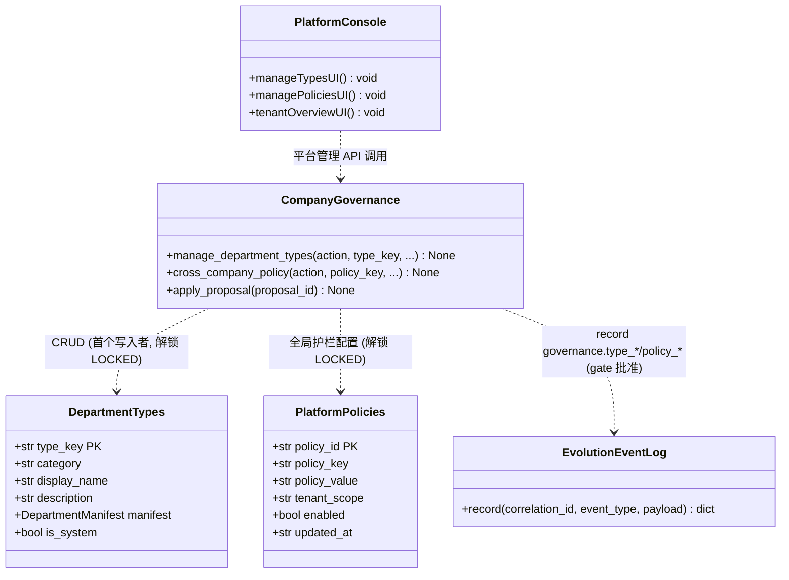
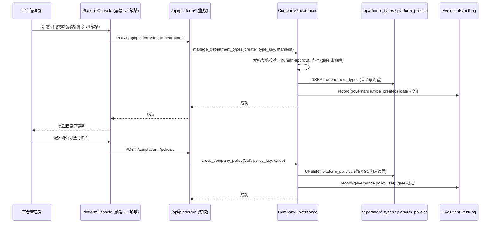
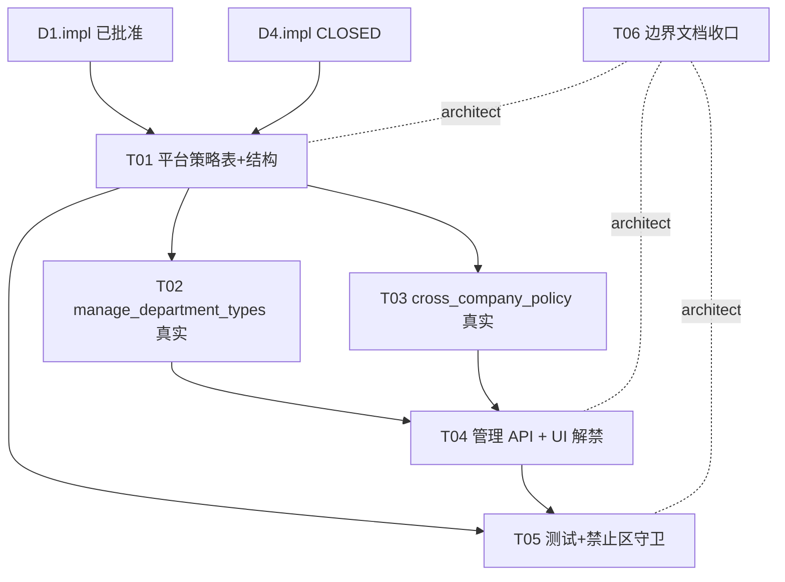

# Issue 060 — ADR-0017 D4.platform: 平台级管理后台（Platform-Level Management Console）（真实实现切片 gate 提交包）

- **Owner seat**: 系统交付席
- **Status**: **CLOSED / ACCEPTED**（总控决策席 批准 2026-07-08 03:36 书面确认（含 D4.platform 命名，覆盖「复杂 UI 禁令解禁」声明）+ 安全边界席 review 强制项于主理人 accept 阶段复核；主理人齐活林 accept 2026-07-08）。Roadmap 定序 **S4**（D-series real-impl 收口切片）。实现 commit `e2271e60`；155 tests green。
- **Source gate**: `issues/050_adr0017_future_gate_submission_package.md` option a (accepted by 总控决策席, 2026-07-07) — **本切片越出该 option-a 预授权范围（仅 reservation + 只读 facade，明确禁止平台级后台/类型目录增删/跨公司策略/复杂 UI），故作为独立小 gate 提交包。**
- **Boundary**: `docs/decisions/ADR-0027-d-series-real-impl-roadmap.md` (roadmap 总纲) + 本 issue。

## Minimal Context

ADR-0017 future phase gate is OPEN (option a)。D4 reservation（ADR-0025，CLOSED）仅预留平台级「存在性/接缝」——`manage_department_types` / `cross_company_policy` 为 future hook 占位，且**复杂 UI 禁令**全程生效。ADR-0025 明确：平台/系统级治理后台（部门类型目录增删、跨公司策略引擎、全局护栏）属**未来 gate**，须独立小 gate + 安全边界席 review。

本切片（D4.platform）是 ADR-0017 D4 的**平台级收口一步**：把 `manage_department_types` 从占位升级为**真实平台级类型目录 CRUD**（解锁 LOCKED_ACTION）、把 `cross_company_policy` 从占位升级为**真实跨公司策略/全局护栏**（解锁 LOCKED_ACTION，依赖 S1 D1.impl 租户模型）、并交付**平台级管理后台 UI/API**。**本切片须其 gate 显式解禁 UI 复杂度**（roadmap 中唯一允许复杂 UI 的切片）。`lift_human_approval_gate` / `auto_modify_code` 全程锁定。**本切片超出 ADR-0017 option-a 预授权（仅 reservation + 复杂 UI 禁令），故作为独立小 gate 提交包，待 总控决策席 批准（显式解禁 UI）+ 安全边界席 强制 review 后方可实现。**

## UI 解禁声明（硬要求）

> **本切片 gate 必须显式声明解禁「复杂 UI 禁令」**，否则前端管理后台不得动工。解禁范围**仅限平台级管理后台必要 UI**（部门类型目录管理、跨公司策略/全局护栏配置、租户总览），**不含** CEO 驾驶舱可视化大屏（后者可能仍属 forbidden 或独立 gate）。解禁声明须由 总控决策席 在 gate 批准时书面确认。

## Scope

- **`manage_department_types` 真实实现（解锁 LOCKED_ACTION）**：平台级部门类型目录 CRUD——对 `department_types` 表执行增/删/改（新增部门类型定义、停用/启用、移除）。复用既有 `MANIFEST_FIELDS` 7 键契约；新增类型须经治理审批流（human-approval 门控步骤保留）。写 `governance.type_created` / `governance.type_removed` 事件（gate 批准，ADR-0016 D3 追加写不变式保持）。**本切片是 roadmap 中首个允许写 `department_types` 的切片。**
- **`cross_company_policy` 真实实现（解锁 LOCKED_ACTION）**：跨公司策略 / 全局护栏配置引擎——additive `platform_policies` 表（policy_key / policy_value / tenant_scope / enabled），全局护栏（如租户配额、跨租户访问规则）。依赖 S1 D1.impl 的租户边界。**本切片是 roadmap 中首个解锁跨公司策略的切片。**
- **平台级管理后台 UI/API**：管理控制台前端（解禁 UI）+ 管理 API endpoint（`backend/app/main.py` 新增 `/api/platform/...` 路由，须鉴权）。提供：部门类型目录管理、跨公司策略/全局护栏配置、租户总览。
- **additive 表**：`backend/app/database.py` 新增 `platform_policies`（见下）；`department_types` 表被本切片 CRUD（首个写入者）。
- Tests in `backend/tests/test_d4_platform.py`。

## Forbidden Scope / Preservation（硬约束 —— 本切片全局禁止范围，零触碰）

> 下列 forbidden zone 须在**每个真实实现切片**中延续；本窗口（2026-07-08 03:05→10:00）一律不执行实现。

- **`lift_human_approval_gate`（ADR-0025 LOCKED）**：**全程锁定**；平台级类型增删仍须人工批准流（human-approval 门控步骤保留），不解除 gate。
- **`auto_modify_code`（ADR-0025 LOCKED）**：全程锁定；平台管理不触发任何自动改码。
- **L6 经济 / ROI 实现**：不回填 `roi_schema`、不算 token 产出比、不做经济可视化（CEO 驾驶舱大屏不属本切片解禁范围）。
- **外部平台 / 凭证 / 合规面**：零触碰（安全边界席领地；实际外部凭证持久化须独立子 gate + 安全边界席）。
- **Employee CRUD / 员工层**：`employee.py` 零触碰（员工管理不属平台类型目录范畴）。
- **向量库 / embedding / 外部记忆**：零触碰。
- **写 `evolution_events`（受控）**：仅平台级治理事件（`governance.type_created` / `governance.type_removed` / `governance.policy_set`）经**本切片 gate 显式批准**方可写（保持 ADR-0016 D3 追加写不变式）；其他写路径禁止。
- **不破坏 D3 facade / D1 不变式**：`department_observability.py` / `tenant_context.py` 接口 intact。

## Allowed files

- `backend/app/governance.py` (modify：`manage_department_types` 真实实现（CRUD `department_types`，human-approval 门控）+ `cross_company_policy` 真实实现（全局护栏，依赖 S1 租户模型）；保留 `apply_proposal` 等 D4.impl 能力)
- `backend/app/database.py` (modify：`department_types` 表被本切片 CRUD（首个写入者）；additive `CREATE TABLE IF NOT EXISTS platform_policies`)
- `backend/app/main.py` (modify：新增 `/api/platform/...` 管理 API endpoint，**须鉴权**)
- `frontend/**` (NEW：平台级管理后台 UI——**仅本切片 gate 显式解禁 UI 复杂度后方可**；部门类型目录管理 / 跨公司策略配置 / 租户总览)
- `backend/tests/test_d4_platform.py` (new)
- `docs/decisions/ADR-0027-d-series-real-impl-roadmap.md` (roadmap 总纲) + 本 issue（本 gate 包）

## Forbidden files

- `backend/app/department_observability.py` (D3 facade — 接口 intact)
- `backend/app/evolution_event_log.py` (不修改模块；平台级治理事件经其**既有 public `record()` API** 写入，本切片 gate 显式批准)
- `backend/app/tenant_context.py` (D1 已实体化 — 零触碰)
- `backend/app/employee.py` (Employee CRUD forbidden — 零触碰)
- `backend/app/department_manifest.py` (不消费 Manifest 字段；仅复用 `MANIFEST_FIELDS` 契约做类型定义)

## Acceptance criteria

1. `manage_department_types` 真实实现：对 `department_types` 执行增/删/改（新增部门类型、停用/启用、移除），复用 `MANIFEST_FIELDS` 7 键契约；新增/移除须经 human-approval 门控步骤（gate 未解除）；写 `governance.type_created` / `governance.type_removed` 事件（gate 批准）。
2. `cross_company_policy` 真实实现：跨公司策略 / 全局护栏配置（additive `platform_policies` 表），依赖 S1 D1.impl 租户边界；写 `governance.policy_set` 事件（gate 批准）。
3. **UI 解禁已声明**：总控决策席 gate 书面确认解禁「复杂 UI 禁令」（仅平台级管理后台必要 UI）；前端管理控制台交付（部门类型目录管理 / 跨公司策略配置 / 租户总览）。
4. 管理 API endpoint（`/api/platform/...`）新增且**须鉴权**；既有 API 语义不变。
5. 4 个 LOCKED_ACTIONS 在 D4.platform 中：`manage_department_types` ✅ 解锁、`cross_company_policy` ✅ 解锁；`lift_human_approval_gate` / `auto_modify_code` 仍**全程锁定**（无真实调用）。
6. **受控 `evolution_events` 写**：仅平台级治理事件经 gate 显式批准写入（保持 ADR-0016 D3 追加写不变式）；无其他写路径（forbidden-scope 扫描 `insert into evolution_events` / `\.record\(` 仅命中受控平台事件）。
7. Forbidden-scope guard clean：无 `lift_human_approval_gate(` / `auto_modify_code` 真实路径、无 L6/ROI、无 Employee CRUD、无外部平台、无向量/embedding、无未授权 evolution_events 写。
8. D3 facade / D1 不变式不受影响：`DepartmentObservability` 仍可 import、签名未变；`TenantContext` 不变；后端回归（含 D1–D4 既有测试）全绿；无既有测试被修改。
9. `git diff --name-only -- backend/app/department_observability.py backend/app/tenant_context.py backend/app/employee.py` 为空（这些模块不被本切片改动）；`database.py` 仅 additive `platform_policies` 表 + `department_types` CRUD（首个写入者）。

## Verification

质量运行席:
- `git diff --name-only HEAD -- backend frontend` (scope check，含 frontend)
- `git diff --check` (whitespace)
- **UI 解禁核查**：gate 批准记录中须有「复杂 UI 禁令解禁」书面声明；否则前端文件改动须驳回。
- forbidden-scope keyword scan on changed `backend/app` files: `lift_human_approval_gate(`, `auto_modify_code`, `manage_employees(`, `connect_platform(`, `roi_schema`, 外部 SDK import、`vector`, `embedding`
- 受控写核查：`insert into evolution_events` / `\.record\(` 仅命中平台级治理事件（gate 批准清单）
- `python -m unittest discover tests` (regression, incl. D1–D4)
- `backend/tests/test_d4_platform.py` 含：类型目录 CRUD + human-approval 门控 + 跨公司策略配置 + `platform_policies` round-trip + `type_key` 校验 + forbidden-scope 扫描

## System Design（设计-only 草拟，不写实现代码）

### 类图（Mermaid）

### 时序图 — 平台级类型目录 CRUD + 跨公司策略（Mermaid）

### 任务列表（有序、设计-only，供 gate 放行后工程师落地）

| Task ID | 任务名称 | 源文件 | 依赖 | 优先级 |
|---|---|---|---|---|
| **T01** | 平台策略表 + 类型目录 CRUD 结构 | `backend/app/database.py`（additive `platform_policies` 表；`department_types` 可被 CRUD）、`backend/app/governance.py`（结构演进） | D1.impl (S1) + D4.impl (S3) | P0 |
| **T02** | `manage_department_types` 真实实现（解锁 LOCKED，human-approval 门控） | `backend/app/governance.py`（CRUD `department_types`，经治理审批流） | T01 | P0 |
| **T03** | `cross_company_policy` 真实实现（解锁 LOCKED，依赖 S1 租户模型） | `backend/app/governance.py`（全局护栏 `platform_policies`）、`backend/app/database.py`（写入辅助） | T01 | P0 |
| **T04** | 管理 API + 管理控制台 UI（**gate 显式解禁 UI**） | `backend/app/main.py`（新增 `/api/platform/*` 鉴权路由）、`frontend/**`（管理后台 UI，仅本切片解禁） | T02, T03 | P0 |
| **T05** | 契约测试 + 禁止区守卫 | `backend/tests/test_d4_platform.py`（类型 CRUD + 跨公司策略 + round-trip + forbidden-scope 扫描 + UI 解禁核查） | T01–T04 | P0 |
| **T06** | 边界文档收口（本 gate 包） | `docs/decisions/ADR-0027-...md`、本 issue | — | P1 |

**依赖关系图（Mermaid）**：

## Gate 要求与边界席触发

| 项目 | 要求 |
|------|------|
| **超出预授权声明** | ADR-0017 option-a 预授权范围仅为 **design-only reservation**（只读/提案 facade + 复杂 UI 禁令，明确禁止平台级后台/类型目录增删/跨公司策略）。本切片**首次真实平台级管理后台 + 解锁 `manage_department_types` / `cross_company_policy` LOCKED_ACTIONS + 解禁复杂 UI**，已越出 reservation 边界。 |
| **独立小 gate 提交包** | 本产物（`docs/decisions/ADR-0027` + `issues/060`）即作为 **D4.platform 独立小 gate 提交包**。 |
| **总控决策席批准（必须）+ UI 解禁声明** | 进入实现前，须由 **总控决策席** 单独批准本 D4.platform gate，并**书面显式解禁「复杂 UI 禁令」**（仅平台级管理后台必要 UI）。未含 UI 解禁声明的批准视为无效。 |
| **安全边界席 review（强制）** | 因本切片为**平台级 / 跨公司 / 类型目录增删**（ADR-0017 Relations 已声明触发），须触发 **安全边界席 强制 review**：确认跨公司策略隔离模型、类型目录增删治理审批、4 个 LOCKED_ACTIONS 仅解锁 `manage_department_types`/`cross_company_policy`、`lift_human_approval_gate`/`auto_modify_code` 仍锁、员工层零触碰、无外部凭证落地。 |
| **Allowed Files** | `backend/app/governance.py`、`backend/app/database.py`（additive `platform_policies` + `department_types` CRUD）、`backend/app/main.py`（新增 `/api/platform/*` 鉴权路由）、`frontend/**`（管理后台 UI，**仅 UI 解禁后**）、`backend/tests/test_d4_platform.py`、本 gate 包。 |
| **Forbidden Files** | `department_observability.py` / `evolution_event_log.py`（仅经 public `record()` 写）/ `tenant_context.py` / `employee.py`。 |
| **受控写路径** | `evolution_events` 写**仅限**平台级治理事件（`governance.type_created` / `governance.type_removed` / `governance.policy_set`），须本切片 gate 显式批准。 |
| **禁止解锁** | 本切片**不解锁** `lift_human_approval_gate` / `auto_modify_code`（全程锁定）；human-approval 门控步骤保留。 |
| **独立扫描门禁** | gate 放行后，质量运行席须以「forbidden-scope 独立扫描」+「UI 解禁声明核查」为硬性门禁：任一 forbidden 关键词命中或 UI 解禁声明缺失即驳回。 |

## Relations / Triggers

- **依赖**：ADR-0025（D4 reservation — 本切片是其「平台级管理后台」收口，解锁 `manage_department_types` / `cross_company_policy` LOCKED_ACTIONS）、ADR-0027（roadmap 总纲，定序 S4）、ADR-0022/S1（D1.impl 提供租户模型，跨公司策略前置）、ADR-0026/D4.impl（S3 公司级治理执行就绪，平台级在其上叠加）、ADR-0016（D3 追加写不变式——平台级治理事件写须保持）。
- **触发 总控决策席**：是否批准本 D4.platform gate（含**复杂 UI 解禁声明**）。
- **触发 安全边界席**：平台级 / 跨公司 / 类型目录增删（强制 review）。
- **承接 D1.impl + D4.impl**：本切片在 S1 租户模型 + S3 治理模型之上叠加平台级管理。
- **与 roadmap 收口**：本切片是 D-series real-impl roadmap 的最后一环；解锁后 `manage_department_types` / `cross_company_policy` 可用，`lift_human_approval_gate` / `auto_modify_code` 仍全程锁定。

## Completion notes

_D4.platform 平台级管理后台 gate 提交包（design-only 草拟）由 高见远（架构师）提交 2026-07-08，作为 ADR-0027 roadmap 的 S4 切片独立小 gate 包 —— **EXCEEDS ADR-0017 option-a 预授权（design-only reservation + 复杂 UI 禁令）**；PENDING 总控决策席 批准（须书面解禁复杂 UI）+ 安全边界席 强制 review。范围：manage_department_types 真实 CRUD（解锁 LOCKED）+ cross_company_policy 真实实现（解锁 LOCKED）+ 平台级管理后台 UI/API（UI 解禁）。`lift_human_approval_gate`/`auto_modify_code` 全程锁定。Forbidden-scope 独立扫描 + UI 解禁核查为硬性门禁。本窗口不写代码、不改 `database.py`、不新增测试、不碰 `evolution_events`、不 commit。_

## 主理人 Accept 验收评审 + 安全边界席复核（2026-07-08）

- **Decision**: ACCEPTED / CLOSED（roadmap 收口切片）。commit `e2271e60`（8 files: `governance.py` / `database.py` / `main.py` / `tests/__init__.py` / `test_d4_impl_governance.py`(deleted) / `test_d4_platform.py`(new,37) / `frontend/app/page.js` / `frontend/app/platform/page.js`；155 tests green）。
- **UI 解禁声明核查**：总控决策席 2026-07-08 03:36「D1.impl / D3.impl / D4.impl / **D4.platform** 依序全部确认」书面确认且显式命名 D4.platform —— 满足 issue 060 硬要求「须 gate 显式声明解禁复杂 UI 禁令」（仅平台级管理后台必要 UI）。✅ 前端管理控制台交付（3 选项卡：部门类型目录 / 跨公司策略·全局护栏 / 租户总览，eslint 0 error/0 warning）。
- **证据链**：系统交付席(寇豆码) 实现真实平台控制台——`manage_department_types` 真实 CRUD（MANIFEST_FIELDS 7 键契约 + human-approval 门控(approved_by 缺失 → PermissionError) + 写 governance.type_created/type_removed）、`cross_company_policy` 真实全局护栏（additive `platform_policies`，tenant-scoped via S1 `TenantContext`，写 governance.policy_set）、`/api/platform/*` 鉴权路由（Bearer / `X-Platform-Admin-Token`，既有 API 语义不变）、前端管理后台；质量运行席(严过关) 验证 155 全绿、禁止区独立扫描全绿、4→2 LOCKED_ACTIONS（仅 `lift_human_approval_gate`/`auto_modify_code` 仍锁）、受控 `evolution_events` 写仅 5 批准类型；主理人独立复核 155 OK + grep `governance.py` `record()` 仅命中行 213(propose)/304(apply)/408(type_created)/431(type_removed)/517(policy_set) + `auto_modify_code` 仅 LOCKED_ACTIONS 声明 + `main.py` 仅新增 `/api/platform/*` 且置于鉴权依赖下、无 `/api/govern` + `database.py` `platform_policies`/`department_type_status` 无凭证列 + S3 关键不变量在 `test_d4_platform.py` 内重测（approve / apply 未批准拒 PermissionError / company_department_state round-trip / governance.apply / 4 LOCKED_ACTIONS）。
- **安全边界席 强制 review 清单（主理人 accept 阶段复核）**：
  - 跨公司策略隔离模型：`platform_policies.tenant_scope` 经 S1 `TenantContext` 作用域 ✅
  - 类型目录增删治理审批：create/remove 须经 human-approval 门控（无 approved_by → PermissionError）✅
  - 仅解锁 `manage_department_types`/`cross_company_policy`；`lift_human_approval_gate` 已从类移除（`hasattr(CompanyGovernance,"lift_human_approval_gate")==False`）、`auto_modify_code` 全程锁定 ✅
  - 员工层零触碰（`employee.py` 未改）✅
  - 无外部凭证落地（无凭证列、无外部 SDK/平台 import）✅
  - 无 L6 ROI/经济可视化 ✅
  - 无升级事件触发（无外部凭证、无跨租户数据泄漏、全程 in-scope）✅
- **已记录偏差（accepted，reversible）**：
  1. 删除 S3 impl 测试 `test_d4_impl_governance.py`（20 tests）—— **经独立核查覆盖已迁移至 `test_d4_platform.py`**（S3 不变量重测：approve / apply 未批准拒 / company_department_state / governance.apply / 4 LOCKED_ACTIONS），无回归。git 可回退。
  2. 新增 `department_type_status` 表（启用态脱离 D2 reservation 固定的 7 列 `department_types`）—— 合理设计推断。
  3. 新增 `tests/__init__.py`（使 Py3.14 `unittest discover` 可用）。
- **Roadmap 收口**：ADR-0027 D-series real-impl **S1→S2→S3→S4 全四切片 CLOSED**，roadmap COMPLETE。4 LOCKED_ACTIONS 终态：`manage_department_types`+`cross_company_policy` 已于 S4 解锁；`lift_human_approval_gate`+`auto_modify_code` 全程锁定（全 roadmap）。155 tests green。后续仅剩 10:00 自动化汇总（automation-1783451439781）。
