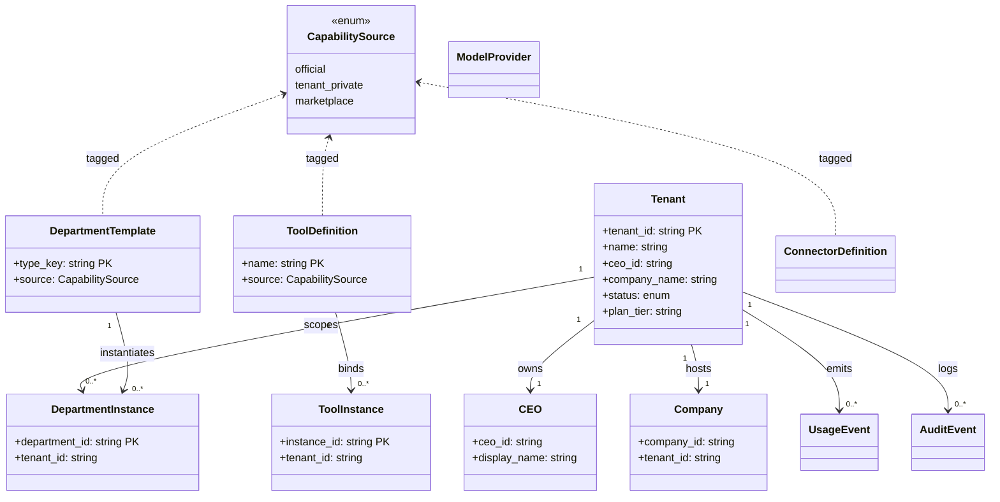
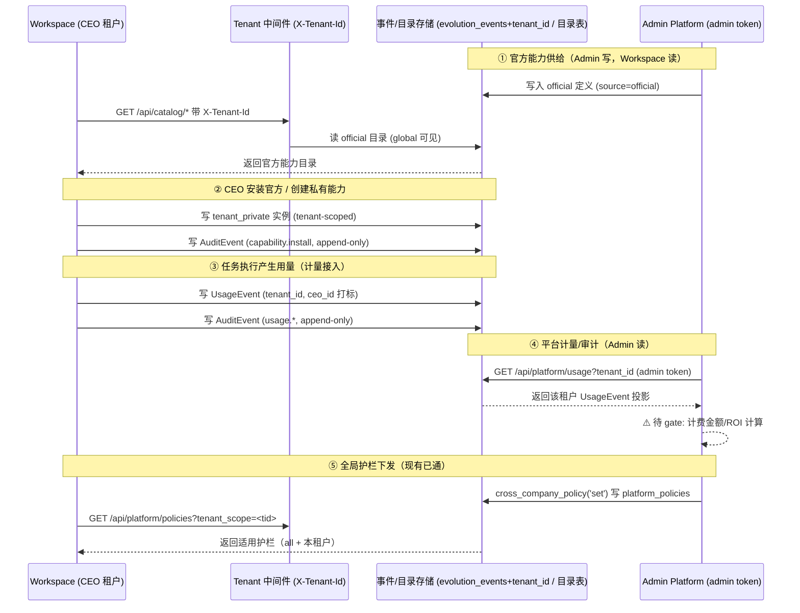

# ADR-0028 · Phase-1 共享基础契约（Design-only）

- **文档性质**：共享契约规范（contract spec），**非实现方案**。禁止区仅定义数据形状，实现逻辑须经 gate 解锁；本 ADR 不含可运行代码、不含实现任务拆解。
- **适用范围**：Curis Admin Platform（平台方）与 Curis Workspace（CEO 方）双团队并行开发共同遵守。
- **设计基线**：完全基于 ADR-0027 已收口 primitives（S1 真实多租户 `70e05652`、S4 平台管理后台 `e2271e60`）扩展，**不另起炉灶**。
- **硬约束继承**：
  - `tenants` 表**绝不存储凭证/密钥**（安全边界席确认）。
  - LOCKED_ACTIONS 全程锁定：`lift_human_approval_gate`、`auto_modify_code`；本契约任何设计不得假设这两项被解锁。
  - 禁止区（运营协定 + brief §11.6）：L5L6 经济/ROI 计算、外部服务与凭证、真实商业化多租户隔离实现、自动改码、员工 CRUD、向量库、复杂 UI。其中 UI 禁令在 S4 已解禁（仅平台管理后台必要 UI）。

---

## §0 契约总览 + 与 ADR-0027(S1/S4) 衔接

### 0.1 共享元约定（所有契约通用）

| 元字段 | 类型 | 说明 | 衔接点 |
| --- | --- | --- | --- |
| `tenant_id` | string | 租户隔离主键，沿用 `tenants.tenant_id` | `TenantContext.parse_tenant_from_request` 读 `X-Tenant-Id` 头 |
| `ceo_id` | string | CEO 不透明身份令牌（非凭证） | 已存在于 `governance_proposals.ceo_id` / `company_department_state.ceo_id` |
| `capability_source` | enum | `official`｜`tenant_private`｜`marketplace` | 见 §2 |
| `created_at` / `updated_at` | datetime(ISO8601 UTC) | 时间戳 | 沿用现有 `current_timestamp` 约定 |
| `schema_version` | string | 契约版本，向后兼容扩展 | 沿用 `manifest_schema_version` 思路 |

### 0.2 与 ADR-0027 衔接映射表

| 本 ADR 契约 | 现有 S1/S4 primitive | 衔接方式 |
| --- | --- | --- |
| Tenant/CEO/Company | `tenants` 表（tenant_id,name,created_at） | **additive 扩展** `tenants`（加 ceo_id/company_name/status/plan_tier，无凭证列） |
| Capability Source | `department_types.is_system`、所有能力表 | 新增统一 `source` 语义，替换/补充 `is_system` |
| Department Template | `department_types` + `department_type_status` | 直接映射，加 `source` 列 |
| Department Instance | `departments` + `company_department_state` | 直接映射 |
| Tool Definition/Instance | `tools` 表（name,type,description,entry） | additive 加 `source`/`tenant_id` |
| Usage/Billing/Audit Event | `evolution_events`（含**预留 tenant_id 列**） | 复用追加日志 + 真实 tenant_id 打标（S1 仅预留未过滤） |
| Admin 鉴权/策略 | `/api/platform/*` + `platform_policies` + `X-Platform-Admin-Token` | 直接复用，扩展只读目录读接口 |
| 租户中间件 | `_tenant_scope_middleware`（`X-Tenant-Id`） | 直接复用为全契约租户隔离基线 |

### 0.3 总体类关系（Mermaid classDiagram）



---

## §1 Tenant / CEO / Company 契约

### 1.1 三者关系
- **Tenant（租户）**：隔离边界，已存在（`tenant_id` PK），沿用 `X-Tenant-Id` 解析。
- **CEO**：操作/拥有者，以不透明 `ceo_id` 标识（身份令牌，**不存储密码/密钥**）。Phase-1 通过请求头 `X-Ceo-Id` 携带（类比 `X-Tenant-Id`）；CEO 登录鉴权机制本身不在本契约范围（属平台 auth，非外部凭证，但建议单独 ADR）。
- **Company（公司）**：CEO 在其租户内构建的 AI 公司，逻辑实体，与 Tenant 1:1 绑定（Phase-1 不做一 CEO 多公司）。

### 1.2 Tenant 扩展契约（additive，不破坏现有 3 列 DDL）

| 字段 | 类型 | 必填 | 归属方 | 说明 |
| --- | --- | --- | --- | --- |
| `tenant_id` | string | ✅ | Admin | PK，沿用现有 |
| `name` | string | ✅ | Admin | 沿用现有 |
| `ceo_id` | string | ✅(新建时) | Admin | 拥有该租户的 CEO 不透明 ID；**非凭证** |
| `company_name` | string | ❌ | CEO/Admin | 公司展示名（CEO 可改） |
| `status` | enum | ✅ | Admin | `active`｜`suspended`｜`pending` |
| `plan_tier` | string | ❌ | Admin | 仅**标签**（trial/starter/growth）；**不得存储价格/成本** |
| `created_at` | datetime | ✅ | 系统 | 沿用 |
| `updated_at` | datetime | ❌ | 系统 | 扩展 |

> 衔接：`database.list_tenants()` 现有只读投影直接返回，无凭证列；扩展后同函数返回新增列即可，无需新 endpoint。

### 1.3 CEO / Company 契约（Phase-1 最小形态）

```json
{
  "ceo_id": "ceo_8f3a...",
  "display_name": "张总",
  "company": {
    "company_id": "co_8f3a...",
    "tenant_id": "tenant_acme",
    "company_name": "Acme AI 公司"
  }
}
```

- **CEO 注册表**：Phase-1 **不新建 `ceos` 凭证表**；`ceo_id` 仅作为不透明令牌存在于 `tenants.ceo_id` 与既有 `governance_proposals`/`company_department_state`。
- **Company**：Phase-1 用 `tenants.company_name` + 派生 `company_id=tenant_id` 表达，不单独立表；多公司场景留待 gate 后扩展。

---

## §2 Capability Source 契约（能力来源模型）

直接对应 brief §4 表，作为所有能力（模型/工具/连接器/部门模板）的统一来源标签。

| source | 含义 | 管理方 | 可见性 | 计量归属 | 状态 |
| --- | --- | --- | --- | --- | --- |
| `official` | 平台官方标准能力 | **Admin Platform** | 全局（所有租户） | 平台目录（不计入租户私有配额） | 已定义 |
| `tenant_private` | CEO 自创，仅本租户 | **Workspace** | 仅本租户（X-Tenant-Id 隔离） | 归属该 tenant_id | 已定义 |
| `marketplace` | 租户提交审核后共享 | Admin 审核 / Workspace 用 | 订阅租户 | ⚠️ **待 gate**（跨租户计量） | ⚠️ **待 gate** |

**JSON Schema（统一 source 语义）**：

```json
{
  "$schema": "http://json-schema.org/draft-07/schema#",
  "CapabilitySource": {
    "type": "string",
    "enum": ["official", "tenant_private", "marketplace"]
  },
  "CapabilityRef": {
    "type": "object",
    "required": ["key", "source"],
    "properties": {
      "key": {"type": "string", "description": "稳定键，如 tool:codex_tool / dept:business.general"},
      "source": {"$ref": "#/CapabilitySource"},
      "owner_tenant_id": {"type": ["string", "null"], "description": "official=null；tenant_private=本租户"},
      "visibility": {"type": "string", "enum": ["global", "tenant"]}
    }
  }
}
```

> 衔接：现有 `department_types.is_system=1` 在 Phase-1 映射为 `source=official`；新增能力表统一加 `source` 列。`marketplace` 来源在本 ADR **仅定义枚举值**，跨租户共享/安装实现 ⚠️ **待 gate**。

### 2.1 `source` 与 `is_system` 向后兼容迁移规则（原团队条件 #4）
- **保留 `is_system` 列**：不删除、不修改原有列定义与既有 7 列 DDL 契约（见 ADR-0023）。
- **`source` 由 `is_system` 派生**：读取时 `is_system=1 → source=official`，`is_system=0 → source=tenant_private`；新增能力表（model/tool/connector）直接落地 `source` 列，official 默认 `is_system` 语义等价。
- **DDL 严格向后兼容**：`source` 仅作 additive 列，不触发任何既有表结构变更；既有 `manage_department_types` 写路径继续以 `is_system` 为准，无需改动。
- **读取双兼容**：任何读取方须同时兼容两列（优先 `source`，缺省回退 `is_system` 推导），禁止仅依赖单一列造成分叉。

---

## §3 Model Provider / Model Instance 契约

### 3.1 Model Provider（官方供应方目录，Admin 管理）

| 字段 | 类型 | 必填 | 归属 | 说明 |
| --- | --- | --- | --- | --- |
| `provider_id` | string PK | ✅ | Admin | 如 `openai`/`anthropic` |
| `display_name` | string | ✅ | Admin | |
| `auth_type` | enum | ✅ | Admin | `none`｜`oauth`｜`apikey`（**仅形状**；真实凭证 ⚠️ 待 gate） |
| `supported_models` | string[] | ✅ | Admin | 该供应方下模型名清单 |
| `source` | enum | ✅ | Admin | 恒 `official` |

### 3.2 Model Instance（模型实例绑定）

| 字段 | 类型 | 必填 | 归属 | 说明 |
| --- | --- | --- | --- | --- |
| `instance_id` | string PK | ✅ | 创建方 | |
| `provider_ref` | string | ✅ | — | → ModelProvider.provider_id |
| `model_name` | string | ✅ | — | 如 `gpt-4o` |
| `source` | enum | ✅ | 创建方 | official=平台供给；tenant_private=CEO 自带 |
| `tenant_id` | string｜null | ❌ | — | official=null（全局）；tenant_private=本租户 |
| `config_ref` | object | ❌ | — | ⚠️ **待 gate**：私有实例的 endpoint/key 配置**形状可定义，凭证不得持久化** |

**tenant_private 命名空间与唯一键（原团队条件 #5）**
- **official 全局 key**：唯一键为全局名（如 `gpt-4o`），跨租户唯一、平台供给。
- **tenant_private 复合唯一键**：唯一键为 `(tenant_id, model_name)` 或 namespaced key `tenant:<tid>:<model_name>`；同一租户内 `model_name` 唯一。
- **冲突检测**：写入私有实例时先查本租户 `(tenant_id, model_name)` 是否冲突；official 与 tenant_private 各自命名空间**互不冲突**（解析时先查 tenant_private 再回退 official）。
- **前缀约束**：禁止 tenant_private 使用 official 全局 key 前缀（如 `openai.*`），避免歧义与越权覆盖。

> 🔴 **禁止区标注（Connector/凭证同类）**：`tenant_private` 模型实例若由 CEO 自带 API key/endpoint，其凭证存储与真实调用落入「外部服务与凭证」禁止区。本 ADR **仅定义 `config_ref` 数据形状**；实现须经 **总控决策席 + 安全边界席 gate** 解锁，本 ADR 不定义其实现逻辑。

---

## §4 Tool Definition / Tool Instance 契约

### 4.1 衔接现有 `tools` 表
现有 `tools(name PK, type, description, entry)` 即 ToolDefinition 雏形。additive 扩展：`source`（默认 `official`）、`tenant_id`（official=null，private=本租户）、`schema_version`、`status`。

### 4.2 Tool Definition（目录/规格）

| 字段 | 类型 | 必填 | 归属 | 说明 |
| --- | --- | --- | --- | --- |
| `name` | string PK | ✅ | 创建方 | 沿用现有 tools.name |
| `type` | string | ✅ | 创建方 | 沿用（llm/...） |
| `description` | string | ✅ | 创建方 | 沿用 |
| `entry` | string | ✅ | 创建方 | 沿用（调用入口标识） |
| `source` | enum | ✅ | 创建方 | official / tenant_private |
| `tenant_id` | string｜null | ❌ | — | private 时必填 |
| `input_schema` | object | ❌ | 创建方 | 参数契约（JSON Schema 形状） |

### 4.3 Tool Instance（绑定进租户/部门）

| 字段 | 类型 | 必填 | 归属 | 说明 |
| --- | --- | --- | --- | --- |
| `instance_id` | string PK | ✅ | Workspace | |
| `tool_name` | string | ✅ | — | → tools.name |
| `tenant_id` | string | ✅ | Workspace | X-Tenant-Id 隔离 |
| `department_ref` | string｜null | ❌ | Workspace | 绑定部门（→ departments.department_id） |
| `enabled` | bool | ✅ | Workspace | 默认 true |

**tenant_private 命名空间与唯一键（原团队条件 #5）**
- **official 全局 key**：`tools.name` 为全局唯一键（沿用现有 PK）。
- **tenant_private 复合唯一键**：唯一键为 `(tenant_id, tool_name)` 或 namespaced key `tenant:<tid>:<tool_name>`；私有工具读取须 `WHERE tenant_id = ?` 过滤（复用 `result_store` 范式）。
- **冲突检测**：创建私有工具时检测同租户内 `tool_name` 唯一；official 与 tenant_private 命名空间互不冲突（Workspace 解析先私有后官方）。
- **前缀约束**：禁止 tenant_private 占用 official 全局 `tools.name` 值，防止覆盖官方工具。

> 衔接：Workspace 执行时经 `_tenant_scope_middleware` 自动 scope；私有工具读取须 `WHERE tenant_id = ?`，复用 `result_store` 既有过滤范式。

---

## §5 Connector Definition / Connector Instance 契约 🔴 禁止区

> ⚠️ **待 gate**：连接器别名「外部平台/凭证」，落入运营协定禁止区。**本契约仅定义数据形状**；真实外部集成、OAuth 令牌、API Key 持久化、跨平台调用均须经 **总控决策席 + 安全边界席 gate** 解锁。本 ADR 不定义其实现逻辑。Phase-1 任何代码路径**不得持久化连接器凭证**。

### 5.1 Connector Definition

| 字段 | 类型 | 必填 | 归属 | 说明 |
| --- | --- | --- | --- | --- |
| `connector_id` | string PK | ✅ | Admin/CEO | |
| `display_name` | string | ✅ | 创建方 | |
| `category` | string | ✅ | 创建方 | 如 crm/email/finance |
| `source` | enum | ✅ | 创建方 | official / tenant_private / marketplace⚠️ |
| `auth_type` | enum | ✅ | 创建方 | `none`｜`oauth`｜`apikey`（**形状占位**） |
| `config_schema` | object | ✅ | 创建方 | 配置项 JSON Schema（**不含凭证值**） |

### 5.2 Connector Instance

| 字段 | 类型 | 必填 | 归属 | 说明 |
| --- | --- | --- | --- | --- |
| `instance_id` | string PK | ✅ | Workspace | |
| `connector_ref` | string | ✅ | — | → ConnectorDefinition.connector_id |
| `tenant_id` | string | ✅ | Workspace | |
| `config_placeholder` | object | ❌ | — | ⚠️ **待 gate**：仅存非凭证配置（如 base_url）；**凭证字段 MUST NOT persist** |

---

**tenant_private 命名空间与唯一键（原团队条件 #5）**
- **official 全局 key**：`connector_id` 全局唯一（平台供给）。
- **tenant_private 复合唯一键**：唯一键为 `(tenant_id, connector_id)` 或 namespaced key `tenant:<tid>:<connector_id>`。
- **冲突检测 / 前缀约束**：同 §3.2 / §4.3 规则；🔴 注意私有连接器 `config_placeholder` 仍须遵守 §5 禁止区——**凭证字段 MUST NOT persist**，冲突检测不涉及凭证值。

---

## §6 Department Template / Department Instance 契约

### 6.1 衔接（最成熟的一类）
- **Template** = `department_types`（系统目录，Admin 经 `manage_department_types` CRUD，human-approval 门控）+ `department_type_status`（启用态）+ `source` 列。
- **Instance** = `departments`（department_id, tenant_id, type_key, display_name, status）+ `company_department_state`（CEO 级启用态，human-approval gate 不解除）。
- Manifest 沿用 `MANIFEST_FIELDS` 7 键契约（capability_set/tool_classes/quality_lines/output_channels/roi_schema/guardrail_refs/employee_role_spec），仅结构占位，不消费。

### 6.2 Department Template（官方/私有部门模板）

| 字段 | 类型 | 必填 | 归属 | 说明 |
| --- | --- | --- | --- | --- |
| `type_key` | string PK | ✅ | Admin/CEO | 沿用 |
| `category` | string | ✅ | 创建方 | business/function/... |
| `display_name` | string | ✅ | 创建方 | |
| `description` | string | ❌ | 创建方 | |
| `manifest_json` | object | ✅ | 创建方 | 7 键 MANIFEST_FIELDS 契约 |
| `source` | enum | ✅ | 创建方 | official（is_system=1）/ tenant_private |
| `enabled` | bool | ✅ | Admin | 来自 department_type_status |

### 6.3 Department Instance（公司内部门实例）

| 字段 | 类型 | 必填 | 归属 | 说明 |
| --- | --- | --- | --- | --- |
| `department_id` | string PK | ✅ | Workspace | 沿用 departments |
| `tenant_id` | string | ✅ | Workspace | 沿用 |
| `type_key` | string | ✅ | Workspace | → department_types |
| `display_name` | string | ✅ | Workspace | |
| `status` | enum | ✅ | Workspace | active/disabled |
| `ceo_enabled` | bool | ✅ | CEO | 来自 company_department_state（human-approval gate） |

**`source` ↔ `is_system` 迁移规则（原团队条件 #4，本部类适用）**
- `department_types` 保留 `is_system` 列不动；`source` 为其 additive 派生（`is_system=1 → official`）。
- `manage_department_types` 既写路径继续以 `is_system` 为准，仅补充 `source` 落库；DDL 严格向后兼容。
- `list_department_types` / `get_department_type` 返回须同时携带 `is_system` 与 `source`，读取方双兼容。

> 衔接：完全复用 S4 既有表与 `governance.apply_proposal` 落地路径；新增仅为 `source` 列以区分官方/私有模板。

---

## §7 Usage Event / Billing Event / Audit Event 契约

### 7.1 通用事件信封（复用 `evolution_events` 追加日志 + 预留 tenant_id 列）

```json
{
  "event_id": "evt_...",
  "tenant_id": "tenant_acme",
  "ceo_id": "ceo_8f3a...",
  "actor_type": "ceo | admin | system",
  "event_type": "usage.model_call | billing.period | audit.capability_install | governance.*",
  "correlation_id": "task_xxx / type:business.general",
  "payload": { },
  "created_at": "2026-07-08T10:00:00Z"
}
```

> 衔接：现有 `evolution_events(event_id, correlation_id, event_type, payload, created_at, tenant_id)` **已含预留 tenant_id 列**（S1 仅预留未过滤）。本契约要求 Workspace 写入时**真实打标 tenant_id**（升级 S1 默认 'default' 行为），Admin 经平台鉴权读接口按 tenant_id 投影。

### 7.2 Usage Event（计量接入 ✅ 可定义）

| 字段 | 类型 | 必填 | 产生方 | 消费方 | 说明 |
| --- | --- | --- | --- | --- | --- |
| `scope_type` | enum | ✅ | Workspace | Admin | task/tool/model/department/connector |
| `scope_ref` | string | ✅ | Workspace | Admin | 关联对象键 |
| `quantity` | number | ✅ | Workspace | Admin | 计量读数（次数/token数/分钟） |
| `unit` | string | ✅ | Workspace | Admin | call/token/minute |
| `capability_ref` | object | ✅ | Workspace | Admin | §2 CapabilityRef（含 source 归因） |
| `raw_meter_value` | number | ❌ | Workspace | Admin | 来自 `tasks.cost`/`executions.cost` 的**原始读数**（LLM 成本代理，**非账单金额**） |

### 7.2.1 Workspace 写入点规范（原团队条件 #1）
- **写入模块/函数**：UsageEvent 在任务执行路径中、每次工具/模型调用落库时同步写入 `evolution_events`。建议封装于执行落库路径（`ResultStore.save_execution` / `Orchestrator.run` 调用点）经 `EvolutionEventLog.record` 追加；新增 `UsageEmitter` 服务为设计预留（本 ADR 不定义实现细节）。
- **tenant_id / ceo_id 强制打标**：写入时 `tenant_id = TenantContext.current_tenant_id()`（来自 `X-Tenant-Id`），`ceo_id` 取当前请求 `X-Ceo-Id` 头（Phase-1 占位，见 §10.4）；二者任一缺失则 **fail-closed 拒绝写入**，确保计量归属不丢。
- **幂等去重**：每条 UsageEvent 携带 `event_id`（uuid）与 `idempotency_key = hash(scope_type + scope_ref + correlation_id + 调用序号)`；写入前按 `idempotency_key` 去重（append-only 日志加唯一约束或写前查重），保证同一执行重试/重放不产生重复计量。
- **admin-only 投影**：UsageEvent 仅经 `GET /api/platform/usage?tenant_id=`（admin token）对 Admin 可读；Workspace 自身不提供 tenant 间或跨租户读入口。

### 7.3 Billing Event（形状可定义，金额计算 🔴 待 gate）

| 字段 | 类型 | 必填 | 产生方 | 说明 |
| --- | --- | --- | --- | --- |
| `period` | string | ✅ | Admin | 计费周期，如 "2026-07" |
| `tenant_id` | string | ✅ | Admin | |
| `usage_refs` | string[] | ✅ | Admin | 关联 UsageEvent 集合 |
| `amount` | number | ❌ | ⚠️ **待 gate** | **Phase-1 不计算**；形状占位 |
| `currency` | string | ❌ | ⚠️ **待 gate** | 占位 |
| `status` | enum | ✅ | ⚠️ **待 gate** | draft/issued（计算逻辑锁定） |

> 🔴 **禁止区标注（L5L6 经济/ROI）**：Billing Event 的 `amount`/`currency`/`status=issued` 及任何 ROI/成本/账单金额推导落入禁止区。**本 ADR 仅定义事件形状**；计费计算与 ROI 须经 **总控决策席 + 安全边界席 gate** 解锁，本 ADR 不定义其实现逻辑。UsageEvent 的原始读数回传（计量接入）不受限。

### 7.4 Audit Event（审计留痕 ✅ 可定义）
- 映射既有 `governance.propose/apply/type_created/type_removed/policy_set` 受控写范式，扩展命名空间：`usage.*` / `capability.*` / `auth.*` / `department.*`。
- 强制 append-only（`EvolutionEventLog.record` 为唯一写路径，无 update/delete）。
- 双写方：Workspace 写执行侧动作审计；Admin 写平台侧动作审计；共享同一追加日志。

---

## §8 Admin ↔ Workspace 同步协议与边界

### 8.1 同步关系总表（谁写 / 谁读 / 走什么接口）

| 数据/事件 | 写入方 | 读出方 | 传输/接口（衔接现有） |
| --- | --- | --- | --- |
| Tenant/CEO/Company | **Admin** | Workspace（读自身） | `GET /api/platform/tenants`（admin token，现有） |
| 官方能力目录（模型/工具/连接器/部门模板，source=official） | **Admin** | **Workspace**（只读安装） | `GET /api/catalog/*`（Workspace 只读官方目录，tenant-scoped，复用 X-Tenant-Id）；Admin 经 `/api/platform/*` **写**。二者**非替代关系**：catalog 仅供 Workspace 读，platform 仅供 Admin 写（见条件 #3） |
| tenant_private 能力实例 | **Workspace** | Admin（仅计量/审计读） | 复用 tenant-scoped 写 + `evolution_events` 投影；唯一键见各 § 的 tenant_private 命名空间（条件 #5） |
| 跨公司策略/全局护栏 | **Admin** | **Workspace**（遵守） | `GET /api/platform/policies?tenant_scope=<tid>`（**现有 list_platform_policies 已支持**） |
| Usage Event | **Workspace** | **Admin**（统计） | 写入 `evolution_events`（tenant_id+ceo_id 强制打标、`idempotency_key` 幂等去重，见 §7.2.1）→ `GET /api/platform/usage?tenant_id=`（**admin-only 投影**，条件 #1） |
| Billing Event | ⚠️ **待 gate**（Admin） | Admin | 计算逻辑锁定（G1） |
| Audit Event | 双方 | 双方/Admin | 共享 `evolution_events` 追加日志 |

> **接口分工（条件 #3）**：`/api/catalog/*` 是 Workspace 侧**只读**官方能力目录通道，不替代 `/api/platform/*` 的 Admin 写通道；任何一端不得混用对方接口语义（Workspace 不写 platform，Admin 不读 catalog 之外的 Workspace 私有数据）。
> **UsageEvent 约束（条件 #1）**：Workspace 写入须满足 §7.2.1 的 tenant_id/ceo_id 强制打标 + `idempotency_key` 幂等去重；`/api/platform/usage` 投影**仅 admin token 可访问**。

### 8.2 同步时序（Mermaid sequenceDiagram）



### 8.3 边界落点（brief §9 决策边界 → 本契约）

**Admin Platform 应该做 / 不应该做**
- ✅ 平台运营、用户/租户管理（`tenants` 扩展）、计费与用量统计（读 UsageEvent，**不计算金额**）、官方能力供给（写 official 定义）、安全/审计/治理（写 `platform_policies`、读 AuditEvent）、能力市场审核（marketplace ⚠️ 待 gate）。
- ❌ 不接管 CEO 内部运营、不限定 CEO 业务边界、不替 CEO 设计全部部门/员工、不把官方能力做成唯一入口（tenant_private 通道必须保留）。

**Workspace 应该做 / 不应该做**
- ✅ 公司内部运营、部门/员工/职责/任务/工作流、官方能力安装使用、租户私有能力创建管理、公司知识/项目记忆/执行结果管理。
- ❌ 不管理**平台级**账单规则、不管理其他租户、不修改 official 定义（仅可安装/卸载）、**不绕过平台用量统计**（每次执行必写 UsageEvent）。

---

## §9 禁止区 gate 待解锁清单

| # | 禁止区项 | 本 ADR 已定义形状 | 被锁定实现 | 解锁条件 |
| --- | --- | --- | --- | --- |
| G1 | L6 计费**计算**（成本/ROI/账单金额） | ✅ BillingEvent 形状（amount/currency/status 占位） | ❌ 金额推导、ROI 计算、账单生成 | 总控决策席 + 安全边界席 gate |
| G2 | 外部连接器与**凭证** | ✅ ConnectorDefinition/Instance 形状（config_schema、config_placeholder） | ❌ 凭证持久化、OAuth/APIKey 真实存储与调用 | 总控决策席 + 安全边界席 gate |
| G3 | 跨租户 **marketplace** | ✅ `capability_source=marketplace` 枚举值 | ❌ 跨租户共享/安装/收益分成 | 总控决策席 + 安全边界席 gate |
| G4 | 私有模型/工具**自带凭证** | ✅ ModelInstance.config_ref / ToolInstance 形状 | ❌ 私有 key/endpoint 持久化与真实调用 | 同 G2 gate |
| G5 | LOCKED_ACTIONS（roadmap 全程） | — | ❌ `lift_human_approval_gate`、`auto_modify_code` 任何实现/调用 | 不在本 ADR 范围，roadmap 锁定 |

> 标注规范：凡落入 G1–G4 的字段/流程，本文档以 `⚠️ 待 gate` 醒目标注，并统一声明：「仅定义数据形状，实现须经 总控决策席 + 安全边界席 gate 解锁；本 ADR 不定义其实现逻辑」。

---

## §10 待明确事项

1. **原 Workspace 团队签收**：本契约需原 Curis Workspace 团队正式签收确认（尤其 §8 同步接口命名 `/api/catalog/*`、UsageEvent 强制回传、official 定义只读不修改等约束），否则双团队可能分叉。建议作为 Phase-1 门禁项。
2. **计费/外部连接器 gate 路径建议**：
   - 建议设立常态化「总控决策席 + 安全边界席」双签 gate 流程，G1–G4 任一项进入实现前须提交独立 ADR（如 ADR-00xx 计费计算、ADR-00xx 连接器凭证保管）。
   - 凭证保管建议单独评估 KMS/密钥托管方案，不沿用 `tenants` 表「无凭证列」约定之外的任何持久化。
3. **Phase-2 Admin Platform MVP 切片起点建议（基于 S1/S4）**：
   - 复用 S4 既有 3 标签页（部门类型目录 / 跨公司策略 / 租户总览）作为骨架。
   - 最小切片 = `tenants` 表 additive 扩展（§1.2）+ 官方能力目录只读读接口（模型/工具/部门模板，source=official）+ UsageEvent 只读投影（`GET /api/platform/usage`）+ AuditEvent 投影。
   - **不**在 Phase-2 触碰 G1–G4 任何实现；BillingEvent 仅落形状。
4. **`ceo_id` 鉴权机制（原团队 ratified：X-Ceo-Id 仅 Phase-1 占位）**：Phase-1 以不透明令牌 `X-Ceo-Id` 承载 CEO 身份，仅作占位，**不阻塞 Phase-1**。正式 CEO 登录 / 令牌签发 / tenant 绑定须单独立 ADR 定义，避免与「外部凭证」禁止区混淆；在该 ADR 落地前，Workspace 侧 `ceo_id` 取自请求头，缺失时 UsageEvent 写入 fail-closed（见 §7.2.1）。
5. **marketplace 与 tenant_private 的边界**：tenant_private 在本租户内可见可用（不受 G3 限制），仅「跨租户共享/上架」触发 G3 gate，需原团队在签收时确认此分界。

---

## §11 原团队附条件签收状态

原 Curis Workspace 团队于 **2026-07-08** 附 5 条件签收产品方向与边界，上述条件已并入 §2 / §3 / §4 / §5 / §6 / §7.2 / §8.1 / §10.4；契约 status 待主理人更新为 **co-signed-with-conditions**。

5 条件并入映射：

| # | 条件 | 并入条款 |
| --- | --- | --- |
| 1 | UsageEvent 写入规范（写入点 / 强制打标 / 幂等 / admin-only 投影） | §7.2.1、§8.1（Usage Event 行） |
| 2 | X-Ceo-Id 仅 Phase-1 占位，正式机制单独立 ADR | §10.4（原第 4 项，ratified） |
| 3 | `/api/catalog/*` 与 `/api/platform/*` 非替代分工 | §8.1（官方能力目录行 + 接口分工注释） |
| 4 | `source` additive 兼容 `is_system`，DDL 向后兼容 | §2.1、§6 |
| 5 | tenant_private 命名空间与唯一键 | §3.2、§4.3、§5.2 |

---

**一句话总结**：ADR-0028 Phase-1 共享基础契约全文（含原团队附 5 条件签收）——含 8 类契约（Tenant/CEO/Company、Capability Source、Model、Tool、Connector、Department、三类 Event）的结构化定义（类图/JSON Schema/字段表，全部锚定 S1/S4 现有 primitives）、Admin↔Workspace 同步协议与边界（含 brief §9 落点）、以及逐项标注的禁止区 gate 待解锁清单与待明确事项，全程 design-only 未含实现代码。
