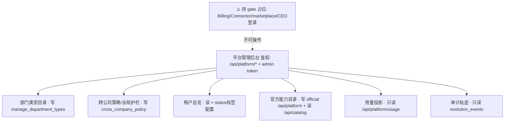

# Curis Admin Platform · Phase-2 MVP 产品需求文档（PRD）

**文档性质**：产品需求文档（PRD）——定义「做什么 / 给谁用 / 验收标准」，不含实现方案、不含架构拆解、不含代码。
**依据契约**：ADR-0028 Phase-1 共享基础契约（co-signed-with-conditions，2026-07-08），复用 ADR-0027 S1(`70e05652`) + S4(`e2271e60`) primitives，不另起炉灶。
**作者**：许清楚（Xu），产品经理　**日期**：2026-07-08
**阶段定位**：本阶段是 **Admin Platform 最小可运营骨架（MVP）**，不是完整商业化平台。

---

## 1. 产品目标（Phase-2）

**一句话**：在 S4 既有 3 标签页后台之上，补齐「租户可运营化 + 官方能力只读目录供给 + 用量/审计透明化」三类能力，使平台运营者能在 **不触发任何禁止区（G1–G4）** 的前提下安全运营首批租户。

**可量化目标（5 条）**
- G1：平台运营者可查看 100% 已创建租户的扩展档案（含 `ceo_id` / `company_name` / `status` / `plan_tier` 标签），且 `tenants` 表 **零凭证列**。
- G2：官方能力目录（部门模板 + 模型 + 工具，`source=official`）经 `GET /api/catalog/*` 对 Workspace 只读可用；Phase-2 至少补 1 类模型 + 1 类工具的 Admin 侧最小录入入口。
- G3：Admin 可经 `GET /api/platform/usage?tenant_id=` 只读投影任一租户用量（task/tool/model 调用次数、token 数、分钟数），投影 **不含任何金额/成本/ROI 推导**。
- G4：Admin 可只读审计轨迹（`governance.*` / `capability.*` / `auth.*` / `department.*`），复用既有 append-only 事件日志，零新增写路径。
- G5：Phase-2 上线能力 **100% 不触碰 G1–G4 禁止区**；任何隐含禁止区的条目在本文档被显式标注并排除出首批切片。

---

## 2. 用户故事（平台运营者视角）

- **US-1**：作为平台运营者，我希望在「租户总览」看到每个租户的 `ceo_id`、公司名、状态、套餐标签，以便在不接触凭证的前提下识别与运营租户。
- **US-2**：作为平台运营者，我希望能新增/编辑官方模型与工具目录条目（`source=official`），并经只读 catalog 接口供给所有租户，以便 CEO 侧 Workspace 能安装使用官方能力。
- **US-3**：作为平台运营者，我希望在后台查看任一租户的用量计量投影（按租户/按天/按能力），以便了解平台活跃度与负载分布，而不需要计算任何费用。
- **US-4**：作为平台运营者，我希望查看平台与租户两侧的审计轨迹（谁在何时做了治理/能力/认证/部门动作），以便安全合规留痕与排查。
- **US-5**：作为平台运营者，我希望部门类型目录沿用 S4 继续管理，且新增条目自动带 `source=official` 标签，以便官方/私有边界清晰。
- **US-6**：作为平台运营者，我希望任何超出禁止区的功能（计费、连接器凭证、marketplace、CEO 登录）在后台有「⚠️ 待 gate 解锁」占位提示，以便避免误入禁区。

---

## 3. 需求池（P0 / P1 / P2）

> 优先级：P0=本阶段必须 / P1=本阶段应有 / P2=占位或后续。凡隐含禁止区者标注「⚠️ 超出 Phase-2 范围，须 gate 解锁」。

### P0（必须）
- **R-01｜tenants 表 additive 扩展**：在 `tenants(tenant_id,name,created_at)` 上 additive 加 `ceo_id`/`company_name`/`status`/`plan_tier`；无凭证列；复用 `list_tenants()` 只读投影（无新 endpoint）。
  - *验收*：`list_tenants` 返回含新列；DDL 向后兼容不破坏既有 3 列；读取路径零凭证字段；`ceo_id` 为非凭证不透明令牌。
  - *禁止区*：否。
- **R-02｜官方能力只读目录读接口** `GET /api/catalog/{department-types|models|tools}`：`source=official`，tenant-scoped（复用 `X-Tenant-Id`），全局可见；与 `/api/platform/*` 写通道 **非替代分工**（§8.1 条件#3）。
  - *验收*：接口仅读、返回 official 条目；Workspace 经 `X-Tenant-Id` 可见全局官方能力；Admin 写仍走 `/api/platform/*`；`marketplace` 来源显式排除。
  - *禁止区*：否（marketplace/G2 凭证已排除）。
- **R-03｜UsageEvent 只读投影** `GET /api/platform/usage?tenant_id=`（admin-only）：投影 `scope_type`/`quantity`/`unit`/`capability_ref`/`raw_meter_value`，仅计量读数不含金额。
  - *验收*：仅 admin token 可访问；返回纯计量，无 `amount`/`currency`/`ROI` 字段；`tenant_id` 缺失 fail-closed。
  - *禁止区*：否（金额计算 G1 已排除）。
- **R-04｜UsageEvent 写入点规范**（Workspace 侧，§7.2.1）：`tenant_id`/`ceo_id` 强制打标 + `idempotency_key` 幂等去重 + fail-closed。
  - *验收*：缺 `tenant_id` 或 `ceo_id` 时拒绝写入；相同 `idempotency_key` 不重复计量；事件经 `EvolutionEventLog` 追加。
  - *禁止区*：否。*注*：此为 R-03 投影的数据来源，属契约写入点，不属 Admin 写；Phase-2 须保证 Workspace 侧已落此规范（见待确认/依赖）。
- **R-05｜AuditEvent 只读投影**：复用 `governance.*`/`capability.*`/`auth.*`/`department.*` 受控写命名空间的 append-only 日志，Admin 侧只读。
  - *验收*：后台只读展示上述命名空间事件；零新增写路径；append-only 不变式保持。
  - *禁止区*：否。

### P1（应有）
- **R-06｜官方模型目录 Admin 最小录入入口**（`source=official`，`auth_type` 仅形状占位，无凭证持久化，§3.1）。
  - *验收*：后台可新增 ModelProvider/Model（official）；`auth_type` 仅取 `none`/`oauth`/`apikey` 形状，不持久化任何 key；不触发 G2。
  - *禁止区*：API key 真实存储/调用 = G2（显式排除真实凭证，仅形状）。
- **R-07｜官方工具目录 Admin 最小录入入口**（基于现有 `tools` 表 additive 加 `source`/`tenant_id`，§4.2）。
  - *验收*：后台可新增官方工具（`source=official`、global key 唯一）；不持久化私有 key；official 与 tenant_private 命名空间互不冲突（§4.3）。
  - *禁止区*：否。
- **R-08｜租户总览页扩展展示** `ceo_id`/`company_name`/`status`/`plan_tier`（基于 R-01）。
  - *验收*：`TenantsPanel` 卡片展示新字段；`status` 提供 active/suspended/pending 视觉态；`plan_tier` 纯标签无价格。
  - *禁止区*：否。
- **R-09｜用量投影页聚合维度可配置**（按 tenant / 按 day / 按 capability 可切换）。
  - *验收*：三维度均可经查询参数切换；返回纯计量读数；无金额。
  - *禁止区*：否。（默认维度见待确认 b）

### P2（占位/后续）
- **R-10｜BillingEvent 仅落形状**：`period`/`tenant_id`/`usage_refs` + `amount`/`currency`/`status` 占位，不计算金额（§7.3 G1）。
  - *验收*：可定义/持久化 BillingEvent 空壳；`amount`/`currency`/`status=issued` 不可被计算或落真实值；UI 仅展示「计费待 gate 解锁」占位。
  - *禁止区*：是（G1 形状可定义，计算 ⚠️ 待 gate）→ **⚠️ 超出 Phase-2 范围，须 gate 解锁**。
- **R-11｜CEO 正式登录/令牌签发/tenant 绑定占位**（`X-Ceo-Id` 仅占位，§10.4 条件#2）。
  - *验收*：后台/接口不实现正式 CEO auth；`X-Ceo-Id` 仅作请求头透明传递；占位提示「CEO 鉴权独立 ADR」。
  - *禁止区*：否（属独立 ADR，非禁止区，但 Phase-2 不实现）。
- **R-12｜禁止区占位展示**：用量/审计页对 `marketplace` 来源、连接器/私有凭证、跨租户计量显式展示「待 gate」占位并不可操作。
  - *验收*：G2/G3/G4 相关入口在 UI 置灰或标注「待 gate」；无调用/持久化路径。
  - *禁止区*：是（G2/G3/G4）→ **⚠️ 超出 Phase-2 范围，须 gate 解锁**。

---

## 4. UI 设计稿（基于 S4 既有 3 标签页扩展，文字 + Mermaid）

**承接基线**：S4 `frontend/app/platform/page.js` 3 标签页（部门类型目录 / 跨公司策略·全局护栏 / 租户总览），全部经 `/api/platform/*` + admin token 鉴权。Phase-2 沿用该范式，新增/调整如下：

- **标签页 A「部门类型目录」**（沿用 S4 `DepartmentTypesPanel`）：新增「source」徽标列（official=平台 / tenant_private=私有）；新增条目默认 `source=official` 并写 `is_system=1`（§6 兼容）；human-approval 门控保持。
- **标签页 B「跨公司策略 / 全局护栏」**（沿用 S4 `PoliciesPanel`）：不变。
- **标签页 C「租户总览」**（扩展，基于 R-08）：`TenantsPanel` 卡片新增 `ceo_id` / `company_name` / `status`（状态徽标）/ `plan_tier`（纯标签）；新增「筛选/搜索」与「暂停/恢复」仅作用于 `status` 标签（不碰凭证）。
- **新增标签页 D「官方能力目录」**（读 + Admin 最小录入，基于 R-02/R-06/R-07）：左栏官方能力列表（tab 切换 模型/工具/部门模板），展示 `source=official` 条目；右栏「新增官方能力」表单（模型：provider_id/display_name/supported_models/auth_type[形状]；工具：name/type/description/entry/input_schema）。录入即写 official 定义，Workspace 经 `/api/catalog/*` 可读。
- **新增标签页 E「用量投影」**（只读，基于 R-03/R-09）：顶部 `tenant_id` 选择器 + 聚合维度切换（按租户/按天/按能力）；中部计量表格（`scope_type`/`quantity`/`unit`/`capability_ref`/`raw_meter_value`）；明确标注「仅计量读数，不含金额」。
- **新增标签页 F「审计轨迹」**（只读，基于 R-05）：事件流列表（`event_type` 命名空间过滤：governance.*/capability.*/auth.*/department.*），append-only 只读展示。
- **全局占位条**：BillingEvent / Connector / marketplace / CEO 登录 相关区显示「⚠️ 待 gate 解锁」灰态卡片（对应 R-10/R-11/R-12）。

---

## 5. 首批安全切片（关键专节）

按 ADR-0028 §10.3 起点建议拆为 **不触发 G1–G4、可安全自主实现** 的切片清单。

### 切片 A — tenants 表 additive 扩展
- **范围**：在 `tenants(tenant_id,name,created_at)` 上 additive 加 `ceo_id`/`company_name`/`status`/`plan_tier`；**无凭证列**；复用 `list_tenants()` 只读投影（无新 endpoint）。
- **依赖**：S1 `database.list_tenants()` + `tenants` 表（§1.2）。
- **纯只读/配置**：Admin 可改 `status`/`plan_tier` 标签（配置型，非凭证）。
- **验收要点**：`list_tenants` 返回新列；DDL 严格向后兼容；零凭证字段；`ceo_id` 为非凭证不透明令牌。
- **禁止区**：否。

### 切片 B — 官方能力只读目录读接口 `GET /api/catalog/*`
- **范围**：模型/工具/部门模板三类，`source=official`，tenant-scoped（复用 `X-Tenant-Id`），全局可见；与 `/api/platform/*` 写通道 **非替代分工**（§8.1 条件#3）。
- **依赖**：S4 `manage_department_types` 写路径 + 现有 `tools` 表 + 新增 model 目录表（shape §3.1/§4.2）；读接口为新增 catalog 读通道，写仍走 platform。
- **纯只读/配置**：读接口纯只读；Admin 录入经 platform 写（配置型）。
- **验收要点**：Workspace 经 `X-Tenant-Id` 只读获取官方能力；`marketplace` 来源排除；不替代 platform 写。
- **禁止区**：否（marketplace/G2 凭证显式排除）。

### 切片 C — UsageEvent 只读投影 `GET /api/platform/usage?tenant_id=`
- **范围**：admin-only 投影 `evolution_events` 中 UsageEvent（`scope_type`/`quantity`/`unit`/`capability_ref`/`raw_meter_value`），仅计量读数不含金额。
- **依赖**：§7.2.1 Workspace 写入点（`tenant_id`/`ceo_id` 打标 + `idempotency_key` 幂等）+ S1 预留 `tenant_id` 列 + `EvolutionEventLog`。
- **纯只读/配置**：纯只读投影。
- **验收要点**：仅 admin token；返回纯计量无 `amount`/`ROI`；`tenant_id` 缺失 fail-closed；幂等去重生效。
- **禁止区**：否（金额 G1 排除）。

### 切片 D — AuditEvent 只读投影
- **范围**：复用既有受控写事件 `governance.*`/`capability.*`/`auth.*`/`department.*` 的 append-only 日志，Admin 侧只读投影。
- **依赖**：S4 `list_governance_audit` 范式 + `EvolutionEventLog`（受控写清单不变）。
- **纯只读/配置**：纯只读。
- **验收要点**：只读展示四类命名空间事件；零新增写路径；append-only 不变式。
- **禁止区**：否。

### 排除切片（原因说明）
- ❌ **BillingEvent 计费计算**：仅落形状（R-10），金额/ROI 计算 **G1 ⚠️ 待 gate**。→ 禁止区 G1，须总控决策席 + 安全边界席 gate 解锁，且需独立 ADR。
- ❌ **Connector 凭证**：§5 **G2 ⚠️ 待 gate**。→ 外部服务与凭证禁止区，凭证 MUST NOT persist。
- ❌ **marketplace 跨租户**：§2/§9 **G3 ⚠️ 待 gate**。→ 跨租户共享/安装/分成禁止区。
- ❌ **CEO 正式登录/令牌签发**：§10.4 条件#2 独立 ADR。→ `X-Ceo-Id` 仅占位，正式机制单独立 ADR（避免与凭证禁止区混淆），Phase-2 不实现。
- ❌ **tenant_private 模型/工具自带 key/endpoint**：§3.2/§4.3 **G4 ⚠️ 待 gate**。→ 私有凭证持久化与真实调用禁止区。

---

## 6. 待确认问题

- **(a) `plan_tier` 仅作标签是否需要枚举约束**：ADR-0028 §1.2 定义 `plan_tier` 为自由 string（trial/starter/growth 示例），无枚举约束。Phase-2 是否要收紧为枚举（active enum）以便运营筛选？还是保持自由标签？
- **(b) UsageEvent 投影的聚合维度**：默认按 tenant？按 day？还是按 capability？本文档 R-09 提供三维度可切换，但 Phase-2 MVP 的**默认维度与最小聚合粒度**需确认（影响投影查询设计与性能）。
- **(c) 官方能力目录的「模型/工具」数据由谁在 Admin 侧先录入**：S4 仅 `department_types` 有 Admin 录入入口；模型/工具目录是否 Phase-2 一并补最小录入入口（R-06/R-07），还是仅 department 类先行、模型/工具仅读占位？影响切片 B 的范围边界。

---

## 契约对齐声明（确保与 ADR-0028 不冲突）
- 全部需求锚定 §10.3 切片起点；UsageEvent 写入/投影对齐 §7.2.1（强制打标 + 幂等 + admin-only）；
- catalog 读 ≠ platform 写分工对齐 §8.1 条件#3；`source` additive 兼容 `is_system` 对齐 §2.1/§6（条件#4）；
- `X-Ceo-Id` 仅占位对齐 §10.4 条件#2；G1–G4 禁止区全程按 §9 标注并排除出首批切片；
- 未提出任何与契约冲突的设计（无凭证持久化、无金额计算、无 marketplace、无 CEO 正式 auth）。
