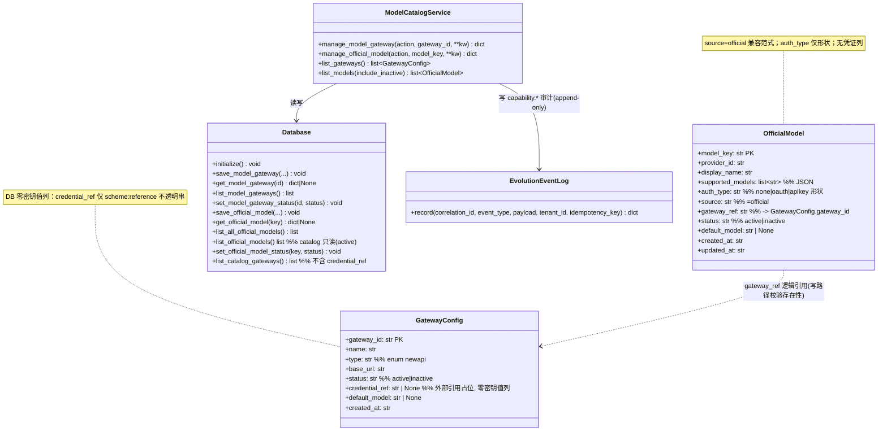
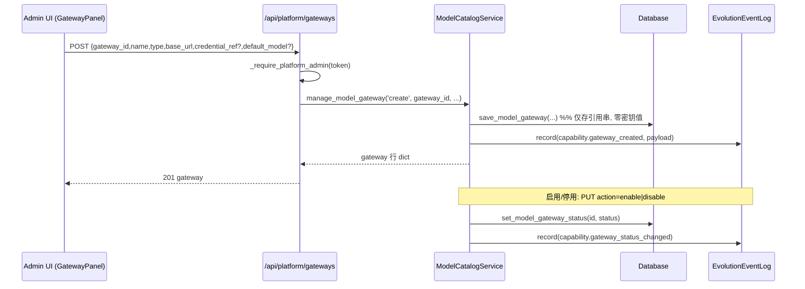
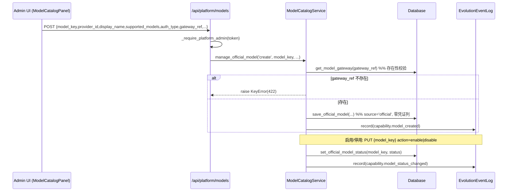
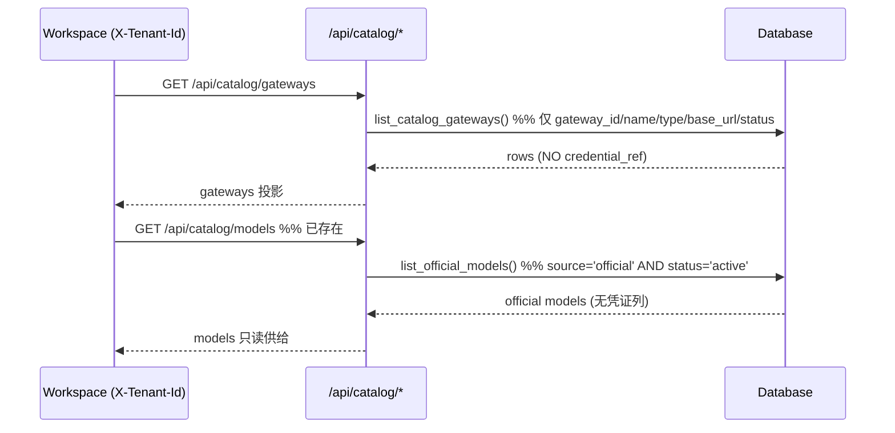
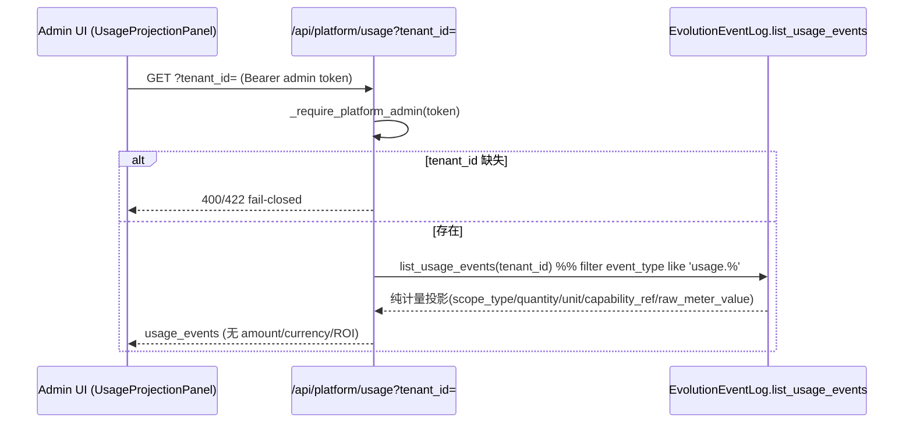
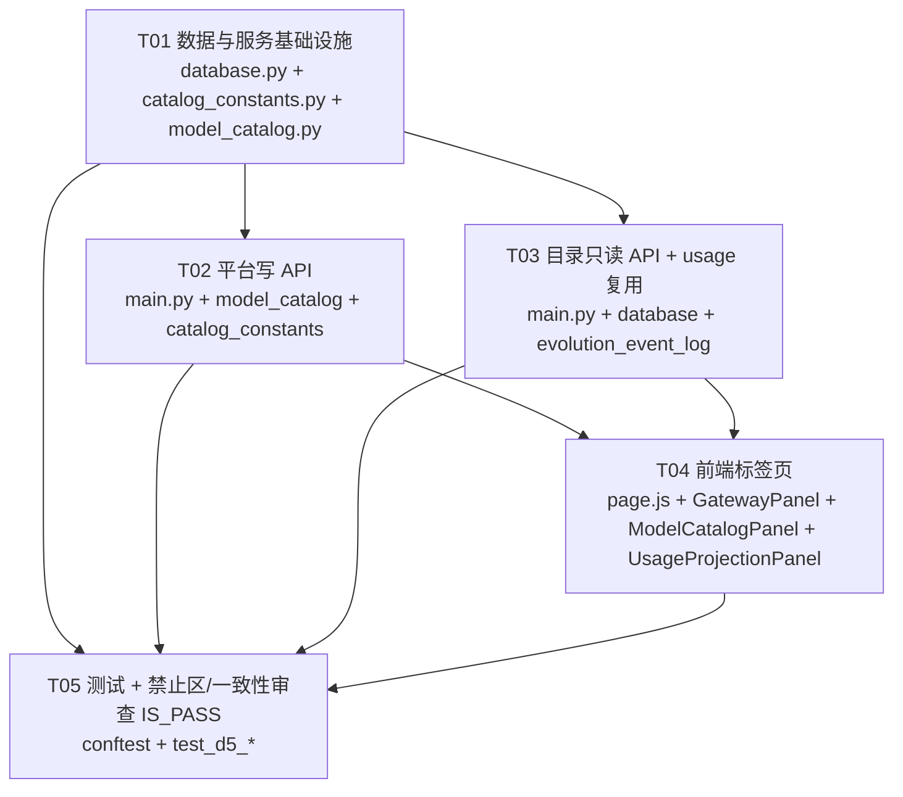

# Curis Admin Platform · New API 网关与官方模型目录管理 — 架构设计 + 任务拆解

> 本文档为「系统架构设计 + 任务拆解」一次性交付，含 8 节；配套 Mermaid 提取见
> `issues/065_adr0028_phase2_newapi_gateway_class.mermaid`（类图）与
> `issues/065_adr0028_phase2_newapi_gateway_sequence.mermaid`（时序图）。

---

## 1. 实现方案 + 框架选型

### 1.1 现状盘点（设计前置，避免重复实现）

代码考古结论（已读 `backend/app/*` 与 `frontend/app/platform/page.js`）：

| 既有资产 | 状态 | 本期处置 |
| --- | --- | --- |
| `official_models` 表（`database.py`，issue 066 已建） | **已存在 + 已 seed**（`_seed_official_model_catalog`，`gateway_ref` 默认 `'newapi'`、`source` 默认 `'official'`、`auth_type` 默认 `'apikey'`） | **补写路径 + 状态机 + `default_model` 列 + `gateway_ref` 校验**，非新建表 |
| `GET /api/catalog/models`（`main.py`） | **已存在**，调用 `database.list_official_models()`（仅 `source='official' AND status='active'`） | 直接复用，Workspace 只读不改动 |
| `GET /api/platform/usage` + `event_log.list_usage_events(tenant_id)` | **已存在**，admin-only 纯计量投影（filter `event_type like 'usage.%'`） | **直接复用 R-04，零新增后端代码** |
| `ModelGatewayAdapter`（`model_gateway.py`） | Workspace 执行层（`urllib` POST `{base_url}/v1/chat/completions`，带 Bearer key） | **Admin 绝不 import / 调用**（G2 + 约束 6/7 硬边界） |
| `_require_platform_admin`（`main.py`） | 平台后台鉴权（Bearer 比对 `CURIS_PLATFORM_ADMIN_TOKEN`） | 复用 |
| `CompanyGovernance.manage_department_types` / `cross_company_policy` | S4 已解锁，受控写 `governance.*` | 不改；本功能审计事件归 `capability.*` 命名空间 |

**关键结论**：本期**净新增表仅 `model_gateways`（GatewayConfig，R-01/R-02）**；官方模型目录（R-03/R-05）为 **additive 补写路径**；usage（R-04）**完全复用**。

### 1.2 框架选型

- **后端**：沿用 **FastAPI + 标准库 `sqlite3` + pydantic + TestClient(httpx)**。
  - 不使用 SQLAlchemy（既有代码即 stdlib `sqlite3`，无 ORM）；迁移沿用 `database.initialize()` 内联 `create table if not exists` + `_ensure_column` **幂等 additive DDL** 风格（**无 Alembic、无独立 migrations 目录**）。
  - 新增表 `model_gateways` 用 `create table if not exists`；`official_models` 扩展列用 `_ensure_column`（additive、幂等、向后兼容既有库）。
- **前端**：沿用 **Next.js 16 (App Router) + React 19 + Tailwind 3**。
  - 新增标签页拆分为独立组件文件（`GatewayPanel.js` / `ModelCatalogPanel.js` / `UsageProjectionPanel.js`），**沿用既有 `apiFetch` + Bearer token 鉴权范式**（不引入 MUI/状态库，与 S4 `page.js` 一致）。
- **零新增依赖**：后端 `requirements.txt`（fastapi / uvicorn / pytest / httpx）、前端 `package.json`（next / react / tailwind）均不变。
- **为何复用而非新建**：ADR-0027/0028 要求基于 S1/S4 primitives 扩展「不另起炉灶」；本期唯一净新增是网关配置表，其余均 additive 扩展既有范式，可让工程师批量写码后经全局一致性审查 `IS_PASS: YES` 直接交 QA。

### 1.3 架构边界（铁律落地）

```
Admin Platform (本功能)                Workspace (既有, 不改动)
─────────────────────────             ───────────────────────────
/api/platform/*  (admin 写)           模型执行 / 网关代理 / 请求转发
  └ manage_model_gateway                 └ ModelGatewayAdapter (urllib 出站)
  └ manage_official_model                （Admin 绝不 import 此模块）
/api/catalog/*     (Workspace 只读)      official_models / model_gateways
  └ base_url/type 投影(不含 credential)   仅元数据供给，不回调 Admin
/api/platform/usage (R-04 复用, 只读计量)
```
- Admin **只定义网关/模型元数据 + 只读计量**；**绝不 import Workspace 执行层、绝不实现模型调用/网关代理/请求转发**。
- `credential_ref` 仅作不透明引用字符串存库；**DB 任何表零密钥值列；绝不解析、绝不向 New API 发起任何 HTTP 调用**。

---

## 2. 文件列表及相对路径

### 2.1 后端（新增 / 修改）

| 文件 | 动作 | 说明 |
| --- | --- | --- |
| `backend/app/database.py` | MODIFY | 新增 `model_gateways` 表 DDL + `_seed_model_gateway`；GatewayConfig 仓储方法；`official_models` 写路径（`save_official_model` / `get_official_model` / `list_all_official_models` / `set_official_model_status`）+ `default_model` 列 additive；`list_catalog_gateways`（**仅选非密钥列**）；调整 `_seed_official_model_catalog` 引用默认 `gateway_id` |
| `backend/app/catalog_constants.py` | **NEW** | 枚举（`GATEWAY_TYPE` / `MODEL_AUTH_TYPE` / `GATEWAY_STATUS` / `MODEL_STATUS`）+ `credential_ref` 格式校验（正则 `^(env|kms|vault):.+$）` |
| `backend/app/model_catalog.py` | **NEW** | `GatewayCatalog` + `ModelCatalog` 服务类（CRUD + 启用/停用 + `gateway_ref` 存在性校验 + 写 `capability.*` 审计 via `EvolutionEventLog`） |
| `backend/app/main.py` | MODIFY | 新增 `/api/platform/gateways`（GET/POST/PUT）、`/api/platform/models`（GET/POST/PUT）、`/api/catalog/gateways`（GET，不含 `credential_ref`）；复用 `_require_platform_admin`；新增 Pydantic 请求模型 |
| `backend/app/governance.py` | 不改 | 保持 S4 受控写不变式 |
| `backend/app/evolution_event_log.py` | 不改 | R-04 `list_usage_events` 直接复用 |
| `backend/app/tenant_context.py` | 不改 | — |
| `backend/tests/conftest.py` | **NEW** | 共享 fixture + 禁止区扫描 helper（针对本功能新增/修改的 app 文件） |
| `backend/tests/test_d5_newapi_gateway.py` | **NEW** | 网关 CRUD + 启用/停用 + 审计 + 禁止区/受控写扫描 |
| `backend/tests/test_d5_official_model_catalog.py` | **NEW** | 官方模型写路径 + catalog 读排除凭证 + 状态机 |

### 2.2 前端（新增 / 修改）

| 文件 | 动作 | 说明 |
| --- | --- | --- |
| `frontend/app/platform/page.js` | MODIFY | `TABS` 增加「模型网关」「官方模型目录」「用量投影」；条件渲染新面板 |
| `frontend/app/platform/GatewayPanel.js` | **NEW** | 标签页 G：网关列表 + 新增网关表单（`credential_ref` 仅占位输入框） |
| `frontend/app/platform/ModelCatalogPanel.js` | **NEW** | 标签页 H：官方模型列表 + 新增官方模型表单（`gateway_ref` 下拉、`auth_type` 仅形状） |
| `frontend/app/platform/UsageProjectionPanel.js` | **NEW** | 标签页 E：复用 `GET /api/platform/usage`（R-04，纯计量） |

### 2.3 DDL / 迁移风格

- 沿用 `database.initialize()` 内联幂等 DDL（**无独立迁移脚本目录、无 Alembic**）。
- `model_gateways` 用 `create table if not exists`；`official_models.default_model` 用 `_ensure_column`（additive、兼容既有库）。
- 如需人工回滚记录，可在 `issues/` 附 SQL 快照，但代码层面保证 additive + 幂等，重跑 `initialize()` 安全。

---

## 3. 数据结构和接口（类图 / 表结构）

### 3.1 GatewayConfig 表（`model_gateways`，R-01/R-02，净新增）

| 字段 | 类型 | 必填 | 约束 | 说明 |
| --- | --- | --- | --- | --- |
| `gateway_id` | text | ✅ | PK | 如 `gw_newapi_prod`；默认种子用 env `CURIS_MODEL_GATEWAY_ID`（默认 `'newapi'`）以对齐既有 `official_models.gateway_ref='newapi'` |
| `name` | text | ✅ | NOT NULL | 展示名 |
| `type` | text | ✅ | NOT NULL，`CHECK(type IN ('newapi'))` | 首批仅 `newapi`（枚举 `GATEWAY_TYPE`）；预留未来值（R-10） |
| `base_url` | text | ✅ | NOT NULL | 网关基础地址（**非凭证配置**） |
| `status` | text | ✅ | NOT NULL，default `'active'`，`CHECK(status IN ('active','inactive'))` | 启用态（R-02/R-05 同款状态机） |
| `credential_ref` | text | ❌ | NULL 允许 | **⚠️ 外部密钥托管引用标识**（如 `env:CURIS_MODEL_GATEWAY_API_KEY` / `kms:arn:aws:...`）。**不存密钥值**；Admin 绝不解析、绝不发起出站调用 |
| `default_model` | text | ❌ | NULL 允许 | 该网关默认模型名（仅元数据，如 `gpt-4o`） |
| `created_at` | text | ✅ | default `current_timestamp` | — |

> **明确标注：无 `api_key` 列、无 `token` 列、无任何密钥值列**。`credential_ref` 是 TEXT 引用字符串，不是密钥本身；DB 落库值恒为形如 `scheme:reference` 的不透明串。

**索引**：PK `gateway_id`；可选 `CREATE INDEX IF NOT EXISTS idx_model_gateways_status ON model_gateways(status, type)`。

### 3.2 官方模型目录表（`official_models`，R-03/R-05，additive 扩展既有表）

既有列：`model_key`(PK) / `provider_id` / `display_name` / `supported_models`(text JSON) / `auth_type`(default `'apikey'`) / `source`(default `'official'`) / `gateway_ref`(default `'newapi'`) / `status`(default `'active'`) / `created_at` / `updated_at`。

本期 additive 扩展：

| 新增列 | 类型 | 说明 |
| --- | --- | --- |
| `default_model` | text | additive（`_ensure_column`）；该模型在网关侧的默认模型名，与 `GatewayConfig.default_model` 对齐 |

**范式对齐（沿用 `department_types` 同款 `source` additive 兼容 `is_system`，§2.1/§6 条件#4）**：
- `source` 默认 `'official'`（Admin 创建官方条目）；`is_system` 列在 `official_models` 无需（模型目录为新表，沿用 `source` 语义即可，遵循 §2.1/§6 精神）。
- catalog 读过滤 `source='official' AND status='active'`（复用既有 `list_official_models`）。
- `gateway_ref` → `GatewayConfig.gateway_id` **逻辑引用**（写路径校验存在性，无 DB FK 约束，与 `department_types` 无 FK 范式一致）。
- `status` 状态机 `active`↔`inactive`（R-05），无物理删除路径。
- `auth_type` 仅取 `none` / `oauth` / `apikey` **形状占位**，不持久化任何 key。

> **明确标注：无 `api_key` 列、无 `token` 列、无 `config_placeholder` 密钥字段**。本表零凭证列。

**索引**：PK `model_key`；复用既有查询模式，必要时 `CREATE INDEX IF NOT EXISTS idx_official_models_src_status ON official_models(source, status)`。

### 3.3 类图（Mermaid classDiagram）



### 3.4 API 接口签名（Pydantic 请求模型，落在 `main.py`）

```python
class GatewayCreateIn(BaseModel):
    gateway_id: str
    name: str
    type: str = "newapi"            # 枚举 GATEWAY_TYPE
    base_url: str
    credential_ref: str = ""        # 外部引用占位, 可为空
    default_model: str = ""
    status: str = "active"          # active|inactive

class GatewayUpdateIn(BaseModel):
    action: str = "enable"          # enable | disable

class ModelCreateIn(BaseModel):
    model_key: str
    provider_id: str
    display_name: str
    supported_models: list[str] = []
    auth_type: str = "apikey"       # none|oauth|apikey
    gateway_ref: str = "newapi"     # -> GatewayConfig.gateway_id
    default_model: str = ""
    status: str = "active"

class ModelUpdateIn(BaseModel):
    action: str = "enable"          # enable | disable
```

---

## 4. 程序调用流程（时序图）

### 4.1 主链路一：Admin 配置网关（写 `/api/platform/*`）



### 4.2 主链路二：Admin 维护官方模型（写 + `gateway_ref` 校验 + 状态机）



### 4.3 主链路三：Workspace 只读 catalog（不含凭证）



### 4.4 主链路四：Admin 查看 usage（R-04 直接复用，零新增）



---

## 5. 任务列表（有序、含依赖、按实现顺序）

> 团队约束：任务数 ≤ 5；每个任务 ≥ 3 个相关文件；T01 为基础设施。
> 原 PRD 建议 7 步（DDL → model/repo → platform 写 → catalog 读 → usage 复用 → 前端 → 测试）已归并为下方 5 个任务（依赖/顺序不变）。

### T01 — 数据与服务基础设施（additive DDL + 仓储 + 服务 + 共享常量）　【P0】
- **Source Files**：`backend/app/database.py`、`backend/app/catalog_constants.py`(NEW)、`backend/app/model_catalog.py`(NEW)
- **Dependencies**：无（仅依赖 ADR-0028 既有契约与 `evolution_event_log`/`tenant_context`）
- **内容**：
  - `database.py`：新增 `model_gateways` 表 DDL + `_seed_model_gateway`（默认种子 gateway_id 取自 env `CURIS_MODEL_GATEWAY_ID` 默认 `'newapi'`）；GatewayConfig 仓储方法（`save_model_gateway` / `get_model_gateway` / `list_model_gateways` / `set_model_gateway_status`）；`official_models` 写路径（`save_official_model` / `get_official_model` / `list_all_official_models` / `set_official_model_status`）+ `_ensure_column` 加 `default_model`；`list_catalog_gateways`（**仅选 `gateway_id,name,type,base_url,status`，排除 `credential_ref`**）；`_seed_official_model_catalog` 的 `gateway_ref` 对齐默认 gateway_id。
  - `catalog_constants.py`：枚举 `GATEWAY_TYPE=['newapi']`、`MODEL_AUTH_TYPE=['none','oauth','apikey']`、`GATEWAY_STATUS=['active','inactive']`、`MODEL_STATUS=['active','inactive']`；`credential_ref` 格式校验（正则 `^(env|kms|vault):.+$`，空串允许）。
  - `model_catalog.py`：`GatewayCatalog` + `ModelCatalog` 服务（CRUD + 启用/停用 + `gateway_ref` 存在性校验 + 写 `capability.*` 审计 via `EvolutionEventLog`）。

### T02 — 平台写 API（`/api/platform/gateways`、`/api/platform/models`）　【P0】
- **Source Files**：`backend/app/main.py`(MODIFY)、`backend/app/model_catalog.py`(引用/调用)、`backend/app/catalog_constants.py`(引用/调用)
- **Dependencies**：T01
- **内容**：新增 Pydantic 请求模型（`GatewayCreateIn` / `GatewayUpdateIn` / `ModelCreateIn` / `ModelUpdateIn`）；新增端点 `GET/POST /api/platform/gateways`、`PUT /api/platform/gateways/{gateway_id}`（enable|disable）、`GET/POST /api/platform/models`、`PUT /api/platform/models/{model_key}`（enable|disable）；全部复用 `_require_platform_admin`；异常映射（KeyError→422，ValueError→422）。**不新增任何 `/api/govern*` 端点、不 import `model_gateway`。**

### T03 — 目录只读 API + usage 复用确认　【P0】
- **Source Files**：`backend/app/main.py`(MODIFY)、`backend/app/database.py`(引用 `list_catalog_gateways`)、`backend/app/evolution_event_log.py`(引用 `list_usage_events`，**不改**)
- **Dependencies**：T01（`list_catalog_gateways`）；usage 复用为既有能力，无后端依赖
- **内容**：新增 `GET /api/catalog/gateways`（Workspace 只读，返回非密钥列）；确认 `GET /api/catalog/models`（已有）与 `GET /api/platform/usage`（R-04，已有）**直接复用、零新增后端代码**——在任务内以「复用核验清单」记录（端点存在、admin-only、纯计量、无金额）。

### T04 — 前端标签页（模型网关 + 官方模型目录 + 复用用量投影）　【P0/P1】
- **Source Files**：`frontend/app/platform/page.js`(MODIFY)、`frontend/app/platform/GatewayPanel.js`(NEW)、`frontend/app/platform/ModelCatalogPanel.js`(NEW)、`frontend/app/platform/UsageProjectionPanel.js`(NEW)
- **Dependencies**：T02、T03（消费对应端点）
- **内容**：`page.js` 的 `TABS` 增加「模型网关」「官方模型目录」「用量投影」并条件渲染；`GatewayPanel` 左栏网关列表 + 右栏新增表单（`credential_ref` 仅显示「⚠️ 待 gate：密钥托管引用（KMS/vault）」占位输入框，**无任何 token/key 明文控件** + 禁用说明条「Admin 仅定义网关元数据，不执行模型调用」）；`ModelCatalogPanel` 左栏模型列表（含启用/停用开关，无物理删除）+ 右栏新增表单（`gateway_ref` 下拉、`auth_type` 仅形状）；`UsageProjectionPanel` 复用 `GET /api/platform/usage`（tenant_id 选择器 + 计量表格，标注「仅计量读数，不含金额」）。沿用既有 `apiFetch` + Bearer token 范式。

### T05 — 测试 + 禁止区/一致性审查（`IS_PASS: YES`）　【P0】
- **Source Files**：`backend/tests/conftest.py`(NEW)、`backend/tests/test_d5_newapi_gateway.py`(NEW)、`backend/tests/test_d5_official_model_catalog.py`(NEW)
- **Dependencies**：T01–T04
- **内容**：
  - `conftest.py`：共享 `_CHANGED_APP_FILES = [model_catalog.py, main.py, database.py]` + 禁止区扫描 helper（复用 S4 `_FORBIDDEN` 列表，并对本功能 `_APPROVED_EVENT_TYPES` 扩展 `capability.gateway_created` / `capability.gateway_status_changed` / `capability.model_created` / `capability.model_status_changed`）。
  - `test_d5_newapi_gateway.py`：网关 create/enable/disable 全链路 + `capability.*` 审计写入 + 受控写仅批准集合 + 禁止区关键词零命中 + `model_gateways` additive 表存在。
  - `test_d5_official_model_catalog.py`：官方模型 create（`gateway_ref` 不存在→422）+ 状态机 + catalog 读**不含 `credential_ref`** + 既有 S1–S4 测试全绿（不修改 `test_d4_platform.py`）。
  - 验收门槛：禁止区扫描 `IS_PASS: YES`、受控 evolution_events 写仅批准集合、后端回归全绿、前端标签页可加载。

### 5.1 任务依赖图（Mermaid graph）



---

## 6. 依赖包列表

**后端**：零新增。既有 `backend/requirements.txt`：`fastapi==0.116.1`、`uvicorn[standard]==0.35.0`、`pytest==8.4.1`、`httpx==0.28.1`。存储用标准库 `sqlite3`（**非 SQLAlchemy**）；禁止引入 `requests` / `openai` / `anthropic` / `boto3`（禁止区扫描零容忍）。

**前端**：零新增。既有 `frontend/package.json`：`next@16.2.10`、`react@19.2.7`、`react-dom@19.2.7`、`tailwindcss@3.4.17`（dev）、`eslint` / `eslint-config-next`（dev）。不引入 MUI / 状态库（沿用 S4 Tailwind 范式）。

---

## 7. 共享知识（跨文件约定）

1. **`gateway_type` 枚举**：首值 `newapi`（`GATEWAY_TYPE`）；预留未来值（R-10）须经独立评估，本期仅 `newapi` 形状，不含其内部调用/鉴权逻辑。
2. **`source=official` 兼容范式**：`official_models.source` 默认 `'official'`；catalog 读过滤 `source='official' AND status='active'`；沿用 `department_types` 同款 `source` additive 兼容 `is_system` 精神（§2.1/§6 条件#4），模型目录为新表故无需 `is_system` 列。
3. **`credential_ref` 引用格式约定（铁律）**：格式 `scheme:reference`，`scheme ∈ {env, kms, vault}`，如 `env:CURIS_MODEL_GATEWAY_API_KEY`、`kms:arn:aws:kms:...`。**严禁明文**；DB 仅存该不透明串；Admin **绝不解析、绝不向 New API 发起任何出站调用**（G2 决策(b)）；UI 仅显示「⚠️ 待 gate：密钥托管引用（KMS/vault）」占位输入框。
4. **`status` 状态机**：网关 `active`↔`inactive`（`model_gateways.status` 列）；官方模型 `active`↔`inactive`（`official_models.status` 列）；启用/停用无物理删除；操作写 `capability.*` 审计事件。
5. **admin-only 鉴权约定**：所有 `/api/platform/*` 复用 `_require_platform_admin`（Bearer token 比对 `CURIS_PLATFORM_ADMIN_TOKEN`，默认 dev `'platform-admin-dev'`）；`/api/catalog/*` 仅 Workspace 经 `X-Tenant-Id` 只读。
6. **fail-closed 规则**：
   - usage 查询 `tenant_id` 缺失 → 拒绝（400/422），不返回跨租户聚合。
   - 创建官方模型时 `gateway_ref` 不存在 → 拒绝（KeyError→422），不写入悬空引用。
   - Workspace 侧 UsageEvent 写入 `tenant_id`/`ceo_id` 缺失 fail-closed（属 Workspace 职责，Admin 仅读，沿用 §7.2.1）。
7. **AuditEvent 命名空间**：启用/停用/创建写 `capability.gateway_created` / `capability.gateway_status_changed` / `capability.model_created` / `capability.model_status_changed`，经 `EvolutionEventLog.record`（append-only，无 update/delete）；与 S4 `governance.*` 受控写集合互不冲突。
8. **catalog 读 ≠ platform 写**：`/api/catalog/*` 对 Workspace 仅只读（网关投影**不含 `credential_ref`**）；`/api/platform/*` 仅 Admin 写；二者非替代分工（§8.1 条件#3）。
9. **Admin 边界（约束 6/7）**：Admin 仅定义网关/模型元数据 + 只读计量；**绝不 import `model_gateway`、绝不实现模型调用/网关代理/请求转发代码**；官方模型对 Workspace 为只读安装关系。

---

## 8. 待明确事项（需总控决策席 / 原 Workspace 团队确认）

1. **(c) R-06 与本期 R-03 是否合并实现**：`official_models` 表已由 issue 066 建立（含 seed）。建议将本期 R-03 与 Phase-2 R-06 合并为同一「官方模型目录」录入能力（additive 补 `gateway_ref` + `status` + `default_model`），避免两套模型录入入口；需确认 Phase-2 切片是否同步调整。
2. **(b) 默认 gateway 种子 `gateway_id` 取值**：本设计建议用 env `CURIS_MODEL_GATEWAY_ID`（默认 `'newapi'`）以保持与既有 `ModelGatewayAdapter` + `official_models.gateway_ref='newapi'` 对齐；若主理人要求 `gw_newapi_prod` 风格，需同步改 `_seed_official_model_catalog` 引用值。
3. **`default_model` 列落点**：建议在 `official_models` 与 `model_gateways` 均 additive 加 `default_model`（已列入设计）；若工程师判断可仅复用 `supported_models[0]`，可省略官方模型侧该列——待工程师实现时确认。
4. **(a) `credential_ref` 背后密钥托管机制选型（G2，须 gate）**：采用 KMS / vault / env 注入？本期仅定义引用格式占位，实现须经 总控决策席 + 安全边界席 gate 解锁。
5. **(d) `gateway_type` 未来扩展**：除 `newapi` 外是否预留 `other` 枚举位，还是严格仅 `newapi`？本设计严格仅 `newapi`。
6. **(非本期但关联) `plan_tier` 枚举（063 待确认 a）/ usage 默认聚合维度（063 待确认 b）**：本期不处理；R-04 已复用，建议 usage 默认「按 tenant」。

---

## 附：契约对齐自检（设计不冲突声明）

- ✅ `tenants` / `model_gateways` / `official_models` **零凭证列**；`credential_ref` 仅外部引用占位（G2 决策(b)）。
- ✅ usage 投影纯计量（`usage.*` 事件），无 `amount`/`currency`/`ROI`（G1 不触及）。
- ✅ 不引入 marketplace 跨租户共享（G3 不触及）；不持久化私有能力自带凭证（G4 不触及）。
- ✅ `X-Ceo-Id` 仅占位，不实现正式 CEO auth。
- ✅ Admin 边界：不写 Workspace 执行路径、不接管模型调用（约束 6/7）；catalog 读 ≠ platform 写（§8.1 条件#3）。
- ✅ `source=official` additive 兼容 `is_system` 范式（§2.1/§6 条件#4）。
- ✅ 受控 evolution_events 写仅 `capability.*`（本期）+ `governance.*`（既有），无未授权写路径。
