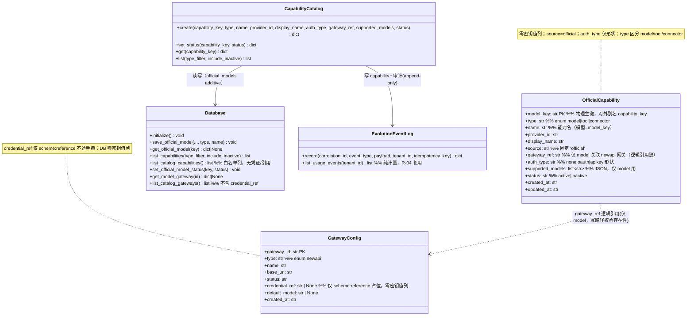
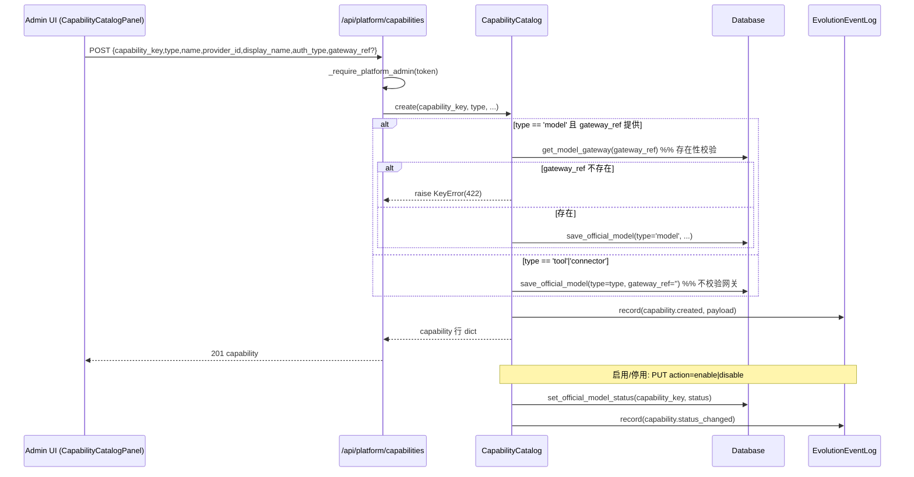
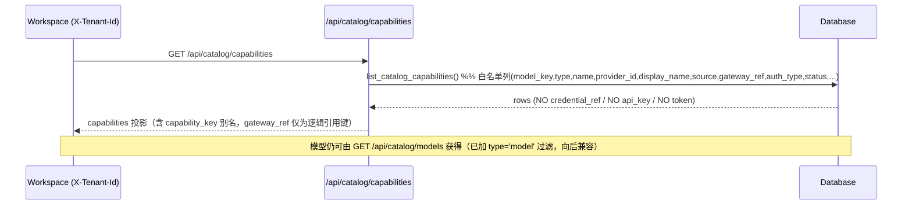
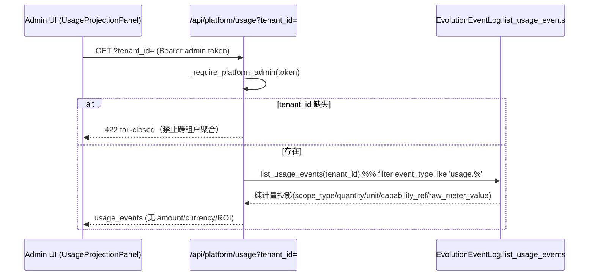
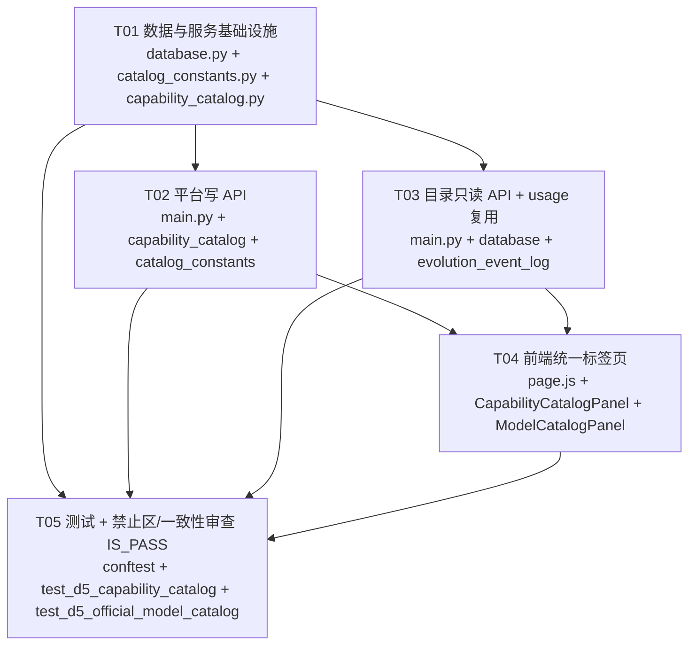

# Curis Admin Platform · 统一官方能力目录 — 架构设计 + 任务拆解

> 本文档为「系统架构设计 + 任务拆解」一次性交付，含 9 节 + 契约对齐自检。
> 配套 Mermaid 提取见同目录 `071_..._class.mermaid`（类图）与 `071_..._sequence.mermaid`（时序图）。
> 凡 G2 相关（`credential_ref` / `auth_type`）只在「引用占位 / 仅形状」层级设计，禁止任何密钥存取 / 出站调用代码路径或任务。

---

## 1. 实现方案 + 框架选型

### 1.1 现状盘点（设计前置，避免重复实现）

代码考古结论（已读 `backend/app/*`、`frontend/app/platform/*`、`backend/tests/*`）：

| 既有资产 | 状态 | 本期处置 |
| --- | --- | --- |
| `official_models` 表（`database.py`，issue 066 建 + issue 065 写路径 + `default_model` additive） | **已存在 + 已 seed**（`official.newapi.default`，`gateway_ref` 默认 `'newapi'`、`source` 默认 `'official'`、`auth_type` 默认 `'apikey'`、`type` 本期补） | **additive 加 `type` + `name` 列**（方案 B，见 §2），模型行 `type='model'`，全量消费者保持原语义 |
| `model_gateways` 表 + `GatewayCatalog`（`model_catalog.py`，issue 065） | 已存在 | **不改结构**；tool/connector 不关联网关（仅 model 的 `gateway_ref` 指向它） |
| `ModelCatalog` + `/api/platform/models` + `/api/catalog/models`（issue 065） | 已存在 + 已测试 | **保留**（向后兼容，既有测试零改动）；模型录入仍可走此路径 |
| `catalog_constants.py`（issue 065） | 已存在 | **additive 加 `CAPABILITY_TYPE=['model','tool','connector']`**；`MODEL_AUTH_TYPE` / `credential_ref` 校验复用 |
| `GET /api/catalog/models`（Workspace 只读） | 已存在 | 加 `AND type='model'` 过滤，**严格只返回模型**（避免 tool/connector 泄漏进模型 catalog） |
| `GET /api/platform/usage` + `event_log.list_usage_events` | 已存在 | **直接复用**，零新增后端代码 |
| `ModelGatewayAdapter`（`model_gateway.py`） | Workspace 执行层 | **Admin 绝不 import / 调用**（约束 6/7） |
| `evolution_event_log.py` | 不改 | R-04 复用；受控写仅 `capability.*` 命名空间 |
| `frontend/app/platform/ModelCatalogPanel.js` | 已存在 | **升级为 `CapabilityCatalogPanel.js`**（统一三类），`page.js` 的「官方模型目录」标签页替换为「官方能力目录」 |
| `test_d5_*` / `conftest.py` | 已存在 | **扩展**（新增 `capability.*` 事件类型、扫描范围加 `capability_catalog.py`），既有测试零改动 |

### 1.2 框架选型

- **后端**：沿用 **FastAPI + 标准库 `sqlite3` + pydantic + TestClient(httpx)**。
  - 不引入 SQLAlchemy；迁移沿用 `database.initialize()` 内联 `create table if not exists` + `_ensure_column` **幂等 additive DDL**（**无 Alembic、无独立 migrations 目录**）。
  - 本期**净新增表：0 张**（统一目录复用 `official_models` additive 扩展）；净新增服务类 `CapabilityCatalog`（新增模块 `capability_catalog.py`）。
- **前端**：沿用 **Next.js 16 (App Router) + React 19 + Tailwind 3**，不引入 MUI / 状态库，沿用既有 `apiFetch` + Bearer token 范式。
- **零新增依赖**：后端 `requirements.txt` / 前端 `package.json` 均不变。
- **为何复用而非新建**：ADR-0027/0028 要求基于 S1/S4 primitives 扩展「不另起炉灶」；统一目录仅需在 `official_models` additive 加 `type`/`name` 两列即可同时承载 model/tool/connector，复用 issue 065 既验证的 `source=official` / `gateway_ref` 校验 / `status` 状态机 / `capability.*` 审计 / catalog 只读投影范式，让工程师批量写码后经全局一致性审查 `IS_PASS: YES` 直接交 QA。

### 1.3 架构边界（铁律落地）

```
Admin Platform (本功能)                Workspace (既有, 不改动)
─────────────────────────             ───────────────────────────
/api/platform/*  (admin 写)           模型执行 / 网关代理 / 请求转发
  └ manage_capability (新增)             └ ModelGatewayAdapter (urllib 出站)
  └ manage_model (issue 065 保留)        （Admin 绝不 import 此模块）
  └ manage_gateway (issue 065 保留)
/api/catalog/*     (Workspace 只读)     official_models (统一目录) / model_gateways
  └ /api/catalog/capabilities (新增)     仅元数据供给，不含任何凭证/引用串
  └ /api/catalog/models (issue 065，仅模型)
/api/platform/usage (R-04 复用, 只读计量)
```

- Admin **只定义能力元数据 + 只读计量**；**绝不 import Workspace 执行层、绝不实现模型/工具/连接器调用/代理/转发**。
- `official_models` 零密钥列；`credential_ref` 仅存在于 `model_gateways`（且为 `scheme:reference` 不透明串），tool/connector 能力**根本不持有 credential_ref**；Admin 绝不解析、绝不向 New API / 工具 / 连接器发起任何出站调用。

---

## 2. 统一目录存储策略决策（PRD §5.2 二选一）

### 2.1 决策：**方案 B（additive 扩展 `official_models` 加 `type` + `name` 列）**

**选择方案 B，放弃方案 A（新增 `official_capabilities` 表）。** 论证如下：

1. **硬约束「向后兼容既有 `GET /api/catalog/models` 与 `official_models` 既有消费方」**：方案 B 保留 `official_models` 作为唯一表，所有现有消费者（`list_official_models`、`get_official_model`、`save_official_model`、`ModelCatalog`、`GatewayCatalog` 的 `gateway_ref` 引用、`tenant_model_preferences` 的 `model_key` 外键语义、seed 函数、既有 `test_d5_*`）**无需改动或仅 additive 改动即继续工作**。方案 A 要么让模型数据存在于两张表（重复），要么需把所有 `official_models` 消费者重定向到新表（迁移风险高、违背「向后兼容」硬约束）。
2. **符合 ADR-0028「additive 不另起炉灶」哲学**：issue 065 已确立 `_ensure_column` 幂等 additive DDL 范式；方案 B 仅加 2 列（`type` 默认 `'model'`、`name` 默认 `''` 回填为 `model_key`），重跑 `initialize()` 安全。
3. **最小净新增**：净新增仅 `CapabilityCatalog` 服务类 + 2 个只读/写端点 + 2 个 repo 查询方法 + 2 个 additive 列；模型部分 100% 复用 issue 065。

### 2.2 最终 DDL（additive，内联于 `database.initialize()`）

```sql
-- 既有 official_models（10 列，issue 066/065 已建，此处不重建，仅 additive 扩展）：
--   model_key PK, provider_id, display_name, supported_models(JSON),
--   auth_type def 'apikey', source def 'official', gateway_ref def 'newapi',
--   status def 'active', created_at, updated_at, (+ issue065 default_model)

-- 本期 additive（幂等，重跑安全）：
ALTER TABLE official_models ADD COLUMN type text NOT NULL DEFAULT 'model';
ALTER TABLE official_models ADD COLUMN name text NOT NULL DEFAULT '';

-- 幂等回填（仅本地库既有行；新库行在写入时已带值）：
UPDATE official_models SET type = 'model' WHERE type IS NULL OR type = '';
UPDATE official_models SET name = model_key WHERE name IS NULL OR name = '';
```

> 说明：`type` 区分 `model`/`tool`/`connector`；`name` 为能力名（模型行 = `model_key`）。物理主键仍为 `model_key`（对外别名为 `capability_key`，见 §4 API）。

### 2.3 迁移 / 种子策略

- **无数据迁移脚本**：沿用 `_ensure_column` + 幂等 `UPDATE` 回填，保证既有库与新库行为一致；`initialize()` 可重复调用。
- **种子不变**：`_seed_official_model_catalog` 继续写入 `official.newapi.default`（本期补 `type='model'`、`name='official.newapi.default'`，可在 seed SQL 直接带值，或依赖回填）。
- **模型网关种子**（`_seed_model_gateway`，issue 065）不变。
- **零密钥列保证**：`official_models` 全程无 `api_key`/`token`/`credential_ref` 列；tool/connector 能力不关联 `credential_ref`。

### 2.4 既有 `GET /api/catalog/models` 兼容性处理

`database.list_official_models()` 的 WHERE 增加 `AND type = 'model'`，使该端点**严格只返回模型**（避免新增的 tool/connector 行泄漏进模型 catalog）。既有行均为 `type='model'`，行为不变；既有 `test_d5_*` 不受影响。

---

## 3. 文件列表及相对路径

### 3.1 后端（新增 / 修改）

| 文件 | 动作 | 说明 |
| --- | --- | --- |
| `backend/app/database.py` | MODIFY | `official_models` additive 加 `type`/`name` 列 + 幂等回填；`save_official_model` 扩展 `type`/`name` 形参；`list_official_models` 加 `AND type='model'`；新增 `list_capabilities(type_filter, include_inactive)`（Admin 统一列表）与 `list_catalog_capabilities()`（Workspace 只读白名单投影，无凭证/引用列） |
| `backend/app/catalog_constants.py` | MODIFY | additive 加 `CAPABILITY_TYPE = ["model","tool","connector"]` + 对应 `is_valid_capability_type`；`MODEL_AUTH_TYPE` / `credential_ref` 校验复用 |
| `backend/app/capability_catalog.py` | **NEW** | `CapabilityCatalog` 服务类（CRUD + 启用/停用 + `gateway_ref` 存在性校验**仅 model** + 写 `capability.*` 审计 via `EvolutionEventLog` + 复用 `_reject_secret_like_metadata`） |
| `backend/app/model_catalog.py` | 不改 | `GatewayCatalog`/`ModelCatalog` 保留（向后兼容）；其 `_reject_secret_like_metadata` 被 `capability_catalog.py` 复用 import |
| `backend/app/main.py` | MODIFY | 新增 Pydantic `CapabilityCreateIn`/`CapabilityUpdateIn`；新增端点 `GET/POST /api/platform/capabilities`、`PUT /api/platform/capabilities/{key}`(enable|disable)、`GET /api/catalog/capabilities`；复用 `_require_platform_admin` |
| `backend/app/evolution_event_log.py` | 不改 | R-04 `list_usage_events` 直接复用 |
| `backend/app/governance.py` / `tenant_context.py` | 不改 | — |

### 3.2 前端（新增 / 修改）

| 文件 | 动作 | 说明 |
| --- | --- | --- |
| `frontend/app/platform/page.js` | MODIFY | `TABS` 将「官方模型目录」替换为「官方能力目录」(`capabilities`)；条件渲染新面板 |
| `frontend/app/platform/CapabilityCatalogPanel.js` | **NEW** | 统一能力面板：按 `type` 分组展示 model/tool/connector；统一新增 / 启用停用；`gateway_ref` 仅 model 显示下拉 |
| `frontend/app/platform/ModelCatalogPanel.js` | DEPRECATE | 被 `CapabilityCatalogPanel.js` 替代（保留不渲染，便于回滚，可后续删除） |
| `frontend/app/platform/GatewayPanel.js` / `UsageProjectionPanel.js` | 不改 | 沿用 issue 065 |

### 3.3 测试（新增 / 修改）

| 文件 | 动作 | 说明 |
| --- | --- | --- |
| `backend/tests/conftest.py` | MODIFY | `_CHANGED_APP_FILES` 加 `capability_catalog.py`；`_APPROVED_EVENT_TYPES` 加 `capability.created` / `capability.status_changed` |
| `backend/tests/test_d5_capability_catalog.py` | **NEW** | 统一能力 create（model 走 gateway_ref 校验、tool/connector 不校验）/ 状态机 / catalog 读排除凭证 / `capability.*` 审计 / 禁止区扫描零命中 / Admin 不 import model_gateway |
| `backend/tests/test_d5_official_model_catalog.py` | MODIFY | 加一条向后兼容断言：`GET /api/catalog/models` 仍仅返回 `type='model'` |

### 3.4 DDL / 迁移风格

- 沿用 `database.initialize()` 内联幂等 DDL（**无独立迁移脚本目录、无 Alembic**）。
- `official_models` 用 `_ensure_column` 加 `type`/`name`（additive、兼容既有库）；回填用幂等 `UPDATE`。
- 如需人工回滚记录，可在 `issues/` 附 SQL 快照，但代码层面保证 additive + 幂等，重跑 `initialize()` 安全。

---

## 4. 数据结构和接口（类图 / 表结构）

### 4.1 统一官方能力目录表（`official_models`，additive 扩展，零密钥列）

| 字段 | 类型 | 必填 | 约束 | 说明 |
| --- | --- | --- | --- | --- |
| `model_key` | text | ✅ | PK | 物理主键；对外别名 `capability_key`；全局唯一（model/tool/connector 共用命名空间） |
| `type` | text | ✅ | NOT NULL，`CHECK(type IN ('model','tool','connector'))` default `'model'` | 能力类型（本期新增列） |
| `name` | text | ✅ | NOT NULL default `''`（回填为 `model_key`） | 能力名；模型行 = `model_key` |
| `provider_id` | text | ✅ | NOT NULL | 供应方（模型=openai 等；tool/connector=逻辑 provider 标识，如 `internal`/`slack`） |
| `display_name` | text | ✅ | NOT NULL | 展示名 |
| `source` | text | ✅ | NOT NULL default `'official'` | 固定 `official`（additive 兼容 `is_system` 精神） |
| `gateway_ref` | text | ❌ | 默认 `''`；**仅 model 关联 `model_gateways.gateway_id`** | 逻辑引用键（非密钥）；tool/connector 为空 |
| `auth_type` | text | ✅ | NOT NULL default `'none'`，`CHECK(auth_type IN ('none','oauth','apikey'))` | **仅形状占位**，不存真实凭证 |
| `supported_models` | text | ❌ | JSON，`default '[]'` | 仅 model 用；tool/connector 存 `'[]'` |
| `status` | text | ✅ | NOT NULL default `'active'`，`CHECK(status IN ('active','inactive'))` | 启用态（状态机） |
| `default_model` | text | ❌ | NULL 允许（issue 065 additive） | 网关侧默认模型名（仅 model 用） |
| `created_at` | text | ✅ | default `current_timestamp` | — |
| `updated_at` | text | ✅ | default `current_timestamp` | — |

> **明确标注：无 `api_key` 列、无 `token` 列、无 `credential_ref` 列——零密钥值列**。`gateway_ref` 是 TEXT 逻辑引用键（指向 `model_gateways.gateway_id`），不是密钥；tool/connector 不持有任何引用/凭证。DB 落库值恒为非密钥元数据。

**索引**：PK `model_key`；可选 `CREATE INDEX IF NOT EXISTS idx_official_models_type_status ON official_models(type, status)`。

### 4.2 类图（Mermaid classDiagram，见 `071_..._class.mermaid`）



### 4.3 API 接口签名（Pydantic 请求模型，落在 `main.py`）

```python
# ── ADR-0028 Phase-2 (issue 070): 统一官方能力目录 请求模型 ──
class CapabilityCreateIn(BaseModel):
    """新增任一类型官方能力（model/tool/connector）。
    capability_key 即物理 model_key（全局唯一）；gateway_ref 仅 model 关联 newapi 网关。"""
    capability_key: str
    type: str = "model"              # model | tool | connector
    name: str = ""                   # 缺省取 capability_key
    provider_id: str = ""
    display_name: str = ""
    auth_type: str = "none"          # none | oauth | apikey 形状
    gateway_ref: str = ""            # 仅 model 生效；缺省 'newapi'
    supported_models: list[str] = [] # 仅 model 用
    status: str = "active"           # active | inactive

class CapabilityUpdateIn(BaseModel):
    """启用 / 停用官方能力。"""
    action: str = "enable"           # enable | disable
```

**新增端点**：
- `GET  /api/platform/capabilities` — admin，列表（`?type=&include_inactive=`），返回 `{capabilities:[...]}`
- `POST /api/platform/capabilities` (201) — admin，创建任一类型
- `PUT  /api/platform/capabilities/{capability_key}` — admin，启用/停用（enable|disable）
- `GET  /api/catalog/capabilities` — Workspace 只读，返回 `{capabilities:[...]}`（白名单列，无凭证/引用串）

**响应视图统一字段**（`/api/catalog/capabilities` 与 `/api/platform/capabilities` 均返回）：
`capability_key`(=model_key) / `type` / `name` / `provider_id` / `display_name` / `source` / `gateway_ref` / `auth_type` / `status` / `created_at` / `updated_at`（catalog 只读额外排除任何潜在凭证/引用，本表本就零密钥列）。

---

## 5. 程序调用流程（时序图，见 `071_..._sequence.mermaid`）

### 5.1 主链路一：Admin 配置能力（model / tool / connector）



### 5.2 主链路二：Workspace 只读 catalog（不含凭证）



### 5.3 主链路三：Admin 查看 usage（R-04 直接复用，零新增）



---

## 6. 任务列表（有序、含依赖、按实现顺序）

> 团队约束：任务数 ≤ 5；每个任务 ≥ 3 个相关文件；T01 为基础设施。**净新增 = tool/connector 条目 + 统一 capabilities 端点/表扩展；model 部分 additive 复用 issue 065（保留 `/api/platform/models` 与 `ModelCatalog`，既有测试零改动）。**

### T01 — 数据与服务基础设施（additive DDL + 共享常量 + 统一服务）　【P0】
- **Source Files**：`backend/app/database.py`、`backend/app/catalog_constants.py`(MODIFY)、`backend/app/capability_catalog.py`(NEW)
- **Dependencies**：无（仅依赖 ADR-0028 既有契约与 `evolution_event_log`/`model_catalog`）
- **内容**：
  - `database.py`：`official_models` additive 加 `type`/`name` 列 + 幂等回填；`save_official_model` 扩展 `type`/`name` 形参；`list_official_models` 加 `AND type='model'`；新增 `list_capabilities(type_filter, include_inactive)`（Admin 统一列表）与 `list_catalog_capabilities()`（Workspace 只读白名单投影）。
  - `catalog_constants.py`：加 `CAPABILITY_TYPE=['model','tool','connector']` + `is_valid_capability_type`；`MODEL_AUTH_TYPE`/`credential_ref` 校验复用。
  - `capability_catalog.py`：`CapabilityCatalog` 服务（CRUD + 启用/停用 + `gateway_ref` 存在性校验**仅 model** + 写 `capability.created`/`capability.status_changed` 审计 via `EvolutionEventLog`；复用 `model_catalog._reject_secret_like_metadata`）。

### T02 — 平台写 API（`/api/platform/capabilities`）　【P0】
- **Source Files**：`backend/app/main.py`(MODIFY)、`backend/app/capability_catalog.py`(引用/调用)、`backend/app/catalog_constants.py`(引用)
- **Dependencies**：T01
- **内容**：新增 Pydantic `CapabilityCreateIn`/`CapabilityUpdateIn`；新增 `GET/POST /api/platform/capabilities`、`PUT /api/platform/capabilities/{capability_key}`(enable|disable)；全部复用 `_require_platform_admin`；异常映射（KeyError/ValueError→422，非法 action→422）。**不新增任何 `/api/govern*` 端点、不 import `model_gateway`。**

### T03 — 目录只读 API（`/api/catalog/capabilities`）+ usage 复用确认　【P0】
- **Source Files**：`backend/app/main.py`(MODIFY)、`backend/app/database.py`(引用 `list_catalog_capabilities`)、`backend/app/evolution_event_log.py`(引用，不改)
- **Dependencies**：T01（`list_catalog_capabilities`）
- **内容**：新增 `GET /api/catalog/capabilities`（Workspace 只读，白名单列，排除任何凭证/引用串，`gateway_ref` 仅作逻辑引用键包含）；确认 `GET /api/catalog/models`（加 `type='model'` 过滤，向后兼容）、`GET /api/platform/usage`（R-04，零新增后端代码）以「复用核验清单」记录。

### T04 — 前端统一标签页（升级 ModelCatalogPanel → CapabilityCatalogPanel）　【P0】
- **Source Files**：`frontend/app/platform/page.js`(MODIFY)、`frontend/app/platform/CapabilityCatalogPanel.js`(NEW)、`frontend/app/platform/ModelCatalogPanel.js`(DEPRECATE)
- **Dependencies**：T02、T03（消费对应端点）
- **内容**：`page.js` 的 `TABS` 将「官方模型目录」替换为「官方能力目录」(`capabilities`) 并条件渲染；`CapabilityCatalogPanel` 按 `type` 分组展示 model/tool/connector，统一新增表单（`type` 下拉、`name`/`provider_id`/`display_name`、`gateway_ref` 仅 model 显示下拉自 `/api/platform/gateways`、`auth_type` 仅形状、status 默认 active）+ 启用/停用开关（无物理删除）；禁用说明条「Admin 仅定义能力元数据，不执行模型/工具/连接器调用」。沿用 `apiFetch` + Bearer token 范式，不引入 MUI/状态库。

### T05 — 测试 + 禁止区/一致性审查（`IS_PASS: YES`）　【P0】
- **Source Files**：`backend/tests/conftest.py`(MODIFY)、`backend/tests/test_d5_capability_catalog.py`(NEW)、`backend/tests/test_d5_official_model_catalog.py`(MODIFY)
- **Dependencies**：T01–T04
- **内容**：
  - `conftest.py`：`_CHANGED_APP_FILES` 加 `capability_catalog.py`；`_APPROVED_EVENT_TYPES` 加 `capability.created` / `capability.status_changed`。
  - `test_d5_capability_catalog.py`：统一能力 create（model 走 `gateway_ref` 校验缺失→422、tool/connector 不校验）、状态机、`capability.*` 审计写入、受控写仅批准集合、catalog 读不含 `credential_ref`/`api_key`/`token`、禁止区关键词零命中、`CapabilityCatalog` 不 import `model_gateway`、既有 S1–S4 测试全绿。
  - `test_d5_official_model_catalog.py`：加向后兼容断言——`GET /api/catalog/models` 仍仅返回 `type='model'`，且 `ModelCatalog` 既有 `capability.model_created` 等事件仍生效（与 `CapabilityCatalog` 的 `capability.created` 共存于 `capability.*` 命名空间）。
  - 验收门槛：禁止区扫描 `IS_PASS: YES`、受控 evolution_events 写仅批准集合、后端回归全绿、前端标签页可加载。

### 6.1 任务依赖图（Mermaid graph，见 `071_..._sequence.mermaid` 末尾或下）



---

## 7. 依赖包列表

**后端**：零新增。既有 `backend/requirements.txt`：`fastapi==0.116.1`、`uvicorn[standard]==0.35.0`、`pytest==8.4.1`、`httpx==0.28.1`。存储用标准库 `sqlite3`（**非 SQLAlchemy**）；禁止引入 `requests` / `openai` / `anthropic` / `boto3`（禁止区扫描零容忍）。

**前端**：零新增。既有 `frontend/package.json`：`next@16.2.10`、`react@19.2.7`、`react-dom@19.2.7`、`tailwindcss@3.4.17`（dev）、`eslint` / `eslint-config-next`（dev）。不引入 MUI / 状态库（沿用 S4 Tailwind 范式）。

---

## 8. 共享知识（跨文件约定）

1. **`type` 枚举**：`CAPABILITY_TYPE = ['model','tool','connector']`（本期新增于 `catalog_constants.py`）；`gateway_type` 仍严格仅 `newapi`（`GATEWAY_TYPE`），本期不含其内部调用/鉴权逻辑。
2. **`source=official` 兼容范式**：`official_models.source` 固定 `'official'`；catalog 读过滤 `source='official' AND status='active'`；沿用 `department_types` 同款 `source` additive 兼容 `is_system` 精神（§2.1/§6 条件#4）。
3. **`credential_ref` 引用格式约定（铁律）**：仅 `model_gateways.credential_ref` 持有，格式 `scheme:reference`（`scheme ∈ {env,kms,vault}`），DB 仅存不透明串；Admin **绝不解析、绝不向 New API / 工具 / 连接器发起任何出站调用**（G2 决策(b)）。**统一能力目录 `official_models` 不持有 `credential_ref` 列**；tool/connector 能力无任何引用/凭证字段。UI 仅在「模型网关」标签页显示「⚠️ 待 gate：密钥托管引用（KMS/vault）」占位输入框。
4. **`auth_type` 仅形状**：取值 `none|oauth|apikey`，**不持久化任何 key**；tool/connector 同样适用此形状占位。
5. **`gateway_ref` 校验（仅 model）**：`CapabilityCatalog.create` 当 `type='model'` 且 `gateway_ref` 提供时，调用 `get_model_gateway` 校验存在性；缺失→`KeyError`→422（fail-closed，无悬空引用）。tool/connector 不关联网关，`gateway_ref` 置空、不校验。
6. **`status` 状态机**：`active`↔`inactive`（`official_models.status` 列）；启用/停用无物理删除；操作写 `capability.*` 审计事件。
7. **admin-only 鉴权约定**：所有 `/api/platform/*` 复用 `_require_platform_admin`（Bearer 比对 `CURIS_PLATFORM_ADMIN_TOKEN`，默认 dev `'platform-admin-dev'`）；`/api/catalog/*` 仅 Workspace 经 `X-Tenant-Id` 只读。
8. **fail-closed 规则**：
   - usage 查询 `tenant_id` 缺失 → 拒绝（422），不返回跨租户聚合。
   - 创建 model 能力时 `gateway_ref` 不存在 → 拒绝（KeyError→422），不写入悬空引用。
   - 统一能力 `capability_key` 重复（跨类型全局唯一，PK 约束）→ `ValueError`→422。
   - Workspace 侧 UsageEvent 写入 `tenant_id`/`ceo_id` 缺失 fail-closed（属 Workspace 职责，Admin 仅读，沿用 §7.2.1）。
9. **AuditEvent 命名空间**：统一能力写 `capability.created` / `capability.status_changed`（append-only，无 update/delete），与 issue 065 `capability.model_created` / `capability.model_status_changed` / `capability.gateway_*` 同属 `capability.*` 命名空间；与 S4 `governance.*` 受控写集合互不冲突。`conftest._APPROVED_EVENT_TYPES` 须包含全部上述类型。
10. **catalog 读 ≠ platform 写**：`/api/catalog/*` 对 Workspace 仅只读（能力投影**不含任何凭证/引用串**——`official_models` 本就零密钥列，`gateway_ref` 仅为逻辑引用键）；`/api/platform/*` 仅 Admin 写；二者非替代分工（§8.1 条件#3）。
11. **Admin 边界（约束 6/7）**：Admin 仅定义能力元数据 + 只读计量；**绝不 import `model_gateway`、绝不实现模型/工具/连接器调用/代理/请求转发代码**。

---

## 9. 待明确事项（需总控决策席 / 原 Workspace 团队确认 — 附推荐答案）

PRD §5 四项，给出推荐答案如下（均不影响本期实现，可并行确认）：

1. **tool / connector 的 `auth_type` 形状是否需更多枚举（如 `oauth2`/`bearer`）？**
   → **推荐：本期保持 `none|oauth|apikey` 仅形状**，与模型一致；未来如需 `oauth2`/`bearer` 经独立评估扩展 `MODEL_AUTH_TYPE` 即可（additive，无 DDL 变更）。
2. **统一目录存储策略（PRD §5.2 二选一）？**
   → **已定：方案 B（additive 扩展 `official_models` 加 `type`/`name`）**，见 §2 论证。理由：硬约束「向后兼容 `GET /api/catalog/models` 与 `official_models` 既有消费方」；方案 A 需迁移/重定向所有消费者，风险更高。
3. **R-06 与 issue 063 中其他 Phase-2 切片（tenants 扩展 / UsageEvent 投影 / AuditEvent 投影）的优先级？**
   → **本期只做统一能力目录**；其余 Phase-2 切片（tenant 扩展、用量/Audit 投影增强）各自独立、互不阻塞，按主理人排期单独切片实现。
4. **capability 与 model 是否共用同一审计事件类型（`capability.*`）？**
   → **推荐：共用 `capability.*` 命名空间**。具体落地：本期新增统一服务用 `capability.created` / `capability.status_changed`（通用，覆盖三类）；issue 065 既有 `ModelCatalog` 继续用 `capability.model_created` / `capability.model_status_changed`（保持既有测试兼容）。二者同属 `capability.*`，受控写清单一并批准。

> 另需总控/安全边界席后续 gate（不在本期）：`credential_ref` 真实密钥托管机制（KMS / vault / env）单列 gate，须经 **总控决策席 + 安全边界席** review 解锁。

---

## 附：契约对齐自检（设计不冲突声明）

- ✅ `official_models`（统一目录）**零密钥列**；`credential_ref` 仅 `model_gateways` 持有且为 `scheme:reference` 不透明串占位（G2 决策(b)）。
- ✅ usage 投影纯计量（`usage.*` 事件），无 `amount`/`currency`/`ROI`（G1 不触及）。
- ✅ 不引入 marketplace 跨租户共享（G3 不触及）；不持久化私有能力自带凭证（G4 不触及）。
- ✅ `X-Ceo-Id` 仅占位，不实现正式 CEO auth。
- ✅ Admin 边界：不写 Workspace 执行路径、不接管模型/工具/连接器调用（约束 6/7）；catalog 读 ≠ platform 写（§8.1 条件#3）。
- ✅ `source=official` additive 兼容 `is_system` 范式（§2.1/§6 条件#4）。
- ✅ 受控 evolution_events 写仅 `capability.*`（本期新增 `capability.created`/`capability.status_changed` + issue 065 既有）+ `governance.*`（既有），无未授权写路径。
- ✅ 净新增仅 `CapabilityCatalog` 服务 + 统一 `capabilities` 端点/表扩展；模型部分 100% 复用 issue 065，既有测试零改动。
