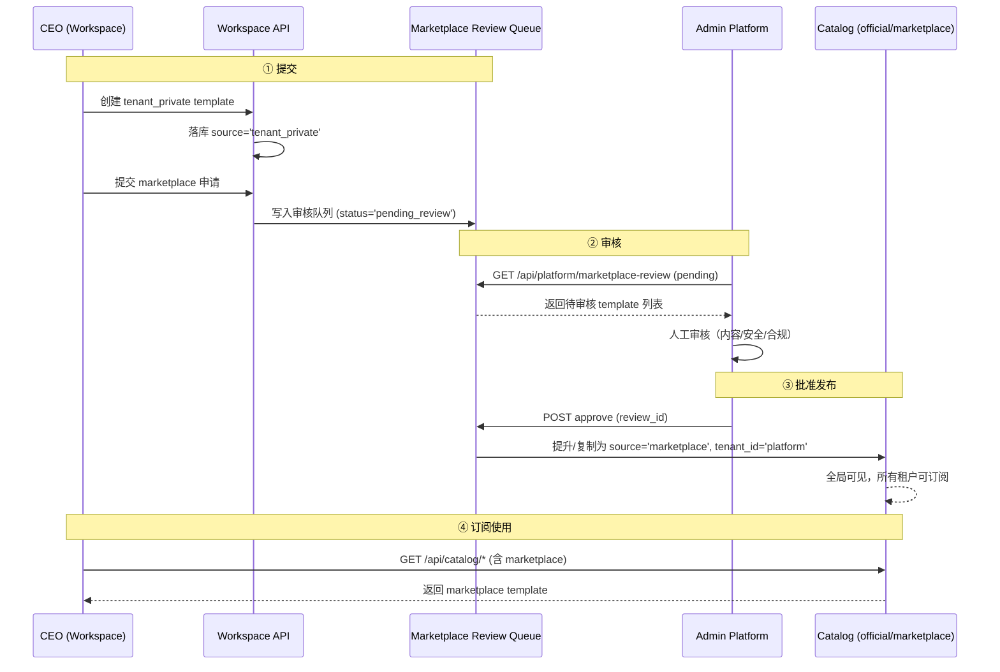
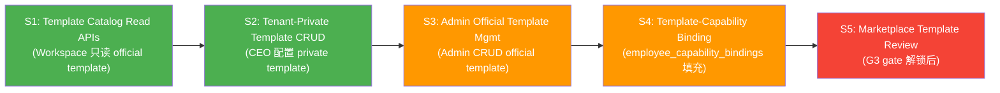
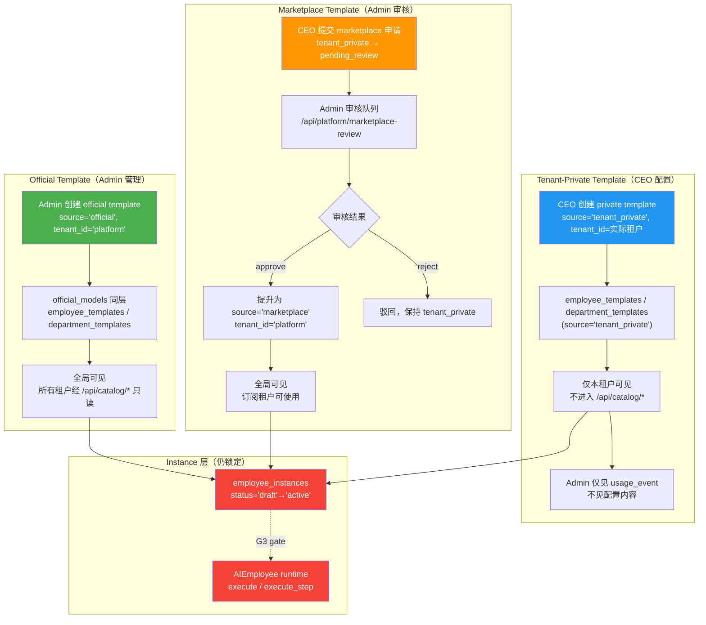

# Phase-3.5 Admin Contract Review: EmployeeTemplate / DepartmentTemplate

## 评审结论：APPROVE-WITH-CONDITIONS

Workspace 团队在 Phase-3.5 中已创建 `employee_templates`、`department_templates`、`employee_instances`、`employee_capability_bindings` 四张表，并预置了 official 种子数据。经逐条评审，契约方向正确、三态来源（official / tenant_private / marketplace）枚举已落地、租户隔离边界已建立。**但有 5 项前置条件须满足后方可进入 Phase-4 实现。**

### 5 项前置条件摘要

| # | 条件 | 详见 |
| --- | --- | --- |
| C1 | ADR-0017「员工 CRUD」禁止区须部分解禁：Template 定义（metadata）解禁，Employee Instance 创建/执行仍锁定 | §1.4 |
| C2 | `department_templates` 与 `department_types` 的双层关系须显式文档化（偏离 ADR-0028 §6 原方案，但更优） | §2.3 |
| C3 | Admin 端 official template 管理 API 须独立于 `CapabilityCatalog`，走 `EmployeeTemplateCatalog` / `DepartmentTemplateCatalog` 独立服务 | §3.2 |
| C4 | `tenant_private_capabilities` 表的 `capability_type` CHECK 约束不含 template 类型——template 走自有表，不复用此表（确认设计意图） | §5.3 |
| C5 | `CAPABILITY_TYPE` 保持 3 类型（model/tool/connector）不变，template 走独立 template catalog 体系 | §6 |

---

## §1 EmployeeTemplate 三态来源评审

### 1.1 三态支持现状：已落地 ✅

`employee_templates` 表（`database.py` L442-456）已包含 `source` 列，CHECK 约束为 `('official', 'tenant_private', 'marketplace')`，与 ADR-0028 §2 `capability_source` 三态枚举完全一致：

```sql
source text not null default 'official'
       check (source in ('official', 'tenant_private', 'marketplace')),
tenant_id text not null default 'platform',
```

三种来源的数据形状已具备：

| source | tenant_id | 管理方 | 当前状态 |
| --- | --- | --- | --- |
| `official` | `'platform'` | Admin Platform | ✅ 种子已落（`official.employee.general_operator`） |
| `tenant_private` | 实际租户 ID | CEO（Workspace） | ✅ 表结构已支持，查询已隔离 |
| `marketplace` | 待定 | Admin 审核 | ⚠️ 枚举已预留，审核流程待 gate（G3） |

### 1.2 数据形状评估

当前 `employee_templates` 表字段：

| 字段 | 类型 | 三态适用性 | 评审意见 |
| --- | --- | --- | --- |
| `id` | text PK | 通用 | ✅ 建议命名空间：`official.*` / `tenant:<tid>:*` / `marketplace:*` |
| `name` | text | 通用 | ✅ |
| `role` | text | 通用 | ✅ 如 operator/analyst/researcher |
| `description` | text | 通用 | ✅ |
| `department_type` | text | 通用 | ✅ → `department_types.type_key` 语义引用 |
| `default_instructions` | text | 通用 | ✅ |
| `default_capability_types_json` | text (JSON) | 通用 | ✅ 如 `["model", "tool"]`，与 `CAPABILITY_TYPE` 对齐 |
| `default_model_policy_json` | text (JSON) | 通用 | ✅ 如 `{"mode": "tenant_default"}` |
| `source` | enum | 三态核心 | ✅ |
| `tenant_id` | text | official='platform', private=租户ID | ✅ |
| `enabled` | integer | 通用 | ✅ |
| `created_at` | datetime | 通用 | ✅ |

**缺失字段建议（不阻塞 Phase-4，但建议 Phase-4 初期 additive 补齐）**：
- `updated_at`：当前仅有 `created_at`，缺少更新时间戳（official_models / tenant_private_capabilities 均有 `updated_at`）
- `schema_version`：ADR-0028 §0.1 元约定要求 `schema_version` 字段，当前缺失

### 1.3 查询隔离已正确实现 ✅

`list_employee_templates`（`database.py` L1395-1414）已实现正确的三态查询隔离：

```python
clauses = ["source = 'official' or (source = 'tenant_private' and tenant_id = ?)"]
```

- official 模板：全局可见（所有租户可读）
- tenant_private 模板：仅本租户可见（`tenant_id = ?` 过滤）
- marketplace 模板：当前未在查询中暴露（待 G3 gate 解锁后补充 `source = 'marketplace'` 条件）

**隔离边界与 model/tool/connector 一致**：tenant_private template 不进入 `/api/catalog/*`（官方目录通道），仅在 Workspace 租户内可见。

### 1.4 ADR-0017 禁止区边界分析（C1 条件）

ADR-0017 禁止区明确列出「员工 CRUD」。需厘清 **EmployeeTemplate（模板定义）** vs **Employee Instance（真实员工实例）** 的边界：

| 层次 | 对应表 | 性质 | ADR-0017 禁止区 | 评审意见 |
| --- | --- | --- | --- | --- |
| Template 定义 | `employee_templates` | 元数据（角色、指令、能力类型偏好） | **可解禁** | 模板定义是 metadata，类比 `department_types`（已解禁）。不涉及真实员工创建/执行/路由 |
| Instance 实例 | `employee_instances` | 租户内真实员工实例（status=draft→active） | **仍锁定** | 实例创建涉及员工生命周期管理，属禁止区核心 |
| Runtime 执行 | `AIEmployee`（employee.py） | 运行时执行类 | **仍锁定** | 涉及任务路由、工具链执行、prompt 注入 |

**类比论证**：
- `department_types`（模板，已解禁）vs `departments`（实例，经 governance gate）vs 部门执行（future）
- `official_models`（目录，已解禁）vs model gateway 调用（执行，经 gateway）
- `employee_templates`（模板，**建议解禁**）vs `employee_instances`（实例，**仍锁定**）vs `AIEmployee` 执行（**仍锁定**）

**结论**：EmployeeTemplate（模板定义）可以先解禁。解禁范围仅限模板元数据的 CRUD（Admin 管理 official、CEO 配置 tenant_private），不包括 Employee Instance 的创建、激活和执行。Instance 层须在 Phase-4 经 governance gate 解锁后方可实现。

**gate 建议**：提交独立 ADR（如 ADR-00xx Employee Template 解禁），明确：
1. 解禁范围：`employee_templates` 表的 official/tenant_private CRUD（metadata only）
2. 锁定范围：`employee_instances` 创建/激活、`AIEmployee` 执行、任务路由注入
3. 不变式：template 不得被 Orchestrator / ToolRouter / AIEmployee 引用（当前种子注释已声明）

---

## §2 DepartmentTemplate 三态来源评审

### 2.1 实现偏离 ADR-0028 §6 原方案——但更优（C2 条件）

ADR-0028 §6 原方案：DepartmentTemplate = `department_types` 表 + additive `source` 列（`is_system=1 → source=official`）。

**实际实现**：Workspace 团队创建了独立的 `department_templates` 表（`database.py` L472-483），而非在 `department_types` 上加 `source` 列。

| 维度 | ADR-0028 §6 原方案 | 实际实现 |
| --- | --- | --- |
| 载体表 | `department_types` + `source` 列 | 新建 `department_templates` 独立表 |
| DDL 影响 | 需修改 7 列固定 DDL（ADR-0023 reservation test） | 不触碰 `department_types` 7 列契约 |
| `is_system` 兼容 | `source` 由 `is_system` 派生 | `department_types.is_system` 保持不变 |
| 模板字段 | 仅 `department_types` 现有字段 + `source` | 新增 `default_employee_templates_json` 等 template 专属字段 |
| 关系 | 单表自承载 | `department_templates.department_type` → `department_types.type_key` |

**评审意见**：实际实现更优。原因：
1. **不破坏锁定 DDL**：`department_types` 有 ADR-0023 D2 reservation test 要求固定 7 列，加 `source` 列需解锁该约束。独立表避免此风险。
2. **关注点分离**：`department_types` 是类型注册表（category/manifest），`department_templates` 是模板治理层（source/enabled/employee 引用）。两者职责不同。
3. **一对多关系**：同一 `department_type` 可有多个 template（official 标准模板 + tenant_private 定制模板），单表无法表达此关系。

**条件 C2**：须在 ADR-0028 §6 或新 ADR 中显式文档化此偏离，更新映射关系为：

```
Department Type Registry = department_types（不变，is_system 语义保留）
Department Template Catalog = department_templates（新增，source 三态治理）
Department Instance = departments + company_department_state（不变）
```

### 2.2 `is_system` → `source` 向后兼容性

由于 `department_templates` 是全新表，不存在 `is_system` → `source` 的迁移问题：

- `department_types.is_system` 保持不变，继续由 `manage_department_types` 写路径使用
- `department_templates.source` 在创建时显式设置（official='platform' / tenant_private=租户ID）
- 两表通过 `department_templates.department_type` → `department_types.type_key` 关联
- **向后兼容**：✅ 无破坏性变更，既有 `department_types` 数据和读写路径完全不受影响

### 2.3 `department_templates` 三态数据形状

| 字段 | 类型 | 三态适用性 | 评审意见 |
| --- | --- | --- | --- |
| `id` | text PK | 通用 | ✅ 种子 `official.department.business_general` |
| `name` | text | 通用 | ✅ |
| `department_type` | text | 通用 | ✅ → `department_types.type_key` |
| `description` | text | 通用 | ✅ |
| `default_employee_templates_json` | text (JSON) | 通用 | ✅ 如 `["official.employee.general_operator"]` |
| `source` | enum | 三态核心 | ✅ CHECK `('official','tenant_private','marketplace')` |
| `tenant_id` | text | official='platform', private=租户ID | ✅ |
| `enabled` | integer | 通用 | ✅ |
| `created_at` | datetime | 通用 | ✅ |

**缺失字段建议**（同 §1.2）：
- `updated_at`：缺少更新时间戳
- `manifest_json` / `manifest_schema_version`：ADR-0028 §6.2 要求 `manifest_json`（7 键 MANIFEST_FIELDS 契约），当前 `department_templates` 无此字段。如果 manifest 由 `department_types` 承载（已有 `manifest_json`），则 `department_templates` 无需重复——但须显式文档化此分工。

### 2.4 marketplace department template 审核准入建议

- **提交流程**：CEO 在 Workspace 创建 `source='tenant_private'` 的 department_template → 提交 marketplace 申请（status 变为 `pending_review`，须新增 status 列或在 `employee_capability_bindings` 同层新增审核表）
- **审核流程**：Admin 经 `/api/platform/marketplace-review`（建议新增）审核 → approve 后复制/提升为 `source='marketplace'` + `tenant_id='platform'`（全局可见）
- **gate**：跨租户共享触发 G3 gate（ADR-0028 §9），须总控决策席 + 安全边界席双签

---

## §3 Admin 未来管理 official template 的可行性

### 3.1 当前架构可扩展性分析

当前 Admin 能力管理架构：
- `/api/platform/capabilities`（Admin 写通道）→ `CapabilityCatalog` 服务 → `official_models` 表
- `/api/catalog/capabilities`（Workspace 只读通道）→ `database.list_catalog_capabilities()` → `official_models` 表
- `CAPABILITY_TYPE = ["model", "tool", "connector"]`（`catalog_constants.py` L32）

**问题**：`official_models` 表的字段集（`provider_id`, `display_name`, `supported_models`, `auth_type`, `gateway_ref`）是为 model/tool/connector 设计的。Employee template 需要 `role`, `default_instructions`, `default_capability_types_json`, `default_model_policy_json` 等专属字段；Department template 需要 `department_type`, `default_employee_templates_json` 等专属字段。这些字段无法自然映射到 `official_models` 表结构。

### 3.2 推荐方案：独立 Template Catalog 服务（C3 条件）

**不建议**将 `employee_template` / `department_template` 加入 `CAPABILITY_TYPE` 并塞入 `official_models` 表。建议走独立服务：

```
CapabilityCatalog（现有）          → official_models 表 → model/tool/connector
EmployeeTemplateCatalog（新增）     → employee_templates 表 → employee_template
DepartmentTemplateCatalog（新增）   → department_templates 表 → department_template
```

三个服务遵循相同的设计模式：
- `create()` → 校验 + 落库 + `capability.created`（或 `template.created`）审计事件
- `set_status()` → 启停 + `template.status_changed` 审计事件
- `get()` / `list()` → 只读投影
- `_reject_secret_like_metadata()` → 复用密钥拒绝逻辑

**理由**：
1. **字段不兼容**：template 表有专属字段（role, instructions, employee 引用），强行合表会导致大量空列或 JSON blob
2. **gateway_ref 校验不适用**：`CapabilityCatalog.create()` 对 `type=='model'` 校验 `gateway_ref` 存在性；template 无网关概念
3. **审计事件命名空间**：template 应使用 `template.created` / `template.status_changed`，与 `capability.created` 区分
4. **关注点分离**：capability 是可执行资源（model/tool/connector），template 是定义/配置（employee role/department structure）

### 3.3 Admin API 端点建议

```
POST   /api/platform/employee-templates          # 创建 official employee template
GET    /api/platform/employee-templates          # 列表（含 inactive）
PATCH  /api/platform/employee-templates/:id      # 编辑
POST   /api/platform/employee-templates/:id/status  # 启停

POST   /api/platform/department-templates         # 创建 official department template
GET    /api/platform/department-templates         # 列表（含 inactive）
PATCH  /api/platform/department-templates/:id     # 编辑
POST   /api/platform/department-templates/:id/status  # 启停
```

Workspace 只读通道：
```
GET    /api/catalog/employee-templates            # 只读 official employee templates
GET    /api/catalog/department-templates           # 只读 official department templates
```

遵循 ADR-0028 §8.1 接口分工：`/api/platform/*` 为 Admin 写通道，`/api/catalog/*` 为 Workspace 只读通道。

---

## §4 Admin 未来审核 marketplace template 的可行性

### 4.1 审核流程建议



### 4.2 审核端点建议

**建议新增** `/api/platform/marketplace-review` 端点，而非复用现有 capability 审计。理由：
- 审核流程是有状态的（submit → review → approve/reject → publish），需要独立的审核队列表
- 现有 `capability.*` 审计事件是 append-only 留痕，不承载审核状态机
- 审核涉及人工决策，需要 `reviewer_id` / `reviewed_at` / `review_notes` 等字段

建议审核队列表（Phase-4 设计，Phase-3.5 仅预留）：

| 字段 | 类型 | 说明 |
| --- | --- | --- |
| `review_id` | text PK | |
| `template_type` | enum | `employee_template` / `department_template` |
| `source_template_id` | text | → employee_templates / department_templates |
| `source_tenant_id` | text | 提交方租户 |
| `status` | enum | `pending_review` / `approved` / `rejected` / `published` |
| `reviewer_id` | text | Admin 审核人 |
| `reviewed_at` | datetime | |
| `review_notes` | text | |
| `published_template_id` | text | 批准后生成的 marketplace template ID |

### 4.3 marketplace template usage_event 投影

**可复用**现有 `capability_source='marketplace'` 过滤。`employee_capability_bindings` 表（`database.py` L485-496）已有 `capability_source` CHECK 约束包含 `'marketplace'`：

```sql
capability_source text not null
    check (capability_source in ('official', 'tenant_private', 'marketplace')),
```

Usage event 中 `capability_ref.source` 字段（ADR-0028 §7.2）可自然标记 marketplace 来源，Admin 投影时按 `source='marketplace'` 过滤即可。

**注意**：marketplace 跨租户计量触发 G3 gate（ADR-0028 §9），跨租户 usage 归属和收益分成须待 gate 解锁。

---

## §5 tenant_private 模板隔离边界

### 5.1 Workspace tenant_private template 隔离 ✅

已验证隔离边界正确：

1. **不进入 `/api/catalog/*`**：`list_catalog_capabilities()`（`database.py` L1284-1307）仅查询 `official_models` 表且 `source='official'`，tenant_private template 存在于 `employee_templates` / `department_templates` 表，天然不泄露。
2. **租户内隔离**：`list_employee_templates` / `list_department_templates` 均使用 `source = 'official' or (source = 'tenant_private' and tenant_id = ?)` 过滤，租户 A 无法读到租户 B 的 private template。
3. **种子数据安全**：official 种子 `tenant_id='platform'`，不与任何租户冲突。

### 5.2 Admin 可见性边界 ✅

- Admin **可看到** tenant_private template 产生的 usage_event（经 `/api/platform/usage?tenant_id=` 投影，按 tenant_id 过滤）
- Admin **不应看到** tenant_private template 的配置内容（`default_instructions`, `default_model_policy_json` 等业务配置）
- **建议**：Admin 端 tenant_private template 投影仅返回 `(template_id, source, tenant_id, enabled, created_at)`，不返回业务配置字段

### 5.3 `tenant_private_capabilities` 表复用问题（C4 条件）

`tenant_private_capabilities` 表（`database.py` L425-437）的 `capability_type` CHECK 约束为：

```sql
capability_type text not null
    check (capability_type in ('model', 'tool', 'connector')),
```

**不含** `employee_template` 和 `department_template`。

**评审意见**：这是**正确的设计**，不应修改此约束。理由：
1. `tenant_private_capabilities` 表的字段集（`capability_type`, `capability_id`, `display_name`, `metadata_json`）是为可执行能力设计的通用形状
2. Employee/Department template 有专属字段（role, instructions, department_type, default_employee_templates），无法自然映射到 `metadata_json` 中而不丢失类型安全
3. `employee_templates` 和 `department_templates` 表已有 `source` + `tenant_id` 列，原生支持 tenant_private，无需额外载体

**确认**：tenant_private employee/department template 由 `employee_templates` / `department_templates` 表自身承载（`source='tenant_private'` + `tenant_id=实际租户`），不复用 `tenant_private_capabilities` 表。此设计意图须显式文档化（C4 条件）。

---

## §6 capability_type 预留决策

### 6.1 两种方案对比

| 维度 | 方案 A：扩展 CAPABILITY_TYPE | 方案 B：保持 3 类型，template 走独立 catalog |
| --- | --- | --- |
| `CAPABILITY_TYPE` | `["model","tool","connector","employee_template","department_template"]` | `["model","tool","connector"]` 不变 |
| 载体表 | 全部塞入 `official_models` | template 用 `employee_templates` / `department_templates` |
| 字段兼容 | ❌ 大量空列 / JSON blob | ✅ 各表字段独立 |
| gateway_ref 校验 | ❌ template 无网关，需特判 | ✅ 仅 model 校验，不影响 |
| `CapabilityCatalog` | 需大改（条件分支激增） | 不变 |
| 审计事件 | 统一 `capability.created` | 分离 `template.created` |
| 三态治理 | 统一 | 各 catalog 独立实现三态（模式一致） |
| 破坏性 | 高（改表/改服务/改常量） | 低（additive 新增） |

### 6.2 决策建议：方案 B（C5 条件）

**保持 `CAPABILITY_TYPE = ["model", "tool", "connector"]` 不变**，template 走独立 template catalog 体系。

**核心理由**：
1. **语义不同**：Capability 是可执行资源（model 调用 / tool 执行 / connector 连接）；Template 是定义配置（employee 角色定义 / department 结构定义）。Template **引用** capability（经 `default_capability_types_json` / `employee_capability_bindings`），但不是 capability 本身。
2. **字段不兼容**：`official_models` 表的 `provider_id` / `auth_type` / `gateway_ref` / `supported_models` 对 template 无意义。
3. **最小破坏**：方案 B 是纯 additive（新增表 + 新增服务），不触碰现有 `CAPABILITY_TYPE` / `official_models` / `CapabilityCatalog`。
4. **三态一致**：template catalog 独立实现 official/tenant_private/marketplace 三态，与 capability catalog 遵循相同模式（source 列 + tenant_id 隔离 + 审计事件），治理一致性不因分离而降低。

**共享契约不变**：`capability_source` 三态枚举（ADR-0028 §2）是所有能力/模板的统一来源标签。`CAPABILITY_TYPE` 是能力类型分类，两者正交：

```
capability_source（来源治理）：official / tenant_private / marketplace  ← 共享
capability_type（能力分类）：model / tool / connector                    ← 仅可执行能力
template_type（模板分类）：employee_template / department_template       ← 独立分类
```

---

## §7 official / tenant_private / marketplace 边界一致性分析

### 7.1 三态治理一致性矩阵

| 维度 | model/tool/connector | employee_template | department_template | 一致性 |
| --- | --- | --- | --- | --- |
| source 枚举 | official/tenant_private/marketplace | official/tenant_private/marketplace | official/tenant_private/marketplace | ✅ |
| official 管理方 | Admin (`/api/platform/*`) | Admin（建议新增端点） | Admin（建议新增端点） | ✅ |
| tenant_private 管理方 | CEO (Workspace) | CEO (Workspace) | CEO (Workspace) | ✅ |
| marketplace 审核 | Admin（G3 gate） | Admin（G3 gate） | Admin（G3 gate） | ✅ |
| tenant_private 隔离 | `tenant_private_capabilities` 表 + tenant_id | `employee_templates` 表 + tenant_id | `department_templates` 表 + tenant_id | ✅ |
| official 全局可见 | `/api/catalog/*` | 建议 `/api/catalog/employee-templates` | 建议 `/api/catalog/department-templates` | ✅ |
| usage_event 投影 | `capability_source` 标记 | `capability_source` 标记（经 bindings） | `capability_source` 标记（经 bindings） | ✅ |
| 审计事件 | `capability.created` | `template.created`（建议） | `template.created`（建议） | ✅ 模式一致 |
| 凭证 | ❌ 不持久化 | ❌ 不涉及 | ❌ 不涉及 | ✅ |

### 7.2 边界一致性结论

三态治理边界在 model/tool/connector 和 employee_template/department_template 之间**一致**。差异仅在实现载体（独立表 vs 共享表），治理语义（source 枚举、管理方、隔离方式、审计模式）完全对齐。

---

## §8 Phase-4 就绪评估

### 8.1 就绪状态

| 维度 | 状态 | 说明 |
| --- | --- | --- |
| 表结构 | ✅ 就绪 | `employee_templates` / `department_templates` / `employee_instances` / `employee_capability_bindings` 已创建 |
| source 三态枚举 | ✅ 就绪 | CHECK 约束已含 official/tenant_private/marketplace |
| 租户隔离查询 | ✅ 就绪 | `list_employee_templates` / `list_department_templates` 已实现 |
| official 种子数据 | ✅ 就绪 | 1 个 employee template + 1 个 department template |
| ADR-0017 禁止区解禁 | ⚠️ 待 gate | C1：Template 定义须解禁 |
| ADR-0028 §6 偏离文档化 | ⚠️ 待更新 | C2：department_templates 独立表须文档化 |
| Admin template 管理 API | ❌ 未实现 | C3：需新增 EmployeeTemplateCatalog / DepartmentTemplateCatalog |
| Marketplace 审核 | ❌ 未实现 | G3 gate，Phase-4 后期 |
| tenant_private template CRUD | ❌ 未实现 | Workspace 端 CEO 配置端点未实现 |

### 8.2 前置条件（Gate）

进入 Phase-4 前须解锁：

| Gate | 条件 | 解锁方式 |
| --- | --- | --- |
| G-C1 | ADR-0017「员工 CRUD」禁止区部分解禁（Template 定义层） | 提交独立 ADR，总控决策席 + 安全边界席 gate |
| G-C2 | `department_templates` vs `department_types` 双层关系文档化 | 更新 ADR-0028 §6 或新 ADR |
| G-C3 | Admin template catalog 服务设计（EmployeeTemplateCatalog / DepartmentTemplateCatalog） | 设计文档，Phase-4 S1 |
| G-C4 | `tenant_private_capabilities` 不承载 template 的设计意图文档化 | 更新 ADR-0028 或代码注释 |
| G-C5 | `CAPABILITY_TYPE` 保持 3 类型的决策文档化 | 本评审文档作为 ADR 输入 |

### 8.3 Phase-4 建议切片顺序



| 切片 | 内容 | 依赖 | 优先级 |
| --- | --- | --- | --- |
| S1 | Workspace 只读 official employee/department template（`/api/catalog/employee-templates` / `/api/catalog/department-templates`） | G-C1 解禁 | P0 |
| S2 | Workspace tenant_private template CRUD（CEO 配置 private employee/department template） | S1 | P0 |
| S3 | Admin official template 管理 API（`EmployeeTemplateCatalog` / `DepartmentTemplateCatalog` 服务 + `/api/platform/*` 端点） | G-C3 | P1 |
| S4 | Template → Capability 绑定（`employee_capability_bindings` 填充 + 校验） | S2, S3 | P1 |
| S5 | Marketplace template 审核（submit → review → approve → publish） | G3 gate, S3 | P2（gate 后） |

**不变式**（Phase-4 全程）：
- `employee_templates` / `department_templates` 不得被 `Orchestrator` / `ToolRouter` / `AIEmployee` 引用
- `employee_instances` 创建/激活/执行仍锁定（ADR-0017 禁止区）
- template 不持久化任何凭证/密钥
- template 不触发任务路由或 prompt 注入

---

## §9 Mermaid 图：Template 三态治理流程



---

## §10 待明确事项

1. **`employee_templates` / `department_templates` 缺少 `updated_at` 列**：与 `official_models` / `tenant_private_capabilities` 不一致（均有 `updated_at`）。建议 Phase-4 S1 additive 补齐。

2. **`department_templates` 与 `department_types.manifest_json` 的关系**：ADR-0028 §6.2 要求 DepartmentTemplate 携带 `manifest_json`（7 键 MANIFEST_FIELDS 契约）。当前 `department_templates` 无此字段，`manifest_json` 仅存在于 `department_types`。须明确：manifest 由 type 层承载还是 template 层承载？若由 type 承载，则 `department_templates` 仅引用 `department_type` 即可，无需重复。

3. **`employee_templates.default_capability_types_json` 与 `employee_capability_bindings` 的关系**：template 级的 `default_capability_types_json`（如 `["model", "tool"]`）是类型偏好；instance 级的 `employee_capability_bindings` 是具体能力绑定。须明确：instance 创建时是否从 template 的 default_capability_types 自动生成 bindings？还是由 CEO 手动绑定？

4. **Marketplace template 的 `tenant_id` 策略**：批准后 `tenant_id='platform'` 还是保留原提交方 `tenant_id`？建议 `tenant_id='platform'`（全局），同时 `source_template_id` 记录原始提交方。

5. **`schema_version` 字段缺失**：ADR-0028 §0.1 元约定要求所有契约携带 `schema_version`。`employee_templates` / `department_templates` 均缺失。建议 additive 补齐。

6. **Admin template 投影的字段白名单**：Admin 查看 tenant_private template 时，哪些字段可见？建议仅 `(id, name, source, tenant_id, enabled, created_at)`，不含 `default_instructions` / `default_model_policy_json` 等业务配置。

---

## §11 总结

| 评审维度 | 结论 | 关键发现 |
| --- | --- | --- |
| 1. EmployeeTemplate 三态 | ✅ 已落地 | source 列 + tenant_id 隔离已实现；ADR-0017 禁止区须部分解禁（C1） |
| 2. DepartmentTemplate 三态 | ✅ 已落地（偏离 ADR-0028 §6，但更优） | 独立表优于加列；须文档化偏离（C2） |
| 3. Admin 管理 official template | ✅ 可行 | 走独立 catalog 服务（C3），不扩展 CAPABILITY_TYPE |
| 4. Admin 审核 marketplace template | ✅ 可行 | 新增 marketplace-review 端点；usage_event 复用 source 过滤 |
| 5. tenant_private 隔离 | ✅ 正确 | 不复用 tenant_private_capabilities（C4）；自有表原生支持 |
| 6. capability_type 预留 | ✅ 决策：不扩展 | 保持 3 类型；template 走独立 catalog（C5） |
| 7. Phase-4 就绪 | ⚠️ 有条件就绪 | 5 项 gate（C1-C5）须解锁；建议 S1→S5 切片顺序 |

**一句话总结**：EmployeeTemplate / DepartmentTemplate 契约方向正确，三态治理已落地且与 model/tool/connector 边界一致；capability_type 保持 3 类型不扩展、template 走独立 catalog 是更优决策；Phase-4 须先解锁 5 项 gate（尤其 C1 禁止区部分解禁），然后按 S1→S5 切片推进。
