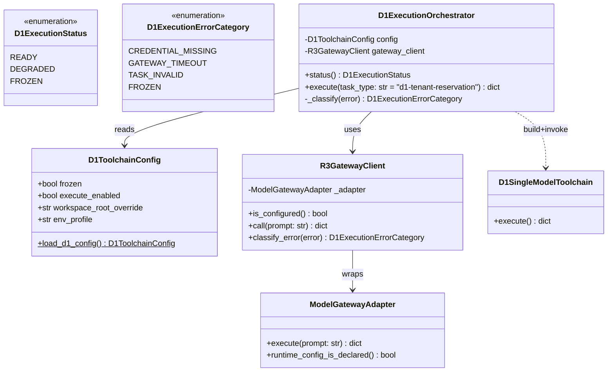
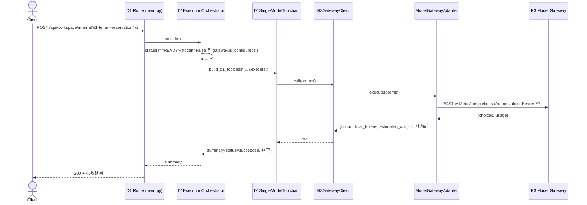
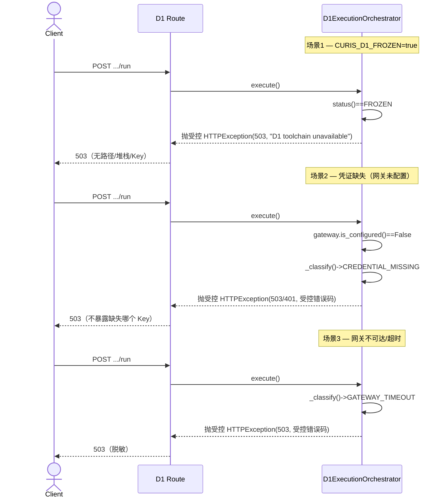
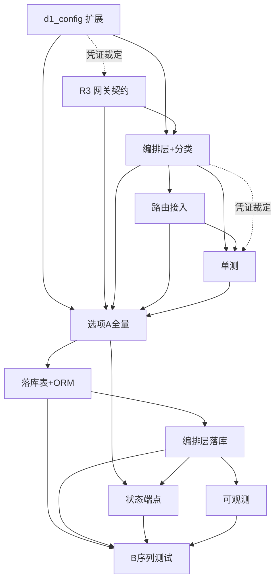

# D1 execute() 完整闭环提案（Proposal — Pending Control Decision）

> **文档状态**：✅ GATE_APPROVED（范围 **A**：最小真实调用；**A 通过 QA 后执行 B**）｜🔴 R3 网关凭证接入仍待**安全边界席裁定**（阻塞 A5 真实网关端到端验证）
> **起草**：许清楚（产品 PRD）＋ 高见远（架构设计）＋ 齐活林（主理人汇编）
> **日期**：2026-07-19
> **关联**：前置 D1 解冻 A+B（commit `aadef60c`，已推 `origin/feat/roadmap-r1r2`）；ADR-0017 option-a（D1 切片：单模型研发工具链）
> **铁律**：启动信号 / warning / 日志 / `/health` 绝不泄露路径、堆栈、Key、参数。
> **实现方式**：本提案仅作决策依据；落地由独立实现 Issue 跟踪（任务列表见第二节）。
> **升级说明**：本提案**因 R3 模型网关凭证接入触发安全边界席**，已飞书升级「Curis 开发通知」群，待安全边界席裁定凭证接入方式 + 总控 gate 拍板后方可实现。

---

# 一、execute() 完整闭环 PRD（许清楚）

## 1. 提案摘要（TL;DR）

本提案请求在**已解冻的 D1 工具链**之上，于受控边界内跑通 `execute()` 对 R3 模型网关的「真实研发执行」最小闭环。关键事实：**真实执行的 plumbing 已存在**（`D1SingleModelToolchain.execute()` 已真实调用 `ModelGatewayAdapter.execute()` → R3 网关），本次是把既有真实调用**正式纳入受控 gate 能力**，补齐错误分类 / 降级状态 / 网关契约隔离 / 可选落库，而非从零写 execute()。因涉及外部凭证接入，须走独立 gate + 安全边界席。

## 2. 前置事实（已闭环）

- D1 工具链解冻 A+B 已完成（commit `aadef60c`）。`build_d1_toolchain(...)` 默认返回真实 `D1SingleModelToolchain` 实例；`CURIS_D1_FROZEN=true` → `None`（降级 503）。
- 现状实证：`/health` 200；非冻结下 D1 路由返回 401（工具链已真解冻，但 `default_executor` 未注入 R3 凭证时 `validate_runtime_config` 抛 401）。

## 3. 产品目标

在已解冻的 D1 工具链之上，于受控边界内跑通 `execute()` 对 R3 模型网关的「真实研发执行」最小闭环，交付一项可验证能力：给定**单模型 + 单任务类型**，execute() 能真实调用网关产出研发结果，且在**凭证缺失 / 网关不可达 / 冻结开关开启**时安全降级、全程脱敏。解决「工具链能建、但跑不通真实业务」的断点。

## 4. 用户故事

1. **作为总控决策者**，希望在独立 gate 勾选「执行范围选项 A/B/C」，在不触碰 L2 红线、凭证接入受控的前提下决定是否让 D1 进入真实执行。
2. **作为 Workspace 用户**，提交研发任务后 execute() 能真实调用模型网关返回结果，中间过程/失败安全降级不暴露内部路径或凭证。
3. **作为研发任务（运行时）**，希望在 `CURIS_D1_FROZEN=true` 或网关不可达时被整体降级 503 而非抛裸错。
4. **作为运维/观测方（P1 起）**，希望执行结果可落库、可观测、错误可分类。

## 5. 需求池（P0/P1/P2）

| 优先级 | 编号 | 需求 | 验收口径 |
|---|---|---|---|
| **P0** | P0-1 | execute() **真实调用 R3 模型网关**跑通最小研发任务（单模型 + 单任务类型） | 给定受控输入，execute() 端到端返回真实研发结果，非空壳/非占位 |
| **P0** | P0-2 | **脱敏红线守住**：启动/warning/日志/`/health` 绝不泄露路径、堆栈、Key、参数 | 静态评审 + 日志抽检，零泄露 |
| **P0** | P0-3 | **回退开关守住**：`CURIS_D1_FROZEN=true` 整体降级 503；网关不可达安全降级 | 开关开启 / 网关断连均返回受控降级，无裸错 |
| **P0** | P0-4 | **契约/接口稳定**：D1 路由 → `build_d1_toolchain` → `execute()` 入口契约稳定、可测试 | 有契约测试覆盖，非冻结下可调 |
| **P1** | P1-1 | 执行结果**落库 / 可观测**（结果记录、执行时长、调用计数） | 结果可追溯，只读接口可读 |
| **P1** | P1-2 | **错误分类与降级**（凭证缺失 / 网关超时 / 任务非法 分类处理） | 错误可区分并对应不同降级策略 |
| **P1** | P1-3 | 与**现有 workspace 运行时**衔接（不新建隔离、不引多 Agent） | 复用既有运行时上下文，无新边界 |
| **P2** | P2-1 | **性能/并发**（单主执行模式，不引多 Agent） | 明确单请求串行或有限并发上限 |
| **P2** | P2-2 | **可配置模型路由**（占位 / 真实网关切换受控） | 配置项可切换，默认保持受控/安全态 |

> 禁止区自检：P0–P2 均**不**引入多 Agent / Employee CRUD / 真实隔离 / 复杂 UI / 向量库；**不**自行接入外部平台凭证（凭证接入见第 6 节强制升级）。

## 6. UI 设计稿

**结论：本次零 UI（或仅极简只读状态展示）。**
- 依禁止区「不引复杂 UI」，本次**不新建任何交互式 UI**。
- 若选项 B 落地，仅提供**只读状态展示**（如可选只读「D1 执行状态：就绪/降级/冻结」文本端点），不提供表单/提交类界面。
- 真实研发任务提交入口沿用既有 workspace 调用方式，不在本提案内新增 UI。

## 7. 选项设计（供总控勾选）

| 选项 | 名称 | 含（交付） | 不含（明确排除） | 外部依赖 |
|---|---|---|---|---|
| **A** | 最小真实调用 | P0 全量：execute() 真实调用 R3 网关跑通单模型单任务；脱敏 + 回退开关 + 契约稳定 | 落库、可观测、错误分类、workspace 衔接增强；不引 UI | R3 网关凭证（受控切换） |
| **B** | 真实调用 + 可观测 | A 全部 + P1 全量（落库 / 可观测 / 错误分类降级 / workspace 衔接） | 多 Agent、复杂 UI、外部平台直连 | A 依赖 + 可能新 DB 表（见待确认） |
| **C** | 暂缓 | 维持 design-only reservation，不进真实实现；仅保留 A+B 已解冻的「可构建」态 | 任何真实执行；`execute()` 仍走占位/降级 | 无新增 |

**建议拍板路径**：若 R3 凭证接入能在安全边界席评估通过 → 选 A 先行验证真实闭环；观测与落库作为 B 二期；若凭证/边界有争议 → 选 C 暂缓，等独立 future gate。

## 8. 待确认问题（含升级标注）

### 8.1 必升级项（🔴 触发安全边界席）

| 问题 | 判定 | 说明 |
|---|---|---|
| **R3 模型网关凭证如何接入** | 🔴 **触发安全边界席** | 涉及外部服务与凭证，按红线**不得自行决定**，必须升级安全边界席评估凭证接入方式（安全边界席 → 飞书升级 → 等总控）。**此为 P0 落地的致命依赖：若凭证接入方式在 gate 前无法确认，选项 A/B 均无法自洽落地，须标红。** |
| execute() 真实执行是否引入「自动改码 / real instantiation」争议 | ⚠️ 需 gate 界定边界 | 本次边界界定为「在 workspace 内运行研发任务、产出**可读**结果」；**不**自动合并/推送生产、**不**自动改写受保护生产码。若 gate 认为已越过 real instantiation 边界，须另立独立 future gate + 总控 + 安全边界席。 |

### 8.2 L2 Gate 七项逐条判定

| 项 | 内容 | 是否触碰 | 处置 |
|---|---|---|---|
| ① | 商业模式变化 | **否** | 不升级 |
| ② | 收费规则变化 | **否** | 不升级 |
| ③ | 新市场方向 | **否** | 不升级 |
| ④ | Marketplace 开放 | **否** | 不升级 |
| ⑤ | 权限边界变化 | **否** | 不升级（execute 在既有 workspace R&D 执行边界内，不新增/扩大权限） |
| ⑥ | Admin / Workspace 边界变化 | **否** | 不升级（不新建隔离、不扩大边界） |
| ⑦ | 新核心资产体系 | **否** | 不升级（产出为研发任务中间产物，不沉淀为新核心资产类别；若未来要沉淀须另立 gate） |

> 七项全部「否」→ 不触发 L2 升级；但凭证接入（8.1）仍强制升级安全边界席。

### 8.3 工程纪律

| 问题 | 说明 |
|---|---|
| 是否需要新 DB 表 / schema 变更 | 仅**选项 B** 可能涉及执行结果落库。若涉及 backend 改动，须遵守 **Git 基线纪律：Issue + 双 lead 会签**，不得裸改。 |
| 单主执行模式 | 主理人连续诊断 / 最小修复 / 验证，不引入并行多 Agent 改写。 |

---

# 二、技术实现方案（高见远）

> 纯方案，未写任何代码、未改任何文件。

## 1. 实现方案与框架选型

| 项 | 结论 |
|---|---|
| 后端框架 | **不变**，沿用 FastAPI + 现有 `create_app` 启动链（`backend/app/main.py`） |
| 工具链 | **复用** `D1SingleModelToolchain` + `LocalRDToolset` + `ModelGatewayAdapter`（均已落地，真实调用 plumbing 存在） |
| 本次只动 | 编排层 `d1_execute.py`、网关契约隔离 `d1_gateway_client.py`、`d1_config.py` 扩展、`main.py` 接线；选项 B 追加落库 |
| 框架选型理由 | 无需新框架；错误分类/降级/落库均用标准库 + 既有 `database.py` / `EvolutionEventLog` 即可，避免扩大攻击面与 L2 越界 |

**关键判断**：真实执行 plumbing 已存在，`D1SingleModelToolchain.execute()` 已真实调 R3 网关（`POST /v1/chat/completions`）并落地 diff、跑测试、记审计。本方案是把它正式纳入受控 gate 能力，补齐错误分类 / 降级状态枚举 / 网关客户端契约（凭证接入点隔离）/ 可选落库。

**架构模式**：Adapter + Orchestrator。`R3GatewayClient`（Adapter，隔离凭证/传输，委托既有 `ModelGatewayAdapter`）之上由 `D1ExecutionOrchestrator`（编排 + 分类 + 降级）协调既有 `D1SingleModelToolchain`。

**铁律遵守**：不新建独立服务；不引多 Agent（复用 `_claim_once` 单主占锁）；复用 workspace 运行时上下文；零/极简 UI（B 仅只读状态端点）；单主执行。

## 2. 文件列表及相对路径（相对 `backend/`）

| 文件 | 类型 | 职责 | 选项 |
|---|---|---|---|
| `app/d1_config.py` | 修改 | 在既有 `D1ToolchainConfig`/`load_d1_config` 追加 `execute_enabled` 开关与 `execute_task_type` 常量，frozen 语义不变 | A/B |
| `app/d1_gateway_client.py` | **新增** | R3 网关客户端适配：仅定义接口契约与调用形态（包装 `ModelGatewayAdapter`），`is_configured()` 判凭证就绪但不暴露 Key；凭证读取方式标注依赖安全边界席 | A/B |
| `app/d1_execute.py` | **新增** | execute() 真实调用编排 + 错误分类（四类枚举）+ 降级状态判定（READY/DEGRADED/FROZEN）+ 脱敏异常；单主执行复用既有占锁 | A/B |
| `app/main.py` | 修改 | D1 路由内接 `D1ExecutionOrchestrator`，复用既有 503 守卫与脱敏；选项 B 追加只读 `/.../d1-execute/status` 端点 | A/B |
| `app/models/d1_execution_log.py` | **新增** | 选项 B 执行结果落库 ORM/表定义（`d1_execution_log`）。受 Git 基线纪律约束（需 Issue + 双 lead 会签） | 仅 B |
| `tests/test_d1_execute.py` | **新增** | 契约/降级/分类单测：frozen→503、凭证缺失→受控降级、网关不可达→分类降级、mock 真实调用成功路径（真实网关端到端受凭证裁定阻塞） | A/B |

> 既有模块（`build_d1_toolchain` / `D1SingleModelToolchain` / `ModelGatewayAdapter` / `LocalRDToolset` / `EvolutionEventLog`）**不重写**，仅被编排层消费。

## 3. 数据结构与接口（类图 / Mermaid）

**契约要点**
- `R3GatewayClient.is_configured() -> bool`：基于 `ModelGatewayAdapter.runtime_config_is_declared()` 判断，**不返回/不记录 Key**。凭证注入方式由安全边界席裁定。
- `D1ExecutionOrchestrator.execute() -> dict`：返回与既有 `D1SingleModelToolchain.execute()` 同构的脱敏 summary（`status=succeeded`、非空 `output` 摘要、token/成本计数）。
- `D1ExecutionOrchestrator.status() -> D1ExecutionStatus`：`FROZEN`（frozen/工具链 None）、`DEGRADED`（非冻结但 `is_configured()==False` 或最近调用分类为网关异常）、`READY`（非冻结且 `is_configured()==True`）。
- 错误映射：`D1ToolchainError.failure_code` / `ModelGatewayExecutionError.status` → `D1ExecutionErrorCategory`（CREDENTIAL_MISSING / GATEWAY_TIMEOUT / TASK_INVALID / FROZEN）。

## 4. 程序调用流程（时序图 Mermaid）

### (a) 正常路径（真实调用成功返回研发结果）

### (b) 降级路径（frozen / 凭证缺失 / 网关不可达）

> TASK_INVALID：当 `execute(task_type)` 传入非受支持任务类型（当前仅 `d1-tenant-reservation`）或请求体非法时触发，转受控 422/409，不暴露内部细节。

## 5. 任务列表（有序、含依赖、按实现顺序）

### 选项 A 任务序列（P0 全量）

| 编号 | 任务名 | 涉及文件 | 依赖 | 阻塞安全边界席 |
|---|---|---|---|---|
| A1 | 扩展 D1 配置开关 | `app/d1_config.py` | 无 | 否（仅加 `execute_enabled` 开关，不含凭证） |
| A2 | 定义 R3 网关客户端契约 | `app/d1_gateway_client.py` | 无（依赖既有 `ModelGatewayAdapter`） | **是**（凭证读取/注入方式由安全边界席裁定；本文件只定义接口，不读 Key） |
| A3 | 实现 execute 编排 + 错误分类 + 降级状态 | `app/d1_execute.py` | A1, A2 | 否（逻辑可独立完成） |
| A4 | D1 路由接入编排层 | `app/main.py` | A3 | 否 |
| A5 | 契约/降级单测 | `tests/test_d1_execute.py` | A3, A4 | **是（真实网关端到端验证需凭证裁定；mock 路径可先行）** |

**A 序列执行顺序**：A1、A2 可并行起步 → A3 → A4 → A5（mock 部分先于真实部分）。`execute_enabled=false` 时编排层整体降级（与 frozen 同效），保证未拍板前不触发真实调用。

### 选项 B 任务序列（A 全量 + P1）

| 编号 | 任务名 | 涉及文件 | 依赖 | 阻塞安全边界席 |
|---|---|---|---|---|
| B0 | 完成选项 A 全量 | 同 A1–A5 | — | 同 A |
| B1 | 执行结果落库表 + ORM | `app/models/d1_execution_log.py` + migration | B0 | 否（但**受 Git 基线纪律**：需 Issue + 双 lead 会签） |
| B2 | 编排层落库 + 错误分类增强 | `app/d1_execute.py` | B1 | 否 |
| B3 | 只读状态端点 | `app/main.py` | B0, B2 | 否 |
| B4 | 可观测（调用计数/时长/错误分类指标） | `app/d1_execute.py` + 复用 `EvolutionEventLog` | B2 | 否 |
| B5 | B 序列扩展测试 | `tests/test_d1_execute.py` | B1–B4 | 同 A5 |

### 任务依赖图（Mermaid）

## 6. 依赖包列表

| 包 | 是否必须 | 说明 |
|---|---|---|
| 新增第三方包 | **否（无）** | R3 网关为 OpenAI 兼容接口，既有 `ModelGatewayAdapter` 已用标准库实现传输与脱敏，无需新增 pip 依赖 |
| `ModelGatewayAdapter`（既有） | 是（复用） | 已落地，负责真实调用与脱敏 |
| 若安全边界席要求专用 SDK | **待裁定** | 引入任何外部 SDK/包**必须过安全边界席**评估，不在本设计内决定 |
| DB（选项 B） | 否（复用） | 复用既有 `database.py`（SQLite），无需新驱动 |

## 7. 共享知识（跨文件约定）

1. **脱敏约定（全局）**：所有错误最终转为受控 `HTTPException`（detail 仅用固定常量，如 `"D1 toolchain unavailable"`），绝不传播原始异常/路径/堆栈/Key/参数。错误分类码仅作内部日志/状态，不回显明细。复用既有 `D1_UNAVAILABLE_MESSAGE` 与 `redact_model_gateway_text`。
2. **frozen 开关语义复用**：`CURIS_D1_FROZEN=true` → `build_d1_toolchain` 返回 `None` → 编排层 `status()==FROZEN` → 503。新增 `execute_enabled` 为**叠加**总开关（默认 false，未拍板前不真实调用）。
3. **execute 与 build 的契约边界**：`build_d1_toolchain(model, event_log, config) -> D1SingleModelToolchain | None` 为唯一构建入口；编排层只消费构建结果，不直接构造 `ModelGatewayAdapter` 读 Key，凭证经注入后的适配器实例传入。
4. **单主执行约束**：复用 `D1SingleModelToolchain._claim_once`（`begin immediate` + 幂等键）保证单主；不并发、不引多 Agent。
5. **real instantiation 边界（本次界定）**：execute() 范围 =「在 workspace 内运行研发任务、产出可读结果」；不自动合并/推送生产、不自动改写受保护生产码。越界须另立独立 future gate。
6. **Git 基线纪律（选项 B）**：任何 backend/DB 改动需 Issue + 双 lead 会签，不得裸改；单主执行模式。

## 8. 待明确事项（标红 = 阻塞开工）

1. 🔴 **R3 模型网关凭证接入方式（阻塞 A/B 真实调用验证与 B 落库联调）** — 触发安全边界席。需裁定 `CURIS_MODEL_GATEWAY_API_KEY` 等凭证的注入/存储/传输方式。本设计 `R3GatewayClient` 仅依赖注入后的 `ModelGatewayAdapter` 实例，不读 Key；但真实端到端验证与 B 联调须待该裁定。
2. ⚠️ **real instantiation 边界需 gate 界定** — 本次界定为「workspace 内运行研发任务、产出可读结果；不自动合并/推送/改写受保护生产码」。若 gate 认为越过 real instantiation 边界，须另立独立 future gate + 总控 + 安全边界席。
3. ⚠️ **选项 B 落库是否新 DB 表及迁移责任** — 建议新增 `d1_execution_log` 表。受 Git 基线纪律约束，需 Issue + 双 lead 会签；迁移责任与归属待 gate/双 lead 确认。

> 设计自洽性说明：若安全边界席裁定长期未出，选项 A 的「mock 真实调用成功路径」与全部降级/分类测试仍可先行；但真实网关端到端验证（A5 真实部分、B 联调）将被阻塞，不硬编凭证细节。选项 C（暂缓）即维持 design-only reservation，不进真实实现。

---

# 三、主理人汇编与提交总控拍板（齐活林）

## TL;DR
D1 execute() 完整闭环提案已成型：真实执行的 plumbing 已存在，本次是把既有真实调用**正式纳入受控 gate 能力**（错误分类 / 降级状态 / 网关契约隔离 / 可选落库），无新增依赖包、L2 七项全「否」。**但 R3 模型网关凭证接入触发安全边界席，已飞书升级 Curis 开发通知群，待安全边界席裁定凭证接入方式 + 总控 gate 拍板后方可实现。**

## 推荐结论
- **默认推荐选项 A**：最小真实调用（单模型 + 单任务类型），先验证真实闭环，风险可控、不触 L2。
- 观测与落库作为 **选项 B 二期**，待 A 跑通且凭证裁定明确后推进。
- **选项 C**（暂缓）为保守兜底：维持 design-only reservation，不进真实实现。

## Gate 判定（与运营协定对齐）
- **需总控 gate 批准**：execute() 真实执行为 real instantiation 方向，越出 ADR-0017 的 design-only 预授权，须独立 gate。
- **L2 Gate 七项**：A/B/C **全部「否」**，不触发 L2 升级（无商业模式/收费/新市场/Marketplace/权限/Admin-Workspace 边界/新核心资产体系变更）。
- 🔴 **安全边界席触发（强制升级）**：R3 模型网关凭证接入涉及外部服务与凭证，按红线不得自行决定，必须升级安全边界席评估凭证接入方式。本提案已飞书升级「Curis 开发通知」群（`oc_1b559ad633e40345229275d15f7e8d42`），待安全边界席裁定 + 总控拍板。
- **飞书升级**：本提案因凭证接入**已触发飞书升级**（与 D1 解冻提案不同——解冻提案本身不触发飞书，本次触发）。

## 请总控拍板的 N 项

**Gate 范围选项**
1. **范围选项**：A（最小真实调用）/ B（真实调用 + 可观测）/ C（暂缓）？

**安全边界席（强制，阻塞实现）**
2. **R3 模型网关凭证接入方式**：env var / 密钥管理器 / 其他？由安全边界席裁定后回填本提案待明确事项 #1。

**边界界定**
3. **real instantiation 边界确认**：是否同意本次界定「workspace 内运行研发任务、产出可读结果；不自动合并/推送生产、不自动改写受保护生产码」？若认为越过边界，须另立独立 future gate。

**红线与纪律**
4. **L2 一致性确认**：是否同意 A/B/C 不触 L2 七项、偏离即升级？
5. **叠加开关**：是否同意新增 `execute_enabled`（默认 false）作为未拍板前的真实调用总闸，与既有 `CURIS_D1_FROZEN` 叠加？
6. **选项 B 落库纪律**：若选 B，是否同意遵守 Git 基线纪律（Issue + 双 lead 会签），不裸改 backend/DB？
7. **落地方式**：是否同意另开实现 Issue 跟踪（本提案仅决策，不编码）？

## 下一步
- 总控 + 安全边界席裁定后，由主理人开实现 Issue（任务列表见第二节 A/B 序列），走标准 SOP（工程师实现 → QA 验收）。
- 实现期间严守脱敏红线与禁止区；QA 须专项核验 warning/日志/`/health` 无路径/堆栈/Key 泄露，且真实调用仅在凭证裁定明确后启用。
- 若选 C（暂缓）：本提案保持 `design-only reservation`，不进实现，仅保留 D1 解冻 A+B 的「可构建」态。

---

## 四、Gate 决策记录（总控）

> ✅ **总控 gate 拍板（2026-07-20）**：范围选 **A（最小真实调用）**，**A 通过 QA 验证后执行 B（真实调用 + 可观测）**。
> 🔴 **安全边界席待裁定**：R3 网关凭证接入方式仍未回；A 实现先推进不依赖凭证的部分（A1–A4 + A5 的 mock/降级测试），真实网关端到端验证（A5 真实部分）待安全边界席裁定后补。

| 拍板项 | 决策 |
|---|---|
| 范围选项 | **A 先行，通过后 B**（C 暂缓不选） |
| 安全边界席凭证接入 | 🔴 待裁定（env / 密钥管理器 / 其他）；未裁定前 A 不触真实网关 |
| real instantiation 边界 | 同意本次界定：workspace 内运行研发任务、产出可读结果；不自动合并/推送/改写受保护生产码 |
| L2 一致性 | 确认 A/B 不触 L2 七项，偏离即升级 |
| 叠加开关 `execute_enabled` | 同意新增（默认 false），与 `CURIS_D1_FROZEN` 叠加 |
| 选项 B 落库纪律 | 待 A 通过后、B 启动时再确认 Git 基线双 lead 会签 |
| 落地方式 | 另开实现 Issue（本提案仅决策） |

> **A 实现策略（凭证未裁定下的务实推进）**：A1–A4 全实现（不依赖真实凭证）；A5 先实现并跑 **mock `http_post` 真实调用成功路径 + 全部降级/分类测试**（frozen→503 / 凭证缺失→受控降级 / 网关不可达→分类降级 / TASK_INVALID→422·409）；A5 真实网关端到端验证标注「待安全边界席凭证裁定后补」，不硬编 Key。`execute_enabled` 默认 false，未裁定前编排层整体降级，不触发真实调用。
