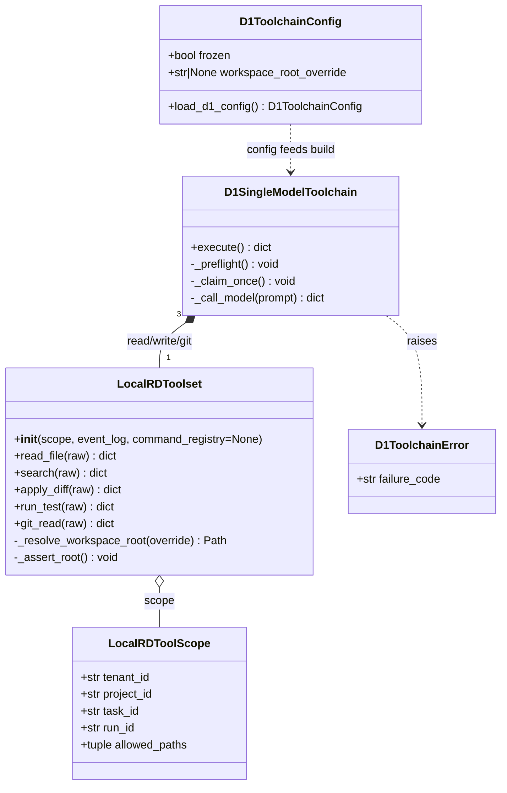
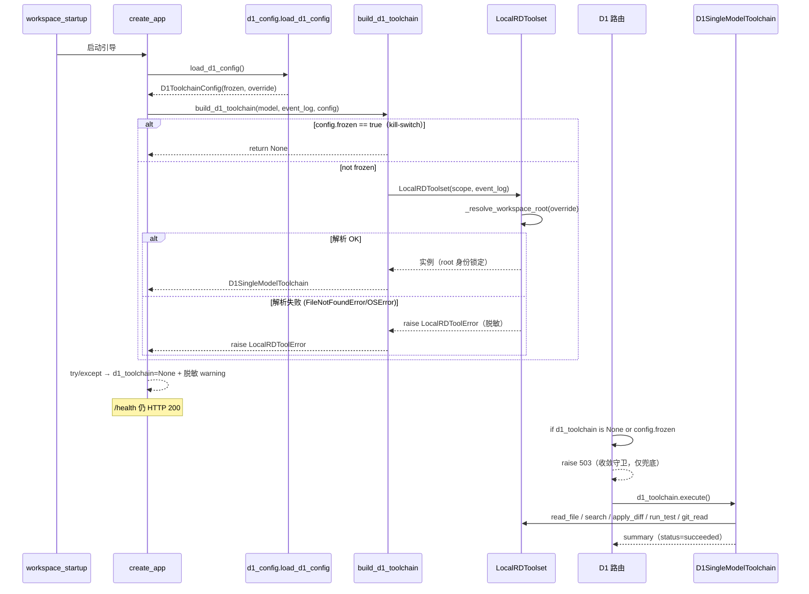
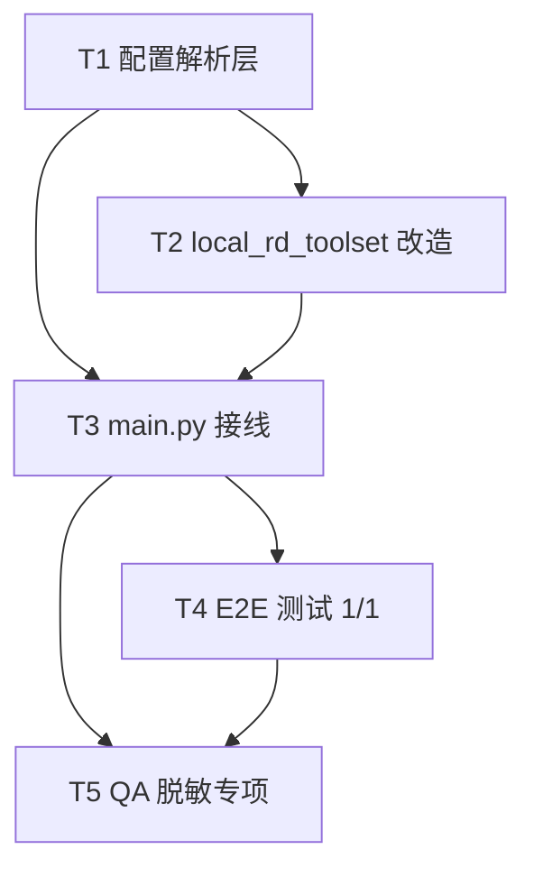

# D1 工具链解冻提案（Proposal — Pending Control Decision）

> **文档状态**：✅ GATE_APPROVED（总控 2026-07-19 批准 **A+B**；越 ADR-0017 design-only 的"真实实现"已获 gate 解锁）
> **起草**：许清楚（产品 PRD）＋ 高见远（架构设计）＋ 齐活林（主理人汇编）
> **日期**：2026-07-19
> **关联**：修复提交 `82ca429d`；QA 验收 `reviews/20260719_workspace_create_app_d1_minimal_fix_qa.md`；实现 Issue `issues/20260719_d1_toolchain_unfreeze_implement.md`
> **铁律**：启动信号 / warning / 日志 / `/health` 绝不泄露路径、堆栈、Key、参数。
> **实现方式**：本提案仅作决策依据；落地由独立实现 Issue 跟踪（T1–T5）。

---

# 一、解冻提案 PRD（许清楚）

## 1. 提案摘要（TL;DR）

本提案请求将 D1 本地研发工具链从「容器内弹性降级（d1_toolchain=None）」解冻为「容器内真实可用」，使其在容器内可构建并 `.execute()`，从而把 D1 端到端测试从 **0/1 推进到 1/1**；本次仅触及 `local_rd_toolset.py` 的硬编码路径解析与配置化，**不接外部平台、不改生产代码自动写入、不触 L2 Gate 七项**。因已越出 ADR-0017 的 design-only 预授权范围，需总控 gate 批准。

## 2. 背景与根因回顾

Workspace 容器启动期曾因 `create_app_failed` 崩溃、`/health` 不可用。根因为两道坎：

| 坎 | 位置（脱敏） | 现象 | 状态 |
|---|---|---|---|
| 第一道 | `local_rd_toolset.py:21` 硬编码 macOS 宿主机绝对路径（形如 `/Users/<user>/Documents/...`，指向宿主机用户目录）；容器 Linux 无对应目录 → `.resolve(strict=True)` 抛 `FileNotFoundError`，在 `build_d1_toolchain` 中中断 `create_app` | 启动崩溃 | **未改**（路径保持原样） |
| 第二道 | 修复第一道时引入的 503 守卫缩进 bug | 路由异常 | 已修回 |

**当前弹性降级状态**（提交 `82ca429d` + QA `PASS_WITH_NOTES`）：
- `main.py` 的 `build_d1_toolchain` 已包 `try/except`（`FileNotFoundError`/`OSError`/`D1ToolchainError`/`LocalRDToolError`）→ `d1_toolchain=None`，脱敏 warning 后继续启动；
- D1 路由新增 503 守卫（仅请求时触发）；
- `/health` 经 sentinel 实测恢复 **HTTP 200**；
- **关键结论**：当前为「弹性降级」——D1 工具链在容器内为 `None`，D1 真实 E2E **仍冻结（0/1）**，硬编码路径**保持原样未改**。

## 3. 解冻目标

**解冻后应达成**：
- D1 工具链在容器内真实可用（可构建并 `.execute()`）；
- D1 路由在 d1_toolchain 就绪（非冻结配置）时返回**真实工具结果**，而非 503；
- D1 E2E 从 0/1 → **1/1**；
- 启动 / 健康信号与日志**维持脱敏**（不泄露路径、堆栈、Key）。

**明确不在本次范围（红线 / 禁止区）**：
- 不接外部平台 / 外部服务与凭证；
- 不自动改生产代码、不引入自动改码能力；
- 不触 L2 Gate 七项（商业模式 / 收费规则 / 新市场方向 / Marketplace 开放 / 权限边界 / Admin-Workspace 边界 / 新核心资产体系）；
- 不做 Employee CRUD、多 Agent、真实隔离、复杂 UI、向量库；
- 不实现 instantiation / ROI / 员工等真实业务（仍属 future gate + 总控 + 安全边界席）。

## 4. 解冻范围选项

| 选项 | 描述 | 边界影响 | 工作量 |
|---|---|---|---|
| **A 最小解冻** | 仅修复容器内 `WORKSPACE_ROOT` 解析（去掉对 macOS 宿主路径的硬编码依赖），使 `local_rd_toolset` 在容器内可用；D1 路由返回真实工具结果；D1 E2E 0/1 → 1/1。不新增其他能力。 | 越 ADR-0017 design-only，但**不触 L2 七项** | 小 |
| **B A + 容器挂载 / 配置化** | A 基础上将 `WORKSPACE_ROOT` 改为环境变量 / 挂载配置驱动，支持多环境（dev/test/prod），含默认值与安全 fallback。 | 同上，配置面更大但**仍不触 L2 七项** | 中 |
| **C 暂不解冻** | 维持弹性降级（d1_toolchain=None + 503 guard），等更大范围 gate 一并处理。 | 零行为变化，安全但 D1 持续冻结 | 零（仅监控） |

> 建议：默认推 **A**；若多环境诉求明确则 **B**；**C** 作为保守兜底。

## 5. 用户故事

1. **作为 Workspace 运行时**，我希望容器内能调用本地研发工具集，以便 D1 真实研发闭环可在容器内跑通（E2E 1/1）。
2. **作为 D1 路由调用方**，我希望在 d1_toolchain 就绪时获得真实工具执行结果，而非统一 503，以便上层能验证 D1 真实能力。
3. **作为运维 / 安全方**，我希望即使 D1 在容器内真实启用，启动信号与健康日志仍不泄露任何路径 / 堆栈 / Key，以便脱敏红线不被破坏。

## 6. 需求池（P0/P1/P2，按选项拆解）

### 选项 A
- **P0**
  - 容器内 `WORKSPACE_ROOT` 解析适配：移除对 macOS 宿主绝对路径的硬编码依赖，改用容器可用路径或安全 fallback；
  - `local_rd_toolset` 在容器内可 import + 实例化；
  - D1 路由在 `d1_toolchain` 就绪（非冻结配置）时返回真实结果（移除 / 收敛 503 守卫）；
  - D1 E2E 0/1 → 1/1；
  - 脱敏红线不变（启动 / 日志不泄露路径、堆栈、Key）。
- **P1**
  - 保留弹性降级兜底（toolchain 构建失败仍 → None + 脱敏 warning + 503 guard）；
  - 回归校验 `/health` 仍为 HTTP 200。
- **P2**
  - 更新 QA 验收文档与 ADR 备注（标注越 design-only，已走 gate）。

### 选项 B（在 A 之上追加）
- **P0**
  - `WORKSPACE_ROOT` 改为环境变量 / 挂载配置驱动，含默认值与缺失校验；
  - 多环境（dev/test/prod）可配置且互不串扰。
- **P1**
  - 配置缺失 / 非法时的安全 fallback + 脱敏 warning；
  - 配置来源（env vs 挂载）在文档中明确。

### 选项 C
- 无新增需求；维持现状监控。

## 7. 风险与缓解

| 风险 | 说明 | 缓解措施 |
|---|---|---|
| 行为变化 | 容器内由 `None` 变真实 toolchain，路由 503 → 真实结果，可能引入回归 | 保留 503 guard 仅作用于「确实不可用」；引入 frozen / 非冻结配置开关；完整 E2E 回归 |
| 容器文件系统权限 | `local_rd_toolset` 可能需读写 workspace 目录 | 明确所需挂载与权限，容器内以非 root 校验；缺失权限 → 安全 fallback（非崩溃）|
| 脱敏红线 | 解冻后异常 / 启动信号若打印原始堆栈会泄露路径 / Key | 异常处理统一脱敏文案，禁止完整堆栈进入 `/health`、warning、日志；QA 专项校验 |
| L2 Gate 越界 | 若方案滑向外部平台 / 自动改生产码 / 多 Agent 则触 L2 七项 | 显式范围护栏；一旦偏离选项 A/B 即重新升级总控 + 安全边界席 |
| ADR-0017 越权 | 真实实现越出 design-only 预授权 | 走总控 gate 批准（见第 8 节），落地另开 Issue |

## 8. Gate 判定与待确认问题

**Gate 判定**：
- **需要总控 gate 批准**。理由：本解冻把 D1 从 design-only / 弹性降级推进到「容器内真实可用」，属于"真实实现"边界，已越出 ADR-0017 的 design-only 预授权（仅加表 + 契约 stub + 只读 facade，零行为变化）。
- **L2 Gate 七项**：默认选项 A/B **不触发** L2 七项（无商业模式 / 收费 / 新市场 / Marketplace / 权限 / Admin-Workspace 边界 / 新核心资产体系变更）；若方案引入外部平台 / 自动改生产码 / 多 Agent，则**触发**，须升级总控 + 安全边界席。

**待总控确认问题（5 项）**：
1. 选择哪个范围选项？**A（最小）/ B（配置化）/ C（暂不解冻）**？
2. 容器内 `WORKSPACE_ROOT` 来源用**环境变量**还是**挂载配置**？默认值如何定？
3. 是否同意：选项 A/B **不触 L2 七项**；一旦引入外部平台等即重新升级？
4. D1 路由是否保留「frozen 配置开关」以便随时回退到降级态？
5. 落地是否同意**另开实现 Issue**（本提案仅决策，不编码）？

## 9. 验收标准（草案）

- [ ] 非冻结配置下，D1 路由返回**真实工具结果**（非 503、非 None）；
- [ ] D1 端到端测试 **0/1 → 1/1** 通过；
- [ ] `/health` 维持 **HTTP 200**；
- [ ] 脱敏红线不变：启动信号 / 日志 / warning **无路径、堆栈、Key 泄露**（QA 专项核验）；
- [ ] 未引入 L2 Gate 七项任何新范围；
- [ ] 实现以独立 Issue 跟踪，本提案状态保持「待总控拍板」直至 gate 批准。

---

# 二、技术实现方案（高见远）

> 纯方案，未写任何代码、未改任何文件。默认按 PRD 选项 A 详细设计，B 仅说明差异。

## 1. 实现方案与框架选型

| 项 | 结论 |
|---|---|
| 后端框架 | **不变**，沿用 FastAPI + 现有 `create_app` 启动链（`main.py`） |
| 工具链 | **不变**，沿用 `LocalRDToolset` + `D1SingleModelToolchain` |
| 本次只动 | `local_rd_toolset.py` 的 `WORKSPACE_ROOT` 解析、`main.py` 的接线、`build_d1_toolchain` 签名、新增 `d1_config.py` 配置层 |
| 框架选型理由 | 无需引入新框架；问题本质是「容器内路径解析 + 配置化 + 回退守卫」，用标准库 `pathlib`/`os.environ` 即可，避免扩大攻击面与 L2 越界 |

**技术路线（默认 A）**：
- 去掉 `local_rd_toolset.py:21` 的 macOS 宿主机硬编码绝对路径，改为「从模块位置推导仓库根」+「可选环境变量覆盖」。
- `LocalRDToolset` 在容器内可正常 `import` + 实例化，`build_d1_toolchain` 不再因 `FileNotFoundError` 坠入降级。
- `D1` 路由在 `d1_toolchain` 就绪时返回真实工具结果；保留 503 守卫作为**收敛后的安全兜底**（仅当 `d1_toolchain is None` 或 `config.frozen` 时触发），以便一键回退。
- D1 E2E 从 0/1 推进到 1/1；`/health` 仍 200。

**选项 B 的差异点**：在 A 之上将 `WORKSPACE_ROOT` 完全改为 env / 挂载配置驱动，含「默认值 + 缺失校验 + 多环境（dev/test/prod）互不串扰 + 缺失/非法时安全 fallback + 配置来源文档」。核心是引入多环境配置表（如 `CURIS_ENV` 选择 profile），A 已为其预留 env 覆盖位，B 是把「单覆盖位」升级为「多 profile 解析器」。

## 2. 容器内 WORKSPACE_ROOT 解析策略（核心设计点）

### 2.1 当前痛点（已核对源码）
- `local_rd_toolset.py:21` → `WORKSPACE_ROOT = Path("/Users/<user>/Documents/Curis AI Workspace")`（macOS 宿主机绝对路径硬编码）。
- `LocalRDToolset.__init__`（`local_rd_toolset.py:83`）→ `root = WORKSPACE_ROOT.resolve(strict=True)`。容器内无 `/Users` → `FileNotFoundError`。
- `_assert_root`（`local_rd_toolset.py:407`）→ 同样 `WORKSPACE_ROOT.resolve(strict=True)`，容器内也会抛。
- `main.py:906-910` → `build_d1_toolchain` 被 `try/except (FileNotFoundError, OSError, D1ToolchainError, LocalRDToolError)` 包住，异常即 `d1_toolchain = None` + 脱敏 warning。

### 2.2 选项 A 方案（去硬编码 + 安全 fallback）

**原则**：`WORKSPACE_ROOT` 不再在 import 期用 `strict=True` 解析（否则会连累 import / `create_app`）。改为「模块级**惰性推导** + 运行时**受控解析**」。

**推导默认值（容器内/宿主均适用）**：
```python
# 示意非落地代码
_DERIVED_ROOT = Path(__file__).resolve().parents[2]   # backend/app/*.py → 仓库根
```
说明：`local_rd_toolset.py` 位于 `<repo>/backend/app/`，`parents[2]` 即仓库根（含 `backend/`、`tools/` 等）。**宿主上 `parents[2]` 恰好等于原硬编码的 `/Users/<user>/Documents/Curis AI Workspace`，因此 A 在宿主行为完全不变，仅修复容器。**

**受控解析函数**（替换 `WORKSPACE_ROOT.resolve(strict=True)`）：
```python
# 示意非落地代码
def _resolve_workspace_root(override: str | None = None) -> Path:
    candidate = Path(override) if override else _DERIVED_ROOT
    try:
        root = candidate.resolve(strict=True)
    except (FileNotFoundError, OSError):
        raise LocalRDToolError(
            "workspace_root_unavailable",
            "approved workspace root is unavailable",   # 脱敏文案，无路径/堆栈
        ) from None
    if root.is_symlink():
        raise LocalRDToolError("workspace_root_unavailable", "approved workspace root is unavailable")
    return root
```
- `__init__`：`root = _resolve_workspace_root(_WORKSPACE_ROOT_OVERRIDE)`（替换原 line 83-85 逻辑）。
- `_assert_root`：同样调用 `_resolve_workspace_root(_WORKSPACE_ROOT_OVERRIDE)`，保证与 `__init__` 解析到同一真实路径，`(st_dev, st_ino)` 身份一致校验不破。
- `_WORKSPACE_ROOT_OVERRIDE`：`d1_config` 在启动时解析一次（见 §4 / §8），缺省为 `None` → 走推导默认。

### 2.3 弹性降级铁律（不可省略）
- 解析失败 **必须** 抛 `LocalRDToolError`（非裸 `FileNotFoundError`），以便被 `main.py:908` 的 `except` 捕获 → `d1_toolchain = None` + 脱敏 warning，**绝不**让异常穿透 `create_app` 中断启动。
- 保留 503 守卫，但**收敛**为：仅 `d1_toolchain is None` 或 `config.frozen is True` 时触发；就绪时返回真实结果。
- 异常统一为脱敏文案（见 §8 共享常量），禁止 `logger.exception` 打印堆栈进入 warning / `/health` / 日志。

### 2.4 选项 B 的差异点（仅说明）
- 解析器升级为从 `CURIS_ENV` 选择 profile（`dev/test/prod`），每个 profile 一份 `workspace_root` + 权限预期；缺失/非法的 profile → 安全 fallback + 脱敏 warning。
- 新增配置来源文档（env 名、默认值、多环境矩阵）；A 的 `_WORKSPACE_ROOT_OVERRIDE` 即 B 的最小子集，平滑升级。

## 3. 文件列表及相对路径（预期 ≤5 个代码改动 + 测试/QA）

| 文件 | 状态 | 改动要点 |
|---|---|---|
| `backend/app/d1_config.py` | **新增** | `D1ToolchainConfig` dataclass + `load_d1_config()`；读取 `CURIS_D1_FROZEN` / `CURIS_D1_WORKSPACE_ROOT`；提供统一脱敏常量 |
| `backend/app/local_rd_toolset.py` | 修改 | 移除 line 21 硬编码；新增 `_DERIVED_ROOT` / `_resolve_workspace_root()` / `_WORKSPACE_ROOT_OVERRIDE`；`__init__` 与 `_assert_root` 改用受控解析 |
| `backend/app/d1_single_model_toolchain.py` | 修改 | `build_d1_toolchain(model, event_log, config=None)` 增加 `config` 参数；`config.frozen` 时直接返回 `None`（kill-switch） |
| `backend/app/main.py` | 修改 | 启动时 `load_d1_config()` 存全局；`build_d1_toolchain(...)` 传 config；D1 路由收敛 503 守卫（`is None or config.frozen`） |
| `backend/tests/test_d1_unfreeze.py` | **新增** | E2E 0/1→1/1：容器内 `build_d1_toolchain` 成功 + 路由返回 `status=succeeded`；以及「root 缺失 → 503」回退用例 |
| `reviews/20260719_d1_unfreeze_qa.md` | **新增** | QA 脱敏专项核验（warning/日志/health 不泄露；frozen 回退；Forbidden 路径护栏） |

## 4. 数据结构与接口（类图 / 接口）



**关键签名变化（示意非落地代码）**：

```python
# backend/app/d1_config.py（新增）
@dataclass(frozen=True)
class D1ToolchainConfig:
    frozen: bool = False
    workspace_root_override: str | None = None

def load_d1_config() -> D1ToolchainConfig:
    # 读 CURIS_D1_FROZEN（默认 "false"）→ bool
    # 读 CURIS_D1_WORKSPACE_ROOT（默认 None）
    ...

# backend/app/local_rd_toolset.py（修改局部）
_DERIVED_ROOT = Path(__file__).resolve().parents[2]
_WORKSPACE_ROOT_OVERRIDE: str | None = None  # 由 build 传入 config 后注入
def _resolve_workspace_root(override: str | None = None) -> Path: ...

# backend/app/d1_single_model_toolchain.py（修改签名）
def build_d1_toolchain(
    model: ModelGatewayAdapter,
    event_log: EvolutionEventLog,
    config: D1ToolchainConfig | None = None,
) -> D1SingleModelToolchain | None:
    if config is not None and config.frozen:
        return None  # kill-switch：保留 503 回退能力
    # 将 config.workspace_root_override 注入 local_rd_toolset._WORKSPACE_ROOT_OVERRIDE
    ...
```

> `LocalRDToolset.__init__` 签名保持不变（workspace root 走模块级受控解析，不污染构造参数）；`D1SingleModelToolchain` 与 `execute()` 完全不变。

## 5. 程序调用流程（时序图，Mermaid）



## 6. 任务列表（有序、含依赖、按实现顺序）

| 任务 | 名称 | 源文件 | 依赖 | 优先级 |
|---|---|---|---|---|
| **T1** | 配置解析层（frozen 开关 + workspace root 覆盖位） | `backend/app/d1_config.py`（新） | 无 | P0 |
| **T2** | local_rd_toolset 改造（去硬编码 + 受控解析 + 弹性降级） | `backend/app/local_rd_toolset.py` | T1 | P0 |
| **T3** | main.py 接线（load config、传 build、收敛 503 守卫） | `backend/app/main.py`、`backend/app/d1_single_model_toolchain.py` | T1, T2 | P0 |
| **T4** | E2E 测试 0/1→1/1（就绪返回真实结果；缺失→503 回退） | `backend/tests/test_d1_unfreeze.py`（新） | T3 | P0 |
| **T5** | QA 脱敏专项核验（warning/日志/health 不泄露；frozen 回退；Forbidden 护栏） | `reviews/20260719_d1_unfreeze_qa.md`（新） | T3, T4 | P1 |

**依赖图（Mermaid）**：


> 落地须以**独立 Issue** 跟踪 T1–T5；验收以 PRD §9 为准。

## 7. 依赖包列表

**无新增第三方依赖。** 全部使用标准库：`pathlib`、`os`、`dataclasses`、`typing`。FastAPI / Pydantic 等已在既有依赖中。

## 8. 共享知识（跨文件约定）

| 约定 | 值 / 说明 |
|---|---|
| 脱敏文案常量（统一） | `D1_UNAVAILABLE_MESSAGE = "D1 toolchain unavailable; service continues without it"`（warning 与 QA 文案统一，禁止含路径/堆栈/Key） |
| 配置键命名 | `CURIS_D1_FROZEN`（bool，默认 `false`）、`CURIS_D1_WORKSPACE_ROOT`（str，默认 `None`） |
| frozen 开关默认值 | **`false`（解冻态）**；设 `true` 即恢复降级（→ `None` → 503），作为一键回退 kill-switch |
| frozen 开关位置 | `d1_config` 层；`create_app` 启动时 `load_d1_config()` 一次，全局缓存；`build_d1_toolchain` 与 D1 路由共用同一份 config |
| workspace root 推导 | `Path(__file__).resolve().parents[2]`（宿主=原硬编码值，容器内=挂载仓库根）；env 覆盖位可选 |
| 503 守卫语义 | 仅当 `d1_toolchain is None` **或** `config.frozen is True` 时触发，就绪时返回真实结果 |
| 异常边界 | `LocalRDToolset` 解析失败一律抛 `LocalRDToolError`（脱敏），**绝不**抛未捕获 `FileNotFoundError` 穿透 `create_app` |
| 日志纪律 | warning / `/health` / 启动信号只输出脱敏常量，禁用 `logger.exception` 打印堆栈 |

## 9. 待明确事项（技术侧细化，呼应 PRD §8 五问）

1. **选 A / B / C？** 技术上 **A 完全可行、风险最低、宿主与容器行为一致**，建议默认 A；若存在多环境（dev/test/prod）硬性诉求，再升级 B。C 为保守兜底。
2. **容器内 WORKSPACE_ROOT 来源 & 默认值？** 建议：**默认**用 `Path(__file__).resolve().parents[2]` 推导仓库根（自适应挂载路径）；**可选** `CURIS_D1_WORKSPACE_ROOT` 覆盖（同时作为 B 的桥接位）。默认即「容器内的仓库根」，无需人工指定。
3. **A/B 是否不触 L2 七项、偏离即升级？** 技术护栏已明确：范围仅限 `local_rd_toolset` 解析 + `d1_config` + `main.py` 接线；**不**接外部平台/凭证、**不**自动改生产码、**不**引入多 Agent / Employee CRUD / 真实隔离 / 复杂 UI / 向量库。任何偏离立即升级总控 + 安全边界席。
4. **D1 路由是否保留 frozen 开关以便回退？** 建议**保留**，放在 `d1_config` 层（键 `CURIS_D1_FROZEN`，默认 `false`）。`build_d1_toolchain` 在 `frozen=True` 时返回 `None`，路由与启动统一走同一份 config，实现「改一个 env 即整体回退到 503 降级态」。
5. **落地是否另开实现 Issue？** 同意：本方案**不落地**，实现以独立 Issue 跟踪 T1–T5，PR 关联该 Issue 与本次 PRD。

---

# 三、主理人汇编与提交总控拍板（齐活林）

## TL;DR
D1 工具链解冻提案已成型：技术路线清晰（容器内 `WORKSPACE_ROOT` 改为模块位置推导 + 可选 env 覆盖，宿主行为不变、仅修容器），保留 frozen kill-switch 回退，无新依赖、不触 L2 七项。**请总控从 A/B/C 中选定范围并批准 gate，批准后即开实现 Issue（T1–T5）推进。**

## 推荐结论
- **默认推荐选项 A**：最小解冻、风险最低、宿主与容器行为一致（推导 `parents[2]` 在宿主恰等于原硬编码路径），仅修容器内解析 + 加 frozen 回退开关。
- 仅当存在 dev/test/prod 多环境硬性诉求时，升级选项 B（配置化）。
- 选项 C 为保守兜底（维持当前弹性降级）。

## Gate 判定（与运营协定对齐）
- **需总控 gate 批准**：本解冻把 D1 从 design-only / 弹性降级推进到容器内「真实可用」，属"真实实现"边界，越出 ADR-0017 的 design-only 预授权。
- **L2 Gate 七项**：默认 A/B **不触发**（无商业模式/收费/新市场/Marketplace/权限/Admin-Workspace 边界/新核心资产体系变更）。若方案滑向外部平台/自动改生产码/多 Agent，则触发，须立即升级总控 + 安全边界席（飞书推送「Curis 开发通知」群）。
- **飞书升级**：本提案本身不触发飞书（总控即在对话内拍板）；仅当选型偏离 A/B 或引入外部平台等越界情形时，才走飞书升级。

## 请总控拍板的 5 项（与 PRD §8 / 设计 §9 一致）
1. **范围选项**：A（最小）/ B（配置化）/ C（暂不解冻）？
2. **容器内 WORKSPACE_ROOT 来源**：env 覆盖（`CURIS_D1_WORKSPACE_ROOT`，默认 None 走推导）还是挂载配置？默认值建议为「模块位置推导仓库根」。
3. **L2 一致性确认**：是否同意 A/B 不触 L2 七项、偏离即升级？
4. **frozen 回退开关**：是否保留 `CURIS_D1_FROZEN`（默认 false）作为一键回退 kill-switch？
5. **落地方式**：是否同意另开实现 Issue 跟踪 T1–T5（本提案仅决策，不编码）？

## 下一步
- 总控拍板后，由主理人开实现 Issue（`issues/20260719_d1_toolchain_unfreeze.md` 或类似），走标准 SOP（PM 增量规格 → 架构师增量设计 → 工程师实现 → QA 验收）。
- 实现期间严守脱敏红线与禁止区；QA 须专项核验 warning/日志/`/health` 无路径/堆栈/Key 泄露。
- 验收以 PRD §9 为准（D1 E2E 0/1 → 1/1、`/health` 200、脱敏不变）。

---

## 四、Gate 决策记录（总控，2026-07-19）

- **决策**：批准 **A+B** 执行（B 含 A：容器内 `WORKSPACE_ROOT` 改为模块位置推导 `Path(__file__).resolve().parents[2]` + 可选 `CURIS_D1_WORKSPACE_ROOT` 覆盖 + 多环境 profile 配置化，配 `CURIS_D1_FROZEN` 回退开关）。
- **L2 七项**：确认 A+B **不触 L2 七项**；若实现偏离（引入外部平台/自动改生产码/多 Agent 等）须立即升级总控 + 安全边界席。
- **frozen 开关**：确认保留 `CURIS_D1_FROZEN`（默认 `false`）作为一键回退 kill-switch。
- **落地方式**：确认另开实现 Issue `issues/20260719_d1_toolchain_unfreeze_implement.md` 跟踪 T1–T5，走标准 SOP（工程师实现 → QA 验收）。
- **红线重申**：脱敏红线与禁止区（自动改生产码、外部服务与凭证、多 Agent、Employee CRUD、真实隔离、复杂 UI、向量库）不变；D1 工具链仅用于其既有 R&D 工具集（read/search/apply_diff/run_test/git_read），不扩权。
