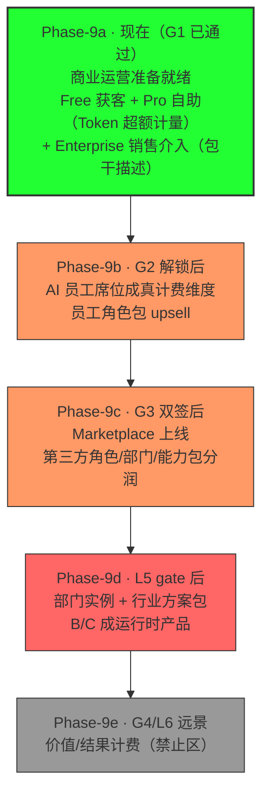

# Phase-8.5 Commercial Readiness — 验收输出（Acceptance Review）

> **阶段**：Phase-8.5 Commercial Readiness（将 Phase-8 Billing MVP 转化为商业运营准备能力）
> **协作团队**：`software-phase85-commercial-readiness`（主理人齐活林 / 架构师高见远 / 产品经理许清楚）
> **阶段性质**：纯契约设计 + 包装研究，**零代码**、五条禁止红线（不开发支付/自动扣款/Invoice/Marketplace/Value Pricing）
> **验收产出**：主理人汇编，含 Phase-9 商业上线建议

---

## 1. 验收交付清单

| # | 交付物 | 负责 | 类型 | 状态 |
| --- | --- | --- | --- | --- |
| 1 | `docs/contracts/pricing-package-contract.md` | 高见远（架构师） | 定价包契约（Free/Pro/Enterprise 客户视角包装） | ✅ 已交付 |
| 2 | `docs/contracts/quota-rule-contract.md` | 高见远（架构师） | 配额规则契约（五类配额 + 超限策略语义矩阵） | ✅ 已交付 |
| 3 | `docs/contracts/billing-rule-contract.md` | 高见远（架构师） | 计费规则契约（四类产生 Billing Event 的规则） | ✅ 已交付 |
| 4 | `docs/research/domain/curis-packaging-research.md` | 许清楚（产品经理） | 商业产品包装研究（卖什么 A-E + 推荐） | ✅ 已交付 |
| 5 | 本验收输出（含 Phase-9 建议） | 齐活林（主理人） | 验收综述 | ✅ 本文 |

---

## 2. 四份文档的核心结论

### 2.1 定价包契约（pricing-package-contract.md）
- Free / Pro / Enterprise 三档**客户视角包装**，与 Phase-8 `plans.plan_code` 1:1 对齐。
- 每档逐字段映射：月价格（占位 `$XX`·不触资金）/ AI 员工席位 / Token 额度 / Workflow 额度 / Capability 额度 / Connector 额度 / 私有能力限制 → `plans.quota_rules_json` + per-tenant `quotas`。
- 口径与 Phase-8 三档默认 seed 完全一致（free 1M/3 席、pro 50M/15 席/50k workflow、enterprise 0=不限）。

### 2.2 配额规则契约（quota-rule-contract.md）
- 补全第五类 `connector_limit`（对齐 `billing-domain-contract.md` 五类）。
- 超限四策略语义矩阵：`block`（准入/未来中间件）/ `degrade`（未来可选）/ `bill`（计入 Billing Event，Phase-8 已实现）/ `notify`（看板预警，Phase-8 已实现）。
- 明确本文是 `admin-quota-contract.md` 的**策略层补全**：计数/重算归它，超限语义归本契约；`block/degrade` 实际拦截属 G1 后未来工程，本阶段仅语义。

### 2.3 计费规则契约（billing-rule-contract.md）
- 四类产生 Billing Event：① Token 超额 ② AI 员工席位超额 ③ Capability Package 使用 ④ Connector 使用。
- 每条规则明确：`amount = 超额用量 × plan.quota_rules.overage 单价`（非权威估算）、状态机 `draft→calculated→issued`（`issued` 仅占位、零资金副作用）。
- **明确排除** Value Event 自动收费（value-based pricing 属 L6 禁止区）。

### 2.4 商业产品包装研究（curis-packaging-research.md）
- **推荐 Hybrid 包装（方向 E）**：以 **Token 额度（D）为当下唯一真实收入杠杆**、AI 员工席位（A）与官方能力包为包装内含物、AI 部门能力包（B）与行业解决方案包（C）为 gate 解锁后的高价值升级层。
- 五方向就绪度：A🔴(待G2) / B🟡(描述可·实例待L5) / C⛔(仅概念) / D🟢(现可卖) / E🟢(推荐)。
- Free/Pro/Enterprise 现在即以「Pro 自助 + Enterprise 销售介入」上线；部门包/行业包/市场包/价值计费随 G2/G3/L5/G4 逐层叠加。

---

## 3. 与 Phase-8 实现的映射（设计就绪度）

| 商业能力 | Phase-8 现状 | Phase-8.5 契约层 | 缺口 |
| --- | --- | --- | --- |
| Plan 管理 | ✅ 已实现 12 端点 | pricing-package 与之 1:1 | 价格列待 G1 加（当前占位） |
| Quota 配置 | ✅ 四类配额 + 读时聚合 | quota-rule 补全 connector + 策略语义 | connector_limit 列待 additive 扩展 |
| Billing Event | ✅ draft/calculated/issued 占位 | billing-rule 定义四触发规则 | issued→paid 出账待 G1 出账子项 |
| 包装/GTM | — | curis-packaging 定义五方向 + 上线路线 | payment/invoice 未实现（独立 gate 子项） |

**结论**：商业治理的「**计量 + 配置 + 规则定义**」层在 Phase-8.5 已设计就绪；唯「**资金归集**」（payment/invoice/自动扣款）仍禁止、须作为 Phase-9 独立 gate 子项落地。

---

## 4. 五条禁止红线核对

| 禁止项 | 核对结果 |
| --- | --- |
| 不开发支付 | ✅ 四份文档均无支付通道、无订阅扣款代码 |
| 不开发自动扣款 | ✅ `billing_event.issued` 仅状态占位，零资金副作用 |
| 不开发 Invoice | ✅ 不生成发票/单据，金额仅作估算记录 |
| 不开发 Marketplace | ✅ marketplace 仅 Enterprise 白名单占位，治理/分润须 G3 双签 |
| 不实现 Value Pricing | ✅ 明确排除 Value Event 收费，属 L6 禁止区 |

---

## 5. Phase-9 商业上线建议（主理人综合）

> 综合架构师 gate 边界与产品经理 GTM 路线，给出可执行的 Phase-9 分阶段建议。

### 5.1 阶段划分（对齐 G0–G4 商业路线图）

### 5.2 各阶段前置与动作

| 阶段 | 上线包装 | GTM 动作 | 关键前置（硬阻塞） |
| --- | --- | --- | --- |
| **Phase-9a（现在）** | Free + Pro（自助）+ Enterprise（销售） | 以「Token 额度 + 内含 AI 团队」为主卖点；Pro 自助注册 + **手动/承诺制计费**（因 payment 未实现） | ① G1 通过 ✅ ② Phase-8 计量机制 ✅ ③ **payment/invoice 实现（独立 gate 子项，未决）** |
| **Phase-9b（G2）** | + 员工角色包 | 「加购 AI 员工席位」upsell，强化 AI 公司叙事 | G2 解锁、employee_instances 权威计量 |
| **Phase-9c（G3）** | + Marketplace 包 | 第三方角色/部门/能力包上架与分润 | G3 双签、marketplace 审核队列 |
| **Phase-9d（L5）** | + 部门包 / 行业包 | Enterprise 可实例化部门、采购行业方案包 | L5 gate、departments 实例化、行业部门类型 |
| **Phase-9e（G4/L6）** | + 价值计费 | 可选 ROI/结果分成（远景） | G4 解锁、Value Event 体系 |

### 5.3 关键判断

- **Phase-9 可进入「设计冻结 + G1 前计量/配置」子阶段**：商业治理的计量、配置、规则定义、包装定义均已就绪，无需等待。
- **Phase-9「真实收款上线」的硬阻塞是 payment/invoice**：本阶段（及 Phase-8）明确禁止实现，因此 Pro 自助在 payment 落地前只能以「手动/承诺制」或「先计量后开票」方式运行。**建议将 payment/invoice 作为 Phase-9 的独立 gate 子项单独裁决**（不属本次禁止范围之外、但需明确授权）。
- **席位/部门/行业/价值计费均须 gate 解锁**，现在仅作包装内含/描述，不可越线计费。

---

## 6. 待商业决策（开放问题，需总控决策席拍板）

1. **Pro 具体锚定价**：研究以 `$XX` 占位，待商业决策（参考 Devin $20 / Notion $10 区间）。
2. **payment/invoice 实现归属与 gate**：是否授权 Phase-9 落地支付/发票子系统？这是「Pro 自助真实收款」的硬前置。
3. **行业优先级**（若未来做 C）：电商/内容/投资研究/BI 选哪个作首个垂直包？
4. **席位「包装展示」对外口径**：Free/Pro 的 seat_limit 现在仅观测，文案如何避免暗示「已计费」？

---

## 7. 验收结论

- ✅ **Phase-8.5 设计层就绪**：三份商业契约 + 一份包装研究，对齐 Phase-8 实现与既有契约，零代码、五条禁止红线全部满足。
- ✅ **Curis 商业化架构与 Admin/Workspace 边界一致**：Admin 仅做计量/配置/规则定义，不接管 Workspace 执行、不管理 tenant_private 明文、不碰 Credential Vault。
- ⚠️ **Phase-9 进入判定**：
  - **可进入**：设计冻结 + G1 前计量/配置/包装子阶段（零资金风险）。
  - **须先决断**：payment/invoice 子系统授权（独立 gate 子项）——否则 Pro 自助无法真实收款。
  - **须 gate 解锁后**：席位计费(G2) / 市场包(G3) / 部门行业包(L5) / 价值计费(G4/L6)。

*—— Phase-8.5 Commercial Readiness 验收输出（主理人齐活林汇编），引用 `docs/contracts/pricing-package-contract.md` / `quota-rule-contract.md` / `billing-rule-contract.md` / `docs/research/domain/curis-packaging-research.md`。*
