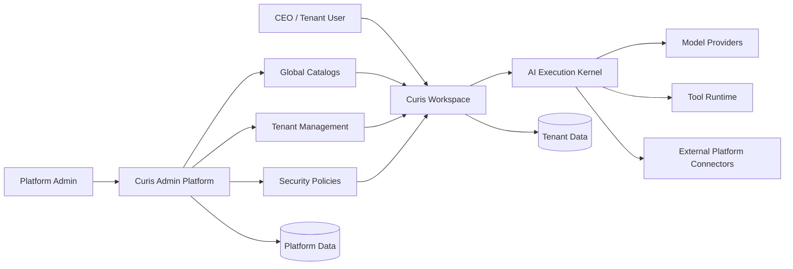
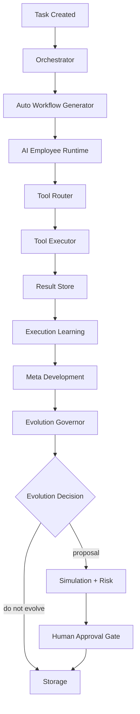
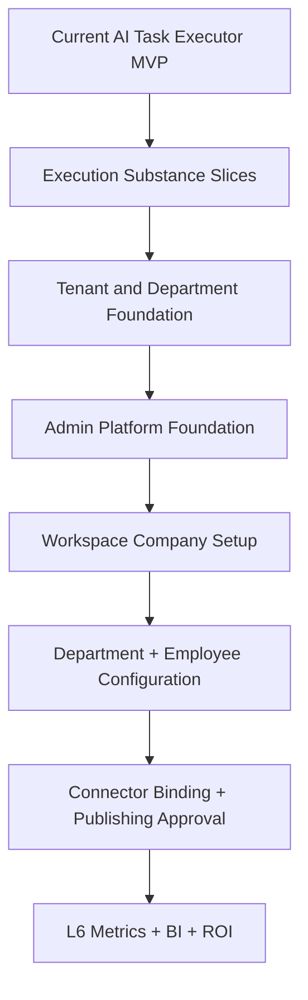

# Curis Admin Platform + Curis Workspace Product Architecture

Status: Future blueprint architecture.
Date: 2026-07-08

This document describes the target commercial architecture for two products:

- Curis Admin Platform: platform operator layer.
- Curis Workspace: tenant CEO company operating system.

It is not an implementation approval. It preserves the canonical Curis L0-L6 model.

## 1. Architecture Principle

Curis becomes a two-plane system:

```text
Control Plane: Curis Admin Platform
Execution Plane: Curis Workspace
```

The Admin Platform controls what the platform offers.

The Workspace controls how each CEO uses those approved capabilities inside their own company.

## 2. Canonical Layer Mapping

```text
L6 经济层: ROI / 成本 / 优化
L5 公司层: 组织 / 部门 / 职责
L4 工作流层: 任务拆解 / 编排 / 状态流转
L3 工具层: 工具注册 / 路由 / 执行 / fallback
L2 员工层: AI执行角色 / 员工能力 / 角色偏好
L1 执行层: Task / Run / Status / History / Result
L0 产品层: 用户界面 / 操作台 / 可视化
D  数据底座: 横切，不占 L 编号
```

### Admin Platform Layer Role

- L0: admin console UI.
- L3: global tool catalog and connector definitions.
- L5: tenant, department type catalog, company topology policy.
- L6: platform-level usage, billing, model cost, quotas.
- D: cross-tenant audit, platform event log, security policy.

### Workspace Layer Role

- L0: CEO workspace UI.
- L1: tenant tasks, runs, status, results.
- L2: tenant AI employees and role profiles.
- L3: tenant-available tools and connectors.
- L4: workflows, queues, approvals.
- L5: tenant company topology, enabled departments.
- L6: tenant usage, cost, ROI, BI.
- D: tenant event log, memory, assets, audit.

## 3. System Context



## 4. Product Boundary

### Admin Platform Owns

| Domain | Admin Platform Responsibility |
| --- | --- |
| Tenant lifecycle | Create/suspend CEO tenants, plan mapping, quota policy |
| Global model catalog | Providers, models, pricing, capability tags, allowed plans |
| Global tool catalog | Tool definitions, schemas, capability mapping |
| Connector catalog | External platform templates, auth type, scope, security policy |
| Department type catalog | Business/function department templates and manifests |
| Plans and feature flags | Plan matrix, rollout rules, tenant overrides |
| Platform audit | Cross-tenant audit, risk events, incident logs |
| Security policy | Credential policy, secret rotation, cross-company restrictions |

### Workspace Owns

| Domain | Workspace Responsibility |
| --- | --- |
| Company topology | Enabled departments, department instances, quality lines |
| Tenant model assignment | Select models allowed by Admin catalog/plan |
| Tenant platform accounts | Bind CEO-owned accounts to allowed connectors |
| Employee configuration | Create AI employees, assign skills, model preferences |
| Task execution | Create/run/review tasks and workflows |
| Department operation | Business output, HR, admin, BI, governance |
| Tenant memory/assets | Project memory, outputs, media, task history |
| Tenant analytics | Company health, usage, ROI when L6 opens |

## 5. Data Architecture

### 5.1 Platform Data

```text
platform_users
tenants
plans
plan_features
model_providers
models
tools
connector_definitions
department_types
feature_flags
platform_audit_events
platform_security_policies
```

### 5.2 Tenant Data

```text
companies
company_topology
departments
employees
tenant_model_assignments
tenant_platform_accounts
tasks
workflows
workflow_traces
executions
tool_traces
tenant_events
approvals
assets
tenant_memory
tenant_metrics
```

### 5.3 Cross-Cutting D Data Foundation

D is not a new L-number. It provides:

- append-only event logs.
- correlation_id.
- tenant_id scope.
- auditability.
- cold/warm/hot data separation.
- materialized metrics.
- asset hash dedupe.
- rollback and governance records.

## 6. Runtime Architecture



Admin Platform does not execute tenant tasks. It controls catalogs, policies, and limits consumed by the Workspace runtime.

## 7. Admin Platform Information Architecture

```text
Admin Platform
├── Overview
├── CEOs & Tenants
│   ├── CEO List
│   ├── Tenant Detail
│   ├── Create CEO
│   └── Plan / Quota Override
├── Plans & Billing
│   ├── Plan Catalog
│   ├── Feature Matrix
│   └── Quota Rules
├── Model Center
│   ├── Provider List
│   ├── Add Provider
│   ├── Model Catalog
│   └── Pricing / Rate Limits
├── Tool Center
│   ├── Tool Registry
│   ├── Tool Schema
│   └── Capability Classes
├── Connector Center
│   ├── Platform Connectors
│   ├── Auth Policy
│   └── Sandbox Test
├── Department Type Catalog
│   ├── Type List
│   ├── Manifest Editor
│   └── Rollout Scope
├── Security & Audit
│   ├── Risk Queue
│   ├── Secret Policy
│   └── Audit Log
└── Rollout
    ├── Feature Flags
    └── Release Channels
```

## 8. Workspace Information Architecture

```text
Workspace
├── CEO Cockpit
├── Company Setup
│   ├── Company Profile
│   ├── Business Scope
│   ├── Department Selection
│   └── Activation Checklist
├── Department Center
│   ├── Department List
│   ├── Create Department
│   ├── Business Department Detail
│   ├── HR Department Detail
│   ├── Admin Department Detail
│   └── BI Department Detail
├── Employee Center
│   ├── Employee List
│   ├── Create Employee
│   └── Skill Matrix
├── Model Assignment
├── Platform Accounts
├── Task Console
│   ├── Task Composer
│   ├── Workflow Detail
│   └── Execution Trace
├── Workflow Center
├── Memory & Assets
├── Approvals
└── Analytics
```

## 9. Form Field Contracts

### 9.1 Create CEO Tenant

Fields:

- CEO name.
- Email.
- Phone.
- Company name.
- Region.
- Plan.
- Token quota.
- Task quota.
- Enabled department types.
- Enabled connector set.
- Enabled model group.
- Billing owner.
- Invite mode.
- Risk level.
- Notes.

### 9.2 Add Model Provider

Fields:

- Provider name.
- Provider key.
- Base URL.
- Auth mode.
- Secret reference.
- Data region.
- Compliance tag.
- Key rotation interval.
- Status.
- Default rate limit.

### 9.3 Add Model

Fields:

- Provider.
- Model id.
- Display name.
- Capability tags.
- Context length.
- Input token price.
- Output token price.
- Rate limit.
- Tool-use support.
- Vision/audio/video support.
- Allowed plans.
- Fallback rank.

### 9.4 Add Tool

Fields:

- Tool key.
- Display name.
- Capability class.
- Runtime type.
- Input schema.
- Output schema.
- Approval requirement.
- Retry policy.
- Timeout.
- Allowed plans.
- Security notes.

### 9.5 Add External Connector

Fields:

- Platform key.
- Platform name.
- Auth type.
- Required scopes.
- Sandbox support.
- Webhook callback.
- Supported output types.
- Publishing approval requirement.
- Credential policy.
- Compliance notes.
- Allowed plans.

### 9.6 Create Department Type

Fields:

- Type key.
- Category: business or function.
- Display name.
- Description.
- Capability set.
- Tool classes.
- Output channels.
- Quality lines.
- Default model group.
- ROI schema placeholder.
- Guardrail references.
- Employee role spec.
- Allowed plans.

### 9.7 Create Workspace Department

Fields:

- Department type.
- Display name.
- Department purpose.
- Business scope.
- Owner.
- Quality line.
- Output channels.
- Allowed tools.
- Primary model.
- Fallback model.
- Platform account.
- Approval policy.
- Cost limit.
- Status.

### 9.8 Create Workspace Employee

Fields:

- Employee name.
- Department.
- Role profile.
- Skill tags.
- Primary model.
- Fallback model.
- Allowed tools.
- Cost limit.
- Work schedule.
- Escalation triggers.
- Output style.
- Status.

## 10. Security Boundary

Security review is mandatory for:

- Real multi-tenant isolation.
- Credential persistence.
- External platform connector activation.
- Cross-company policy.
- Platform-level department type mutation.
- Production mutation or auto-change paths.
- Any operation that can affect more than one tenant.

## 11. Build Roadmap



## 12. Implementation Discipline

- No future-layer implementation without a gate.
- No API semantic changes without explicit issue scope.
- No external service or credential work without Security Boundary review.
- No complex UI in current MVP unless a future gate explicitly opens Admin Platform or Workspace advanced UI.
- Every implementation slice must include issue, boundary, verification, review, acceptance, and source-of-truth updates.
