# Curis Admin Platform + Workspace Flow Diagrams

Status: Future blueprint.
Date: 2026-07-08

This file captures the product flows for the commercial two-product design: Admin Platform and Workspace.

## 1. Two-Product Operating Model

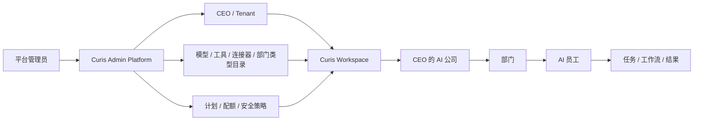

## 2. Admin Platform Creates CEO Tenant

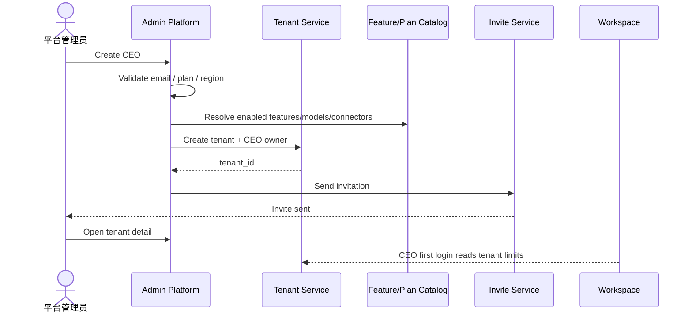

Create CEO fields:

- CEO name
- Email
- Phone
- Company name
- Region
- Plan
- Token quota
- Task quota
- Enabled department types
- Enabled connector set
- Enabled model group
- Billing owner
- Invite mode
- Risk level
- Notes

## 3. Admin Adds Model Provider and Models

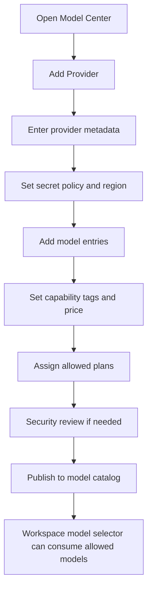

Provider fields:

- Provider name
- Provider key
- Base URL
- Auth mode
- Secret reference
- Data region
- Compliance tag
- Key rotation interval
- Status
- Default rate limit

Model fields:

- Provider
- Model id
- Display name
- Capability tags
- Context length
- Input token price
- Output token price
- Rate limit
- Tool-use support
- Vision/audio/video support
- Allowed plans
- Fallback rank

## 4. Admin Adds Tool

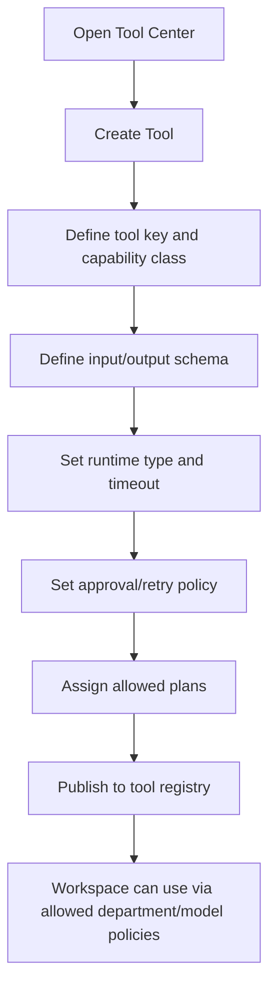

Tool fields:

- Tool key
- Display name
- Capability class
- Runtime type
- Input schema
- Output schema
- Approval requirement
- Retry policy
- Timeout
- Allowed plans
- Security notes

## 5. Admin Adds External Business Platform Connector

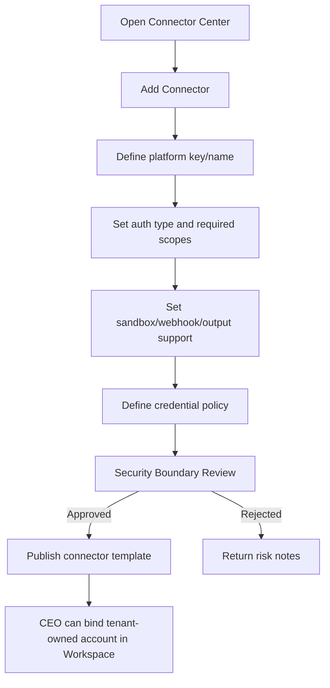

Connector fields:

- Platform key
- Platform name
- Auth type
- Required scopes
- Sandbox support
- Webhook callback
- Supported output types
- Publishing approval requirement
- Credential policy
- Compliance notes
- Allowed plans

## 6. Admin Maintains Department Type Catalog

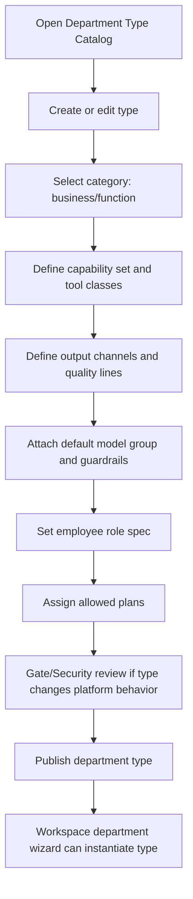

Department type fields:

- Type key
- Category
- Display name
- Description
- Capability set
- Tool classes
- Output channels
- Quality lines
- Default model group
- ROI schema placeholder
- Guardrail references
- Employee role spec
- Allowed plans

## 7. CEO First-Time Company Setup

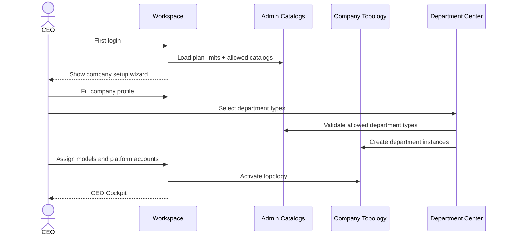

Company setup steps:

1. Company profile.
2. Business scope.
3. Department selection.
4. Model assignment.
5. Platform account binding.
6. Employee setup.
7. Approval policy.
8. Activation checklist.

## 8. CEO Creates Department

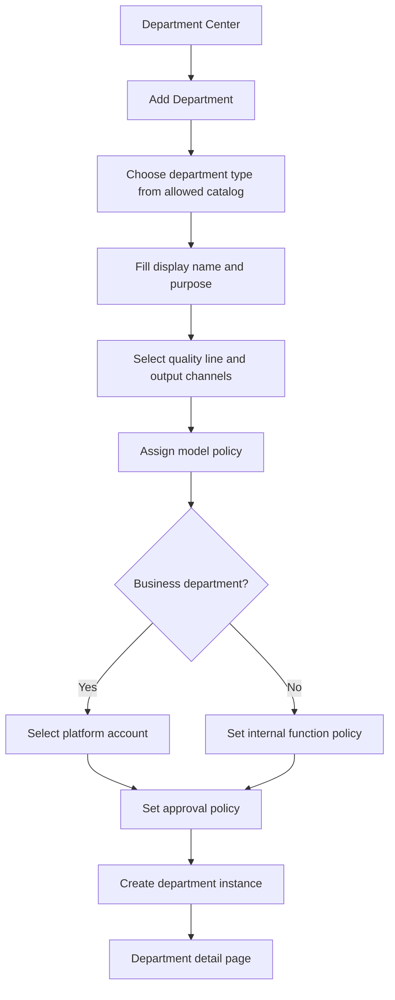

Department instance fields:

- Department type
- Display name
- Purpose
- Business scope
- Owner
- Quality line
- Output channels
- Allowed tools
- Primary model
- Fallback model
- Platform account
- Approval policy
- Cost limit
- Status

## 9. CEO Creates AI Employee

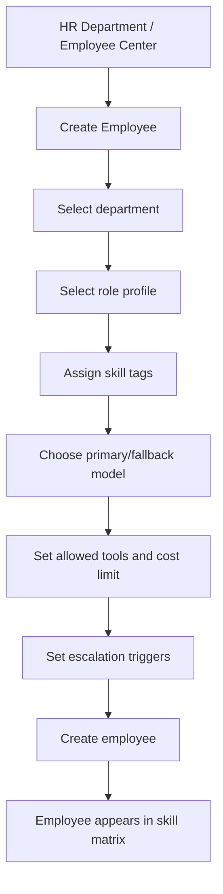

Employee fields:

- Employee name
- Department
- Role profile
- Skill tags
- Primary model
- Fallback model
- Allowed tools
- Cost limit
- Work schedule
- Escalation triggers
- Output style
- Status

## 10. CEO Connects a Platform Account

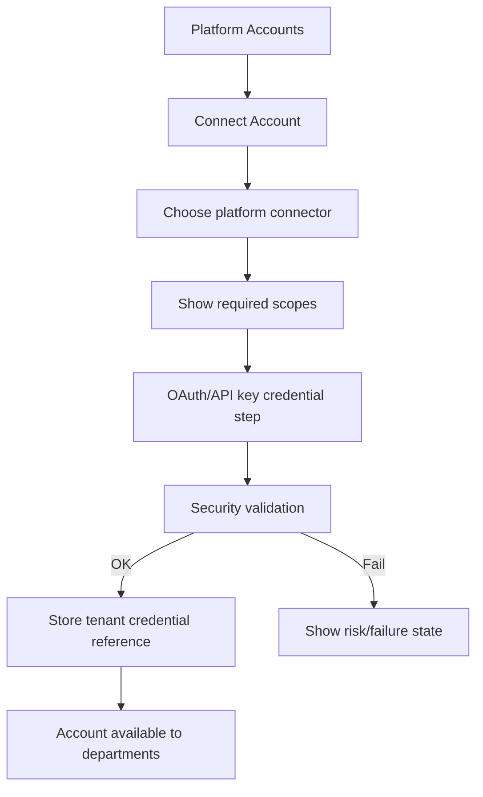

Workspace stores tenant-specific credential references. Admin Platform owns connector definitions and credential policy.

## 11. CEO Runs a Task

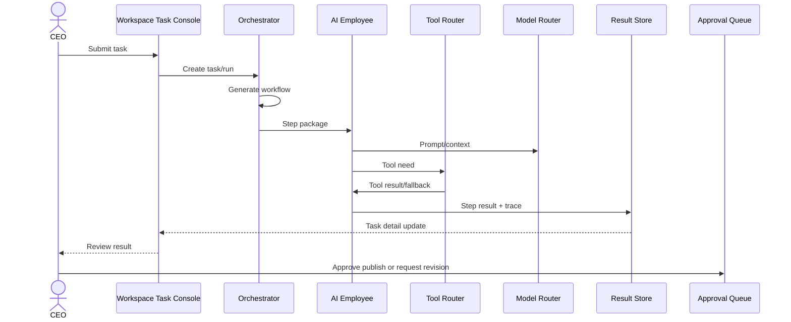

## 12. Admin vs Workspace Decision Matrix

| Decision | Admin Platform | Workspace |
| --- | --- | --- |
| Which models exist on platform | Owns | Reads allowed subset |
| Which model a department uses | Defines allowed list | CEO chooses |
| Which external connectors exist | Owns | CEO binds tenant account |
| Which departments types exist | Owns | CEO instantiates department |
| Which departments are active in a company | Can limit by plan | CEO chooses |
| Employee creation | Sets plan/limits | CEO creates employees |
| Task execution | Observes aggregate only | Owns execution |
| Tenant-specific business content | No access by default | Owns |
| Cross-tenant risk policy | Owns | Must comply |
| Company ROI decisions | Defines metrics availability | CEO uses results |

## 13. End-State Flow

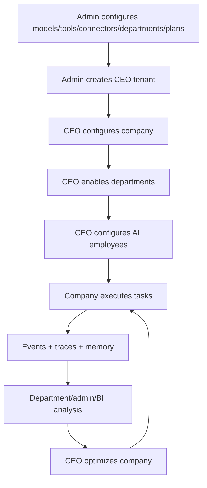
