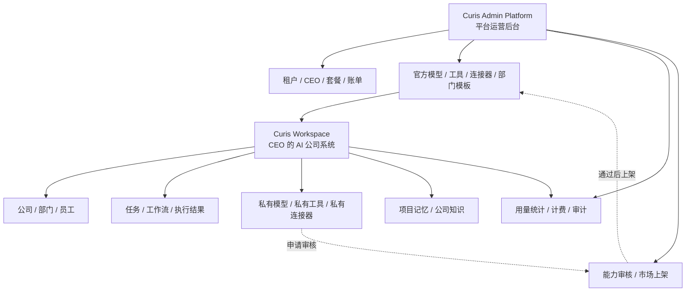

# Curis 商业化多租户产品变更说明

日期: 2026-07-08

## 1. 背景

Curis 当前已经完成 AI Task Executor MVP 的基础执行能力、任务操作台、项目记忆、角色上下文和本地/demo 发布候选验证。

现在产品方向发生升级: Curis 不再只是单一 Workspace 产品，而是面向商业化多租户的 AI 公司系统。

未来产品需要拆成两套并行产品:

- Curis Admin Platform: 平台方使用的统一管理后台。
- Curis Workspace: CEO 使用的 AI 公司操作系统。

这次变化的核心不是推翻当前 AI Task Executor MVP，而是把它放进未来 Workspace 的执行底座中，继续作为 AI 公司系统的 L1 执行层基础。

## 2. 核心产品变化

旧理解:

- Curis Workspace 是一个面向单个 CEO 的 AI 公司操作系统。
- 当前阶段先做 AI Task Executor，再逐步扩展到部门、员工、工作流、工具和 ROI。

新理解:

- Curis 是商业化多租户 AI 公司系统。
- 平台方需要 Admin Platform 管理租户、用量、计费、官方能力供给和平台治理。
- CEO 使用 Workspace 创建和运营自己的 AI 公司。
- Admin Platform 提供官方能力，但不是 Workspace 的能力上限。
- Workspace 允许 CEO 在自己的租户内自拓展模型、工具、连接器、部门和业务流程。

## 3. 两套产品定位

### 3.1 Curis Admin Platform

Admin Platform 是平台运营后台，主要负责:

- CEO / 用户 / 租户管理。
- 套餐、订阅、用量、账单和计费规则。
- 各租户模型、工具、连接器、任务执行等使用量统计。
- 官方模型目录。
- 官方工具目录。
- 官方连接器目录。
- 官方部门模板和能力包。
- 平台级安全策略、审计、权限和风控。
- 后续能力市场、能力审核、官方推荐能力包。

Admin Platform 不负责:

- 不替 CEO 决定公司业务怎么运转。
- 不限制 CEO 只能使用官方能力。
- 不直接管理 CEO 公司内部的部门、员工和任务细节。
- 不强制所有业务平台都由平台方统一接入。

### 3.2 Curis Workspace

Workspace 是 CEO 的 AI 公司操作系统，主要负责:

- CEO 创建和运营自己的 AI 公司。
- 配置公司、部门、员工、职责和工作流。
- 使用 Admin Platform 提供的官方能力。
- 自行添加私有模型、私有工具、私有连接器和私有部门模板。
- 执行业务任务、查看执行结果、优化工作流。
- 管理公司内部知识、项目记忆、任务历史和执行记录。

Workspace 的关键原则:

- CEO 可以直接使用官方能力，降低接入成本。
- CEO 也可以在租户内自拓展能力，满足个性化业务。
- 租户私有能力默认只在本公司可见。
- 所有执行、调用和消耗都需要产生用量事件，回传 Admin Platform 进行统计和计费。

## 4. 能力来源模型

未来系统里的模型、工具、连接器、部门模板和工作流模板，都需要带能力来源。

| 来源 | 含义 | 管理方 | 典型场景 |
| --- | --- | --- | --- |
| official | 平台官方提供的标准能力 | Admin Platform | 官方模型、官方工具、官方连接器、标准部门模板 |
| tenant_private | CEO 自己创建，仅本租户使用 | Workspace | 私有模型、私有工具、自接业务平台、自定义部门 |
| marketplace | 租户提交审核后共享的能力 | Admin Platform 审核，Workspace 使用 | 第三方能力包、行业模板、可复用业务连接器 |

这个模型解决的核心问题:

- 平台可以持续提供越来越多的标准能力。
- CEO 不会被官方能力范围卡住。
- 私有能力可以先在租户内使用，成熟后再申请进入 marketplace。
- 所有能力都能被统一计量、审计和治理。

## 5. 产品关系图



## 6. 分层关系

Curis 最终产品仍然遵循原有 L0-L6 全局架构，不改变编号约定。

```text
L6 经济层: ROI / 成本 / 优化
L5 公司层: 组织 / 部门 / 职责
L4 工作流层: 任务拆解 / 编排 / 状态流转
L3 工具层: 工具注册 / 路由 / 执行 / fallback
L2 员工层: AI执行角色 / 员工能力 / 角色偏好
L1 执行层: Task / Run / Status / History / Result
L0 产品层: 用户界面 / 操作台 / 可视化
```

当前 AI Task Executor MVP 主要覆盖:

- L0: 基础操作台和可视化。
- L1: Task / Run / Status / History / Result。
- L2: 最小角色上下文和执行协调。
- L3-L4: 已批准范围内的工具、工作流和执行闭环。

未来 Admin Platform 是商业化运营侧，不改变 Workspace 的 L0-L6 业务架构，而是为多租户、计费、官方能力供给、安全审计和平台治理提供横向支撑。

## 7. 开发策略

Admin Platform 和 Workspace 可以同步开发，但必须先定义共享契约。

第一步不是直接做复杂页面，而是先定清楚这些协议:

- Tenant / CEO / Company。
- Capability Source: official / tenant_private / marketplace。
- Model Provider / Model Instance。
- Tool Definition / Tool Instance。
- Connector Definition / Connector Instance。
- Department Template / Department Instance。
- Usage Event / Billing Event / Audit Event。

共享契约稳定后，两端才能并行开发:

- Admin Platform 负责租户、计费、官方能力目录和平台治理。
- Workspace 负责公司创建、部门员工配置、任务执行和租户私有能力。

## 8. 建议开发阶段

### Phase 1: 共享基础契约

目标:

- 定义租户模型。
- 定义能力来源模型。
- 定义官方能力与私有能力边界。
- 定义用量事件、计费事件和审计事件。
- 定义 Admin Platform 与 Workspace 的同步关系。

交付物:

- 多租户基础数据契约。
- 能力来源数据契约。
- 用量与计费事件契约。
- Admin / Workspace 边界说明。

### Phase 2: Admin Platform MVP

目标:

- 平台方可以管理 CEO 和租户。
- 平台方可以查看租户用量。
- 平台方可以维护官方模型、工具、连接器和部门模板。
- 平台方可以看到基础审计日志。

首版功能:

- CEO / 租户列表。
- 租户详情。
- 套餐与用量概览。
- 官方模型目录。
- 官方工具目录。
- 官方连接器目录。
- 官方部门模板目录。
- 基础审计日志。

### Phase 3: Workspace Self-Extension MVP

目标:

- CEO 可以选择官方能力。
- CEO 可以创建租户私有能力。
- CEO 可以用官方能力和私有能力组成自己的 AI 公司。
- 所有执行产生用量事件，供 Admin Platform 统计和计费。

首版功能:

- 选择官方模型、工具、连接器和部门模板。
- 添加私有模型。
- 添加私有工具。
- 添加私有连接器。
- 创建自定义部门。
- 绑定部门可用模型和工具。
- 执行任务并产生用量事件。

### Phase 4: 能力市场

目标:

- 租户私有能力可以申请上架。
- Admin Platform 审核后进入 marketplace。
- 其他 CEO 可以安装 marketplace 能力。
- 平台形成标准能力 + 私有能力 + 共享能力的生态供给。

首版功能:

- 能力提交审核。
- 能力审核列表。
- 能力上架状态。
- Marketplace 安装。
- 使用量和收益统计。

## 9. 决策边界

### Admin Platform 应该做

- 平台运营。
- 用户与租户管理。
- 计费与用量统计。
- 官方能力供给。
- 安全、审计和治理。
- 能力市场审核。

### Admin Platform 不应该做

- 不接管 CEO 公司内部运营。
- 不强行限定 CEO 业务边界。
- 不替 CEO 设计全部部门和员工。
- 不把官方能力做成唯一能力入口。

### Workspace 应该做

- 公司内部运营。
- 部门、员工、职责、任务和工作流。
- 官方能力安装与使用。
- 租户私有能力创建与管理。
- 公司知识、项目记忆和执行结果管理。

### Workspace 不应该做

- 不管理平台级账单规则。
- 不管理其他租户。
- 不修改官方能力定义。
- 不绕过平台用量统计。

## 10. 对当前项目的影响

当前 AI Task Executor MVP 不需要推翻。

它应该继续作为未来 Workspace 的执行基础:

- 当前任务系统对应 L1 执行层。
- 当前操作台对应 L0 产品层的第一版。
- 当前角色上下文为未来 L2 员工层预留基础。
- 当前 Project Memory 为未来公司知识和项目记忆预留基础。
- 当前执行记录和任务历史为未来用量统计、审计和优化预留基础。

需要新增的不是重做执行器，而是补齐商业化多租户架构:

- 租户模型。
- 能力来源模型。
- Admin Platform 产品结构。
- Workspace 自拓展中心。
- 用量计费事件。
- 官方能力与私有能力边界。

## 11. 给接手团队的执行建议

优先级顺序:

1. 先确认共享基础契约。
2. 再拆 Admin Platform MVP 和 Workspace Self-Extension MVP。
3. 两端并行开发，但不得绕过共享契约。
4. 当前 AI Task Executor MVP 继续保留，不要重构成完整 AI 公司系统。
5. 新增能力必须标注来源、归属、权限、用量和审计。
6. 多租户、外部平台、密钥、计费相关工作必须经过安全边界评审。

建议下一步 issue:

- 定义 Capability Source Contract。
- 定义 Tenant / Company / CEO Contract。
- 定义 Usage Event / Billing Event Contract。
- 定义 Admin Platform MVP PRD。
- 定义 Workspace Self-Extension MVP PRD。
- 更新高保真原型中的 Admin Platform 与 Workspace 自拓展页面。

## 12. 结论

新产品逻辑比之前更适合商业化。

Curis Admin Platform 负责平台运营、租户、计费、官方能力供给和治理。

Curis Workspace 负责 CEO 自己的 AI 公司搭建、任务执行、部门员工配置和租户私有能力扩展。

两套产品可以并行开发，但前提是先完成共享契约设计，尤其是租户、能力来源、用量计费和权限审计模型。这样既能保持平台商业化管理能力，又不会限制 CEO 在 Workspace 内进行业务自拓展。
